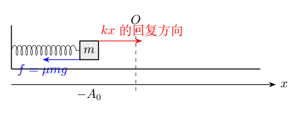
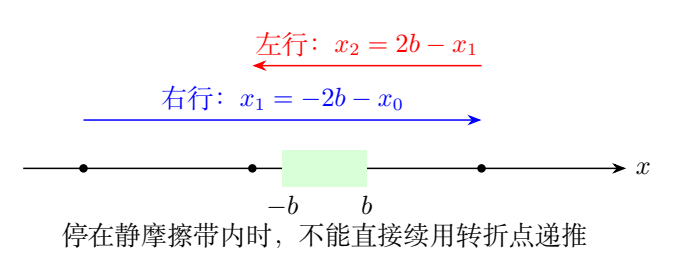
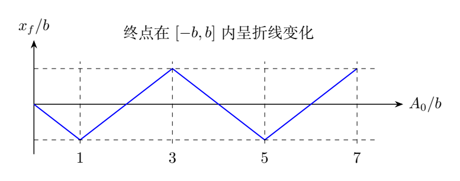

# 第 2 题 干摩擦弹簧振子的有限次往返（40分）

轻弹簧左端固定，右端连接质量为 $m$ 的小球，劲度系数为 $k$。弹簧水平，自然长度位置为坐标原点 $O$。小球在水平地面上滑动，动摩擦因数为 $\mu$，重力加速度为 $g$；最大静摩擦力等于滑动摩擦力。初始速度为零，初始伸长为 $-A_0$，其中 $A_0>0$，但 $A_0$ 不是已知量。

（1）如果小球至多只能向右运动，求最终静止位置，以及 $A_0$ 应满足的条件。

（2）如果小球完成第一次向右运动至原点右边后，至多只能向左运动，求最终静止位置，以及 $A_0$ 应满足的条件。

（3）如果小球只能完成 $n$ 次往返运动，求最终静止位置，以及 $A_0$ 应满足的条件。向右经过原点，然后向左经过原点，算一次往返。

（4）如果小球只能完成 $n$ 次往返运动，求从开始运动至最终静止的总路程。

## 一、题型定位

本题应按摩擦方向分段求解，并在每个转折点判断小球能否继续运动；振幅不按指数规律衰减。滑动时摩擦力大小固定、方向随速度反向；静止时摩擦力自动调整，只有超过最大静摩擦力才能重新启动。

题目对一次往返的定义特别重要：必须向右、向左都经过原点。发生一次速度反向不必然等于完成半次往返；最后一段运动还可能完全位于原点同一侧。

## 二、知识点

记

$$
f=\mu mg,\qquad b=\frac fk,\qquad
\omega=\sqrt{\frac km}.
$$

$b$ 是静摩擦能平衡弹簧力的最大位移。因此速度为零时，

$$
|x|\le b\quad\Longrightarrow\quad\text{可以保持静止}.
$$

若 $|x|>b$，小球必然向原点方向重新启动。等号处能够静止，题给初始静止状态不应凭空启动。

滑动时的方程分别为

$$
\ddot x+\omega^2(x+b)=0\quad(\dot x>0),
$$

$$
\ddot x+\omega^2(x-b)=0\quad(\dot x<0).
$$

所以每一单向滑动段都相当于围绕一个偏移平衡位置作半个简谐周期；右行的中心在 $-b$，左行的中心在 $b$。

## 三、物理图像

图中的绿色区间 $[-b,b]$ 是停止带。小球到达速度为零的位置后，先看是否落入这一区间，再决定能否进入下一段。不能为了保持递推形式而人为添加已经不存在的运动段。

若从很大的负位移释放，第一次右端转折点大约比初始振幅小 $2b$；再回到左端，振幅又小 $2b$。每个真正的完整往返降低幅度 $4b$。

最终位置并不总在左边，也不总等于零。图中的折线说明：连续改变初始压缩量，最后一段可能右行或左行，终点在停止带内来回移动。这种终点结构来自静摩擦，不是最后一次振幅必须恰好耗尽。

## 四、解题入口

第一步只研究“从某个静止端点出发，到下一次速度为零”的单段映射。第二步把每个端点与 $b$ 比较。第三步根据题目对往返的定义，用过零次数而非转向次数计数。

求总路程可直接计算整个过程的能量耗散。由于每一段摩擦耗散均为 $f$ 乘路程，得到终点后即可求总路程，无须把很多段距离逐个相加。

以下默认 $\mu>0$。若 $\mu=0$，停止带缩成一个点，小球无耗散地振动，题目所说最终停止的情形不成立，不能把含 $1/\mu$ 的公式直接代入。

## 五、解析

### 1. 单段运动及端点映射

从 $x_i<-b$ 静止启动向右，解动力学方程得

$$
x(t)=-b+(x_i+b)\cos\omega t.
$$

第一次再次速度为零发生在 $\omega t=\pi$，此时

$$
x_{i+1}=-2b-x_i.
$$

特别地，从 $x_0=-A_0$ 出发，

$$
x_1=A_0-2b.
$$

也可由动能定理独立推导：

$$
\frac k2(A_0^2-x_1^2)=f(A_0+x_1).
$$

消去非零路程因子 $A_0+x_1$，同样得到 $x_1=A_0-2b$。只有 $A_0>b$ 时小球才会滑动，故不能把这个映射用于 $A_0\le b$ 的初始静止状态。

从 $x_i>b$ 静止启动向左时，同理

$$
x(t)=b+(x_i-b)\cos\omega t,\qquad
x_{i+1}=2b-x_i.
$$

两条映射的常数项符号相反，反映摩擦力方向的改变。

### 2. 第一问：至多向右运动

若 $0<A_0\le b$，弹簧力没有超过最大静摩擦力，小球完全不动：

$$
\boxed{x_f=-A_0,\quad 0<A_0\le b}.
$$

若 $A_0>b$，第一段右行的终点为 $x_1=A_0-2b$。要在那里停住，必须 $|x_1|\le b$，即

$$
b<A_0\le3b.
$$

因此另一个分支为

$$
\boxed{x_f=A_0-2b,\quad b<A_0\le3b}.
$$

在 $b<A_0\le2b$ 时，小球最终停在原点左侧或原点；在 $2b<A_0\le3b$ 时，它向右过原点后停在右侧。只有 $A_0>3b$，才有足够的回复力开始向左运动。

### 3. 第二问：第一段过零后至多左行

把第一段确实向右经过原点写成 $A_0>2b$。若 $2b<A_0\le3b$，到右端后直接静止，这已包含在第一问。题目使用“至多”，从字面上说该重叠分支也符合第二问。

参考解答主要讨论第一段之后确实开始向左的新增情形：$A_0>3b$。左行终点为

$$
x_2=2b-x_1=4b-A_0.
$$

要求左行后不再右行，即 $|x_2|\le b$，得到

$$
\boxed{x_f=4b-A_0,\quad3b<A_0\le5b}.
$$

其中 $3b<A_0<4b$ 时，左行到原点右边便停住，未完成题定义的一次往返；$A_0=4b$ 时恰好停在原点，也没有向左经过原点。只有 $4b<A_0\le5b$ 才完成了一次往返。

明确这一区别之后，后面的计数就不容易在 $A_0=4nb$ 处错一个单位。

### 4. 多段递推与往返次数

只要各中间端点仍能启动，端点公式可统一写成

$$
x_j=(-1)^{j+1}(A_0-2jb),\qquad j=0,1,2,\ldots.
$$

这里 $j=0$ 也正确给出 $x_0=-A_0$。对于前面真实存在的往返，偶数端点在左侧，奇数端点在右侧。

完成第 $n$ 次向左过原点，需要

$$
x_{2n}=4nb-A_0<0
\quad\Longrightarrow\quad A_0>4nb.
$$

不能完成第 $n+1$ 次往返，需要

$$
A_0\le4(n+1)b.
$$

因此对 $n\ge1$，恰好完成 $n$ 次往返的总范围是

$$
\boxed{4nb<A_0\le4(n+1)b}.
$$

左端严格，是因为“停在原点”不等于“经过原点”。右端包含，是因为下一次向左运动恰好到原点便停。

### 5. 第三问的终点分段

在上述总范围内，有三种停止方式。若

$$
4nb<A_0\le(4n+1)b,
$$

小球在完成第 $n$ 次往返的左端直接停住：

$$
\boxed{x_f=4nb-A_0}.
$$

若

$$
(4n+1)b<A_0\le(4n+3)b,
$$

它又开始右行，然后停住，终点为

$$
\boxed{x_f=A_0-(4n+2)b}.
$$

这个区间可在 $(4n+2)b$ 处分成两段：前半终点在左侧，后半在右侧，但表达式相同，可以合并书写。

若

$$
(4n+3)b<A_0\le(4n+4)b,
$$

它再开始左行，却不能向左经过原点，终点为

$$
\boxed{x_f=(4n+4)b-A_0}.
$$

三个分支在连接处连续，且均满足 $|x_f|\le b$。参考解答把中间区间拆为两个符号分支；合并并不删去任何运动情形。

### 6. 第四问：总路程

初态和末态动能都为零，弹簧弹性势能的减少全部变成摩擦耗散：

$$
\frac{kA_0^2}{2}-\frac{kx_f^2}{2}=fs.
$$

所以统一表达式是

$$
\boxed{s=\frac{A_0^2-x_f^2}{2b}}.
$$

代入第三问的三段终点，

$$
s=
\begin{cases}
4n(A_0-2nb),&
4nb<A_0\le(4n+1)b,\\
(4n+2)\bigl[A_0-(2n+1)b\bigr],&
(4n+1)b<A_0\le(4n+3)b,\\
(4n+4)\bigl[A_0-(2n+2)b\bigr],&
(4n+3)b<A_0\le(4n+4)b.
\end{cases}
$$

中间一段也可写成 $2(2n+1)[A_0-(2n+1)b]$。每一式括号内都有长度量纲，前面的数值因子无量纲。

### 7. 任意初始压缩量的简明算法

如果不预先给出 $n$，可先计算实际单向滑动段数

$$
N_s=\max\left\{0,\left\lceil\frac{A_0/b-1}{2}\right\rceil\right\}.
$$

那么

$$
x_f=(-1)^{N_s+1}(A_0-2N_sb).
$$

取整符号必须是向上取整。在恰好到达停止带边界的参数点，上一段已经停止，所以不能再加一段。该公式给出的最后端点不一定与前面端点同样交替过零。

往返次数为

$$
n_{\rm round}=\max\left\{0,\left\lceil\frac{A_0}{4b}\right\rceil-1\right\}.
$$

例如 $A_0=4b$ 时，虽然向右和向左都运动过，但左行恰好停在原点，故 $n_{\rm round}=0$；稍增至 $4b+\epsilon$ 就完成一次往返。

### 8. 时间及整体一致性

每个实际滑动段都持续 $\pi/\omega$，最后一段也是如此；停止并非滑到静摩擦带边界瞬间发生，而是在带内某处速度真正变为零时发生。因此

$$
T_{\rm stop}=N_s\frac\pi\omega.
$$

如果以“进入 $[-b,b]$”为事件直接终止数值积分，会过早停止。该区间只给出速度为零后的静止条件，不能对运动中的小球直接使用。

把分段路程相加应与整体能量式一致。终点折线在连接处连续，总路程也连续；停止时间却可能发生一个半周期的跳变，因为临界参数两侧真实滑动段数不同。

### 9. 过零速度与单段速度峰

从 $-A_0$ 开始右行，若能到原点，所消耗摩擦功为 $fA_0$。原点处的动能是

$$
\frac12mv_O^2=\frac12kA_0^2-fA_0,
$$

故

$$
v_O^2=\omega^2A_0(A_0-2b).
$$

这独立给出第一次真正过零的条件 $A_0>2b$。若等号，速度在原点恰好变零，只能说到达原点。若右侧为负，说明运动根本到不了原点，不能把它理解成虚数速度的物理运动。

右行过程中加速度为 $-\omega^2(x+b)$，所以速度峰出现在 $x=-b$，而非 $x=0$：

$$
v_{\max}=\omega(A_0-b).
$$

这是每段简谐中心偏移的另一种表现。对多段运动，只需用该段起点的位移重新列能量式，不能把第一段的 $A_0$ 原封不动用于所有过零速度。

全程耗散占初始弹性能的比例为

$$
\eta_{\rm heat}=1-\frac{x_f^2}{A_0^2}.
$$

因为 $|x_f|\le b$，大幅度释放时几乎全部初始能量变为热，但最后仍可留下不为零的弹性能和位移。能量“几乎耗尽”并不等于终点“恰在原点”。

## 六、关键洞察

静摩擦带不是一个吸收所有经过粒子的空间区间，它是速度为零时可以保持平衡的区间。运动中的小球即使经过 $x=0$，仍会由于惯性继续运动。

解答中需要分别计数：单向段数决定停止时间，成对的过零次数决定题目所说往返数。二者不能互换。逐次列出端点位置，便可分别统计滑动段数和过零次数。

## 七、易错点

常见错误是漏掉 $A_0\le b$ 的初始静止分支，把每一段摩擦力都写成 $-f$，或把单向段中的平衡位置错写为原点。

第三问若把 $A_0=4nb$ 并入第 $n$ 次往返，会把“到达”误认为“经过”。总路程不能用 $A_0+x_f$，除非全程只有向右一段。

在端点已落入停止带后继续递推，会出现数学上新端点而没有实际运动。静摩擦条件必须先于下一段方程使用。

## 八、课堂讲解建议

先用 $A_0/b=0.8,2.5,3.5,4,4.5,6.5$ 六个值画端点表，要求学生同时标出左右行、是否过零、是否能再次启动。随后归纳通式，能让取整边界来自具体运动。

总路程部分先让学生尝试逐段相加，再用整体耗散校验。数值演示应以速度变零为事件，事件发生后检查静摩擦条件；不能把摩擦符号在零速度处机械切换。

### 板书追问：在相图中怎样停止

右行时相轨迹围绕 $(-b,0)$，左行时围绕 $(b,0)$：

$$
\dot x^2+\omega^2(x+b)^2=\text{常量}\quad(\dot x>0),
$$

$$
\dot x^2+\omega^2(x-b)^2=\text{常量}\quad(\dot x<0).
$$

每个滑动段在相图中走一个半椭圆，下一段换中心。停止带只位于 $\dot x=0$ 上的 $-b\le x\le b$ 线段，不是整个竖直条带。

让学生用这个相图解释：为何进入原点附近仍能继续运动，为什么最后一段也用半周期，为什么不能把小球当作在 $x=0$ 撞上一个阻尼器。

再把 $A_0=3b$ 与 $A_0=3b+\epsilon$ 对照。前者第一段终点为 $b$，可静止；后者到 $b+\epsilon$ 后必须启动左行，虽然新增段路程趋于零，持续时间仍趋于一个半周期。这说明停止时间可跳变，但总路程和终点可连续。

学生若把时间也要求连续，应要求其在相图上检查运动频率与振幅的关系，而不是仅凭“小扰动导致小变化”的直觉判断。

## 九、变式训练

### 变式1：给定无量纲压缩量

取 $A_0=10.5b$，求终点、往返数、总路程和停止时间。

**解：** $N_s=\lceil9.5/2\rceil=5$，故 $x_f=0.5b$。往返数为 $\lceil10.5/4\rceil-1=2$。能量式给出

$$
s=\frac{(10.5b)^2-(.5b)^2}{2b}=55b,
\qquad T_{\rm stop}=\frac{5\pi}{\omega}.
$$

实际端点依次为 $-10.5b,8.5b,-6.5b,4.5b,-2.5b,.5b$；最后一次右行过零不构成第三次完整往返。

### 变式2：停止在原点

求所有能从 $-A_0$ 静止释放、最终停在原点的非零初始压缩量。

**解：** 终点公式要求 $A_0=2N_sb$。对任意正整数 $j$，取 $A_0=2jb$，则

$$
N_s=\lceil j-\tfrac12\rceil=j,\qquad x_f=0.
$$

所以全部解为 $A_0=2jb$，总路程 $s=2j^2b$。初态在停止带内的 $0<A_0\le b$ 不会到达原点。

### 变式3：静摩擦大于滑动摩擦

最大静摩擦力为 $f_s=1.5f$，滑动摩擦仍为 $f$，从 $A_0=6b$ 静止释放，求终点。

**解：** 启动阈值变为 $b_s=f_s/k=1.5b$，单段映射仍含 $2b$。端点依次是

$$
-6b\ \longrightarrow\ 4b\ \longrightarrow\ -2b\
\longrightarrow\ 0.
$$

前两个转折点的弹簧力大于 $f_s$，仍可启动；第三个端点可静止。总路程为 $36b^2/(2b)=18b$。不能把所有映射中的 $b$ 都替换为 $b_s$。

### 变式4：从原点给一个向右初速度

从 $x=0$ 以速度 $u>0$ 开始右行，求第一个右端转折点，以及在那里直接停止的速度范围。

**解：** 第一段能量式为

$$
\frac{mu^2}{2}=\frac{kx_1^2}{2}+fx_1.
$$

取正根，

$$
x_1=-b+\sqrt{b^2+\frac{mu^2}{k}}.
$$

直接停止要求 $x_1\le b$，即

$$
u\le\sqrt{\frac{3kb^2}{m}}=\sqrt3\,\omega b.
$$

超过该范围便从右端重新向左运动。初始已有速度，所以没有“起始静摩擦能否启动”的限制。
