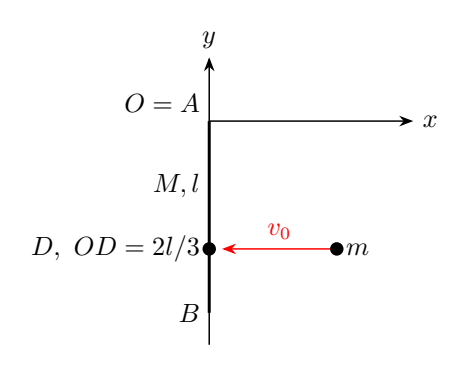
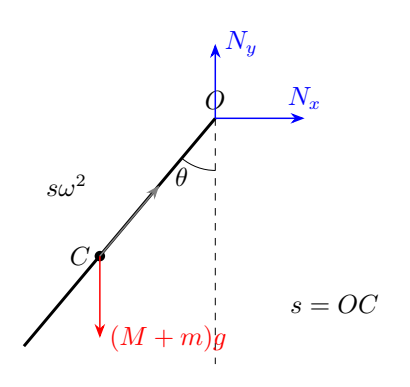
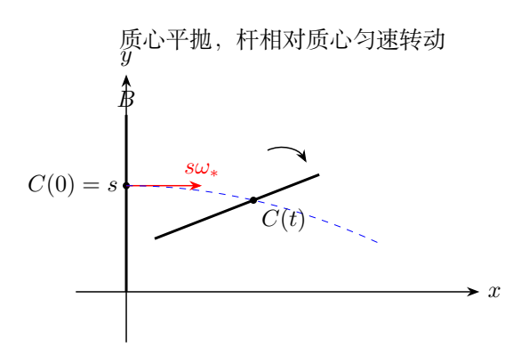

# 第 3 题 打击中心、转轴反力与撤轴后的刚体运动（40分）

质量为 $M$、长为 $l$ 的匀质细杆 $AB$ 自由悬挂于过原点 $O$ 的水平光滑转轴上。杆在竖直的 $xy$ 平面内转动，$x$ 轴水平向右、$y$ 轴竖直向上；初始上端 $A$ 与 $O$ 重合，杆竖直下垂。$O$ 距地面足够高。

质量为 $m$ 的弹丸以大小为 $v_0$ 的水平速度从右向左撞击杆的打击中心，并很快嵌入杆中。打击过程中转轴对杆的水平作用力为零。杆转半圈到竖直向上时立即撤除转轴。重力加速度为 $g$。

（1）求打击中心到 $O$ 的距离。

（2）撤轴前，求杆被撞后转过 $\theta$（$0\le\theta<\pi$）时转轴对杆的作用力。

（3）以撤轴瞬间为 $t=0$，求撤轴后、杆着地前杆端 $B$ 的 $x_B(t),y_B(t)$。

（4）求撤轴后杆再转半圈时，固定空间点 $O$ 与杆端 $B$ 的高度差。

## 一、题型定位

运动分为非弹性碰撞、绕固定轴转动和撤轴后的自由运动三个阶段。进入下一阶段时，应重新选定研究系统，检查约束和守恒条件。

打击中心使转轴不承受水平冲量，但不意味着随后转轴没有反力。碰撞结束后重力、向心加速度和切向加速度共同决定轴反力。

## 二、知识点

匀质杆对端点的转动惯量为 $I_{\rm rod}=Ml^2/3$。若水平冲量 $J$ 作用于距轴 $d$ 处，杆的角速度改变量满足

$$
I_{\rm rod}\Delta\omega=Jd.
$$

杆质心速度改变量大小是 $(l/2)\Delta\omega$。当转轴水平冲量为零，杆的质心动量改变必须完全由 $J$ 提供。

碰撞时通常只守恒相应的动量或角动量，不守恒机械能。碰撞后固定轴转动时，轴反力作用点不动、不做功，所以机械能守恒。撤轴后重力对组合质心的总力矩为零，组合体相对质心的角速度恒定。

## 三、物理图像

取 $\theta$ 为从竖直下垂方向开始的顺时针转角。弹丸向左撞击，使杆先向左摆，最终到达竖直向上位置。下述公式采用这一方向约定。

杆和嵌入的弹丸组成刚体。其组合质心不在杆中点，而在两者质量的一阶矩平均位置。求轴反力时必须对这一组合质心应用牛顿第二定律。

撤轴瞬间，上端 $B$ 向右运动，组合质心也向右运动。此后整个刚体的质心作平抛，杆相对质心作顺时针匀速转动。杆端轨迹是平抛和圆周运动叠加，不是一个简单抛物线。

## 四、解题入口

先用“杆的水平冲量”和“杆绕端点的角冲量”联立求打击中心。再对碰撞后的组合体计算质心距轴 $s$ 与转动惯量 $I_O$，统一使用这两个参数。

轴反力可以不先求展开的复杂表达式：写出质心位置，求两次导数，再乘总质量并加重力项。用 $\omega^2(\theta)$ 和 $\ddot\theta$ 表示的结果更易检查符号。

撤轴前后角速度连续，但转轴反力突然消失。撤轴后的旋转中心应选组合质心，而不能继续把原点 $O$ 当作转轴。

## 五、解析

### 1. 打击中心

设打击点距 $O$ 为 $d$。忽略碰撞过程中的重力冲量，对杆的角冲量方程给出

$$
\Delta\omega=\frac{Jd}{Ml^2/3}.
$$

杆质心向左的速度改变量为 $(l/2)\Delta\omega$。由于转轴没有水平冲量，

$$
J=M\frac l2\Delta\omega.
$$

消去 $J,\Delta\omega$，得

$$
\boxed{d=\frac{2l}{3}}.
$$

这里求的是碰撞前杆的打击中心，使用的是杆本身的质心和惯量。不能先加入弹丸质量再计算一个“新的打击中心”，因为题目的冲击条件针对原来的杆。

### 2. 碰撞后的参数与角速度

组合质量记为 $\mathcal M=M+m$，质心距轴为

$$
s=\frac{M(l/2)+m(2l/3)}{M+m}
=\frac{(3M+4m)l}{6(M+m)}.
$$

组合体对轴的惯量为

$$
I_O=\frac{Ml^2}{3}+m\left(\frac{2l}{3}\right)^2
=\frac{(3M+4m)l^2}{9}.
$$

碰撞期间，轴作用力对 $O$ 的力矩为零，故角动量守恒：

$$
mv_0\frac{2l}{3}=I_O\omega_0.
$$

因此

$$
\boxed{\omega_0=\frac{6mv_0}{(3M+4m)l}}.
$$

质心速度大小为 $s\omega_0=mv_0/(M+m)$，与无水平外冲量时的总水平动量守恒相符。两条计算路线相互一致。

### 3. 碰撞损失与随后能量守恒

碰撞后的转动动能为

$$
K_+=\frac12 I_O\omega_0^2
=\frac{2m^2v_0^2}{3M+4m}.
$$

与碰撞前弹丸动能比较，

$$
\frac{K_+}{K_-}=\frac{4m}{3M+4m}<1.
$$

损失为

$$
K_--K_+=\frac{3Mm v_0^2}{2(3M+4m)}.
$$

这一步明确非弹性嵌入不能使用机械能守恒。碰撞完成之后，轴不做功，才可在不同 $\theta$ 之间使用机械能守恒。

### 4. 固定轴阶段的角速度与角加速度

组合质心位置为

$$
x_C=-s\sin\theta,\qquad y_C=-s\cos\theta.
$$

从最低点升到角度 $\theta$，重力势能增加 $\mathcal Mgs(1-\cos\theta)$，所以

$$
\frac12I_O\omega_0^2
=\frac12I_O\omega^2+\mathcal Mgs(1-\cos\theta).
$$

由于 $2\mathcal M s/I_O=3/l$，

$$
\boxed{\omega^2(\theta)=\omega_0^2-
\frac{3g}{l}(1-\cos\theta)}.
$$

重力对轴产生反向力矩，故

$$
\boxed{\ddot\theta=-\frac{\mathcal Mgs}{I_O}\sin\theta
=-\frac{3g}{2l}\sin\theta}.
$$

这里 $\omega=\dot\theta>0$ 是顺时针转动的大小，而 $\ddot\theta$ 可为负。正负约定应贯穿位置、速度和力矩，不应只在最终结果前补一个符号。

### 5. 转轴反力

对质心坐标求导，

$$
\ddot x_C=s(\omega^2\sin\theta-\ddot\theta\cos\theta),
$$

$$
\ddot y_C=s(\omega^2\cos\theta+\ddot\theta\sin\theta).
$$

设轴对杆与弹丸整体的反力为 $\mathbf N=N_x\mathbf i+N_y\mathbf j$。牛顿第二定律给出

$$
N_x=\mathcal M\ddot x_C,\qquad
N_y-\mathcal Mg=\mathcal M\ddot y_C.
$$

于是

$$
\boxed{N_x=\mathcal Ms\left[
\omega^2+\frac{3g}{2l}\cos\theta\right]\sin\theta},
$$

$$
\boxed{N_y=\mathcal M\left[
g+s\omega^2\cos\theta-\frac{3gs}{2l}\sin^2\theta\right]}.
$$

其中 $\omega^2$ 使用上一节表达式。若题目要求大小和方向，可继续写

$$
N=\sqrt{N_x^2+N_y^2},
$$

并用两分量的符号确定象限。给出 $N_x,N_y$ 已完整确定矢量，且比反正切表达式更不易遗漏象限。

这里把“杆”理解为嵌入弹丸后的整体；嵌入处内力不作为额外外力加入。若单独对裸杆列方程，还需要弹丸对杆的未知接触力，计算会更繁琐。

### 6. 端点反力与到达顶部条件

在最低点 $\theta=0$，

$$
N_x=0,\qquad N_y=\mathcal M(g+s\omega_0^2).
$$

在顶部 $\theta=\pi$，

$$
\omega_*^2=\omega_0^2-\frac{6g}{l},
\qquad N_x=0,\quad N_y=\mathcal M(g-s\omega_*^2).
$$

光滑转轴可以向上或向下施力，不存在绳子的“拉力必须非负”限制。不能额外要求顶部 $N_y\ge0$。

题设要在有限时间转到顶部并撤轴，实际隐含

$$
\omega_*^2>0,\qquad
v_0>\frac{3M+4m}{6m}\sqrt{6gl}.
$$

若恰好等号，顶部速度为零，物体只在无限时间极限接近不稳定顶部。此时不能继续使用 $\pi/\omega_*$ 求再转半圈的时间。

### 7. 撤轴后为何角速度不变

撤轴后唯一外力是均匀重力。重力的合力通过组合质心，故对质心的力矩为零。其质心惯量为

$$
I_C=I_O-\mathcal Ms^2
=\frac{M(3M+4m)l^2}{36(M+m)}.
$$

因此 $I_C\omega$ 守恒，且 $I_C$ 固定，角速度就是 $\omega_*$。这不是说相对于原点 $O$ 的角动量仍守恒；均匀重力对固定点 $O$ 一般有非零力矩。

撤轴瞬间质心在 $(0,s)$，速度为 $(s\omega_*,0)$。故

$$
x_C(t)=s\omega_*t,\qquad
y_C(t)=s-\frac12gt^2.
$$

### 8. 杆端坐标与高度差

撤轴瞬间 $B$ 在质心上方，距离 $l-s$。顺时针转动后，相对质心坐标为

$$
x_{B/C}=(l-s)\sin\omega_*t,\qquad
y_{B/C}=(l-s)\cos\omega_*t.
$$

于是

$$
\boxed{x_B(t)=s\omega_*t+(l-s)\sin\omega_*t},
$$

$$
\boxed{y_B(t)=s-\frac12gt^2+(l-s)\cos\omega_*t}.
$$

在 $t=0$，两式给出 $x_B=0,y_B=l$；求导得到 $\dot x_B=l\omega_*,\dot y_B=0$，与撤轴前顶部端点速度连续。

再转半圈时 $t_\pi=\pi/\omega_*$，有

$$
y_B(t_\pi)=2s-l-\frac{g\pi^2}{2\omega_*^2}
=\frac{ml}{3(M+m)}-\frac{g\pi^2}{2\omega_*^2}.
$$

题目的 $O$ 是原坐标原点，撤轴后仍是固定空间参照点，故所求高度差为

$$
\boxed{\Delta H=
\left|\frac{ml}{3(M+m)}
-\frac{g\pi^2}{2\omega_*^2}\right|}.
$$

上式以“杆尚未着地”为适用条件；原点距地面足够高，应保证这一观察时刻仍可实现。若要求谁更高，则由绝对值内的符号判断。

### 9. 原杆端A不再等于固定点O

撤轴后原来的杆端 $A$ 已经运动，其坐标为

$$
x_A=s\omega_*t-s\sin\omega_*t,\qquad
y_A=s-\frac12gt^2-s\cos\omega_*t.
$$

在再转半圈时 $y_A-y_B=l$，这是杆竖直朝下时两端的几何高度差；它与固定点 $O$ 到 $B$ 的高度差不是同一个问题。

同时

$$
(x_B-x_A)^2+(y_B-y_A)^2=l^2,
$$

表明两端轨迹始终保持刚性杆长。这个恒等式和释放瞬间速度连续性，是检验撤轴后坐标最有效的两项检查。

### 10. 顶部临界运动的时间

为什么刚好能量够到顶部，仍不能在有限时间“到顶部并撤轴”？令 $\omega_0^2=6g/l$，角速度式化为

$$
\omega^2=\frac{3g}{l}(1+\cos\theta)
=\frac{6g}{l}\cos^2\frac\theta2.
$$

于是从最低点到角度 $\theta$ 的时间为

$$
t(\theta)=\sqrt{\frac l{6g}}
\int_0^\theta\frac{d\psi}{\cos(\psi/2)}.
$$

积分得

$$
t(\theta)=2\sqrt{\frac l{6g}}\,
\ln\left[\sec\frac\theta2+\tan\frac\theta2\right].
$$

当 $\theta\to\pi^-$，对数趋于无穷。顶部是一个不稳定平衡点，临界运动以越来越慢的速度靠近它。若 $\omega_0^2$ 略大于 $6g/l$，才以非零 $\omega_*$ 穿过顶部并进入自由飞行。

这也说明“势能最高点的能量阈值”与“有限时间穿过最高点”的区别。第四问使用 $\pi/\omega_*$，因此也要求检查这一隐含条件。

## 六、关键洞察

打击中心取消的是冲击时的轴水平冲量，不是所有时刻的轴反力。它使整体碰撞后的质心速度恰好符合无水平外冲量的动量关系。

撤轴后，原来的固定点约束解除，定轴转动方程不再适用。此时应将运动分解为质心平动和绕质心转动。

## 七、易错点

不能在嵌入碰撞中守恒机械能，不能把组合质心取为杆中点，也不能把轴反力直接等于向心力。切向加速度对反力的影响在一般 $\theta$ 处不能省略。

顶部释放后的正弦项符号要按弹丸向左、杆顺时针转动确定。题目第四问中 $O$ 仍为固定坐标原点；把它改称撤轴后移动的 $A$，会得到完全不同的常数答案 $l$。

## 八、课堂讲解建议

用三张图分别列出碰撞、固定轴、自由飞行阶段的外力。每换一图先回答“关于哪个点的角动量守恒”“哪个位置不动”“机械能能否守恒”，再开始代数。

反力部分保留 $s,I_O$ 到最后，避免展开质量比造成符号混乱。自由飞行部分先检验 $t=0$ 的位置和速度，再检验杆长，最后代入半圈时刻。

### 板书追问：撤轴是否瞬间改变动能

理想撤轴过程不额外施加冲量，所以各质点速度连续，刚体的瞬时动能不变。把固定轴动能重新分解，

$$
\frac12I_O\omega_*^2
=\frac12\mathcal M(s\omega_*)^2+\frac12I_C\omega_*^2.
$$

该等式由平行轴定理保证，不是又发生了一次能量损失。杆释放后有平抛和自转两个部分，但这不意味着新添了一份平动能。

追问学生撤轴后哪个角动量守恒。关于质心有 $L_C=I_C\omega_*$，均匀重力矩为零；关于固定 $O$，

$$
\frac{dL_O}{dt}
=-\mathcal Mg\,x_C(t),
$$

一般不为零。这里角动量采用通常的逆时针正方向，因此转动部分本身带负号；题目中的 $\omega_*$ 仍表示顺时针速度大小。

把上述力矩与 $x_C=s\omega_*t$ 联合，可以指出“撤轴后没有支点”并不等于“关于任何点角动量都守恒”。自由刚体分解要选质心，原因是外力矩性质，而不只是公式习惯。

## 九、变式训练

### 变式1：弹丸与杆等质量

取 $m=M$，求组合质心、碰撞角速度及顶部释放的条件。

**解：**

$$
s=\frac{7l}{12},\quad I_O=\frac79Ml^2,\quad
\omega_0=\frac{6v_0}{7l}.
$$

有限时间到顶部要求

$$
v_0>\frac76\sqrt{6gl}.
$$

碰撞保留动能比例为 $4/7$。这里总质量为 $2M$，不能仍用裸杆惯量计算碰撞后的角速度。

### 变式2：顶部轴竖直反力恰为零

求满足 $N_y(\pi)=0$ 的发射速度。

**解：** 由 $N_y(\pi)=\mathcal M(g-s\omega_*^2)$ 得 $\omega_*^2=g/s$。结合能量式，

$$
v_0=\frac{(3M+4m)l}{6m}
\sqrt{\frac{6g}{l}+\frac gs}.
$$

该速度高于仅能到顶部的阈值。反力为零只发生在该时刻，不表示整个转动过程没有轴作用。

### 变式3：任意角度撤轴

在角度 $\theta_r$、角速度 $\omega_r>0$ 处撤轴，求组合质心轨迹及杆端 $B$ 坐标。

**解：** 撤轴时

$$
(x_{C0},y_{C0})=(-s\sin\theta_r,-s\cos\theta_r),
$$

$$
(v_{Cx0},v_{Cy0})=(-s\omega_r\cos\theta_r,
s\omega_r\sin\theta_r).
$$

随后 $x_C=x_{C0}+v_{Cx0}t$，$y_C=y_{C0}+v_{Cy0}t-gt^2/2$，并且

$$
x_B=x_C-(l-s)\sin(\theta_r+\omega_rt),
$$

$$
y_B=y_C-(l-s)\cos(\theta_r+\omega_rt).
$$

取 $\theta_r=\pi$ 即恢复原题。重力虽改变质心速度，却不改变相对质心的角速度。

### 变式4：半圈后端点回到原点高度

求顶部释放后再转半圈时 $y_B=0$ 的条件。

**解：** 由 $2s-l=ml/[3(M+m)]$ 得

$$
\omega_*^2=\frac{3(M+m)g\pi^2}{2ml}.
$$

再由 $\omega_0^2=\omega_*^2+6g/l$ 求 $v_0$：

$$
v_0=\frac{(3M+4m)l}{6m}
\sqrt{\frac{6g}{l}+
\frac{3(M+m)g\pi^2}{2ml}}.
$$

此时 $B$ 与固定点 $O$ 等高，但水平位置为 $s\pi$，并没有回到 $O$。
