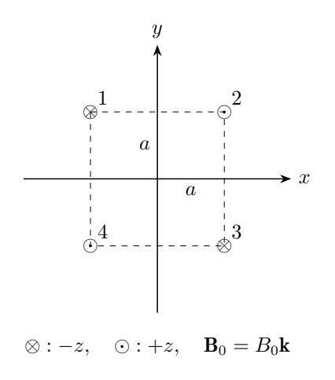
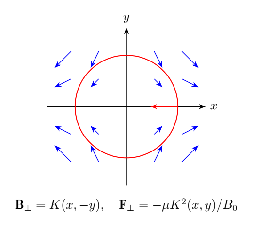
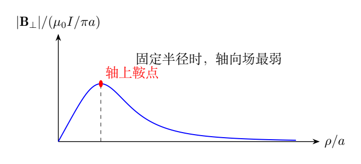

# 第 4 题 四导线磁阱的局部束缚与全局逃逸（40分）

Ioffe–Pritchard磁阱可用于束缚原子。四根无限长直导线均垂直于 $xy$ 平面，交点为中心在原点、边长 $2a$ 的正方形顶点。导线1、2分别位于 $(-a,a),(a,a)$，导线3、4分别位于 $(a,-a),(-a,-a)$。电流大小均为 $I$，方向如图：1、3向纸内，2、4向纸外。

整个装置处于沿 $+z$ 方向的均匀弱磁场 $\mathbf B_0=B_0\mathbf k$，$B_0>0$，真空磁导率为 $\mu_0$。

（1）求导线电流在导线外产生的总磁场空间分布。

（2）求该磁场在原点附近的线性近似。

（3）原子的磁作用束缚势能为 $V=\mu|\mathbf B_{\rm tot}|$，其中 $\mu>0$。求原点附近原子所受磁场作用力。

（4）原子最容易从 $xy$ 平面的什么位置逃出？求从原点出发、刚能逃出磁阱的最小动能。

## 一、题型定位

先用毕奥–萨伐尔定律叠加磁场，再分析势能与稳定性。前两问是场的精确求和与泰勒展开；第三问需要从磁场大小得到势能梯度；第四问必须回到全局场分布寻找最低势垒。

局部恢复力只能说明原点附近稳定，不能给出逃逸能量。把线性磁场近似延伸到无穷远，会错误地得到无限深磁阱。

## 二、知识点

位于 $(x_j,y_j)$ 的直导线，若电流沿 $+z$，则在导线外

$$
\mathbf B_j=\frac{\mu_0 I}{2\pi}
\frac{-(y-y_j)\mathbf i+(x-x_j)\mathbf j}
{(x-x_j)^2+(y-y_j)^2}.
$$

电流沿 $-z$ 时取负号。直导线无限长，因此场与 $z$ 无关，且导线场没有 $z$ 分量。外加均匀场与导线场垂直，所以

$$
|\mathbf B_{\rm tot}|=\sqrt{B_0^2+|\mathbf B_\perp|^2}.
$$

原子质量若为 $m_a$，小振动频率可由势能二阶项读出；但题目不需要已知 $m_a$ 才能求作用力。

## 三、物理图像

四根导线的磁场在原点相互抵消。近原点的横向场是一个四极场：沿 $x$ 轴指向外侧，沿 $y$ 轴指向内侧。磁场矢量的形状不是原子受力的形状；原子的势能取决于场的模。

外加 $B_0$ 使原点总场不为零，势能的尖点变成平滑的二次极小值。题给 $\mu>0$ 的原子倾向于低场区，故原点附近受到向中心的恢复力。

远处四根导线的电流代数和为零，导线场衰减，势能又趋向 $\mu B_0$。所以从原点向外，势能先升高、后降低，形成有限势垒，而不是永远增大。

## 四、解题入口

先把四根导线的坐标和电流符号列表，不要凭图形直接猜每个分量。线性项可用雅可比矩阵求，也可由场的有理表达式展开。

第三问先写 $\sqrt{B_0^2+B_\perp^2}$，再在 $B_\perp/B_0\ll1$ 下展开。第四问求轴上极值只是第一步，还要说明任意逃逸路径不可能绕过更低的势垒。

下面用复数表达式把固定半径上场强的角度依赖写清楚，这给出最容易逃逸路径的证明，不只依靠“由对称性看起来应该沿轴”。

## 五、解析

### 1. 精确空间分布

记

$$
C_I=\frac{\mu_0 I}{2\pi},\qquad
D_j=(x-x_j)^2+(y-y_j)^2,
$$

$$
(s_1,s_2,s_3,s_4)=(-1,+1,-1,+1).
$$

则导线总场为

$$
\boxed{\mathbf B_\perp=C_I\sum_{j=1}^4
s_j\frac{-(y-y_j)\mathbf i+(x-x_j)\mathbf j}{D_j}}.
$$

这就是导线外任意 $(x,y,z)$ 的精确空间分布，且 $\partial\mathbf B_\perp/\partial z=0$。若需要逐项分量，

$$
\frac{B_x}{C_I}
=\frac{y-a}{D_1}-\frac{y-a}{D_2}
+\frac{y+a}{D_3}-\frac{y+a}{D_4},
$$

$$
\frac{B_y}{C_I}
=-\frac{x+a}{D_1}+\frac{x-a}{D_2}
-\frac{x-a}{D_3}+\frac{x+a}{D_4}.
$$

导线位置处模型发散，公式只适用于导线外。外加场不属于导线电流产生的场，第一问不应把 $B_0$ 混入 $B_x,B_y$。

### 2. 紧凑的复数表达

令 $z_c=x+iy$，并定义

$$
\mathcal B=B_x-iB_y.
$$

单根导线场可写成 $-iC_Is_j/(z_c-z_j)$。对四根导线求和、通分后，

$$
\boxed{\mathcal B=
\frac{4\mu_0Ia^2}{\pi}
\frac{z_c}{z_c^4+4a^4}}.
$$

分母的四个零点正是四根导线所在的角点。近原点的分子正比于 $z_c$，远处则按 $z_c^{-3}$ 衰减。

这一式不能与 $B_x+iB_y$ 混用；虚部的负号是为了让直导线表达式成为 $1/(z_c-z_j)$ 的形式。改变复数定义后，近场方向也会相应改变。

### 3. 原点附近的线性场

当 $|x|,|y|\ll a$，

$$
\mathcal B\simeq\frac{\mu_0I}{\pi a^2}z_c.
$$

因此记

$$
K=\frac{\mu_0 I}{\pi a^2},
$$

便有

$$
\boxed{\mathbf B_\perp\simeq K(x\mathbf i-y\mathbf j)}.
$$

原点场为零，$x,y$ 两方向梯度符号相反。四重对称性使接下来的非线性修正从五次项开始：

$$
\mathcal B=Kz_c\left(1-\frac{z_c^4}{4a^4}+\cdots\right).
$$

线性场满足 $\nabla\cdot\mathbf B=K-K=0$；在无电流的中心区域也满足 $\nabla\times\mathbf B=0$。两项检查能发现电流方向或符号误写。

### 4. 势能展开与磁力

总场的模为

$$
|\mathbf B_{\rm tot}|\simeq
\sqrt{B_0^2+K^2(x^2+y^2)}.
$$

令 $\rho^2=x^2+y^2$。在 $K\rho\ll B_0$ 时，

$$
V\simeq\mu B_0+\frac{\mu K^2}{2B_0}\rho^2.
$$

所以

$$
\boxed{\mathbf F=-\nabla V
\simeq-\frac{\mu K^2}{B_0}(x\mathbf i+y\mathbf j)}.
$$

$F_z=0$，意味着这个无限长导线模型只在横向束缚，沿 $z$ 没有势垒；题目第四问明确限定在 $xy$ 平面内。

若只要求 $\rho\ll a$ 而不要求 $K\rho\ll B_0$，还可保留

$$
\mathbf F\simeq-\mu
\frac{K^2(x\mathbf i+y\mathbf j)}
{\sqrt{B_0^2+K^2\rho^2}}.
$$

它是线性近场模型中的非谐力，不能再称为严格简谐恢复力。

### 5. 两个近似条件的区别

$\rho\ll a$ 用于线性化导线场；$K\rho\ll B_0$ 用于把场的模展开为二次势。外加场越弱，后一个条件可能比前一个更严格。

若原子质量为 $m_a$，二次势对应

$$
\omega_{\rm trap}
=\sqrt{\frac{\mu K^2}{m_aB_0}}.
$$

直接令 $B_0\to0$ 会使这个频率形式上发散，但实际简谐近似的空间范围同时趋于零。零偏置时势能近中心为 $\mu K\rho$，存在尖点，并非无限刚度的简谐阱。

### 6. 固定半径上的最小场强

在极坐标 $z_c=\rho e^{i\varphi}$ 下，

$$
|\mathbf B_\perp|=
\frac{4\mu_0Ia^2\rho/\pi}
{\sqrt{\rho^8+8a^4\rho^4\cos4\varphi+16a^8}}.
$$

对固定 $\rho$，分子固定，分母在 $\cos4\varphi=1$ 时最大。因此场强和势能在四条坐标半轴上最小：

$$
\varphi=0,\frac\pi2,\pi,\frac{3\pi}2.
$$

这些方向恰好位于相邻导线之间，而不是朝着导线角点。它们提供同样低的逃逸通道。

沿正 $x$ 轴，

$$
B_x(x,0)=\frac{4\mu_0Ia^2x}{\pi(x^4+4a^4)},
\qquad B_y(x,0)=0.
$$

### 7. 轴上势垒位置

对轴上场强求导，

$$
\frac{d}{dx}\frac{x}{x^4+4a^4}
=\frac{4a^4-3x^4}{(x^4+4a^4)^2}.
$$

正半轴的极大值位置为

$$
x_b=a\left(\frac43\right)^{1/4}.
$$

四个等价势垒位置为

$$
\boxed{(\pm x_b,0),\quad(0,\pm x_b)}.
$$

沿轴向经过这里，势能是最大值；在相同半径上偏离坐标轴，势能反而增大，所以它们是逃逸鞍点，而非整个平面的势能最大点。

在该处导线场强满足

$$
B_b^2=\frac{3\sqrt3}{8}
\left(\frac{\mu_0 I}{\pi a}\right)^2.
$$

### 8. 为什么没有更低的绕行路径

任何从原点逃到无穷远的连续平面路径，都必须穿过半径为 $x_b$ 的圆。在这个圆上，轴上点的势能最小，其值为

$$
V_b=\mu\sqrt{B_0^2+B_b^2}.
$$

因此任何逃逸路径的最大势能至少为 $V_b$。另一方面，沿任一坐标半轴向外，势能最大值恰好等于 $V_b$。这就同时给出了下界和实现下界的路径。

所以原点出发的最小逃逸动能为

$$
\boxed{K_{\min}=
\mu\left[
\sqrt{B_0^2+\frac{3\sqrt3}{8}
\left(\frac{\mu_0I}{\pi a}\right)^2}
-B_0\right]}.
$$

“刚能逃出”是能量阈值的极限说法：动能恰好等于阈值时，到达鞍点的速度趋于零，通常需要无限时间；实际穿越需略高于此阈值。

### 9. 势垒的极限检查

当 $B_b\ll B_0$，

$$
K_{\min}\simeq\frac{\mu B_b^2}{2B_0}.
$$

当 $B_0\to0^+$，

$$
K_{\min}\to\mu B_b.
$$

两式分别检验二次展开和无偏置极限。远处 $V\to\mu B_0$，等于原点势能，但逃出仍需要克服中间势垒；仅比较初末势能会错误地得到零逃逸能量。

### 10. 鞍点附近的运动与阈值含义

沿正 $x$ 轴，令 $u=x/a$，以及 $S=\mu_0I/(\pi a)$，则

$$
B_\perp=S\,b(u),\qquad b(u)=\frac{4u}{u^4+4}.
$$

在 $u_b=(4/3)^{1/4}$ 有 $b'(u_b)=0$，并可计算

$$
b(u_b)b''(u_b)=-\frac{27}{16}.
$$

因此势能在逃逸鞍点的轴向二阶导数为

$$
V''(x_b)=-\frac{27\mu S^2}
{16a^2\sqrt{B_0^2+B_b^2}}<0.
$$

若原子质量为 $m_a$，在 $\xi=x-x_b$ 很小时，

$$
\ddot\xi\simeq\Lambda^2\xi,\qquad
\Lambda^2=-\frac{V''(x_b)}{m_a}>0.
$$

这与原点附近的简谐方程符号相反：原点扰动被拉回，鞍点轴向扰动被推开。

当总能量恰为 $V_b$，从内侧接近鞍点时 $\dot\xi\simeq-\Lambda\xi$，故 $\xi$ 指数趋向零、到达时间无穷。若能量为 $V_b+\delta E$，则

$$
\dot\xi^2\simeq
\frac{2\delta E}{m_a}+\Lambda^2\xi^2.
$$

正的 $\delta E$ 允许有限时间穿越。它说明第四问的“最小动能”是穿越能量的下确界；实际逃逸需稍高于阈值，但这不改变所求势垒公式。

## 六、关键洞察

局部稳定和全局束缚是两个问题。原点处有恢复力，只保证小振动稳定；逃逸需要比较整个连续路径上的最大势能。

“固定半径上先找最低势能，再沿这个方向找径向最高点”给出一条有效的最小势垒证明。对称性给出候选逃逸方向，再由复数模随角度的变化证明这些方向的势垒最低。

## 七、易错点

磁场方向不是力的方向；不能把 $\mathbf F$ 写成正比于 $\mathbf B_\perp$。势能依赖总场的模，$B_0$ 即使称为弱场，在局部势能展开中仍不能删掉。

求第四问不能只对线性化的 $K\rho$ 求极值，也不能只说“沿坐标轴逃逸”而缺少排除其他路径的论证。沿 $z$ 的不束缚不能与题目限定的平面逃逸混为一谈。

## 八、课堂讲解建议

先让学生逐根画原点附近磁场，确定线性梯度符号。再把场线图与势能等高线并排，强调“场呈四极、力却径向恢复”的区别。

全局部分先猜轴向通道，计算轴上势垒，再用固定半径的比较证明猜测。可把复数表达放在板书侧边，它既缩短代数，也暴露导线奇点和远场阶数。

### 板书追问：恢复力越强是否阱越深

局部刚度为 $k_{\rm trap}=\mu K^2/B_0$，全局深度为

$$
\Delta V=\mu(\sqrt{B_0^2+B_b^2}-B_0).
$$

它们量纲不同，不能直接比较数值。改变 $a$ 时，局部刚度按 $a^{-4}$ 变化，而弱横向场条件下的深度按 $a^{-2}$ 变化。几何尺度变化会同时改变势阱宽度。

让学生从能量角度估计简谐振幅：

$$
\rho_{\max}\simeq
\sqrt{\frac{2E_{\rm osc}B_0}{\mu K^2}}.
$$

再检查 $\rho_{\max}\ll a$ 和 $K\rho_{\max}\ll B_0$。如果任一条件不成立，就不能把这一振幅作为全局运动结果。

教学中可以固定振动能量，逐渐减小 $B_0$：简谐公式中的频率提高，但适用空间范围缩小，不能推断所有原子都更容易被困住。最后再比较平面逃逸与 $z$ 向自由运动，提醒完整三维磁阱还需轴向束缚，原题的无限导线模型只要求分析横向。

## 九、变式训练

### 变式1：电流增大一倍

保持 $a,B_0$ 不变，把各导线电流同时变为 $2I$。求局部频率与逃逸势垒的变化。

**解：** $K$ 与 $B_b$ 都增大一倍，所以 $\omega_{\rm trap}$ 增大一倍，而精确势垒变为

$$
K'_{\min}=\mu\left(\sqrt{B_0^2+4B_b^2}-B_0\right).
$$

在 $B_b\ll B_0$ 时势垒约增为四倍；在偏置可忽略时约增为两倍。势垒位置不变。

### 变式2：高场寻求原子

改取势能 $V=-\mu|\mathbf B_{\rm tot}|$，判断原点的稳定性。

**解：** 原点附近

$$
V\simeq-\mu B_0-\frac{\mu K^2\rho^2}{2B_0},
\qquad \mathbf F\simeq+\frac{\mu K^2}{B_0}(x,y).
$$

原点成为势能极大点，微小位移被放大。若沿 $x$ 释放，小位移满足 $\ddot x=\omega_{\rm trap}^2x$，解含指数增长项，因此不是稳定横向阱。

### 变式3：增大导线间距

把 $a$ 变为 $2a$，电流和偏置保持不变，求近场刚度和逃逸位置。

**解：** $K$ 降为原来的 $1/4$，刚度 $\mu K^2/B_0$ 降为 $1/16$，频率降为 $1/4$。鞍点半径增大一倍，$B_b$ 降为 $1/2$，势垒为

$$
K'_{\min}=\mu\left(\sqrt{B_0^2+B_b^2/4}-B_0\right).
$$

在强偏置极限势垒约降为 $1/4$，与局部刚度的 $1/16$ 不是同一比例。

### 变式4：估计简谐近似范围

要求用二次势近似时，场模展开的下一项相对二次项不超过 $1\%$，估计允许的 $\rho$。

**解：** 令 $u=K^2\rho^2/B_0^2$，有

$$
\sqrt{1+u}=1+\frac u2-\frac{u^2}{8}+\cdots.
$$

下一项与二次势项的比值为 $u/4$，故需 $u\le0.04$，即

$$
\rho\lesssim0.2\,\frac{B_0}{K}.
$$

同时还需 $\rho\ll a$，否则导线场本身的线性近似已经失效。两种误差条件必须同时满足。
