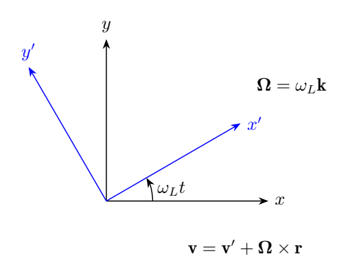
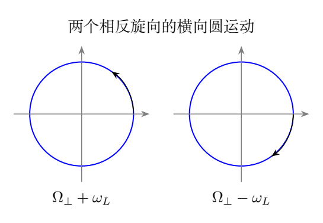
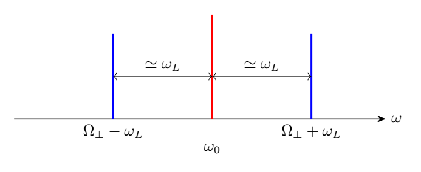

# 第 5 题 旋转参考系与经典塞曼分裂（40分）

假定原子中的价电子质量为 $m$，电荷为 $-e$（$e>0$），受到指向原子中心的各向同性线性回复力 $-m\omega_0^2\mathbf r$，无磁场时作固有圆频率为 $\omega_0$ 的简谐振动，并发出圆频率为 $\omega_0$ 的光。

现在原子置于沿 $+z$ 方向的均匀磁场中，磁感应强度大小为 $B$。为方便，把磁场参数化为

$$
B=\frac{2m}{e}\omega_L.
$$

（1）选择绕磁场方向匀角速转动的参考系，使电子在该参考系中做简谐振动，写出直角坐标中的动力学分量方程并求解。

（2）把第一问的解变换到实验室参考系的直角坐标。

（3）证明原来的谱线在磁场中分成三条；在弱磁场 $\omega_L\ll\omega_0$ 时求三条谱线的频率间隔。

已知：转动角速度为 $\boldsymbol\Omega$ 的参考系中，电子除受惯性离心力外，还受科里奥利力；若相对速度为 $\mathbf v'$，科里奥利力为 $-2m\boldsymbol\Omega\times\mathbf v'$。

## 一、题型定位

选取旋转参考系消除速度耦合，再把旋转系中的振动变换成实验室中的两个横向圆偏振模。沿磁场的纵向振动保持原频率，横向两个模的频率分开。

“电子在旋转系中做简谐振动”是指各直角坐标满足简谐方程；一般轨迹可以是椭圆，不一定是一条径向直线。求通解时必须保留足够的初始条件常数。

## 二、知识点

在实验室中，电子满足

$$
m\ddot{\mathbf r}=-m\omega_0^2\mathbf r
-e\dot{\mathbf r}\times B\mathbf k.
$$

电子电荷的负号决定耦合项方向。由叉积得

$$
\ddot x=-\omega_0^2x-2\omega_L\dot y,
$$

$$
\ddot y=-\omega_0^2y+2\omega_L\dot x,\qquad
\ddot z=-\omega_0^2z.
$$

磁力垂直速度，不做功，故实验室中的机械能

$$
\mathcal E=\frac m2
\left(\dot x^2+\dot y^2+\dot z^2
+\omega_0^2(x^2+y^2+z^2)\right)
$$

恒定。磁场改变运动模的频率，并不要求给电子输入持续能量。

## 三、物理图像

选择旋转系以 $\omega_L$ 沿 $+z$ 转动。它的科里奥利力恰好抵消相对运动产生的磁力；但还有由参考系整体旋转产生的磁力和离心力，二者相加后改变横向回复力。

因此旋转系的横向频率不是严格的 $\omega_0$，而是 $\sqrt{\omega_0^2+\omega_L^2}$。弱磁场时这个改变属于二阶小量，但前两问并未允许把它提前删掉。

实验室中可把一般横向运动分解为两个相反旋向的圆运动。每个圆运动在 $x,y$ 上有同一频率、相差四分之一周期；两模频率不同，叠加后形成一般轨迹。

## 四、解题入口

先把旋转系中的速度关系写全：

$$
\mathbf v=\mathbf v'+\boldsymbol\Omega\times\mathbf r.
$$

再把实验室磁力换成相对速度项和位置项，最后加科里奥利力与离心力。若只把磁力中的 $\mathbf v$ 换成 $\mathbf v'$，会漏掉横向频率的二阶修正。

求解采用直角坐标通解最稳妥；变换到实验室后，可用积化和差或复数 $u=x+iy$ 识别两个频率。复数法还提供一条独立的本征频率验证。

## 五、解析

### 1. 旋转系中的完整动力学方程

设 $\boldsymbol\Omega=\Omega\mathbf k$。在旋转系中，

$$
m\ddot{\mathbf r}'=-m\omega_0^2\mathbf r
-e(\mathbf v'+\boldsymbol\Omega\times\mathbf r)\times B\mathbf k
-2m\boldsymbol\Omega\times\mathbf v'
-m\boldsymbol\Omega\times(\boldsymbol\Omega\times\mathbf r).
$$

其中坐标矢量 $\mathbf r$ 在两系表示不同，但几何矢量相同。磁力的速度部分为

$$
-e\mathbf v'\times B\mathbf k
=2m\omega_L\mathbf k\times\mathbf v'.
$$

它与科里奥利力合并后是

$$
2m(\omega_L-\Omega)\mathbf k\times\mathbf v'.
$$

因此取

$$
\boxed{\boldsymbol\Omega=\omega_L\mathbf k}
$$

消去速度耦合。旋转方向沿 $+z$，与电子的负电荷及给定磁场方向相适应。

### 2. 位置项与旋转系通解

设 $\mathbf r_\perp=x'\mathbf i'+y'\mathbf j'$。参考系旋转所带来的磁力为 $-2m\omega_L^2\mathbf r_\perp$，离心力为 $+m\omega_L^2\mathbf r_\perp$，合计为 $-m\omega_L^2\mathbf r_\perp$。

于是令

$$
\Omega_\perp=\sqrt{\omega_0^2+\omega_L^2},
$$

旋转系分量方程为

$$
\boxed{\ddot x'+\Omega_\perp^2x'=0,\quad
\ddot y'+\Omega_\perp^2y'=0,\quad
\ddot z'+\omega_0^2z'=0}.
$$

完整通解为

$$
x'=a_x\cos\Omega_\perp t+b_x\sin\Omega_\perp t,
$$

$$
y'=a_y\cos\Omega_\perp t+b_y\sin\Omega_\perp t,
$$

$$
z'=a_z\cos\omega_0t+b_z\sin\omega_0t.
$$

六个实常数由三维初始位置和速度决定。$x',y'$ 的振幅和相位一般不同，所以横向轨迹通常为椭圆。

### 3. 初始条件的变换

令 $t=0$ 时两组坐标轴重合。若实验室初始坐标是 $(x_0,y_0,z_0)$，初始速度是 $(v_{x0},v_{y0},v_{z0})$，则

$$
(a_x,a_y,a_z)=(x_0,y_0,z_0),
$$

$$
b_x=\frac{v_{x0}+\omega_Ly_0}{\Omega_\perp},
\qquad b_y=\frac{v_{y0}-\omega_Lx_0}{\Omega_\perp},
\qquad b_z=\frac{v_{z0}}{\omega_0}.
$$

即使实验室初速度为零，旋转系初速度也未必为零。一个离轴静止电子，在旋转坐标中本来就具有相反方向的表观速度。

### 4. 变回实验室坐标

坐标变换为

$$
\boxed{x=x'\cos\omega_Lt-y'\sin\omega_Lt},
$$

$$
\boxed{y=x'\sin\omega_Lt+y'\cos\omega_Lt,\quad z=z'}.
$$

代入上一节通解，即得到第二问的完整解。例如

$$
\begin{aligned}
x={}&(a_x\cos\Omega_\perp t+b_x\sin\Omega_\perp t)\cos\omega_Lt\\
&-(a_y\cos\Omega_\perp t+b_y\sin\Omega_\perp t)\sin\omega_Lt,
\end{aligned}
$$

$$
\begin{aligned}
y={}&(a_x\cos\Omega_\perp t+b_x\sin\Omega_\perp t)\sin\omega_Lt\\
&+(a_y\cos\Omega_\perp t+b_y\sin\Omega_\perp t)\cos\omega_Lt.
\end{aligned}
$$

这两个式子适用于任意初始条件，不需要假定两方向相位相同，也不需要假定电子在旋转系里径向振动。

### 5. 用复数识别本征频率

令 $u=x+iy$。实验室耦合方程化为

$$
\ddot u-2i\omega_L\dot u+\omega_0^2u=0.
$$

设 $u=e^{i\omega_Lt}w$，代入后得到

$$
\ddot w+\Omega_\perp^2w=0.
$$

因此

$$
\boxed{u=c_+e^{i(\Omega_\perp+\omega_L)t}
+c_-e^{-i(\Omega_\perp-\omega_L)t}}.
$$

$c_+,c_-$ 为两个任意复常数，共四个实自由度，正好对应横向初始条件。两个指数的符号相反，说明两个圆运动的旋向相反。

定义

$$
\omega_+=\Omega_\perp+\omega_L,\qquad
\omega_-=\Omega_\perp-\omega_L.
$$

二者都为正，且

$$
\omega_+\omega_-=\omega_0^2,\qquad
\omega_+-\omega_-=2\omega_L.
$$

这两个恒等式是本征频率的直接检查。

### 6. 三条可能的谱线

沿磁场的振动频率保持 $\omega_0$；横向运动包含 $\omega_-,\omega_+$ 两个频率。因此在一般初始条件下，辐射包含

$$
\boxed{\omega_-,\quad\omega_0,\quad\omega_+}.
$$

严格地说，三条是该经典模型允许的三个频率。某一特殊初始条件可能使一个模的振幅为零；某一观察方向也可能看不到某个偏振分量。频率结构不等于任意一次单电子运动都必然同时显示三条等强谱线。

若观察方向沿 $z$，纵向偶极振动不向自身轴向辐射，因此只见两个横向圆偏振频率；若从侧面观察，纵向中央线和横向边线均可出现。该补充有助于区分动力学频率与观测强度。

### 7. 弱磁场的频率间隔

当 $\omega_L\ll\omega_0$，

$$
\Omega_\perp
=\omega_0+\frac{\omega_L^2}{2\omega_0}
+O\!\left(\frac{\omega_L^4}{\omega_0^3}\right).
$$

保留一阶项，

$$
\omega_\pm\simeq\omega_0\pm\omega_L.
$$

故相邻谱线的圆频率间隔约为

$$
\boxed{\Delta\omega\simeq\omega_L=\frac{eB}{2m}}.
$$

若“频率”采用每秒周期数 $\nu=\omega/(2\pi)$，则

$$
\boxed{\Delta\nu\simeq\frac{\omega_L}{2\pi}
=\frac{eB}{4\pi m}}.
$$

两侧线的精确圆频率差恒为 $2\omega_L$；但中央线并非两边线精确中点。严格的两相邻间隔分别为

$$
\omega_+-\omega_0=\omega_L+\Omega_\perp-\omega_0,
$$

$$
\omega_0-\omega_-=\omega_L-(\Omega_\perp-\omega_0).
$$

### 8. 一般角动量常数不能设为零

参考解答的部分极坐标路线把一个积分常数以“任意半径都成立”为由设为零。这个推论对一般初始条件不成立。

由实验室极坐标的角向方程可得

$$
\rho^2(\dot\varphi-\omega_L)=C.
$$

在旋转系中，$\varphi'=\varphi-\omega_Lt$，所以

$$
\rho^2\dot\varphi'=C.
$$

$C$ 是旋转系横向运动的比角动量，由初始条件决定；没有理由对所有初始条件都等于零。只有特殊的直线振动才有 $C=0$。

一般情况下径向方程是

$$
\ddot\rho-\frac{C^2}{\rho^3}
=-\Omega_\perp^2\rho.
$$

它包含离心项，而 $x',y'$ 仍分别是简谐振动。使用直角坐标通解即可完整解决原题，避免把特殊径向运动误写为所有运动。

### 9. 零场与强场检查

令 $B\to0$，有 $\omega_L\to0$，三个频率都回到 $\omega_0$，恢复原来的简并振动。

在 $\omega_L\gg\omega_0$ 的形式极限中，

$$
\omega_+\simeq2\omega_L,\qquad
\omega_-\simeq\frac{\omega_0^2}{2\omega_L}.
$$

低频始终为正，因为 $\Omega_\perp>\omega_L$。如果提前用 $\omega_0-\omega_L$ 代替精确低频，强场下会得到负值，说明弱场近似已经越界。

## 六、关键洞察

拉莫尔旋转消去了速度耦合，却并未完全恢复无磁场的各向同性三维振子。横向二阶修正来自“旋转速度产生的磁力”与离心力的合成。

通解应先保留全部自由度，再在观测或特殊初始条件下删去模。以特殊直线振动推断全部初始条件，会漏掉旋转系椭圆运动的角动量常数。

## 七、易错点

电荷为 $-e$，不能按正电荷写洛伦兹力。旋转系相对速度与实验室速度也不能混同。第一问不应在未经允许时提前使用 $\Omega_\perp=\omega_0$。

弱场等间隔只是一阶结论；圆频率间隔转换成普通频率时要除以 $2\pi$。三条允许频率也不表示任意方向都能观测到三条线。

## 八、课堂讲解建议

先由实验室叉积写两个耦合方程，再分别用旋转参考系和复数替换去耦。比较两种方法的结果，可检查旋转方向和二阶项的符号。

通解部分让学生数常数，要求横向四个、纵向两个。最后用一个只激发单一圆模的初始条件演示“存在的本征频率”和“实际激发的谱线”之间的区别。

### 板书追问：怎样从初始条件选出两个模

给定 $u(0)=u_0,\dot u(0)=v_u$，两个复振幅满足

$$
c_++c_-=u_0,\qquad
i\omega_+c_+-i\omega_-c_-=v_u.
$$

解得

$$
c_+=\frac{v_u+i\omega_-u_0}{2i\Omega_\perp},
\qquad
c_-=\frac{i\omega_+u_0-v_u}{2i\Omega_\perp}.
$$

这两个复常数确实包含四个实参数。让学生选 $v_u=i\omega_+u_0$，即可消去低频模；选 $v_u=-i\omega_-u_0$，即可消去高频模。

随后再问：若加上任意纵向初始条件，中央线是否出现？答案取决于是否有纵向振动，以及观察方向是否允许看到其辐射。这样能把“解微分方程”“激发本征模”“观察谱线”三个步骤分开。

评价推导时，建议先检查磁力符号，再数通解自由度，最后检查弱场展开。仅写出三个正确频率却用错误的通解证明，仍会在特殊初始条件或强场检验中暴露问题。

## 九、变式训练

### 变式1：电子从偏离中心处静止释放

给定 $x(0)=a,y(0)=0,\dot x(0)=\dot y(0)=0,z=0$，求两横向模的复振幅。

**解：** 由 $c_++c_-=a$ 与 $i\omega_+c_+-i\omega_-c_-=0$，

$$
c_+=\frac{a\omega_-}{2\Omega_\perp},\qquad
c_-=\frac{a\omega_+}{2\Omega_\perp}.
$$

两模一般都存在，而且振幅不相等。旋转系初速度为 $(0,-\omega_La)$，不能假定旋转系也从静止释放。

### 变式2：只激发高频圆模

给定 $x(0)=a,y(0)=0$，怎样选择横向初速度，只出现 $\omega_+$？

**解：** 取 $c_-=0,c_+=a$，有

$$
x=a\cos\omega_+t,\qquad
y=a\sin\omega_+t.
$$

所需初速度为 $\dot x(0)=0,\dot y(0)=a\omega_+$。代入实验室方程得到 $\omega_+^2-2\omega_L\omega_+-\omega_0^2=0$，恰好满足本征条件。

### 变式3：用边线间隔反推磁场

实测两条边线的普通频率差为 $D$，在该经典模型中求磁场。

**解：** 精确关系是

$$
D=\frac{\omega_+-\omega_-}{2\pi}
=\frac{\omega_L}{\pi}=\frac{eB}{2\pi m}.
$$

因此 $B=2\pi mD/e$。此关系不需要弱场近似；若测的是中央线到单侧线的间隔，才需要考虑二阶不对称。

### 变式4：旋转系中的圆轨道

在旋转系令 $x'=a\cos\Omega_\perp t,y'=a\sin\Omega_\perp t$。求角动量常数，判断能否令其为零。

**解：** $\rho=a,\dot\varphi'=\Omega_\perp$，故

$$
C=\rho^2\dot\varphi'=a^2\Omega_\perp\ne0.
$$

变回实验室后是高频圆模 $u=ae^{i\omega_+t}$。它直接反驳了“旋转系中积分常数必为零”的一般化，且仍满足各坐标的简谐方程。
