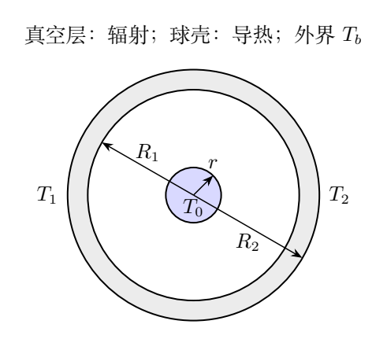
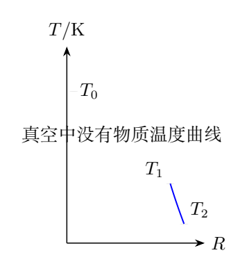
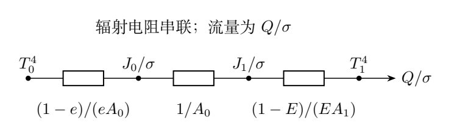

# 第 6 题 同心球系统的导热与灰体辐射交换（40分）

太空中的装置由同心内球和球壳构成，内球到球壳内表面之间为真空。内球半径 $r=0.200\,\mathrm m$，温度恒定，比辐射率 $e=0.800$。球壳导热系数

$$
\kappa=1.00\times10^{-2}\,
\mathrm{J\,m^{-1}s^{-1}K^{-1}},
$$

内、外半径分别为 $R_1=0.900\,\mathrm m$、$R_2=1.00\,\mathrm m$。各表面的热辐射各向同性，球壳外表面可看作黑体。装置处于热稳定状态，球壳内表面比辐射率 $E=0.800$。

斯特藩常量为 $\sigma=5.67\times10^{-8}\,\mathrm{W\,m^{-2}K^{-4}}$，宇宙微波背景辐射温度为 $T_b=2.73\,\mathrm K$。若单位时间内由内球传到球壳外表面的净热量为 $Q=44.0\,\mathrm W$，求：

（1）球壳外表面温度 $T_2$；（2）球壳内表面温度 $T_1$；（3）内球温度 $T_0$。

已知：比辐射率是表面发射功率与同温黑体发射功率之比；吸收比是吸收功率与入射功率之比。物体同温下的吸收比等于比辐射率。沿热流方向每单位长度温度梯度为 $dT/dz$ 时，单位面积热流为 $-\kappa\,dT/dz$。

## 一、题型定位

装置处于稳态：内球与球壳内表面通过辐射交换，球壳内外表面通过导热传热，外表面向宇宙背景净辐射。三个环节的净功率都是 $Q$，但温度关系各不相同。

第三问不能只计算内球首次发射后被球壳吸收的比例。球壳内表面是凹面，反射或发射的一部分辐射会再次照到球壳自身；这部分会继续反射或被吸收，必须计入。

## 二、知识点

外表面是黑体，净辐射功率为发射减吸收：

$$
Q_{\rm out}=4\pi R_2^2\sigma(T_2^4-T_b^4).
$$

球壳稳态径向导热的净功率为

$$
Q=-4\pi R^2\kappa\frac{dT}{dR}.
$$

灰体辐射交换需要区分三个量：表面自身发射功率密度 $\epsilon\sigma T^4$，入射辐照度 $G$，以及包括发射和反射在内的出射辐射度 $J$：

$$
J=\epsilon\sigma T^4+(1-\epsilon)G.
$$

这三个量单位均为 $\mathrm{W/m^2}$。净向外功率密度是 $J-G$，不能把 $J$ 本身当成净流。

## 三、物理图像

由稳态条件，沿传热方向必有 $T_0>T_1>T_2>T_b$。球壳内外表面温差由导热热阻决定；真空层没有导热温度梯度，它是两个表面的辐射耦合。

内球为凸面，所有向外发射最终都碰到球壳内表面。球壳内表面向内发射则有两种目的地：内球和球壳自身其他位置。后者正是凹面自照项。

图中各电阻表示辐射度关系的代数结构，不是物体的电学电阻。流量对应 $Q/\sigma$，势差对应温度四次方。表面电阻与面积有关，不能把两个比辐射率简单相乘。

## 四、解题入口

按热流从外向内求解：先由外部净辐射求 $T_2$；再由球壳导热求 $T_1$；最后由同心灰体的完整辐射交换求 $T_0$。

第三步先写视角因子。记内球表面积 $A_0=4\pi r^2$，球壳内表面积 $A_1=4\pi R_1^2$，以及

$$
f=\frac{A_0}{A_1}=\frac{r^2}{R_1^2}.
$$

内球到球壳的视角因子为1；由互易关系，球壳到内球的视角因子为 $f$；球壳到自身的视角因子为 $1-f$。以下默认题给各向同性辐射对应漫辐射、漫反射的灰体模型。

## 五、解析

### 1. 外表面净辐射

热稳定要求外表面净散热等于 $Q$，所以

$$
Q=4\pi R_2^2\sigma(T_2^4-T_b^4).
$$

解得

$$
\boxed{T_2=\left(T_b^4+
\frac{Q}{4\pi R_2^2\sigma}\right)^{1/4}}.
$$

代入数值，

$$
\boxed{T_2=88.6472\,\mathrm K\simeq88.6\,\mathrm K}.
$$

背景项在这里很小，但写出它才能保证 $Q=0$ 时装置趋于 $T_b$，而不是不合理地趋于绝对零度。因为题给的是净功率，不能仅用 $Q=4\pi R_2^2\sigma T_2^4$ 当作精确关系。

### 2. 球壳径向导热

任何半径 $R$ 上穿过球面的净功率均为 $Q$：

$$
\frac{dT}{dR}=-\frac{Q}{4\pi\kappa R^2}.
$$

从 $R_1$ 积分到 $R_2$，

$$
T_2-T_1=-\frac{Q}{4\pi\kappa}
\int_{R_1}^{R_2}\frac{dR}{R^2}.
$$

因此

$$
\boxed{T_1=T_2+
\frac{Q}{4\pi\kappa}
\left(\frac1{R_1}-\frac1{R_2}\right)}.
$$

球壳导热热阻为

$$
\mathcal R_{\rm cond}=
\frac1{4\pi\kappa}\left(\frac1{R_1}-\frac1{R_2}\right).
$$

代入数值得

$$
T_1-T_2=38.9045\,\mathrm K,\qquad
\boxed{T_1=127.5517\,\mathrm K\simeq128\,\mathrm K}.
$$

若直接采用平板公式，必须选合适的等效面积；使用内表面积或外表面积中的任意一个，都会留下系统误差。

### 3. 球壳内表面的自照

由几何互易关系，

$$
F_{0\to1}=1,\quad F_{0\to0}=0,
$$

$$
F_{1\to0}=f,\qquad F_{1\to1}=1-f.
$$

本题 $f=(.2/.9)^2=0.0493827$，因此球壳向内发射的绝大部分辐射并不直接打到内球，而是先打到球壳内表面其他位置。

这不会改变各表面温度均匀的假设，却会改变反射后的入射辐照度。只写 $G_1=fJ_0$ 而省略 $(1-f)J_1$，就漏掉自照。

完整入射关系为

$$
G_0=J_1,\qquad
G_1=fJ_0+(1-f)J_1.
$$

### 4. 辐射度方程

两个灰体表面的出射辐射度分别满足

$$
J_0=e\sigma T_0^4+(1-e)J_1,
$$

$$
J_1=E\sigma T_1^4+(1-E)
\left[fJ_0+(1-f)J_1\right].
$$

净热流由内球流出，

$$
Q=A_0(J_0-J_1).
$$

从第一式可整理出

$$
\sigma T_0^4
=J_0+\frac{1-e}{e}\frac Q{A_0}.
$$

从第二式可整理出

$$
J_1=\sigma T_1^4+\frac{1-E}{E}\frac Q{A_1}.
$$

这一步利用 $f(J_0-J_1)=Q/A_1$，正是面积互易关系使净功率一致。

两式相减，得到

$$
\sigma(T_0^4-T_1^4)=
Q\left[\frac{1-e}{eA_0}
+\frac1{A_0}+\frac{1-E}{EA_1}\right].
$$

### 5. 完整的灰体交换公式

将上一式整理，

$$
\boxed{
Q=\frac{A_0\sigma(T_0^4-T_1^4)}
{\displaystyle \frac1e+f\left(\frac1E-1\right)}}.
$$

定义无量纲辐射阻因子

$$
D=\frac1e+f\left(\frac1E-1\right).
$$

则

$$
\boxed{T_0=
\left[T_1^4+\frac{QD}{4\pi r^2\sigma}\right]^{1/4}}.
$$

本题

$$
D=1.25+0.0493827\times0.25=1.26234568.
$$

用未提前舍入的 $T_1$ 计算，

$$
\boxed{T_0=216.9062\,\mathrm K\simeq217\,\mathrm K}.
$$

内球温度高于球壳内表面，净流方向与题意一致。

### 6. 与参考答案的实质差异

参考答案采用的反射级数没有计入球壳内表面到自身的反射链，得到的阻因子为

$$
D_{\rm ref}=
\frac{1-(1-e)(1-E)f}{eE}=1.55941358,
$$

从而算得约 $227\,\mathrm K$。在完整的漫辐射灰体模型下，该结果应修正为约 $217\,\mathrm K$。

这不是舍入差异。两者对 $E\to0$ 的极限行为不同：完整模型在球壳内表面吸收比趋于零时交换热阻趋于无穷；漏项公式却可留下不合理的有限交换能力。

整理版保留原题数据，同时明确写出修正推导；参考解答中的 $T_2,T_1$ 与完整模型相符，只有第三问需要修正。

### 7. 用多次反射验证

设一份辐射能量已碰到球壳内表面。球壳吸收比例为 $E$，反射比例为 $1-E$。反射后，比例 $f$ 碰到内球，比例 $1-f$ 再碰到球壳。

考虑所有可能的球壳自反射次数，最终返回内球的概率为

$$
P_{\rm return}
=(1-E)f\sum_{j=0}^{\infty}
\left[(1-E)(1-f)\right]^j
=\frac{(1-E)f}{E+(1-E)f}.
$$

内球吸收或反射后还会继续产生交换。内球自身发射的能量最终在球壳吸收的比例为

$$
\eta_{0\to1}
=\frac{1-P_{\rm return}}
{1-(1-e)P_{\rm return}}
=\frac{E}{E+e(1-E)f}.
$$

所以来自内球自身发射、最终被球壳吸收的功率为

$$
eA_0\sigma T_0^4\,\eta_{0\to1}.
$$

反方向按面积互易得到同一交换系数乘 $T_1^4$。两者作差，恰好恢复 $Q=A_0\sigma(T_0^4-T_1^4)/D$，与辐射度方程独立一致。

### 8. 有用的极限检查

若 $E=1$，球壳不反射，

$$
Q=eA_0\sigma(T_0^4-T_1^4).
$$

若 $e=E=1$，恢复两个黑体表面的交换。若 $f\to0$ 且 $E$ 为固定非零值，小内球面对大空腔，

$$
Q\to eA_0\sigma(T_0^4-T_1^4),
$$

因为空腔内表面的多次自反射使它的有效辐射环境趋近黑体。

若 $f\to1$，得到两个面积近乎相等灰体的熟悉因子

$$
D\to\frac1e+\frac1E-1.
$$

以上极限既检验面积因子，也检验是否保留凹面自照。

### 9. 精度与单位

本题用 SI 单位统一计算，温度四次方必须使用开尔文。$\kappa$ 的题给单位等价于 $\mathrm{W\,m^{-1}K^{-1}}$，不是热容单位。

数值计算宜把 $T_2,T_1$ 的内部精度保留到最后；若先把 $T_1$ 舍入成128 K再求四次方，会产生可避免的误差。正式答案按题给三位有效数字给出 $88.6\,\mathrm K,128\,\mathrm K,217\,\mathrm K$。

### 10. 辐射度数值与两侧净流检查

以未舍入温度计算，两个出射辐射度和入射辐照度为

$$
J_0=103.6241\,\mathrm{W/m^2},\quad
J_1=16.0889\,\mathrm{W/m^2},
$$

$$
G_0=16.0889\,\mathrm{W/m^2},\quad
G_1=20.4116\,\mathrm{W/m^2}.
$$

内球净向外功率为

$$
A_0(J_0-G_0)=44.0\,\mathrm W.
$$

球壳内表面净吸收功率为

$$
A_1(G_1-J_1)=44.0\,\mathrm W.
$$

两侧净功率完全相同，说明视角因子、表面积和反射项保持整体能量守恒。球壳入射辐照度高于自身出射辐射度，因此净吸收；它并不要求球壳自身完全不发射。

另外，灰体内球自身发射功率是 $eA_0\sigma T_0^4$，一般大于44 W，因为内球同时吸收空腔辐射。只有发射减去吸收才是外加热源需要持续补充的净功率。

采用参考答案的227 K代入完整方程，会得到大于44 W的净交换。故修正后的217 K不仅来自一种公式，还同时满足两个表面的辐射度方程与净流约束。

## 六、关键洞察

对凹面，辐射“离开表面”不等于“离开该物体”。球壳的自照项是几何条件产生的真实能量路径，不能因为它最终还在同一个温度表面就忽略反射过程。

辐射度方程把无限反射级数压缩成两个线性方程；完整级数则解释每个项的物理来源。两种方法得到同一阻因子，支持对参考解答漏项的修正。

## 七、易错点

把发射功率当作净功率会漏掉背景吸收；对球壳导热使用恒定面积会漏掉 $R^2$。内外两个表面积互换会改变灰体交换因子。

最关键的漏项是 $G_1$ 中的 $(1-f)J_1$。不能简单写净交换系数为 $eE$，也不能用两表面的反射率乘积直接构造级数而省略球壳自反射。

## 八、课堂讲解建议

先把三段传热画成流程并标出同一个 $Q$，再从外到内求温度。第三问要求学生把一条从球壳发出的射线画到另一个球壳位置，直观说明自照。

可先在黑体条件下写交换，再增加两个表面反射，最后推导辐射度方程。用 $E\to0$、$f\to0$ 的极限检查，帮助学生辨别看似合理却漏项的级数。

### 板书追问：自照能量为什么不能直接删除

在球壳净功率表达式中，自照部分在最终作差时确实消掉：

$$
A_1(G_1-J_1)=A_1f(J_0-J_1).
$$

但在决定 $J_1$ 的辐射度方程中，它仍影响反射后的再次入射。先删除自照与解完方程后在净流中抵消，是两种不同操作。

可以把球壳内表面划成许多等温小片，画出光线从一片到另一片再反射回内球的路径。小片之间没有温差，净热交换为零，却仍存在双向辐射和反射，这些双向过程共同形成空腔辐射环境。

再让学生把 $E$ 降到很小但非零。完整交换阻因子为

$$
D=\frac1e+f\frac{1-E}{E},
$$

随 $E\to0$ 增大，说明球壳难以吸收内球净输出。若某个公式在这个极限仍给出有限净交换，应回到反射路径逐项排查，而不只是重新检查代数。

最后把“外壳黑体”和“内表面灰体”分别标注，避免因它们属于同一块物体而把两个边界的辐射性质误设为相同。

## 九、变式训练

### 变式1：把球壳内表面涂黑

保持原题其他条件及 $Q$ 不变，取 $E=1$，求新的 $T_0$。

**解：** 外部辐射和导热均不变，$T_2,T_1$ 不变。此时 $D=1/e=1.25$，

$$
T_0'=\left[T_1^4+\frac{Q}{eA_0\sigma}\right]^{1/4}
\simeq216.4\,\mathrm K.
$$

与原来的217 K很接近，因为内球面积远小于球壳内表面积，球壳的自反射已经形成有效空腔。

### 变式2：球壳导热系数增为两倍

取 $\kappa'=2\kappa$，保持原来的几何、发射率及 $Q$，求两内层温度。

**解：** $T_2$ 不变，导热温差减半：

$$
T_1'=T_2+\frac{T_1-T_2}{2}=108.10\,\mathrm K.
$$

辐射因子 $D$ 不变，所以

$$
T_0'=\left[(T_1')^4+\frac{QD}{A_0\sigma}\right]^{1/4}
\simeq213.7\,\mathrm K.
$$

导热变好降低球壳内温度，内球为维持同样净热流所需温度也略降。

### 变式3：薄球壳极限

令 $R_2=R_1+\delta$，$\delta\ll R_1$，求球壳导热热阻的首阶近似。

**解：**

$$
\frac1{R_1}-\frac1{R_1+\delta}
=\frac{\delta}{R_1^2}+O(\delta^2).
$$

因此

$$
\mathcal R_{\rm cond}\simeq
\frac{\delta}{4\pi\kappa R_1^2}.
$$

它恢复厚度为 $\delta$、面积为 $4\pi R_1^2$ 的平板形式。平板公式是薄壳近似，而非有限厚球壳的一般精确式。

### 变式4：同温检验

把两个内表面都维持在同一温度 $T_s$，求净辐射交换；再说明各表面的辐射度。

**解：** 完整交换式立即给出 $Q=0$，与 $e,E$ 的不同无关。由辐射度方程，

$$
J_0=J_1=\sigma T_s^4.
$$

灰体自身发射少于黑体，但反射环境辐射补足出射辐射度。若只用 $e\sigma T_s^4-E\sigma T_s^4$ 比较，会错误地预测同温系统仍有净热流。
