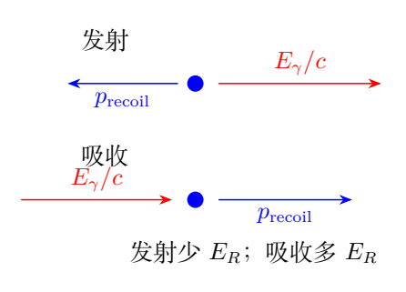
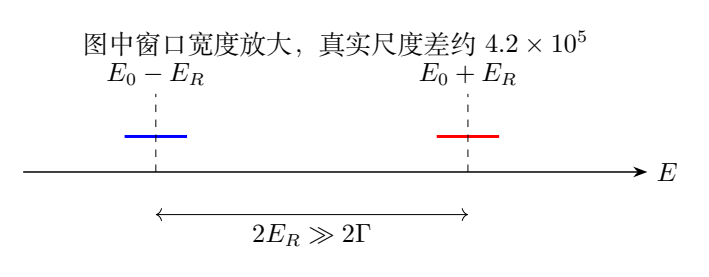
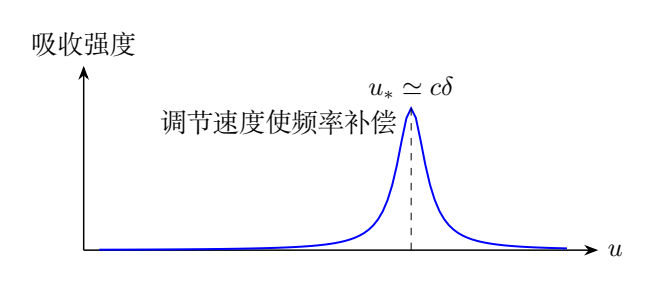

# 第 8 题 核反冲、共振窗口与微小频移测量（40分）

原子核能级间可通过吸收或发射光子跃迁。自由原子核吸收或发射光子时会反冲，部分能量转为原子核动能。激发态相对基态的能量不是完全确定的，而在以 $E_0$ 为中心、宽度为 $2\Gamma$ 的范围内取值。

对 $\,{}^{57}\mathrm{Fe}$ 第一激发态到基态的跃迁，取

$$
E_0=2.31\times10^{-15}\,\mathrm J,\qquad
\Gamma\simeq3.2\times10^{-13}E_0,
$$

$$
m_{\rm Fe}\simeq9.5\times10^{-26}\,\mathrm{kg},
\quad h=6.6\times10^{-34}\,\mathrm{J\,s},
\quad c=3.0\times10^8\,\mathrm{m/s}.
$$

（1）忽略能级宽度，求发射的反冲能，并求考虑核反冲与不考虑核反冲时发射光子频率之差。

（2）忽略能级宽度，求吸收的反冲能，并求考虑核反冲与不考虑核反冲时吸收光子频率之差。

（3）考虑能级宽度，静止的激发态自由核发射的光子，能否被另一静止基态自由核共振吸收？说明理由。

（4）把核置于晶体中，按题设认为核跃迁无反冲。静止晶体中的激发核发射光子，另一以速度 $V$ 运动的晶体中的基态核吸收。什么速度范围会共振？若到达吸收晶体的光子发生相对量级 $10^{-10}$ 的微小频率变化，怎样测量？给出原理和计算。

## 一、题型定位

本题比较反冲能、能级宽度和多普勒频移三个尺度。发射需要让部分跃迁能量成为核动能，光子能量偏低；吸收则同时需要提供激发能和反冲动能，光子能量偏高。

晶体无反冲时，两窗口中心恢复一致；人为调节晶体速度可使入射频率在吸收体参考系中移动，以补偿未知频移。测量时扫描速度并寻找吸收峰，再由峰位换算频移，便可避开直接测量光频微小差值的困难。

## 二、知识点

光子的能量和动量满足

$$
E_\gamma=h\nu,\qquad p_\gamma=\frac{E_\gamma}{c}.
$$

核反冲在本题为非相对论运动，其动能为

$$
E_R=\frac{p_\gamma^2}{2m_{\rm Fe}}
=\frac{E_\gamma^2}{2m_{\rm Fe}c^2}.
$$

因为 $E_0/(m_{\rm Fe}c^2)\ll1$，可在反冲项中用 $E_\gamma\simeq E_0$，只保留反冲的一阶修正。

题给宽度 $2\Gamma$ 是能量窗口总宽度，因此半宽为 $\Gamma$，频率半宽为 $\Gamma/h$。两窗口相交时允许共振，这里使用题设的有限窗口模型。

## 三、物理图像

发射时光子与核动量相反；吸收时初始光子动量成为核的反冲动量。两过程反冲动能都是正的，但在光子能量方程中位于不同侧。

两窗口中心分别为 $E_0-E_R$ 和 $E_0+E_R$，间隔为 $2E_R$。不能只拿单个窗口半宽与两个中心之间的距离比较，却忘记吸收窗口也有半宽。

无反冲晶体的窗口都以 $E_0$ 为中心。只要晶体相对光子传播方向有速度分量，多普勒效应就把入射窗口相对吸收窗口移动。

## 四、解题入口

先用动量守恒求反冲速度与动能，再分别列发射、吸收能量式。把 $E_R$ 与 $\Gamma$ 的比值算出来，第三问的答案立即明确。

第四问先约定速度符号。以下以吸收晶体沿光子传播方向运动为 $u>0$，即远离光源；迎着光子运动为 $u<0$。$V=|u|$ 是速度大小。这个约定能让补偿未知频移时的方向一目了然。

比较窗口交叠时，可先用 $\nu'\simeq\nu(1-u/c)$，再给出精确纵向多普勒结果作为检查。原题数值只需一阶近似。

## 五、解析

### 1. 共同的反冲尺度

不计反冲时，

$$
\nu_0=\frac{E_0}{h}
=3.50\times10^{18}\,\mathrm{Hz}.
$$

光子动量近似为

$$
p_0=\frac{E_0}{c}=7.70\times10^{-24}\,\mathrm{kg\,m/s}.
$$

核反冲速度为

$$
v_R\simeq\frac{E_0}{m_{\rm Fe}c}
=81.05\,\mathrm{m/s}\ll c.
$$

故采用非相对论核动能合理。反冲能为

$$
\boxed{E_R\simeq\frac{E_0^2}{2m_{\rm Fe}c^2}
=3.1205\times10^{-22}\,\mathrm J}.
$$

它相对跃迁能很小，但是否可以忽略还要与能级宽度比较，不能仅凭 $E_R/E_0\ll1$ 下结论。

### 2. 发射光子的频率

初始激发核静止，发射后光子与核反冲动量大小相等。能量守恒为

$$
E_0=h\nu_{\rm em}
+\frac{(h\nu_{\rm em})^2}{2m_{\rm Fe}c^2}.
$$

在反冲项中用 $h\nu_{\rm em}\simeq E_0$，

$$
h\nu_{\rm em}\simeq E_0-E_R.
$$

所以

$$
\boxed{\nu_{\rm em}-\nu_0\simeq-\frac{E_R}{h}
=-4.7281\times10^{11}\,\mathrm{Hz}}.
$$

负号表示发射光子频率比不反冲时低。核动能来自原来的跃迁能，不能把反冲能加到发射光子上。

### 3. 吸收光子的频率

初始基态核静止，吸收后既被激发，又获得光子动量。能量守恒为

$$
h\nu_{\rm abs}=E_0
+\frac{(h\nu_{\rm abs})^2}{2m_{\rm Fe}c^2}.
$$

一阶近似给出

$$
h\nu_{\rm abs}\simeq E_0+E_R,
$$

于是

$$
\boxed{\nu_{\rm abs}-\nu_0\simeq+\frac{E_R}{h}
=+4.7281\times10^{11}\,\mathrm{Hz}}.
$$

吸收需要比跃迁能更多的光子能量，额外能量提供核的反冲动能。两过程的反冲能在一阶精度下相等，符号差别属于光子能量而不是动能。

### 4. 近似精度与稳定求根

令

$$
\epsilon=\frac{E_0}{m_{\rm Fe}c^2}
\simeq2.70\times10^{-7}.
$$

反冲能相对修正为 $\epsilon/2$。在非相对论模型内，两个能量方程的小根可以写成稳定形式

$$
E_{\rm em}=
\frac{2E_0}{1+\sqrt{1+2\epsilon}},
$$

$$
E_{\rm abs}=
\frac{2E_0}{1+\sqrt{1-2\epsilon}}.
$$

展开后分别恢复 $E_0\mp E_R$。稳定形式避免直接相减两个几乎相等的大数造成数值精度损失。

这些平方根式是非相对论反冲模型的自洽求根，不是全相对论精确核跃迁式。本题已足以用一阶反冲分析；把修正差异视为模型精度，不应赋予多余有效数字。

### 5. 自由核的窗口是否相交

能级窗口为 $E_0-\Gamma$ 到 $E_0+\Gamma$。在一阶反冲近似中，发射和吸收窗口分别近似为

$$
\mathcal I_{\rm em}=
[E_0-E_R-\Gamma,\ E_0-E_R+\Gamma],
$$

$$
\mathcal I_{\rm abs}=
[E_0+E_R-\Gamma,\ E_0+E_R+\Gamma].
$$

窗口相交要求发射的最高能量不低于吸收的最低能量：

$$
E_0-E_R+\Gamma\ge E_0+E_R-\Gamma.
$$

即

$$
\boxed{E_R\le\Gamma}.
$$

等号只有窗口端点接触，是阈值情形；实际有宽度的重叠需要严格小于。现在

$$
\Gamma=7.392\times10^{-28}\,\mathrm J,
\qquad
\frac{E_R}{\Gamma}\simeq4.22\times10^5.
$$

因此按题设有限能量窗口模型，两个静止自由核不能共振吸收。虽然 $E_R$ 比 $E_0$ 小约七个数量级，却比 $\Gamma$ 大五个数量级。

### 6. 晶体无反冲后的窗口

按题设，核置于晶体时跃迁不产生可观测反冲损失。发射和吸收的能量窗口均为

$$
\mathcal I_0=[E_0-\Gamma,E_0+\Gamma].
$$

不需把晶体中的单核仍当作自由核来使用前面的 $m_{\rm Fe}$。这里采用的是题目指定的无反冲条件；更完整的晶体模型会涉及晶格及声子，原题不要求计算这些效应。

吸收晶体以 $u>0$ 沿光子方向运动时，看到的纵向多普勒因子为

$$
D_u=\sqrt{\frac{1-\beta}{1+\beta}},
\qquad\beta=\frac uc.
$$

小速度下 $D_u\simeq1-u/c$，所以远离光源使入射频率降低，迎向光源使频率升高。

### 7. 共振速度范围

运动后的入射窗口为

$$
D_u[E_0-\Gamma,E_0+\Gamma].
$$

与吸收体自身窗口相交，要求

$$
\frac{E_0-\Gamma}{E_0+\Gamma}
\le D_u\le
\frac{E_0+\Gamma}{E_0-\Gamma}.
$$

用精确多普勒因子求出对称界限，

$$
|\beta|\le
\frac{2E_0\Gamma}{E_0^2+\Gamma^2}.
$$

因 $\Gamma/E_0\ll1$，

$$
\boxed{|u|\lesssim\frac{2\Gamma}{E_0}c
=1.92\times10^{-4}\,\mathrm{m/s}
=0.192\,\mathrm{mm/s}}.
$$

所以沿光线方向运动时，速度大小应满足 $0\le V\lesssim0.19\,\mathrm{mm/s}$。若晶体运动方向并不沿光线，低速时应限制其沿光线的速度分量，不能只凭总速率判断一阶频移。

这里出现系数2，是因为发射窗口与吸收窗口各有半宽 $\Gamma$，允许的窗口中心相对偏移约为 $2\Gamma$。

### 8. 用速度补偿测量微小频移

设入射光子在到达吸收体前发生未知相对频移

$$
\delta=\frac{\nu_{\rm in}-\nu_0}{\nu_0},
\qquad |\delta|\sim10^{-10}.
$$

改变吸收晶体沿光线的速度，测量吸收强度。吸收峰中心出现在

$$
\nu_{\rm in}D_u=\nu_0.
$$

一阶展开，

$$
(1+\delta)(1-u/c)\simeq1,
$$

所以

$$
\boxed{u_*\simeq c\delta}.
$$

若频率升高 $\delta=+10^{-10}$，吸收体沿光线远离源，以红移补偿；若频率降低，则向源移动。所需速度量级为

$$
\boxed{|u_*|\simeq0.030\,\mathrm{m/s}=3.0\,\mathrm{cm/s}}.
$$

### 9. 为什么速度测量具有放大作用

目标频移的绝对值约为

$$
|\Delta\nu|\sim\nu_0\times10^{-10}
=3.50\times10^8\,\mathrm{Hz}.
$$

尽管这个数不小，相对光频仍只有 $10^{-10}$。直接测光频差需要极高相对精度，速度补偿把它转化为容易控制的厘米每秒量级。

题给能级频率半宽为

$$
\Gamma/h=1.12\times10^6\,\mathrm{Hz},
$$

对应单个窗口半宽的速度尺度

$$
c\Gamma/E_0=0.096\,\mathrm{mm/s}.
$$

共振窗口重叠容许范围约为这个尺度的两倍。目标补偿速度比该范围大约156倍，扫描吸收峰可清楚区分“未补偿”和“已补偿”的状态。

### 10. 精确补偿关系

若要保留纵向多普勒精确关系，令 $\nu_{\rm in}=(1+\delta)\nu_0$，则

$$
D_u=\frac1{1+\delta}.
$$

解得

$$
\boxed{\frac{u_*}{c}
=\frac{(1+\delta)^2-1}{(1+\delta)^2+1}}.
$$

展开首项为 $u_*/c=\delta+O(\delta^2)$。对 $10^{-10}$ 的频移，一阶公式足够。正负号与前述速度约定一致。

实际测量可用未发生目标频移时的吸收峰作基准，再比较两次峰中心速度差，避免把装置固定的频率偏差混入目标变化。

## 六、关键洞察

判断反冲能否忽略，应将它与线宽比较。反冲能即使远小于跃迁能量，也可能使发射和吸收窗口完全分离。

速度扫描把频率匹配问题变成寻找吸收峰的位置。测得的峰位差直接给出 $\Delta\nu/\nu_0\simeq\Delta u/c$，是一种差分标定。

## 七、易错点

发射频率下降、吸收频率上升；反冲动能本身都为正。两窗口中心距离是 $2E_R$，两窗口总容许偏移是 $2\Gamma$，不能把系数2只用在一侧。

速度方向必须事先约定。若写“频率升高就让吸收体迎向光源”，反而会使它看到的频率更高。频移补偿需采用相反效果。

## 八、课堂讲解建议

先用能量箭头画发射和吸收，要求学生判断频率偏移的符号，再计算大小。第三问把 $E_R,\Gamma,E_0$ 放在同一数量级表中，强调决定共振的是最窄尺度。

第四问用移动吸收窗口的图解释系数2，再用速度扫描曲线讲测量方法。讲解中统一以吸收体沿光线方向的有符号速度为变量，最后再转换成速率。

### 板书追问：峰位精度如何转成频移精度

若速度峰位的测量不确定度为 $\sigma_u$，相对频移的不确定度约为

$$
\sigma_\delta\simeq\frac{\sigma_u}{c}.
$$

例如峰位可确定到 $0.10\,\mathrm{mm/s}$，则

$$
\sigma_\delta\simeq
\frac{1.0\times10^{-4}}{3.0\times10^8}
=3.3\times10^{-13}.
$$

它远小于目标 $10^{-10}$ 的变化。速度补偿不是把光频本身降低，而是把频率差编码到共振峰位置。

教学中应区分“窗口是否有重叠”和“吸收峰中心在哪里”。前者决定能否出现吸收，后者用于测量；不能把整个允许重叠区间中的任意速度都当成同一个精确频移。

再让学生设计基准比较：先测无目标效应时的峰位，再测有目标效应时的峰位，作速度差。若两次共享相同的固定仪器偏差，这个差值可消去它；若偏差随时间变化，则仍需额外标定。

这一环节可把题目从数值计算延伸到实验原理，而无需引入原题未给的晶格无反冲概率或复杂线型。

## 九、变式训练

### 变式1：有效反冲质量增大

假设反冲由质量 $Nm_{\rm Fe}$ 的整体承担，其他参数不变，至少需要多少个核质量才可能让反冲能不大于 $\Gamma$？

**解：** 有效反冲能为 $E_R/N$，要求 $E_R/N\le\Gamma$，故

$$
N\ge\frac{E_R}{\Gamma}\simeq4.22\times10^5.
$$

取整数时按未经舍入的比值向上取整。这只是整体反冲模型的尺度估计，不是实际晶体无反冲分数的声子计算。

### 变式2：补偿自由核的中心频差

让吸收自由核迎着光子运动，估计使发射与吸收窗口中心相符的速度。

**解：** 需要把 $E_0-E_R$ 蓝移到 $E_0+E_R$，一阶蓝移满足 $E_0|u|/c\simeq2E_R$，所以

$$
u\simeq-\frac{2E_Rc}{E_0}
=-\frac{E_0}{m_{\rm Fe}c}
\simeq-81.1\,\mathrm{m/s}.
$$

负号表示迎向光源。这个速度与核反冲速度同量级，远大于无反冲晶体容许的亚毫米每秒窗口。

### 变式3：由峰位差求频移

两次吸收曲线的峰中心速度相差 $+1.5\,\mathrm{cm/s}$，按原题约定求相对频移。

**解：** 峰中心关系为 $\delta\simeq u_*/c$，故

$$
\Delta\delta\simeq\frac{0.015}{3.0\times10^8}
=5.0\times10^{-11}.
$$

正号说明第二次入射频率较高，需要吸收体更快地远离光源作补偿。若采用相反的速度正方向，数值相同、符号相反。

### 变式4：只有吸收窗口有有限宽度

设发射光子严格单色，能量为 $E_0$，而吸收窗口仍为 $E_0\pm\Gamma$。求低速共振范围。

**解：** 条件为 $|E_0u/c|\le\Gamma$，故

$$
|u|\le\frac{\Gamma c}{E_0}
=0.096\,\mathrm{mm/s}.
$$

它是原题两有限窗口范围的一半。原题系数2来自两个窗口的半宽相加，并非多普勒公式本身带有系数2。
