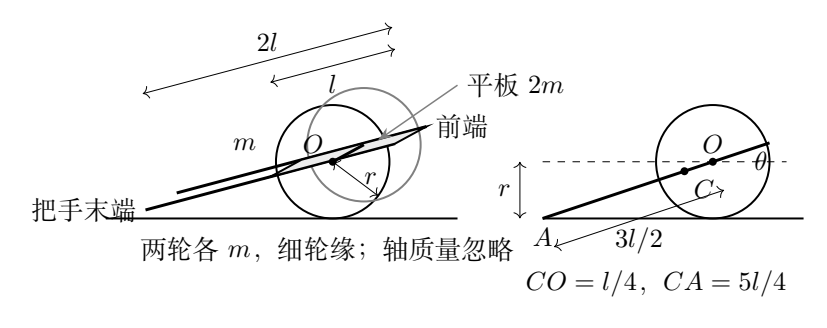
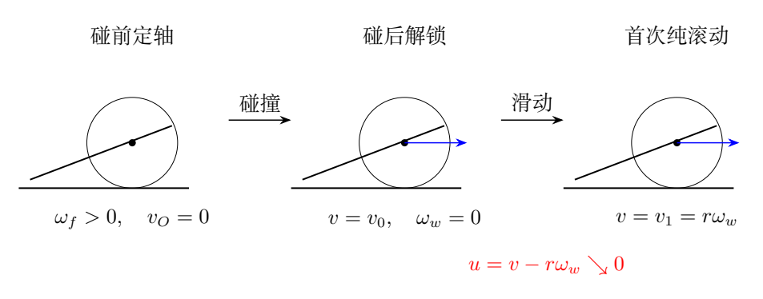
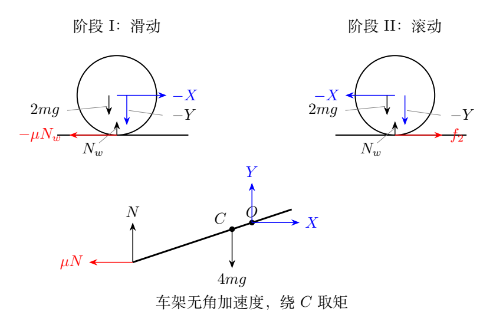

# 第 2 题　平板车碰撞、轮地滑动与滚动停止（50 分）

农用平板车的简化模型如图2a。两车轮半径均为$r$，忽略内外半径差，质量均为$m$，辐条质量可忽略；两轮可绕过轮心的光滑细车轴转动，轴质量忽略。车平板长$l$、质量$2m$，质心恰在车轴上。两车把手各可视为细直杆，长均为$2l$、质量均为$m$，前端与平板对齐。平板、把手和车轴固连，各自质量均匀。重力加速度为$g$。

（1）车轮被装置卡住，不能前后移动，但仍可绕车轴转动。把手提至水平位置由静止释放，求把手与水平地面碰撞前瞬间的转动角速度。

（2）在碰撞前瞬间立即撤去卡轮装置，同时将车轮和轴锁死，碰后瞬间立即解锁。碰撞时间较短但不为零，碰后把手末端在竖直方向不反弹。把手与地面、车轮与地面的滑动摩擦系数均为$\mu$，最大静摩擦力等于滑动摩擦力。求车轮从开始运动到静止的过程中车轴移动的距离。

## 一、题型定位

运动依次经历定轴下落、短时碰撞和碰后的两个摩擦阶段。三个过程的研究对象不同，不能把一个守恒式贯穿全过程：下落时可用机械能守恒；碰撞时有地面冲量，机械能不守恒；碰后又需要把车架和车轮分别列平动、转动方程。

把手末端始终在地面上，轮轴高度始终为$r$，所以碰后车架倾角固定，车架只平移。车轮解锁后可转动，最初角速度为零，轮心已有向前速度，轮地接触点会向前滑。摩擦力使轮心减速，同时使轮子开始顺时针转动，达到纯滚动条件后，轮地摩擦从向后滑动摩擦转为向前静摩擦。

最终距离应分支讨论：足够大的摩擦可在碰撞期间把水平运动完全消除；摩擦较小时先滑后滚；若$\mu=0$，碰后不会有限时停止。

## 二、知识点

### 1. 车架的质量、质心和转动惯量

以下把平板、两把手、轴称为车架，车轮另算。车架总质量为$4m$。取轴为沿车身方向坐标的原点，前端为$l/2$，把手末端为$-3l/2$，每根把手质心在$-l/2$。

车架质心到轴的距离为

$$
a_c=\frac{2m(l/2)}{4m}=\frac l4,
$$

位于把手末端一侧。两根把手绕轴的转动惯量是

$$
J_h=2\left[\frac{m(2l)^2}{12}+m\left(\frac l2\right)^2\right]
=\frac76ml^2.
$$

平板绕轴的转动惯量为

$$
J_p=\frac{2ml^2}{12}=\frac16ml^2.
$$

故车架绕轴惯量是

$$
\boxed{J_f=\frac43ml^2}.
$$

细轮的质量主要集中于半径$r$的轮缘，一轮惯量为$mr^2$，两轮总惯量为$J_w=2mr^2$。这不是均匀圆盘的$m r^2/2$。

### 2. 纯滚动约束与摩擦方向

用$v>0$表示车轴向把手前端的水平速度，$\omega_w>0$表示车轮顺时针角速度。轮地接触点滑速为

$$
u=v-r\omega_w.
$$

$u>0$时，地面对轮子的滑动摩擦向后。纯滚动以后$u=0$，摩擦方向必须由动力学求出；它不一定与$v$反向。

纯滚动的加速度约束为

$$
\dot v=r\dot\omega_w.
$$

若车速在减小，则顺时针角速度也减小，需要逆时针力矩，因此地面对车轮的静摩擦向前。

### 3. 冲量与连续力的不同尺度

碰撞时间为$\Delta t$。碰撞支持力很大，使$\int N\,dt$保持有限，滑动摩擦冲量也保持有限。通常的重力冲量$6mg\Delta t$在短时碰撞近似中可以忽略。

这并不意味着碰撞持续时间被设成零，也不意味着摩擦冲量为零。摩擦系数$\mu$乘的是支持力冲量，不是单独乘$mg\Delta t$。

## 三、物理图像

图2b把过程分为三个状态：碰前车架绕固定轴转动；碰后锁轮条件使整体瞬间只平移；解锁后轮地接触点先滑动，再达到纯滚动。把手末端在两个碰后阶段都沿地面滑动，持续耗散机械能。

图2c把两轮合并为一个轮系统，其支持力记为$N_w$；把手末端总支持力记为$N$。这里所有$N$都表示两根把手或两轮的合计，避免单个部件与合并系统相差二倍。

碰后车架质心为$C$，轴为$O$，末端为$A$。沿车架有$CO=l/4$、$CA=5l/4$。力矩平衡取车架质心$C$，因为车架角加速度为零。轴的水平、竖直作用力不能漏掉。

## 四、解题入口

第一问先计算车架质心下降量，再由势能损失求角速度。第二问先求碰后的车轴初速度$v_0$，检查是否大于零，然后在每一阶段重新求支持力。

第二阶段的阻力不能写成$\mu(6mg)$：车轮纯滚动时轮地静摩擦不做滑动耗散，且方向向前，只有把手末端滑动摩擦耗散。车轮的转动惯量还会使有效惯性大于总平动质量。

保留倾角$\theta$写出紧凑结果，最后以

$$
\sin\theta=\frac{2r}{3l},\qquad
\cos\theta=\frac{\sqrt{9l^2-4r^2}}{3l}
$$

替代即可。题中几何要求$0<2r/(3l)<1$，即把手能够从水平下落到地面而不遇到退化的竖直位置。

## 五、解析

### （1）碰前角速度

把手末端$A$距离轴$O$为$3l/2$。碰撞时$A$到轴的竖直高度差为$r$，所以

$$
\frac{3l}{2}\sin\theta=r.
$$

车架质心下降量为

$$
\Delta y_C=a_c\sin\theta
=\frac l4\frac{2r}{3l}=\frac r6.
$$

下落期间轴固定，轴力作用点不移动，不做功；车轮可以与轴相对转动，不随车架一起转动。车架机械能守恒：

$$
\frac12J_f\omega_f^2=4mg\frac r6.
$$

代入$J_f=4ml^2/3$，得到

$$
\boxed{\omega_f=\frac{\sqrt{gr}}l}.
$$

这里$\omega_f$是碰前车架角速度的大小。把手末端落下时，车架在图2a所示侧视坐标中逆时针转动；车轮此阶段仍没有平动，也不必具有同样的角速度。

### 碰前车架动量

令$x$向前、$y$向上。车架质心绕轴转动，位置相对轴为

$$
\boldsymbol r_{C/O}
=-\frac l4(\cos\theta,\sin\theta).
$$

叉乘得到质心速度

$$
\boldsymbol v_C
=\frac{l\omega_f}{4}(\sin\theta,-\cos\theta).
$$

记

$$
v_*=\frac{l\omega_f}{4}=\frac{\sqrt{gr}}4.
$$

则$v_{Cx}=v_*\sin\theta$，$v_{Cy}=-v_*\cos\theta$。两轮碰前轮心不动，所以系统总平动动量为$4m\boldsymbol v_C$，不能用$6m\boldsymbol v_C$。

### （2）短时碰撞后的平移速度

碰后把手末端竖直速度为零，轴竖直速度也为零；两点相隔一个有非零水平投影的刚性杆段，因此车架角速度为零。车轮与轴在碰撞中锁死，所以碰后解锁前的轮角速度也为零。

于是碰后六个$m$的质量都以$v_0$水平向前平移。锁轮产生的内部冲量可改变车架和车轮各自的角动量，但不改变整个系统的总线动量。

设碰撞中地面给全车的向上支持冲量为$J_N$。忽略重力短时冲量，竖直动量方程为

$$
J_N=0-4m(-v_*\cos\theta)
=4mv_*\cos\theta.
$$

在向前滑动的分支中，地面总水平摩擦冲量为$-\mu J_N$。水平动量方程给

$$
6mv_0-4mv_*\sin\theta=-\mu J_N,
$$

因而

$$
\boxed{
v_0=\frac{\sqrt{gr}}6
(\sin\theta-\mu\cos\theta)}.
$$

碰前各接触点向前运动，滑动摩擦向后；这个式子成立到滑速减至零为止。若它将给出负值，表示摩擦能够在碰撞期间消除前进趋势，不能继续把滑动摩擦方向固定而推出倒退。

### 碰撞中的静止分支

所需静摩擦冲量大小与支持冲量之比为

$$
\frac{4mv_*\sin\theta}{4mv_*\cos\theta}
=\tan\theta.
$$

当$\mu\ge\tan\theta$，最大静摩擦可以承受这个比值，碰后系统静止：

$$
\boxed{s=0,\qquad
\mu\ge\tan\theta
=\frac{2r}{\sqrt{9l^2-4r^2}}}.
$$

以下讨论$0<\mu<\tan\theta$，此时$v_0>0$。碰撞结束后解锁，轮角速度初值为零，故轮地滑速$u(0)=v_0>0$。

### 阶段I：车轮滑动并逐渐转动

以上碰撞解采用图示车架较长、轮与把手末端持续接地的双接触模型。对极端几何比例，还应检查法向冲量不为负。设末端支持冲量为$J_A$、轮地支持冲量为$J_w$，总量为$J_N$。关于碰前轴位置取角冲量，碰前角动量为$J_f\omega_f$，碰后纯平移角动量为$2mr v_0/3$，地面摩擦冲量力臂为$r$，可得

$$
\frac{J_A}{J_N}
=\frac{8-\sin^2\theta-8\mu\sin\theta\cos\theta}
{9\cos^2\theta},
\qquad J_w=J_N-J_A.
$$

这个双接触分支须满足$0\le J_A/J_N\le1$；若不满足，说明短时撞击中某处会脱离接触，必须补充其再接触过程，不能把后面的双接触公式无条件延伸到任意$r/l$。通常把手相对轮径较长的图示配置及下述数值变式满足这一条件。

两个接触部位都向前滑动，地面总摩擦力为

$$
f_{\rm tot}=-\mu(N+N_w).
$$

全车竖直方向无加速度，所以

$$
N+N_w=6mg.
$$

全车总质量$6m$，水平加速度于是为

$$
\boxed{a_1=-\mu g}.
$$

此时车架和轮心的水平速度相同，车架所有点也都作同样平移。

### 阶段I的把手支持力

设轴给车架的力为$(X,Y)$。车架水平、竖直方程为

$$
X-\mu N=4ma_1,\qquad
Y+N=4mg.
$$

因此

$$
X=\mu N+4ma_1,\qquad Y=4mg-N.
$$

以车架质心取逆时针为正。末端相对质心的位置是$-5l(\cos\theta,\sin\theta)/4$，轴相对质心的位置是$l(\cos\theta,\sin\theta)/4$。车架无转动加速度，故

$$
-5N\cos\theta-5\mu N\sin\theta
+Y\cos\theta-X\sin\theta=0.
$$

已除去公共的$l/4$。代入$X,Y$及$a_1=-\mu g$，

$$
4mg\cos\theta-6N\cos\theta
-6\mu N\sin\theta+4\mu mg\sin\theta=0.
$$

可整理为

$$
(4mg-6N)(\cos\theta+\mu\sin\theta)=0.
$$

括号$\cos\theta+\mu\sin\theta>0$，所以

$$
\boxed{N=\frac23mg,\qquad
N_w=\frac{16}{3}mg}.
$$

两轮承受大部分车重，与车架质心靠近轴这一几何事实一致。支持力并非简单按质量$4m$、$2m$分配。

### 达到纯滚动的时刻

地面对两轮的摩擦力为$-\mu N_w$，对轮心产生顺时针力矩。两轮惯量为$2mr^2$：

$$
2mr^2\dot\omega_w=\mu N_wr.
$$

于是

$$
\boxed{\dot\omega_w=\frac{8\mu g}{3r}}.
$$

这一阶段

$$
v(t)=v_0-\mu gt,\qquad
r\omega_w(t)=\frac83\mu gt.
$$

接触点滑速为

$$
u(t)=v_0-\frac{11}{3}\mu gt.
$$

第一次达到$u=0$的时间是

$$
\boxed{t_r=\frac{3v_0}{11\mu g}}.
$$

此时的轮心速度为

$$
\boxed{v_1=v(t_r)=\frac8{11}v_0}.
$$

它仍为正，说明纯滚动的建立发生在轮心停止之前。阶段I的车轴距离为

$$
\begin{aligned}
s_1&=\int_0^{t_r}(v_0-\mu gt)\,dt\\
&=v_0t_r-\frac12\mu gt_r^2\\
&=\boxed{\frac{57v_0^2}{242\mu g}}.
\end{aligned}
$$

也可用$v_1^2-v_0^2=2a_1s_1$核对，两条计算得到同一个结果。

### 阶段II：车轮纯滚动，把手继续滑动

以$f_2$表示地面对两轮向前的静摩擦。两轮的转动方程为

$$
2mr^2\dot\omega_w=-f_2r.
$$

纯滚动约束$\dot v=r\dot\omega_w=a_2$给

$$
\boxed{f_2=-2ma_2}.
$$

全车水平外力只有轮地静摩擦与把手滑动摩擦：

$$
6ma_2=f_2-\mu N_2.
$$

代入上式，得到

$$
\boxed{a_2=-\frac{\mu N_2}{8m}}.
$$

这里$8m=6m+J_w/r^2$是平动加上轮转动的有效惯性，不能用$6m$替代。

### 阶段II的支持力与加速度

轴给车架的力仍记为$(X_2,Y_2)$。由车架平动方程，

$$
X_2=4ma_2+\mu N_2=\frac{\mu N_2}{2},
\qquad
Y_2=4mg-N_2.
$$

再次用车架质心的力矩平衡：

$$
Y_2\cos\theta-X_2\sin\theta
-5N_2(\cos\theta+\mu\sin\theta)=0.
$$

代入并整理，

$$
4mg\cos\theta
=N_2\left(6\cos\theta+\frac{11}{2}\mu\sin\theta\right).
$$

记无量纲量

$$
D_f=12+11\mu\tan\theta,
$$

便有

$$
\boxed{N_2=\frac{8mg}{D_f}},
\qquad
\boxed{a_2=-\frac{\mu g}{D_f}}.
$$

阶段II的轮地支持力为$N_{w2}=6mg-N_2>0$。此时把手摩擦是唯一做负机械功的接触力，但静摩擦也影响平动和转动之间的分配。

### 纯滚动能否维持

纯滚动所需静摩擦是

$$
f_2=\frac{2m\mu g}{D_f}.
$$

其与最大静摩擦的比值为

$$
\frac{f_2}{\mu N_{w2}}
=\frac{2}{6D_f-8}<1,
$$

因为$D_f\ge12$。所以纯滚动约束在这一阶段能够维持，不会再次转入滑动。$\mu=0$时表达式要用极限理解，此时没有减速和有限停止时间。

### 阶段II距离与总距离

车轴速度由$v_1$减到零，加速度恒为$a_2$，所需时间为

$$
t_2=\frac{D_fv_1}{\mu g}.
$$

距离为

$$
\boxed{s_2=\frac{D_fv_1^2}{2\mu g}
=\frac{64D_fv_0^2}{242\mu g}}.
$$

因此完整结果可写成

$$
\boxed{
s=
\begin{cases}
\displaystyle
\frac{v_0^2}{242\mu g}
\left(825+704\mu\tan\theta\right),
&0<\mu<\tan\theta,\\[4pt]
0,&\mu\ge\tan\theta,
\end{cases}}
$$

其中

$$
v_0=\frac{\sqrt{gr}}6(\sin\theta-\mu\cos\theta),
\qquad
\sin\theta=\frac{2r}{3l}.
$$

若希望完全只含题给量，在前一分支中替代为

$$
\boxed{
s=\frac{r}{8712\mu}
\left(\frac{2r-\mu\sqrt{9l^2-4r^2}}{3l}\right)^2
\left(825+\frac{1408\mu r}{\sqrt{9l^2-4r^2}}\right)}.
$$

紧凑的$v_0,\theta$形式更便于检查，不需要把所有根式展开。距离与$m$、$g$无关，是因为初速度平方正比于$gr$，摩擦减速度正比于$g$，质量在惯量和力中共同消去。

### 对总距离的边界检验

当$\mu\to\tan\theta$的下侧，$v_0\to0$，总距离按$(\tan\theta-\mu)^2$趋于零，与静止分支连续相接。不能把这一连续性解释为仍有一小段倒退。

当$\mu\to0^+$时，$v_0$趋于正值而减速趋于零，$s$发散。严格$\mu=0$时，轮角速度保持零，车架和轮心以$v_0$匀速平移，不存在题意中的有限停止时刻。

阶段II的机械能可作另一核对。平动加轮转动能为

$$
K_2=\frac12(6m)v^2+\frac12(2mr^2)\frac{v^2}{r^2}
=4mv^2.
$$

其变化率为$8mva_2=-\mu N_2v$，恰好等于把手滑动摩擦功率。轮地静摩擦接触点瞬时静止，不向系统输入或取出机械能。

## 六、关键洞察

碰撞结束时六个$m$都在平移，但碰撞开始前只有四个$m$有质心动量；质量参与运动的方式发生变化。把全部质量始终写成$6m$会直接改变碰后初速度。

两阶段的分界是接触点滑速$u=v-r\omega_w$降到零。轮心还没停，摩擦方向已经改变。进入纯滚动后，静摩擦向前仍能与整体减速同时发生，因为它需要给正在变慢的顺时针轮子提供逆时针力矩。

车架支持力须随动力学重新确定。阶段I的$2mg/3$不能直接搬入阶段II；惯性力矩与轴水平作用力改变了分配。

## 七、易错点

薄轮应取$mr^2$，均匀圆盘的$mr^2/2$不适用。车架质心位于轴后$l/4$，不是某根把手的$l/2$处。

碰撞中有支持冲量就有可能产生有限摩擦冲量，不能用“碰撞太短”把它删去。若碰后速度式给出负值，先检查静摩擦分支，不把负值作为倒退速度。

纯滚动并不使整车无耗散；把手末端仍在滑动。纯滚动的静摩擦也不等于$\mu N_{w2}$，应先求所需值并检查上界。

## 八、课堂讲解建议

用一张过程表写下轴是否固定、轮是否锁死、把手是否接地、采用什么方程。第一问由几何下降量进入能量，第二问先只处理碰撞而不急于列后续受力。

把学生的摩擦箭头集中检查在图2c：阶段I轮地摩擦向后，阶段II向前。让学生分别从接触点滑速和转动方程解释方向。最终用机械能变化率核对阶段II，可同时检验有效惯性、摩擦符号和支持力。

## 九、变式训练

### 变式1　两轮改成均匀实心圆盘

保持车架和碰后$v_0$不变，两轮总惯量改为$J_w=mr^2$。求滑动终止速度。

**解答：** 两处仍滑动时全车$a_1=-\mu g$，车架受力与力矩给$N=2mg/3$、$N_w=16mg/3$。但轮角加速度变为

$$
\dot\omega_w=\frac{\mu N_wr}{mr^2}
=\frac{16\mu g}{3r}.
$$

于是$u=v_0-(19/3)\mu gt$，首次纯滚动时间$t_r=3v_0/(19\mu g)$，速度为

$$
\boxed{v_1=\frac{16}{19}v_0}.
$$

比原题$8v_0/11$更大：轮转动惯量变小，更早追上纯滚动角速度，轮心在滑动阶段损失的速度较少。不能仅把最终距离式中的某个数字替换而不重算支持力阶段。

### 变式2　给定几何及摩擦系数

取$l=1.00\,\mathrm m$、$r=0.300\,\mathrm m$、$\mu=0.100$、$g=9.80\,\mathrm{m/s^2}$。求两阶段时间与距离。

**解答：** $\sin\theta=0.200$、$\cos\theta=\sqrt{0.96}$，$\tan\theta=0.204124>\mu$，进入运动分支。

$$
v_0=\frac{\sqrt{2.94}}6
(0.2-0.1\sqrt{0.96})\simeq0.02916\,\mathrm{m/s}.
$$

因此

$$
t_r=\frac{3v_0}{11(0.1)(9.8)}
\simeq8.11\times10^{-3}\,\mathrm s,
\qquad
v_1=\frac8{11}v_0\simeq0.02120\,\mathrm{m/s}.
$$

$D_f=12.22454$，故$t_2=D_fv_1/(0.98)\simeq0.2645\,\mathrm s$。距离分别为

$$
s_1=\frac{57v_0^2}{242(0.98)}
\simeq2.04\times10^{-4}\,\mathrm m,
$$

$$
s_2=\frac{D_fv_1^2}{2(0.98)}
\simeq2.80\times10^{-3}\,\mathrm m.
$$

合计约$3.01\,\mathrm{mm}$，不能因碰前角速度不小而忽略碰撞的能量损失。

### 变式3　纯滚动阶段的静摩擦裕度

仍为薄轮，求阶段II轮地静摩擦相对其上限的比例，并判断最不利的参数范围。

**解答：** 所需$f_2=2m\mu g/D_f$，支持力$N_{w2}=mg(6-8/D_f)$，所以

$$
\frac{f_2}{\mu N_{w2}}=\frac1{3D_f-4}
=\frac1{32+33\mu\tan\theta}.
$$

该比值随$\mu\tan\theta$增加而减小，最大极限为$1/32$，远小于1。因此在题设共同摩擦系数下，阶段II有足够的静摩擦裕度。若两种接触面的摩擦系数不相同，就必须重新比较实际轮地系数，不能沿用此结论。

### 变式4　反求无需碰后位移的最低摩擦系数

取$r/l=1/4$，求碰撞以后静止所需的最低共同摩擦系数，并判断$\mu=0.20$时是否发生后续运动。

**解答：** 碰撞中需消除水平动量的摩擦冲量与支持冲量之比为$\tan\theta$。几何给

$$
\sin\theta=\frac16,\qquad
\cos\theta=\frac{\sqrt{35}}6.
$$

所以

$$
\boxed{\mu_{\rm crit}=\frac1{\sqrt{35}}\simeq0.16903}.
$$

$\mu=0.20>\mu_{\rm crit}$，碰撞过程中滑动停止，余下接触作用由静摩擦承担，后续车轴距离为零。若机械地使用持续滑动公式会得到负$v_0$，说明参数已超出持续滑动分支的适用范围。
