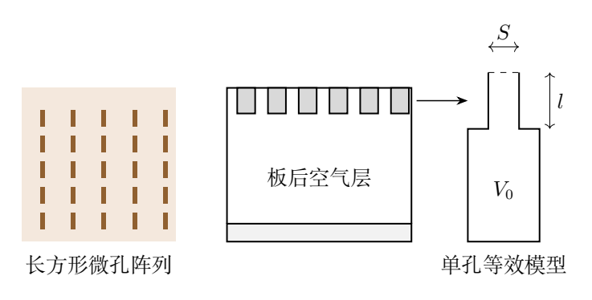
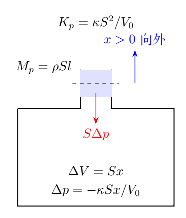
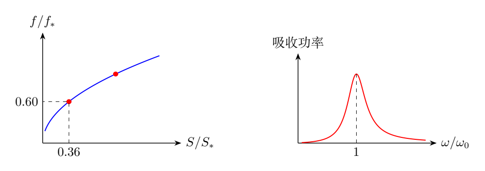

# 第 4 题　微孔竹板与亥姆霍兹共振器（40 分）

2016年9月杭州G20峰会会议厅的装饰展示了节能环保理念与浙江竹文化。部分墙面使用微孔竹板，既作装饰，也实现声波共振吸收。竹板上有面积不同、周期排列的长方形微孔；声波进入微孔后使孔内空气柱振动。单个微孔与板后空气层可简化为图4a中的亥姆霍兹共振器。孔深均为$l$，单孔对应的空气腔体体积均为$V_0$，孔横截面积为$S$。

声波在空气中传播可视为绝热过程，声速$v_s$、空气密度$\rho$及体积弹性模量$\kappa$满足

$$
v_s=\sqrt{\frac{\kappa}{\rho}},
\qquad
\kappa=-\frac{\Delta p}{\Delta V/V}
=-V\frac{\Delta p}{\Delta V}.
$$

标准状态为$T=273\,\mathrm K$、$p=1.01\times10^5\,\mathrm{Pa}$。空气可视为理想气体，摩尔质量$M_{\rm mol}=29.0\,\mathrm{g/mol}$、热容比$\gamma=7/5$，气体常量$R_g=8.31\,\mathrm{J/(K\cdot mol)}$。

（1）求标准状态下空气密度和声速$v_s$。

（2）求共振器吸收声波的频率，用$v_s,S,l,V_0$表示。

（3）吸收$120\,\mathrm{Hz}$和$200\,\mathrm{Hz}$声波的两种微孔，横截面积之比应是多少？

## 一、题型定位

可将孔内空气柱视为振子的质量，将腔内气体压缩产生的回复力等效为弹簧力。孔深$l$控制移动空气的质量，腔体体积$V_0$影响压缩刚度，两者作用不同。

第一问求密度时使用理想气体状态方程，求声速时使用小扰动的绝热压缩。不能因为环境温度给定，就把传播中的压缩过程改成等温过程；波动快、来不及与环境交换足够热量，题目已规定按绝热处理。

理想无阻尼模型可以求固有频率，但不能单独给出实际的净吸收率。题意的“吸收频率”按弱耗散情况下的共振频率解释：实际空气黏性、热损失等把进入共振器的机械能转为内能。没有这些损失，振子只储能与返还能量。

## 二、知识点

### 1. 从摩尔量得到质量密度

若空气质量为$m_a$，物质的量为$m_a/M_{\rm mol}$，

$$
pV=\frac{m_a}{M_{\rm mol}}R_gT.
$$

除以$V$并解出密度，

$$
\boxed{\rho=\frac{M_{\rm mol}p}{R_gT}}.
$$

计算前必须把$29.0\,\mathrm{g/mol}$换成$0.0290\,\mathrm{kg/mol}$。压力用$\mathrm{Pa}$，温度用开尔文；摄氏温度不能直接进入分母。

### 2. 小扰动中的体积弹性模量

绝热气体满足

$$
pV^\gamma=\text{常量}.
$$

在平衡态附近微分，

$$
V^\gamma\,dp+\gamma pV^{\gamma-1}\,dV=0.
$$

所以

$$
\frac{dp}{dV}=-\frac{\gamma p}{V},
\qquad
\boxed{\kappa=\gamma p}.
$$

压缩对应$dV<0$、$dp>0$，负号使$\kappa>0$。当$\Delta V$很小时，题给有限增量式就是这个微分结果的线性近似。

### 3. 质量—弹簧模型

孔内空气柱的长度为$l$、截面积为$S$，在集中参数近似下整体以同一速度移动，质量为

$$
M_p=\rho Sl.
$$

若其向外位移为$x$，腔体的等效体积增量是$Sx$。压强改变为$-\kappa Sx/V_0$，再乘作用面积$S$得到回复力。因此等效弹簧常量与$S^2$成正比，而质量只与$S$成正比。

## 三、物理图像

图4b中的$x>0$表示孔内空气柱向外移动。腔体膨胀，压强低于外界，压差把空气柱向内拉；当$x<0$时，腔体受压，压差向外推。回复力总与位移相反。

腔体体积变化并不表示整个腔壁真的在移动，而是空气柱边界的位置改变使腔体内部气体获得额外的可占据体积。壁面仍可视为刚性。

微孔对应的声学振子频率低于孔内形成驻波的频率时，可以把孔内空气看成一个集中的质量，把腔体压强看成空间均匀。若孔深和腔体尺寸不再远小于声波波长，就需要分布波动模型，而不能仅保留$\rho Sl$这个单一质量。

图4c左侧显示$f_0\propto\sqrt S$，所以频率比不是面积比。右侧显示实际响应的有限峰宽，需要阻尼才能产生有限稳态吸收功率。

## 四、解题入口

依次写下$\rho$、$\kappa$、$M_p$和等效弹簧常量$K_p$：

$$
\rho=\frac{M_{\rm mol}p}{R_gT},\quad
\kappa=\gamma p,\quad
M_p=\rho Sl,\quad
K_p=\frac{\kappa S^2}{V_0}.
$$

随后用$\omega_0^2=K_p/M_p$，最后才把$\kappa/\rho$认成$v_s^2$。这样可避免“见到声速就直接猜公式”，也能解释每一个几何量的指数。

第三问中两类微孔的$l,V_0$和所处空气状态相同，才可以把这些量约掉。若腔体积随孔面积变化，面积比不再单独等于频率比平方。

## 五、解析

### （1）标准状态的密度

代入理想气体结果，

$$
\rho_{\rm st}
=\frac{(29.0\times10^{-3})(1.01\times10^5)}
{8.31\times273}
\ \mathrm{kg/m^3}.
$$

逐步计算：分子为$2929$，分母为$2268.63$，因此

$$
\boxed{\rho_{\rm st}=1.29109\,\mathrm{kg/m^3}
\simeq1.29\,\mathrm{kg/m^3}}.
$$

量纲可直接核对：$R_gT/M_{\rm mol}$具有$\mathrm{m^2/s^2}$单位；压力除以这一量就是$\mathrm{kg/m^3}$。

### 绝热声速

由$\kappa=\gamma p$，

$$
v_s^2=\frac{\gamma p}{\rho}.
$$

再用$\rho=M_{\rm mol}p/(R_gT)$消去密度，得到

$$
\boxed{v_s=\sqrt{\frac{\gamma R_gT}{M_{\rm mol}}}}.
$$

对给定温度和组成的理想气体，压力在这个表达式中消去。压力提高时密度也按比例提高，弹性模量和惯性密度的变化相互抵消。

数值为

$$
v_s=
\sqrt{\frac{(7/5)(8.31)(273)}{0.0290}}
\ \mathrm{m/s}
=330.938\,\mathrm{m/s}.
$$

故

$$
\boxed{v_s\simeq331\,\mathrm{m/s}}.
$$

若误用等温模量$p$，声速会小一个$\sqrt\gamma$因子，约为$280\,\mathrm{m/s}$，与题设的绝热声速不同。

### （2）空气柱受到的回复力

设平衡腔体积为$V_0$，内部压强与外界平衡压强均为$p_0$。空气柱向外位移$x$，有

$$
\Delta V=Sx.
$$

小振幅假设要求$|Sx|\ll V_0$。绝热线性化给

$$
\Delta p=-\gamma p_0\frac{Sx}{V_0}.
$$

压力差作用在空气柱的腔内端面和外界端面，合力为

$$
F=S[(p_0+\Delta p)-p_0]
=S\Delta p.
$$

所以

$$
\boxed{F=-\frac{\gamma p_0S^2}{V_0}x}.
$$

一份$S$来自体积改变，一份$S$来自压强转为力，缺少任意一份都会改变频率的量纲和面积指数。

### 振动方程与频率

空气柱质量为$M_p=\rho Sl$，牛顿方程为

$$
\rho Sl\,\ddot x
=-\frac{\gamma p_0S^2}{V_0}x.
$$

除以质量，

$$
\ddot x+\frac{\gamma p_0S}{\rho lV_0}x=0.
$$

故角频率为

$$
\omega_0=
\sqrt{\frac{\gamma p_0S}{\rho lV_0}}
=v_s\sqrt{\frac{S}{lV_0}}.
$$

角频率是每秒的相位变化率，而普通频率是每秒振动周期数，两者相差$2\pi$：

$$
\boxed{f_0=\frac{v_s}{2\pi}
\sqrt{\frac{S}{lV_0}}}.
$$

量纲方面，$S/(lV_0)$的单位为$\mathrm{m^{-2}}$，开方后乘$v_s$给$\mathrm{s^{-1}}$。若根号内误写成$Sl/V_0$，将不能得到频率单位。

### 用能量法独立求得同一回复常量

腔体气体的线性压缩能可以通过准静态小增量做功计算。设相对平衡体积改变为$\delta V$，外力对气体所做的增量功为

$$
dU_{\rm comp}
=-\Delta p\,d(\delta V)
=\frac{\kappa}{V_0}\delta V\,d(\delta V).
$$

从零改变积分到$\delta V=Sx$，

$$
U_{\rm comp}=
\int_0^{Sx}\frac{\kappa}{V_0}u\,du
=\frac{\kappa S^2}{2V_0}x^2.
$$

总振动能为

$$
E_{\rm osc}
=\frac12\rho Sl\,\dot x^2
+\frac12\frac{\kappa S^2}{V_0}x^2.
$$

对时间求导并令无损情况下能量不变，

$$
\dot x\left[\rho Sl\,\ddot x+
\frac{\kappa S^2}{V_0}x\right]=0.
$$

得到与牛顿法相同的方程。这条路线独立检查了回复力方向和$S^2$。

### （3）120 Hz与200 Hz微孔的面积比

在声速、孔深、腔体积均相同的条件下，

$$
\frac{f_{120}}{f_{200}}
=\sqrt{\frac{S_{120}}{S_{200}}}.
$$

因此

$$
\boxed{
\frac{S_{120}}{S_{200}}
=\left(\frac{120}{200}\right)^2
=0.36=\frac9{25}}.
$$

所以较低频微孔的截面积应更小。若长方形微孔形状相似，长宽均按同一比例变化，则两个对应线性尺寸之比是$\sqrt{0.36}=0.60$；若孔长保持不变，只改变宽，则孔宽比就是0.36。

### 为什么小孔反而对应低频

减小$S$时空气柱质量按$S$减少，但腔体回复常量按$S^2$减少。回复常量下降得更快，故$K_p/M_p$随$S$下降，固有频率下降。

增加孔深$l$只在本题理想模型中增加空气柱质量，频率按$l^{-1/2}$下降。增加腔体积$V_0$使同样位移引起的相对体积变化减小，频率按$V_0^{-1/2}$下降。这些变化可从方程直接识别，而不必记忆成组的比例关系。

### 固有频率与实际吸声的联系

理想振子的解为$x=A\cos(\omega_0t+\phi)$，能量不衰减。实际若有线性阻尼$c_d\dot x$，并受外界声压$p_a\cos\omega t$驱动，方程为

$$
M_p\ddot x+c_d\dot x+K_px=Sp_a\cos\omega t.
$$

设稳态位移振幅为$X$，有

$$
X=\frac{Sp_a}
{\sqrt{(K_p-M_p\omega^2)^2+(c_d\omega)^2}}.
$$

稳态平均耗散功率是

$$
\overline P_{\rm loss}
=c_d\overline{\dot x^2}
=\frac12c_d\omega^2X^2.
$$

所以共振附近空气柱速度大，阻尼耗散也大，外界声能能够被吸收。这个表达式需要$c_d>0$；让$c_d=0$后直接在共振点使用稳态振幅公式，会出现无界值，说明有限稳态解不再成立。

本题未给阻尼、端部修正或微孔间相互作用参数，因而主答案保留理想固有频率，不声称能够算出吸收峰宽、吸收比例或真实材料的最佳孔型。

## 六、关键洞察

压力差才是振动的驱动力，平衡大气压在两端抵消。回复常量中的$S^2$由“位移转体积”和“压差转力”两步组成。

理想气体声速在固定温度下与压强无关，而同一共振器频率与温度的平方根成正比。几何共振与材料耗散共同决定吸声，主问题给出的信息只足以确定前者。

## 七、易错点

把摩尔质量29直接代入SI公式，会使密度增大一千倍、声速缩小$\sqrt{1000}$倍。声速公式中的温度必须是开尔文。

把腔体体积变化写成$x$，或把压力直接当成力，都会漏掉$S$。求频率时忘记$2\pi$会把角频率当作Hz。

面积比0.36不等于两个频率之比0.60。无损振子无法单独说明净吸声，实际吸收需要能量耗散。

## 八、课堂讲解建议

先画空气柱向外、向内两个位置，逐个确认压差箭头的方向，再引入$\Delta V=Sx$。板书把质量和回复常量放在相邻两列，帮助学生看到面积的不同指数。

声速部分用气体状态方程消去压强，讨论“压强不影响声速”的条件。结尾用受迫振动说明固有频率与吸收峰的关系，阻尼只作模型说明，不把未知参数强行代入原题。

## 九、变式训练

### 变式1　温度变化引起的频率偏移

同一共振器在$273\,\mathrm K$时固有频率为$200\,\mathrm{Hz}$。气体组成与$\gamma$不变，温度升到$300\,\mathrm K$，求新频率。

**解答：** 固有频率平方与$\kappa/\rho=\gamma R_gT/M_{\rm mol}$成正比，几何不变，所以

$$
\boxed{f_2=f_1\sqrt{\frac{T_2}{T_1}}
=200\sqrt{\frac{300}{273}}
\simeq209.66\,\mathrm{Hz}}.
$$

小温差情况下$\Delta f/f\simeq\Delta T/(2T)$。不能把温差$27\,\mathrm K$直接代入平方根比，也不能用摄氏温度0与27作比。

### 变式2　孔口端部附加惯性

现在孔口两端的空气运动用附加有效长度$\Delta l$表示，且题给$\Delta l=0.50l$。腔体体积不变，求频率相对于理想值的比。

**解答：** 质量变为$\rho S(l+\Delta l)$，回复常量不变，因此

$$
f_{\rm eff}=\frac{v_s}{2\pi}
\sqrt{\frac{S}{(l+\Delta l)V_0}}.
$$

所以

$$
\boxed{\frac{f_{\rm eff}}{f_0}
=\sqrt{\frac{l}{l+\Delta l}}
=\sqrt{\frac23}\simeq0.81650}.
$$

端部附加空气提供惯性，降低频率。这里$\Delta l$是本变式明确给定的参数；原题没有孔口形状和附加长度信息，不能默认加一个数值修正。

### 变式3　多个相同孔共用一个腔

$N$个相同孔各有面积$S$、孔深$l$，共用体积$V_0$的单一腔体。所有空气柱同相并具有相同位移$x$，求这一集体模式频率。

**解答：** 总体积变化为$NSx$，腔压变化为$-\kappa NSx/V_0$。每一孔受到回复力$-\kappa NS^2x/V_0$，质量仍为$\rho Sl$，所以

$$
\ddot x+\frac{N\kappa S}{\rho lV_0}x=0,
\qquad
\boxed{f_N=\sqrt N\,f_1}.
$$

若$n$个孔各有独立体积$V_0$的腔体，则每个仍为$f_1$，不出现$\sqrt N$。对于位移满足$\sum_jx_j=0$的不同相模式，理想均匀腔体的总体积不变，腔压回复在本模型中为零；真实孔间耦合和局部气体惯性需另外考虑。

### 变式4　位移峰与吸收功率峰

受迫模型写成$\ddot x+2\beta\dot x+\omega_0^2x=F_0\cos\omega t/M_p$，$\beta>0$。比较位移振幅最大频率与平均吸收功率最大频率。

**解答：** 位移振幅平方正比于

$$
\frac1{(\omega_0^2-\omega^2)^2+4\beta^2\omega^2}.
$$

对分母求导，非零驻点满足$\omega^2=\omega_0^2-2\beta^2$。所以$\beta<\omega_0/\sqrt2$时位移峰在$\omega_x=\sqrt{\omega_0^2-2\beta^2}$；阻尼更大时位移振幅从零频起单调下降。

平均吸收功率正比于

$$
\frac{\omega^2}
{(\omega_0^2-\omega^2)^2+4\beta^2\omega^2}.
$$

令$z=\omega^2$，对$z$求导，分子整理为$\omega_0^4-z^2$，唯一正根是$z=\omega_0^2$。故

$$
\boxed{\omega_P=\omega_0}.
$$

在外力振幅和阻尼系数不随频率变化的模型中，功率峰恰在固有频率，而位移峰略低；两种“共振最大”所指的观测量不同。
