# 第 1 题　盛水杯的最佳高度与三脚凳载荷转移（40 分）

旅行车上有一个半径为$R$的三脚圆凳，可视为刚性结构。三个相同凳脚的端点连线均水平，构成边长为$a$的等边三角形；凳子质心位于其轴上的$G$点。半径为$r$的圆筒形薄壁茶杯放在凳面上，杯底中心位于凳面中心$O$。茶杯质量为$m$，远小于凳子质量；杯底质量为$m/5$，杯壁和杯底各自质量均匀。杯高为$H$，杯底厚度相对于杯高可忽略。茶水密度为$\rho$，重力加速度为$g$。

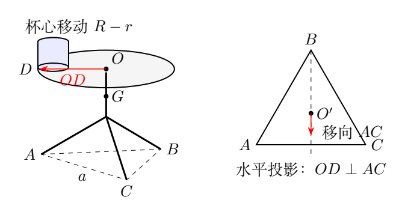

（1）为了使茶杯所盛茶水尽可能多并保持足够稳定，杯中茶水的最佳高度是多少？

（2）茶杯底面边缘缓慢滑移到与圆凳边缘内切于$D$点时静止，凳面边有小凸缘，防止杯子滑出；凳面和凸缘各自质量均匀。已知$OD\perp AC$，求此时车内底板对各凳脚的支持力相对于滑移前的改变。

## 一、题型定位

第一问是变质量系统的质心极值，第二问是刚体静力学中的载荷转移。倒水以后，不仅水的质心改变，水的质量也随水面高度改变，所以不能只比较杯壁和水的高度，更不能对某一个高度取简单平均。

题目中的“最佳”采用杯与水整体质心最低的稳定性判据：在杯底半径一定、整体按准静态刚体倾倒模型比较时，较低质心对应较大的倾倒临界角。此判据给出参考解答所采用的最佳高度。若“足够稳定”另指定一个临界角或车的加速度，则可以在满足该阈值的高度中再求最大水量，那是另一个约束优化问题。

第二问所求是支持力的变化，不必知道凳子的质量和凳面高度。重物平移前后总重力相同，只有重力作用线的水平位置发生改变。对前后两组静力平衡方程作差，可直接消去不变的凳子自重。

## 二、知识点

### 1. 质心的一阶矩定义

取凳面为$y=0$，向上为正。若杯中水深为$h$，圆筒截面积为$A_c=\pi r^2$，单位高度的水质量记为

$$
k=\rho A_c=\rho\pi r^2.
$$

$k$的单位是$\mathrm{kg/m}$，不是水的总质量。高度在$y$到$y+dy$间的水层质量为

$$
dm=k\,dy.
$$

因而水的质量及关于杯底的一阶质量矩分别为

$$
m_w=\int_0^h k\,dy=kh,
\qquad
M_{1w}=\int_0^h yk\,dy=\frac12kh^2.
$$

水的质心是$h/2$。杯底的质量集中在$y=0$，对一阶矩贡献为零；杯壁质量$4m/5$均匀分布在$0\le y\le H$，质心为$H/2$。空杯质心因此在$2H/5$处。

### 2. 极值的物理区间

水深必须满足

$$
0\le h\le H.
$$

驻点只是候选值，还需排除负根、检查驻点前后导数的符号以及端点。若求得驻点落在杯外，实际最优值只能落在允许区间的边界。本题驻点恰好始终在杯内。

### 3. 三个竖直支持力的静力平衡

对全部凳子及其载荷取为研究对象，外力包括三脚支持力、凳重与杯水总重。三个支持力的作用线竖直，关于任意竖直轴的力矩自动为零；有效条件是一个竖直合力方程和两个水平轴方向的力矩方程。

在三个脚均接触地板时，三个竖直支持力可以唯一确定。求出的支持力若为负，表示该脚需要地板向下拉，普通接触无法提供，因此必须改成翘脚后的支撑模型。

## 三、物理图像

图1b中，浅水层的高度低于空杯质心。增加这种水层会把整体质心向下拉；水面升到较高位置后，新增水层反而把质心向上推。因此整体质心随水深先降后升，最低点并不在“水质心与杯质心相等”处。

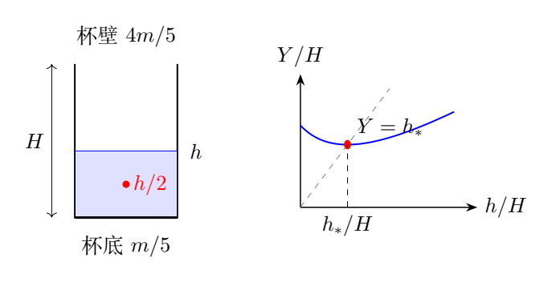

图中的水面高度是新增极薄水层的高度。质心最低的条件，是新增水层高度恰好等于加水前杯水整体质心，即$h=Y(h)$。这一关系能提供一条不直接展开商法则的推导路线。

平移后杯心在$OD$方向上，距离凳面中心为$R-r$，而不是$R$。杯底与凳面内切时，两个圆的半径沿同一直线，圆心距等于半径之差。杯水总重力作用线移向$AC$，于是$A,C$两脚增载，远离杯子的$B$脚减载。

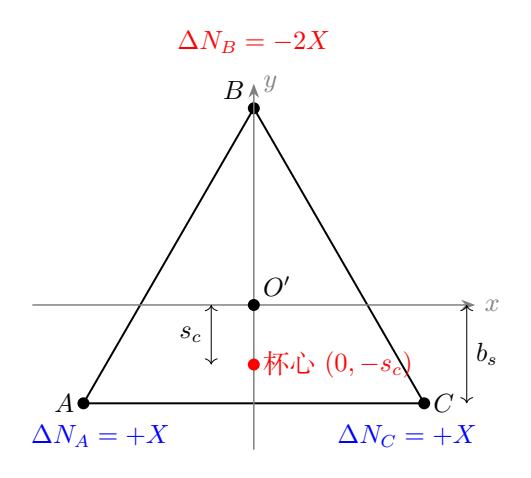

图1c使用顶点$B$朝上的平面坐标：$x$沿$AC$，$y$从$AC$指向$B$。支撑三角形的中心记为$O'$；凳面中心$O$的投影就是$O'$。杯心向$AC$移动后位于$y=-(R-r)$。

## 四、解题入口

先用一阶矩除以总质量得到$Y(h)$，再求其极值。水质量不能预先当成常量。为了减少根式内的代数错误，可以先保留$k$，最后才把$\rho\pi r^2$代回。

第二问先记杯水总重力为$W$，再把三脚几何力臂写成

$$
b_s=\frac{a}{2\sqrt3},
\qquad
y_A=y_C=-b_s,\quad y_B=2b_s.
$$

$b_s$是三角形内切圆半径，$B$到$AC$的高为$3b_s=\sqrt3a/2$。先求$\Delta N_A,\Delta N_B,\Delta N_C$，最后由第一问的最佳水深求$W$。

## 五、解析

### （1）杯水整体质心的最低点

杯壁的一阶质量矩为

$$
\frac{4m}{5}\frac H2=\frac{2mH}{5}.
$$

杯底厚度忽略，杯底的一阶矩为零。杯水总质量为$m+kh$，所以整体质心高度是

$$
\boxed{Y(h)=\frac{2mH/5+kh^2/2}{m+kh}}.
$$

这个表达式在$h=0$时回到$Y(0)=2H/5$；当水质量占主导且水深固定时，质心趋近水柱的质心$h/2$。两个极限均符合质量分配。

对$h$求导，分子导数为$kh$，分母导数为$k$。于是

$$
\begin{aligned}
Y'(h)
&=\frac{kh(m+kh)-k(2mH/5+kh^2/2)}
{(m+kh)^2}\\
&=\frac{k}{2(m+kh)^2}
\left(kh^2+2mh-\frac{4mH}{5}\right).
\end{aligned}
$$

令括号内的多项式为$P(h)$。驻点满足

$$
kh^2+2mh-\frac{4mH}{5}=0.
$$

用二次方程求根，

$$
h_\pm=\frac{-m\pm\sqrt{m^2+4kmH/5}}{k}.
$$

因为$k,m,H>0$，负号根小于零，不在允许水深区间。正号根为

$$
\boxed{
h_*=\frac{m}{\rho\pi r^2}
\left(\sqrt{1+\frac{4\rho\pi r^2H}{5m}}-1\right)}.
$$

符号$h_*$表示质心最低时的水深，它不是杯的最大容积高度。用有理化形式写成

$$
h_*=\frac{4H/5}{\sqrt{1+4kH/(5m)}+1},
$$

可避免$kH/m$很小时两个接近的数相减，也便于检查上界。

### 驻点是否真的是杯内唯一极小值

在$h\ge0$时，

$$
P'(h)=2kh+2m>0.
$$

所以$P(h)$严格单调增加。同时

$$
P(0)=-\frac{4mH}{5}<0,\qquad
P(H)=kH^2+\frac{6mH}{5}>0.
$$

故$0<h_*<H$，并且$Y'(h)$在$h_*$之前为负、之后为正。由此可判定它是整个物理区间内唯一的最低点，无需另用数值图像判断。

有理化形式还给出更强的约束：

$$
0<h_*<\frac{2H}{5}.
$$

当水密度或杯半径趋于零时，$k\to0$，最佳水深趋近$2H/5$；水很轻时，新增水层的高度要接近空杯质心，才能让质心下降转为上升。反之，$kH/m$很大时，

$$
h_*\sim \sqrt{\frac{4mH}{5k}},
$$

最佳水深变浅，但所装水的质量$kh_*$仍可很大。水深与水质量的变化方向不能混淆。

### 由新增水层直接得到极值条件

设原杯水质量为$M_h=m+kh$，整体质心为$Y$。再加$dh$高的水层，其质量是$k\,dh$，所在高度在一阶精度为$h$。新质心满足

$$
(M_h+k\,dh)(Y+dY)=M_hY+h\,k\,dh.
$$

略去二阶小量$dh\,dY$，

$$
M_h\,dY=k(h-Y)\,dh.
$$

因此

$$
\boxed{\frac{dY}{dh}=\frac{k(h-Y)}{m+kh}}.
$$

最低点条件$Y'=0$就是$Y(h_*)=h_*$。把上一页的质心表达式代入此等式，仍得到同一二次方程。这说明最低点对应“水面位于整体质心处”，而不是水柱质心位于整体质心处。

在该点附近求导，可以得到

$$
Y''(h_*)=\frac{k}{m+kh_*}>0.
$$

因此若水深偏离最佳值一个小量$\delta h$，

$$
Y(h_*+\delta h)
=h_*+\frac{k}{2(m+kh_*)}(\delta h)^2
+O((\delta h)^3).
$$

一阶偏差消失，质心只以二阶量升高；这一性质解释了最佳点附近对微小装水误差的容忍。

### （2）杯心平移导致的支持力改变

设凳子总质量为$M_s$，杯水总重力为

$$
W=(m+kh_*)g.
$$

滑移前凳重和杯水重力均沿中心轴，三脚因等边几何而对称：

$$
N_A^{(0)}=N_B^{(0)}=N_C^{(0)}
=\frac{M_sg+W}{3}.
$$

平移后，杯心移动距离

$$
s_c=R-r.
$$

注意只有杯水作用线移动，凳子的质心仍位于轴上。由于移动方向垂直于$AC$并经过$B$，关于$AC$中垂面的对称性仍成立：

$$
\Delta N_A=\Delta N_C.
$$

前后总重力没有改变，所以

$$
\Delta N_A+\Delta N_B+\Delta N_C=0.
$$

以经过$O'$并平行于$AC$的水平轴取力矩。重力向下，杯心在$y=-s_c$处；等价的支持力矩平衡写成

$$
-b_s\Delta N_A+2b_s\Delta N_B-b_s\Delta N_C
=-Ws_c.
$$

令$\Delta N_A=\Delta N_C=X$，合力条件给$\Delta N_B=-2X$，代入力矩条件，

$$
-6b_sX=-Ws_c.
$$

由$6b_s=\sqrt3a$，得

$$
\boxed{\Delta N_A=\Delta N_C
=\frac{W(R-r)}{\sqrt3a}},
$$

$$
\boxed{\Delta N_B
=-\frac{2W(R-r)}{\sqrt3a}}.
$$

两侧脚各增加一份载荷，$B$脚减去两份。三项之和为零，且变化量的单位是力。

### 把最佳水深代入总重力

从$h_*$公式，

$$
m+kh_*=\sqrt{m^2+\frac{4kmH}{5}}
=m\sqrt{1+\frac{4\rho\pi r^2H}{5m}}.
$$

因此最终结果为

$$
\boxed{\Delta N_A=\Delta N_C=
\frac{mg(R-r)}{\sqrt3a}
\sqrt{1+\frac{4\rho\pi r^2H}{5m}}},
$$

$$
\boxed{\Delta N_B=
-\frac{2mg(R-r)}{\sqrt3a}
\sqrt{1+\frac{4\rho\pi r^2H}{5m}}}.
$$

若$r=R$，杯心不能在凳面内平移，三脚支持力不发生改变。若$a$增大，三角形支撑力臂变大，同样杯心位移导致的载荷转移减小。

### 三脚均接触的限制

减载脚不能提供负支持力。平移后的$B$脚必须满足

$$
N_B=\frac{M_sg+W}{3}
-\frac{2W(R-r)}{\sqrt3a}\ge0.
$$

即

$$
\boxed{
M_sg+W\ge \frac{2\sqrt3W(R-r)}a}.
$$

等号对应$B$脚刚好失去压力，之后凳子可能绕$AC$倾倒。本题叙述要求滑移后静止，使用三脚静力解时应保留这一接触限制。单凭空杯质量$m\ll M_s$，不能在任意几何尺度和任意水量下自动推出该限制，因为水也贡献载荷。

第二问是缓慢移动后比较静态支持力，移动中可能有的瞬时摩擦力和加速度不进入这个最终平衡式。小凸缘防止杯子滑出凳面，却不能直接保证整个凳子的重心投影位于支撑三角形内。

\clearpage

# 第 2 题　平板车碰撞、轮地滑动与滚动停止（50 分）

农用平板车的简化模型如图2a。两车轮半径均为$r$，忽略内外半径差，质量均为$m$，辐条质量可忽略；两轮可绕过轮心的光滑细车轴转动，轴质量忽略。车平板长$l$、质量$2m$，质心恰在车轴上。两车把手各可视为细直杆，长均为$2l$、质量均为$m$，前端与平板对齐。平板、把手和车轴固连，各自质量均匀。重力加速度为$g$。

（1）车轮被装置卡住，不能前后移动，但仍可绕车轴转动。把手提至水平位置由静止释放，求把手与水平地面碰撞前瞬间的转动角速度。

（2）在碰撞前瞬间立即撤去卡轮装置，同时将车轮和轴锁死，碰后瞬间立即解锁。碰撞时间较短但不为零，碰后把手末端在竖直方向不反弹。把手与地面、车轮与地面的滑动摩擦系数均为$\mu$，最大静摩擦力等于滑动摩擦力。求车轮从开始运动到静止的过程中车轴移动的距离。

## 一、题型定位

运动依次经历定轴下落、短时碰撞和碰后的两个摩擦阶段。三个过程的研究对象不同，不能把一个守恒式贯穿全过程：下落时可用机械能守恒；碰撞时有地面冲量，机械能不守恒；碰后又需要把车架和车轮分别列平动、转动方程。

把手末端始终在地面上，轮轴高度始终为$r$，所以碰后车架倾角固定，车架只平移。车轮解锁后可转动，最初角速度为零，轮心已有向前速度，轮地接触点会向前滑。摩擦力使轮心减速，同时使轮子开始顺时针转动，达到纯滚动条件后，轮地摩擦从向后滑动摩擦转为向前静摩擦。

最终距离应分支讨论：足够大的摩擦可在碰撞期间把水平运动完全消除；摩擦较小时先滑后滚；若$\mu=0$，碰后不会有限时停止。

## 二、知识点

### 1. 车架的质量、质心和转动惯量

以下把平板、两把手、轴称为车架，车轮另算。车架总质量为$4m$。取轴为沿车身方向坐标的原点，前端为$l/2$，把手末端为$-3l/2$，每根把手质心在$-l/2$。

车架质心到轴的距离为

$$
a_c=\frac{2m(l/2)}{4m}=\frac l4,
$$

位于把手末端一侧。两根把手绕轴的转动惯量是

$$
J_h=2\left[\frac{m(2l)^2}{12}+m\left(\frac l2\right)^2\right]
=\frac76ml^2.
$$

平板绕轴的转动惯量为

$$
J_p=\frac{2ml^2}{12}=\frac16ml^2.
$$

故车架绕轴惯量是

$$
\boxed{J_f=\frac43ml^2}.
$$

细轮的质量主要集中于半径$r$的轮缘，一轮惯量为$mr^2$，两轮总惯量为$J_w=2mr^2$。这不是均匀圆盘的$m r^2/2$。

### 2. 纯滚动约束与摩擦方向

用$v>0$表示车轴向把手前端的水平速度，$\omega_w>0$表示车轮顺时针角速度。轮地接触点滑速为

$$
u=v-r\omega_w.
$$

$u>0$时，地面对轮子的滑动摩擦向后。纯滚动以后$u=0$，摩擦方向必须由动力学求出；它不一定与$v$反向。

纯滚动的加速度约束为

$$
\dot v=r\dot\omega_w.
$$

若车速在减小，则顺时针角速度也减小，需要逆时针力矩，因此地面对车轮的静摩擦向前。

### 3. 冲量与连续力的不同尺度

碰撞时间为$\Delta t$。碰撞支持力很大，使$\int N\,dt$保持有限，滑动摩擦冲量也保持有限。通常的重力冲量$6mg\Delta t$在短时碰撞近似中可以忽略。

这并不意味着碰撞持续时间被设成零，也不意味着摩擦冲量为零。摩擦系数$\mu$乘的是支持力冲量，不是单独乘$mg\Delta t$。

## 三、物理图像

图2b把过程分为三个状态：碰前车架绕固定轴转动；碰后锁轮条件使整体瞬间只平移；解锁后轮地接触点先滑动，再达到纯滚动。把手末端在两个碰后阶段都沿地面滑动，持续耗散机械能。

图2c把两轮合并为一个轮系统，其支持力记为$N_w$；把手末端总支持力记为$N$。这里所有$N$都表示两根把手或两轮的合计，避免单个部件与合并系统相差二倍。

碰后车架质心为$C$，轴为$O$，末端为$A$。沿车架有$CO=l/4$、$CA=5l/4$。力矩平衡取车架质心$C$，因为车架角加速度为零。轴的水平、竖直作用力不能漏掉。

## 四、解题入口

第一问先计算车架质心下降量，再由势能损失求角速度。第二问先求碰后的车轴初速度$v_0$，检查是否大于零，然后在每一阶段重新求支持力。

第二阶段的阻力不能写成$\mu(6mg)$：车轮纯滚动时轮地静摩擦不做滑动耗散，且方向向前，只有把手末端滑动摩擦耗散。车轮的转动惯量还会使有效惯性大于总平动质量。

保留倾角$\theta$写出紧凑结果，最后以

$$
\sin\theta=\frac{2r}{3l},\qquad
\cos\theta=\frac{\sqrt{9l^2-4r^2}}{3l}
$$

替代即可。题中几何要求$0<2r/(3l)<1$，即把手能够从水平下落到地面而不遇到退化的竖直位置。

## 五、解析

### （1）碰前角速度

把手末端$A$距离轴$O$为$3l/2$。碰撞时$A$到轴的竖直高度差为$r$，所以

$$
\frac{3l}{2}\sin\theta=r.
$$

车架质心下降量为

$$
\Delta y_C=a_c\sin\theta
=\frac l4\frac{2r}{3l}=\frac r6.
$$

下落期间轴固定，轴力作用点不移动，不做功；车轮可以与轴相对转动，不随车架一起转动。车架机械能守恒：

$$
\frac12J_f\omega_f^2=4mg\frac r6.
$$

代入$J_f=4ml^2/3$，得到

$$
\boxed{\omega_f=\frac{\sqrt{gr}}l}.
$$

这里$\omega_f$是碰前车架角速度的大小。把手末端落下时，车架在图2a所示侧视坐标中逆时针转动；车轮此阶段仍没有平动，也不必具有同样的角速度。

### 碰前车架动量

令$x$向前、$y$向上。车架质心绕轴转动，位置相对轴为

$$
\boldsymbol r_{C/O}
=-\frac l4(\cos\theta,\sin\theta).
$$

叉乘得到质心速度

$$
\boldsymbol v_C
=\frac{l\omega_f}{4}(\sin\theta,-\cos\theta).
$$

记

$$
v_*=\frac{l\omega_f}{4}=\frac{\sqrt{gr}}4.
$$

则$v_{Cx}=v_*\sin\theta$，$v_{Cy}=-v_*\cos\theta$。两轮碰前轮心不动，所以系统总平动动量为$4m\boldsymbol v_C$，不能用$6m\boldsymbol v_C$。

### （2）短时碰撞后的平移速度

碰后把手末端竖直速度为零，轴竖直速度也为零；两点相隔一个有非零水平投影的刚性杆段，因此车架角速度为零。车轮与轴在碰撞中锁死，所以碰后解锁前的轮角速度也为零。

于是碰后六个$m$的质量都以$v_0$水平向前平移。锁轮产生的内部冲量可改变车架和车轮各自的角动量，但不改变整个系统的总线动量。

设碰撞中地面给全车的向上支持冲量为$J_N$。忽略重力短时冲量，竖直动量方程为

$$
J_N=0-4m(-v_*\cos\theta)
=4mv_*\cos\theta.
$$

在向前滑动的分支中，地面总水平摩擦冲量为$-\mu J_N$。水平动量方程给

$$
6mv_0-4mv_*\sin\theta=-\mu J_N,
$$

因而

$$
\boxed{
v_0=\frac{\sqrt{gr}}6
(\sin\theta-\mu\cos\theta)}.
$$

碰前各接触点向前运动，滑动摩擦向后；这个式子成立到滑速减至零为止。若它将给出负值，表示摩擦能够在碰撞期间消除前进趋势，不能继续把滑动摩擦方向固定而推出倒退。

### 碰撞中的静止分支

所需静摩擦冲量大小与支持冲量之比为

$$
\frac{4mv_*\sin\theta}{4mv_*\cos\theta}
=\tan\theta.
$$

当$\mu\ge\tan\theta$，最大静摩擦可以承受这个比值，碰后系统静止：

$$
\boxed{s=0,\qquad
\mu\ge\tan\theta
=\frac{2r}{\sqrt{9l^2-4r^2}}}.
$$

以下讨论$0<\mu<\tan\theta$，此时$v_0>0$。碰撞结束后解锁，轮角速度初值为零，故轮地滑速$u(0)=v_0>0$。

### 阶段I：车轮滑动并逐渐转动

以上碰撞解采用图示车架较长、轮与把手末端持续接地的双接触模型。对极端几何比例，还应检查法向冲量不为负。设末端支持冲量为$J_A$、轮地支持冲量为$J_w$，总量为$J_N$。关于碰前轴位置取角冲量，碰前角动量为$J_f\omega_f$，碰后纯平移角动量为$2mr v_0/3$，地面摩擦冲量力臂为$r$，可得

$$
\frac{J_A}{J_N}
=\frac{8-\sin^2\theta-8\mu\sin\theta\cos\theta}
{9\cos^2\theta},
\qquad J_w=J_N-J_A.
$$

这个双接触分支须满足$0\le J_A/J_N\le1$；若不满足，说明短时撞击中某处会脱离接触，必须补充其再接触过程，不能把后面的双接触公式无条件延伸到任意$r/l$。通常把手相对轮径较长的图示配置及下述数值变式满足这一条件。

两个接触部位都向前滑动，地面总摩擦力为

$$
f_{\rm tot}=-\mu(N+N_w).
$$

全车竖直方向无加速度，所以

$$
N+N_w=6mg.
$$

全车总质量$6m$，水平加速度于是为

$$
\boxed{a_1=-\mu g}.
$$

此时车架和轮心的水平速度相同，车架所有点也都作同样平移。

### 阶段I的把手支持力

设轴给车架的力为$(X,Y)$。车架水平、竖直方程为

$$
X-\mu N=4ma_1,\qquad
Y+N=4mg.
$$

因此

$$
X=\mu N+4ma_1,\qquad Y=4mg-N.
$$

以车架质心取逆时针为正。末端相对质心的位置是$-5l(\cos\theta,\sin\theta)/4$，轴相对质心的位置是$l(\cos\theta,\sin\theta)/4$。车架无转动加速度，故

$$
-5N\cos\theta-5\mu N\sin\theta
+Y\cos\theta-X\sin\theta=0.
$$

已除去公共的$l/4$。代入$X,Y$及$a_1=-\mu g$，

$$
4mg\cos\theta-6N\cos\theta
-6\mu N\sin\theta+4\mu mg\sin\theta=0.
$$

可整理为

$$
(4mg-6N)(\cos\theta+\mu\sin\theta)=0.
$$

括号$\cos\theta+\mu\sin\theta>0$，所以

$$
\boxed{N=\frac23mg,\qquad
N_w=\frac{16}{3}mg}.
$$

两轮承受大部分车重，与车架质心靠近轴这一几何事实一致。支持力并非简单按质量$4m$、$2m$分配。

### 达到纯滚动的时刻

地面对两轮的摩擦力为$-\mu N_w$，对轮心产生顺时针力矩。两轮惯量为$2mr^2$：

$$
2mr^2\dot\omega_w=\mu N_wr.
$$

于是

$$
\boxed{\dot\omega_w=\frac{8\mu g}{3r}}.
$$

这一阶段

$$
v(t)=v_0-\mu gt,\qquad
r\omega_w(t)=\frac83\mu gt.
$$

接触点滑速为

$$
u(t)=v_0-\frac{11}{3}\mu gt.
$$

第一次达到$u=0$的时间是

$$
\boxed{t_r=\frac{3v_0}{11\mu g}}.
$$

此时的轮心速度为

$$
\boxed{v_1=v(t_r)=\frac8{11}v_0}.
$$

它仍为正，说明纯滚动的建立发生在轮心停止之前。阶段I的车轴距离为

$$
\begin{aligned}
s_1&=\int_0^{t_r}(v_0-\mu gt)\,dt\\
&=v_0t_r-\frac12\mu gt_r^2\\
&=\boxed{\frac{57v_0^2}{242\mu g}}.
\end{aligned}
$$

也可用$v_1^2-v_0^2=2a_1s_1$核对，两条计算得到同一个结果。

### 阶段II：车轮纯滚动，把手继续滑动

以$f_2$表示地面对两轮向前的静摩擦。两轮的转动方程为

$$
2mr^2\dot\omega_w=-f_2r.
$$

纯滚动约束$\dot v=r\dot\omega_w=a_2$给

$$
\boxed{f_2=-2ma_2}.
$$

全车水平外力只有轮地静摩擦与把手滑动摩擦：

$$
6ma_2=f_2-\mu N_2.
$$

代入上式，得到

$$
\boxed{a_2=-\frac{\mu N_2}{8m}}.
$$

这里$8m=6m+J_w/r^2$是平动加上轮转动的有效惯性，不能用$6m$替代。

### 阶段II的支持力与加速度

轴给车架的力仍记为$(X_2,Y_2)$。由车架平动方程，

$$
X_2=4ma_2+\mu N_2=\frac{\mu N_2}{2},
\qquad
Y_2=4mg-N_2.
$$

再次用车架质心的力矩平衡：

$$
Y_2\cos\theta-X_2\sin\theta
-5N_2(\cos\theta+\mu\sin\theta)=0.
$$

代入并整理，

$$
4mg\cos\theta
=N_2\left(6\cos\theta+\frac{11}{2}\mu\sin\theta\right).
$$

记无量纲量

$$
D_f=12+11\mu\tan\theta,
$$

便有

$$
\boxed{N_2=\frac{8mg}{D_f}},
\qquad
\boxed{a_2=-\frac{\mu g}{D_f}}.
$$

阶段II的轮地支持力为$N_{w2}=6mg-N_2>0$。此时把手摩擦是唯一做负机械功的接触力，但静摩擦也影响平动和转动之间的分配。

### 纯滚动能否维持

纯滚动所需静摩擦是

$$
f_2=\frac{2m\mu g}{D_f}.
$$

其与最大静摩擦的比值为

$$
\frac{f_2}{\mu N_{w2}}
=\frac{2}{6D_f-8}<1,
$$

因为$D_f\ge12$。所以纯滚动约束在这一阶段能够维持，不会再次转入滑动。$\mu=0$时表达式要用极限理解，此时没有减速和有限停止时间。

### 阶段II距离与总距离

车轴速度由$v_1$减到零，加速度恒为$a_2$，所需时间为

$$
t_2=\frac{D_fv_1}{\mu g}.
$$

距离为

$$
\boxed{s_2=\frac{D_fv_1^2}{2\mu g}
=\frac{64D_fv_0^2}{242\mu g}}.
$$

因此完整结果可写成

$$
\boxed{
s=
\begin{cases}
\displaystyle
\frac{v_0^2}{242\mu g}
\left(825+704\mu\tan\theta\right),
&0<\mu<\tan\theta,\\[4pt]
0,&\mu\ge\tan\theta,
\end{cases}}
$$

其中

$$
v_0=\frac{\sqrt{gr}}6(\sin\theta-\mu\cos\theta),
\qquad
\sin\theta=\frac{2r}{3l}.
$$

若希望完全只含题给量，在前一分支中替代为

$$
\boxed{
s=\frac{r}{8712\mu}
\left(\frac{2r-\mu\sqrt{9l^2-4r^2}}{3l}\right)^2
\left(825+\frac{1408\mu r}{\sqrt{9l^2-4r^2}}\right)}.
$$

紧凑的$v_0,\theta$形式更便于检查，不需要把所有根式展开。距离与$m$、$g$无关，是因为初速度平方正比于$gr$，摩擦减速度正比于$g$，质量在惯量和力中共同消去。

### 对总距离的边界检验

当$\mu\to\tan\theta$的下侧，$v_0\to0$，总距离按$(\tan\theta-\mu)^2$趋于零，与静止分支连续相接。不能把这一连续性解释为仍有一小段倒退。

当$\mu\to0^+$时，$v_0$趋于正值而减速趋于零，$s$发散。严格$\mu=0$时，轮角速度保持零，车架和轮心以$v_0$匀速平移，不存在题意中的有限停止时刻。

阶段II的机械能可作另一核对。平动加轮转动能为

$$
K_2=\frac12(6m)v^2+\frac12(2mr^2)\frac{v^2}{r^2}
=4mv^2.
$$

其变化率为$8mva_2=-\mu N_2v$，恰好等于把手滑动摩擦功率。轮地静摩擦接触点瞬时静止，不向系统输入或取出机械能。

\clearpage

# 第 3 题　恒流电磁轨道炮的磁力、电压与能量（40 分）

电磁轨道炮的两圆柱形固定导轨平行，轴线所在平面与水平面夹角为$\theta$。两轨长均为$L$、半径均为$b$，每单位长度电阻均为$\lambda$，两轨最近距离为$d$，且$d$很小。质量为$m$的金属弹丸可视为薄片，直径为$d$、电阻为$R$，置于两轨之间并保持良好接触。两轨下端横截面共面，通过与导轨同轴且较长的硬导线接电流为$I$的理想恒流源，忽略源内部能量损耗。忽略空气阻力和摩擦，真空磁导率为$\mu_0$，重力加速度为$g$。弹丸从导轨下端静止出发，被磁场加速直至射出。

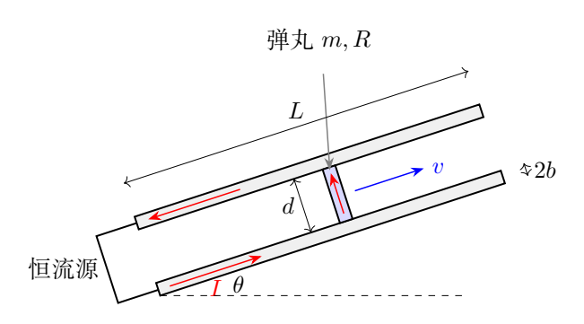

（1）求弹丸加速过程中受到的磁场作用力。

（2）求弹丸的出射速度。

（3）求加速过程中任意时刻以及出射时刻恒流源两端的电压。

（4）求整个加速过程中恒流源做的功。

（5）当$\theta=0^\circ$且导轨和弹丸电阻均可忽略时，求出射动能与恒流源做功之比。

## 一、题型定位

这是一道磁场积分、动力学、变化回路感应与能量守恒的综合题。电流由理想恒流源维持，故电流不随弹丸运动而下降；但回路长度、导轨电阻、回路磁通与恒流源电压都随弹丸位置改变。

磁力计算最容易出现二倍错误。弹丸位于载流导轨的末端，每段导轨在弹丸处按半无限长直导线处理；回路内部的磁通主要由两侧长直导线场决定。这两处场的系数不同。最终可用磁力与电感梯度、源功与磁场储能之间的关系检验这个差别。

本题采用小轨隙下的长导线近似，忽略端部、引线固定部分和弹丸内部电流分布的细节。固定部分磁场能量不随弹丸位置变化，所以只需计算随轨道有效长度增加的那部分能量。

## 二、知识点

### 1. 导线端点的磁场

直导线的一般磁场可以从毕奥—萨伐尔积分得到。在垂直距离$q$处，若导线从端点向负方向无限延伸，

$$
B_{\rm end}
=\frac{\mu_0I}{4\pi}
\int_0^\infty\frac{q\,dz}{(q^2+z^2)^{3/2}}
=\frac{\mu_0I}{4\pi q}.
$$

积分原函数为$z/[q\sqrt{q^2+z^2}]$，两端相减给$1/q$。无限长导线把两侧半线贡献相加，得到

$$
B_{\rm long}=\frac{\mu_0I}{2\pi q}.
$$

不能因为导轨整体很长，就把弹丸所在端点也当成一条两侧都无限延伸的载流导线。

### 2. 分布场中的安培力

弹丸沿轨隙横向载流，取微小长度$dq$。微段磁力大小为

$$
dF=I B(q)\,dq.
$$

磁场强度随$q$变化，必须积分，不能取轨隙中点磁场再乘$d$。当$d/b$足够小，中点近似才给出同一结果的低阶展开。

### 3. 变化回路的电压

恒流源要克服两部分电压：回路电阻压降及回路磁通增加引起的反电动势。定义反电动势的正大小为$\mathcal E_b=d\Phi/dt>0$，有

$$
U=I R_{\rm loop}+\mathcal E_b.
$$

若把感应电动势作为沿电流方向的有符号量，则$\mathcal E_{\rm ind}=-d\Phi/dt$，相同方程写成$U+\mathcal E_{\rm ind}=IR_{\rm loop}$。两种写法一致，不可在中途把符号约定混用。

## 三、物理图像

图3b取导轨轴间距为$s=2b+d$。从左轨轴测量弹丸横向位置$q$，弹丸占据$b\le q\le b+d$。两条导轨电流方向相反，在轨隙内的磁场方向相同；弹丸微段的安培力都指向沿轨道的前方。

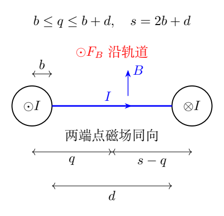

在回路内部，以长直导线场积分磁通。弹丸前进一小段$dx$，有效回路新增一个宽为$dx$、跨越轨隙的条带。这个新增条带使电感增加，因此恒流源除了提供弹丸运动所需机械功，还必须增加磁场能量。

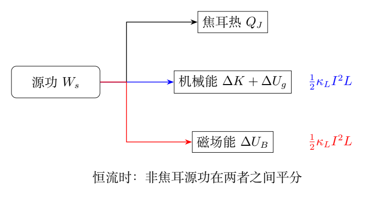

图中的机械能包含弹丸动能和重力势能。弹丸向上射出时，磁力做功不全变成动能；而恒流源做功又不全等于磁力做功。

## 四、解题入口

先定义只由几何决定的电感梯度

$$
\kappa_L=\frac{\mu_0}{\pi}\ln\frac{b+d}{b}.
$$

其单位为$\mathrm{H/m}$。磁力应为$F_B=\kappa_LI^2/2$，新增回路磁通应为$\Phi=\kappa_LIx$。这两条结果来自不同场的积分，可以相互做能量检验。

再令沿导轨向上为正，定义净加速度

$$
a_B=\frac{\kappa_LI^2}{2m}-g\sin\theta.
$$

如果$a_B\le0$，从下端静止出发的弹丸不能按题设向前射出，后面的出射时间与速度公式没有适用的运动分支。下文均取$a_B>0$。

## 五、解析

### （1）弹丸磁力的积分

在弹丸横向位置$q$，距右轨轴的距离为$s-q$。两个端点场相加，

$$
B_{\rm end}(q)=\frac{\mu_0I}{4\pi}
\left(\frac1q+\frac1{s-q}\right).
$$

弹丸的安培力为

$$
F_B=\frac{\mu_0I^2}{4\pi}
\int_b^{b+d}
\left(\frac1q+\frac1{s-q}\right)dq.
$$

分别积分：

$$
\int_b^{b+d}\frac{dq}{q}
=\ln\frac{b+d}{b},
$$

$$
\int_b^{b+d}\frac{dq}{s-q}
=-\ln(s-q)\bigg|_b^{b+d}
=\ln\frac{b+d}{b}.
$$

第二项中$s-(b+d)=b$、$s-b=b+d$，两项对称相等。所以

$$
\boxed{
F_B=\frac{\mu_0I^2}{2\pi}
\ln\left(1+\frac db\right)
=\frac12\kappa_LI^2}.
$$

方向沿导轨向上。对于固定电流及固定横向几何，这个磁力不依赖弹丸在轨道上的纵向位置。

小间隙展开为

$$
F_B=\frac{\mu_0I^2}{2\pi}
\left[\frac db-\frac12\left(\frac db\right)^2
+O\left((d/b)^3\right)\right].
$$

当$d\to0$，弹丸的横向载流长度趋于零，力也趋于零。这一极限同时检验积分上下限，没有把轴间距$2b+d$误当成弹丸长度。

### （2）加速度、速度与出射条件

弹丸沿轨道方向的重力分量为$-mg\sin\theta$。动力学方程为

$$
ma_B=F_B-mg\sin\theta.
$$

因此

$$
\boxed{
a_B=\frac{\mu_0I^2}{2\pi m}
\ln\left(1+\frac db\right)-g\sin\theta}.
$$

这是一恒定加速度。以开始运动为$t=0$，有

$$
x(t)=\frac12a_Bt^2,\qquad v(t)=a_Bt.
$$

出射位置$x=L$，对应

$$
\boxed{
T=\sqrt{\frac{2L}{a_B}},
\qquad
v_e=\sqrt{2a_BL}}.
$$

展开速度结果即

$$
\boxed{
v_e=\sqrt{2L\left[
\frac{\mu_0I^2}{2\pi m}\ln\left(1+\frac db\right)
-g\sin\theta\right]}}.
$$

当$0<\theta<\pi/2$时，电流必须超过

$$
I_{\rm crit}=
\sqrt{\frac{2mg\sin\theta}{\kappa_L}}.
$$

等于临界值时净力为零，静止弹丸不会自行走完整段；低于临界值时题设向上出射过程不能成立。

### 由机械能再核对出射速度

磁力做功为$F_BL$，弹丸上升高度$L\sin\theta$，于是

$$
\frac12mv_e^2+mgL\sin\theta=F_BL.
$$

代入$F_B=\kappa_LI^2/2$，得到

$$
\frac12mv_e^2
=\frac12\kappa_LI^2L-mgL\sin\theta.
$$

它与匀加速运动所得速度平方相同。电阻不会改变此处磁力和速度，是恒流源保持$I$不变的结果；电阻改变的是所需源电压和源功。

### （3）随位置变化的磁通

回路内部长直导线场为

$$
B_{\rm long}(q)=\frac{\mu_0I}{2\pi}
\left(\frac1q+\frac1{s-q}\right).
$$

在小轨隙、长回路近似下，长度$x$的轨道回路新增磁通是

$$
\begin{aligned}
\Phi(x)
&=x\int_b^{b+d} B_{\rm long}(q)\,dq\\
&=\frac{\mu_0Ix}{\pi}\ln\frac{b+d}{b}\\
&=\boxed{\kappa_LIx}.
\end{aligned}
$$

不变的引线磁通可以加上一个常量，它的时间导数为零，不影响本问。有效电感写成$\mathcal L(x)=\mathcal L_0+\kappa_Lx$，本题$I$恒定，故

$$
\boxed{\mathcal E_b=\frac{d\Phi}{dt}
=\kappa_LI\,v}.
$$

如果直接只算弹丸微段的动生电动势，末端场给出的那部分功率恰好对应磁力的机械功率；完整源电压还包含整个可变磁场的感应贡献。回路磁通法把这一贡献统一保留。

### 任意时刻的源电压

电流通过左右两轨各长$x$的部分，回路电阻为

$$
R_{\rm loop}(x)=R+2\lambda x.
$$

恒流源电压为

$$
\boxed{U(x,v)=I(R+2\lambda x)+\kappa_LIv}.
$$

代入$x=a_Bt^2/2$、$v=a_Bt$，

$$
\boxed{U(t)=IR+\lambda Ia_Bt^2+\kappa_LIa_Bt},
\qquad 0\le t\le T.
$$

起始电压为$IR$；随着回路长度和速度增长，导轨电阻压降与反电动势都增加。当$\lambda\ge0$时，

$$
\frac{dU}{dt}=2\lambda Ia_Bt+\kappa_LIa_B>0,
$$

所以最高电压出现在出射时：

$$
\boxed{
U_e=I(R+2\lambda L)+\kappa_LI\sqrt{2a_BL}}.
$$

理想恒流源不限制电压，才可以维持这种电流。若实际电源有电压上限，便应检查$U_e$，不能仅检查启动电压。

### （4）恒流源的总功

源功是

$$
W_s=\int_0^T U(t)I\,dt.
$$

分别积分三个功率项：

$$
W_R=I^2RT,
$$

$$
W_{\rm rail}=
\int_0^T\lambda I^2a_Bt^2\,dt
=\frac{\lambda I^2a_BT^3}{3},
$$

$$
W_{\rm flux}=
\int_0^T\kappa_LI^2a_Bt\,dt
=\frac12\kappa_LI^2a_BT^2.
$$

由$a_BT^2=2L$，

$$
W_{\rm flux}=\kappa_LI^2L,
\qquad
W_{\rm rail}=\frac23\lambda I^2LT.
$$

于是一个不含高次时间的结果为

$$
\boxed{
W_s=I^2T\left(R+\frac23\lambda L\right)
+\kappa_LI^2L}.
$$

其中$T=\sqrt{2L/a_B}$。轨道焦耳热之所以含$2\lambda L/3$，是因为两轨有效电阻随$x\propto t^2$增加，时间平均长度为$L/3$，而不是$L/2$。

### 源功为什么是磁力机械功的二倍再加焦耳热

固定电流下，有效回路磁场能量增加

$$
\Delta U_B=\frac12I^2[\mathcal L(L)-\mathcal L(0)]
=\frac12\kappa_LI^2L.
$$

磁力机械功为

$$
W_B=F_BL=\frac12\kappa_LI^2L.
$$

因此两个去向相等。总能量平衡为

$$
\boxed{
W_s=Q_J+\Delta U_B+\Delta K+\Delta U_g},
$$

其中

$$
Q_J=I^2T\left(R+\frac23\lambda L\right),
\qquad
\Delta K+\Delta U_g=F_BL.
$$

逐时刻也能核对：

$$
\begin{aligned}
UI
&=I^2(R+2\lambda x)+\kappa_LI^2v\\
&=P_J+\frac12\kappa_LI^2v+\frac12\kappa_LI^2v.
\end{aligned}
$$

后一对分别是$dU_B/dt$和$F_Bv$。若磁力也用了长直导线场，机械功率会多出二倍，无法同时满足这个平衡。

### （5）无电阻水平发射时的能量比例

当$\theta=0$、$R=\lambda=0$时，

$$
K_e=F_BL=\frac12\kappa_LI^2L,
$$

而源做功是

$$
W_s=\kappa_LI^2L.
$$

故

$$
\boxed{\frac{K_e}{W_s}=\frac12=50\%}.
$$

剩下的一半为有效回路增加的磁场能量，而非隐藏的电阻损耗。在弹丸出射前这一瞬间比较能量即可；出射以后回路怎样断开、磁能怎样回收或消耗，不在题给模型中。

无电阻也不意味着源电压为零。只要$v>0$，$U=\kappa_LIv>0$，源仍须对抗磁通增加产生的反电动势。

\clearpage

# 第 4 题　微孔竹板与亥姆霍兹共振器（40 分）

2016年9月杭州G20峰会会议厅的装饰展示了节能环保理念与浙江竹文化。部分墙面使用微孔竹板，既作装饰，也实现声波共振吸收。竹板上有面积不同、周期排列的长方形微孔；声波进入微孔后使孔内空气柱振动。单个微孔与板后空气层可简化为图4a中的亥姆霍兹共振器。孔深均为$l$，单孔对应的空气腔体体积均为$V_0$，孔横截面积为$S$。

声波在空气中传播可视为绝热过程，声速$v_s$、空气密度$\rho$及体积弹性模量$\kappa$满足

$$
v_s=\sqrt{\frac{\kappa}{\rho}},
\qquad
\kappa=-\frac{\Delta p}{\Delta V/V}
=-V\frac{\Delta p}{\Delta V}.
$$

标准状态为$T=273\,\mathrm K$、$p=1.01\times10^5\,\mathrm{Pa}$。空气可视为理想气体，摩尔质量$M_{\rm mol}=29.0\,\mathrm{g/mol}$、热容比$\gamma=7/5$，气体常量$R_g=8.31\,\mathrm{J/(K\cdot mol)}$。

（1）求标准状态下空气密度和声速$v_s$。

（2）求共振器吸收声波的频率，用$v_s,S,l,V_0$表示。

（3）吸收$120\,\mathrm{Hz}$和$200\,\mathrm{Hz}$声波的两种微孔，横截面积之比应是多少？

## 一、题型定位

可将孔内空气柱视为振子的质量，将腔内气体压缩产生的回复力等效为弹簧力。孔深$l$控制移动空气的质量，腔体体积$V_0$影响压缩刚度，两者作用不同。

第一问求密度时使用理想气体状态方程，求声速时使用小扰动的绝热压缩。不能因为环境温度给定，就把传播中的压缩过程改成等温过程；波动快、来不及与环境交换足够热量，题目已规定按绝热处理。

理想无阻尼模型可以求固有频率，但不能单独给出实际的净吸收率。题意的“吸收频率”按弱耗散情况下的共振频率解释：实际空气黏性、热损失等把进入共振器的机械能转为内能。没有这些损失，振子只储能与返还能量。

## 二、知识点

### 1. 从摩尔量得到质量密度

若空气质量为$m_a$，物质的量为$m_a/M_{\rm mol}$，

$$
pV=\frac{m_a}{M_{\rm mol}}R_gT.
$$

除以$V$并解出密度，

$$
\boxed{\rho=\frac{M_{\rm mol}p}{R_gT}}.
$$

计算前必须把$29.0\,\mathrm{g/mol}$换成$0.0290\,\mathrm{kg/mol}$。压力用$\mathrm{Pa}$，温度用开尔文；摄氏温度不能直接进入分母。

### 2. 小扰动中的体积弹性模量

绝热气体满足

$$
pV^\gamma=\text{常量}.
$$

在平衡态附近微分，

$$
V^\gamma\,dp+\gamma pV^{\gamma-1}\,dV=0.
$$

所以

$$
\frac{dp}{dV}=-\frac{\gamma p}{V},
\qquad
\boxed{\kappa=\gamma p}.
$$

压缩对应$dV<0$、$dp>0$，负号使$\kappa>0$。当$\Delta V$很小时，题给有限增量式就是这个微分结果的线性近似。

### 3. 质量—弹簧模型

孔内空气柱的长度为$l$、截面积为$S$，在集中参数近似下整体以同一速度移动，质量为

$$
M_p=\rho Sl.
$$

若其向外位移为$x$，腔体的等效体积增量是$Sx$。压强改变为$-\kappa Sx/V_0$，再乘作用面积$S$得到回复力。因此等效弹簧常量与$S^2$成正比，而质量只与$S$成正比。

## 三、物理图像

图4b中的$x>0$表示孔内空气柱向外移动。腔体膨胀，压强低于外界，压差把空气柱向内拉；当$x<0$时，腔体受压，压差向外推。回复力总与位移相反。

腔体体积变化并不表示整个腔壁真的在移动，而是空气柱边界的位置改变使腔体内部气体获得额外的可占据体积。壁面仍可视为刚性。

微孔对应的声学振子频率低于孔内形成驻波的频率时，可以把孔内空气看成一个集中的质量，把腔体压强看成空间均匀。若孔深和腔体尺寸不再远小于声波波长，就需要分布波动模型，而不能仅保留$\rho Sl$这个单一质量。

图4c左侧显示$f_0\propto\sqrt S$，所以频率比不是面积比。右侧显示实际响应的有限峰宽，需要阻尼才能产生有限稳态吸收功率。

## 四、解题入口

依次写下$\rho$、$\kappa$、$M_p$和等效弹簧常量$K_p$：

$$
\rho=\frac{M_{\rm mol}p}{R_gT},\quad
\kappa=\gamma p,\quad
M_p=\rho Sl,\quad
K_p=\frac{\kappa S^2}{V_0}.
$$

随后用$\omega_0^2=K_p/M_p$，最后才把$\kappa/\rho$认成$v_s^2$。这样可避免“见到声速就直接猜公式”，也能解释每一个几何量的指数。

第三问中两类微孔的$l,V_0$和所处空气状态相同，才可以把这些量约掉。若腔体积随孔面积变化，面积比不再单独等于频率比平方。

## 五、解析

### （1）标准状态的密度

代入理想气体结果，

$$
\rho_{\rm st}
=\frac{(29.0\times10^{-3})(1.01\times10^5)}
{8.31\times273}
\ \mathrm{kg/m^3}.
$$

逐步计算：分子为$2929$，分母为$2268.63$，因此

$$
\boxed{\rho_{\rm st}=1.29109\,\mathrm{kg/m^3}
\simeq1.29\,\mathrm{kg/m^3}}.
$$

量纲可直接核对：$R_gT/M_{\rm mol}$具有$\mathrm{m^2/s^2}$单位；压力除以这一量就是$\mathrm{kg/m^3}$。

### 绝热声速

由$\kappa=\gamma p$，

$$
v_s^2=\frac{\gamma p}{\rho}.
$$

再用$\rho=M_{\rm mol}p/(R_gT)$消去密度，得到

$$
\boxed{v_s=\sqrt{\frac{\gamma R_gT}{M_{\rm mol}}}}.
$$

对给定温度和组成的理想气体，压力在这个表达式中消去。压力提高时密度也按比例提高，弹性模量和惯性密度的变化相互抵消。

数值为

$$
v_s=
\sqrt{\frac{(7/5)(8.31)(273)}{0.0290}}
\ \mathrm{m/s}
=330.938\,\mathrm{m/s}.
$$

故

$$
\boxed{v_s\simeq331\,\mathrm{m/s}}.
$$

若误用等温模量$p$，声速会小一个$\sqrt\gamma$因子，约为$280\,\mathrm{m/s}$，与题设的绝热声速不同。

### （2）空气柱受到的回复力

设平衡腔体积为$V_0$，内部压强与外界平衡压强均为$p_0$。空气柱向外位移$x$，有

$$
\Delta V=Sx.
$$

小振幅假设要求$|Sx|\ll V_0$。绝热线性化给

$$
\Delta p=-\gamma p_0\frac{Sx}{V_0}.
$$

压力差作用在空气柱的腔内端面和外界端面，合力为

$$
F=S[(p_0+\Delta p)-p_0]
=S\Delta p.
$$

所以

$$
\boxed{F=-\frac{\gamma p_0S^2}{V_0}x}.
$$

一份$S$来自体积改变，一份$S$来自压强转为力，缺少任意一份都会改变频率的量纲和面积指数。

### 振动方程与频率

空气柱质量为$M_p=\rho Sl$，牛顿方程为

$$
\rho Sl\,\ddot x
=-\frac{\gamma p_0S^2}{V_0}x.
$$

除以质量，

$$
\ddot x+\frac{\gamma p_0S}{\rho lV_0}x=0.
$$

故角频率为

$$
\omega_0=
\sqrt{\frac{\gamma p_0S}{\rho lV_0}}
=v_s\sqrt{\frac{S}{lV_0}}.
$$

角频率是每秒的相位变化率，而普通频率是每秒振动周期数，两者相差$2\pi$：

$$
\boxed{f_0=\frac{v_s}{2\pi}
\sqrt{\frac{S}{lV_0}}}.
$$

量纲方面，$S/(lV_0)$的单位为$\mathrm{m^{-2}}$，开方后乘$v_s$给$\mathrm{s^{-1}}$。若根号内误写成$Sl/V_0$，将不能得到频率单位。

### 用能量法独立求得同一回复常量

腔体气体的线性压缩能可以通过准静态小增量做功计算。设相对平衡体积改变为$\delta V$，外力对气体所做的增量功为

$$
dU_{\rm comp}
=-\Delta p\,d(\delta V)
=\frac{\kappa}{V_0}\delta V\,d(\delta V).
$$

从零改变积分到$\delta V=Sx$，

$$
U_{\rm comp}=
\int_0^{Sx}\frac{\kappa}{V_0}u\,du
=\frac{\kappa S^2}{2V_0}x^2.
$$

总振动能为

$$
E_{\rm osc}
=\frac12\rho Sl\,\dot x^2
+\frac12\frac{\kappa S^2}{V_0}x^2.
$$

对时间求导并令无损情况下能量不变，

$$
\dot x\left[\rho Sl\,\ddot x+
\frac{\kappa S^2}{V_0}x\right]=0.
$$

得到与牛顿法相同的方程。这条路线独立检查了回复力方向和$S^2$。

### （3）120 Hz与200 Hz微孔的面积比

在声速、孔深、腔体积均相同的条件下，

$$
\frac{f_{120}}{f_{200}}
=\sqrt{\frac{S_{120}}{S_{200}}}.
$$

因此

$$
\boxed{
\frac{S_{120}}{S_{200}}
=\left(\frac{120}{200}\right)^2
=0.36=\frac9{25}}.
$$

所以较低频微孔的截面积应更小。若长方形微孔形状相似，长宽均按同一比例变化，则两个对应线性尺寸之比是$\sqrt{0.36}=0.60$；若孔长保持不变，只改变宽，则孔宽比就是0.36。

### 为什么小孔反而对应低频

减小$S$时空气柱质量按$S$减少，但腔体回复常量按$S^2$减少。回复常量下降得更快，故$K_p/M_p$随$S$下降，固有频率下降。

增加孔深$l$只在本题理想模型中增加空气柱质量，频率按$l^{-1/2}$下降。增加腔体积$V_0$使同样位移引起的相对体积变化减小，频率按$V_0^{-1/2}$下降。这些变化可从方程直接识别，而不必记忆成组的比例关系。

### 固有频率与实际吸声的联系

理想振子的解为$x=A\cos(\omega_0t+\phi)$，能量不衰减。实际若有线性阻尼$c_d\dot x$，并受外界声压$p_a\cos\omega t$驱动，方程为

$$
M_p\ddot x+c_d\dot x+K_px=Sp_a\cos\omega t.
$$

设稳态位移振幅为$X$，有

$$
X=\frac{Sp_a}
{\sqrt{(K_p-M_p\omega^2)^2+(c_d\omega)^2}}.
$$

稳态平均耗散功率是

$$
\overline P_{\rm loss}
=c_d\overline{\dot x^2}
=\frac12c_d\omega^2X^2.
$$

所以共振附近空气柱速度大，阻尼耗散也大，外界声能能够被吸收。这个表达式需要$c_d>0$；让$c_d=0$后直接在共振点使用稳态振幅公式，会出现无界值，说明有限稳态解不再成立。

本题未给阻尼、端部修正或微孔间相互作用参数，因而主答案保留理想固有频率，不声称能够算出吸收峰宽、吸收比例或真实材料的最佳孔型。

\clearpage

# 第 5 题　微球透镜的聚焦与阶跃光纤耦合（40 分）

图5a为基于全内反射的折射率阶跃光纤及耦合光路。内芯直径为$50\,\mu\mathrm m$，折射率$n_1=1.46$；玻璃包层外径为$125\,\mu\mathrm m$，折射率$n_2=1.45$。氦氖激光器输出圆柱形平行光束，光纤前端放置微球透镜进行聚焦。球镜直径$D=3.00\,\mathrm{mm}$、折射率$n=1.50$。激光束轴通过球心，与光纤轴重合。空气折射率$n_0=1.00$。

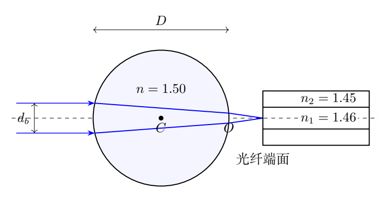

（1）为了使光线在光纤内长距离传输，光纤端面处最大入射角是多少？

（2）透镜聚焦满足近轴条件，平行光束刚好聚焦于垂直光轴的光纤端面。球镜后表面中心顶点$O$与光纤端面的距离是多少？

（3）为了使进入光纤的全部光束均能长距离传输，平行入射激光束的直径最大不能超过多少？

## 一、题型定位

这是一道把接受角与球镜聚焦相结合的几何光学题。光纤是否接收一根光线，需要同时满足位置和方向条件：光线必须落在内芯内，并在芯—包层界面发生全反射。原题的同轴、理想近轴聚焦使所有光线在端面会于轴上的点，位置条件自动满足，最大束径由方向条件限制。

球镜有两个曲面，厚度等于$D$，不能当作一片厚度忽略的普通薄透镜。第一曲面先形成会聚光束，该光束到第二曲面时相当于一个虚物；物距、曲率半径符号必须统一。

后顶点到焦点的距离是后焦距，不是等效焦距。第三问联系入射光束半径与出射角时，需要等效焦距，不能把第二问的$0.75\,\mathrm{mm}$直接拿来代替。

## 二、知识点

### 1. 全反射与端面折射

设光线在芯内与轴的夹角为$\alpha_f$，与芯—包层界面法线的夹角为$i_f$，二者互余：

$$
i_f+\alpha_f=\frac{\pi}{2}.
$$

临界角满足$\sin i_c=n_2/n_1$。全反射要求$i_f\ge i_c$，对应$\cos\alpha_f\ge n_2/n_1$。理想极限光线取等号，实际需要略留裕度。

端面法线沿光轴，因此空气中入射角$\theta$满足

$$
n_0\sin\theta=n_1\sin\alpha_f.
$$

将这两个角分清，才能导出数值孔径，而不是把$\theta$直接代成芯内临界角。

### 2. 球面折射的统一符号

取$z$轴沿光传播向右，所有位置相对于所讨论曲面的顶点。物点在左边时$z_{\rm obj}<0$，虚物在右边时$z_{\rm obj}>0$；像点在右边时$z_{\rm im}>0$。曲率中心在右边取$\mathcal R>0$，在左边取负。

近轴球面折射公式为

$$
\boxed{
\frac{n_{\rm out}}{z_{\rm im}}
-\frac{n_{\rm in}}{z_{\rm obj}}
=\frac{n_{\rm out}-n_{\rm in}}{\mathcal R}}.
$$

这个形式避免在第二曲面把虚物距误写成正的“实物距离”。物距若使用另一套定义也可以，但整套计算必须保持同一种符号。

### 3. 近轴光线矩阵

使用光线向量$(y,u)$，其中$u=n_{\rm med}\vartheta$为折射率乘小角度。距离$t$的传播和曲面折射矩阵分别为

$$
T(t,n_{\rm med})=
\begin{pmatrix}1&t/n_{\rm med}\\0&1\end{pmatrix},
$$

$$
S(n_{\rm in},n_{\rm out},\mathcal R)=
\begin{pmatrix}
1&0\\
-(n_{\rm out}-n_{\rm in})/\mathcal R&1
\end{pmatrix}.
$$

两曲面加中间传播的乘积可独立核对焦点位置和光束角度。每个矩阵行列式为1，完整矩阵也必须为1。

## 三、物理图像

图5b表示光纤端面折射及芯内全反射。最大空气入射角对应芯内光线刚好达到全反射临界条件；这个角约$9.82^\circ$，远小于芯—包层界面处的临界角。

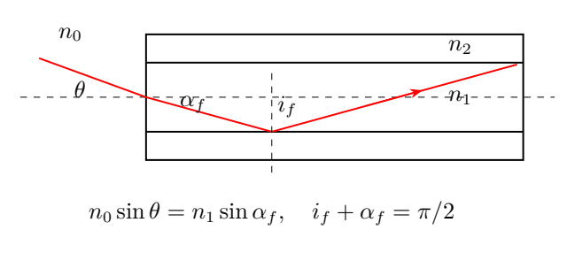

图5c中$V_1,V_2$为球镜前后顶点，$C$为球心，$I_1$为仅考虑前曲面所得的中间像，$F$为最后焦点。对题给$n=1.50$，$I_1$在后顶点右侧，因此第二次折射的物是虚物。

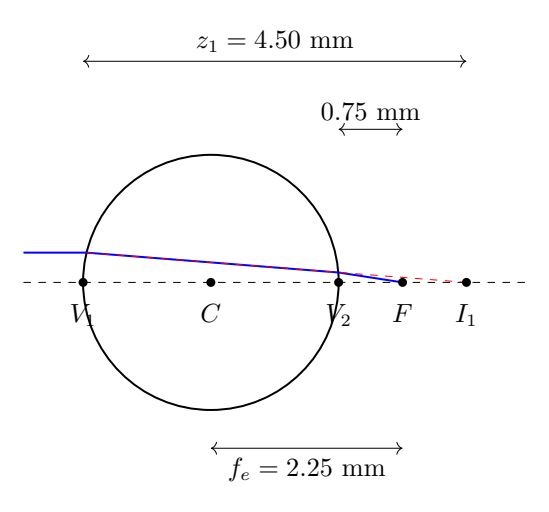

原平行光线的高度记为$h_b$，对应入射束半径。近轴球镜等效主平面在球心，出射角大小为$h_b/f_e$；球镜后表面上的实际光线高度则较小，两者不是同一个高度。

## 四、解题入口

第一问先求$\mathrm{NA}=\sqrt{n_1^2-n_2^2}$，再用$\sin\theta_{\max}=\mathrm{NA}/n_0$。第二问按两个曲面依次求像，不在第一曲面就提前把像当作最终焦点。

第三问用等效焦距$f_e$把接受角变成入射光束半径。保持原题近轴精度，采用$\vartheta\simeq\sin\vartheta$；若想提高精度，必须把球镜的两次Snell折射也一起改为精确光线，不能只把最后一步换成$\tan\theta$就声称得到精确结果。

## 五、解析

### （1）光纤数值孔径与最大接受角

全反射极限满足

$$
\cos\alpha_{f,\max}=\frac{n_2}{n_1}.
$$

故

$$
\sin\alpha_{f,\max}
=\sqrt{1-\frac{n_2^2}{n_1^2}}.
$$

端面Snell定律给

$$
\begin{aligned}
n_0\sin\theta_{\max}
&=n_1\sin\alpha_{f,\max}\\
&=\sqrt{n_1^2-n_2^2}.
\end{aligned}
$$

因此

$$
\boxed{\theta_{\max}
=\arcsin\frac{\sqrt{n_1^2-n_2^2}}{n_0}}.
$$

数值孔径为

$$
\mathrm{NA}
=\sqrt{1.46^2-1.45^2}
=\sqrt{(1.46-1.45)(1.46+1.45)}
=\sqrt{0.0291}.
$$

所以

$$
\mathrm{NA}=0.17058722,
\qquad
\boxed{\theta_{\max}=9.82196^\circ\simeq9.82^\circ}.
$$

这里的角相对于光纤轴，而非相对于芯—包层界面的法线。若$n_1=n_2$，数值孔径变成零，光纤不再靠全反射限制非轴向光线；若外部介质改变，最大外部角也随$n_0$变化。

### （2）前曲面的中间像

球镜半径为$a_b=D/2$。前曲面折射由空气$n_0$进入球材$n$，曲率中心在右侧，故$\mathcal R_1=+a_b$。平行入射等价于物点在$-\infty$，所以

$$
\frac{n}{z_1}
=\frac{n-n_0}{a_b}.
$$

得到

$$
\boxed{
z_1=\frac{na_b}{n-n_0}
=\frac{nD}{2(n-n_0)}}.
$$

题给数值为

$$
z_1=\frac{1.50\times3.00}
{2(1.50-1.00)}
=4.50\,\mathrm{mm}.
$$

这个中间像位置相对于前曲面顶点。球厚$D=3.00\,\mathrm{mm}$，所以它在后曲面右侧$1.50\,\mathrm{mm}$处。

### 后曲面的虚物与最终像

相对于后顶点$V_2$，第二曲面的物点位置为

$$
z_{\rm obj,2}=z_1-D
=\frac{(2n_0-n)D}{2(n-n_0)}.
$$

本题$z_{\rm obj,2}=+1.50\,\mathrm{mm}$，是虚物，因为入射第二曲面的光已经在向右侧该点会聚。

后曲面从$n$到$n_0$，曲率中心位于左侧，$\mathcal R_2=-D/2$。代入统一折射公式，

$$
\frac{n_0}{z_2}
-\frac{n}{z_{\rm obj,2}}
=\frac{n_0-n}{-D/2}.
$$

整理得

$$
\boxed{
z_2=\frac{(2n_0-n)D}{4(n-n_0)}}.
$$

对题给数值，

$$
\boxed{
OF=z_2=\frac{(2-1.5)3.00}{4(1.5-1)}
=0.750\,\mathrm{mm}}.
$$

所求是空气中后顶点到端面的距离。不是$4.50\,\mathrm{mm}$的中间像距，也不是$2.25\,\mathrm{mm}$的等效焦距。

### 用光线矩阵独立检查

前后两曲面的折射功率相同，均为$2(n-n_0)/D$。按传播顺序相乘，

$$
\mathsf M=S_2T(D,n)S_1
=\begin{pmatrix}A&B\\C&A\end{pmatrix},
$$

其中

$$
A=\frac{2n_0}{n}-1,\qquad
B=\frac Dn,\qquad
C=-\frac{4n_0(n-n_0)}{nD}.
$$

入射平行光线$(h_b,0)$在后曲面刚出射时变为

$$
y_2=Ah_b,\qquad
u_2=Ch_b,\qquad
\vartheta_2=\frac{Ch_b}{n_0}.
$$

再在空气中传播距离$z$，高度为

$$
y(z)=\left(A+\frac{zC}{n_0}\right)h_b.
$$

焦点条件$y(z)=0$给

$$
z=-\frac{n_0A}{C}
=\frac{(2n_0-n)D}{4(n-n_0)}.
$$

与两次折射的结果相同。另一方面，

$$
A^2-BC=1,
$$

验证了矩阵的符号与传播顺序。若误把后曲面曲率取正，$C$及焦距都会改变，通常也失去正确的弱折射极限。

### 等效焦距和主平面位置

外部介质前后相同，矩阵光学给等效焦距

$$
\boxed{
f_e=-\frac{n_0}{C}
=\frac{nD}{4(n-n_0)}}.
$$

本题

$$
f_e=\frac{1.50\times3.00}{4(0.50)}
=2.250\,\mathrm{mm}.
$$

后主平面到后顶点的距离为

$$
f_e-z_2=\frac D2.
$$

所以后主平面经过球心；对称性也使前主平面经过球心。两个主平面在此等效模型中重合，不表示真实光线在球心发生单次折射，而是两曲面系统的近轴等效表示。

### （3）最大平行入射束径

设平行入射束直径为$d_b$，边缘光线入射高度为$h_b=d_b/2$。由矩阵的角度式，

$$
|\vartheta_2|=\frac{h_b}{f_e}.
$$

边缘光线的出射角最大；原理想近轴聚焦中所有光线落在端面轴心，所以保证全部光线被接收的条件为

$$
\frac{d_b}{2f_e}\lesssim\theta_{\max}.
$$

在与球镜近轴近似一致的一阶精度下，$\theta_{\max}\simeq\sin\theta_{\max}=\mathrm{NA}/n_0$。因此

$$
\boxed{
d_{b,\max}\simeq2f_e\frac{\mathrm{NA}}{n_0}
=\frac{nD}{2(n-n_0)n_0}
\sqrt{n_1^2-n_2^2}}.
$$

代入未提前舍入的数值孔径，

$$
d_{b,\max}\simeq
2(2.250)(0.17058722)\,\mathrm{mm}
=0.767642\,\mathrm{mm}.
$$

所以近轴设计结果为

$$
\boxed{d_b\lesssim0.77\,\mathrm{mm}}.
$$

若先把$\sin\theta_{\max}$取为0.17，得到0.765 mm，常简写为约0.76 mm。这个差别是近轴和中间舍入精度，不宜把末位数字解读成精密制造容差。

### 为什么不能用后焦距代替等效焦距

后曲面上的光线高度并不等于入射光束半径。对本题，矩阵中$A=1/3$，因此

$$
y_2=\frac{h_b}{3}.
$$

从后顶点传播到焦点的距离为$0.75\,\mathrm{mm}$，所以出射角也可写成

$$
|\vartheta_2|
\simeq\frac{y_2}{0.75\,\mathrm{mm}}
=\frac{h_b}{2.25\,\mathrm{mm}}.
$$

如果把$h_b$直接除以0.75 mm，会把角度放大三倍，并错误地把允许束径缩小三倍。

### 近轴结果的精度与模型边界

球镜有限孔径存在球差，不同入射高度的光线不完全在同一轴向位置交会。原题给定近轴条件，因此主答案使用一阶光线模型；它把理想焦点视为零大小，不使用内芯直径来限制束径。

如果改用精确两次Snell折射，应同时考虑出射角与端面上的实际落点。只用$\tan\theta_{\max}$代替$\sin\theta_{\max}$，而仍保留一阶焦距和“全部光线同焦点”，并不能得到一条完整的精确光学答案。

芯径$50\,\mu\mathrm m$与包层外径$125\,\mu\mathrm m$描述光纤横向结构。真正的聚焦光斑、球差、衍射与轴向误差会使芯径成为位置容差；原题没有波长和束腰等完整信息，主解不额外计算波动光学耦合效率。

\clearpage

# 第 6 题　$\pi$介子两体衰变与$\mu$子的地面存活概率（40 分）

宇宙射线中高速飞行的$\pi$介子会衰变为$\mu$子和$\mu$型反中微子：

$$
\pi\longrightarrow\mu+\bar\nu_\mu.
$$

已知静止质量$m_\pi=139.57061\,\mathrm{MeV}/c^2$、$m_\mu=105.65837\,\mathrm{MeV}/c^2$，反中微子静止质量近似为零。实验室测得$\pi$介子速率为$v=0.965c$，取$c=3.00\times10^8\,\mathrm{m/s}$。

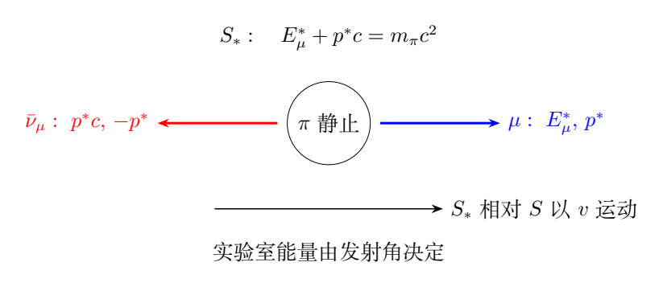

（1）求衰变产生的$\mu$子的最大速率和最小速率。

（2）这些$\mu$子从距地面$10000\,\mathrm m$的高空竖直向下飞行。静止$\mu$子的半衰期为$T_{1/2}^{(0)}=1.523\,\mu\mathrm s$，求地面观察者能够观测到$\mu$子的最大概率。

## 一、题型定位

第一问先在母粒子静止系解两体衰变，再作洛伦兹变换。在母粒子静止系，两产物动量大小相同且方向相反；反中微子质量为零，能量等于$pc$。这一结构使能量和动量两个守恒条件可以完全求出$\mu$子的静止系能量与速率。

衰变方向可以是三维的。最大与最小实验室速率最终出现在正向和反向发射，但必须证明，不能只计算两个共线发射情形，就认定已找到所有方向中的极值。

第二问求的是$\mu$子飞完规定路程之前未衰变的概率，即存活概率。它既受飞行时间影响，又受$\mu$子本身的时间膨胀影响。使用的是$\mu$子的洛伦兹因子，而不是母$\pi$介子的洛伦兹因子。

## 二、知识点

### 1. 两种惯性系

记实验室系为$S$，母$\pi$介子静止系为$S_*$。沿母粒子在实验室的飞行方向取$x$轴。$S_*$中的量加星号，如$E_\mu^*,p^*,u^*$。母粒子速度记为$\beta_\pi c$，$\beta_\pi=0.965$。

能量单位可先统一为MeV。定义静质量对应的静能

$$
M=m_\pi c^2,\qquad m_0=m_\mu c^2.
$$

这样$M=139.57061$ MeV、$m_0=105.65837$ MeV；若把动量乘$c$，它也用MeV表示，避免在质量和能量的平方之间漏掉$c$。

### 2. 能量—动量关系

$\mu$子满足

$$
E_\mu^2=(p_\mu c)^2+(m_\mu c^2)^2,
$$

而质量忽略的反中微子满足$E_\nu=p_\nu c$。母粒子静止系总动量为零，故两产物动量矢量相反，大小相等。

### 3. 半衰期与平均寿命

存活概率可以写成

$$
P(\tau)=2^{-\tau/T_{1/2}^{(0)}}
=\exp\left(-\frac{\tau}{\tau_0}\right),
$$

其中$\tau$是$\mu$子沿自身世界线经历的固有时间，平均寿命为

$$
\boxed{\tau_0=\frac{T_{1/2}^{(0)}}{\ln2}}.
$$

半衰期和平均寿命不是同一个时间。若将$T_{1/2}^{(0)}$直接放在指数函数的分母，会把概率改变一个$\ln2$因子。

## 三、物理图像

在$S_*$中，$\mu$子与反中微子的动量一左一右。向实验室母粒子前进方向发射的$\mu$子，实验室能量最大；反向发射的能量最小。实验室的母粒子速度远大于$\mu$子的静止系速率，反向发射的$\mu$子仍然沿实验室前方运动。

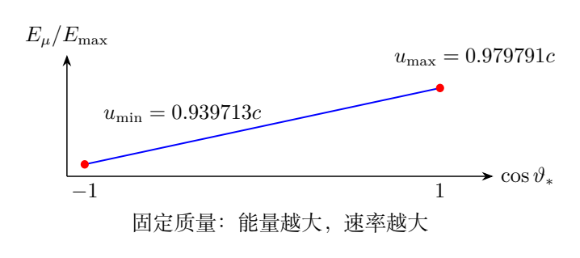

图6b横轴为$\cos\vartheta_*$，其中$\vartheta_*$是$\mu$子在$S_*$中的发射角。能量随这一变量线性增加，而速率由能量决定、单调增加。因此端点就是速率极值。

图6c把实验室路程与$\mu$子的固有时间联系。地面和产生点在实验室相距$h$，$\mu$子飞行时间为$h/u$；$\mu$子自身钟经历的时间则少一个$\gamma_\mu$因子。

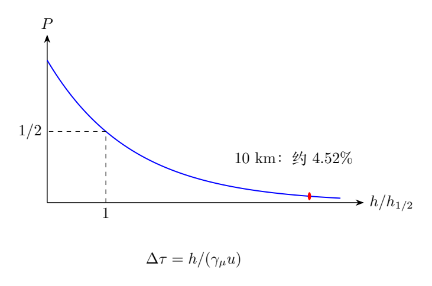

概率最大的$\mu$子不是“半衰期最长的某一种粒子”，所有$\mu$子的静止半衰期相同；最大概率来自更大的$\gamma_\mu u$，使同一实验室路程对应更短固有时间。

## 四、解题入口

在母粒子静止系先写

$$
E_\mu^*+p^*c=M,\qquad
(E_\mu^*)^2-(p^*c)^2=m_0^2.
$$

两式联立，得到$E_\mu^*$和$p^*c$，再由$u^*/c=p^*c/E_\mu^*$求速度。实验室极值可以由能量变换证明，再用共线速度合成计算数值。

存活概率最好直接写成固有时间形式

$$
P=2^{-h/(\gamma_\mu uT_{1/2}^{(0)})}.
$$

在接近光速时，不要先把$u/c$舍入到三位再计算$\gamma_\mu$；$1-u^2/c^2$是两个接近的数之差，舍入误差容易放大。

## 五、解析

### （1）母粒子静止系的衰变动量

动量守恒给

$$
\boldsymbol p_\mu^*+\boldsymbol p_\nu^*=0.
$$

因此$p_\mu^*=p_\nu^*=p^*$。反中微子能量为$p^*c$，总能量守恒为

$$
E_\mu^*+p^*c=M.
$$

由$\mu$子能量—动量关系，

$$
(E_\mu^*)^2-(p^*c)^2=m_0^2.
$$

左边作平方差，

$$
(E_\mu^*-p^*c)(E_\mu^*+p^*c)=m_0^2.
$$

第二因子是$M$，故第一因子为$m_0^2/M$。相加相减后得到

$$
\boxed{E_\mu^*=\frac{M^2+m_0^2}{2M}},
\qquad
\boxed{p^*c=\frac{M^2-m_0^2}{2M}}.
$$

反中微子的能量等于后一项。这里$M>m_0$确保$p^*>0$；若质量次序相反且没有其他输入能量，母粒子静止系两体衰变不能成立。

### $\mu$子的静止系速度

对有质量粒子，$u/c=pc/E$，所以

$$
\boxed{
\beta_*=\frac{u^*}{c}
=\frac{M^2-m_0^2}{M^2+m_0^2}
=\frac{m_\pi^2-m_\mu^2}{m_\pi^2+m_\mu^2}}.
$$

代入数值，

$$
E_\mu^*=109.7782919\,\mathrm{MeV},
\qquad
p^*c=29.7923181\,\mathrm{MeV},
$$

$$
\boxed{\beta_*=0.2713862422}.
$$

检查能量和动量：

$$
109.7782919+29.7923181=139.5706100,
$$

$$
(109.7782919)^2-(29.7923181)^2
=(105.65837)^2.
$$

这个静止系速度明显不能从质量差直接乘$c$得到，剩余静能差同时分配到反中微子能量和$\mu$子动能。

### 任意方向的实验室能量与极值证明

在$S_*$中，$\mu$子的平行、垂直动量分别是

$$
p_x^*=p^*\cos\vartheta_*,
\qquad
p_\perp^*=p^*\sin\vartheta_*.
$$

沿$x$方向的洛伦兹变换给

$$
\boxed{
E_\mu(\vartheta_*)
=\gamma_\pi(E_\mu^*+\beta_\pi cp^*\cos\vartheta_*)},
$$

其中$\gamma_\pi=(1-\beta_\pi^2)^{-1/2}$。由于$\beta_\pi,p^*>0$，实验室能量随$\cos\vartheta_*$严格单调增加。

$\mu$子的质量不变，实验室速率由

$$
u=c\sqrt{1-\frac{m_0^2}{E_\mu^2}}
$$

决定，并随正能量$E_\mu$单调增加。所以最大速率在$\cos\vartheta_*=1$，最小速率在$\cos\vartheta_*=-1$。这覆盖了全部三维发射方向。

两端均为共线运动，可以使用一维速度合成：

$$
\boxed{
\beta_{\max}=\frac{\beta_\pi+\beta_*}
{1+\beta_\pi\beta_*}},
$$

$$
\boxed{
\beta_{\min}=\frac{\beta_\pi-\beta_*}
{1-\beta_\pi\beta_*}}.
$$

本题$\beta_\pi>\beta_*$，最小速度也为正。若母速度小于$\beta_*$，后一表达式是负的有符号速度，最小速率应取其绝对值；极值能量法仍有效。

### 数值结果及洛伦兹因子核对

保留中间精度，

$$
\beta_{\max}=0.9797910059,\qquad
\beta_{\min}=0.9397130763.
$$

因此

$$
\boxed{u_{\max}\simeq2.93937\times10^8\,\mathrm{m/s}
\simeq0.980c},
$$

$$
\boxed{u_{\min}\simeq2.81914\times10^8\,\mathrm{m/s}
\simeq0.940c}.
$$

最大速率对应的$\mu$子洛伦兹因子为

$$
\boxed{\gamma_{\mu,\max}
=\frac1{\sqrt{1-\beta_{\max}^2}}
=4.9994011}.
$$

也可先算实验室最大能量$E_{\max}=\gamma_\pi(E_\mu^*+\beta_\pi p^*c)$，再用$\gamma_{\mu,\max}=E_{\max}/m_0$。后一方式避免对接近光速的平方差过早舍入。

### 从二维速度变换再检查

速度分量为

$$
u_x=\frac{u^*\cos\vartheta_*+v}
{1+vu^*\cos\vartheta_*/c^2},
$$

$$
u_\perp=\frac{u^*\sin\vartheta_*}
{\gamma_\pi(1+vu^*\cos\vartheta_*/c^2)}.
$$

两分量平方相加，可整理成

$$
1-\frac{u^2}{c^2}
=\frac{(1-\beta_\pi^2)(1-\beta_*^2)}
{(1+\beta_\pi\beta_*\cos\vartheta_*)^2}.
$$

分母在$\cos\vartheta_*=1$时最大，故左边最小、速率最大；反向时分母最小、速率最小。它与能量变换的证明一致，并说明不能只变换$x$分量后把它误当全部速率。

### （2）存活概率的固有时间

实验室中高度为$h=10000\,\mathrm m$。某一$\mu$子以恒定速率$u$竖直向下飞行，忽略空气能量损失、外力加速和重力对速率的微小改变。实验室飞行时间为

$$
\Delta t=\frac hu.
$$

$\mu$子沿世界线的固有时间为

$$
\Delta\tau=\frac{\Delta t}{\gamma_\mu}
=\frac{h}{\gamma_\mu u}.
$$

存活概率为

$$
\boxed{
P(u)=2^{-\Delta\tau/T_{1/2}^{(0)}}
=2^{-h/(\gamma_\mu uT_{1/2}^{(0)})}}.
$$

随着$u$增加，$\gamma_\mu u=u/\sqrt{1-u^2/c^2}$单调增加，因此固有时间减少，存活概率增加。最大概率对应第一问的$u_{\max}$。

### 最大概率的计算

实验室最短飞行时间为

$$
\Delta t_{\min}
=\frac{10000}{(0.9797910059)(3.00\times10^8)}
=3.40209\times10^{-5}\,\mathrm s.
$$

$\mu$子固有时间约为

$$
\Delta\tau_{\min}
=\frac{3.40209\times10^{-5}}{4.9994011}
\simeq6.8050\times10^{-6}\,\mathrm s.
$$

代入半衰期，

$$
\boxed{
P_{\max}
=2^{-10000/
[(4.9994011)(0.9797910059)(3.00\times10^8)(1.523\times10^{-6})]}
\simeq0.04518=4.52\%}.
$$

如果先把最大速率舍入成$0.980c$再求时间膨胀因子，会得到约4.59%的概率。速率的三位有效数字适合最后展示，却不适合在敏感的洛伦兹因子计算中提前使用。

### 用平均寿命写成指数式

由$\tau_0=T_{1/2}^{(0)}/\ln2$，

$$
\tau_0=\frac{1.523}{\ln2}\,\mu\mathrm s
\simeq2.19723\,\mu\mathrm s.
$$

实验室平均寿命为$\gamma_\mu\tau_0$。于是

$$
P_{\max}
=\exp\left[-\frac{\Delta t_{\min}}
{\gamma_{\mu,\max}\tau_0}\right].
$$

该指数式与以2为底的半衰期式逐项相同，二者只是参数不同，不能分别使用相同分母。

### 在$\mu$子静止系用长度收缩核对

对同一恒速$\mu$子，可转入它的静止系。地面与产生点在实验室的静止间距为$h$，在$\mu$子系的同时距离为$h/\gamma_\mu$。地面以速度$u$向$\mu$子接近，所以到达所需时间为

$$
\Delta t'=\frac{h/\gamma_\mu}{u}
=\frac{h}{\gamma_\mu u}.
$$

$\mu$子在该系静止，这就是它经历的固有时间。将$\Delta t'$代入静止半衰期，得到与实验室计算相同的概率。

不能在同一计算中既把高度缩成$h/\gamma_\mu$，又把半衰期扩大成$\gamma_\mu T_{1/2}^{(0)}$；那会重复使用一次相对论效应。

### 结果的解释与限制

最大存活概率指一个已经产生、向下以最大速率飞行的$\mu$子到达地面前仍存在的概率。它不是所有$\pi$介子衰变产物落入某个有限探测器的总概率；后者还需发射角分布、探测面积、探测效率等信息。

在没有时间膨胀的错误模型里，飞行时间约34 $\mu$s相当于二十多个静止半衰期，概率极小。正确模型把$\mu$子所经历的时间减到约6.8 $\mu$s，使仍有约百分之几到达地面，这就是高速粒子长距离存活的核心原因。

\clearpage

# 第 7 题　雷电云、电离层光环与高空氦气球（70 分）

闪电是壮丽的自然现象，近年来还观测到闪电导致的瞬间发光和伽玛射线暴等现象。雷电云通常离地$6$—$12\,\mathrm{km}$，多数闪电发生在云内，少数到达地面。云内冰状颗粒碰撞后，小冰晶带正电，随气流上浮到云上端；较大颗粒带负电，下坠到云底。云内闪电中和正负电荷，云地闪电把负电荷释放到地面。

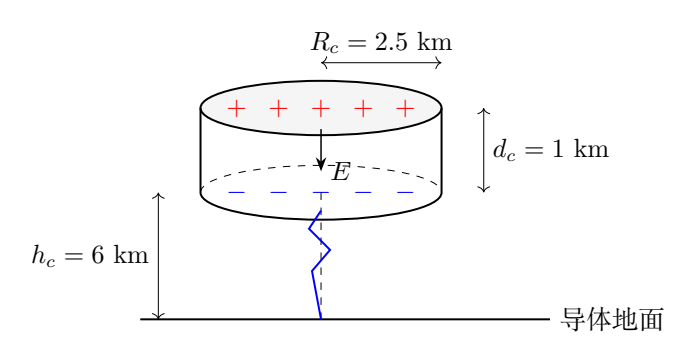

（1）高空气球电场仪测得某圆柱形云内空域的电场均匀，大小为$0.15\,\mathrm{MV/m}$。该区域轴线垂直地面，半径$2.5\,\mathrm{km}$、高度$1.0\,\mathrm{km}$。求上下端电势差、正电荷总量及携带的总电能。取$\varepsilon_0=8.85\times10^{-12}\,\mathrm{F/m}$。

（2）起电过程中云上下端电荷随时间指数增加。当地表电场大于$1.0\,\mathrm{kV/m}$时会发生云地闪电，地表场很少超过$10\,\mathrm{kV/m}$。假设（1）中的雷电云从高空缓慢整体下移，直到负电荷层离地$6.0\,\mathrm{km}$时稳定。地面是良导体，估算云正下方地表电场。

（3）云底带负电冰晶尖端放电，先形成厘米量级直径的向下细路径，并使周围空气电离，形成以细路径为轴的粗圆柱形带电体，最终接近地面成为云地闪电通道。通道竖直、负电荷总量为$2.5\,\mathrm C$，核心细路径电量相对很小；核心以外内部电场大小相等。通道长度远大于直径，通道直径远大于核心直径，连通云地前的极短时间内电荷分布近似稳定。大气击穿场为$3.0\,\mathrm{MV/m}$。估算通道直径并导出核心以外电荷密度的径向分布。

（4）连通后云底及通道负电荷迅速流向地面，温度升至数万摄氏度，空气电离形成等离子体、强光及雷声。电流约$10\,\mu\mathrm s$内达到数万安培，通道底部向四周发出约$30\,\mathrm{kHz}$强无线电波。低于$20\,\mathrm{MHz}$电离层截止频率的电磁波不能进入电离层内部，它会加热离地约$80\,\mathrm{km}$的电离层底部；电流超过阈值后，底部瞬间发光，形成以波源正上方位置为中心的光环，最大直径可达数百公里。画出光环产生及扩展的物理过程图，求半径$100\,\mathrm{km}$时的径向扩张速度。

（5）球形闪电的微波空泡模型把球闪视为球形等离子体微波空腔。较弱微波不能形成空泡时可向太空辐射并穿透电离层，被卫星观测到；电离层色散会干扰信号，携带探测器的高空气球可在雷电云上方观测。要在离地$12\,\mathrm{km}$悬浮载荷为$50\,\mathrm{kg}$的氦气球，载荷包含气球材料及探测器，求体积。12 km以下空气温度每升高1 km下降5.0 K；地面$T_0=290\,\mathrm K$、$p_0=1.01\times10^5\,\mathrm{Pa}$，空气摩尔质量$M_a=29\,\mathrm{g/mol}$。12 km处气球内氦气密度为$\rho_{\rm He}=0.18\,\mathrm{kg/m^3}$，$g=9.8\,\mathrm{m/s^2}$、$R_g=8.31\,\mathrm{J/(K\cdot mol)}$。

## 一、题型定位

各问依次涉及云内近似平行板电场、云地系统的镜像电荷、长圆柱电荷的高斯定理、球面波与平面交线的运动，以及变温大气的静力平衡和气球浮力。

每一模型的近似尺度不同。云内场按题设均匀；地表场可先把云两层电荷当成远处点电荷，也可以用均匀圆盘提高几何精度；通道横向尺度只有米量级，长度约6 km，适合忽略端部效应；光环在短时间内可把电离层底面当平面；大气计算则必须保留12 km中的温度变化。

题中电荷“总量”和场强“大小”多为正的标量；有符号电荷密度则必须带负号。以下统一地表竖直向上为$z$正方向，通道径向向外为$r$正方向，据此核对参考答案中的方向和符号。

## 二、知识点

### 1. 均匀电场的能量

电场能量密度为

$$
w_E=\frac12\varepsilon_0E^2.
$$

对均匀圆柱空间积分，$U_E=w_E\pi R_c^2d_c$。平行板等效电容$C_c=\varepsilon_0\pi R_c^2/d_c$，电势差$V_c=Ed_c$，电荷$Q_c=C_cV_c$，同样给$U_E=Q_cV_c/2$。

### 2. 导体平面的镜像

上半空间一个电荷$q$位于高度$h$，无限良导体地面的电势为零，可用镜像电荷$-q$放在$-h$代替地面对外部区域的作用。

地表切向电场为零，法向场由真实电荷和镜像电荷共同贡献。云层不是直接放在地面上的平行板，不能用云内场$E$直接当成地表场。

### 3. 长圆柱体系的高斯定理

对长度$\ell$、半径$r$的同轴高斯柱面，忽略端面通量，

$$
2\pi r\ell E_r(r)=\frac{Q_{\rm enc}(r)}{\varepsilon_0}.
$$

负电通道使$E_r<0$，指向轴线。柱面对电荷的积分和通量都要使用有符号量；若全部使用大小，最后应明确把密度大小转换为负密度。

### 4. 大气静力平衡

取薄空气层厚$dz$，下表面压力与上表面压力之差支撑其重力：

$$
\frac{dp}{dz}=-\rho g.
$$

理想气体密度$\rho=M_ap/(R_gT)$，温度按$T(z)=T_0-\alpha z$变化，$\alpha=5.0\times10^{-3}\,\mathrm{K/m}$。这是静力温度分布，不是将整柱空气当作同一个绝热气团。

## 三、物理图像

图7b把正、负电荷层及各自镜像同时画出。负层更接近地面，在云下轴线上产生的向上场较强；正层产生较弱的向下场，所以净地表场向上。

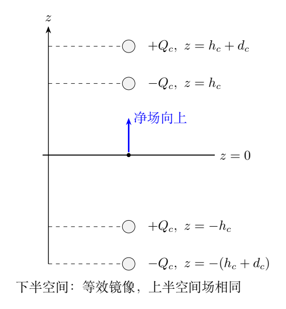

图7c显示通道场向内、大小恒定，但密度不均匀。半径越大，同一单位长度高斯柱面的面积越大，包围的负电荷量必须按半径增加，故体密度只能按$1/r$下降。

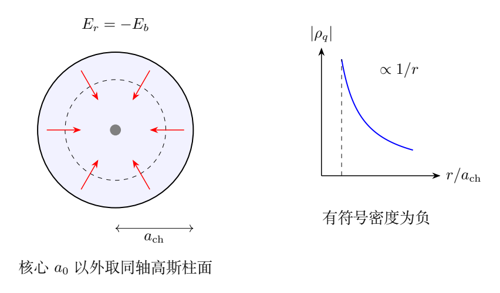

图7d中无线电波波前始终以$c$在三维空间传播，而发光圆环只是球面波与电离层平面的交线。相邻环位置由不同方向的波分别点亮，所以交线速度可以大于$c$。

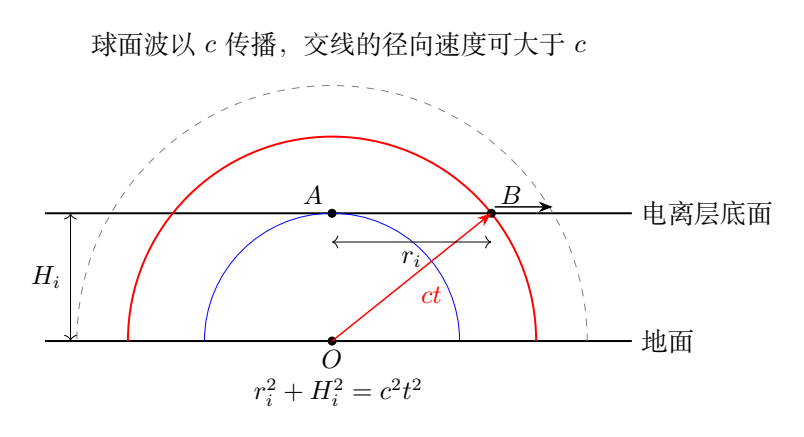

图7e把温度、压力及密度随高度下降的趋势与浮力模型放在一起。气球体积取决于外界空气和内部氦气的密度差，不是只用空气密度来支撑50 kg载荷。

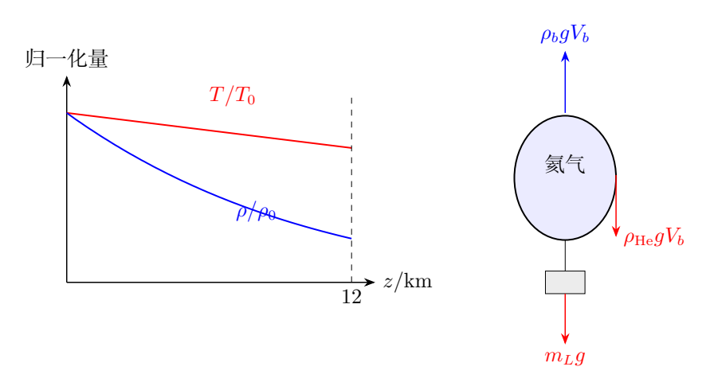

## 四、解题入口

为避免符号重复，云半径、层间距、负层高度分别记为$R_c,d_c,h_c$，光环层高度记为$H_i$，气球高度记为$z_b$。数值分别为2.5 km、1.0 km、6.0 km、80 km和12 km。

第（1）问按均匀场模型算$V_c,Q_c,U_E$；第（2）问在这些电荷不变的模型下做镜像估算。第（3）问使用通道自身2.5 C电量，不应把云层约26 C电量全部塞入通道。

第（4）问先写交线几何关系再求导；第（5）问先积分大气压强，算出12 km空气密度，再求气球体积。把海平面密度直接代入浮力将严重低估体积。

## 五、解析

### （1）电势差

云上端带正电、下端带负电，云内场从上向下。上端电势高于下端，差值为

$$
V_c=\varphi_{\rm upper}-\varphi_{\rm lower}
=Ed_c.
$$

将$E=0.15\,\mathrm{MV/m}=1.5\times10^5\,\mathrm{V/m}$、$d_c=1000\,\mathrm m$代入，

$$
\boxed{V_c=1.50\times10^8\,\mathrm V=150\,\mathrm{MV}}.
$$

### 正电荷与总电能

圆柱横截面积为

$$
A_c=\pi R_c^2=\pi(2500)^2\,\mathrm{m^2}.
$$

平行板近似的面电荷密度大小是$\sigma_c=\varepsilon_0E$，所以

$$
\boxed{
Q_c=\varepsilon_0EA_c
=26.0654\,\mathrm C\simeq26\,\mathrm C}.
$$

上端为$+Q_c$，下端为$-Q_c$；“正电荷总量”不是两端电量大小相加所得的$2Q_c$。

能量由场密度积分，

$$
\begin{aligned}
U_E&=\int_{\rm cylinder}\frac12\varepsilon_0E^2\,dV\\
&=\frac12\varepsilon_0E^2A_cd_c
=\frac12Q_cV_c.
\end{aligned}
$$

于是

$$
\boxed{U_E=1.95491\times10^9\,\mathrm J
\simeq2.0\times10^9\,\mathrm J}.
$$

用电容$C_c=\varepsilon_0A_c/d_c$计算$C_cV_c^2/2$得到同一结果。本问的“总电能”是所给均匀场区域及相应平行板模型的能量，不包含未给出的外部云场或其他云团能量。

### （2）点电荷加镜像的地表场估算

把每层总电荷集中在其中心：负电荷$-Q_c$位于$z=h_c$，正电荷$+Q_c$位于$z=h_c+d_c$。对应镜像分别为$+Q_c$在$-h_c$、$-Q_c$在$-(h_c+d_c)$。

位于地面上方的负电荷在原点产生向上场$Q_c/(4\pi\varepsilon_0h_c^2)$，下方正镜像也产生同方向同大小场。二者合计

$$
E_{-,z}=\frac{Q_c}{2\pi\varepsilon_0h_c^2}.
$$

上方正层与下方负镜像产生向下场：

$$
E_{+,z}=-\frac{Q_c}
{2\pi\varepsilon_0(h_c+d_c)^2}.
$$

因此

$$
\boxed{
E_{z,\rm point}
=\frac{Q_c}{2\pi\varepsilon_0}
\left[\frac1{h_c^2}
-\frac1{(h_c+d_c)^2}\right]}.
$$

代入$h_c=6000\,\mathrm m,d_c=1000\,\mathrm m$，

$$
\boxed{E_{z,\rm point}\simeq
3.455\times10^3\,\mathrm{V/m}
=3.5\,\mathrm{kV/m}},
$$

方向竖直向上。在以向下为正的约定中，它写成负的−3.5 kV/m；方向相同。

这个大小超过题给1.0 kV/m的触发尺度，符合题意中可能发生云地闪电的情形。这里并没有求一个真实的动态放电时刻，因为电荷增长率和下移时间过程未给出。

### 均匀圆盘的轴向场：更细的几何估算

云层半径与高度之比$R_c/h_c\simeq0.42$并不极小，点电荷近似有一定误差。现在把上下层均看成半径$R_c$、面电荷密度大小$\sigma_c$的均匀圆盘。

先求正圆盘在距盘平面$x>0$的轴上电势。半径$s$、宽$ds$的圆环电量为$dq=2\pi\sigma_cs\,ds$，到轴上点距离为$\sqrt{x^2+s^2}$。故

$$
d\varphi=\frac{dq}
{4\pi\varepsilon_0\sqrt{x^2+s^2}}
=\frac{\sigma_c s\,ds}
{2\varepsilon_0\sqrt{x^2+s^2}}.
$$

从$s=0$积分到$R_c$，

$$
\varphi(x)=
\frac{\sigma_c}{2\varepsilon_0}
\left(\sqrt{x^2+R_c^2}-x\right).
$$

轴向远离正盘的场大小为

$$
E_{\rm disk}(x)
=-\frac{d\varphi}{dx}
=\frac{\sigma_c}{2\varepsilon_0}
\left(1-\frac{x}{\sqrt{x^2+R_c^2}}\right).
$$

对云的负盘与正盘再分别加入镜像，地表净向上场为

$$
\boxed{
E_{z,\rm disk}
=\frac{\sigma_c}{\varepsilon_0}
\left[
\frac{h_c+d_c}{\sqrt{R_c^2+(h_c+d_c)^2}}
-\frac{h_c}{\sqrt{R_c^2+h_c^2}}
\right]}.
$$

也可用$\sigma_c=Q_c/(\pi R_c^2)$替代，系数应为$Q_c/(\pi\varepsilon_0R_c^2)$；$\varepsilon_0$不可漏掉。

代入题给数据，

$$
\boxed{E_{z,\rm disk}\simeq
2.800\,\mathrm{kV/m}},
$$

仍为向上。与点电荷估算约3.455 kV/m相比，有限圆盘分散电荷使轴上场较弱。均匀圆盘假设改善几何，但仍承接第（1）问的平行板电量估计，不应把它称为真实雷电云的精确结果。

### 圆盘结果的远场检验

当$R_c\ll h_c$时，

$$
\frac{x}{\sqrt{x^2+R_c^2}}
=1-\frac{R_c^2}{2x^2}
+O(R_c^4/x^4).
$$

将这个展开代入圆盘式，

$$
E_{z,\rm disk}
\simeq
\frac{Q_c}{2\pi\varepsilon_0}
\left[\frac1{h_c^2}
-\frac1{(h_c+d_c)^2}\right].
$$

正好回到点电荷镜像结果。若还满足$d_c\ll h_c$，电场约为$Q_cd_c/(\pi\varepsilon_0h_c^3)$，中性电荷双层在远处呈现偶极子场的三次方衰减。

### （3）通道线电荷与直径

通道长度近似为负云层离地高度$h_c=6000\,\mathrm m$，负电荷总量大小为$Q_{\rm ch}=2.5\,\mathrm C$。有符号线电荷密度为

$$
\lambda_{\rm ch}=-\frac{Q_{\rm ch}}{h_c},
$$

大小为

$$
|\lambda_{\rm ch}|
=4.16667\times10^{-4}\,\mathrm{C/m}.
$$

对通道外$r>a_{\rm ch}$的高斯柱面，

$$
E_r(r)=\frac{\lambda_{\rm ch}}
{2\pi\varepsilon_0r}<0.
$$

通道边缘场的大小取击穿场$E_b=3.0\times10^6\,\mathrm{V/m}$，

$$
E_b=\frac{|\lambda_{\rm ch}|}
{2\pi\varepsilon_0a_{\rm ch}}.
$$

故通道直径为

$$
\boxed{
D_{\rm ch}=2a_{\rm ch}
=\frac{Q_{\rm ch}}
{\pi\varepsilon_0E_bh_c}
\simeq4.995\,\mathrm m
\simeq5.0\,\mathrm m}.
$$

几米通道与几厘米核心、几千米长度之间有清楚的尺度分离，符合题给近似。若误把云正电总量26 C代入，会把直径放大约十倍。

### 核心外的电荷密度

题设核心外通道内部电场大小相同，方向向内，因此

$$
E_r(r)=-E_b,
\qquad a_0<r<a_{\rm ch}.
$$

由柱坐标散度形式的高斯定理，

$$
\frac1r\frac{d}{dr}[rE_r(r)]
=\frac{\rho_q(r)}{\varepsilon_0}.
$$

代入恒定的$E_r=-E_b$，

$$
\frac1r\frac{d(-E_br)}{dr}
=-\frac{E_b}{r}.
$$

所以

$$
\boxed{\rho_q(r)=-\frac{\varepsilon_0E_b}{r}}.
$$

其中$\rho_q$单位为$\mathrm{C/m^3}$，不是空气质量密度。其大小为$\varepsilon_0E_b/r$；负号表达通道带负电，不能被当作可省略的数学符号。

### 用积分再检查密度

把核心理想化到极小半径，半径$r$内单位长度的电量为

$$
\lambda(r)=\int_0^r
\rho_q(s)\,2\pi s\,ds
=-2\pi\varepsilon_0E_br.
$$

因此高斯柱面给

$$
E_r(r)=\frac{\lambda(r)}
{2\pi\varepsilon_0r}=-E_b,
$$

与假设一致。虽然密度按$1/r$形式增大，柱壳体积微元正比$r\,dr$，总电量仍有限。

物理核心不能真的取$r=0$并继续使用此密度，题设明确排除了核心。若核心半径为$a_0$，要使其外侧场已经为$-E_b$，核心单位长度电量应约为$-2\pi\varepsilon_0E_ba_0$，仅占全部通道电量的$a_0/a_{\rm ch}$，可以很小。

这个模型描述稳定的体电荷分布，不是静电平衡的理想金属柱。理想导体内部电场为零，而题目明确规定内部非零电场，不能把电荷全放在表面。

### （4）电离层光环出现与扩张

按题设把电离层底面取为离地$H_i=80\,\mathrm{km}$的平面。无线电波从地面点$O$在$t=0$发出，波前球面半径为$ct$。最早到达正上方$A$，时间为

$$
t_A=\frac{H_i}{c}.
$$

在$t\ge t_A$时，球面与电离层平面的交线为圆，环半径$r_i$满足

$$
H_i^2+r_i^2=(ct)^2.
$$

故

$$
\boxed{r_i(t)=\sqrt{c^2t^2-H_i^2}}.
$$

若改用从光环首次出现起的时间$\tau=t-t_A$，

$$
r_i(\tau)=\sqrt{2H_ic\tau+c^2\tau^2}.
$$

两种时间原点不能混用：以发射为零必须保留$t_A$，以首次出现为零则平方中有交叉项。

### 径向速度

对几何式求导，

$$
2r_i\frac{dr_i}{dt}=2c^2t.
$$

于是

$$
\boxed{
v_{\rm ring}=\frac{dr_i}{dt}
=\frac{c^2t}{r_i}
=c\frac{\sqrt{H_i^2+r_i^2}}{r_i}}.
$$

取$H_i=80\,\mathrm{km}$、$r_i=100\,\mathrm{km}$，

$$
v_{\rm ring}
=c\sqrt{1+\left(\frac{80}{100}\right)^2}
=1.28062485c.
$$

所以

$$
\boxed{v_{\rm ring}\simeq3.842\times10^8\,\mathrm{m/s}}.
$$

在该半径的到达时刻$t=\sqrt{80^2+100^2}\,\mathrm{km}/c\simeq0.42688\,\mathrm{ms}$，首次出现时刻约0.26667 ms，扩张到100 km历时约0.16021 ms。

### 几何速度超过光速的含义

交线速度并不是无线电波的传播速度，也不是电离层物质的径向运动速度。半径不同的位置分别由从$O$沿不同方向发出的波点亮，外侧位置不需要先等待内侧发光后才接到信息。

在$r_i\to0^+$时，理想交线速度趋于无穷；它对应球面与平面相切时交点对半径的敏感性，不表示无限快的信息传输。有限波包宽度、电离层厚度及发光反应时间会使实际边缘模糊，题目未给这些参数。

另一种几何表达为$v_{\rm ring}=c/\cos\theta_i$，其中$\cos\theta_i=r_i/\sqrt{H_i^2+r_i^2}$。分母是斜程$OB$，不能误写成竖直高度$OA$。

### （5）12 km的温度

温度梯度为

$$
\alpha=5.0\,\mathrm{K/km}
=5.0\times10^{-3}\,\mathrm{K/m}.
$$

取$z_b=12000\,\mathrm m$，

$$
\boxed{T_b=T_0-\alpha z_b=290-60=230\,\mathrm K}.
$$

该温度分布只在题给12 km以下使用，不向任意高度延伸到零或负绝对温度。

### 积分大气静力方程

由

$$
\frac{dp}{dz}
=-\rho g
=-\frac{M_ag}{R_g[T_0-\alpha z]}p,
$$

分离变量，

$$
\frac{dp}{p}
=-\frac{M_ag}{R_g}
\frac{dz}{T_0-\alpha z}.
$$

从地面$z=0,p=p_0$积分至$z,p(z)$：

$$
\ln\frac{p(z)}{p_0}
=-\frac{M_ag}{R_g}
\int_0^z\frac{ds}{T_0-\alpha s}.
$$

积分为

$$
\int_0^z\frac{ds}{T_0-\alpha s}
=-\frac1\alpha
\ln\frac{T_0-\alpha z}{T_0}.
$$

因此

$$
\boxed{
p(z)=p_0
\left(1-\frac{\alpha z}{T_0}\right)^{q_a}},
\qquad
q_a=\frac{M_ag}{\alpha R_g}.
$$

这里$q_a$无量纲。两个负号相消后，对数右侧仍是负值，因为温度比小于1，故压力随高度降低，方向正确。

### 空气密度分布

地面密度为

$$
\rho_0=\frac{M_ap_0}{R_gT_0}.
$$

用$T(z)=T_0(1-\alpha z/T_0)$，

$$
\begin{aligned}
\rho(z)
&=\frac{M_ap(z)}{R_gT(z)}\\
&=\rho_0
\left(1-\frac{\alpha z}{T_0}\right)^{q_a-1}.
\end{aligned}
$$

所以

$$
\boxed{
\rho(z)=\frac{M_ap_0}{R_gT_0}
\left(1-\frac{\alpha z}{T_0}\right)^{
M_ag/(\alpha R_g)-1}}.
$$

密度指数比压力指数小1，因为温度也随高度下降。若在密度式中仍使用$q_a$，就漏掉了分母温度的变化。

### 数值代入

用$M_a=0.029\,\mathrm{kg/mol}$，

$$
q_a=\frac{0.029\times9.8}{0.005\times8.31}
=6.8399519.
$$

12 km处

$$
p_b=1.01\times10^5
\left(\frac{230}{290}\right)^{6.8399519}
=2.0689134\times10^4\,\mathrm{Pa}.
$$

进而

$$
\boxed{
\rho_b=\frac{0.029p_b}{8.31\times230}
=0.3139146\,\mathrm{kg/m^3}}.
$$

密度单位是$\mathrm{kg/m^3}$。若误写成$\mathrm{kg/cm^3}$，相差百万倍，不能仅因数字0.31看起来合理就忽略单位。

### 浮力平衡求气球体积

题给50 kg载荷不包括氦气质量，但包括气球材料与探测器。设气球体积为$V_b$，外界浮力为$\rho_bgV_b$，氦气重力为$\rho_{\rm He}gV_b$，载荷重力为$m_Lg$。

悬浮条件为

$$
\rho_bgV_b=\rho_{\rm He}gV_b+m_Lg.
$$

消去$g$，

$$
\boxed{V_b=\frac{m_L}{\rho_b-\rho_{\rm He}}}.
$$

必须有$\rho_b>\rho_{\rm He}$；若密度差为零或负，无有限正体积能够托起正载荷。

代入题给氦气密度0.18 kg/m³及未舍入的空气密度，

$$
\boxed{
V_b=\frac{50}{0.3139146-0.18}
=373.37\,\mathrm{m^3}
\simeq3.7\times10^2\,\mathrm{m^3}}.
$$

若先把空气密度近似成0.31 kg/m³，结果为384.6 m³，常写约$3.8\times10^2\,\mathrm{m^3}$。密度差比单个密度小，提前舍入会在体积上放大。

用质量直接检验：题给氦气质量约为$0.18V_b=67.21$ kg，排开空气质量约为$0.3139146V_b=117.21$ kg，差为50 kg，正好支撑载荷。

### 氦气条件与大气条件的区分

原题把12 km处氦气密度直接给定为0.18 kg/m³，主解按这一条件使用，不额外假设球内与外界等压、同温来替换它。氦气密度的物理值取决于内部压力与温度，外界空气密度则由题给静力温度分布求得。

若另规定柔性球囊、内外等压同温，应以氦气摩尔质量重新求内部密度，体积将不同；这是变式中的另一个模型，而不是原题可无条件加入的假设。

### 大气积分的等温极限

当温度梯度趋于零时，压力表达式看似指数$q_a\to\infty$，但可以取对数：

$$
\ln\frac{p(z)}{p_0}
=\frac{M_ag}{\alpha R_g}
\ln\left(1-\frac{\alpha z}{T_0}\right).
$$

利用$\ln(1-u)=-u+O(u^2)$，

$$
\ln\frac{p(z)}{p_0}\longrightarrow
-\frac{M_agz}{R_gT_0}.
$$

所以回到熟悉的等温大气公式$p=p_0e^{-M_agz/(R_gT_0)}$。这项极限同时核对了变温积分的指数、符号与初始条件。
