# 第 1 题　双气室空气弹簧的刚度（40分）

高铁空气弹簧由承载主气室和容积不变的附加气室组成，以阀门连通，如图。气囊内的压缩空气对簧上负载提供竖直向上的作用力。负载平衡时，主室压强、体积为$p_{10},V_{10}$，附加室容积为$V_2$，大气压为$p_0$。定义有效承载面积$A_e=F/(p_1-p_0)$，其中$F$是向上的气囊作用力，$p_1$是主室气体压强。

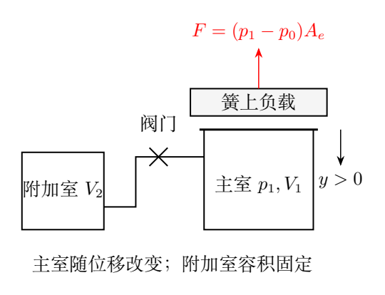

空气定容摩尔热容$C_V=5R/2$。微振幅下，主室体积$V_1$和有效面积$A_e$均是承载面相对平衡位置的竖直位移$y$的线性函数，取向下为正，变化率分别为$-\alpha$及$\beta$，$\alpha,\beta>0$。

（1）阀门关闭时，求劲度系数$K\equiv dF/dy$与$A_e$的关系：（i）上下乘客时气体发生等温变化；（ii）列车剧烈颠簸时气体发生绝热变化。

（2）阀门打开、主室连通附加室后，分别求上述两种情况下$K$与$A_e$的关系。通道容积忽略。

## 一、题型定位

这是热力学状态变化与小振动恢复力相结合的问题。气囊的力既由压强差改变，也由承载面积改变，必须对二者的乘积求导。将气囊当作定面积活塞，只能保留部分刚度。

两种运动速度对应两种热过程：上下乘客通常足够慢，气体可与外界交换热量；强烈颠簸足够快，热交换来不及发生。阀门是否打开又影响参与压缩的气体体积，热时间尺度与流动时间尺度需要分别判断。

本题的$K$是力对承载面向下位移的导数。它为正时，向下压缩使向上支承增大，属于恢复力。若把它写成负的胡克斜率，必须同时改变力和位移的方向定义，否则符号会错。

## 二、知识点

### 1. 几何变化与平衡位置

令平衡面积为$A_{e0}$，则题设线性关系为

$$
V_1(y)=V_{10}-\alpha y,\qquad
A_e(y)=A_{e0}+\beta y.
$$

$\alpha$的量纲为面积，$\beta$的量纲为长度。两者是气囊形状变化给出的独立参数，不能无依据地令$\alpha=A_e$。局部模型至少要求$V_1>0$及$A_e>0$。

平衡负载若为$W$，有

$$
W=(p_{10}-p_0)A_{e0}.
$$

这个式子可以在最后将面积刚度写成$\beta W/A_{e0}$，但并不能代替求压强导数。

### 2. 多方过程的统一写法

固定物质的量的理想气体在等温过程中满足$pV=\text{常量}$；准静态可逆绝热过程中满足$pV^\gamma=\text{常量}$。因此使用指数$\kappa$统一写

$$
pV^\kappa=p_{\rm eq}V_{\rm eq}^\kappa,\quad
\kappa=1\ \text{或}\ \gamma.
$$

此处$\kappa$只标记已给过程，不是额外假定任意多方指数。由$C_P-C_V=R$，

$$
C_P=\frac72R,\qquad
\gamma=\frac{C_P}{C_V}=\frac75.
$$

对于任意可微容积$V(y)$，对状态关系求导：

$$
V^\kappa\frac{dp}{dy}
+\kappa pV^{\kappa-1}\frac{dV}{dy}=0,
$$

所以

$$
\frac{dp}{dy}=-\kappa\frac pV\frac{dV}{dy}.
$$

向下压缩使$dV/dy<0$，因此$dp/dy>0$，与直观一致。

### 3. 两项刚度

气囊力为

$$
F(y)=[p(y)-p_0]A_e(y).
$$

乘积求导给

$$
K=A_e\frac{dp}{dy}
+(p-p_0)\frac{dA_e}{dy}.
$$

第一项是气体压缩产生的刚度，第二项是有效面积改变产生的刚度。面积项使用压强差，压缩项使用绝对压强；这是因为气体状态方程中的$p$不能换成表压$p-p_0$。

## 三、物理图像

承载面向下移动时主室缩小，压强升高；同时题给有效面积增大。两个效应都增大向上的支承力。

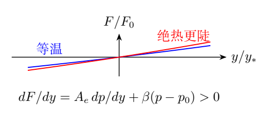

图中的$y>0$对应压缩。相对平衡力的增量$\delta F\simeq K_0y$向上，故质量$M_s$的负载在忽略其他力变化时满足$M_s\ddot y=-K_0y$。

阀门打开的慢过程里，空气有时间在两室之间流动，主室压强的增加被更大的总容积缓冲。快过程里，通道阻抗可以使空气交换来不及完成，主室仍近似独立压缩。忽略通道容积只去掉其储气量，并不自动去掉其流动阻抗。

## 四、解题入口

先写$F=(p-p_0)A_e$，求导并保留两个变化来源；再根据热过程和流动过程决定状态关系中的容积。

闭阀用主室$V_1$，慢开阀用总容积$V_1+V_2$。对于参考解答所采用的高频开阀极限，应明确“一个振动周期内两室交换的气量可忽略”，然后重新使用主室独立绝热关系。

如果所求是小振动劲度，最终应在平衡位置$y=0$评价导数。若所求是$K$随$A_e$的局部关系，可以保留$y$，再用

$$
y=\frac{A_e-A_{e0}}{\beta}
$$

消去它。求导时不应提前将所有体积都替换为平衡值，否则会漏掉状态变化。

## 五、解析

### （1）闭阀的统一推导

主室气体质量不变，过程指数为$\kappa$，所以

$$
p_1V_1^\kappa=p_{10}V_{10}^\kappa,
\qquad
p_1=p_{10}\left(\frac{V_{10}}{V_1}\right)^\kappa.
$$

利用$dV_1/dy=-\alpha$，

$$
\frac{dp_1}{dy}
=\frac{\kappa\alpha p_1}{V_1}
=\frac{\kappa\alpha p_{10}V_{10}^\kappa}
{V_1^{\kappa+1}}.
$$

由乘积导数，得到

$$
\boxed{
K_{\rm closed}
=\frac{\kappa\alpha p_{10}V_{10}^\kappa}
{V_1^{\kappa+1}}A_e
+\beta\left[
p_{10}\left(\frac{V_{10}}{V_1}\right)^\kappa-p_0
\right]}.
$$

这是闭阀两种情形的统一表达式。式中$p_0$不随$y$变化。若外界大气压也改变，那是另一个输入，不能包含在同一个恢复系数中。

### 等温上下乘客

令$\kappa=1$，

$$
\boxed{
K_{\rm iso}
=\frac{\alpha p_{10}V_{10}}{V_1^2}A_e
+\beta\left(\frac{p_{10}V_{10}}{V_1}-p_0\right)}.
$$

在平衡位置，

$$
\boxed{
K_{{\rm iso},0}
=\frac{\alpha p_{10}A_{e0}}{V_{10}}
+\beta(p_{10}-p_0)}.
$$

承载面压下后，气体的温度保持不变，支承增加来自密度增大和有效面积增大。因为过程缓慢，这个刚度反映准静态力—位移响应。

### 绝热颠簸

空气绝热指数为$7/5$，因此

$$
\boxed{
K_{\rm ad}
=\frac{7\alpha p_{10}V_{10}^{7/5}}
{5V_1^{12/5}}A_e
+\beta\left[
p_{10}\left(\frac{V_{10}}{V_1}\right)^{7/5}-p_0
\right]}.
$$

在平衡位置，

$$
\boxed{
K_{{\rm ad},0}
=\frac{7\alpha p_{10}A_{e0}}{5V_{10}}
+\beta(p_{10}-p_0)}.
$$

绝热压缩还会升温，因此气体压缩项是同状态等温值的$7/5$倍。总刚度的比值却一般不是$7/5$，因为面积项没有这个因子。

记

$$
K_p=\frac{\alpha p_{10}A_{e0}}{V_{10}},
\qquad K_A=\beta(p_{10}-p_0),
$$

则

$$
\frac{K_{{\rm ad},0}}{K_{{\rm iso},0}}
=\frac{(7/5)K_p+K_A}{K_p+K_A}.
$$

当$p_{10}>p_0$、题给$\alpha,\beta>0$时，该比值在1与$7/5$之间。只有面积变化项可忽略时，它才趋于$7/5$。

### 用有效面积表示局部刚度

因为$A_e=A_{e0}+\beta y$，

$$
V_1(A_e)=V_{10}
-\frac{\alpha}{\beta}(A_e-A_{e0}).
$$

将它代入前面的闭阀统一式，便得到仅以$A_e$作变量的关系。比如等温时

$$
\begin{aligned}
K_{\rm iso}(A_e)
={}&\frac{\alpha p_{10}V_{10}A_e}
{\left[V_{10}-\frac{\alpha}{\beta}
(A_e-A_{e0})\right]^2}\\
&+\beta\left\{
\frac{p_{10}V_{10}}
{V_{10}-\frac{\alpha}{\beta}(A_e-A_{e0})}-p_0
\right\}.
\end{aligned}
$$

方括号中的体积必须为正，且线性几何只适于微小位移。虽然代数式在很大位移仍可计算，不代表实际气囊仍遵守该线性几何。

### （2）慢开阀：两室共同等温

在两室已于平衡态等压、温度相同的条件下，初态总容积

$$
V_{T0}=V_{10}+V_2.
$$

慢过程里$p_1=p_2=p$，总气量不变。附加室虽没有承载面位移，却参与气体的密度变化：

$$
p(V_1+V_2)=p_{10}(V_{10}+V_2).
$$

因此

$$
p=\frac{p_{10}(V_{10}+V_2)}{V_1+V_2},
\qquad
\frac{dp}{dy}
=\frac{\alpha p_{10}(V_{10}+V_2)}
{(V_1+V_2)^2}.
$$

向上支承仍只有主室的有效面积$A_e$，不能把附加室某个截面积加进承载面积。得到

$$
\boxed{
\begin{aligned}
K_{\rm open,slow}
={}&\frac{\alpha p_{10}(V_{10}+V_2)}
{(V_1+V_2)^2}A_e\\
&+\beta\left[
\frac{p_{10}(V_{10}+V_2)}
{V_1+V_2}-p_0\right].
\end{aligned}}
$$

平衡位置的刚度为

$$
\boxed{
K_{{\rm open,slow},0}
=\frac{\alpha p_{10}A_{e0}}{V_{10}+V_2}
+\beta(p_{10}-p_0)}.
$$

与闭阀等温值比较，

$$
K_{{\rm iso},0}-K_{{\rm open,slow},0}
=\alpha p_{10}A_{e0}
\left(\frac1{V_{10}}-\frac1{V_{10}+V_2}\right)>0.
$$

减小的只是在同一平衡状态下的压缩项，面积项不变。$V_2\to0$时恢复闭阀结果；$V_2$很大时压缩项趋零，但总刚度仍趋向$K_A$。

### 快开阀：主室独立绝热极限

参考解答对剧烈颠簸采用两个快过程条件：主室与外界热交换可忽略，且一个周期内主、附加室的气体交换量可忽略。此时主室气量近似固定，即使阀门打开，也有

$$
p_1V_1^{7/5}=p_{10}V_{10}^{7/5}.
$$

故

$$
\boxed{K_{\rm open,fast}\simeq K_{\rm ad}}.
$$

这是流动来不及响应的极限，而不是从“阀门打开”这个词单独推出的等式。若通道能够迅速等压，同时气体来不及散热，应改用共同绝热关系

$$
p(V_1+V_2)^{7/5}
=p_{10}(V_{10}+V_2)^{7/5},
$$

此时平衡刚度是

$$
K_{{\rm open,ad,equal},0}
=\frac{7\alpha p_{10}A_{e0}}{5(V_{10}+V_2)}
+\beta(p_{10}-p_0).
$$

题目没有给通道阻抗或流量方程，无法计算这两极限之间的具体频率响应。说明参考高频假定之后给出独立主室结果，才使模型闭合。

### 小振动与力的方向检查

设簧上质量为$M_s$，以平衡位置作原点。恒定重力与$F_0$相消，向下的净力为$-\delta F$：

$$
M_s\ddot y=-K_0y.
$$

当$K_0>0$，

$$
\omega_s=\sqrt{\frac{K_0}{M_s}}.
$$

这里用的是平衡切线刚度，不是$F/y$，也不是将整个非线性$F(y)$系数当成常数。该模型只有弹性而没有通道耗散，不能仅凭附加气室存在就说振幅一定随时间衰减。

### 量纲与能量核对

压缩项$\alpha pA/V$的量纲为

$$
\frac{\mathrm{m^2}\cdot\mathrm{N/m^2}\cdot\mathrm{m^2}}
{\mathrm{m^3}}=\mathrm{N/m}.
$$

面积项$\beta(p-p_0)$也为N/m。平衡附近的净弹性势能可定义为

$$
U_{\rm eff}(y)=\int_0^y[F(s)-F_0]\,ds
=\frac12K_0y^2+O(y^3).
$$

此处减掉平衡力对应同时计入重力势能。若直接积分$F$再把线性项解释为不稳定，是把平衡负载遗漏了。

\clearpage

# 第 2 题　台球击打后的滑动、滚动与摆线（40分）

质量$m$、半径$R$的均质实心母球静置于水平桌面。球与桌面的滑动摩擦系数为$\mu$，最大静摩擦力等于滑动摩擦力。球杆在球心所在的竖直平面内保持水平，击打球的上半部，击打线高于球心水平面$R/2$。击打时间极短，母球获得大小$P$的水平冲量。重力加速度为$g$。

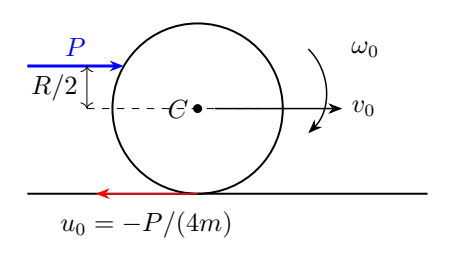

（1）击打后经过多久母球开始纯滚动？求进入纯滚动时的球心速度。

（2）在开始纯滚动时将计时清零，记此时球上与桌面接触的材料点为$B$。求随后$t'$时刻$B$的位置、速度和加速度。

## 一、题型定位

击打使球同时获得平动和转动；球底接触点是否滑动，要用这两种运动合成判断。本题的击打点较高，产生的自转使球底向后滑动，尽管球心向前运动。

在滑动阶段，摩擦朝前，加快球心同时减慢自转，直到$v=R\omega$。之后理想水平桌面不需要非零静摩擦维持匀速滚动。

第二问追踪的是固定材料点$B$，而非每个时刻不断更换的几何接触点。它随着球转动离开桌面，走过摆线；速度在触地点为零，加速度却仍非零。

## 二、知识点

### 1. 方向、惯量与冲量

取$x$水平向右，与球杆冲量同向；$y$竖直向上。用顺时针转动的角速度大小$\omega$作正标量。均质实心球绕球心的惯量为

$$
J=\frac25mR^2.
$$

击打前静止，极短击打中有限的桌面摩擦不能贡献可比于$P$的冲量。水平冲量和关于球心的角冲量分别给

$$
mv_0=P,\qquad J\omega_0=P\frac R2.
$$

因此击打后$v_0=P/m$，$\omega_0=5P/(4mR)$。两个结果来自不同守恒方程，不能先套纯滚动约束，因为此时尚在滑动。

### 2. 接触点的有向速度

球底相对球心的转动速度向左，故实际球底材料点相对桌面的水平速度

$$
u=v-R\omega.
$$

这个$u$决定滑动摩擦的方向：$u<0$时摩擦向右，$u>0$时摩擦向左。摩擦作用方向由局部相对滑动决定，不由质心运动方向决定。

### 3. 刚体点的速度与加速度

对于球心$C$和固定材料点$B$，

$$
\mathbf v_B=\mathbf v_C+\boldsymbol\omega\times\mathbf r_{B/C},
$$

$$
\mathbf a_B=\mathbf a_C+
\dot{\boldsymbol\omega}\times\mathbf r_{B/C}
+\boldsymbol\omega\times
(\boldsymbol\omega\times\mathbf r_{B/C}).
$$

匀速纯滚动时$\mathbf a_C=0$、$\dot{\boldsymbol\omega}=0$，但最后的向心加速度存在。瞬时速度为零不能推出瞬时加速度为零。

## 三、物理图像

击打线高于球心，关于球心的力矩为顺时针。代入$v_0,\omega_0$，

$$
u_0=\frac Pm-\frac{5P}{4m}
=-\frac P{4m}<0.
$$

因此球底向后擦桌面，桌面对球的摩擦向前。

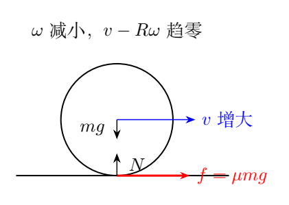

同一向右的摩擦对球心作顺时针反向力矩：它使$v$增大、$\omega$减小，所以$v-R\omega$从负值向零靠近。到达零后，平动和转动无须再交换动量。

纯滚动阶段，$B$从球底出发，先向右上方运动，到球顶时水平速度是球心速度的两倍，再回到下一个触地点。

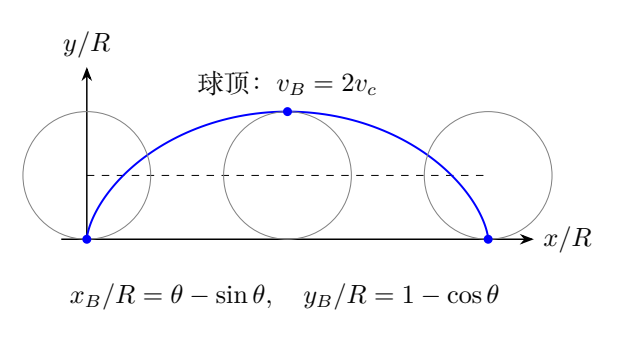

图中的球心沿高度$R$的直线前进，材料点相对球心沿圆周顺时针转动。把这两个位移相加即可建立坐标参数式。

## 四、解题入口

分成击打、滑动、纯滚动三段。击打用线冲量与角冲量求初值；滑动先判断$u_0$，再写平动及转动方程；纯滚动之后重新计时，建立固定点的轨迹。

滑动终止条件只有一个：

$$
v(t_0)-R\omega(t_0)=0.
$$

它是过程边界，不是整个滑动阶段的恒等式。第二问用$\theta=(v_c/R)t'$作参数，能同时得到位置、速度和加速度。

## 五、解析

### （1）击打产生的初始运动

沿冲量方向应用动量定理，

$$
P=mv_0,\qquad \boxed{v_0=\frac Pm}.
$$

击打点到球心的垂直力臂为$R/2$，所以

$$
\frac{PR}{2}=J\omega_0
=\frac25mR^2\omega_0,
$$

得到

$$
\boxed{\omega_0=\frac{5P}{4mR}}.
$$

球底速度$u_0=-P/(4m)$，故摩擦恒朝正$x$，大小$f=\mu mg$，法向力与重力相消。

### 滑动阶段的动力学

平动方程

$$
m\dot v=\mu mg,
\qquad
v(t)=\frac Pm+\mu gt.
$$

取顺时针为正，球底向右的摩擦产生逆时针力矩，

$$
J\dot\omega=-\mu mgR.
$$

因此

$$
\dot\omega=-\frac{5\mu g}{2R},
\qquad
\omega(t)=\frac{5P}{4mR}-\frac{5\mu g}{2R}t.
$$

接触相对速度为

$$
\begin{aligned}
u(t)&=v(t)-R\omega(t)\\
&=-\frac P{4m}+\frac72\mu gt.
\end{aligned}
$$

在$u<0$的整个区间，所用摩擦方向一致。令$u(t_0)=0$，

$$
\boxed{t_0=\frac{P}{14\mu mg}}.
$$

这是从击打结束到第一次到达纯滚动条件的时间。$\mu>0$、$P>0$时$t_0>0$；若$\mu=0$，初始运动本来不满足滚动约束，因而永远不能靠桌面作用自行转成纯滚动。

### 纯滚动初值

代入$t_0$，

$$
v_c=\frac Pm+\frac P{14m}
=\boxed{\frac{15P}{14m}}.
$$

角速度为

$$
\omega_c=\frac{5P}{4mR}
-\frac{5P}{28mR}
=\frac{15P}{14mR}
=\frac{v_c}{R}.
$$

球心速度比击打刚结束时略大。桌面没有运动，摩擦仍耗散机械能；它可以增加平动动能，但同时减少更多转动动能。

### 纯滚动之后为什么没有持续摩擦

若此后仍假设向右静摩擦$f_s$，则

$$
m\dot v=f_s,\qquad J\dot\omega=-f_sR.
$$

纯滚动要求$\dot v=R\dot\omega$，所以

$$
\frac{f_s}{m}=-\frac{f_sR^2}{J},
$$

即$f_s=0$。原题不计滚动阻力，球以后保持$v_c,\omega_c$不变。最大静摩擦与滑动摩擦相等的条件允许过程平稳达到无滑动状态，但并不要求无滑动时静摩擦取最大值。

### 角动量的独立检查

在任意桌面固定点上方的运动中，取地面初始接触位置为矩心，桌面摩擦作用线过该地面水平线，力矩为零；重力与支持力的总力矩相消。等价地，在当前接触点处写可守恒的平动—自转组合，

$$
J\omega+mRv
=J\omega_0+mRv_0.
$$

由动力学直接求导也有

$$
J\dot\omega+mR\dot v
=-fR+fR=0.
$$

代入纯滚动$\omega_c=v_c/R$，

$$
\left(\frac JR+mR\right)v_c
=\frac{PR}{2}+PR,
$$

于是$v_c=15P/(14m)$。这条路线不用摩擦系数解释最终滚动速度，但不能仅凭它求滑动所需时间。

### 耗散能量核对

击打后动能

$$
K_0=\frac12mv_0^2+\frac12J\omega_0^2
=\frac{13P^2}{16m}.
$$

纯滚动动能

$$
K_c=\frac12\left(m+\frac J{R^2}\right)v_c^2
=\frac{45P^2}{56m}.
$$

差为

$$
\boxed{K_0-K_c=\frac{P^2}{112m}>0}.
$$

摩擦总功率是作用点速度与力的点积，

$$
\dot K=f[v-R\omega]=\mu mg\,u(t)<0.
$$

故

$$
\begin{aligned}
W_f&=\mu mg\int_0^{t_0}
\left(-\frac P{4m}+\frac72\mu gt\right)dt\\
&=-\frac{P^2}{112m},
\end{aligned}
$$

与动能差相符。只计算$f$乘球心位移会得到正功，遗漏了摩擦对自转的负功。

### （2）固定点B的位置

在纯滚动开始时重置$t'=0$，以$B$当时接触桌面的点为坐标原点，球心初始位置$(0,R)$。此后球心位置为

$$
(x_C,y_C)=(v_ct',R).
$$

令顺时针转角

$$
\theta=\omega_ct'=\frac{v_c}{R}t'.
$$

初始$\mathbf r_{B/C}=(0,-R)$，顺时针转$\theta$后，

$$
\mathbf r_{B/C}=(-R\sin\theta,-R\cos\theta).
$$

所以

$$
\boxed{
x_B=v_ct'-R\sin\theta
=R(\theta-\sin\theta)},
$$

$$
\boxed{y_B=R(1-\cos\theta)}.
$$

若需要全部用题给量表示，只需替换

$$
\theta=\frac{15Pt'}{14mR}.
$$

在$\theta=0$时$B=(0,0)$；$\theta=\pi$时$B=(\pi R,2R)$；$\theta=2\pi$时$B=(2\pi R,0)$，满足一圈前进$2\pi R$。

### 速度及其分支

位置对时间求导：

$$
\boxed{
\mathbf v_B=
v_c(1-\cos\theta)\,\hat{\mathbf x}
+v_c\sin\theta\,\hat{\mathbf y}}.
$$

速率由两分量的平方和给出，

$$
\begin{aligned}
|\mathbf v_B|
&=v_c\sqrt{(1-\cos\theta)^2+\sin^2\theta}\\
&=v_c\sqrt{2-2\cos\theta}\\
&=\boxed{2v_c\left|\sin\frac{\theta}{2}\right|}.
\end{aligned}
$$

对于$0<\theta<2\pi$，$\sin(\theta/2)>0$，可以去掉绝对值。若题目要求任意$t'$，必须保留绝对值，不能让第二圈速率变负。

速度方向最稳妥的完整表述是两个有向分量。第一圈非触地时，其与$x$轴的角度满足

$$
\alpha=\frac{\pi}{2}-\frac{\theta}{2},
\qquad 0<\theta<2\pi.
$$

角度在触地点速度为零时无定义。跨圈可用$\operatorname{atan2}(\sin\theta,1-\cos\theta)$，不把第一圈的单一线性角度公式无限延长。

### 加速度

再次求导，

$$
\boxed{
\mathbf a_B=
\frac{v_c^2}{R}\sin\theta\,\hat{\mathbf x}
+\frac{v_c^2}{R}\cos\theta\,\hat{\mathbf y}}.
$$

大小

$$
\boxed{
|\mathbf a_B|=\frac{v_c^2}{R}
=\frac{225P^2}{196m^2R}}.
$$

其方向始终指向球心，因为

$$
\mathbf a_B=-\omega_c^2\mathbf r_{B/C}.
$$

在$t'=0$，速度为零，加速度为$(0,v_c^2/R)$；在球顶，加速度向下。球心匀速与材料点加速没有矛盾。

### 触地点附近的轨迹检查

当$\theta$很小时，

$$
\sin\theta=\theta-\frac{\theta^3}{6}+O(\theta^5),
\quad
\cos\theta=1-\frac{\theta^2}{2}+O(\theta^4),
$$

故

$$
x_B=\frac R6\theta^3+O(\theta^5),
\quad
y_B=\frac R2\theta^2+O(\theta^4).
$$

水平速度从二次小量起步，竖直速度从一次小量起步，解释了摆线在触地点的尖点和竖直切向。尖点是轨迹几何性质，材料点的时间加速度依然有限。

\clearpage

# 第 3 题　负微分电阻与RLC振荡（40分）

某些电路或元件在特定电压范围内，电流随端电压增加而减小，称为负微分电阻效应。简化电路如图：左侧由电阻$R$、电感$L$、电容$C$和隧道二极管$D$形成交流回路，交流电流为$i(t)$；右侧由理想高频扼流圈RFC和理想直流电源$V_0$组成，直流电流为$I$，$I\gg|i(t)|$。RFC直流电阻为零，完全阻断交流。已标示电流方向。

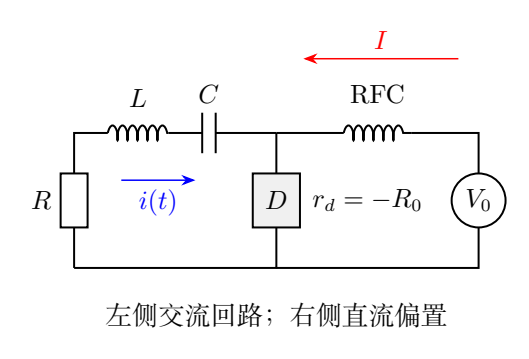

二极管始终处于负微分电阻区，其微分电阻为$-R_0$，$R_0>0$且为常量。

（1）已知$i(0)=0$、$\dot i(0)=\beta\neq0$，且

$$
i(t)=\alpha_1e^{\beta_1t}+\alpha_2e^{\beta_2t},
$$

求各常数及任意时刻$i(t)$。

（2）求左侧产生持续等幅谐振的条件、电流$i_H(t)$和频率$f_H$。

（3）求左侧产生随时间衰减的RLC阻尼振荡的条件、电流$i_D(t)$及振荡频率$f_D$。

（4）二极管负微分电阻工作电压范围为$V_{\min}\leq V_D\leq V_{\max}$。求其交流部分能提供的最大平均功率$\overline P_{\max}$，以及此时直流电源电压$V_0$。

## 一、题型定位

本题把非线性器件在一个工作点附近线性化，得到带负电阻的二阶自由响应。直流电源负责建立偏置并提供能量；交流回路的净耗散由$R-R_0$决定。

第一问求一般初值解，第二、三问从特征根的实部和虚部识别运动类型。第四问是有限工作区间内的正弦幅度与偏置优化，不是继续无限使用指数增长解。

初始电流导数非零意味着回路储能并非全为零。写积分形式的基尔霍夫方程时要保留电容初始电压，才能与初值兼容。

## 二、知识点

### 1. 直流和交流分解

将二极管电流与电压写作

$$
I_D=I+i,\qquad V_D=\overline V_D+v_d.
$$

负微分电阻定义是局部斜率

$$
v_d=-R_0i.
$$

这并非$V_D=-R_0I_D$；实际直流电压和电流都可以为正，整体器件仍从电源取能。$-R_0$描述交流扰动的电压—电流关系。

RFC让直流偏置通路可导通、交流扰动不能向右流。电容阻断左侧的直流，故直流电源电压等于二极管的平均端电压。

### 2. 电容的初始常数

按照交流回路电流方向取电容电压降$v_C$，

$$
\dot v_C=\frac{i}{C},
\qquad
v_C(t)=v_C(0)+\frac1C\int_0^ti(s)\,ds.
$$

交流KVL为

$$
L\dot i+(R-R_0)i+v_C=0.
$$

在$t=0$时$i=0,\dot i=\beta$，故

$$
\boxed{v_C(0)=-L\beta}.
$$

如果去掉$v_C(0)$，就会在$t=0$得到$L\beta=0$，与题设冲突。这个常数在微分后消失，但必须在初值解释和反代检查中保留。

### 3. 二阶方程及特征根

将KVL对时间求导，

$$
L\ddot i+(R-R_0)\dot i+\frac iC=0.
$$

定义

$$
\delta=\frac{R-R_0}{2L},\qquad
\omega_0=\frac1{\sqrt{LC}}.
$$

方程变为

$$
\ddot i+2\delta\dot i+\omega_0^2i=0.
$$

若试解$e^{st}$，特征方程$s^2+2\delta s+\omega_0^2=0$，特征根

$$
s_\pm=-\delta\pm q,\qquad
q=\sqrt{\delta^2-\omega_0^2}.
$$

当判别式为负时$q$为纯虚数，最终电流仍是实函数；不能因为题目最初写指数形式就只允许实数根。

### 4. 能量交换与净耗散

回路瞬时储能

$$
U=\frac12Li^2+\frac12Cv_C^2.
$$

对时间求导并用KVL，

$$
\dot U=i(L\dot i+v_C)=-(R-R_0)i^2.
$$

电阻吸收$Ri^2$，二极管交流部分吸收$-R_0i^2$，其负值表示向交流回路输送能量。

## 三、物理图像

$R>R_0$时二极管补充的交流能量小于电阻损耗，振幅衰减；$R=R_0$时两者恰好抵消；$R<R_0$时线性模型中的扰动增长。

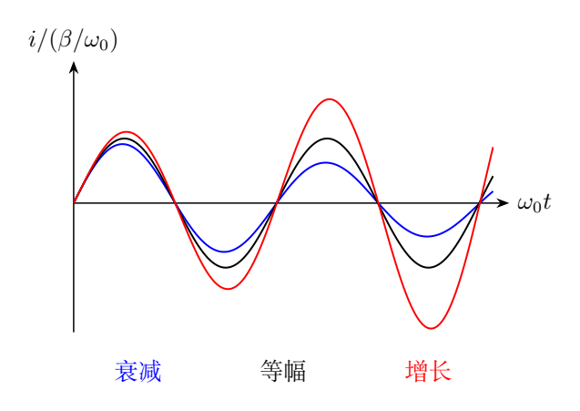

是否有振荡还需要特征根含虚部。正净阻尼既可能产生衰减振荡，也可能产生不振荡的过阻尼响应。

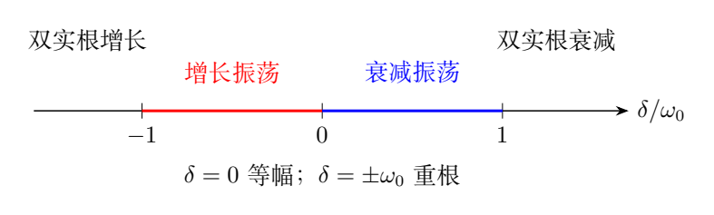

图中横坐标$\delta/\omega_0$决定根的类型：$|\delta|<\omega_0$时有虚部；$\delta>0$时包络衰减；$\delta=0$时等幅；$\delta<0$时增长。二极管有限工作区间使增长最终离开本题线性模型，不能由常量负电阻预测稳定极限环。

## 四、解题入口

交流回路只保留左侧串联元件与二极管微分电阻。先写带初始电容电压的KVL，再微分得到二阶方程。

两根不等时用$i(0)=0$得到$\alpha_2=-\alpha_1$，再用$\dot i(0)=\beta$确定幅度。把指数差转成$\sin$或$\sinh$，可使各阻尼区间的实解更清楚。

第四问将电压写成偏置加正弦：平均值必须使正、负峰值都留在$[V_{\min},V_{\max}]$内。峰值幅度与有效值不能混同，平均功率需要因子$1/2$。

## 五、解析

### （1）一般的非重根解

特征根由$Ls^2+(R-R_0)s+1/C=0$给出，

$$
\boxed{
\beta_{1,2}
=-\frac{R-R_0}{2L}
\pm\sqrt{\left(\frac{R-R_0}{2L}\right)^2-\frac1{LC}}}.
$$

选择$\beta_1=-\delta+q$、$\beta_2=-\delta-q$。初值给

$$
\alpha_1+\alpha_2=0,
\qquad
\alpha_1\beta_1+\alpha_2\beta_2=\beta.
$$

因此$q\neq0$时

$$
\boxed{\alpha_1=\frac{\beta}{2q},\qquad
\alpha_2=-\frac{\beta}{2q}},
$$

并有

$$
\boxed{
i(t)=\frac{\beta}{2q}e^{-\delta t}
(e^{qt}-e^{-qt})
=\beta e^{-\delta t}\frac{\sinh(qt)}q}.
$$

根的编号可以交换，两个系数也随之交换，但电流不变。$\beta$是初始电流斜率，量纲A/s；$\beta_1,\beta_2$是特征增长率，量纲1/s。

### 含初始电压的反代检查

由KVL定义

$$
v_C(t)=-L\dot i(t)-(R-R_0)i(t).
$$

该表达式在$t=0$给$-L\beta$。利用二阶方程求导，

$$
\dot v_C=-L\ddot i-(R-R_0)\dot i=\frac iC.
$$

于是它恰好满足

$$
v_C(t)=-L\beta+\frac1C\int_0^ti(s)\,ds.
$$

因此微分后得到的解确实可以恢复原始KVL，而非只满足一条丢失积分常数的方程。

### 判别式负：实数振荡形式

当$|\delta|<\omega_0$，定义

$$
\omega_d=\sqrt{\omega_0^2-\delta^2}>0,
\qquad q=i\omega_d.
$$

利用$\sinh(ix)=i\sin x$，一般解写为

$$
\boxed{
i(t)=\frac{\beta}{\omega_d}
e^{-\delta t}\sin(\omega_dt)}.
$$

初值验证：

$$
i(0)=0,\qquad
\dot i(0)=\frac{\beta}{\omega_d}\omega_d=\beta.
$$

振荡包络的增长或衰减由$\delta$符号决定；振荡的角频率则是$\omega_d$，不是包络指数。

### 重根与临界边界

当$\delta^2=\omega_0^2$，原有“两不同指数”表示退化。正确基解为$e^{-\delta t}$和$te^{-\delta t}$，初值给

$$
\boxed{i(t)=\beta t\,e^{-\delta t}}.
$$

也可取$q\to0$：

$$
\lim_{q\to0}\frac{\sinh(qt)}q=t.
$$

对于$\delta=+\omega_0$，它是临界阻尼衰减；对于$\delta=-\omega_0$，它是临界边界的增长解。不能将分母$q=0$解释为电流无穷大，分子同时趋零。

### 判别式正：不振荡的双指数

当$\delta^2>\omega_0^2$，$q$为实正数，电流仍使用$\sinh$表达式。若$\delta>\omega_0$，$-\delta\pm q$都为负，电流先从零上升再衰减，不周期过零。

若$\delta<-\omega_0$，两个特征根都为正，扰动不振荡地增长。虽然二极管供能，这并不自动构成正弦自激振荡。

### （2）持续等幅谐振

等幅非零响应要求能量不随时间减小或增加，因此

$$
R-R_0=0.
$$

此时$\delta=0$，自动满足$\delta^2<\omega_0^2$。有

$$
\boxed{R=R_0},
$$

$$
\boxed{
i_H(t)=\beta\sqrt{LC}\,
\sin\left(\frac t{\sqrt{LC}}\right)},
$$

$$
\boxed{f_H=\frac1{2\pi\sqrt{LC}}}.
$$

LC在电场能与磁场能之间往返交换，普通电阻的每周期损失由二极管从直流偏置供给的能量补偿。在这个理想常量斜率模型中，没有任何机制选择唯一的稳定振幅。

若初始$\beta=0$且$i(0)=0$，方程的零解将永久保持零；负电阻不会凭空制造确定初始扰动。题给$\beta\neq0$提供了启动响应。

### （3）衰减振荡的两个条件

衰减需要$\delta>0$；有振荡需要$\delta^2<\omega_0^2$。合并得到

$$
0<R-R_0<2\sqrt{\frac LC},
$$

即

$$
\boxed{R_0<R<R_0+2\sqrt{\frac LC}}.
$$

这不是所有“阻尼”响应的范围，只是欠阻尼振荡的范围。上边界为重根，超过它仍能衰减，但不振荡。

电流为

$$
\boxed{
i_D(t)=\frac{\beta}{\omega_d}
\exp\left[-\frac{R-R_0}{2L}t\right]
\sin(\omega_dt)},
$$

其中

$$
\omega_d=
\sqrt{\frac1{LC}-\left(\frac{R-R_0}{2L}\right)^2}.
$$

振荡频率

$$
\boxed{
f_D=\frac1{2\pi}
\sqrt{\frac1{LC}-\left(\frac{R-R_0}{2L}\right)^2}}.
$$

因为$\omega_d<\omega_0$，阻尼振荡频率比无阻尼频率小。相邻同向峰值的时间间隔为$2\pi/\omega_d$，包络每周期下降因子为$e^{-2\pi\delta/\omega_d}$。

### 能量随时间的闭合

初始$i(0)=0$，全部交流储能在电容中：

$$
U_0=\frac12CL^2\beta^2.
$$

当$R>R_0$且响应衰减到零，

$$
\int_0^\infty(R-R_0)i^2\,dt=U_0.
$$

不是只有电阻$R$耗尽这份初始能量；二极管在衰减过程中仍向交流回路补充$R_0\int i^2dt$，故普通电阻吸收的总能量更大。

对于欠阻尼解，可以显式积分验证：

$$
\int_0^\infty i^2dt
=\frac{\beta^2}{\omega_d^2}
\int_0^\infty e^{-2\delta t}\sin^2(\omega_dt)\,dt.
$$

利用$\sin^2x=(1-\cos2x)/2$，

$$
\int_0^\infty e^{-2\delta t}\sin^2(\omega_dt)\,dt
=\frac{\omega_d^2}{4\delta(\delta^2+\omega_d^2)}.
$$

因此

$$
\int_0^\infty i^2dt=\frac{\beta^2}{4\delta\omega_0^2}.
$$

乘$R-R_0=2L\delta$得$CL^2\beta^2/2$，与初始电容能一致。

### （4）偏置电压与允许正弦幅度

设二极管上的交流电压是

$$
v_d(t)=V_a\cos(\omega t+\varphi),
\qquad V_a\geq0.
$$

保持整个周期在负电阻区要求

$$
V_a\leq\overline V_D-V_{\min},
\qquad
V_a\leq V_{\max}-\overline V_D.
$$

两边余量的较小值决定最大幅度。为使它最大，偏置应位于区间中点：

$$
\boxed{
\overline V_D=\frac{V_{\max}+V_{\min}}2},
$$

$$
\boxed{V_{a,\max}=\frac{V_{\max}-V_{\min}}2}.
$$

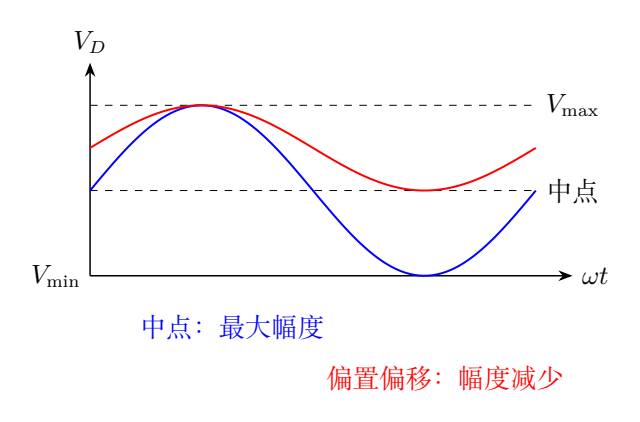

图中上下峰值分别接触区间端点。偏置向任一端移动都会缩小可容纳的完整正弦幅度。

### 最大交流输出功率

由$v_d=-R_0i$，二极管交流吸收功率

$$
p_{\rm abs}=v_di=-\frac{v_d^2}{R_0}.
$$

对正弦取平均，

$$
\overline P_{\rm abs}=-\frac{V_a^2}{2R_0}.
$$

它提供给交流回路的功率大小为相反数，故

$$
\boxed{
\overline P_{\max}
=\frac{(V_{\max}-V_{\min})^2}{8R_0}}.
$$

这是题目与参考解答所求的最大正弦交流输出功率。若另允许方波等非正弦信号，平均平方值和谐波电路都改变，不能沿用同一$1/2$因子。

RFC的直流压降为零，理想直流电源与二极管构成直流回路，所以

$$
\boxed{V_0=\overline V_D
=\frac{V_{\max}+V_{\min}}2}.
$$

若还要求$R=R_0$的等幅响应达到这个幅度，由$i_H$的幅值$|\beta|\sqrt{LC}$可知

$$
R_0|\beta|\sqrt{LC}
=\frac{V_{\max}-V_{\min}}2.
$$

第四问的幅度优化不自动更改第一问指定的初值；它表示在允许工作区间内可实现的最大正弦响应。

### 模型边界检查

微分电阻是常量的区间有限。若$R<R_0$，指数包络最终离开区间；之后必须使用二极管的真实非线性特性才能讨论饱和、削顶或稳定振幅。

原题$V_{\min},V_{\max}$只给电压范围，不能据此推导完整的非线性电流曲线。本题可以判断线性响应何时不再适用，却不能把无限增长当成器件真实输出。

\clearpage

# 第 4 题　同步加速器磁场与反质子产生阈值（40分）

回旋加速器利用两个半圆形磁场使带电粒子沿圆弧转向，粒子反复经过两半圆缝隙间的高频电场而获得能量。某同步质子加速器Tevatron的粒子运行最大圆形轨道周长为$L_{\max}=6436$ m，可将质子加速到最大能量$E_{p,\max}=1.00\times10^6$ MeV。

（1）粒子始终在垂直于均匀磁场的平面内运动，不计辐射损失。求达到该最大能量所需要的最小磁感应强度$B_{\min}$。

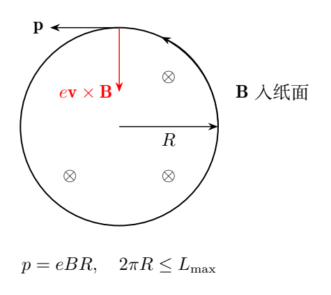

（2）高能质子撞击静止质子，可产生反质子，反应为

$$
p+p\longrightarrow p+p+p+\overline p.
$$

求入射质子产生反质子的最小动能，并判断上述加速器能否实现此反应。

已知$m_pc^2=938.3$ MeV，$c=3.00\times10^8$ m/s。第一问给定能量按质子总能量使用。

## 一、题型定位

第一问是相对论动量与磁场弯转半径的关系，第二问是固定靶反应的能量—动量阈值。两个问题都不能仅用牛顿动能$mv^2/2$。

磁场提供转向力而不做功；电场才使粒子获得能量。所求磁场是让已有高能质子留在允许圆轨道内的弯转场。

产生新粒子不只需要静能：固定靶入射体系有净动量，即使在阈值，末态在实验室里仍整体运动。因此阈值动能比新增的一对质子与反质子的静能$2m_pc^2$大。

## 二、知识点

### 1. 相对论动量与能量

质子总能量与动量为

$$
E=\gamma m_pc^2,\quad
p=\gamma m_pv,\quad
\gamma=\frac1{\sqrt{1-v^2/c^2}}.
$$

两者满足

$$
E^2=p^2c^2+m_p^2c^4,
$$

所以

$$
pc=\sqrt{E^2-m_p^2c^4}.
$$

总能量$E$包含静能，动能$K=E-m_pc^2$。同一反应中必须保持这一区分。

### 2. 磁场中的弯转

洛伦兹方程是动量的变化率：

$$
\frac{d\mathbf p}{dt}
=e\,\mathbf v\times\mathbf B.
$$

磁力与速度垂直，因而不改变$E$和$p$的大小，只改变动量方向。圆轨道上动量每单位时间转过角度$v/R$，故

$$
\left|\frac{d\mathbf p}{dt}\right|
=p\frac vR.
$$

与磁力大小$evB$比较，

$$
\boxed{p=eBR}.
$$

这个式子对相对论与非相对论圆轨道都适用，因为它直接使用动量，不把$dp/dt$错写为常质量$m_p\,dv/dt$。

### 3. 体系不变量

把总能量和总动量组成四动量，能量平方形式的不变量为

$$
\mathcal S=E_{\rm tot}^2-c^2|\mathbf p_{\rm tot}|^2.
$$

它在各惯性系相同。质心系总动量为零，所以$\sqrt{\mathcal S}$就是该系可用的总能量。

四个末态粒子质量均为$m_p$，在质心系至少有静能$4m_pc^2$，阈值时各粒子相对质心都静止：

$$
\sqrt{\mathcal S_{\rm th}}=4m_pc^2.
$$

这不表示它们在实验室静止。实验室原先有入射动量，末态整体必须继续携带它。

## 三、物理图像

在相同动量下，轨道半径越大，所需弯转场越小。允许周长上限意味着半径上限，最小磁场在最大半径处实现。

第二问中，实验室的靶质子静止，而质心系中两个入射质子相向运动。阈值末态在质心系聚为共同零动量状态，回到实验室后一起运动。

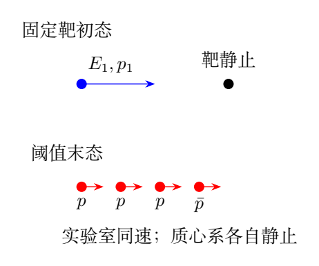

图中的末态实验室速度相同，表示没有相对动能可再减少。它们仍具有整体动能，这是固定靶阈值升高的原因。

## 四、解题入口

先由给定总能量算$pc$，再由$p=eBR$和$2\pi R\leq L_{\max}$求$B_{\min}$。

第二问在实验室写总能量$E_1+m_pc^2$与总动量$p_1$，计算不变量：

$$
\mathcal S=(E_1+m_pc^2)^2-p_1^2c^2.
$$

用单个入射质子的$E_1^2-p_1^2c^2=m_p^2c^4$消元，再与阈值$(4m_pc^2)^2$比较，最后从总能量减去静能得到动能。

## 五、解析

### （1）最大轨道与最小磁场

圆轨道周长不得超过$L_{\max}$：

$$
2\pi R\leq L_{\max},\qquad
R\leq R_{\max}=\frac{L_{\max}}{2\pi}.
$$

固定$p$时$B=p/(eR)$，因此

$$
B\geq\frac p{eR_{\max}}
=\frac{2\pi p}{eL_{\max}}.
$$

不等号方向须保持一致：半径有上限，磁场有下限。达到下限时轨道恰好占满最大允许周长。

由能量—动量关系，

$$
\boxed{
B_{\min}=
\frac{2\pi}{ecL_{\max}}
\sqrt{E_{p,\max}^2-m_p^2c^4}}.
$$

这是精确的相对论表达式。高能近似$E\gg m_pc^2$时可用$p\simeq E/c$，但不应在阈值低能计算里直接使用该近似。

### 能量单位转换

题给能量用MeV。对单个单位电荷的质子，$1$ eV$/e=1$ V，所以在$\sqrt{E^2-m_p^2c^4}/e$中可以将MeV数值乘$10^6$，直接得到伏特单位：

$$
\frac1e\sqrt{E^2-m_p^2c^4}
=10^6\sqrt{(10^6)^2-(938.3)^2}\ \mathrm V.
$$

故

$$
B_{\min}
=\frac{2\pi\times10^6}
{(3.00\times10^8)(6436)}
\sqrt{(10^6)^2-(938.3)^2}\ \mathrm T
\simeq\boxed{3.25\ \mathrm T}.
$$

参考解答给约3.26 T；按题给$c,L_{\max}$保留中间值计算为3.25 T，两者相差约0.2%，属于同一约3.3 T的量级。

轨道半径约$1.02\times10^3$ m。对于$E=10^6$ MeV，$\gamma=E/(m_pc^2)\simeq1066$，速度非常接近$c$；动量仍可随能量显著增加，不能因速度接近$c$就认为磁场不再需要增加。

### 相对论高能近似误差

令$\epsilon=m_pc^2/E$，则

$$
pc=E\sqrt{1-\epsilon^2}
=E\left(1-\frac{\epsilon^2}{2}+O(\epsilon^4)\right).
$$

本题$\epsilon\simeq9.38\times10^{-4}$，忽略静能平方产生的相对误差约$4.4\times10^{-7}$，远小于题给常数的有效数字误差。该误差估计说明近似$p\simeq E/c$在第一问的精度要求内可用。

### 弯转角的另一条推导

在圆轨道上经过微小弧长$ds$时，动量方向变化$d\theta=ds/R$。磁力提供动量变化

$$
dp_\perp=evB\,dt=eB\,ds.
$$

又有$dp_\perp=p\,d\theta=p\,ds/R$，所以$p=eBR$。此推导直接使用弧长和动量方向变化，也避免相对论加速度公式的混淆。

磁场对每个微元所作功仍为

$$
dW=e(\mathbf v\times\mathbf B)\cdot\mathbf v\,dt=0.
$$

因此“达到某能量所需磁场”在此意为容纳该能量的圆轨道弯转磁场；粒子的能量增长由装置中的电场完成。

### （2）固定靶初态不变量

记入射质子总能量为$E_1$、动量为$p_1$。靶质子静止，能量$m_pc^2$，动量零。实验室总量为

$$
E_{\rm tot}=E_1+m_pc^2,\qquad
p_{\rm tot}=p_1.
$$

所以

$$
\begin{aligned}
\mathcal S
&=(E_1+m_pc^2)^2-p_1^2c^2\\
&=(E_1^2-p_1^2c^2)+2E_1m_pc^2+m_p^2c^4\\
&=2m_p^2c^4+2E_1m_pc^2.
\end{aligned}
$$

每个末态粒子在质心系的能量都不小于其静能，故

$$
\sqrt{\mathcal S}\geq4m_pc^2.
$$

阈值取等号，

$$
2m_p^2c^4+2E_{1,\rm th}m_pc^2
=16m_p^2c^4.
$$

解得

$$
\boxed{E_{1,\rm th}=7m_pc^2}.
$$

题目要的是最小动能：

$$
\boxed{
K_{1,\rm th}=E_{1,\rm th}-m_pc^2
=6m_pc^2=5629.8\ \mathrm{MeV}}.
$$

相应最小总能量$7(938.3)=6568.1$ MeV。不能把6568.1 MeV直接标成动能，也不能只按多出来的一对粒子写1876.6 MeV。

### 实验室末态的共同运动

阈值初态入射动量

$$
p_{1,\rm th}c=
\sqrt{(7m_pc^2)^2-(m_pc^2)^2}
=4\sqrt3\,m_pc^2.
$$

质心系相对于实验室的速度为

$$
V_{\rm cm}=\frac{c^2p_{\rm tot}}{E_{\rm tot}}
=\frac{4\sqrt3}{8}c
=\frac{\sqrt3}{2}c,
$$

洛伦兹因子

$$
\gamma_{\rm cm}=2.
$$

阈值时四个末态粒子在质心系静止，因此在实验室各自总能量$2m_pc^2$、动量大小$\sqrt3m_pc$且方向相同。相加得到

$$
E_{\rm final}=8m_pc^2,\qquad
p_{\rm final}=4\sqrt3m_pc,
$$

与入射质子加静止靶质子的总量完全一致。这是对阈值条件的具体运动学核对。

### 为何共同速度使总能量最小

在固定总动量下，末态若存在相对运动，质心系还有正动能。把这种相对运动减到零，质心系总能量降到四个静能之和，同时保留实验室所需的整体动量。

可以将四个粒子视为共同速度的总静质量$4m_p$系统，其实验室总能量最小为

$$
E_{\rm final,min}
=\sqrt{(4m_pc^2)^2+p_1^2c^2}.
$$

能量守恒要求

$$
E_1+m_pc^2
\geq\sqrt{16m_p^2c^4+p_1^2c^2}.
$$

两边平方并消去$p_1$，同样得到$E_1\geq7m_pc^2$。这条路线不用先命名不变量，其依据仍是能量和动量同时守恒。

### 加速器是否能产生反质子

比较总能量：

$$
1.00\times10^6\ \mathrm{MeV}
>6568.1\ \mathrm{MeV}.
$$

因此题设最大能量远超过固定靶产生反质子的运动学阈值，结论为可以。该判断只说明反应在能量—动量守恒上允许，不从阈值推断实际反应概率或产额。

电荷与重子数也一致：初态电荷$+2e$，末态三个质子与一个反质子合计$+2e$；初态重子数2，末态$3-1=2$。阈值计算与这些守恒条件共同定义题给反应。

\clearpage

# 第 5 题　飞行器间光信号与相对论投递（40分）

在惯性系$\Sigma$的$Oxy$坐标中，飞行器甲、乙沿同一条直线朝$-y$匀速飞行，丙在与之平行、相距$d$的另一条直线上朝$+y$匀速飞行。速度为

$$
\mathbf v_{\text{甲}\Sigma}=-\frac{2c}{3}\hat{\mathbf y},
\quad
\mathbf v_{\text{乙}\Sigma}=-\frac c3\hat{\mathbf y},
\quad
\mathbf v_{\text{丙}\Sigma}=\frac{2c}{3}\hat{\mathbf y}.
$$

甲、乙所在直线为$x=0$，丙所在直线为$x=d$；原图乙在甲的$-y$一侧。飞行器尺寸远小于$d$。

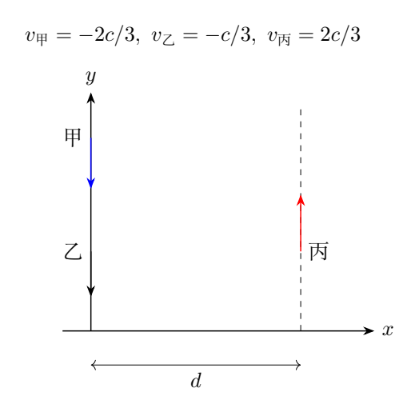

（1）甲向乙发射光信号，乙收到后立即反射回甲。甲上原子钟测得从发射到收到返回光的时间为$T$。求$\Sigma$中和乙上观察者测得的这两事件的时间间隔；再求在甲系中，从甲收到返回光到甲追上乙的时间。

（2）甲与丙在$\Sigma$中相距最近时，甲发射质量和尺寸均可忽略的小货物。货物在$\Sigma$中的速率为$3c/4$，要求丙恰好收到它。求甲系中货物发射速度的大小及方向，并求乙系中货物从甲发射到丙接收的时间间隔。

## 一、题型定位

本题同时涉及固有时、异地事件的时间变换和二维速度变换。第一问光信号的发射与返回都发生在甲上，所以$T$是甲的固有时；第二问货物的发射与接收发生在不同飞行器，不能直接套同一时间膨胀公式。

选择最容易描述的参考系来写事件，再把完整的时间和位置差转换到目标系。光信号问题在甲系中图像清楚，货物拦截问题在$\Sigma$中几何最简单。

方向答案应说明相对于哪条轴或哪艘飞行器的运动方向。只写一个角度而不说明参考方向，会把接近正$y$与接近负$y$的两个角混淆。

## 二、知识点

### 1. 沿y方向的洛伦兹变换

设$\Sigma'$相对于$\Sigma$以速度$v\hat{\mathbf y}$运动，则

$$
t'=\gamma_v\left(t-\frac{vy}{c^2}\right),
\quad
y'=\gamma_v(y-vt),
\quad x'=x,
$$

其中$\gamma_v=(1-v^2/c^2)^{-1/2}$。对任意两个事件，

$$
\Delta t'=\gamma_v
\left(\Delta t-\frac{v\Delta y}{c^2}\right).
$$

当$v$为负时，仍代入有向值，不应把式中$v$先换成速率再凭直觉补符号。

### 2. 固有时的条件

如果两个事件在$\Sigma'$的同一位置，$\Delta y'=0$，该位置的钟直接测得固有时$\Delta\tau=\Delta t'$，并有$\Delta t=\gamma_v\Delta\tau$。

发射与收到返回光同在甲上，故可用时间膨胀求$\Sigma$间隔。乙观察这两事件的间隔一般是其坐标时间，不是某一只乙钟在两事件处的读数差。

### 3. 一维与二维速度变换

对沿$y$的系间变换，

$$
u'_y=\frac{u_y-v}{1-vu_y/c^2},
\qquad
u'_x=\frac{u_x}
{\gamma_v(1-vu_y/c^2)}.
$$

垂直分量也会改变，因为时间坐标改变。只对纵向分量作相对论加法、横向分量保持原值，是错误的二维速度变换。

### 4. 最近位置与拦截条件

平行航线的横向距离固定为$d$。甲与丙在$\Sigma$中最近时，其$y$坐标相同。可将这一时刻和甲的位置选为$t=0$、原点，不改变题目事件的时间间隔。

若货物从甲此时出发，丙没有$x$运动，恰好接收要求货物$x$位移等于$d$，同时货物和丙的$y$位移相同。

## 三、物理图像

在$\Sigma$中，甲向负$y$运动比乙快；由于乙起初在前方的负$y$一侧，甲将逐渐追上乙。光先向负$y$追到乙，再向正$y$返回甲。

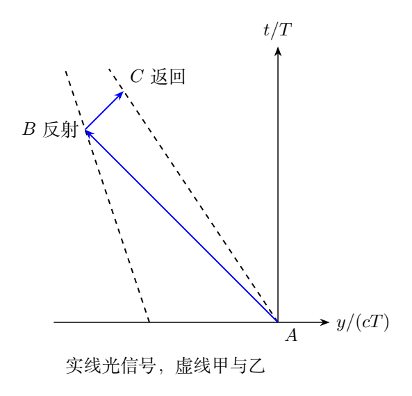

在甲系中甲静止，乙以$3c/7$朝正$y$接近甲。反射事件位于甲的负$y$侧。光速在这个系中仍为$c$，从固定甲到反射点和返回固定甲的路程相同，所以甲系中往、返各占$T/2$。

第二问在$\Sigma$中货物和丙从同一$y$出发，必须共享$y$速度$2c/3$。货物剩余速率分配到$x$方向，朝正$x$横跨$d$。

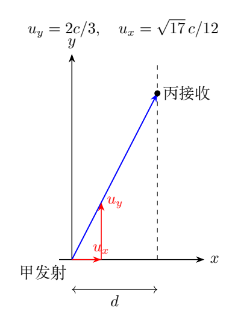

货物在甲系中纵向速度明显增大，但总速率仍小于$c$。洛伦兹变换自动保证亚光速运动不能被变换成超光速。

## 四、解题入口

第一问先利用甲固有时，得到$\Delta t_\Sigma$；再求甲相对乙的速度，把同一对甲上事件的固有时转换到乙系。

追及时间在甲系中求：由反射点距离$cT/2$，减去乙在返回这半段时间内前进的距离，即得收到返回光时的剩余间距。

第二问先在$\Sigma$用拦截条件求$u_x,u_y$。速度变换到甲系；时间间隔变换到乙系时保留货物实际的$\Delta y$。速度与时间的变换都针对具体事件，不针对笼统“这段路程”。

## 五、解析

### （1）甲上固有时转换到Σ

甲的速度大小为$2c/3$，其洛伦兹因子

$$
\gamma_{\text{甲}\Sigma}
=\frac1{\sqrt{1-4/9}}
=\frac3{\sqrt5}.
$$

发射事件$A$与收到返回光事件$C$都在甲上，所以

$$
\boxed{
\Delta t_{\text{光},\Sigma}
=\frac3{\sqrt5}T
=\frac{3\sqrt5}{5}T}.
$$

这两个事件在$\Sigma$的空间间隔不是零，而是

$$
\Delta y_{AC,\Sigma}
=-\frac{2c}{3}\Delta t_{\text{光},\Sigma}.
$$

把这一位置差保留下来，也可用完整洛伦兹变换反求甲时间，检查固有时关系。

### 甲相对乙的速度

乙系相对$\Sigma$速度为$-c/3$，因此

$$
v_{\text{甲}\text{乙}}
=\frac{-2c/3-(-c/3)}
{1-(-2c/3)(-c/3)/c^2}
=\boxed{-\frac{3c}{7}}.
$$

相应

$$
\gamma_{\text{甲}\text{乙}}
=\frac1{\sqrt{1-9/49}}
=\frac7{2\sqrt{10}}.
$$

同样的发射与返回事件发生在甲的同一位置，于是乙系观察的间隔为

$$
\boxed{
\Delta t_{\text{光},\text{乙}}
=\frac7{2\sqrt{10}}T
=\frac{7\sqrt{10}}{20}T}.
$$

它约为$1.107T$，不是直接用乙相对$\Sigma$的因子乘$T$。$T$属于甲的钟，应使用甲和所求观察系之间的相对速度。

### 用完整事件变换核对乙时间

乙相对$\Sigma$的有向速度$v=-c/3$，$\gamma_\text{乙}=3/(2\sqrt2)$。于是

$$
\begin{aligned}
\Delta t_{AC,\text{乙}}
&=\frac3{2\sqrt2}
\left[
\Delta t_{AC,\Sigma}
-\frac{(-c/3)(-2c\Delta t_{AC,\Sigma}/3)}{c^2}
\right]\\
&=\frac3{2\sqrt2}\frac79\frac3{\sqrt5}T\\
&=\frac7{2\sqrt{10}}T.
\end{aligned}
$$

该式与相对速度时间膨胀完全一致，说明两个事件与参考系的选择没有混淆。

### 甲系中的反射与追及

在甲系中乙朝正$y$以

$$
w=v_{\text{乙}\text{甲}}=\frac{3c}{7}
$$

接近静止甲。反射事件$B$在$t_B'=T/2$，其坐标

$$
y_B'=-c\frac T2.
$$

在光从乙返回甲的$T/2$期间，乙向正$y$移动$wT/2$。故收到返回光时

$$
y_{\text{乙}}'(T)
=-\frac{cT}{2}+\frac{3cT}{14}
=-\frac{2cT}{7}.
$$

剩余间距$l=2cT/7$，甲系中乙继续靠近甲，所以从返回到相遇的时间

$$
\boxed{
\Delta t_{\rm catch}
=\frac{l}{w}
=\frac{2T}{3}}.
$$

从最初发射到相遇的总甲时间为$T+2T/3=5T/3$。题目所问是返回之后的一段，不应把它与总时间混用。

### 在Σ中建立三事件

为了进一步核对，取发射事件$A:(t,y)=(0,0)$，乙初始位置为$-D$。甲和乙世界线

$$
y_{\text{甲}}=-\frac{2c}{3}t,\qquad
y_{\text{乙}}=-D-\frac c3t.
$$

出射光满足$y=-ct$。与乙相交，

$$
-ct_B=-D-\frac c3t_B,
\quad
t_B=\frac{3D}{2c},\quad y_B=-\frac{3D}{2}.
$$

反射后光向正$y$：

$$
y=y_B+c(t-t_B)=ct-3D.
$$

与甲相交，

$$
ct_C-3D=-\frac{2c}{3}t_C,
\qquad
t_C=\frac{9D}{5c}.
$$

由于$t_C=3T/\sqrt5$，

$$
D=\frac{\sqrt5}{3}cT.
$$

于是$t_B=\sqrt5T/2$，$t_C=3T/\sqrt5$。出、返时间在$\Sigma$中明显不同，因为发射端甲本身在移动；不能把甲系中各$T/2$未经转换地搬到$\Sigma$。

甲追上乙的实验室时刻由$-2ct/3=-D-ct/3$给$t_{\rm meet}=3D/c=\sqrt5T$，减去$t_C$再换成甲固有时：

$$
\frac{t_{\rm meet}-t_C}{\gamma_{\text{甲}\Sigma}}
=\frac{\sqrt5T-3T/\sqrt5}{3/\sqrt5}
=\frac{2T}{3}.
$$

再次恢复追及结果。

### 乙系中往返两段并不等长

对$A\to B$，$\Delta y=-ct_B$，有

$$
t_{B,\text{乙}}
=\frac3{2\sqrt2}\left(t_B+\frac{y_B}{3c}\right)
=\frac{t_B}{\sqrt2}
=\frac{\sqrt{10}}4T.
$$

对$A\to C$为$7\sqrt{10}T/20$，因此$B\to C$的乙系时间为

$$
\frac{7\sqrt{10}}{20}T-\frac{\sqrt{10}}4T
=\frac{\sqrt{10}}{10}T.
$$

只有甲系中两段各占$T/2$，因为甲在该系固定。光速各系都相同，但端点运动和同时性不同，分段时间就不同。

### （2）货物在Σ中的拦截条件

最近时刻选$t=0$，甲坐标$(0,0)$、丙坐标$(d,0)$。此后丙位置

$$
x_{\text{丙}}=d,\qquad y_{\text{丙}}=\frac{2c}{3}t.
$$

货物速度在$\Sigma$中记为$(u_x,u_y)$，从原点匀速直线运动。接收时刻$t_f>0$要求

$$
u_xt_f=d,\qquad u_yt_f=\frac{2c}{3}t_f.
$$

因此$u_y=2c/3$。总速率$3c/4$给

$$
u_x^2+\left(\frac{2c}{3}\right)^2
=\left(\frac{3c}{4}\right)^2,
$$

得到

$$
\boxed{u_x=\frac{\sqrt{17}}{12}c>0,\qquad
u_y=\frac{2c}{3}}.
$$

必须取横向正根，因为丙在$x=d>0$一侧。若速率小于或等于$2c/3$，没有足够横向分量在有限时间横跨$d$。

### 货物发射速度转换到甲系

甲系相对$\Sigma$的速度为$v=-2c/3$，时间变换分母

$$
1-\frac{vu_y}{c^2}
=1+\frac49=\frac{13}{9}.
$$

横向分量

$$
\begin{aligned}
u_{x,\text{甲}}
&=\frac{\sqrt{17}c/12}
{(3/\sqrt5)(13/9)}\\
&=\boxed{\frac{\sqrt{85}}{52}c}.
\end{aligned}
$$

纵向分量

$$
u_{y,\text{甲}}
=\frac{2c/3+2c/3}{13/9}
=\boxed{\frac{12}{13}c}.
$$

总速率为

$$
\boxed{
u_{\text{甲}}
=\sqrt{\frac{85}{52^2}+\frac{144}{13^2}}\,c
=\frac{\sqrt{2389}}{52}c
\simeq0.940c}.
$$

$2389<2704=52^2$，所以该速度小于$c$，通过亚光速检查。

### 发射方向的明确表达

货物在甲系中朝正$x$、正$y$。相对于正$y$方向的夹角为

$$
\chi=\arctan\frac{u_{x,\text{甲}}}{u_{y,\text{甲}}}
=\arctan\frac{\sqrt{85}}{48}
\simeq10.9^\circ.
$$

甲在$\Sigma$中的航行方向为负$y$，故题目若将角度相对于甲航向定义，

$$
\boxed{\theta=\pi-\chi\simeq169^\circ}.
$$

两个角描述同一向量，只是参照方向不同。也可给相对于正$x$的角度$\arctan(48/\sqrt{85})\simeq79.1^\circ$。

### 货物从发射到接收的实验室事件差

横跨时间

$$
\boxed{
\Delta t_{\text{货},\Sigma}
=\frac d{u_x}
=\frac{12d}{\sqrt{17}c}}.
$$

纵向位移

$$
\boxed{
\Delta y_{\text{货},\Sigma}
=u_y\Delta t_{\text{货},\Sigma}
=\frac{8d}{\sqrt{17}}}.
$$

横向位移$\Delta x=d$。这对事件不在甲、乙或丙的同一位置，不能只对$\Delta t$乘某个洛伦兹因子。

### 转换到乙系的时间间隔

乙系速度$v=-c/3$，故

$$
\begin{aligned}
\Delta t_{\text{货},\text{乙}}
&=\frac3{2\sqrt2}
\left[
\frac{12d}{\sqrt{17}c}
-\frac{(-c/3)(8d/\sqrt{17})}{c^2}
\right]\\
&=\frac3{2\sqrt2}
\frac{44d}{3\sqrt{17}c}\\
&=\boxed{\frac{11\sqrt{34}}{17}\frac dc}.
\end{aligned}
$$

数值系数约3.773。负$y$方向运动的乙系观察到货物两个事件间的坐标时间更长，原因同时包括时间膨胀和同时性项。

### 以乙系速度再检查时间

直接变换货物速度到乙系，

$$
u_{x,\text{乙}}
=\frac{\sqrt{17}c/12}
{[3/(2\sqrt2)](1+2/9)}
=\frac{\sqrt{34}}{22}c.
$$

横向距离$d$不因沿$y$的变换改变，因此

$$
\Delta t_{\text{货},\text{乙}}
=\frac d{u_{x,\text{乙}}}
=\frac{22}{\sqrt{34}}\frac dc
=\frac{11\sqrt{34}}{17}\frac dc.
$$

纵向速度同时为

$$
u_{y,\text{乙}}
=\frac{2c/3+c/3}{1+2/9}
=\frac9{11}c.
$$

这条速度变换与横向位移路线独立恢复了时间结果。

### 不变间隔与货物固有时

货物的实验室速率$u=3c/4$，从发射到接收的固有时

$$
\Delta\tau_{\text{货}}
=\Delta t_{\text{货},\Sigma}\sqrt{1-\frac9{16}}
=\frac{\sqrt7}{4}\Delta t_{\text{货},\Sigma}
=3\sqrt{\frac7{17}}\frac dc.
$$

同一事件差在任一系都满足

$$
c^2\Delta\tau_{\text{货}}^2
=c^2\Delta t^2-\Delta x^2-\Delta y^2.
$$

在甲系中$\Delta t_{\text{货},\text{甲}}=(13/\sqrt5)\Delta t_{\text{货},\Sigma}/3$，配合前面的速率$u_\text{甲}$，也恢复同一固有时。光信号分段是不变间隔为零，甲的完整往返事件则是类时间隔，两者不要混同。

\clearpage

# 第 6 题　光纤导光与旋转环形腔（40分）

半径$R$的光纤环路以角速度$\Omega$旋转，固定在环上的分束器$A$分出两束相干光，分别沿逆时针CCW和顺时针CW传播后返回$A$。检测两束光的相位差，可以确定转动角速度；真空光速为$c$。

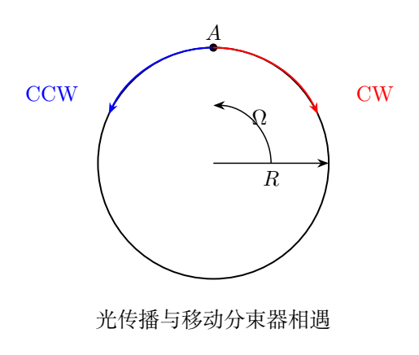

（1）光纤由折射率$n_1>n_2$的内芯与外包层组成。外部介质折射率为$n_0$，光从输入端面以相对轴线的角度$i$入射。求使光在芯内传输的条件。

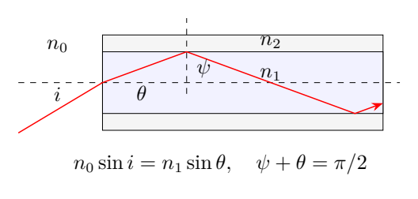

（2）将光纤密绕$N$圈，首尾接于$A$，整个环路逆时针以$\Omega$转动。芯介质折射率为$n_1$，两束光真空波长为$\lambda_0$。求两束光传播$N$圈返回$A$的时间$t_{\rm CCW},t_{\rm CW}$、相位差，以及相位差与$n_1$的关系。

（3）旋转环形谐振腔半径为$R$，介质折射率$n$，$R\Omega\ll c$，腔和介质共同逆时针旋转。静止时模式满足$2\pi R=m\lambda_{m0}$，$m$为正整数、$\lambda_{m0}$为介质内波长。旋转时同一级次的CW、CCW共振模式有频率差$\Delta f$，求$\Omega$与$\Delta f$的关系。

## 一、题型定位

第一问将端面折射与侧面全反射条件连接，得到光纤数值孔径。第二问是移动介质中光速的相对论合成，以及光与旋转分束器的追及问题。

第三问把相位累积转为共振频率，但必须保持频率、波长和模式编号在同一观察约定中。时间差不依赖折射率，并不意味着频率差也不依赖折射率：静态共振频率和腔的频率响应尺度均包含$n$。

本题参考解答的第三问采用另一套移动路径波长替代，给$\Delta f\simeq m\Omega/\pi$。下文保留参考解答的求法，并与共旋介质闭合腔的相位条件比较，说明两种处理为何不同。第一、二问的常用低速结果一致。

## 二、知识点

### 1. 端面折射与临界角

在平端面，法线沿光纤轴，折射光与轴线夹角记为$\theta$：

$$
n_0\sin i=n_1\sin\theta.
$$

在芯—包层侧面，入射角$\psi$相对于侧面法线，子午光线几何给

$$
\psi+\theta=\frac\pi2.
$$

全反射临界角

$$
\sin\psi_c=\frac{n_2}{n_1}.
$$

芯内传播应满足$\psi\geq\psi_c$的理想临界边界条件；为留有实际导光余量，应取严格大于。

### 2. 移动介质中的相对论速度合成

介质局部静止系中沿纤维传播的光速为$c/n$。介质沿该局部切向以速度$u$运动，实验室沿同方向的光速

$$
v_+=\frac{c/n+u}{1+u/(nc)}.
$$

反方向光的有向速度为$(-c/n+u)/(1-u/(nc))$；在$u<c/n$的通常范围内，其反向速率

$$
v_-=\frac{c/n-u}{1-u/(nc)}.
$$

低速展开为

$$
v_\pm\simeq\frac cn
\pm u\left(1-\frac1{n^2}\right).
$$

这是相对论速度合成给出的拖曳项，不能直接用$c/n\pm u$作实验室光速。

### 3. 传播时间与分束器移动

令$u=R\Omega>0$，环路几何长度$\ell=N2\pi R$。CCW光追随分束器，需多走$ut_{\rm CCW}$；CW光迎向分束器，少走$ut_{\rm CW}$：

$$
v_+t_{\rm CCW}=\ell+ut_{\rm CCW},
\qquad
v_-t_{\rm CW}=\ell-ut_{\rm CW}.
$$

若只用$\ell/v_\pm$，会遗漏检测端的运动，得到错误时间差。

### 4. 共振相位条件

静止腔某模式的一周相位必须为$2\pi m$：

$$
\frac{2\pi n f_0}{c}(2\pi R)=2\pi m,
$$

因此

$$
f_0=\frac{mc}{2\pi nR}
=\frac{c}{n\lambda_{m0}},
\qquad
\lambda_{\rm vac}=n\lambda_{m0}.
$$

介质内波长和真空波长不同。旋转后频率的变化必须由闭合相位条件求，不应把实验室移动路径长度配上未经变换的静止介质波长关系。

## 三、物理图像

端面入射越斜，芯内光线相对轴线的角度越大，侧面入射角越小，越容易从芯泄漏到包层。数值孔径规定一个围绕轴线的接受锥。

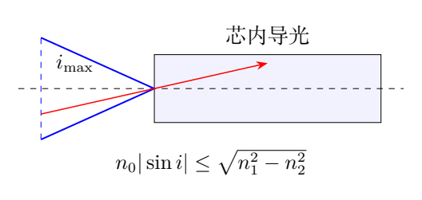

旋转环中，两束光不仅经历不同的实验室传播速率，还要与移动的$A$重合。相对分束器的两种传播速率在低速近似为

$$
v_+-u\simeq\frac cn-\frac{u}{n^2},
\qquad
v_-+u\simeq\frac cn+\frac{u}{n^2}.
$$

CCW相对分束器稍慢，返回时间较长。光速拖曳中的$(1-1/n^2)$与分束器自身的$u$相减，形成关键的$u/n^2$修正。

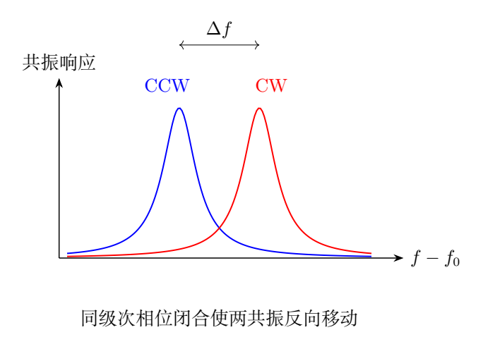

固定外来光频时，旋转使一周相位在两方向上改变；若要求相位仍为同一个$2\pi m$，就要向相反方向调整两种模式的频率。这一调整量还要除以静态一周相位对频率的斜率。

## 四、解题入口

第一问用$\sin\theta=\cos\psi$把端面斯涅尔定律与侧面临界角连接。

第二问先由相对论合成得到$v_\pm$，再写追及式，最后相减。把两方向共用的$n$项和相反的$u$项分别保留，可以看出折射率如何抵消。

第三问以旋转坐标中的单周传播时间或单值相位条件求$f_{\rm CW},f_{\rm CCW}$。先算静态$f_0$，再求一阶转动修正；将同一级次$m$保持不变。

## 五、解析

### （1）芯包层的全反射条件

由侧面临界条件$\psi\geq\psi_c$，

$$
\theta\leq\frac\pi2-\psi_c.
$$

因此

$$
\sin\theta\leq\cos\psi_c
=\sqrt{1-\frac{n_2^2}{n_1^2}}.
$$

代入端面折射，

$$
n_0\sin i=n_1\sin\theta
\leq\sqrt{n_1^2-n_2^2}.
$$

故理想接受条件为

$$
\boxed{n_0|\sin i|\leq\sqrt{n_1^2-n_2^2}}.
$$

对$0\leq i<\pi/2$且右端除$n_0$不大于1时，

$$
\boxed{
i\leq i_{\max}
=\arcsin\frac{\sqrt{n_1^2-n_2^2}}{n_0}}.
$$

若$\sqrt{n_1^2-n_2^2}/n_0>1$，不能对大于1的实数取$\arcsin$；此几何模型下全部可入射角都满足该侧面临界约束。

定义数值孔径

$$
\mathrm{NA}=n_0\sin i_{\max}
=\sqrt{n_1^2-n_2^2}
$$

时，应理解通常接受角未饱和的情况。等号是临界边界，实际光束应留有角度余量。本题使用几何光学子午光线模型，不计算波导模式的截止细节。

### 临界角与入射角不要混用

侧面$\psi$相对于侧面法线，端面$i$相对于轴线法线，芯内$\theta$相对于轴线。三者有两个不同界面：

$$
n_0\sin i=n_1\sin\theta,\qquad
\psi=\frac\pi2-\theta.
$$

不能在端面直接要求$i>\arcsin(n_2/n_1)$；那会把不同法线的角度混在一起，并得出越斜越容易导光的相反结论。

### （2）两方向实验室传播速率

以下$t_{\rm CCW},t_{\rm CW}$取实验室坐标时间，使用题解的局部切向速度合成与固定几何长度模型。令$u=R\Omega$，

$$
v_+=\frac{c/n_1+u}{1+u/(n_1c)}
=\frac{c^2+n_1uc}{n_1c+u},
$$

$$
v_-=\frac{c/n_1-u}{1-u/(n_1c)}
=\frac{c^2-n_1uc}{n_1c-u}.
$$

两束光在介质静止系中的速率同为$c/n_1$，实验室速率不同。光纤约束让它们沿环路传播，方向随局部切线改变。

### 从追及式求返回时间

由$v_+t_{\rm CCW}=\ell+ut_{\rm CCW}$，

$$
t_{\rm CCW}=\frac{\ell}{v_+-u}.
$$

分母化简为

$$
\begin{aligned}
v_+-u
&=\frac{c^2+n_1uc-u(n_1c+u)}{n_1c+u}\\
&=\frac{c^2-u^2}{n_1c+u}.
\end{aligned}
$$

因此

$$
\boxed{
t_{\rm CCW}
=\frac{N2\pi R(n_1c+R\Omega)}
{c^2-(R\Omega)^2}}.
$$

同理由$v_-t_{\rm CW}=\ell-ut_{\rm CW}$，

$$
v_-+u=\frac{c^2-u^2}{n_1c-u},
$$

所以

$$
\boxed{
t_{\rm CW}
=\frac{N2\pi R(n_1c-R\Omega)}
{c^2-(R\Omega)^2}}.
$$

这里共用的$n_1c$项决定平均传播时间，相反的$R\Omega$项决定方向差。

### 时间差与折射率抵消

相减得

$$
\boxed{
\Delta t=t_{\rm CCW}-t_{\rm CW}
=\frac{4\pi NR^2\Omega}
{c^2-(R\Omega)^2}}.
$$

常用低速$R\Omega/c\ll1$时，

$$
\boxed{\Delta t\simeq\frac{4N A\Omega}{c^2}},
\qquad A=\pi R^2.
$$

时间差与$n_1$无关，虽然各自传播时间约为$N2\pi n_1R/c$。如果把光速直接相加$c/n_1\pm u$，则相对分束器的两方向速率会被错误算成相同，甚至给出时间差零。

### 相位差与光频定义

若$\lambda_0$按所用实验室光频$f=c/\lambda_0$定义，题解的相位差为

$$
\boxed{
\Delta\phi=2\pi f\Delta t
=\frac{8\pi^2NR^2\Omega c}
{\lambda_0[c^2-(R\Omega)^2]}}.
$$

低速结果

$$
\boxed{
\Delta\phi\simeq
\frac{8\pi N A\Omega}{\lambda_0c}}.
$$

对固定真空波长，它与$n_1$无关。旋转方向改变时$\Omega$变号，相位差也变号；交换CW、CCW的差值定义也使符号反转，但灵敏度大小不变。

若$\lambda_0$定义为分束器本地光源的真空波长，应以分束器固有时间差$\Delta\tau=\Delta t\sqrt{1-u^2/c^2}$配合本地光频。二者在一阶低速式完全一致，只在$u^2/c^2$及以上有差别。不能把不同参考系的精确时间与频率混用后声称所有高阶项也成立。

### N圈和面积的作用

在半径相同且绕向一致时，每一圈贡献同样的有向面积，因此时间差与相位差都乘$N$。在不等半径的多圈情况下，低速式中$N\pi R^2$应换成各圈有向面积之和。

增加光纤长度却不增加包围面积，不一定增加旋转相位灵敏度。这个结论由面积积分而非总光程本身决定。

### （3）共旋腔的静态模式

单圈长度$\ell_1=2\pi R$，静态一周时间

$$
t_0=\frac{n\ell_1}{c}.
$$

同一级次$m$的静态相位周期条件$f_0t_0=m$，所以

$$
f_0=\frac{mc}{n\ell_1}.
$$

由于题给$\ell_1=m\lambda_{m0}$，$\lambda_{m0}$是介质内波长，$f_0=c/(n\lambda_{m0})$。若把它当作真空波长，会少一个折射率因子。

### 旋转一阶传播时间与闭合相位

从第二问取$N=1,n_1=n$并展开，

$$
t_{\rm CCW}=t_0+\frac{\ell_1u}{c^2}+O(u^2/c^2),
$$

$$
t_{\rm CW}=t_0-\frac{\ell_1u}{c^2}+O(u^2/c^2).
$$

在共旋坐标中，一个模式的场绕周必须恢复相位，因此同一$m$满足

$$
f_{\rm CCW}t_{\rm CCW}=m,\qquad
f_{\rm CW}t_{\rm CW}=m.
$$

保留一阶，倒数展开得

$$
f_{\rm CCW}
\simeq f_0\left(1-\frac{u}{nc}\right),
\qquad
f_{\rm CW}
\simeq f_0\left(1+\frac{u}{nc}\right).
$$

因此频差取正值$f_{\rm CW}-f_{\rm CCW}$：

$$
\begin{aligned}
\Delta f
&\simeq\frac{2f_0u}{nc}\\
&=\frac{2}{nc}\frac{mc}{2\pi nR}(R\Omega)\\
&=\boxed{\frac{m\Omega}{\pi n^2}}.
\end{aligned}
$$

故共旋、无色散闭合介质腔的相位自洽关系为

$$
\boxed{
\Omega\simeq\frac{\pi n^2}{m}\Delta f
=\frac{n^2\lambda_{m0}}{2R}\Delta f}.
$$

在这个低速精度内，共旋观察者的钟与实验室时间尺度差是二阶量，不改变上述一阶因子。

### 从旋转坐标相速度再推导

实验室相速度一阶为$c/n\pm u(1-1/n^2)$。减去坐标本身的旋转，CCW相对于共旋角坐标的速度为

$$
\bar v_+=\frac cn-\frac{u}{n^2};
$$

CW反向速率为

$$
\bar v_-=\frac cn+\frac{u}{n^2}.
$$

闭合模式场形如$e^{\pm im\varphi-i\omega_\pm t}$，$\varphi$是共旋角坐标，空间单值性给波数大小$m/R$。因此

$$
\omega_{\rm CCW}=\frac mR\bar v_+,\qquad
\omega_{\rm CW}=\frac mR\bar v_-,
$$

得到$\Delta\omega=2m\Omega/n^2$，再次给$\Delta f=m\Omega/(\pi n^2)$。这条路线明确保持角波数和频率的同一坐标定义。

### 固定光频与固定m的折射率依赖

若使用真空波长$\lambda_{\rm vac}=c/f_0$，

$$
\boxed{
\Delta f\simeq
\frac{2R\Omega}{n\lambda_{\rm vac}}
=\frac{4A\Omega}{n\ell_1\lambda_{\rm vac}}}.
$$

固定$f_0,R$时，频差与$1/n$成正比；固定$m,R$时，因为$f_0$本身还与$1/n$成正比，频差与$1/n^2$成正比。两个结论描述不同的参数保持条件，并不冲突。

若介质有明显色散，静态相位对频率的导数还涉及群折射率，本题未给这类信息，以上采用$n$与频率无关的模型。

### 参考解答的第三问约定

参考解答取两方向的实验室移动路径

$$
L_{\rm CW}=v_-t_{\rm CW},\qquad
L_{\rm CCW}=v_+t_{\rm CCW},
$$

再令$L_\pm=m\lambda_\pm$，并同时使用$f_\pm=c/(n\lambda_\pm)$，得到

$$
\Delta f_{\rm ref}
=\frac{m\Omega}{\pi}
\frac{c^2-u^2}{c^2-n^2u^2}
\simeq\frac{m\Omega}{\pi}.
$$

按该参考路径替代，答案为

$$
\boxed{\Omega_{\rm ref}\simeq\frac\pi m\Delta f}.
$$

然而移动介质中的实验室频率—波数关系已经因速度合成与多普勒变换改变，不再是静止介质的$f=c/(n\lambda)$。把移动路径和静止波长关系同时使用，不能与共旋腔场的单值相位条件等同。

因此备考时可识别参考采用的式子，物理建模时应明确区分它与前述相位闭合结果。$n=1$时两者一致；$n\neq1$时差异是一阶旋转灵敏度的$n^2$因子，不能归为二阶小量或数值舍入。

### 时间差不等于频率差的直观核对

固定光频的相位差是$\Delta\phi=2\pi f_0\Delta t$。共振频率调整满足

$$
\delta\phi\simeq2\pi t_0\,\delta f.
$$

所以两方向频差近似

$$
\Delta f\simeq f_0\frac{\Delta t}{t_0}.
$$

$\Delta t$虽不含$n$，但$f_0/t_0\propto1/n^2$（固定$m$），因此不能直接从时间差的折射率抵消推出频差也抵消。这个检查只用相位对频率的导数，就能定位问题。

\clearpage

# 第 7 题　双黑洞旋近的辐射与轨道演化（40分）

双黑洞并合分为旋近、并合、衰荡三个阶段。旋近阶段，两黑洞绕系统质心在同一平面内作近似圆周运动，机械能损失转为引力波辐射能，间距$L$逐渐减小。

在旋近阶段忽略黑洞自转与大小，将它们视为质量$M,m$的质点。系统除引力波辐射外没有能量耗散；不考虑辐射反作用的详细形式，轨道关系用牛顿引力近似。

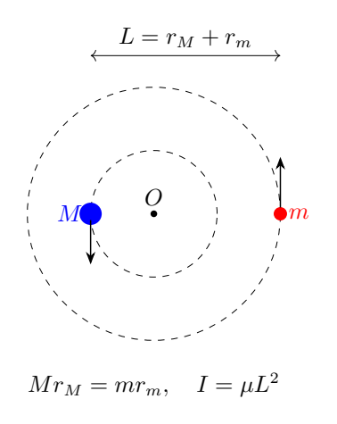

（1）辐射功率与$G$正比，可与$M,m,L$、绕质心的转动惯量$I$、角速度$\omega$、辐射传播速度$c$有关。取描述转动体系的三个物理量，与$G$一起用量纲分析求功率形式，无量纲比例系数记为$\alpha$。

（2）已知$t=0$时两黑洞间距$L_0$，$\alpha$为已知常量。求两黑洞从$t=0$开始绕系统质心旋转360°所需时间。

（3）求当间距缩为$L_0/2$时，自初始时刻起旋转的度数。

## 一、题型定位

本题用量纲分析建立辐射功率，再用近似圆轨道关系和能量守恒把辐射转成轨道参数演化。系统失去机械能，轨道能量变得更负，间距减小、角速度升高。

第二问不能以初始角速度固定不变算$2\pi/\omega_0$，因为旋转过程中轨道在缩小。应求角速度随时间的变化并积分角位移。

牛顿准圆旋近模型有适用区间。形式上间距可降到零，但真实黑洞会进入并合；若代数式要求越过这一模型端点，不能给出没有物理分支的“一整圈时间”。

## 二、知识点

### 1. 量纲选择

描述转动体系选择$I,\omega,c$。设

$$
P=\alpha G I^a\omega^bc^d.
$$

已知

$$
[G]=\mathrm{L^3M^{-1}T^{-2}},
\quad [I]=\mathrm{ML^2},
\quad[\omega]=\mathrm{T^{-1}},
\quad[c]=\mathrm{LT^{-1}}.
$$

功率量纲为$\mathrm{ML^2T^{-3}}$。这里$\alpha$承载量纲分析不能决定的纯数信息；题目后续假设它是给定常量。

### 2. 质心与约化质量

令总质量$S=M+m$，约化质量

$$
\mu=\frac{Mm}{M+m}.
$$

两质点到质心的距离$r_M,r_m$满足

$$
Mr_M=mr_m,\qquad r_M+r_m=L,
$$

故

$$
r_M=\frac mS L,\qquad r_m=\frac MS L.
$$

绕质心的总惯量

$$
I=Mr_M^2+mr_m^2=\mu L^2.
$$

### 3. 圆轨道关系

两质点分别受同样大小的引力$GMm/L^2$。对较小质量$m$写

$$
\frac{GMm}{L^2}=m\omega^2r_m.
$$

代$r_m=ML/S$，得到

$$
\boxed{\omega^2=\frac{GS}{L^3}}.
$$

轨道总动能

$$
K=\frac12I\omega^2=\frac{GMm}{2L},
$$

引力势能$U=-GMm/L$，故总机械能

$$
\boxed{E=-\frac{GMm}{2L}}.
$$

### 4. 辐射能量平衡

辐射功率$P>0$使系统机械能变化为

$$
\frac{dE}{dt}=-P.
$$

因为$E(L)$随$L$增大而增大，$dE/dL=GMm/(2L^2)>0$，所以失能必有$\dot L<0$。

## 三、物理图像

两质点相对质心有相同角速度，但转动半径不同。较重质点靠近质心，较轻质点离质心较远，所有轨道关系可以由约化质量集中表示。

辐射使$E$降低，即变得更负。由$\omega\propto L^{-3/2}$，旋转越来越快；引力波频率随之升高，形成“啁啾”的频率增长。

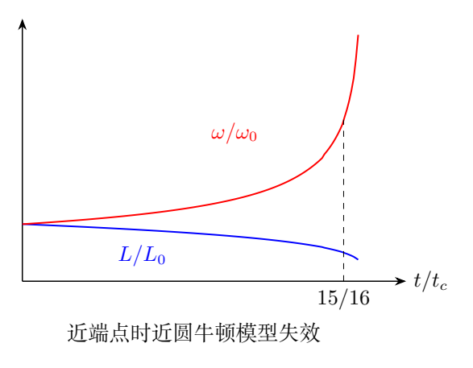

图中的横坐标使用形式上的演化时间尺度，越接近端点，间距下降越快、频率增长越快。靠近端点时慢变化近圆轨道与牛顿近似都会失效，应在实际适用范围内解释。

## 四、解题入口

先量纲求$P$，再代$I=\mu L^2$和$\omega^2=GS/L^3$，将功率化成单一$L$函数。对$E(L)$求导得到一阶$\dot L$方程。

从$L(t)$求$\omega(t)$，积分

$$
\Delta\theta(t)=\int_0^t\omega(s)\,ds.
$$

第二问令$\Delta\theta=2\pi$并筛选$t$；第三问先求$L/L_0=1/2$对应的参数，再算角位移，最后换成度。

## 五、解析

### （1）辐射功率的量纲

代入量纲，

$$
[G I^a\omega^bc^d]
=\mathrm{M^{a-1}L^{3+2a+d}T^{-2-b-d}}.
$$

与$\mathrm{ML^2T^{-3}}$比较，得到

$$
a-1=1,\qquad 3+2a+d=2,\qquad -2-b-d=-3.
$$

依次解出

$$
a=2,\qquad d=-5,\qquad b=6.
$$

因此

$$
\boxed{P=\frac{\alpha G I^2\omega^6}{c^5}}.
$$

量纲正确：

$$
\frac{(\mathrm{L^3M^{-1}T^{-2}})
(\mathrm{M^2L^4})(\mathrm{T^{-6}})}
{\mathrm{L^5T^{-5}}}
=\mathrm{ML^2T^{-3}}.
$$

这个分析不能单独确定$\alpha$的数值，也不能证明所有辐射体系都只有这三个参数；它依据题目指定的近圆双质点模型和选取的转动变量。

### 将辐射功率写成间距函数

利用$I=\mu L^2$、$\omega^6=G^3S^3/L^9$，

$$
\begin{aligned}
P
&=\frac{\alpha G}{c^5}
\mu^2L^4\frac{G^3S^3}{L^9}\\
&=\frac{\alpha G^4\mu^2S^3}{c^5L^5}\\
&=\boxed{\frac{\alpha G^4M^2m^2S}{c^5L^5}}.
\end{aligned}
$$

功率随间距的五次倒数增长。虽然惯量随$L^2$降低，角速度六次方增长更强，使整体辐射增强。

### （2）间距的微分方程

机械能$E=-GMm/(2L)$，所以

$$
\frac{dE}{dt}
=\frac{GMm}{2L^2}\dot L.
$$

令其等于$-P$，

$$
\frac{GMm}{2L^2}\dot L
=-\frac{\alpha G^4M^2m^2S}{c^5L^5}.
$$

定义正量

$$
\boxed{\mathcal A=\frac{2\alpha G^3MmS}{c^5}},
$$

量纲为$\mathrm{L^4/T}$。得到

$$
\boxed{\dot L=-\frac{\mathcal A}{L^3}}.
$$

对两边乘$4L^3$，

$$
\frac{d(L^4)}{dt}=-4\mathcal A.
$$

积分并用$L(0)=L_0$，

$$
\boxed{L(t)=[L_0^4-4\mathcal A t]^{1/4}}.
$$

选择正根，因为间距为正。形式解的时间范围$0\leq t<t_c$，其中

$$
\boxed{
t_c=\frac{L_0^4}{4\mathcal A}
=\frac{c^5L_0^4}{8\alpha G^3MmS}}.
$$

该$t_c$是本模型的形式端点，不是对真实黑洞并合时刻的完整预测。

### 角速度随时间增加

初始角速度

$$
\omega_0=\sqrt{\frac{GS}{L_0^3}}.
$$

由圆轨道关系，

$$
\boxed{
\omega(t)=\omega_0
\left(1-\frac t{t_c}\right)^{-3/8}}.
$$

初始角速度随辐射而增大，指数$-3/8$来自$L\propto(1-t/t_c)^{1/4}$与$\omega\propto L^{-3/2}$的组合。

### 角位移的积分

积分

$$
\Delta\theta(t)
=\omega_0\int_0^t
\left(1-\frac s{t_c}\right)^{-3/8}ds.
$$

令$z=1-s/t_c$，$ds=-t_cdz$，上下限从1到$1-t/t_c$。因此

$$
\begin{aligned}
\Delta\theta(t)
&=\omega_0t_c
\int_{1-t/t_c}^1z^{-3/8}dz\\
&=\frac85\omega_0t_c
\left[1-\left(1-\frac t{t_c}\right)^{5/8}\right].
\end{aligned}
$$

定义

$$
\boxed{
\Theta_c=\frac85\omega_0t_c
=\frac{c^5L_0^{5/2}}
{5\alpha G^{5/2}Mm\sqrt S}}.
$$

于是

$$
\boxed{
\Delta\theta(t)=\Theta_c
\left[1-\left(1-\frac t{t_c}\right)^{5/8}\right]}.
$$

$\Theta_c$是形式上从$L_0$到零间距的累计角位移。角速度虽然在端点发散，积分仍有限，因为指数$3/8<1$。

### 一整圈时间的分支条件

令$\Delta\theta=2\pi$，定义

$$
\chi=\frac{2\pi}{\Theta_c}
=\frac{10\pi\alpha G^{5/2}Mm\sqrt S}
{c^5L_0^{5/2}}.
$$

方程为

$$
\left(1-\frac{t_1}{t_c}\right)^{5/8}=1-\chi.
$$

左侧在物理分支非负。若希望整圈在正间距处完成，需

$$
\boxed{0<\chi<1}.
$$

此时

$$
\boxed{
t_1=t_c\left[1-(1-\chi)^{8/5}\right]}.
$$

用原参数展开，

$$
\boxed{
\begin{aligned}
t_1={}&\frac{c^5L_0^4}{8\alpha G^3Mm(M+m)}\\
&\times\left\{
1-\left[
1-\frac{10\pi\alpha G^{5/2}Mm\sqrt{M+m}}
{c^5L_0^{5/2}}
\right]^{8/5}
\right\}.
\end{aligned}}
$$

若$\chi=1$，形式整圈恰好在零间距端点完成，而端点不属于慢旋近有效区；若$\chi>1$，这个模型在端点前累计转角不足一圈。不能将负的$1-\chi$取分数幂并将其解释成另一条真实时间解。

### 缓慢耗散的周期检查

当$\chi\ll1$，二项展开

$$
1-(1-\chi)^{8/5}
=\frac85\chi-\frac{12}{25}\chi^2+O(\chi^3).
$$

利用$t_c(8/5)\chi=2\pi/\omega_0$，

$$
\boxed{
t_1=\frac{2\pi}{\omega_0}
\left[1-\frac3{10}\chi+O(\chi^2)\right]}.
$$

无耗散极限$\alpha\to0$时，$\chi\to0$、$t_c\to\infty$，乘积保持有限，恢复初始轨道周期。实际$t_1$略短于该周期，因为角速度在一圈内逐渐增大。

### （3）间距缩小一半的时间

令$L=L_0/2$，则

$$
\left(\frac L{L_0}\right)^4
=1-\frac t{t_c}=\frac1{16}.
$$

因此

$$
\boxed{
t_{1/2}=\frac{15}{16}t_c
=\frac{15c^5L_0^4}
{128\alpha G^3MmS}}.
$$

求得这段时间后，还需积分角速度并换算为度；时间结果也可用于核对中间计算。

### 半间距对应的累计角位移

代$1-t/t_c=1/16$，

$$
\left(1-\frac{t_{1/2}}{t_c}\right)^{5/8}
=16^{-5/8}=2^{-5/2}=\frac{\sqrt2}{8}.
$$

所以弧度为

$$
\boxed{
\Delta\theta_{1/2}
=\Theta_c\left(1-\frac{\sqrt2}{8}\right)}.
$$

换成度数，

$$
\boxed{
\begin{aligned}
\Delta\theta_{1/2}^{(\deg)}
={}&\left(1-\frac{\sqrt2}{8}\right)
\frac{c^5L_0^{5/2}}
{5\alpha G^{5/2}Mm\sqrt{M+m}}\\
&\times\frac{180^\circ}{\pi}.
\end{aligned}}
$$

角位移不是将初始$\omega_0$乘$t_{1/2}$。这一段经历很大的频率变化：半间距时$\omega/\omega_0=2^{3/2}=2\sqrt2$。

### 直接对间距积分的独立路线

由$\dot L=-\mathcal A/L^3$，

$$
dt=-\frac{L^3}{\mathcal A}\,dL.
$$

角位移微元

$$
d\theta=\omega\,dt
=-\frac{\sqrt{GS}}{\mathcal A}L^{3/2}\,dL.
$$

从$L_0$积分到$L$，

$$
\boxed{
\Delta\theta(L)
=\frac{2\sqrt{GS}}{5\mathcal A}
(L_0^{5/2}-L^{5/2})}.
$$

代$L=L_0(1-t/t_c)^{1/4}$恢复先前时间式，代$L=L_0/2$恢复半间距结果。这个积分将微分方程与角运动关系直接相接，提供不同消元路径。

### 用角速度方程再检查

由$\omega=\sqrt{GS}L^{-3/2}$，

$$
\dot\omega=-\frac32\sqrt{GS}L^{-5/2}\dot L
=\frac32\mathcal A\sqrt{GS}L^{-11/2}.
$$

消去$L$，

$$
\boxed{
\dot\omega
=\frac{3\alpha G^{5/3}Mm}
{c^5S^{1/3}}\omega^{11/3}}.
$$

分离变量，

$$
\omega^{-11/3}d\omega
=\frac{3\alpha G^{5/3}Mm}{c^5S^{1/3}}dt,
$$

积分得

$$
\omega^{-8/3}
=\omega_0^{-8/3}
-\frac{8\alpha G^{5/3}Mm}{c^5S^{1/3}}t.
$$

它与$\omega(t)=\omega_0(1-t/t_c)^{-3/8}$一致，独立核对了幂次和系数。

### 近圆与牛顿近似的适用条件

径向变化相对一圈运动必须缓慢：

$$
\epsilon_{\rm ad}
=\frac{|\dot L|}{L\omega}
=\frac{\mathcal A}{\sqrt{GS}\,L^{5/2}}\ll1.
$$

牛顿轨道速度尺度$\omega L=\sqrt{GS/L}$也应明显小于$c$，即$GS/(Lc^2)\ll1$。随着$L$减小，两个条件都会变差。

因此形式解在$t_c$附近的发散主要提示模型失效。题目关注旋近阶段，不能把这条近似曲线当作真实并合或衰荡的完整解。

\clearpage

# 第 8 题　电光调制与并联谐振驱动（40分）

电光调制将电信号转入光信号。以铌酸锂晶体为例，折射率随外电场变化，使光程改变。起偏器$P_1$与检偏器$P_2$相互正交，透光轴分别沿$x_1,x_2$。长度$l$、厚度$d$的晶体位于二者之间，电场沿光的传播方向$x_3$，大小$E$，晶体两端面加电压$V$。

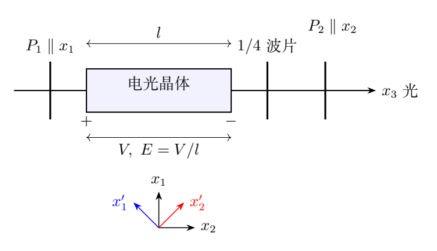

真空波长$\lambda_0$的光经$P_1$后沿$x_3$入射，分解为晶体快轴$x'_1$与慢轴$x'_2$上的正交分量。两主轴与$x_1,x_2$均呈45°，折射率为

$$
n_{x'_1}=n_0-\frac12n_0^3\gamma E,\qquad
n_{x'_2}=n_0+\frac12n_0^3\gamma E.
$$

$\gamma$为材料常量。光出晶体后经过1/4波片，再由$P_2$检出。采用题图主轴对齐、波片给慢快分量额外$+\pi/2$延迟的约定。

（1）入射到晶体左端面的两分量电场为$E_{x'_1}=E_0\cos\omega t$、$E_{x'_2}=E_0\cos\omega t$。求经过晶体的相位变化和光强变化；出射两分量相位差为$\pi$时称晶体为1/2波片，求半波电压$V_\pi$。

（2）调制电压$V=V_m\sin\omega_mt$，$V_m\ll V_\pi$。先求不经过1/4波片、直接经$P_2$后的光强透过率与$V$的关系；再求经过1/4波片与$P_2$的透过率，指出1/4波片的作用。

（3）晶体的等效电路为并联电阻$R$和电容$C$，电源串联电阻$R_m$，$R\gg R_m$。开关断开时，证明当$\omega_m\gg(R_mC)^{-1}$，晶体实际电压$|V_c|\ll|V|$。

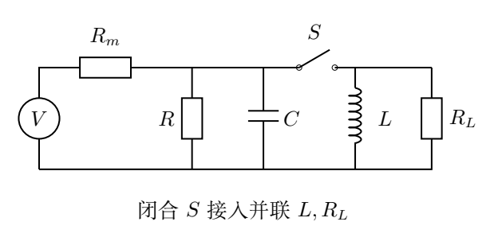

（4）为提高调制效率，闭合开关，加入与晶体并联的谐振回路，电感为$L$、负载电阻为$R_L$。试证明$|V_c|\simeq|V|$。

## 一、题型定位

前两问是偏振分解与电压控制的相位延迟，后两问是高频电源如何把电压送到电容性晶体。光学响应和电路分压共同决定真实调制效率。

理想晶体改变两正交分量的相位而不吸收能量；检偏器将相位差转成光强变化。正交检偏器在零相位差附近的透过率是二次小量，不能忠实保留弱电压信号的正负；四分之一波片将工作点移到最大斜率附近。

并联电感的作用是抵消电容的电纳。电感必须调谐到指定频率，且剩余并联电阻足够大，才能避免电源串联电阻把电压分走。

## 二、知识点

### 1. 相位延迟与纵向电场

真空波长$\lambda_0$、介质折射率$n_j$、传播长度$l$的相位延迟为

$$
\phi_j=\frac{2\pi}{\lambda_0}n_jl.
$$

题面给电场沿传播$x_3$且加在两端面，因此使用纵向几何

$$
E=\frac Vl.
$$

厚度$d$不进入这一纵向电场表达式。若另改为厚度两侧加横向电场，才应使用$E=V/d$，半波电压也随$d/l$改变。

### 2. 相干分量与光强

两个正交偏振分量可以各有相位，但未经分析器时总平均光强是两分量的平均强度之和，没有相互干涉项。

用复振幅$a_1,a_2$表示，并把平均光强比例常量记为$K_o$：

$$
I=K_o(|a_1|^2+|a_2|^2).
$$

检偏器将两个分量投影到同一个轴，投影后的复振幅才需先相加再求模平方，产生与相位差有关的干涉。

### 3. 偏振主轴与投影符号

选择

$$
\hat{\mathbf x}'_1=
\frac{\hat{\mathbf x}_1-\hat{\mathbf x}_2}{\sqrt2},
\qquad
\hat{\mathbf x}'_2=
\frac{\hat{\mathbf x}_1+\hat{\mathbf x}_2}{\sqrt2}.
$$

于是输入$x_1$方向是两主轴的等振幅和，输出$x_2$方向是两主轴的差：

$$
\hat{\mathbf x}_1=\frac{\hat{\mathbf x}'_1+\hat{\mathbf x}'_2}{\sqrt2},
\quad
\hat{\mathbf x}_2=\frac{-\hat{\mathbf x}'_1+\hat{\mathbf x}'_2}{\sqrt2}.
$$

检偏振幅中的负号是正交轴几何决定的，不是为了凑成某个三角函数。

### 4. 高频相量

采用$e^{i\omega_mt}$约定，

$$
Z_C=\frac1{i\omega_mC},\qquad Z_L=i\omega_mL.
$$

并联用导纳相加，串联用阻抗相加。晶体电压由串联$R_m$与整个并联网络分压：

$$
\frac{\widetilde V_c}{\widetilde V}
=\frac Z{R_m+Z}
=\frac1{1+R_mY}.
$$

## 三、物理图像

输入$x_1$线偏振在两个45°主轴上有相等振幅。晶体令它们相位错开，形成一般椭圆偏振；无损情况下总光强不变。正交检偏器把两个主轴上的场带符号地投到$x_2$，相位差零时完全相消。

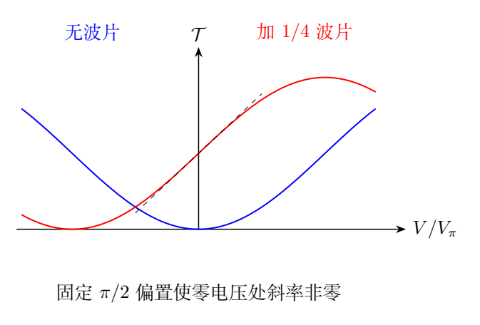

不加波片时，$V=0$附近曲线是谷底，斜率零，正负电压产生相同光强。增加固定$\pi/2$延迟后，零调制附近位于透过率约1/2的最大斜率点，正负电压对应光强的上下变化。

高频下晶体电容阻抗很小，电流大，电源内阻上分走大部分电压。调谐电感后，电容和电感的无功电流在并联网络内相消，电源只需承担损耗电流。

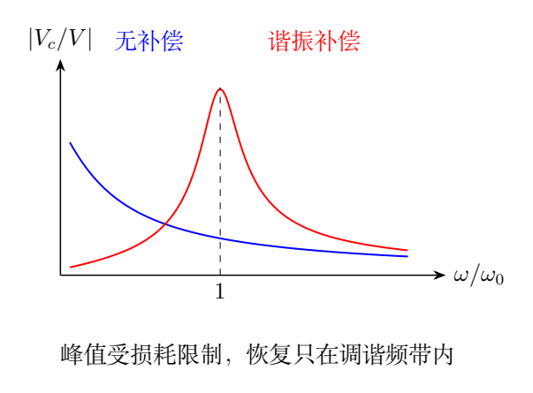

谐振补偿使一个选定频率附近的电压恢复，但不是宽带消除全部电容影响。负载和损耗决定峰值，调谐决定电纳是否相消。

## 四、解题入口

光学先求$\delta=\phi_2-\phi_1$，再用$x_2$投影求透过率。半波电压由$\delta=\pi$求，不由光强本身直接猜。

弱信号$V_m\ll V_\pi$意味着$\delta_m=\pi V_m/V_\pi\ll1$。先写精确三角函数响应，再展开；可以清楚区分二次响应和一阶线性响应。

电路先写导纳$Y$，再计算$H=\widetilde V_c/\widetilde V$。闭合开关后，谐振需要虚部为零，电压接近电源还需要实部远小于$1/R_m$，两个条件必须同时满足。

## 五、解析

### （1）经过晶体的两种相位

由题给折射率，

$$
\phi_1=\frac{2\pi l}{\lambda_0}
\left(n_0-\frac12n_0^3\gamma E\right),
$$

$$
\phi_2=\frac{2\pi l}{\lambda_0}
\left(n_0+\frac12n_0^3\gamma E\right).
$$

相位差

$$
\begin{aligned}
\delta=\phi_2-\phi_1
&=\frac{2\pi l}{\lambda_0}n_0^3\gamma E\\
&=\boxed{\frac{2\pi n_0^3\gamma}{\lambda_0}V}.
\end{aligned}
$$

公共相位$(\phi_1+\phi_2)/2=2\pi n_0l/\lambda_0$不会影响检偏后的强度，只影响整个场的共同相位。

取题给正向电压使$\gamma E>0$的主轴标号。若材料$\gamma$符号相反，可交换快慢轴或反转电压方向，半波电压大小使用$|\gamma|$。

### 晶体本身的光强变化

入射两个分量振幅均为$E_0$，所以

$$
I_{\rm in}=2K_oE_0^2.
$$

在忽略吸收及界面反射的理想相位延迟模型中，晶体只乘上相位因子，

$$
(a_1,a_2)
=(E_0e^{-i\phi_1},E_0e^{-i\phi_2}).
$$

故

$$
I_{\rm crystal}
=K_o(E_0^2+E_0^2)
=\boxed{I_{\rm in}}.
$$

相位差改变偏振态，不直接改变未经检偏的总光强。后续检偏器将部分偏振分量滤掉，才产生光强调制。

### 半波电压

出射相位差$\pi$时，

$$
\frac{2\pi n_0^3\gamma}{\lambda_0}V_\pi=\pi.
$$

因此按正标号约定

$$
\boxed{V_\pi=\frac{\lambda_0}{2n_0^3\gamma}},
\qquad
\boxed{\delta=\pi\frac V{V_\pi}}.
$$

若求电压大小，$|V_\pi|=\lambda_0/(2n_0^3|\gamma|)$。纵向几何中$l$抵消：更长晶体增加光程相位积累，却使同一电压对应电场更小，两者正好抵消。

$\gamma$的量纲为m/V，故$\lambda_0/\gamma$为电压，量纲成立。不能因题面出现$d$就强行在纵向公式中加入$d$。

### （2）不加四分之一波片

经$x_2$检偏后的复振幅

$$
a_{\rm out}
=\frac{E_0}{\sqrt2}
\left(-e^{-i\phi_1}+e^{-i\phi_2}\right).
$$

提取公共相位，

$$
|a_{\rm out}|^2
=\frac{E_0^2}{2}|e^{-i\delta}-1|^2.
$$

由于

$$
|e^{-i\delta}-1|^2=2-2\cos\delta
=4\sin^2(\delta/2),
$$

输出强度

$$
I_{\rm out}=2K_oE_0^2\sin^2(\delta/2).
$$

透过率

$$
\boxed{
\mathcal T_0=\frac{I_{\rm out}}{I_{\rm in}}
=\sin^2\left(\frac{\pi V}{2V_\pi}\right)}.
$$

当$V=0$，两分量相位相同，输入仍是$x_1$线偏振，正交$x_2$检偏器完全挡光；当$V=V_\pi$，半波延迟将线偏振转到$x_2$，理想透过率为1。

### 弱交流信号的二次失真

令$a=\pi V_m/V_\pi\ll1$，电压$V=V_m\sin\omega_mt$，则

$$
\mathcal T_0(t)
=\sin^2\left(\frac a2\sin\omega_mt\right)
\simeq\frac{a^2}{4}\sin^2\omega_mt.
$$

因此

$$
\boxed{
\mathcal T_0(t)\simeq
\frac{a^2}{8}[1-\cos(2\omega_mt)]}.
$$

弱信号中的一次频率$\omega_m$被变成直流项和二倍频项，电压正负被抹掉。这是工作点处斜率为零导致的非线性，不是光频率本身被改成两倍。

### 加入四分之一波片

主轴与晶体相同的1/4波片为两分量增加固定相位差$\delta_q=+\pi/2$。总延迟$\delta+\pi/2$，检偏透过率

$$
\boxed{
\mathcal T_q
=\sin^2\left(\frac{\delta}{2}+\frac\pi4\right)
=\frac12(1+\sin\delta)}.
$$

弱电压展开，

$$
\boxed{
\mathcal T_q\simeq
\frac12+\frac{\pi}{2V_\pi}V}.
$$

对于正弦电压，

$$
\boxed{
\mathcal T_q(t)\simeq
\frac12+\frac{\pi V_m}{2V_\pi}\sin\omega_mt}.
$$

透过率有1/2的直流光背景，交流增量与电压同频、同号。波片使零电压工作点位于透过率曲线最大斜率处，完成弱信号的一阶线性化。

若波片慢快轴互换，$\delta_q=-\pi/2$，得到$\mathcal T_q=(1-\sin\delta)/2$，调制斜率反号，线性化能力相同。波片若任意转轴而非与晶体主轴匹配，则不能只简单将$\pi/2$加到原延迟上。

### 线性化的局部范围

精确响应仍为正弦，不是任意电压下的直线：

$$
\mathcal T_q
=\frac12+\frac{\delta}{2}
-\frac{\delta^3}{12}+O(\delta^5).
$$

相对于一次调制幅度，非线性修正随$\delta_m^2$增长。原题$V_m\ll V_\pi$保证局部近似有效。若一次直线近似预测$\mathcal T<0$或大于1，就已超出适用范围。

### 用Jones矩阵核对偏振

在主轴基中，晶体与波片的无损相位矩阵为

$$
J=\begin{pmatrix}
e^{-i\phi_1}&0\\
0&e^{-i(\phi_2+\delta_q)}
\end{pmatrix}.
$$

输入归一化向量为$(1,1)^T/\sqrt2$，检偏轴投影为$(-1,1)/\sqrt2$。输出相对振幅

$$
\frac12\left[-e^{-i\phi_1}
+e^{-i(\phi_2+\delta_q)}\right].
$$

模平方为$\sin^2[(\delta+\delta_q)/2]$，同时恢复无波片和四分之一波片结果。矩阵满足$J^\dagger J=1$，解释了晶体与理想波片本身保持光强。

### （3）开关断开时的晶体阻抗

晶体$R,C$并联，

$$
Y_c=\frac1R+i\omega_mC,\qquad
Z_c=\frac1{1/R+i\omega_mC}.
$$

与电源串联电阻分压，

$$
\boxed{
H_0(\omega_m)=\frac{\widetilde V_c}{\widetilde V}
=\frac1{1+R_m/R+i\omega_mR_mC}}.
$$

幅值为

$$
\boxed{
|H_0|
=\frac1{\sqrt{(1+R_m/R)^2+(\omega_mR_mC)^2}}}.
$$

用$R\gg R_m$，

$$
|H_0|\simeq
\frac1{\sqrt{1+(\omega_mR_mC)^2}}.
$$

当$\omega_mR_mC\gg1$，

$$
\boxed{
\frac{|V_c|}{|V|}
\simeq\frac1{\omega_mR_mC}\ll1}.
$$

电压几乎落在串联$R_m$上。相位为

$$
\arg H_0=-\arctan\frac{\omega_mR_mC}{1+R_m/R},
$$

高频时晶体电压近似滞后电源90°。调制除了幅度小，也具有电路相位延迟。

### 晶体的真实光学调制幅度

光学公式中的$V$应是晶体实际电压$V_c$，而非未经分压的电源电压。若输入电源幅值为$V_m$，实际一次调制幅度

$$
\Delta\mathcal T_m
\simeq\frac{\pi}{2V_\pi}|H_0(\omega_m)|V_m.
$$

高频衰减直接抑制光强调制。只检查材料半波电压，却忽略电源与电容分压，会高估真实转换效率。

### （4）闭合开关后的总导纳

加入理想电感$L$与负载电阻$R_L$后，整个并联网络导纳

$$
\boxed{
Y=\frac1R+\frac1{R_L}
+i\left(\omega_mC-\frac1{\omega_mL}\right)}.
$$

令

$$
G_e=\frac1R+\frac1{R_L},\qquad
B_e=\omega_mC-\frac1{\omega_mL},
$$

则

$$
\boxed{
H(\omega_m)=
\frac1{1+R_mG_e+iR_mB_e}}.
$$

因此

$$
\boxed{
|H|=
\frac1{\sqrt{(1+R_mG_e)^2+(R_mB_e)^2}}}.
$$

这条式子保留了晶体漏电损耗和负载损耗，没有在开始就将$R$略去。

### 并联谐振的调谐条件

使电感与电容电纳相消，要求

$$
\boxed{\omega_mC-\frac1{\omega_mL}=0},
\quad
\boxed{L=\frac1{\omega_m^2C}}.
$$

此时网络阻抗纯实，

$$
Z_{\rm res}=\frac1{G_e}
=R_e,\qquad
R_e=\left(\frac1R+\frac1{R_L}\right)^{-1}.
$$

晶体电压比例为

$$
\boxed{
H_{\rm res}=\frac{R_e}{R_m+R_e}
=\frac1{1+R_m/R+R_m/R_L}}.
$$

因此$|V_c|\simeq|V|$还需要

$$
\boxed{R_e\gg R_m}.
$$

题给$R\gg R_m$只保证晶体本身漏电较小，还需负载$R_L\gg R_m$。只添加任意电感或任意低阻负载，不能保证电压恢复。

### 谐振为何减少电源分压

在谐振频率，电容和电感各有无功电流

$$
\widetilde I_C=i\omega_mC\widetilde V_c,\qquad
\widetilde I_L=-\frac{i}{\omega_mL}\widetilde V_c.
$$

二者相消，电源只供$G_e\widetilde V_c$的同相损耗电流。串联电阻压降因而减小，晶体电压接近电源。

这不意味着支路电流都小，也不意味着网络创造能量。理想电感与电容不断交换储能，电源负责各电阻的平均损耗。真实电感若有额外损耗，需要把它也加入导纳实部。

### 偏离谐振的频率响应

设$\omega_0=1/\sqrt{LC}$，附近$\omega=\omega_0+\Delta\omega$且$|\Delta\omega|\ll\omega_0$。电纳展开

$$
B_e(\omega)\simeq2C\Delta\omega.
$$

所以

$$
|H(\omega)|
\simeq
\frac1{\sqrt{a_e^2+(2R_mC\Delta\omega)^2}},
\qquad a_e=1+R_mG_e.
$$

半功率点满足$|H|^2=|H_{\rm res}|^2/2$，因此

$$
|\Delta\omega|=\frac{a_e}{2R_mC}.
$$

峰越尖，偏离设计频率时恢复效果越差。题目第四问是在特定调制频率调谐，不是对任意输入频谱都给相同增益。
