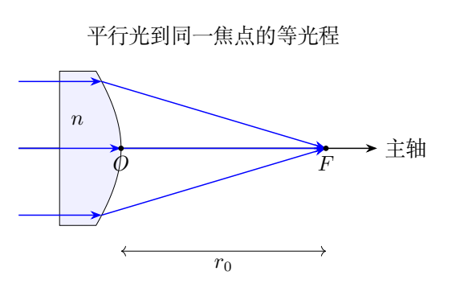
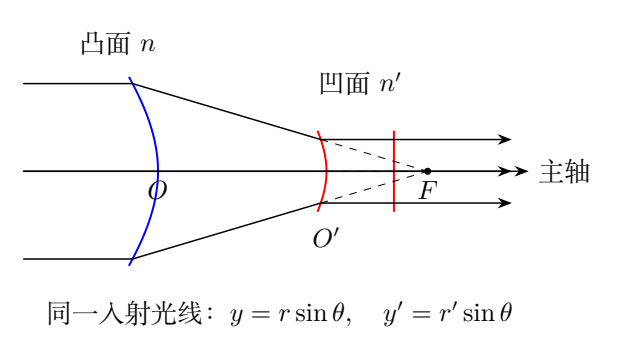
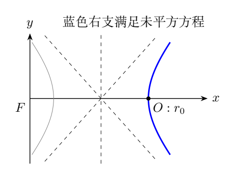

# 第 1 题　精确会聚的非球面透镜（40分）

（1）宽束平行光正入射到折射率$n$的平凸透镜左侧平面，经过凸面后会聚于主轴上的$F$。凸面顶点$O$到$F$的距离为$r_0$。求凸面的极坐标方程及直角坐标标准形式。

（2）在上述系统中共轴插入折射率$n'$的平凹透镜，其平面在凹面右侧，凹面顶点$O'$在$O,F$之间，到$F$的距离$r'_0<r_0$。使原来会聚到$F$的光经凹面折射后，平行向右射出。

（i）求凹面的极坐标方程及直角坐标标准形式。

（ii）会聚光线与主轴的夹角最大为$\theta_{\max}$，求入射与出射平行圆光束横截面半径之比。

## 一、题型定位

这是由规定光线功能反求折射面形状的题，属于精确几何光学的设计问题。题目没有给“薄透镜”或“近轴”条件，因此不能从薄透镜公式或球面折射公式直接求曲率半径。所求曲面要让整个口径内的平行光都到达同一焦点，而不仅是近轴光。

最方便的工具是等光程。入射波前是平面，理想焦点处的会聚波前具有球面结构。连接平面波前与焦点的所有实际光路具有相同光程，由此可以直接得到凸面各点的位置。

第二个折射面将会聚球面波转换为平面波。利用同一焦点$F$建立极坐标，它的方程与第一个曲面具有相同结构。最后用同一最外侧光线的两个交点高度，得到口径比。

## 二、知识点

### 1. 光程与等相位

介质中长度$s$的光程为$ns$。同一入射平面波前上的两点等相位；如果光无像差地到达同一个像点，其光程差为零。界面透射的固定相位不影响本题几何比较。

对任意曲面点$M$，在左侧平面选与$M$同高度的入射点$N$，在主轴选入射点$P$。将$M$向主轴作垂足$H$。正入射平面后光线不偏折，所以透镜内部$NM$平行主轴，且$NM=PH$。

轴上参考光路是$PO+OF$，离轴光路是$NM+MF$。等光程给

$$
n\,NM+MF=n\,PO+OF.
$$

由$PO=PH+HO$，可消去公共透镜内部长度，得到$MF=n\,HO+OF$。初始平面的具体位置因此不会出现在最终方程中。

### 2. 坐标约定

以$F$为极点，从$F$指向$O$的射线为极轴。记$FM=r$，与极轴夹角$\theta$。直角坐标也以$F$为原点，$x$轴指向$O$，$y$轴取垂直于主轴方向，故

$$
x=r\cos\theta,\qquad y=r\sin\theta,\qquad
HO=x-r_0.
$$

该$x$正方向与光的总体传播方向相反。定义坐标后，不能把$OF=r_0$误写成顶点坐标为$-r_0$。

### 3. 平方后的分支筛选

若方程含$\sqrt{x^2+y^2}$，平方会丢失右边必须非负的条件。得到圆锥曲线标准式之后，仍须回代未平方式，并选通过实际顶点的分支。

本题折射率通常取$n>1,n'>1$。对$n=1$的界面没有折射会聚能力；用$n\to1$极限讨论形状时，不能把退化极限当成可工作的有限透镜。

## 三、物理图像

轴外入射光在透镜中比轴上光走的路更短，离开曲面后到焦点的空气段更长。由于透镜光程按$n$加权，曲面的厚度分布恰好补偿这两部分差异。

离轴点距焦点$r$大于$r_0$，且在本坐标下$x>r_0$，因此凸面只有靠近焦点的顶点最突出。将截面绕主轴旋转，就形成精确会聚的旋转双曲面。

第二透镜截取还没到达$F$的会聚光。光在空气中原来要继续走到$F$，现在先在凹面折射为平行光，再通过右侧平面正入射出射。平行出射说明同一右侧垂直主轴平面上的光程相同。

最外侧光线从第一曲面点$M$到第二曲面点$M'$，两点和$F$共线，所以它们的极角相同。这一共线关系是口径比的依据；两曲面的顶点距离之比只有在折射率相同或近轴极限下才直接等于口径比。

## 四、解题入口

第一问将$MF=r$、$HO=r\cos\theta-r_0$代入等光程：

$$
r=n(r\cos\theta-r_0)+r_0.
$$

这已经是所求极坐标形状的线性方程。先求$r(\theta)$，再用$r=\sqrt{x^2+y^2}$转为直角坐标。

第二问可借第一问等光程关系消去两曲面之间的空气段，也可把凹面前的会聚波单独视为以$F$为中心的球面波。两条路线应给出相同$r'(\theta)$。

最后用$y_{\max}=r(\theta_{\max})\sin\theta_{\max}$和$y'_{\max}=r'(\theta_{\max})\sin\theta_{\max}$取比。不要先把$\sin\theta_{\max}$近似成$\theta_{\max}$，本题要求精确几何关系。

## 五、解析

### （1）凸面的极坐标方程

由等光程式，

$$
(1-n\cos\theta)r=(1-n)r_0.
$$

因此

$$
\boxed{
r(\theta)=\frac{(1-n)r_0}{1-n\cos\theta}
=\frac{(n-1)r_0}{n\cos\theta-1}}.
$$

在$\theta=0$时$r=r_0$，符合顶点距离。对$n>1$，要有正有限$r$，

$$
n\cos\theta>1,\qquad
|\theta|<\arccos(1/n).
$$

达到该角度边界时$r$趋于无穷，不能用一个有限口径透镜实现超过此边界的所求曲面。实际透镜还受到厚度、口径和与其他元件相交等几何限制。

### 直角坐标方程的推导

等光程式在直角坐标中为

$$
\sqrt{x^2+y^2}=nx-(n-1)r_0.
$$

右边必须非负。平方并移项：

$$
(n^2-1)x^2-2n(n-1)r_0x
+(n-1)^2r_0^2-y^2=0.
$$

配方时先除以$n^2-1$：

$$
x^2-\frac{2n}{n+1}r_0x
-\frac{y^2}{n^2-1}
+\frac{n-1}{n+1}r_0^2=0.
$$

于是

$$
\left(x-\frac{n}{n+1}r_0\right)^2
-\frac{y^2}{n^2-1}
=\frac{r_0^2}{(n+1)^2}.
$$

标准形式为

$$
\boxed{
\frac{\left(x-\dfrac{n}{n+1}r_0\right)^2}
{\left(\dfrac{r_0}{n+1}\right)^2}
-\frac{y^2}{\dfrac{n^2-1}{(n+1)^2}r_0^2}=1}.
$$

截面是双曲线，旋转后为双曲面。中心$x_c=nr_0/(n+1)$，半实轴$a=r_0/(n+1)$，半虚轴$b=r_0\sqrt{n^2-1}/(n+1)$。

### 选择实际曲面

两个轴上顶点为$x_c\pm a$：

$$
x_+=r_0,\qquad x_-=\frac{n-1}{n+1}r_0.
$$

本题实际顶点是$x=r_0$，故取右支：

$$
\boxed{
x(y)=\frac{n}{n+1}r_0
+\sqrt{\left(\frac{r_0}{n+1}\right)^2
+\frac{y^2}{n^2-1}}}.
$$

左支轴上顶点代入未平方式，右边为负，不合$r\geq0$。所以不能把标准双曲线两支都当成透镜表面。

标准双曲线的几何焦点也不能与光学焦点混同。其焦半距为$\sqrt{a^2+b^2}=nr_0/(n+1)$，左侧几何焦点恰为本坐标原点$F$；光程方程还包含折射率的加权关系，曲面设计的物理依据仍是折射等光程。

### （2）（i）凹面的等光程

以$F$继续作极点，设同一会聚光线在凹面的交点距$F$为$r'$。选右侧一张垂直于主轴的共同出射波前；为了书写方便，可以把平凹透镜的右平面沿主轴延长到通过$F$的平面，延长的相同介质光程不会影响比较。

光从第一曲面$M$走到凹面$M'$，空气路长$r-r'$；在第二透镜中平行走到共同平面，长度$r'\cos\theta$。轴上对应空气段$r_0-r'_0$，第二介质段$r'_0$。

全光路等光程给

$$
(r-r')+n'r'\cos\theta
=n(r\cos\theta-r_0)+(r_0-r'_0)+n'r'_0.
$$

利用第一问$r=n(r\cos\theta-r_0)+r_0$消去$r$，得到

$$
-r'+n'r'\cos\theta=-r'_0+n'r'_0.
$$

因此

$$
\boxed{
r'(\theta)=\frac{(n'-1)r'_0}{n'\cos\theta-1}}.
$$

这个推导中的“延长透镜”是共同出射光程的辅助构造，并不要求实际透镜必须延长到$F$。任意实际右平面只会给所有光线增加相同的常数项。

### 凹面标准式与分支

等价未平方式

$$
\sqrt{x^2+y^2}=n'x-(n'-1)r'_0.
$$

与前一问同样配方，得到

$$
\boxed{
\frac{\left(x-\dfrac{n'}{n'+1}r'_0\right)^2}
{\left(\dfrac{r'_0}{n'+1}\right)^2}
-\frac{y^2}{\dfrac{n'^2-1}{(n'+1)^2}{r'_0}^2}=1}.
$$

取通过$x=r'_0$的右支，截面仍是双曲线。它在实际光路中的介质填充侧与第一透镜相反：第一透镜介质在曲面左侧，第二透镜介质在凹面右侧。因此相同类型的数学曲线可以分别表现为凸面与凹面。

同样要求$n'\cos\theta>1$。在口径内还须$r'(\theta)<r(\theta)$，保证光先过凸面、再过凹面。顶点处$r'_0<r_0$仅保证轴上次序；折射率不同时，不能据此自动断言整个口径内都不交叉。

### （2）（ii）圆光束的口径比

轴对称系统中，入射圆束半径等于最外侧光线在凸面的高度，

$$
R_{\rm in}=r(\theta_{\max})\sin\theta_{\max}.
$$

出射圆束半径等于同一光线在凹面的高度，

$$
R_{\rm out}=r'(\theta_{\max})\sin\theta_{\max}.
$$

对$\theta_{\max}>0$约去共同正弦：

$$
\boxed{
\frac{R_{\rm in}}{R_{\rm out}}
=\frac{(n-1)(n'\cos\theta_{\max}-1)}
{(n'-1)(n\cos\theta_{\max}-1)}
\frac{r_0}{r'_0}}.
$$

也可将两处负号同时反转，得到参考解答的$(1-n)$与$(1-n\cos\theta)$形式，两者完全等价。

从极坐标方程看，$r$随$|\theta|$增加而增加，$\sin|\theta|$也增加，故在允许角域内最外侧光线确实对应$\theta_{\max}$。因此，口径比应由边缘光线对应的最大角求出。

### 特殊情况与近轴检查

若$n'=n$，所有角度的$r/r'$都等于$r_0/r'_0$，两曲面相对于$F$成严格相似形，故

$$
\frac{R_{\rm in}}{R_{\rm out}}=\frac{r_0}{r'_0}.
$$

若$n'\neq n$，只有在$\theta_{\max}\to0$时口径比趋于这一简单比值。展开可得

$$
\frac{R_{\rm in}}{R_{\rm out}}
=\frac{r_0}{r'_0}
\left[1+\frac{\theta_{\max}^2}{2}
\left(\frac n{n-1}-\frac{n'}{n'-1}\right)
+O(\theta_{\max}^4)\right].
$$

主轴附近的曲面形状也可展开。由右支式，

$$
x-r_0=\frac{y^2}{2(n-1)r_0}+O(y^4).
$$

因此顶点曲率半径的大小为$(n-1)r_0$。这与近轴单面折射焦距关系相符，但整曲面需要高阶项才能消除大口径球差。用顶点球面替代完整双曲面，只能近轴近似会聚。

### 用斯涅尔定律复核等光程

等光程函数对曲面位置求变分，其沿切线的导数为零。这意味着入、出光线在界面切向的光学动量相等：

$$
n\sin i=\sin t
$$

对于第一透镜成立；第二透镜则为$\sin i'=n'\sin t'$。这说明等光程不是绕过折射定律的独立假设，而是把所有光线满足折射规律并到达规定波前的条件集中到一个几何方程中。

实际核验可以逐点取法线，与入射平行方向和出射指向$F$方向计算夹角。若某条绘制光线不满足这一关系，通常是图的曲面分支或坐标方向有误。

## 六、关键洞察

把焦点放在极点后，“空气路长$r$”和“介质长度变化$r\cos\theta-r_0$”都变成简单量，方程立即线性。这是坐标选择带来的简化，并非公式记忆。

数学标准式包含两支，但物理光程式只接受一支。标准式、实际分支、介质填充侧是三个不同信息，都说明清楚才能确定透镜。

两曲面有相同功能关系的结构，不等于它们一定几何相似。相似要求折射率相同；否则口径比随最外侧角度变化。

## 七、易错点

套薄透镜公式只能得到近轴焦距，不能得到无球差表面。把$F$到$M$的距离当成$MF\cos\theta$，会将空气光程误换成轴向投影。

平方后接受左支，会得到负的未平方右边。以$O$为原点推导却写成以$F$为原点的标准式，会把中心平移量写错。

第二透镜的等光程需取共同出射波前，不能比较两条在不同轴向位置停止的路径。口径比中的$\theta_{\max}$属于同一会聚光线，而不是两个独立转角。

## 八、课堂讲解建议

先让学生画$N,M,H,O,F$，只写$nNM+MF=nPO+OF$。引导他们消去相同的入射段，再选择焦点极坐标。配方可单独板书，把保留符号条件和分支筛选放在标准式之后。

第二问先不给最终形状，要求在同一右侧波前比较两路光程。最后讨论$n'=n$与$n'\neq n$，让学生判断什么时候能直接用顶点距离比。

课堂检查可用三步：轴上是否$r=r_0$；右支是否满足未平方式；逐点法线是否满足折射定律。三种检查针对不同错误，不能只对照最后的曲线名称。

## 九、变式训练

### 变式1　相同材料的缩束器

取$n=n'=1.50,r_0=100$ mm、$r'_0=25.0$ mm，$\theta_{\max}=10^\circ$。求入、出圆束半径。

**解答：**$r=0.5r_0/(1.5\cos10^\circ-1)\simeq104.8$ mm，入射半径$r\sin10^\circ\simeq18.2$ mm。$r'=r/4$，出射半径约4.55 mm。两口径比严格为4，不依赖角度。轴上距离比4与全口径比一致的依据是折射率相同。

### 变式2　折射率不同的口径比

取$n=1.50,n'=1.80,r'_0=r_0/2$，$\theta_{\max}=20^\circ$，求口径比，并判断两曲面的沿光线次序。

**解答：**代精确比值，

$$
k=2\frac{0.5(1.8\cos20^\circ-1)}
{0.8(1.5\cos20^\circ-1)}
\simeq2.11.
$$

$n\cos20^\circ>1$、$n'\cos20^\circ>1$，且$r/r'=k>1$，最外侧光线先到凸面。对本组参数，$r/r'$从轴上2随角度增加，因此全口径内均保持正确次序。

### 变式3　给定口径求凸面边缘厚度差

折射率$n=1.50$、$r_0=100$ mm，入射半径$R_{\rm in}=20.0$ mm。求边缘相对顶点的轴向退后量，并与抛物近似比较。

**解答：**用右支式，

$$
x-r_0=-40+\sqrt{40^2+\frac{20^2}{1.25}}
\simeq3.82\ \mathrm{mm}.
$$

近轴近似$y^2/[2(n-1)r_0]=4.00$ mm，偏大约0.18 mm。这里“退后”指沿$x$正向、与传播方向相反。光学功能由完整曲面保证，近似厚度差不能替代精确设计。

### 变式4　有限口径的角度界限

折射率$n=1.60$，要求光会聚后最大夹角为$60^\circ$，能否用本题平凸单折射面实现？

**解答：**需要$n\cos\theta_{\max}>1$，而$1.60\cos60^\circ=0.80<1$，极坐标式给负$r$，没有所需物理分支。允许上界为$\arccos(1/1.60)\simeq51.3^\circ$，且上界对应无限尺寸，有限透镜必须严格小于该角。该结论来自规定波前与介质折射关系，不能通过把负$r$取绝对值挽救。
