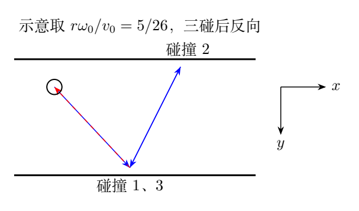
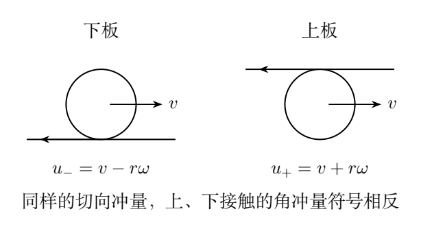

# 第 3 题　超球在两块硬板之间的三次反跳（40分）

半径$r$的均质超球向上、下两块固定平行硬板之间发射，先碰下板、再碰上板、再碰下板，共三次后几乎返回原处。不计重力。$x$轴水平向右，$y$轴竖直向下，$z$正向按右手规则确定，即指向纸内。

开始时球心水平速度$v_{0x}$，$z$方向速度为零；绕平行于$z$轴的过球心轴的初始角速度记为有向$\omega_{0z}$，原图所示方向对应$\omega_{0z}\geq0$，且$r\omega_{0z}<v_{0x}$。均质球转动惯量$J=2mr^2/5$。

求（1）第一次碰后球心水平速度$v_1$及自转角速度$\omega_1$；（2）第二次碰后$v_2,\omega_2$；（3）第三次碰后$v_3,\omega_3$。

原题提示：超球为硬质橡皮球，其与硬板的反跳可视为完全弹性。接触点不滑动，静摩擦力和正压力分别产生切向、法向弹性形变；两类形变相互独立，相应弹力均为保守力。

## 一、题型定位

本题研究同一粗糙弹性球在相反接触位置上的连续碰撞。球心的法向速度每次反号；水平运动与自转之间交换能量。上板和下板摩擦力即使同向，关于球心的力矩也会反号，这是三次结果的关键。

原题已经说明切向形变是弹性的，并与法向形变独立。因此碰撞后不必满足纯滚动$v=r\omega$。分离时切向接触点速度可以反向，储存的形变能已经返还；把“无滑动”理解成碰后立即粘着，会破坏完全弹性条件。

解法分两步：建立下板和上板的一次碰撞关系，再按实际顺序相乘。由于不计重力，飞行段速度、自转都恒定，没有额外加速度增量。

## 二、知识点

### 1. 有向角速度

在$x$右、$y$下的坐标中，$z$正向指向纸内，正的$\omega_z$在纸面看为顺时针。定义

$$
v=v_x,\qquad b=r\omega_z,\qquad \kappa=\frac{J}{mr^2}=\frac25.
$$

将$r\omega$作为速度变量，可使矩阵元素无量纲。球的切向与自转动能为

$$
K_t=\frac12m(v^2+\kappa b^2).
$$

上接触点和下接触点的切向速度分别为

$$
u_{\text{上}}=v+b,\qquad u_{\text{下}}=v-b.
$$

同一$\omega$对两个接触点产生相反的水平速度，不能用同一表达式。

### 2. 线冲量和角冲量

设有向水平冲量为$J_x=m(v_f-v_i)$。下板接触点在球心的$+y$侧，角冲量为$-rJ_x$；上板接触点在$-y$侧，角冲量为$+rJ_x$。

所以

$$
\begin{array}{ll}
\text{下板：}&v_f-v_i=-\kappa(b_f-b_i),\\
\text{上板：}&v_f-v_i=+\kappa(b_f-b_i).
\end{array}
$$

这两式就是摩擦作用点改变造成的符号差异。

### 3. 独立的两种弹性能量

法向形变无损且与切向形变独立，所以

$$
v_{yf}=-v_{yi},\qquad |v_{yf}|=|v_{yi}|.
$$

切向形变和自转交换能量：

$$
v_f^2+\kappa b_f^2=v_i^2+\kappa b_i^2.
$$

固定硬板的冲量可以改变球的动量，但碰撞恢复后球的总动能不变。不能把“硬板固定”理解成冲量为零。

## 三、物理图像

第一次碰下板时$u_{\text{下,0}}=v_0-b_0>0$，球底有向右运动趋势，摩擦冲量向左，使水平速度下降并增加正自转。

第二次接触上板时，球顶的自转速度沿正$x$，与水平平动相加。即使第一次球底速度已经反向，球顶仍可向右；上板的摩擦继续向左，却使自转向负方向改变。

第三次回到下板，再使用第一次的算子，但输入已经是第二次后的状态。不能把第三次碰撞当成第一次的独立重复，或者直接把$v_3$写成$v_1$。

三次后水平速度通常接近初始速度的反向，自转也可能反向；“几乎返回”描述的是整个运动结果，并非要求每个中间速度为初始速度的绝对值。后面的变式给出恰好返回所需初始自转比。

## 四、解题入口

先用$v_0=v_{0x}$、$b_0=r\omega_{0z}$简化符号。下板联立

$$
v_f-v_i=-\frac25(b_f-b_i),\quad
v_f^2+\frac25b_f^2=v_i^2+\frac25b_i^2.
$$

上板将第一式右边负号换正，能量式不变。得到两个一次映射后，依次写

$$
\boldsymbol q_1=D\boldsymbol q_0,\quad
\boldsymbol q_2=UD\boldsymbol q_0,\quad
\boldsymbol q_3=DUD\boldsymbol q_0,
\qquad
\boldsymbol q=\begin{pmatrix}v\\b\end{pmatrix}.
$$

这种记号让接触顺序保持明确，也便于独立检查每次能量是否不变。

## 五、解析

### （1）下板一次碰撞的推导

冲量关系

$$
v_1-v_0=-\frac25(b_1-b_0).
$$

切向弹性条件可分解：

$$
(v_1-v_0)(v_1+v_0)
+\frac25(b_1-b_0)(b_1+b_0)=0.
$$

在有切向冲量时，消去差量得到

$$
v_1+v_0=b_1+b_0.
$$

亦即

$$
u_{{\text{下}},1}=-u_{{\text{下}},0}.
$$

联立两式，

$$
\boxed{v_1=\frac37v_{0x}+\frac47r\omega_{0z}},
$$

$$
\boxed{\omega_1=\frac{10}{7r}v_{0x}-\frac37\omega_{0z}}.
$$

初始$r\omega_{0z}<v_{0x}$时，第一次切向冲量

$$
J_{x,1}=-\frac47m(v_0-b_0)<0,
$$

方向与球底向右运动趋势相反。角速度增量$\omega_1-\omega_0=10(v_0-b_0)/(7r)>0$。

法向速度反号：$v_{1y}=-v_{0y}$。题目只要求水平分量和自转，但写清法向关系能说明球确实离开下板并进入下一飞行段。

### 零切向冲量分支的说明

能量与角冲量联立还允许$v_f=v_i,b_f=b_i$，对应水平冲量零。对于本题第一次$u_{\text{下,0}}>0$且切向弹性接触充分，应取接触速度反号的非平凡分支。

如果某次本来接触速度为零，则两个分支重合，粗糙弹性映射也给出零切向冲量。不能把代数上的平凡解笼统说成“只适用于光滑球”，零接触速度时粗糙球也可能无切向冲量。

### （2）上板的符号变化

球从下板飞向上板，不计重力，碰前水平速度和自转仍为$v_1,b_1$。上接触的角冲量反号：

$$
v_2-v_1=\frac25(b_2-b_1).
$$

与弹性能量联立，在非平凡分支有

$$
v_2+v_1=-(b_2+b_1),
\qquad
u_{{\text{上}},2}=-u_{{\text{上}},1}.
$$

因此

$$
\begin{aligned}
v_2&=\frac37v_1-\frac47b_1,\\
b_2&=-\frac{10}{7}v_1-\frac37b_1.
\end{aligned}
$$

代第一次结果：

$$
v_2=\frac37\left(\frac37v_0+\frac47b_0\right)
-\frac47\left(\frac{10}{7}v_0-\frac37b_0\right).
$$

整理

$$
\boxed{v_2=-\frac{31}{49}v_{0x}
+\frac{24}{49}r\omega_{0z}},
$$

$$
\boxed{\omega_2=-\frac{60}{49r}v_{0x}
-\frac{31}{49}\omega_{0z}}.
$$

由于$0\leq b_0<v_0$，$v_2<(-31+24)v_0/49<0$，所以第二次碰后球心水平运动向左，自转也为负。这是返程开始的动力学原因。

法向速度再次反号，$v_{2y}=v_{0y}$，球向下板运动。

### （3）第三次下板碰撞

下板映射不变：

$$
v_3=\frac37v_2+\frac47b_2,\qquad
b_3=\frac{10}{7}v_2-\frac37b_2.
$$

代入第二次结果，

$$
\begin{aligned}
v_3
&=\frac{3(-31v_0+24b_0)+4(-60v_0-31b_0)}{343}\\
&=\frac{-333v_0-52b_0}{343},
\end{aligned}
$$

$$
\begin{aligned}
b_3
&=\frac{10(-31v_0+24b_0)-3(-60v_0-31b_0)}{343}\\
&=\frac{-130v_0+333b_0}{343}.
\end{aligned}
$$

所以

$$
\boxed{v_3=-\frac{333}{343}v_{0x}
-\frac{52}{343}r\omega_{0z}},
$$

$$
\boxed{\omega_3=-\frac{130}{343r}v_{0x}
+\frac{333}{343}\omega_{0z}}.
$$

法向分量$v_{3y}=-v_{0y}$，再次向上运动。$v_3$在给定初始范围内始终负，而$\omega_3$可正、可零、可负；其符号分界为

$$
\frac{r\omega_{0z}}{v_{0x}}=\frac{130}{333}.
$$

因此不能将第三次角速度一概写成其正的大小，必须保留有向结果。

### 矩阵复核与能量不变量

下板、上板分别对应

$$
D=\frac17\begin{pmatrix}3&4\\10&-3\end{pmatrix},
\quad
U=\frac17\begin{pmatrix}3&-4\\-10&-3\end{pmatrix}.
$$

两次组合

$$
UD=\frac1{49}\begin{pmatrix}-31&24\\-60&-31\end{pmatrix},
$$

三次组合

$$
DUD=\frac1{343}
\begin{pmatrix}-333&-52\\-130&333\end{pmatrix}.
$$

每个单次映射均满足

$$
D^{\mathsf T}WD=W,\qquad
U^{\mathsf T}WU=W,\quad
W=\begin{pmatrix}1&0\\0&2/5\end{pmatrix}.
$$

所以每次以及整体都保持$v^2+(2/5)b^2$，与弹性能量相符。普通的$v^2+b^2$不是正确的不变量。

单次$D^2=U^2=\mathbf1$，但$UD\neq\mathbf1$。同一板连续作用两次的映射会抵消，上、下两板各一次的映射却不抵消。实际飞行决定碰撞次序，不能随意交换矩阵顺序。

### 三个切向冲量的方向

利用$v_j-v_{j-1}$，

$$
\begin{aligned}
J_{x,1}&=-\frac{4m}{7}(v_0-b_0),\\
J_{x,2}&=-\frac{4m}{49}(13v_0+b_0),\\
J_{x,3}&=-\frac{4m}{343}(29v_0+55b_0).
\end{aligned}
$$

在原题范围内三者都负，因此球心水平速度逐次降低。第一次和第三次作用于球底，角冲量为正；第二次作用于球顶，角冲量为负。这一方向表能独立检验上板映射的两个负号。

总水平冲量

$$
J_x=m(v_3-v_0)
=-\frac{m}{343}(676v_0+52b_0).
$$

它等于逐次冲量之和。竖直冲量在三次中交替反向，法向速度大小始终为$|v_{0y}|$，法向动能没有参与水平—自转能量交换。

### “几乎返回”的定量解释

无初始自转时$v_3=-(333/343)v_0\simeq-0.971v_0$，水平速度确实接近反向原速，但自转不再为零。若初始自转适当，两种状态可以完全反向，见变式2。

三次之后的速度接近反向并不单独保证空间轨迹完全重合。完整返回还涉及中间水平位移与飞行时间；原题只要求速度和自转，无需把“几乎返回”强行作为额外方程。

半径$r$决定同一$b$对应的角速度大小，均质实心球的系数$\kappa=2/5$决定能量分配。改变质量$m$会改变冲量绝对值，却不改变给定初速度条件下的速度映射。

## 六、关键洞察

碰撞面从球底换到球顶，改变的是角冲量符号；切向冲量仍可指向左侧。把摩擦方向和转矩方向分别判断，能避免第二次碰撞的错误。

加权动能守恒使单次映射像一个反射，但两次不同接触的组合像旋转。水平速度和自转不断交换，并不意味着每两次回到初始状态。

原题对弹性形变作了明确假设。接触区在压缩中暂时停住、切向形变储能，恢复后分离速度反号；不能用刚性粘着模型替代这条无损接触规律。

## 七、易错点

第二次仍使用下板矩阵，会得到$v_2=v_0,\omega_2=\omega_0$的错误两周期。只说“摩擦向左”就沿用同一力矩符号，忽略了接触点位于球心哪一侧。

把$\omega_3$取绝对值会丢掉自转反向信息。将切向平动动能独立守恒，会漏掉球自转；将法向动能混入切向方程又会增加不必要未知量。

飞行段不受重力，所以速度恒定。不能把斜面连续弹跳问题的重力增量带入本题。

## 八、课堂讲解建议

先在两圆示意图中标出球底、球顶的接触速度，再用叉乘方向检查角冲量。只完整推一次下板映射，要求学生自行推上板而非只抄负号。

代数运算每次都保留$v,b$两个变量，最后再除以$r$得到角速度。写出能量不变量可检查分母7、49、343的连乘是否正确。

课堂可取$\omega_0=0$追踪三次平动和自转变化，再求恰好反向所需初始自转。通过中间水平位移解释“速度反向”与“轨迹返回”的差别。

## 九、变式训练

### 变式1　无初始自转

设$\omega_0=0$，写三次碰后状态及切向能量分配。

**解答：**

$$
\begin{array}{c|c|c}
j&v_j/v_0&r\omega_j/v_0\\ \hline
1&3/7&10/7\\
2&-31/49&-60/49\\
3&-333/343&-130/343
\end{array}
$$

第一次平动能占$9/49$，转动能占$40/49$。第三次平动能占$333^2/343^2$，转动能占$(2/5)130^2/343^2$，二者之和为1。球心几乎反向原速，自转携带余下能量。

### 变式2　恰好反向并返回起点

求使$v_3=-v_0,\omega_3=-\omega_0$的初始自转比，并验证无重力时三碰后返回初始高度可恰好到达原点。

**解答：**$v_3=-v_0$给$333v_0+52b_0=343v_0$，所以

$$
\frac{b_0}{v_0}=\frac5{26}.
$$

代入$b_3$得$b_3=-b_0$。此时$v_1=-v_2$。初始点到下板的飞行时间记$t_0$，两板间完整飞行时间$T$；第三次碰后回到初始高度又需$t_0$。水平位移

$$
\Delta x=(v_0+v_3)t_0+(v_1+v_2)T=0.
$$

因此返回时全部速度和自转反向，确实到达初始位置。该比值满足$0<b_0<v_0$，在原题允许范围内。

### 变式3　更多次碰撞的两碰组合

求第$2j$次碰后的状态，仍从下板开始、两板交替。

**解答：**令$\widetilde b=\sqrt{2/5}\,b$，两碰组合保持$v^2+\widetilde b^2$，对应角$\psi$满足

$$
\cos\psi=-\frac{31}{49},\qquad
\sin\psi=\frac{12\sqrt{10}}{49}.
$$

于是

$$
v_{2j}=v_0\cos j\psi+\sqrt{\frac25}\,b_0\sin j\psi,
$$

$$
b_{2j}=b_0\cos j\psi-\sqrt{\frac52}\,v_0\sin j\psi.
$$

奇数次再左乘$D$。$j=1$恢复第二次结果；取加权坐标的目的在于把能量椭圆变成圆，不能在未加权的$(v,b)$平面直接把矩阵当普通旋转。

### 变式4　冲量级粗糙度要求

设法向速度大小为$V_y>0$，碰撞总冲量满足$|J_x|\leq\mu J_y$。求原题三次映射能成立的冲量级必要条件。

**解答：**每次$J_y$的大小均$2mV_y$。三个所需比值为

$$
\frac{2(v_0-b_0)}{7V_y},\quad
\frac{2(13v_0+b_0)}{49V_y},\quad
\frac{2(29v_0+55b_0)}{343V_y}.
$$

在$0\leq b_0<v_0$时，第二个比值大于第一个和第三个，故

$$
\mu\geq\frac{2(13v_0+b_0)}{49V_y}.
$$

这是总冲量层面的必要条件。瞬时接触是否始终不滑，还需法向和切向弹性历程符合摩擦限制；仅有总冲量之比，还不足以证明接触全程不滑动。原题直接给出无滑动的弹性形变假设，免去这一接触细节。
