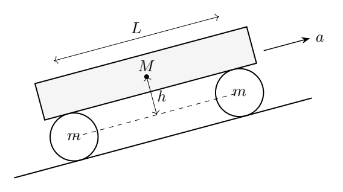
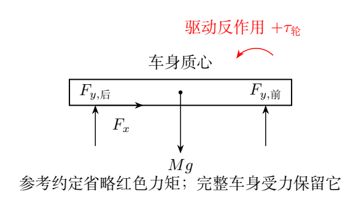

# 第 7 题　汽车爬坡的牵引、转动与载荷（40分）

简化汽车的前轮、后轮分别视为半径$r$、质量$m$的均质圆柱，两前轮合并为一个物体，两后轮也合并为一个物体。轴距$L$。刚性车身质量$M$，质心在前、后轮轴的中点正上方，距轮轴平面$h$。

轮与地面摩擦系数$\mu$，最大静摩擦等于滑动摩擦；忽略空气阻力和轮轴摩擦力矩。均质圆柱转动惯量$J_w=mr^2/2$，重力加速度$g$。

（1）汽车在倾角$\theta$坡面上无滑动地向上加速，加速度$a$，前、后轮法向力均大于零。求$N_{\text{前}},N_{\text{后}}$及不使前轮离地的最大安全加速度$a_{\text{安全}}$。

（2）车身发动机给后轮瞬时力矩$\tau_{\text{轮}}$，摩擦足以维持无滑动，求加速度。

（3）传动效率100%，电机转速是车轮转速的$r_i$倍。A型车参数：$M=1.8\times10^3$ kg，$h=0.1$ m，$r=0.40$ m，$L=2.9$ m，电机最大转矩$\tau=4.0\times10^2$ N·m，$r_i=10$，轮质量可忽略，$g=9.8\,\mathrm{m/s^2}$。求水平和$30^\circ$上坡最大加速度、所需最小摩擦系数，数值保留两位有效数字。

## 一、题型定位

本题同时包含质心平动、车轮转动、车身力矩平衡与静摩擦约束。驱动轮需要向前的地面摩擦，无驱动前轮在向前加速时需要向后的摩擦，以获得正确的滚动角加速度。

参考解答在车身力矩平衡中只计轮轴合力，省略了驱动装置对车身的反作用力矩。若按这一隐含简化，会得到其载荷分配和摩擦数字；若发动机与传动安装在题设车身上，则作用反作用必须计入。

下文先按完整车载驱动系统给出守恒自洽的结果，再单列参考解答的简化约定作对照。两种模型的轮子转动与加速度公式相同，法向载荷和摩擦阈值不同。忽略轮轴摩擦力矩不等于忽略发动机的驱动反作用力矩。

## 二、知识点

### 1. 坡面坐标与摩擦方向

$x$沿坡面向上，$y$垂直坡面向外，逆时针角速度取正。汽车向上滚动时车轮顺时针，故

$$
\omega_w=-\frac vr,\qquad
\alpha_w=-\frac ar.
$$

前轮没有驱动力矩，地面摩擦必须产生负角加速度。因此加速时前轮摩擦沿坡面下方；后轮的驱动力矩顺时针，它需要向上的摩擦传递牵引。

### 2. 三种质量作用

平动质量是$M+2m$。两轮的转动能折算为额外质量

$$
2\frac{J_w}{r^2}=m.
$$

所以动力学中的等效惯性质量为$M+3m$。法向总载荷却是$(M+2m)g\cos\theta$，不能把转动等效质量加入重量。

车身质心距地面为$h+r$，整车质心距地面为

$$
H=r+\frac{Mh}{M+2m}.
$$

题面$h$从轮轴平面量起，不能直接把$h$当成距地面高度。

### 3. 传动转矩与功率

理想传动满足功率守恒：

$$
\tau\omega_{\rm motor}=\tau_{\text{轮}}\omega_{\rm wheel}.
$$

由$\omega_{\rm motor}=r_i\omega_{\rm wheel}$，

$$
\tau_{\text{轮}}=r_i\tau.
$$

低档提高轮上转矩，但同一电机转速下车速降低。静止瞬间仍可用转矩传递关系，不能因两端功率都为零就把转矩设零。

### 4. 静摩擦约束

无滑动要求各轮

$$
|f_{\text{前}}|\leq\mu N_{\text{前}},\qquad
|f_{\text{后}}|\leq\mu N_{\text{后}}.
$$

法向力必须先大于零。不接触地面的车轮不能继续提供滚动约束，摩擦系数再大也不能补偿负的法向力。

## 三、物理图像

加速或上坡使地面对整车的合切向力为正。该力作用在质心下方，产生使车头抬起的力矩，载荷向后轮转移。

完整系统中，车轮不断获得顺时针角动量。整车外力矩除了维持车身不俯仰，还要提供车轮角动量变化；在车身单独受力图上，表现为发动机／传动对车身的反向力矩。

图中红色项为完整车载驱动模型必须保留的$+\tau_{\text{轮}}$。参考解答的简化力矩图省略它。这个区别在轮质量趋零时仍存在：转动惯量可忽略，并不意味着有限驱动力矩的反作用消失。

轮上转矩提供的有效牵引尺度是$\tau_{\text{轮}}/r$，但后轮摩擦一般不完全等于它，因为一部分转矩用于后轮自身角加速。前轮也需要获得自转，进一步增加总惯性需求。

## 四、解题入口

总切向摩擦记$F=f_{\text{前}}+f_{\text{后}}$。整车平动：

$$
F=(M+2m)(a+g\sin\theta).
$$

整车法向：

$$
N_{\text{前}}+N_{\text{后}}=(M+2m)g\cos\theta.
$$

再对整车质心写角动量方程。车身保持平行坡面，不产生俯仰角加速度，但两轮转动角动量变化为$2J_w(-a/r)=-mra$，所以

$$
\frac L2(N_{\text{前}}-N_{\text{后}})+HF=-mra.
$$

该方法不必在第一问预先知道每个轮轴力或发动机结构，直接保留了车轮自转的角动量。

## 五、解析

### （1）完整系统的法向载荷

由法向总力与整车质心力矩，

$$
N_{\text{前}}=\frac{M+2m}{2}g\cos\theta-\frac{HF+mra}{L},
$$

$$
N_{\text{后}}=\frac{M+2m}{2}g\cos\theta+\frac{HF+mra}{L}.
$$

代$H=r+Mh/(M+2m)$和$F=(M+2m)(a+g\sin\theta)$，整理得

$$
\boxed{
\begin{aligned}
N_{\text{前}}
={}&\frac{M+2m}{2}g\cos\theta\\
&-\frac{Mh(a+g\sin\theta)
+r[(M+3m)a+(M+2m)g\sin\theta]}L,
\end{aligned}}
$$

$$
\boxed{
\begin{aligned}
N_{\text{后}}
={}&\frac{M+2m}{2}g\cos\theta\\
&+\frac{Mh(a+g\sin\theta)
+r[(M+3m)a+(M+2m)g\sin\theta]}L.
\end{aligned}}
$$

两法向力相加恢复总法向重量。对于向上加速，后一载荷转移项为正，后轮载荷增大、前轮减小。

### 前轮离地的加速度边界

令$N_{\text{前}}=0$，得

$$
\boxed{
a_{\text{安全}}=
\frac{(M+2m)Lg\cos\theta/2
-[Mh+(M+2m)r]g\sin\theta}
{Mh+(M+3m)r}}.
$$

接触要求$a<a_{\text{安全}}$，临界等号仅表示刚失去正的前轮支持。若该表达式非正，在当前坡度和参数下，正向加速的前轮接触条件已不能满足，不能把负阈值当成可用正加速度。

当$m\to0$，

$$
\boxed{
a_{\text{安全}}=\frac{Lg\cos\theta}{2(h+r)}-g\sin\theta}.
$$

这里出现$h+r$，正是质心距地面的高度，符合将轮质量忽略后的整车视作质点与不俯仰车架的极限。

### 车身单独受力的交叉核验

前、后轮轴提供的法向分量分别为$N_{\text{前}}-mg\cos\theta$、$N_{\text{后}}-mg\cos\theta$。两轮轴合切向力给车身

$$
F_{x,\text{车身}}=M(a+g\sin\theta).
$$

车身绕质心无俯仰角加速。在车载驱动模型中，力矩方程为

$$
\frac L2(N_{\text{前}}-N_{\text{后}})
+Mh(a+g\sin\theta)+\tau_{\text{轮}}=0.
$$

下一问给$\tau_{\text{轮}}=r[(M+3m)a+(M+2m)g\sin\theta]$，代入便恢复前面的整车角动量结果。这说明附加项并非任意修正，而是两种系统选择的一致要求。

### （2）前轮摩擦与自转

前轮绕轴转动：

$$
f_{\text{前}}r=J_w\alpha_w
=-\frac12mr^2\frac ar.
$$

故

$$
\boxed{f_{\text{前}}=-\frac m2a}.
$$

它向坡面下方。由整车平动，

$$
\boxed{
f_{\text{后}}=(M+2m)(a+g\sin\theta)+\frac m2a}.
$$

后轮摩擦向坡面上方，除推动车身和两轮平动外，还须克服前轮为了加速自转而产生的反向摩擦。

### 后轮转动与加速度

后轮驱动力矩顺时针，按逆时针为正：

$$
f_{\text{后}}r-\tau_{\text{轮}}
=J_w\alpha_w=-\frac12mra.
$$

代后轮摩擦，

$$
\frac{\tau_{\text{轮}}}r=(M+3m)a+(M+2m)g\sin\theta.
$$

所以

$$
\boxed{
a=\frac{\tau_{\text{轮}}/r-(M+2m)g\sin\theta}
{M+3m}}.
$$

这与参考解答相同。两轮转动各增加$m/2$的惯性质量，共$m$。若将分母写成$M+2m$，就是把车轮自转能漏掉。

### 能量方法的复核

整车机械动能

$$
K=\frac12(M+2m)v^2
+2\frac12J_w(v/r)^2
=\frac12(M+3m)v^2.
$$

驱动机械功率$\tau_{\text{轮}}v/r$，上坡重力势能变化率$(M+2m)g v\sin\theta$。无滑动时，静止地面接触点的摩擦不耗散能量，所以

$$
\tau_{\text{轮}}\frac vr
=\frac{dK}{dt}+(M+2m)g v\sin\theta.
$$

对$v>0$约去$v$即得到同一加速度式，$v=0$时由连续极限或转动方程给出。这个功率式不能用于证明法向载荷，因为载荷取决于力矩与高度。

### （3）A型车的加速度

理想传动$\tau_{\text{轮}}=r_i\tau=4.0\times10^3$ N·m，轮质量忽略，所以

$$
a=\frac{r_i\tau}{Mr}-g\sin\theta.
$$

平地

$$
a(0)=\frac{4000}{1800(0.40)}
=5.55556\,\mathrm{m/s^2},
$$

上坡

$$
a(30^\circ)=5.55556-9.8\sin30^\circ
=0.655556\,\mathrm{m/s^2}.
$$

按两位有效数字

$$
\boxed{a(0)=5.6\,\mathrm{m/s^2},\qquad
a(30^\circ)=0.66\,\mathrm{m/s^2}}.
$$

此时后轮牵引力在两种坡度均为

$$
f_{\text{后}}=M(a+g\sin\theta)
=\frac{\tau_{\text{轮}}}r=1.00\times10^4\,\mathrm N.
$$

前轮摩擦在$m\to0$极限趋零，因此摩擦限制来自后轮。

### 完整动力学下的摩擦阈值

轮质量忽略时

$$
N_{\text{后}}=\frac12Mg\cos\theta
+\frac{M(h+r)}L(a+g\sin\theta).
$$

平地后轮载荷约$1.0544\times10^4$ N，上坡约$9.3625\times10^3$ N。于是

$$
\mu_{\min}(0)=\frac{10000}{10544.14}\simeq0.9484,
$$

$$
\mu_{\min}(30^\circ)=\frac{10000}{9362.48}\simeq1.0681.
$$

两位有效数字结果

$$
\boxed{
\mu_{\min}(0)=0.95,\qquad
\mu_{\min}(30^\circ)=1.1}
\quad\text{（完整车载驱动模型）}.
$$

对应安全加速度约28.4和19.7 $\mathrm{m/s^2}$，均高于本题所求加速度，前轮支持仍为正。摩擦系数大于1在理想题设中并非代数错误，它只表示所需牵引较强。

### 参考解答的简化载荷约定

若在车身力矩式中省略$\tau_{\text{轮}}$，得到参考解答采用的

$$
\boxed{
N_{\text{前}}^{\text{简}}
=\left(\frac M2+m\right)g\cos\theta
-\frac{Mh}L(a+g\sin\theta)},
$$

$$
\boxed{
N_{\text{后}}^{\text{简}}
=\left(\frac M2+m\right)g\cos\theta
+\frac{Mh}L(a+g\sin\theta)}.
$$

相应前轮离地边界

$$
a_{\text{安全}}^{\text{简}}
=\frac{(M+2m)L}{2Mh}g\cos\theta-g\sin\theta.
$$

按这套简化约定，A型车后轮载荷约9164.8 N与7983.2 N，最小摩擦系数约1.09与1.25；若严格按题面两位有效数字，分别为1.1与1.3。

这些数值与参考解答相对应，但不能同时声称保留了完整车载电机的反作用力矩。题面未明确声明省略该项，因此两模型区别需说明。加速度公式两者相同，不意味着载荷、接触安全边界和摩擦条件也相同。

### 物理极限的检查

在$m\to0$且$a=0,\theta=0$时，两轮各承担$Mg/2$，两模型一致。只要有非零驱动转矩，完整系统即有额外载荷转移；差异不会因轮惯量趋零而自动消失。

若将车身高度$h$取零，完整系统质心仍在离地$r$处，有有限加速载荷转移。参考简化则给零转移，暴露其省略力矩与题设高度定义的限制。

因此，平动、功率、角动量和作用反作用应分别检查，不能只凭加速度与参考答案相同就断言整个受力模型正确。

## 六、关键洞察

自由滚动前轮的摩擦向后，驱动后轮向前。静摩擦的方向由所需自转加速度决定，并非始终“阻碍物体整体运动”。

$M+3m$是平动加轮转动的惯性质量，$M+2m$是总重量质量；两者作用不同。载荷还涉及几何高度，不能由能量方程单独求出。

两种结果的差异来自是否计入驱动反作用力矩，不能归因于数值舍入。整车角动量方程与车身单独受力能独立指出差异。教学时应让学生知道参考简化的来源，并看到完整守恒结果。

## 七、易错点

把$h$当成离地高度，漏加车轮半径；把前轮摩擦画成向前，导致轮转动惯量项符号错误。把轮上转矩当成电机转矩，会少乘传动比。

忽略轴承摩擦不等于无驱动力矩。电机、传动固定在车身时，给车轮的转矩必有反作用；若采用省略约定，须明确它并与完整模型区分。

摩擦阈值必须除以后轮实际载荷，不能用整车总重量。前轮已离地时，原来的双轮滚动模型不能继续使用。

## 八、课堂讲解建议

先讲前、后轮的转动方程，得到摩擦方向与$M+3m$。然后分别画整车外力图和车身图，保留驱动反作用力矩，用两种系统求同一法向载荷。

参考解答的省略项可做模型审查练习。要求学生用$m\to0,h\to0$两种极限检查，解释为何质心仍有离地高度。

数值计算先保留$5.55556$和$0.655556$，再求法向力和摩擦阈值，最后统一舍入。不要在中途把加速度取5.6后再宣称三位精度。

## 九、变式训练

### 变式1　轮质量忽略的牵引极限

平地，已知$\mu$，车身离地高度$H=h+r$，求后驱、双轮接触时摩擦允许的最大加速度。

**解答：**$f=Ma$，后轮载荷$N_{\text{后}}=Mg/2+HMa/L$。若$\mu H<L$，

$$
a\leq\frac{\mu g}{2(1-\mu H/L)}.
$$

还需$a<Lg/(2H)$保证前轮接触，且受电机可用转矩限制。两个机械边界相等于$\mu=L/(2H)$；更大的摩擦不能使前轮离地后的双轮模型继续成立。

### 变式2　传动比的摩擦限制

A型车在平地、$\mu=1.00$，电机输出400 N·m，完整模型下最大允许传动比为何？

**解答：**$H=0.50$ m，摩擦允许牵引

$$
f_{\max}=\frac{\mu Mg}{2(1-\mu H/L)}
\simeq1.066\times10^4\,\mathrm N.
$$

$f=r_i\tau/r$，故$r_i\leq f_{\max}r/\tau\simeq10.7$。该状态尚未到前轮离地边界。增大传动比提高转矩，也增大所需摩擦，不能无条件提高加速度。

### 变式3　有限轮质量

保持A型车参数，但每组前、后轮质量均50 kg。平地轮上转矩4000 N·m，求加速度与两轮摩擦。

**解答：**$a=(4000/0.40)/(1800+150)\simeq5.13\,\mathrm{m/s^2}$。前轮摩擦$f_{\text{前}}=-(50/2)a\simeq-128$ N；后轮摩擦$1900a+25a\simeq9.87\times10^3$ N。

两摩擦之和为$1900a$，轮上转矩满足$f_{\text{后}}r+(m/2)ar=4000$ N·m。法向力仍须用完整载荷式，而不能将$m$只加到平动分母。

### 变式4　提高车身质心

轮质量忽略，保持平地驱动转矩与其他A型车参数，若$h$从0.10 m提高到0.50 m，加速度、后轮摩擦需求和前轮安全边界如何变化？

**解答：**加速度仍5.56 $\mathrm{m/s^2}$，牵引仍10000 N；后轮载荷增至约11923 N，最小摩擦系数降至约0.839。离地质心高度从0.50 m增至0.90 m，安全加速度从约28.4降至15.8 $\mathrm{m/s^2}$。

更高质心增加后轮载荷，有利于后驱牵引，但更容易抬起前轮，两种趋势并存。不能只看摩擦阈值下降就认为接触安全也提高。
