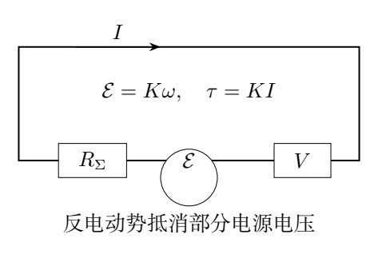
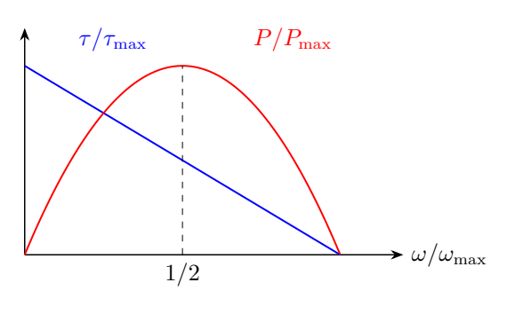
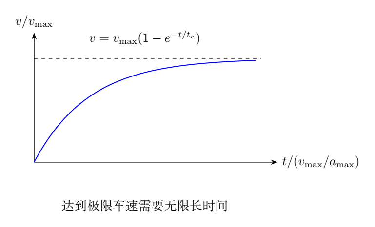

# 第 8 题　直流电机驱动的加速与能量效率（40分）

简化电动车的前、后轮各视为半径$r$、质量$m$的均质圆柱，车身质量$M$，质心位于两轮轴中点正上方，轴距$L$。忽略空气阻力、轴承摩擦力矩，车轮惯量$J_w=mr^2/2$。

（1）简化永磁直流电机的线圈导线始终垂直切割匀强磁场$B$，有效切割导线总长$l$，转动轨迹半径$r_{\text{线圈}}$，线圈电阻$R_{\text{线圈}}$、自感可忽略。电池开路电压$V$、内阻$R_{\text{内}}$。无电机机械摩擦，求输出转矩$\tau(\omega)$、最大转矩$\tau_{\max}$、零功率空载最大转速$\omega_{\max}$及最大输出功率$P_{\max}$；用后三个量表示转矩曲线。

（2）平地从$t=0$静止启动，车轮无滑动。已知$a=(\tau_{\text{轮}}/r)/(M+3m)$，传动效率100%，电机转速为车轮的$r_i$倍，求$v(t)$。

（3）A型车$M=1.8\times10^3$ kg，$r=0.40$ m，$L=2.9$ m，$\tau_{\max}=4.0\times10^2$ N·m，$r_i=10$，轮质量忽略。电机$P_{\max}=2.0\times10^2$ kW。求从静止加速到$v_f=100$ km/h的时间、耗电池能量（kWh）及转化为机械能的效率。结果保留两位有效数字。

## 一、题型定位

本题是电机电路与机械加速的耦合。转速上升产生越来越大的反电动势，电流和转矩下降，所以汽车加速度不是常数。最大输出功率也不是所有时刻的实际功率。

电路自感被忽略，电流可随转速即时调整；机械惯量则保留，速度随时间连续变化。先建立电流—转速关系，再通过转矩和传动比写车速微分方程。

最后计算能量必须用电池实际功率$VI$积分。电机机械输出功率是$\tau\omega$，电池输入与机械输出之差耗散在电池内阻和线圈电阻中。忽略机械摩擦不代表电能全部成为机械能。

## 二、知识点

### 1. 转矩常数与反电动势常数

定义

$$
\mathcal K=B r_{\text{线圈}}l.
$$

有效导线受安培力形成的转矩

$$
\tau=\mathcal K I.
$$

旋转切割磁场产生反电动势

$$
\mathcal E=\mathcal K\omega.
$$

两个关系使用同一$\mathcal K$，满足机电转换的功率关系：$\mathcal EI=\tau\omega$。这里$\mathcal E$方向阻碍电源电流，故电路中相减。

### 2. 瞬时电路

总电阻

$$
R_\Sigma=R_{\text{内}}+R_{\text{线圈}}.
$$

忽略自感，电路满足

$$
V=IR_\Sigma+\mathcal E,
\qquad I=\frac{V-\mathcal K\omega}{R_\Sigma}.
$$

在正常电动区$0\leq\omega\leq V/\mathcal K$，电流非负。超过空载转速的情况可能进入发电区，原题从静止加速的轨迹不涉及这一分支。

### 3. 传动与等效质量

无滑动车轮角速度大小$v/r$，电机转速

$$
\omega=r_i\frac vr,\qquad
\tau_{\text{轮}}=r_i\tau.
$$

车轮平动与转动的总动能为

$$
K_{\text{车}}=\frac12(M+3m)v^2.
$$

令$M_e=M+3m$，使运动方程更简洁。它是惯性质量，不是实际重量质量。

### 4. 输入、输出与热耗

电池供能功率$P_{\rm bat}=VI$，机电转换功率$P_{\rm mech}=\mathcal EI$，电阻耗散$I^2R_\Sigma$。三者满足

$$
VI=\mathcal EI+I^2R_\Sigma.
$$

电池开路电压用于计算其供能；若只用电池端电压乘电流，会漏计电池内阻的热耗。

## 三、物理图像

静止时反电动势零，电流和转矩最大，但机械输出功率$\tau\omega$为零；这时输入电功率全部转成电阻热。随着转速增加，反电动势提高，电流、转矩下降，机械功率先升后降。

最大机械功率出现在半空载转速，不在最大转矩点，也不在最大转速点。到空载转速时电流趋零、转矩趋零，无法继续产生正加速。

固定传动比下，转矩随车速线性下降，汽车速度呈指数趋近极限；极限车速是渐近值，在理想模型中不能在有限时间恰好到达。

空气阻力和机械损耗在题设中均忽略，所以这里的极限车速来自电路反电动势。真实车辆的其他限制不需要带入这个计算。

## 四、解题入口

第一问由$I=(V-\mathcal K\omega)/R_\Sigma$求转矩，再求$\tau\omega$的最大值。将转矩曲线写成$\tau_{\max}(1-\omega/\omega_{\max})$。

第二问代$\omega=r_iv/r$、$\tau_{\text{轮}}=r_i\tau$，得到

$$
\frac{dv}{dt}=a_{\max}\left(1-\frac v{v_{\max}}\right).
$$

这是关于$v$的一阶线性方程。初值$v(0)=0$确定唯一解。

第三问先由$\tau_{\max}\omega_{\max}=4P_{\max}$求空载转速，再算$v_{\max}$、$a_{\max}$。保持未舍入值，最后求时间、输入能量和效率。

## 五、解析

### （1）转矩—转速关系

电流

$$
I(\omega)=\frac{V-\mathcal K\omega}{R_\Sigma}.
$$

于是

$$
\boxed{\tau(\omega)=\frac{\mathcal K V}{R_\Sigma}
-\frac{\mathcal K^2}{R_\Sigma}\omega}.
$$

转矩随转速线性下降。堵转$\omega=0$时电流最大，转矩

$$
\boxed{\tau_{\max}=\frac{\mathcal K V}{R_\Sigma}}.
$$

反电动势等于开路电压时$I=0$，无负载最大转速

$$
\boxed{\omega_{\max}=\frac V{\mathcal K}}.
$$

由于机械摩擦忽略，这个“最大转速”也就是零转矩、零机械功率的空载极限。

### 最大机械功率

机械输出功率

$$
P(\omega)=\tau\omega
=\frac{\mathcal K}{R_\Sigma}
(V\omega-\mathcal K\omega^2).
$$

对$\omega$求导：

$$
\frac{dP}{d\omega}
=\frac{\mathcal K}{R_\Sigma}(V-2\mathcal K\omega).
$$

最大值在$\omega=V/(2\mathcal K)=\omega_{\max}/2$，得到

$$
\boxed{P_{\max}=\frac{V^2}{4R_\Sigma}
=\frac{\tau_{\max}\omega_{\max}}4}.
$$

因此

$$
\boxed{
\tau(\omega)=\tau_{\max}
\left(1-\frac\omega{\omega_{\max}}\right)
=\frac{4P_{\max}}{\omega_{\max}}
\left(1-\frac\omega{\omega_{\max}}\right)}.
$$

三个参数$P_{\max},\tau_{\max},\omega_{\max}$并非独立，有上述乘积关系。若任意给三个互不一致的数，则不符合本题线性电机模型。

### 最大功率点的效率

在半空载转速，$\mathcal E=V/2$，电流$V/(2R_\Sigma)$，电池输入功率$V^2/(2R_\Sigma)=2P_{\max}$。电阻热和机械输出各为$P_{\max}$，瞬时机电效率为50%。

这不是“电机在所有时刻效率50%”。瞬时效率一般为

$$
\eta_{\rm inst}=\frac{\mathcal EI}{VI}
=\frac{\mathcal E}{V}
=\frac\omega{\omega_{\max}},
$$

在电流非零的电动区成立。它从低速的低效率随速度提高，但到空载极限时输出功率也趋零。

### （2）车速微分方程

电机转速与车速关系$\omega=r_iv/r$，代入转矩：

$$
\tau=\tau_{\max}
\left(1-\frac{r_iv}{r\omega_{\max}}\right).
$$

轮上转矩$r_i\tau$，由题给$a=\tau_{\text{轮}}/(M_er)$，

$$
\frac{dv}{dt}
=\frac{\tau_{\max}r_i}{M_er}
\left(1-\frac{r_iv}{r\omega_{\max}}\right).
$$

定义

$$
\boxed{a_{\max}=\frac{\tau_{\max}r_i}{M_er}},
\qquad
\boxed{v_{\max}=\frac{r\omega_{\max}}{r_i}}.
$$

于是

$$
\frac{dv}{dt}=a_{\max}\left(1-\frac v{v_{\max}}\right).
$$

初始$a(0)=a_{\max}$，随着$v$提高逐渐下降。

### 初值解

分离变量：

$$
\frac{dv}{1-v/v_{\max}}=a_{\max}dt.
$$

从0到$v$、从0到$t$积分：

$$
-v_{\max}\ln\left(1-\frac v{v_{\max}}\right)
=a_{\max}t.
$$

因此

$$
\boxed{
v(t)=v_{\max}
\left[1-\exp\left(-\frac{a_{\max}}{v_{\max}}t\right)\right]}.
$$

时间常数$t_c=v_{\max}/a_{\max}$。同时

$$
a(t)=a_{\max}e^{-t/t_c},\quad
I(t)=\frac V{R_\Sigma}e^{-t/t_c}.
$$

速度从0单调增加且始终小于$v_{\max}$，初值和空载极限均正确。若目标速度不小于$v_{\max}$，则不能在有限时间达到。

### （3）A型车的特征量

$P_{\max}=2.0\times10^5$ W，$\tau_{\max}=400$ N·m，故

$$
\omega_{\max}=\frac{4P_{\max}}{\tau_{\max}}
=2.0\times10^3\,\mathrm{rad/s}.
$$

轮质量忽略，$M_e=M=1800$ kg：

$$
v_{\max}=\frac{0.40(2000)}{10}
=80.0\,\mathrm{m/s},
$$

$$
a_{\max}=\frac{400(10)}{1800(0.40)}
=\frac{50}{9}\,\mathrm{m/s^2}.
$$

于是$t_c=80/(50/9)=14.4$ s。目标$v_f=100/3.6=250/9$ m/s，小于80 m/s，可以有限时间达到。

### 加速时间

由初值解反求

$$
t_f=-\frac{v_{\max}}{a_{\max}}
\ln\left(1-\frac{v_f}{v_{\max}}\right).
$$

代精确比例$v_f/v_{\max}=25/72$，

$$
t_f=14.4\ln\frac{72}{47}\simeq6.14\,\mathrm s.
$$

两位有效数字

$$
\boxed{t_f=6.1\,\mathrm s}.
$$

若错误地用恒定最大加速度，则得到$v_f/a_{\max}=5.0$ s，它只是忽略转矩下降的偏小估计。

### 电池功率与积分

电池输入功率

$$
P_{\rm bat}=VI=\frac{V^2}{R_\Sigma}
\left(1-\frac v{v_{\max}}\right)
=4P_{\max}e^{-t/t_c}.
$$

因此

$$
\begin{aligned}
\Delta E_{\rm bat}
&=\int_0^{t_f}4P_{\max}e^{-t/t_c}\,dt\\
&=4P_{\max}t_c(1-e^{-t_f/t_c})\\
&=4P_{\max}\frac{v_f}{a_{\max}}.
\end{aligned}
$$

利用$4P_{\max}=\tau_{\max}\omega_{\max}$及特征量，还可写

$$
\boxed{\Delta E_{\rm bat}=M_ev_{\max}v_f}.
$$

这个式子由真实电池功率积分得到，不是把机械动能除以预设固定效率。

### 数值电池能量

$$
\Delta E_{\rm bat}
=4(2.0\times10^5)\frac{250/9}{50/9}
=4.00\times10^6\,\mathrm J.
$$

$1\,\mathrm{kWh}=3.60\times10^6$ J，故

$$
\boxed{\Delta E_{\rm bat}\simeq1.1\,\mathrm{kWh}}.
$$

电池初始输入功率为$4P_{\max}=800$ kW，之后随电流下降。这解释为什么不能用“最大机械输出200 kW乘6.1 s”估算耗电。

### 机械能与累计效率

车的平动和轮转动能增加

$$
\Delta E_{\rm mech}=\frac12M_ev_f^2.
$$

本题轮质量忽略，

$$
\Delta E_{\rm mech}
=\frac12(1800)\left(\frac{250}{9}\right)^2
\simeq6.94\times10^5\,\mathrm J.
$$

累计效率

$$
\eta=\frac{\Delta E_{\rm mech}}{\Delta E_{\rm bat}}
=\frac{\tfrac12M_ev_f^2}{M_ev_{\max}v_f}
=\frac{v_f}{2v_{\max}}.
$$

故

$$
\boxed{\eta=\frac{25}{144}\simeq17\%}.
$$

按未舍入$a_{\max}=50/9$计算，实际为17.361%。参考解答也允许由提前舍入5.6导致的18%，本稿保留精确中间值并在末尾给两位有效数字。

### 热耗的独立积分

电阻热功率

$$
P_{\rm heat}=I^2R_\Sigma
=4P_{\max}e^{-2t/t_c}.
$$

积分

$$
Q_\Sigma=2P_{\max}t_c(1-e^{-2t_f/t_c}).
$$

令$x=v_f/v_{\max}=1-e^{-t_f/t_c}$，得到

$$
Q_\Sigma=M_ev_{\max}v_f-\frac12M_ev_f^2.
$$

所以$Q_\Sigma+\Delta E_{\rm mech}=\Delta E_{\rm bat}$，数值热耗约$3.31\times10^6$ J。热耗包括电池内阻和线圈电阻，无机械摩擦仍可有很大的电阻损失。

### 瞬时与累计效率的区别

到$v_f$瞬间，$\eta_{\rm inst}=v_f/v_{\max}\simeq34.7\%$；从静止到$v_f$累计效率只有其一半，因为早期速度更低、反电动势更小、电流却更大。

若形式上让$v_f\to v_{\max}$，加速时间趋于无穷，但电池输入能量趋于有限$M_ev_{\max}^2$，机械能趋于其一半。指数电流衰减使无穷长时间的积分仍收敛，二者并不矛盾。

### 无滑动假设的自洽性

本题直接给无滑动条件，因此速度方程不再求摩擦系数。若另行检查，平地驱动牵引随速度下降，而载荷转移也逐渐减弱；在同一模型中，最严格的牵引和前轮接触条件一般出现在启动瞬间。

与第7题一样，法向载荷涉及驱动反作用力矩，但它不改变当前无滑动条件下的$M+3m$加速式。不同载荷约定会影响是否能够实现无滑动，不能改变已经假定无滑动时的机电运动解。

## 六、关键洞察

转矩最大、机械功率最大和转速最大是三个不同工作点。停转时强电流并不产生机械功率；空载高速时效率比值可高但输出趋零。

固定传动比使$a_{\max}v_{\max}=4P_{\max}/M_e$保持不变。更大传动比增加初始加速度，却降低极限车速，是后续固定档位优化的基础。

累计能量用电池功率积分，得到$\eta=v_f/(2v_{\max})$，完全不需要预设固定效率，也不必分别知道电压、电阻与磁场。它们已通过$P_{\max},\tau_{\max}$组合进入模型。

## 七、易错点

把$\tau_{\max}$当成全程恒定转矩，会把时间算成5.0 s。把$P_{\max}$当成全程电池输入功率，会低估耗电并破坏能量平衡。

漏乘传动比或把电机转速写成$v/(rr_i)$，会反转档位效果。轮子转动能需要使用$M+3m$，不能只在运动方程中计入却在机械能中漏掉。

瞬时效率与累计效率不同。先将加速度舍入为5.6再求百分比，可能跨过17%与18%的舍入边界，应保持中间值。

## 八、课堂讲解建议

先画转矩直线和功率抛物线，在同一图上标堵转、半速、空载三点。再从电路功率恒等式分出机械输出和热耗，解释低速损失。

求$v(t)$时先定义$a_{\max},v_{\max},t_c$，再分离变量，避免带一串电路常数积分。数字部分只在最后代A型车参数。

让学生用热耗积分重新核对能量，并比较目标时刻效率与整个过程效率。这个检查比记住“耗电约1.1 kWh”更能判断模型是否正确。

## 九、变式训练

### 变式1　半空载车速的功率

汽车达到$v=v_{\max}/2$时，求瞬时电池功率、机械功率、热耗功率及从静止到该速率的累计效率。

**解答：**$\omega=\omega_{\max}/2$，$I=V/(2R_\Sigma)$，所以$P_{\rm bat}=2P_{\max}$，$P_{\rm mech}=P_{\max}$，$P_{\rm heat}=P_{\max}$。瞬时效率50%，累计效率$v/(2v_{\max})=25\%$。两个效率不同来自早期的低速高电流阶段。

### 变式2　传动比加倍

电机和车体参数不变，把$r_i$从10改为20，仍假定无滑动，求达到100 km/h的时间与电池能量。

**解答：**$a_{\max}$加倍为$100/9$ m/s²，$v_{\max}$减半为40 m/s，时间常数为3.60 s。

$$
t_f=-3.60\ln\left(1-\frac{250/9}{40}\right)
\simeq4.27\,\mathrm s.
$$

耗电$M v_{\max}v_f=2.00\times10^6$ J，约0.556 kWh，累计效率$v_f/(2v_{\max})\simeq34.7\%$。更大传动比不是任意都可用，须目标速率低于极限并满足启动摩擦与接触条件。

### 变式3　增加恒定阻力

平地增加大小恒定的阻力$F_0$，沿运动反向，$0<F_0<M_ea_{\max}$。求静止启动的$v(t)$。

**解答：**

$$
\frac{dv}{dt}=a_{\max}\left(1-\frac v{v_{\max}}\right)
-\frac{F_0}{M_e}.
$$

令$\delta=F_0/(M_ea_{\max})$，最终速度$v_\infty=v_{\max}(1-\delta)$，时间常数仍$t_c=v_{\max}/a_{\max}$，因此

$$
v(t)=v_\infty(1-e^{-t/t_c}).
$$

电池电流不再趋于零，而趋于$V\delta/R_\Sigma$，维持恒速仍需供能。电池能量积分为$4P_{\max}[\delta t+(1-\delta)t_c(1-e^{-t/t_c})]$，须再扣阻力功，不能沿用无阻力的有限极限能量结论。

### 变式4　固定传动比的最短加速时间

在理想无滑动条件下，保持同一电机和车辆参数，自由选择恒定$r_i$，使到达给定$v_f$的时间最短。

**解答：**令$x=v_f/v_{\max}\in(0,1)$。因$a_{\max}v_{\max}=4P_{\max}/M_e$，

$$
t_f=\frac{M_ev_f^2}{4P_{\max}}
\frac{-\ln(1-x)}{x^2}.
$$

求导的驻点条件

$$
\frac{x}{1-x}+2\ln(1-x)=0.
$$

除退化边界$x=0$外，唯一内部根$x_*\simeq0.7153$。两端时间均发散，该根给最小值。A型车到100 km/h时$r_i=x_*r\omega_{\max}/v_f\simeq20.6$，最短时间约4.27 s。

该变式只在传动比恒定、无摩擦滑动和无接触丢失的理想范围优化；若增加这些约束，应先筛选可行传动比，再比较时间。
