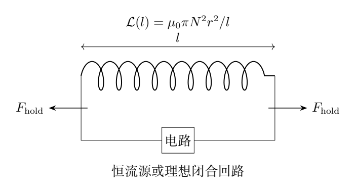
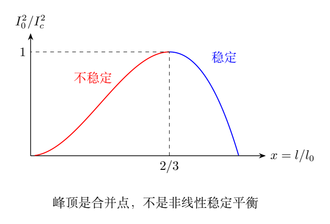

# 第 2 题　通电弹簧的平衡与稳定性（40分）

长直弹簧由涂绝缘漆的磷铜细丝绕制$N$匝，可视为半径$r$的长直螺线管。原长$l_0\gg r$，劲度系数$k$。形变时螺线管始终均匀密绕，半径变化可忽略。不计边缘效应、漏磁和重力，真空磁导率$\mu_0$。

（1）恒流源通过柔软导线给螺线管通以不变电流$I_0$，用外力使其无形变，随后缓慢撤除外力。新平衡长度$l_p$，弹簧仍可压缩或拉伸。

（i）导出可求$l_p$的代数方程，不必求解；求平衡附近小形变的等效弹性系数$k_{\rm eff}$，可含$l_p$。

（ii）求能实现平衡状态的$I_0$范围，不得含$l_p$。

（2）改用零电阻柔软导线把弹簧两端连接为闭合回路，并假设弹簧电阻也为零。初始电流$I'_0$，仍先用外力保持原长，再缓慢撤除。求新的平衡长度$l'_p$及等效弹性系数$k'_{\rm eff}$。

## 一、题型定位

这是“电磁能量与力学势能耦合”的题。几何相同的弹簧，在恒流源和理想闭合回路中却有不同的电磁约束，因而有不同的平衡与刚度。

列能量关系前，应判断电流是否随线圈长度改变，并计入外部电源的功。恒流情况下，线圈压缩时电感增大，磁场储能增大，但电源同时向系统输送更多能量；用于求机械保持力的有效势能必须扣除这部分电源功。理想闭合回路没有电源，却因感应而保持磁通链不变。

本题第（1）（ii）还包含稳定性。代数方程有正根不等于缓慢撤除外力后可以稳定停住。先寻找平衡分支，再检查曲率，最后区分临界点和稳定分支，才能完整解释实验过程。

## 二、知识点

### 1. 电感取决于长度

螺线管内磁感应强度

$$
B=\mu_0\frac{NI}{l}.
$$

每匝磁通$\Phi=B\pi r^2$，总磁通链$\Psi=N\Phi$。为使符号清楚，令

$$
A=\mu_0\pi N^2r^2,\qquad
\mathcal L(l)=\frac{\Psi}{I}=\frac Al.
$$

这里$A$不是面积，具有“电感乘长度”的量纲。线圈截面积仍为$\pi r^2$。弹簧缩短时匝密度增大，电感随之增大。

### 2. 磁场能和电源功

磁场储能为

$$
W_B=\frac12\mathcal LI^2.
$$

若$I=I_0$不变，电源电压满足$U=d(\mathcal LI_0)/dt$，电源输入的微元功

$$
dW_{\rm src}=UI_0dt=I_0^2\,d\mathcal L.
$$

而磁场储能变化只有其一半：

$$
dW_B=\frac12I_0^2\,d\mathcal L.
$$

两者相减后的能量流向机械部分。这是恒流情况下不能直接对正磁能求导作为机械势能的原因。

### 3. 保持力与恢复力

取长度增大的方向为广义正方向。缓慢改变长度所需外保持力满足

$$
F_{\rm hold}\,dl=dW_{\rm eff}.
$$

于是$F_{\rm hold}=W'_{\rm eff}(l)$。线圈自身的合广义力为其负值。平衡点要求$F_{\rm hold}=0$，附近

$$
F_{\rm hold}\simeq k_{\rm eff}\,\delta l,
\qquad k_{\rm eff}=W''_{\rm eff}(l_p).
$$

正刚度意味着自身力与位移方向相反。若二阶导数等于零，必须看更高阶项，不能直接断言中性稳定。

## 三、物理图像

相邻同向电流匝相互吸引，电磁效应倾向使弹簧变短。弹簧被压缩后，弹性力倾向伸长。平衡是这两种趋势抵消。

恒流源使$I$不变，压缩会使$B\propto1/l$增大，电磁吸引随$l^{-2}$增强；这是一种使压缩继续加剧的反馈。如果电流过大，弹性恢复力无法产生稳定平衡。

理想闭合回路保持$\Psi$不变。压缩使$\mathcal L$增大，因此$I$反而减小，且$I\propto l$。于是$B=\mu_0NI/l$不变，电磁压缩力成为常量。在该理想模型里，它改变平衡位置，却不改变增量刚度。

图中横坐标是长度比，纵坐标是电流平方比。右侧蓝色分支连接$I_0=0,l=l_0$，缓慢增大电流时会沿此分支缩短。左侧红色分支虽满足力平衡，却对微扰不稳定。顶点是两分支合并的极限。

## 四、解题入口

第一步只做几何，写$\mathcal L=A/l$。第二步写约束：恒流源是$I=I_0$；理想闭合回路是$\mathcal LI=\mathcal L_0I'_0$。第三步把两种约束各自代入能量式。

恒流源情形，从能量守恒微元式

$$
F_{\rm hold}\,dl+dW_{\rm src}
=dW_{\rm el}+dW_B
$$

出发。闭合回路情形没有电源功，直接用弹性势能加磁能。两种情形应分开列式，不能先写一个总势能，再随意把$I$视作常量或变量。

为讨论范围，将恒流平衡方程变成$I_0^2$关于$l_p$的函数。这比直接解三次方程容易，因为一个函数最大值就能决定是否有正长度平衡。

## 五、解析

### （1）（i）恒流源下的有效势能

弹性势能

$$
W_{\rm el}=\frac12k(l-l_0)^2.
$$

电源功微元与磁能微元相减，得到

$$
F_{\rm hold}\,dl
=d\left[\frac12k(l-l_0)^2
-\frac12\mathcal L(l)I_0^2\right].
$$

因此可用的机械有效势能为

$$
W_{\rm eff}(l)=\frac12k(l-l_0)^2-\frac{AI_0^2}{2l}.
$$

其负磁项并不意味着实际磁场能为负；它是计入恒流源能量交换后对机械运动起作用的势能。实际磁能仍是$AI_0^2/(2l)>0$。

对$l$求导：

$$
F_{\rm hold}=k(l-l_0)+\frac{AI_0^2}{2l^2}.
$$

撤去保持力时

$$
\boxed{k(l_p-l_0)+\frac{AI_0^2}{2l_p^2}=0}.
$$

也可写成多项式

$$
\boxed{l_p^3-l_0l_p^2+\frac{AI_0^2}{2k}=0}.
$$

当$I_0\neq0$，该式要求$l_p<l_0$，与电磁吸引导致压缩一致。初始无形变时需要的外力为$AI_0^2/(2l_0^2)$，方向是拉长弹簧，用以抵消磁吸引。

### 小形变等效刚度

令$l=l_p+\delta l$，对保持力作一阶展开：

$$
F_{\rm hold}(l)
=F_{\rm hold}(l_p)
+\left(k-\frac{AI_0^2}{l_p^3}\right)\delta l
+O(\delta l^2).
$$

于是

$$
\boxed{k_{\rm eff}=k-\frac{AI_0^2}{l_p^3}}.
$$

利用平衡条件消去$I_0$，还可写为

$$
AI_0^2=2k(l_0-l_p)l_p^2,
\qquad
\boxed{k_{\rm eff}=k\,\frac{3l_p-2l_0}{l_p}}.
$$

两式各有用途：前式直接显示磁效应降低刚度；后式直接显示稳定分支要求$l_p>2l_0/3$。若给弹簧某个等效运动质量$M$，小振动频率便是$\sqrt{k_{\rm eff}/M}$，但本题没有给质量，不需要另求频率。

### （1）（ii）电流阈值与分支

由平衡条件

$$
I_0^2=\frac{2k}{A}(l_0-l_p)l_p^2,
\qquad 0<l_p<l_0.
$$

令$f(l)=(l_0-l)l^2$。求导得

$$
f'(l)=l(2l_0-3l).
$$

它在$l=2l_0/3$达到唯一内部最大值：

$$
f_{\max}=\frac{4l_0^3}{27}.
$$

所以存在正长度平衡解的电流范围为

$$
\boxed{|I_0|\leq I_c,\qquad
I_c=\sqrt{\frac{8kl_0^3}{27\mu_0\pi N^2r^2}}}.
$$

若$I_0$指电流大小，则写$0\leq I_0\leq I_c$。电流反向不会改变磁能和匝间吸引，故阈值依赖平方。

在$0<|I_0|<I_c$时有两个正根：一个在$(0,2l_0/3)$，另一个在$(2l_0/3,l_0)$。前者$k_{\rm eff}<0$，后者$k_{\rm eff}>0$。缓慢撤去外力而要求可以停留的平衡，选择后者。

参考解答将临界等号包括在“能实现平衡”的代数范围里。若强调抗微扰的稳定平衡，则应进一步写

$$
\boxed{|I_0|<I_c,\qquad l_p>2l_0/3}.
$$

零电流时$l_p=l_0$，刚度为$k$，也属于稳定情形。

### 临界点为什么不是稳定平台

临界电流时$l_c=2l_0/3$，$W'_{\rm eff}(l_c)=W''_{\rm eff}(l_c)=0$，但

$$
W'''_{\rm eff}(l_c)
=\frac{3AI_c^2}{l_c^4}>0.
$$

因此局部势能有非零三次项：

$$
W_{\rm eff}(l_c+\delta l)
-W_{\rm eff}(l_c)
\simeq\frac{W'''_{\rm eff}(l_c)}6\,\delta l^3.
$$

势能不是极小值。合机械力在两侧的最低阶项均指向缩短方向：稍微压缩后不会回到原点。它是稳定与不稳定分支合并的临界点，而不是一段平坦势阱。

对于$|I_0|>I_c$，在$0<l<l_0$范围内没有平衡根，模型预测持续压缩。然而$l$很小时长螺线管近似和“匝间仍能运动”的假设先失效，不能把数学上的$l\to0$当成真实弹簧结局。

### （2）闭合零电阻回路的守恒量

闭合回路中没有电阻、没有外加电动势，法拉第定律给出

$$
\frac{d\Psi}{dt}=0,
\qquad \Psi=\mathcal LI=\mathcal L_0I'_0.
$$

初始电感$\mathcal L_0=A/l_0$，因此

$$
\frac Al I=\frac A{l_0}I'_0,
\qquad \boxed{I(l)=I'_0\frac l{l_0}}.
$$

注意守恒的是所有匝的磁通链，不是电流。这里$N$固定，因此每匝磁通也固定；若匝数变化，两者不能混同。

### 总势能与平衡长度

在固定$\Psi$约束下，磁能为

$$
W'_B=\frac{\Psi^2}{2\mathcal L}
=\frac{A{I'_0}^2}{2l_0^2}\,l.
$$

于是没有电源功时的总势能

$$
W'(l)=\frac12k(l-l_0)^2
+\frac{A{I'_0}^2}{2l_0^2}\,l.
$$

保持力

$$
F'_{\rm hold}=k(l-l_0)
+\frac{A{I'_0}^2}{2l_0^2}.
$$

令其为零，得

$$
\boxed{l'_p=l_0-\frac{\mu_0\pi N^2r^2{I'_0}^2}{2kl_0^2}}.
$$

再求导可得

$$
\boxed{k'_{\rm eff}=k}.
$$

磁能是长度的一次函数，所以提供恒定压缩力，没有二阶曲率。这是两种供电方式差异的最简数学表达。

### 适用条件与横向比较

要得到正长度，闭合回路初始电流需满足

$$
{I'_0}^2<\frac{2kl_0^3}{A}.
$$

还必须有$l'_p\gg r$，并且压缩未达到线圈接触或弹簧材料极限。题目假定“仍可压缩或拉伸”，正是排除接触锁死对刚度的干扰。

把两种模型在$l=l_0$附近作弱电流展开，其一阶平衡缩短量相同：

$$
l_0-l_p\simeq\frac{AI_0^2}{2kl_0^2},
\qquad
l_0-l'_p=\frac{A{I'_0}^2}{2kl_0^2}.
$$

但恒流刚度已经降低，闭合回路刚度仍为$k$。仅测一次平衡位移可能区分不了两种约束，测量小振动或增量力则能区分。

量纲检查也很有效：$AI^2/l$为能量；$AI^2/l^2$为力；$AI^2/l^3$为刚度。若答案中的磁刚度写成$l^{-2}$，一定遗漏了一次求导。

## 六、关键洞察

恒流磁能的机械有效符号来自电源功，而非“磁力吸引所以势能应为负”的猜测。让学生由$dW_{\rm src}=I_0^2d\mathcal L$自行得出负号，可以避免把不同电磁约束的势能混用。

固定磁通链与固定电流是两套不同的控制条件。相同几何变化，在前者中磁能减小，在后者中磁能增大；机械力却都倾向压缩。说明不能只看某一储能增减而忽略控制装置。

极值法比三次方程求根更适合阈值问题。峰值同时给出临界电流、临界长度和零刚度点，但零刚度并不自动等于稳定。

## 七、易错点

把磁场能$\mathcal LI^2/2$直接加到弹性势能后固定$I$求导，会算出电磁力倾向伸长。该错误通常来自漏掉恒流源能量输入。

零电阻不代表$I$恒定；感应电动势与长度变化共同决定$I(l)$。把闭合回路写成恒流源，会再次得到错误的软化刚度。

求电流阈值时，不能只要求判别式非负而不检查根的长度和稳定性。将小长度根用作“缓慢撤力后达到的平衡”也不合物理过程。

## 八、课堂讲解建议

用同一张弹簧图分别写两列控制条件，再从微元能量式出发推导。先让学生确定压缩力应指向哪里，随后用计算检验方向，但不要让方向判断替代电源功论证。

第二阶段画$I_0^2$—$l_p$分支图，并在两支上分别标出$k_{\rm eff}$符号。最后用三次项处理临界点，作为“二阶判据失效时怎么办”的范例。

评分时将电感、恒流源功、平衡方程、刚度、阈值和固定磁通链各自列为证据。只写最终公式而没有说明两种电路约束，表明模型尚未建立。

## 九、变式训练

### 变式1　弱电流展开至二阶

令$x=l_p/l_0$，$\eta=AI_0^2/(2kl_0^3)\ll1$，求稳定分支$x$的二阶展开。

**解答：**方程为$(1-x)x^2=\eta$。设$x=1-a\eta-b\eta^2+O(\eta^3)$，代入得$a=1,b=2$，故

$$
x=1-\eta-2\eta^2+O(\eta^3).
$$

由$k_{\rm eff}/k=3-2/x$，得到$k_{\rm eff}/k=1-2\eta-6\eta^2+O(\eta^3)$。缩短量的二阶修正为正，反映恒流压缩过程中的磁吸引增强。

### 变式2　给定长度求稳定性

恒流平衡长度分别为$0.8l_0$与$0.5l_0$。求相应电流平方占临界电流平方的比例，以及刚度。

**解答：**

$$
\frac{I_0^2}{I_c^2}=\frac{27}{4}(1-x)x^2.
$$

$x=0.8$时比例0.864，刚度$k_{\rm eff}=0.5k$，稳定。$x=0.5$时比例0.84375，刚度$k_{\rm eff}=-k$，不稳定。两种长度不对应同一电流；比较比例说明电流低于阈值仍可能有不稳定根。

### 变式3　固定磁通链的小振动

理想闭合回路的初始电流使平衡长度为$0.9l_0$，弹簧一端固定、另一端接质量$M$，忽略弹簧质量。求初始电流、平衡电流和小振动频率。

**解答：**由缩短量$0.1l_0$，

$$
{I'_0}^2=\frac{0.2kl_0^3}{A}.
$$

平衡电流$I'_p=0.9I'_0$。固定磁通链时势能二阶项仍为$k$，故$\Omega=\sqrt{k/M}$。振动过程中$I(t)=I'_0l(t)/l_0$，电流和长度同相变化，不能把平衡电流当作所有时刻的电流。

### 变式4　有限电阻的长期结局

第（2）问回路有小电阻$\mathcal R>0$，无外电源。写电路方程，并判断经过足够长时间、有弱机械阻尼时的最终长度。

**解答：**

$$
\frac{d(\mathcal LI)}{dt}+\mathcal RI=0.
$$

总能量满足$dE/dt=-\mathcal RI^2$再加上机械阻尼耗散，磁通链不再严格守恒。若长度保持在有限正值区域，电流最终衰减为零；电磁压缩力消失，弹簧最终回到$l_0$。零电阻公式只适用于衰减时间远长于观察时间的阶段，不能用它断言有限电阻回路永久保持压缩。
