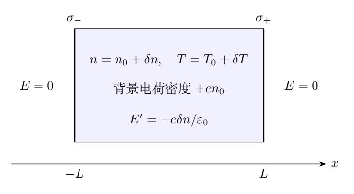
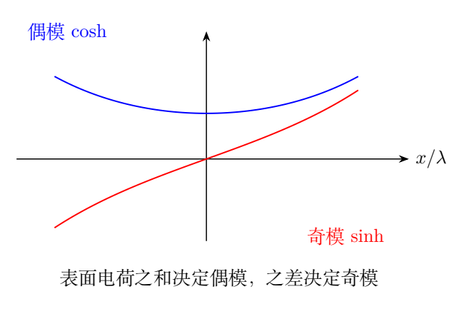

# 第 6 题　温差电效应的经典玩具模型（60分）

厚度$2L$的金属平板占据$-L<x<L$，沿$y,z$无限延展，外部$|x|>L$为真空且电场为零。导电电子视为均匀正电荷背景上的经典理想气体。无温度梯度时电子数密度为$n_0$，正背景电荷密度为$en_0$。

有温度梯度时$T(x)=T_0+\delta T(x)$，$n(x)=n_0+\delta n(x)$，其中$|\delta T|\ll T_0$、$|\delta n|\ll n_0$。板内有小电场$E_x(x)$，表面$x=\pm L$内侧分别有小面电荷密度$\sigma_\pm$。电子质量$m$，电荷$-e$且$e>0$；忽略重力，玻尔兹曼常量$k_B$。

（1）电子粒子流密度$j_x$满足斐克定律

$$
j_x=-D\frac{dn}{dx},\qquad
D=c\frac{\sqrt{T(x)}}{n(x)},
$$

$c$为已知常量。电阻率$\rho$为与$n,T$无关的常量。平衡时扩散电流与电场漂移电流相抵消，求$E_x$。

（2）用高斯定理求电场微分方程；消去电场，求$n$的微分方程及边界条件。真空介电常量$\varepsilon_0$，注意正电荷背景。

（3）只保留小量的一阶项，求$\delta n(x)$，可含$\sigma_\pm$。

（4）电子气在每处局域热平衡，且薄层电子气受电场力仍宏观力学平衡。导出$\delta T$的方程、线性化并求解。

（5）求

$$
S=\frac{U(L)-U(-L)}{T(L)-T(-L)}.
$$

原题附注：真实金属的温差电效应须考虑电子量子效应，本题简化经典模型不适用于真实情况。

## 一、题型定位

本题是耦合输运、静电与局域力学平衡的边值问题。需要联立三类关系：零净电流给电场和密度梯度的关系，高斯定理给电场与电荷分布的关系，理想气体压强梯度平衡给温度与密度的关系。

全题没有电子的惯性运动方程。局域电子气处于宏观力学平衡，电子质量$m$不会显式出现在最终公式中；这并非漏项，而是现象学扩散参数$c$和电阻率$\rho$已作为已知输入。

最容易混淆的是电子粒子流与电流的方向。电子带负电，扩散粒子流乘$-e$才是扩散电流。另一个难点是两侧边界符号：外部电场为零，但内部左右端的电场并不都是$\sigma/\varepsilon_0$。

## 二、知识点

### 1. 三种密度与两个流

电子数密度$n$是粒子数每单位体积，电子电荷密度$-en$，总电荷密度还包括背景：

$$
\rho_{\rm ch}=en_0-en=-e\delta n.
$$

本题$\rho$单独表示电阻率，不能与$\rho_{\rm ch}$混用。扩散粒子流$j_x=-Dn'$，扩散电流$J_{\rm diff}=-ej_x=eDn'$。漂移电流$J_{\rm drift}=E_x/\rho$。

零净电流不是零扩散流。平衡时两种电流可以分别非零而互相抵消，这就是形成内部电场的原因。

### 2. 平面高斯定理与表面跃变

板内平面一维对称，故

$$
\frac{dE_x}{dx}=\frac{\rho_{\rm ch}}{\varepsilon_0}.
$$

跨面电荷层，电场的有向跃变满足$E_{\rm right}-E_{\rm left}=\sigma/\varepsilon_0$。在右表面，右侧真空为零；在左表面，左侧真空为零，因此符号相反。

### 3. 线性化规则

把$\delta n,\delta T,E,\sigma_\pm$都视为同阶小量。背景$n_0,T_0$为空间常数。展开

$$
\frac{\sqrt T}{n}
=\frac{\sqrt{T_0}}{n_0}
\left(1+\frac{\delta T}{2T_0}
-\frac{\delta n}{n_0}+\cdots\right).
$$

它乘$n'=\delta n'$时，括号中两个修正项均与$\delta n'$相乘，属于二阶，须删去。因此一阶电场只需要背景系数$\sqrt{T_0}/n_0$。

线性化是按小量阶数删项，不是把所有位置依赖统统替换成常数。$\delta n'$、$\delta T'$仍是必须保留的一阶变量。

### 4. 压强平衡

局域理想气体压强

$$
p=nk_BT.
$$

薄层单位体积所受电力为$-enE_x$。压强力为$-p'$，所以静力平衡

$$
p'=-enE_x.
$$

左、右表面的压强作用方向必须相反；若把压强梯度的符号反写，会改变最终Seebeck系数。

## 三、物理图像

电子由密度高处向低处扩散，产生电子数流。由微小电荷分离形成的电场又驱动漂移，使总电流为零。电子增加的地方总电荷为负，电场斜率为负；电子减少的地方总电荷为正，斜率为正。

由线性方程将得到$\delta n''=\delta n/\lambda^2$。它与简谐振动的负号不同，解是双曲函数而不是正弦函数。$\lambda$是此模型的空间响应长度，不是本卷光学题的波长。

表面电荷之和决定对称的$\cosh$部分，之差决定反对称的$\sinh$部分。两端密度差、温度差和电势差只由奇模决定；偶模影响总内部电荷和平均状态，但对左右端差分相消。

温度不是可随意指定的一条直线。零电流、静电方程和机械平衡共同要求温度与密度的偏离相关。如果还给定两端温度，表面电荷必须随之调整，不能同时任意指定所有边界量。

## 四、解题入口

先写

$$
-ej_x+\frac{E_x}{\rho}=0,
$$

从中求$E_x$。再对它求导，等同于$-e(n-n_0)/\varepsilon_0$，得到密度方程。边界最好先写成电场边界，再代入密度表达式，避免连续两次负号出错。

求解线性密度时，优先用$\cosh,\sinh$而不是两个指数。两端导数条件相加、相减就能直接给出系数，也自然显示偶、奇分量。

最后利用$p'=-enE$与第一问的零流关系消去电场，得到$\delta T'=H\delta n'$。积分常数表示统一温度偏移，应明确选定参考温度；它不会影响两端差分比。

## 五、解析

### （1）零净电流得到内部电场

代$j_x=-c\sqrt T\,n'/n$，

$$
ec\frac{\sqrt T}{n}n'+\frac{E_x}{\rho}=0.
$$

所以

$$
\boxed{E_x=-e\rho c\,\frac{\sqrt T}{n}\frac{dn}{dx}}.
$$

若$n'>0$，电子向负$x$方向扩散，扩散电流沿正$x$；要抵消它，漂移电流和电场需沿负$x$，与负号一致。

这里$c$是扩散系数中的常量，不是第7题的光速。各题符号各自定义，不能跨题套用量纲。

### （2）非线性密度方程

高斯定理给

$$
\boxed{\varepsilon_0E_x'=-e[n(x)-n_0]}.
$$

代入第一问，消去$-e$：

$$
\boxed{
\varepsilon_0\rho c\,
\frac d{dx}\left(\frac{\sqrt T}{n}\frac{dn}{dx}\right)
=n-n_0}.
$$

正背景抵消了均匀电子的$n_0$部分。若右边误写成$n$，即使无温差、无面电荷也会产生非零场，违背初始电中性状态。

### 左右表面的边界符号

左表面外场0、内场$E_x(-L^+)$：

$$
\varepsilon_0E_x(-L^+)=\sigma_-.
$$

右表面内场$E_x(L^-)$、外场0：

$$
\varepsilon_0E_x(L^-)=-\sigma_+.
$$

因此密度边界为

$$
\boxed{
-\varepsilon_0e\rho c
\left.\frac{\sqrt T}{n}n'\right|_{-L}=\sigma_-},
$$

$$
\boxed{
-\varepsilon_0e\rho c
\left.\frac{\sqrt T}{n}n'\right|_{L}=-\sigma_+}.
$$

同时，由高斯方程积分：

$$
\sigma_-+\sigma_+-e\int_{-L}^L[n(x)-n_0]\,dx=0.
$$

这就是整体电中性。它由两侧真空场均零保证，不是第三个独立边界条件。

### （3）线性化与空间尺度

只保留一阶项，密度方程变成

$$
\varepsilon_0\rho c\frac{\sqrt{T_0}}{n_0}\,
\delta n''=\delta n.
$$

定义

$$
\boxed{
\lambda^2=\frac{\varepsilon_0\rho c\sqrt{T_0}}{n_0}},
\qquad \lambda>0.
$$

于是

$$
\boxed{\delta n''=\frac{\delta n}{\lambda^2}}.
$$

令背景扩散系数$D_0=c\sqrt{T_0}/n_0$，则$\lambda^2=\varepsilon_0\rho D_0$。$\varepsilon_0\rho$有时间量纲，乘扩散系数得到长度平方，是一个方便的量纲检查。

线性电场

$$
E_x=-\frac{e\lambda^2}{\varepsilon_0}\delta n'.
$$

边界条件化为

$$
\delta n'(-L)=-\frac{\sigma_-}{e\lambda^2},
\qquad
\delta n'(L)=\frac{\sigma_+}{e\lambda^2}.
$$

### 求双曲函数系数

通解

$$
\delta n=A_1\cosh(x/\lambda)+B_1\sinh(x/\lambda).
$$

代入两端导数：

$$
\begin{aligned}
-A_1\sinh(L/\lambda)+B_1\cosh(L/\lambda)
&=-\frac{\sigma_-}{e\lambda},\\
A_1\sinh(L/\lambda)+B_1\cosh(L/\lambda)
&=\frac{\sigma_+}{e\lambda}.
\end{aligned}
$$

相减、相加给

$$
A_1=\frac{\sigma_++\sigma_-}{2e\lambda\sinh(L/\lambda)},
\quad
B_1=\frac{\sigma_+-\sigma_-}{2e\lambda\cosh(L/\lambda)}.
$$

故

$$
\boxed{
\begin{aligned}
\delta n(x)=\frac1{2e\lambda}\bigg[
&(\sigma_++\sigma_-)\frac{\cosh(x/\lambda)}{\sinh(L/\lambda)}\\
&+(\sigma_+-\sigma_-)\frac{\sinh(x/\lambda)}{\cosh(L/\lambda)}
\bigg].
\end{aligned}}
$$

当$L>0$时分母均非零，给定$\sigma_\pm$有唯一密度解。双曲函数解与参考解答的两个指数形式等价，但能更直接读出对称性。

### 整体电中性的独立检验

奇模积分为零，偶模积分给

$$
\int_{-L}^L\delta n\,dx
=2A_1\lambda\sinh(L/\lambda)
=\frac{\sigma_++\sigma_-}{e}.
$$

故内部净电荷$-e\int\delta n\,dx$正好抵消表面电荷之和。若系数少了2或边界符号错误，这一步一般不能通过。

若$\sigma_+=-\sigma_-$，密度只有奇模，内部总净电荷为零，但局域正、负电荷仍可以分别存在，产生内部电场和两端电势差。

### （4）电子气机械平衡与温度方程

薄层单位面积的压力合力为$-p'dx$，电力为$-enE_xdx$。平衡给$p'=-enE_x$。利用$p=nk_BT$，

$$
k_B(nT'+Tn')=-enE_x.
$$

代入第一问电场：

$$
k_B(nT'+Tn')=e^2\rho c\sqrt T\,n'.
$$

所以非线性温度方程为

$$
\boxed{
T'=\left(\frac{e^2\rho c}{k_B}\sqrt T-T\right)\frac{n'}n}.
$$

该式与密度非线性方程共同构成模型。它并非热传导方程，也没有使用傅里叶热流定律；本题给的是局域力学平衡，不是稳态热流的完整能量输运模型。

### 线性温度解与参考温度

将压力方程线性化：

$$
k_B(n_0\delta T'+T_0\delta n')
=-en_0E_x.
$$

再代线性电场，得到

$$
\delta T'=H\delta n',
\qquad
H=\frac{e^2\rho c\sqrt{T_0}/k_B-T_0}{n_0}.
$$

因此一般解

$$
\boxed{\delta T(x)=H\delta n(x)+C_T}.
$$

$C_T$为空间常数，表示温度的统一偏移，须由温度基准或一个温度边界指定。小量条件本身不能单独确定它。按参考解答采用$\delta T$与$\delta n$共同归零的基准，取$C_T=0$，可写

$$
\boxed{
\delta T(x)=
\frac{T_0}{n_0}
\left(\frac{e^2\rho c}{k_B\sqrt{T_0}}-1\right)\delta n(x)}.
$$

再将上一问的双曲函数解代入，即为完整温度分布。若温度基准另有规定，只需加上相应$C_T$，密度、电场和两端差值在一阶近似下不受这个常数影响。

对$x$再求导还有

$$
\delta T''=\frac{H}{\lambda^2}\delta n
=\frac{\delta T-C_T}{\lambda^2}.
$$

最后一步在$H=0$时需谨慎：此时$\delta T'=0$，只能得到均匀温度偏移，不存在此一阶模型支持的非零温差。

### （5）用两端差分求Seebeck系数

定义正方向为右端减左端。由$U'=-E_x$，

$$
\Delta U=-\int_{-L}^LE_x\,dx
=\frac{e\lambda^2}{\varepsilon_0}
[\delta n(L)-\delta n(-L)].
$$

令$K=e\lambda^2/\varepsilon_0=e\rho c\sqrt{T_0}/n_0$，则

$$
\Delta U=K\Delta n,\qquad
\Delta T=H\Delta n.
$$

只要$\Delta T\neq0$，

$$
\boxed{
S=\frac KH
=\left(\frac e{k_B}-\frac{\sqrt{T_0}}{e\rho c}\right)^{-1}}.
$$

这个式子中$e/k_B$不可漏掉$k_B$，括号量纲为$\mathrm{K/V}$，求倒数才是$\mathrm{V/K}$。单凭字母外观容易把它误抄成$e$，必须做量纲检查。

### 用表面电荷显式表示差值

由奇模，

$$
\Delta n=
\frac{\sigma_+-\sigma_-}{e\lambda}
\tanh(L/\lambda).
$$

所以

$$
\boxed{\Delta U=
\frac{\lambda}{\varepsilon_0}
(\sigma_+-\sigma_-)\tanh(L/\lambda)},
$$

$$
\boxed{\Delta T=
\frac{H}{e\lambda}
(\sigma_+-\sigma_-)\tanh(L/\lambda)}.
$$

两式相除，面电荷差与几何因子同时消掉。Seebeck系数不显含厚度，并不意味着电势差也不含厚度；厚度影响$\Delta U$与$\Delta T$的共同幅度。

若$\sigma_+=\sigma_-$，两端差值都为零，此时$0/0$不能直接算作实际测得的$S$。上述公式表示在非零奇模扰动下的线性响应比。

### 特殊参数与适用性检验

令无量纲参数

$$
\chi=\frac{e^2\rho c}{k_B\sqrt{T_0}}.
$$

则$H=T_0(\chi-1)/n_0$，且

$$
S=\frac{k_B}{e}\frac{\chi}{\chi-1}.
$$

$\chi>1$时该模型的$S$为正，$0<\chi<1$时为负。$\chi=1$使一阶温差为零，形式上的$S$发散说明当前比值不再可用，不是模型预言可制造无限电压。

最后须检查整个区间内$|\delta n|/n_0\ll1$与$|H\delta n+C_T|/T_0\ll1$。给出的表面电荷若过大，即使双曲函数数学解存在，也不符合线性模型。

厚板$L\gg\lambda$时，密度偏离主要集中在两表面附近；薄板$L\ll\lambda$时，$\tanh(L/\lambda)\simeq L/\lambda$，两端电势差近$(\sigma_+-\sigma_-)L/\varepsilon_0$。两种极限都可用作解的检查。

## 六、关键洞察

零净电流约束负责建立电场，静电方程负责空间分布，力学平衡负责温度与密度关联。每一条方程有不同物理来源，应避免把它们都称作“平衡方程”而不说明平衡的对象。

双曲函数的奇偶结构使问题解耦：表面电荷和控制整体电中性，表面电荷差控制两端测量。最终$S$不依赖具体边界电荷，正是两种端差由同一奇模产生。

参考解答将温度积分常数取零，是温度基准的选择。保留$C_T$再求端差，既不改变参考答案，也能让学生看清哪些量需额外边界条件才能确定。

## 七、易错点

扩散流是粒子数流，不能直接与$E/\rho$相加，须先乘$-e$。高斯定理不能只计电子负电荷，否则背景态不再电中性。

两表面的边界负号不同，推荐始终写“右侧场减左侧场”。把$\delta n''=\delta n/\lambda^2$误解成简谐振动，会得到正弦函数而无法满足真实指数响应。

线性化时保留$\delta T\,\delta n'$却删去$\delta n'$，是阶数判断颠倒。Seebeck系数的量纲尤其适合检查漏掉的$k_B$。

## 八、课堂讲解建议

先列三行物理方程，标注未知量$n,T,E$，再讲消元顺序。边界条件单独用两张小高斯盒图讨论，确认$\sigma_-$和$\sigma_+$的符号。

密度通解用$\cosh,\sinh$讲解，并让学生独立验证电中性积分。温度积分常数放在端差计算前讨论，说明无温度边界时哪些部分仍可确定。

该题适合分成两课时或一堂长课。评价重点是流方向、背景电荷、线性化阶数、边界与端差消元；真实材料的量子输运不在本题模型内，保留原题附注即可。

## 九、变式训练

### 变式1　反对称表面电荷

设$\sigma_+=\sigma,\sigma_-=-\sigma$，求密度、电场和两端电势差。

**解答：**偶模为零，

$$
\delta n=\frac{\sigma}{e\lambda}
\frac{\sinh(x/\lambda)}{\cosh(L/\lambda)},
$$

$$
E_x=-\frac{\sigma}{\varepsilon_0}
\frac{\cosh(x/\lambda)}{\cosh(L/\lambda)}.
$$

两端场均为$-\sigma/\varepsilon_0$，符合左右不同表面电荷的边界。$\Delta U=2\sigma\lambda\tanh(L/\lambda)/\varepsilon_0$。内部总净电荷为零，但场不为零；零总电荷不等于处处电中性。

### 变式2　给定温差反求面电荷

仍取$\sigma_+=-\sigma_-=\sigma$，$H\neq0$，规定$\Delta T$并采用奇对称温度基准，求$\sigma$及电势差。

**解答：**

$$
\Delta T=\frac{2H\sigma}{e\lambda}\tanh(L/\lambda),
\quad
\sigma=\frac{e\lambda\Delta T}{2H\tanh(L/\lambda)}.
$$

电势差$\Delta U=S\Delta T$。若$H$很小，为保持固定温差所需$\sigma$很大，可能违反小量条件；这说明接近$\chi=1$时不能不检查线性化就使用比值公式。

### 变式3　有限振幅的温度—密度关系

不作线性化，只使用零净电流与局域压强平衡。令$a_T=e^2\rho c/k_B$，给定某点$n=n_r,T=T_r$，求$T(n)$。

**解答：**温度方程$T'=(a_T\sqrt T-T)n'/n$。令$Y=\sqrt T>0$，有

$$
2Y'=(a_T-Y)\frac{n'}n.
$$

积分得

$$
\boxed{\sqrt T=a_T+(\sqrt{T_r}-a_T)\sqrt{\frac{n_r}{n}}}.
$$

右边需保持正，才能代表所取平方根。以$n_r=n_0,T_r=T_0$作一阶展开，得到$\delta T=H\delta n$，验证线性系数。该关系尚需与非线性高斯方程联立，不能单独确定空间分布。

### 变式4　对称表面电荷与零温差

设$\sigma_+=\sigma_-=\sigma$，求$\delta n$、内部净电荷与两端差值。

**解答：**

$$
\delta n=\frac{\sigma}{e\lambda}
\frac{\cosh(x/\lambda)}{\sinh(L/\lambda)}.
$$

内部净电荷为$-2\sigma$每单位面积，正好抵消两表面$2\sigma$。$E_x$为奇函数，$\delta n,\delta T$在取共同基准时为偶函数，所以$\Delta U=\Delta T=0$。不能将这个实验直接用于测$S$，因为没有非零温差；应加反对称扰动后再测响应比。
