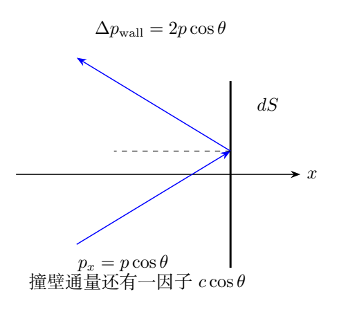
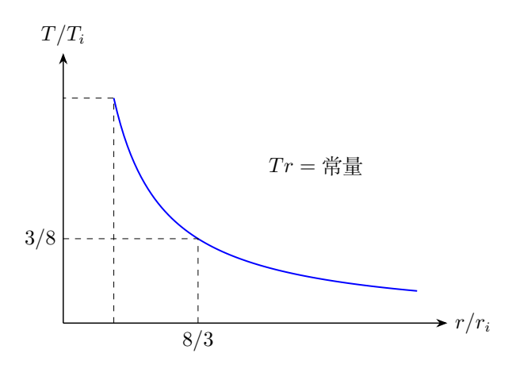

# 第 7 题　超相对论经典气体与火球膨胀（40分）

大型强子对撞机的高能铅核—铅核碰撞，早期产物可视为高温“火球”。本题只考虑其中静止质量很小、速度接近光速的夸克，忽略其他组分。夸克视为质点，除相互碰撞的瞬间外无相互作用，碰撞中粒子数守恒，速度分布各向同性。

温度$T$时，动量大小区间$[p,p+dp]$的粒子分布比率正比于

$$
e^{-E/(k_BT)}\,4\pi p^2\,dp.
$$

玻尔兹曼常量$k_B$、气体常量$R$视为已知。

（1）导出模型中压强$P$与平均能量密度$u$的关系。

（2）导出$P$、粒子数密度$n$、温度$T$之间的状态方程。

（3）求定体摩尔热容$C_V$和热容比$\gamma=C_P/C_V$。

（4）火球近似球形，初始半径$3.0\times10^{-15}\,\mathrm m$，温度$400\,\mathrm{MeV}/k_B$。膨胀降温至$150\,\mathrm{MeV}/k_B$时，夸克开始束缚为质子和中子。按准静态绝热过程近似，求刚开始形成核子时的火球半径。

## 一、题型定位

本题用动力学与统计分布共同建立热力学。第一问不需知道能量分布的具体形式，只需各向同性与$E\simeq pc$；第二问才使用玻尔兹曼权重求平均能量。第三、四问在粒子数守恒条件下连接到热容与绝热过程。

此处不能直接使用普通单原子气体的$C_V=3R/2$。三维平动并不总意味着每粒子能量$3k_BT/2$；这个结果依赖能量是动量的二次函数。超相对论近似下$E=pc$为一次函数，平均能量变为$3k_BT$。

本题是给定假设下的经典模型。粒子数守恒、玻尔兹曼分布和忽略其他组分是必须保留的条件，不能将真实高能碰撞中的全部物质组成和反应过程额外带入计算。

## 二、知识点

### 1. 压强是法向动量通量

考虑垂直$x$方向的器壁。粒子碰壁时法向动量反号，传给壁的动量为$2p_x$。但在时间$dt$内能撞壁的粒子数还正比于法向速度$v_x$。因此压强平均包含$p_xv_x$，不是只平均$p_x$。

各向同性给

$$
\langle p_xv_x\rangle
=\frac13\langle\boldsymbol p\cdot\boldsymbol v\rangle.
$$

所以

$$
P=\frac n3\langle pv\rangle.
$$

超相对论粒子$v\simeq c,E\simeq pc$，故$pv\simeq E$。

### 2. 动量空间球壳的态数因子

三维动量空间中，半径$p$、厚度$dp$的球壳体积为$4\pi p^2dp$。因此概率密度不仅含$e^{-E/k_BT}$，还有$p^2$权重。

用$E=pc$转换变量，$dp=dE/c$，得

$$
4\pi p^2dp=\frac{4\pi}{c^3}E^2dE.
$$

归一化时常数$4\pi/c^3$相消，但$E^2$不能删掉。若只按指数分布求平均，会错误得到$k_BT$。

### 3. 阶乘积分

设$a=k_BT>0$，则

$$
\int_0^\infty E^q e^{-E/a}\,dE=q!\,a^{q+1}
$$

对非负整数$q$成立。可由换元$E=a\xi$和分部积分递推证明。积分上限的多项式乘指数趋零，下限在$q>0$时也为零。

### 4. 固定粒子数的热力学

设有$\nu$摩尔粒子，则$N=\nu N_A$保持不变。内能$U=N\bar E$；状态方程$PV=Nk_BT=\nu RT$。热容定义中$\nu$不变：

$$
C_V=\frac1\nu\left(\frac{\partial U}{\partial T}\right)_V,
\qquad
C_P=\frac1\nu\left(\frac{\partial H}{\partial T}\right)_P.
$$

这里$H=U+PV$是焓，不是单粒子能量。经典超相对论气体仍满足$C_P-C_V=R$，但$C_V$的数值与普通单原子气体不同。

## 三、物理图像

撞壁粒子的方向越接近法线，撞壁速度越大，传递的法向动量也越大。两个$\cos\theta$因子相乘，产生$\cos^2\theta$平均。球面各向同性使平均值为$1/3$。

温度升高使典型动量增大，而速度已接近$c$，不能再像低速气体那样把热量主要理解为速度平方增大。粒子的能量和动量继续增加，是超相对论热容与压强的来源。

火球膨胀时对外做功，内能减少、温度下降。模型中$U=3Nk_BT$，同样压强下的单位粒子储能比普通单原子气体更多，所以绝热指数更小、温度随体积下降得更慢。

由于球体体积正比$r^3$，超相对论气体的$TV^{1/3}$守恒恰好化成$Tr$守恒。这个简洁关系来自三维球体几何和$\gamma=4/3$的共同作用。

## 四、解题入口

第一问从$P=(n/3)\langle pv\rangle$入手，立即得到$P=u/3$。第二问单独计算

$$
\bar E=
\frac{\int_0^\infty E^3e^{-E/(k_BT)}\,dE}
{\int_0^\infty E^2e^{-E/(k_BT)}\,dE}.
$$

比值可直接用阶乘积分，也可用分部积分；无需先求完整归一化常数。

第三问用$U=3\nu RT$和$H=4\nu RT$求导。第四问最好从第一定律再推一次绝热关系，而不是只背$TV^{\gamma-1}$，这样可同时确认粒子数和热容在过程内保持不变。

## 五、解析

### （1）从各向同性动量通量求压强

取某组粒子，数密度$n_i$、动量$\boldsymbol p_i$、速度$\boldsymbol v_i$。朝向器壁的一组在$dt$内撞上面积$dS$的粒子数为$n_iv_{ix}dt\,dS$，每粒子传给壁$2p_{ix}$。

把朝壁和背壁两组按各向同性配对，总平均压强可写

$$
P=\sum_i n_i p_{ix}v_{ix}.
$$

各向同性使三个方向贡献相同：

$$
P=\frac13\sum_i n_i\boldsymbol p_i\cdot\boldsymbol v_i.
$$

在$v\simeq c,E\simeq pc$近似下，$\boldsymbol p\cdot\boldsymbol v\simeq E$，于是

$$
P=\frac13\sum_i n_iE_i
=\frac13n\bar E.
$$

定义$u=n\bar E$，得

$$
\boxed{P=\frac u3}.
$$

该关系只要求各向同性和线性色散，不要求特定温度分布。若方向不各向同性，压强应按方向分别计算，不能统一写$u/3$。

### 半球角积分的另一推导

取动量与器壁法线的夹角$\theta\in[0,\pi/2]$。各向同性方向概率经方位角积分后为$\frac12\sin\theta\,d\theta$。若能量概率密度为$f(E)$，则撞壁数

$$
dN=n f(E)dE\,\frac12\sin\theta\,d\theta
\;c\cos\theta\,dt\,dS.
$$

每次传给壁$2(E/c)\cos\theta$，相乘并除$dt\,dS$，得

$$
dP=nE f(E)dE\,\cos^2\theta\sin\theta\,d\theta.
$$

因

$$
\int_0^{\pi/2}\cos^2\theta\sin\theta\,d\theta=\frac13,
$$

积分仍为$P=n\bar E/3$。方向概率中的$1/2$与反弹动量的2正好相消；再额外乘2会把压强错误加倍。

### （2）归一化能量分布

变换到能量变量后，分布正比于$E^2e^{-E/a}$，$a=k_BT$。归一化积分

$$
Z_E=\int_0^\infty E^2e^{-E/a}\,dE=2a^3.
$$

所以

$$
\boxed{f(E)=\frac{E^2}{2(k_BT)^3}e^{-E/(k_BT)}},
\qquad E\geq0.
$$

$f(E)$的量纲为能量的倒数，保证$f(E)dE$无量纲。它不是简单指数分布：低能处有$E^2$压低权重，最概然能量、平均能量也因此不同。

平均能量

$$
\bar E=
\frac{3!a^4}{2!a^3}
=3a,
\qquad \boxed{\bar E=3k_BT}.
$$

若不用阶乘积分，分部积分直接给

$$
\int_0^\infty E^3e^{-E/a}dE
=3a\int_0^\infty E^2e^{-E/a}dE,
$$

边界项为零，同样得到$3a$。

### 状态方程

代第一问，

$$
P=\frac13n(3k_BT),
\qquad \boxed{P=nk_BT}.
$$

它与普通理想气体的压强状态方程形式相同，但能量状态方程不同：

$$
\boxed{u=3nk_BT=3P}.
$$

所以知道$P=nk_BT$并不足以判断热容。还需知道$U(T)$，也就是分布与色散关系的结果。

### 分布的可检验性质

对$f$求导，最大值满足$2/E-1/a=0$，最概然能量为$2k_BT$；平均能量为$3k_BT$，两者不可混同。

二阶矩

$$
\langle E^2\rangle
=\frac{4!a^5}{2!a^3}=12a^2.
$$

故方差

$$
\operatorname{Var}(E)=12a^2-9a^2=3a^2.
$$

这个结果与单粒子热容$3k_B$相容：正则分布中能量涨落与温度响应关联。它可作为归一化和积分指数是否正确的独立检查。

### （3）定体摩尔热容

一摩尔包含$N_A$粒子，$N_Ak_B=R$。其内能

$$
U_m=N_A\bar E=3RT.
$$

因此

$$
\boxed{C_V=\frac{dU_m}{dT}=3R}.
$$

质量很小的静止能在本近似中忽略。若保留一个与温度无关的静止能常数，它不影响热容，但当前$P=u/3$中的$u$应是超相对论近似下的相应能量密度，不能随意加常数仍保留同一关系。

### 定压摩尔热容与热容比

一摩尔状态方程$PV_m=RT$。焓

$$
H_m=U_m+PV_m=3RT+RT=4RT.
$$

因此

$$
\boxed{C_P=4R,\qquad\gamma=\frac{C_P}{C_V}=\frac43}.
$$

定压加热时，除增加内能，还需使体积增大而对外做功，所以$C_P>C_V$。差值为$R$，与理想气体状态方程一致。

不能把“速度约为$c$”理解为没有温度变化因而热容为零。速度趋近上限不等于能量趋近上限；相对论动量仍可以随温度继续增加。

### （4）从第一定律推绝热关系

准静态绝热过程$dQ=0$，

$$
dU=-P\,dV.
$$

固定$N$且$U=3Nk_BT$、$P=Nk_BT/V$，故

$$
3Nk_B\,dT=-Nk_B\frac{T}{V}\,dV.
$$

约去常数并积分：

$$
3\,d\ln T=-d\ln V,
\qquad
\boxed{TV^{1/3}=\text{常量}}.
$$

等价地$PV^{4/3}$为常量，与$\gamma=4/3$一致。需要说明的是，准静态绝热是本题明确给出的近似；实际快速膨胀是否达到这种条件不由此简化模型另行判断。

### 球体半径

$V=4\pi r^3/3$，所以$V^{1/3}$正比$r$，得到

$$
T_ir_i=T_fr_f.
$$

图上初态为$(r/r_i,T/T_i)=(1,1)$，末态温度比为$3/8$，沿$T/T_i=r_i/r$曲线对应半径比$8/3$。读图与下面的代数计算使用同一守恒关系。

温度以$\mathrm{MeV}/k_B$给出，两者取比时单位和$k_B$相消：

$$
r_f=\frac{400}{150}
\left(3.0\times10^{-15}\,\mathrm m\right).
$$

因此

$$
\boxed{r_f=8.0\times10^{-15}\,\mathrm m=8.0\,\mathrm{fm}}.
$$

它大于初始半径，符合膨胀降温。不要把能量单位MeV直接当成温度单位；本题只用温度比，所以无须将其换算为开尔文。

### 全过程的比例检查

体积比

$$
\frac{V_f}{V_i}=\left(\frac83\right)^3=\frac{512}{27}.
$$

粒子数守恒，数密度比$n_f/n_i=27/512$。温度比$T_f/T_i=3/8$，因此压强比

$$
\frac{P_f}{P_i}=\frac{27}{512}\frac38
=\frac{81}{4096}=\left(\frac38\right)^4.
$$

这与$P\propto V^{-4/3}$一致。内能比$U_f/U_i=T_f/T_i=3/8$，减少的内能转化为对外做功：

$$
W_{\rm out}=U_i-U_f=\frac58U_i.
$$

如果算出的压力仅按$T$同比缩小，便遗漏了膨胀导致的数密度减少。

### 熵形式的交叉验证

固定粒子数时

$$
dS=\frac{dU+P\,dV}{T}
=3Nk_B\frac{dT}{T}+Nk_B\frac{dV}{V}.
$$

因此两个状态间

$$
\Delta S=Nk_B\left[3\ln\frac{T_f}{T_i}
+\ln\frac{V_f}{V_i}\right].
$$

代$V_f/V_i=(T_i/T_f)^3$恰为零，验证可逆准静态绝热关系。若过程有熵产生，则不能由同一等式推半径；本题已指定采用准静态绝热近似。

### 与普通气体和辐射的比较

普通低速单原子气体有$E=p^2/(2m)$，平均能量$3k_BT/2$，$\gamma=5/3$。超相对论经典粒子有$E=pc$，平均能量$3k_BT$，$\gamma=4/3$。相同的空间维度可以对应不同热容，区别在色散关系。

光子气体也常见$P=u/3$，但其平衡粒子数通常不守恒，状态方程不能直接写成固定粒子数的$PV=Nk_BT$。本题必须按给定的守恒经典粒子模型推导摩尔热容，不能借辐射公式替代。

## 六、关键洞察

压强关系$P=u/3$与温度关系$\bar E=3k_BT$来自不同假设。前者只用各向同性和$E=pc$，后者还用玻尔兹曼分布；把两步区分开，有助于识别条件改变时哪一个结论仍有效。

能量为动量一次函数时，每个动量尺度给出$k_BT$量级储能，三维得到$3k_BT$。这与二次型能量的能量均分结果不同，不能通过“自由度数不变”强行沿用$3k_BT/2$。

绝热半径来自两条事实：固定粒子数导致$TV^{1/3}$守恒，球体几何导致$V^{1/3}\propto r$。只记住$Tr$常量会掩盖这两个条件。

### 为什么不同色散仍可有相同理想气体压强

对于任意单调能量函数$E(p)$，在经典玻尔兹曼分布和无相互作用条件下，速度为$v=dE/dp$。压强可写成

$$
P=\frac n3
\frac{\int_0^\infty p^3E'(p)e^{-E(p)/(k_BT)}dp}
{\int_0^\infty p^2e^{-E(p)/(k_BT)}dp}.
$$

由

$$
\frac d{dp}e^{-E/(k_BT)}
=-\frac{E'}{k_BT}e^{-E/(k_BT)},
$$

对分子分部积分，边界项$p^3e^{-E/(k_BT)}$在0和无穷远均为零，便有

$$
\int_0^\infty p^3E'e^{-E/(k_BT)}dp
=3k_BT\int_0^\infty p^2e^{-E/(k_BT)}dp.
$$

因此$P=nk_BT$可以不依赖具体色散。平均能量却仍由$E(p)$决定，所以热容和绝热关系保留了微观能量结构的信息。这一推导能解释为什么两种气体压力式相同而热容不同，也给出了比较不同气体模型的方法。

若粒子存在相互作用、非经典占据或粒子数改变，上述分布与积分条件可能变化。不能因为本题得到熟悉的理想气体形式，就认为所有高温物质都自动满足相同的摩尔热力学。

### 从压强、内能和熵分别检查模型

教学中可要求学生拿三个结果互相检验：$P=u/3$说明能量—动量关系；$u=3nk_BT$说明统计分布；$dS=3Nk_Bd\ln T+Nk_Bd\ln V$说明固定粒子数的热力学。三者中任意一个若系数少了2或3，绝热关系一般不能闭合。

例如，把平均能量错算成$k_BT$却保留$P=u/3$，将得到$P=nk_BT/3$，立即与直接积分的压强不符。把内能错写成$3Nk_BT/2$但仍保留$P=nk_BT$，则会得到$\gamma=5/3$，与能量分布不符。

这种交叉检查比只把最终半径与参考答案比较更能定位错误。即使半径因两个错误恰好抵消而相同，三条物理关系仍会暴露推导的不一致。

## 七、易错点

压强角平均只写一个$\cos\theta$会漏掉撞壁通量因子。积分概率只保留$e^{-E/k_BT}$会漏掉动量空间球壳权重，导致平均能量少三倍。

从$P=nk_BT$直接推$\gamma=5/3$，是把状态方程与内能公式混淆。将摩尔内能、总内能和单位体积能量混用，容易在$N_A,n,V$之间多乘或少乘一次。

最后用$T_ir_i^3=T_fr_f^3$会把$\gamma-1=1/3$漏掉，给出错误半径。结果检查时应同时计算体积、密度和压强比例。

## 八、课堂讲解建议

先从单个斜入射粒子的动量交换出发，画出两个余弦因子的来源，再做半球角积分。随后以比值积分求平均能量，这样归一化常数在分子、分母中相消。

把非相对论与超相对论两列并排，只比较$E(p)$、$\bar E$、$C_V$和$\gamma$。让学生看到$PV=Nk_BT$相同，却有不同绝热规律。

最后用第一定律、$\gamma$公式和熵差三种方法交叉验证同一绝热关系。课堂评价重点是条件、态数权重与单位，不需要引入题外的真实碰撞组分。

## 九、变式训练

### 变式1　任意空间维度

在$d$维空间中，经典粒子仍满足$E=pc$、各向同性和粒子数守恒。求平均能量、压强关系、摩尔热容和绝热指数。

**解答：**动量壳权重为$p^{d-1}dp$，所以能量分布正比$E^{d-1}e^{-E/a}$，平均能量为$da$。各方向平均给$P=u/d$，因此仍有$P=nk_BT$。

$$
C_V=dR,\quad C_P=(d+1)R,\quad\gamma=1+\frac1d.
$$

准静态绝热$TV^{1/d}$守恒。若几何各向同性、体积正比特征尺度$r^d$，仍有$Tr$守恒。原题为$d=3$。

### 变式2　一般幂律色散

三维经典理想粒子满足$E=ap^s$，$a,s>0$，速度$v=dE/dp$，粒子数守恒。求$P/u$、平均能量、$C_V$与$\gamma$。

**解答：**$pv=sE$，故$P=su/3$。变量转换$p^2dp\propto E^{3/s-1}dE$，平均能量$(3/s)k_BT$。于是$P=nk_BT$，

$$
C_V=\frac3sR,\quad
\gamma=1+\frac s3.
$$

$s=1$恢复原题，$s=2$得到普通非相对论平动气体。球形绝热过程满足$Tr^s$守恒；因此对于$s=2$，相同温度比下的半径比为$\sqrt{400/150}$，与原题不同。

### 变式3　两类粒子的混合气体

固定总粒子数，比例$f$为超相对论经典粒子，比例$1-f$为普通单原子经典粒子，二者共温、无化学转化。求按总摩尔数计的热容与$\gamma$。

**解答：**总压强仍为$n k_BT$。每粒子平均能量

$$
\bar E=\left[3f+\frac32(1-f)\right]k_BT
=\frac32(1+f)k_BT.
$$

故$C_V=\frac32(1+f)R$，$C_P=C_V+R$，

$$
\gamma=1+\frac{2}{3(1+f)}.
$$

$f=0,1$分别给$5/3,4/3$。若$f$随温度变化，还需包含组分变化的能量贡献，不能使用这个固定比例公式。

### 变式4　可逆等温膨胀

一摩尔本题气体在温度$T$下可逆等温膨胀，体积增为原来的$q>1$倍。求做功、吸热、内能变化和熵变。

**解答：**$U_m=3RT$只随温度，故$\Delta U=0$。由$P=RT/V$，

$$
W_{\rm out}=RT\ln q,\quad
Q=W_{\rm out},\quad
\Delta S=R\ln q.
$$

这些等温量与普通理想气体形式相同；差别在温度变化过程的热容和绝热指数。该变式再次说明同一压强状态方程可以对应不同的内能结构。
