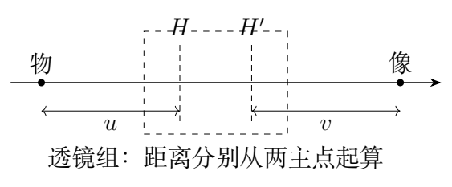
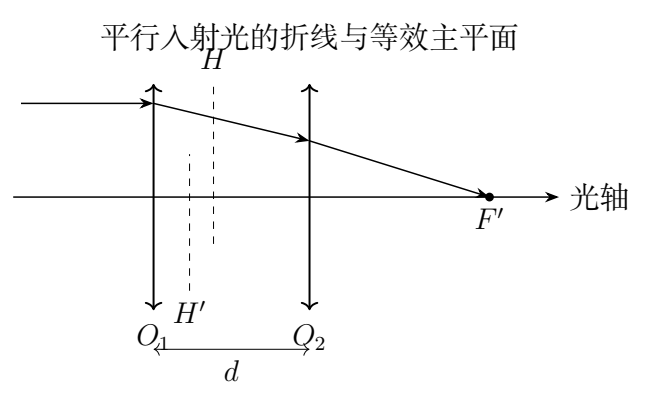

# 第 1 题　手机镜头的等效焦距与主点（40分）

手机镜头由多个光学元件组成，图像传感器能记录物体的像，借助软件可读出像的实际尺寸。将镜头视为结构固定的共轴理想透镜组，可把物像关系等效为一个凸透镜，使用薄透镜成像公式计算。但物距、像距与焦距的起点分别为光轴上的物方主点 $H$ 和像方主点 $H'$，这些主点不必与某个透镜的光心重合。本题所有光路均满足近轴条件。

（1）主点封装在镜头内部，位置未知，无法直接测量物距。沿光轴移动一段与光轴垂直、长为 $l$ 的刻度尺，在物距 $u_1,u_2$ 处分别成像，测得移动距离 $s=u_2-u_1$ 和对应像长 $l_1,l_2$。求：（i）等效焦距 $F$；（ii）物距 $u_1$。结果均用 $l,l_1,l_2,s$ 表示。

（2）透镜组由焦距分别为 $f_1,f_2$ 的共轴薄透镜组成，光心为 $O_1,O_2$，间距 $d$。物经两透镜成像时，存在横向放大率为 $+1$ 的一对物面和像面，称为主平面，其与光轴的交点为 $H,H'$。（i）将 $H$ 看作透镜1的“物”，求它相对 $O_1$ 的物距；将 $H'$ 看作透镜2的“像”，求它相对 $O_2$ 的像距。（ii）物方距离从 $H$ 起算，像方距离从 $H'$ 起算，求物方焦距 $F$ 和像方焦距 $F'$。

## 一、题型定位

这是几何光学中的间接测量和复合光学系统问题。前半部分利用两次放大率消去未知主点位置；后半部分利用逐级成像或近轴光线矩阵，把两个透镜合成一个具有两主平面的等效系统。

使用透镜公式前，先确定各段距离从哪里量起。镜头外壳到刻度尺的距离，不等于从主点到刻度尺的物距。两次位置之差却不受这个固定偏移影响，所以能用于消元。

## 二、知识点

薄透镜公式与带符号横向放大率为

$$\frac1u+\frac1v=\frac1f,\qquad m=-\frac vu.$$

在本题的实物、实像测量中，$u,v,F>0$；像倒立，故像长与物长之比是 $|m|$。第二问允许虚物、虚像，此时仍用同一公式，但虚物的物距、虚像的像距取负。

平行光的会聚位置给出焦点；焦点与主点之间的距离才是有效焦距。主平面之间的放大率为 $+1$，不等于说任意物体经过镜头都放大一倍。

## 三、物理图像

传感器固定，调焦由系统内部结构或成像位置决定；本问将两次成像作为已实现的理想物像关系。物体离镜头更远时，实像通常更小。按 $s>0$ 的约定，应有 $l_1>l_2$。这是计算前即可做的方向检查。

两个主点把透镜组对光线的作用分成三步：从入口平移到物方主平面，在等效薄透镜处改变光线斜率，再从像方主平面平移到出口。主点可能位于镜头内部，也可能在镜头外部；这并不意味着那里另有一个真实折射面。

## 四、解题入口

第一问先用 $v_i/u_i=l_i/l$ 把 $v_i$ 消掉，分别求 $u_1,u_2$，再相减。第二问暂用 $U_1,V_1,U_2,V_2$ 表示两个单透镜的物像距，避免和第一问的两次物距混淆。先写 $U_2=d-V_1$，再把总放大率设为1。焦距最后从平行光成像位置减去主点位置求得。

## 五、解析

### 1　第一次成像：把像距换成可测的放大率

设第一次像距为 $v_1$。像长给出

$$\frac{v_1}{u_1}=\frac{l_1}{l},\qquad v_1=\frac{l_1}{l}u_1.$$

将它代入成像公式：

$$\frac1{u_1}+\frac{l}{l_1u_1}=\frac1F.$$

把左侧合并，再取倒数，得

$$\boxed{u_1=F\left(1+\frac l{l_1}\right).}$$

这里无需知道 $H$ 在外壳内的位置。$u_1$ 是理论上从 $H$ 起算的距离，测量信息通过放大率进入方程。

第二次成像同理：

$$u_2=F\left(1+\frac l{l_2}\right).$$

### 2　利用移动距离消去主点位置

由于镜头结构固定，两次测量的 $H$ 相同，故实际移动距离就是物距差：

$$s=u_2-u_1=Fl\left(\frac1{l_2}-\frac1{l_1}\right).$$

解得

$$\boxed{F=\frac{s\,l_1l_2}{l(l_1-l_2)}.}$$

再代回第一次物距：

$$u_1=\frac{s\,l_1l_2}{l(l_1-l_2)}\frac{l_1+l}{l_1},$$

即

$$\boxed{u_1=\frac{s\,l_2(l_1+l)}{l(l_1-l_2)}.}$$

同样得到

$$u_2=\frac{s\,l_1(l_2+l)}{l(l_1-l_2)}.$$

直接相减可检验 $u_2-u_1=s$，这是一项独立于成像代入的代数检查。焦距表达式中 $l_1l_2/[l(l_1-l_2)]$ 无量纲，结果与 $s$ 同量纲。

若 $l_1=l_2$ 而 $s\ne0$，这些数据不符合结构固定、近轴理想成像的模型；不能把分母为零解释为焦距“测得无穷大”。若两次位移也为零，则只是重复同一次观测，没有获得新的约束。

### 3　用一组数据检查物像位置

例如，$l=20.0\,\mathrm{mm}$，$l_1=2.00\,\mathrm{mm}$，$l_2=1.00\,\mathrm{mm}$，$s=60.0\,\mathrm{mm}$。逐步代入为

$$F=\frac{60.0\times2.00\times1.00}{20.0\times1.00}\,\mathrm{mm}
=6.00\,\mathrm{mm},$$

$$u_1=6.00(1+10.0)=66.0\,\mathrm{mm},$$

$$u_2=6.00(1+20.0)=126\,\mathrm{mm}.$$

对应像距为

$$v_1=\frac{l_1}{l}u_1=6.60\,\mathrm{mm},\qquad
v_2=\frac{l_2}{l}u_2=6.30\,\mathrm{mm}.$$

两次物距相差60.0 mm，但像距只变了0.30 mm。远物成像时像距接近焦距，这与手机镜头的尺寸尺度相容。这个例子说明“物像两侧距离都改变”不妨碍用固定主点消元。

### 4　两透镜的逐级成像与总放大率

第一片透镜满足

$$\frac1{U_1}+\frac1{V_1}=\frac1{f_1},\qquad
V_1=\frac{f_1U_1}{U_1-f_1}.$$

第一片的像作为第二片的物，几何关系是

$$U_2=d-V_1=d-\frac{f_1U_1}{U_1-f_1}.$$

当 $V_1>d$，第一片的像落在第二片右侧，光线到达第二片时尚在会聚，因此 $U_2<0$，它是第二片的虚物。把这一情形强行换成正的距离，会破坏光路的连续性。

对任一单透镜，由 $m_i=-V_i/U_i$ 和成像公式，有

$$\frac1{m_i}=1-\frac{U_i}{f_i}.$$

总放大率 $m=m_1m_2$，于是

$$\frac1m=\left(1-\frac{U_1}{f_1}\right)
\left(1-\frac{U_2}{f_2}\right).$$

将 $U_2$ 代入，先化简会消去 $U_1-f_1$：

$$\begin{aligned}
\frac1m
&=\left(1-\frac{U_1}{f_1}\right)
\left(1-\frac d{f_2}+\frac{f_1U_1}{f_2(U_1-f_1)}\right)\\
&=1-\frac d{f_2}-U_1
\left(\frac1{f_1}+\frac1{f_2}-\frac d{f_1f_2}\right).
\end{aligned}$$

### 5　令横向放大率为正一，求主点

对主平面共轭，$m=+1$。令

$$\Phi=\frac1{f_1}+\frac1{f_2}-\frac d{f_1f_2},$$

则上式给出

$$0=-\frac d{f_2}-U_H\Phi.$$

因此

$$\boxed{U_H=\frac{f_1d}{d-f_1-f_2}.}$$

根据光路可逆性，反向观察只须交换1、2，得到

$$\boxed{V_{H'}=\frac{f_2d}{d-f_1-f_2}.}$$

这里 $U_H$ 按物距约定，$V_{H'}$ 按像距约定。若 $f_1,f_2>0$ 且 $d<f_1+f_2$，二者均为负；$H$ 位于 $O_1$ 右侧，$H'$ 位于 $O_2$ 左侧。主点的坐标与有向物像距之间相差一个符号，必须分开说明。

以光向右传播、$O_1$ 为坐标原点，有

$$x_H=-U_H,\qquad x_{H'}=d+V_{H'}.$$

### 6　从平行光求像方焦距

对第一片，$U_1\to\infty$ 时 $V_1=f_1$，故第二片的物距为 $U_2=d-f_1$。最终焦点相对 $O_2$ 的像距为

$$V_{F'}=\frac{f_2(d-f_1)}{d-f_1-f_2}.$$

有效像方焦距应从 $H'$ 起算：

$$\begin{aligned}
F'&=V_{F'}-V_{H'}\\
&=\frac{f_2(d-f_1)-f_2d}{d-f_1-f_2}\\
&=\frac{f_1f_2}{f_1+f_2-d}.
\end{aligned}$$

交换光路方向得到相同的物方焦距，因此

$$\boxed{F=F'=\frac{f_1f_2}{f_1+f_2-d},\qquad
\frac1F=\frac1{f_1}+\frac1{f_2}-\frac d{f_1f_2}.}$$

两端介质相同是 $F=F'$ 的条件；这里镜头两侧均按同一空气环境处理。不能把第二片后的焦点距离 $V_{F'}$ 直接当成 $F'$。

### 7　另一条推导：近轴光线矩阵

用列向量 $(y,\alpha)^{\mathsf T}$ 描述光线高度和近轴斜率。传播距离 $d$ 和薄透镜分别表示为

$$T(d)=\begin{pmatrix}1&d\\0&1\end{pmatrix},\qquad
L(f)=\begin{pmatrix}1&0\\-1/f&1\end{pmatrix}.$$

按光线实际经过的顺序，从右向左乘矩阵：

$$\mathcal M=L(f_2)T(d)L(f_1)
=\begin{pmatrix}
1-d/f_1&d\\
-\Phi&1-d/f_2
\end{pmatrix}.$$

把该矩阵写为主平面形式

$$\mathcal M=T(q)L(F)T(p),$$

其中 $p=x_H$，$q=d-x_{H'}$。比较左下元、左上元和右下元，依次得

$$F=\frac1\Phi,\qquad q=\frac{Fd}{f_1},\qquad
p=\frac{Fd}{f_2}.$$

所以 $U_H=-p$，$V_{H'}=-q$，与逐级成像法完全一致。每个基本矩阵的行列式均为1，因此复合矩阵也应满足 $AD-BC=1$；直接展开可以作为乘法次序和符号的检查。

### 8　特殊极限与测量灵敏度

当 $d=0$，主点回到共同光心，组合光焦度为 $1/f_1+1/f_2$。当第二片的 $f_2\to\infty$，它不再改变斜率，系统焦距回到 $f_1$。当 $d=f_1+f_2$，$\Phi=0$，系统为无焦系统，不具有有限的本题式主点焦距；不能在主点公式中把无穷大当作普通位置。

对第一问的实验式取对数并作小量微分：

$$\frac{\delta F}{F}
=\frac{\delta s}{s}-\frac{\delta l}{l}
-\frac{l_2}{l_1-l_2}\frac{\delta l_1}{l_1}
+\frac{l_1}{l_1-l_2}\frac{\delta l_2}{l_2}.$$

独立随机测量的不确定度应把这些项的方差相加；有共同标尺或像素校准误差时，要保留相关项。$l_1$ 与 $l_2$ 越接近，误差放大越严重，所以移动距离不能选得太小。若 $l,l_1,l_2$ 同乘一个校准比例，三个相对长度项恰好抵消，焦距仍只依赖像长与物长的比值。

## 六、关键洞察

未知主点位置是一个固定偏移，做差后消失；未知焦距决定了两次放大率的变化，不能被做差消掉。第一问实际识别的是这个变化率。

第二问的两主点属于对整个系统的等效描述。它们允许物像公式保持简单，并不表示光在两个主平面之间真实走了一段特殊光路。可用矩阵分解验证等效系统与原系统具有相同的外部物像关系。

## 七、易错点

把像长之比 $l_i/l$ 写成 $u_i/v_i$；漏掉总放大率中的负号；把 $U_2$ 一律当作正数；把焦点到第二片的距离误当有效焦距；把主点坐标和主点的有向物距混为一谈。实验数据中若远物的像反而变大，要先检查 $s$ 和下标约定。

## 八、课堂讲解建议

先遮住镜头内部结构，要求学生只用刻度尺的移动距离和两次像长求焦距，突出间接测量。再用两片透镜逐级成像，专门安排一次虚物情形。最后把矩阵法作为同一结果的压缩表达，比较两种方法对符号和极限的检查。

## 九、变式训练

### 变式1　用三次测量检验镜头模型

刻度尺长 $l$，位置坐标分别为 $x_1,x_2,x_3$，像长分别为 $l_1,l_2,l_3$。主点坐标 $x_H$ 未知，物在主点左侧。给出判断三个数据能否来自同一理想镜头的条件，并求焦距。

解：物距 $u_i=x_H-x_i$，由第一问得

$$x_H-x_i=F\left(1+\frac l{l_i}\right).$$

移项：$x_i=(x_H-F)-Fl/l_i$。因此在横坐标 $1/l_i$、纵坐标 $x_i$ 的图中，三点必须共线，斜率为 $-Fl$。具体条件为

$$\frac{x_2-x_1}{1/l_2-1/l_1}
=\frac{x_3-x_2}{1/l_3-1/l_2}=-Fl.$$

用任意一对求 $F$，再代入第三对检验。带测量误差时应拟合整条直线，而不是要求浮点数严格相等。截距给出 $x_H-F$，因而还可求 $x_H$。

### 变式2　两凸透镜的主点数值

两片凸透镜的焦距为50.0 mm、100 mm，间距20.0 mm。求有效焦距、两主点坐标和像方焦点坐标，$O_1$ 为原点，向右为正。

解：$F=50\times100/(50+100-20)=38.5$ mm。未舍入计算得

$$x_H=\frac{Fd}{f_2}=7.69\,\mathrm{mm},\qquad
x_{H'}=d-\frac{Fd}{f_1}=4.62\,\mathrm{mm}.$$

像方焦点坐标为 $x_{F'}=x_{H'}+F=43.1$ mm。相对第二片的后焦距为23.1 mm，与38.5 mm的有效焦距不同。主点的先后顺序不必与光线传播顺序一致，这组数值仍符合矩阵物像关系。

### 变式3　凸凹组合达到无焦

第一片焦距 $f_1=80\,\mathrm{mm}$，第二片 $f_2=-30\,\mathrm{mm}$。求使系统无焦的间距，及一束平行近轴光入射时输出斜率与输入斜率的关系。

解：无焦要求 $\Phi=0$，故 $d=f_1+f_2=50$ mm。此时矩阵左下元为零，$A=1-d/f_1=3/8$，$D=1-d/f_2=8/3$。对入射斜率 $\alpha$，出射斜率为

$$\alpha'=D\alpha=\frac83\alpha.$$

当轴向平行入射 $\alpha=0$，仍平行出射；斜入射的平行光束也保持内部平行，但方向改变。此处应使用无焦系统的角放大关系，不能继续套有限焦距的成像式。

### 变式4　给定相对误差选择测量间隔

设两次像长的独立相对标准不确定度都为 $\varepsilon$，$s,l$ 的误差可忽略，记 $q=l_2/l_1\in(0,1)$。求焦距的相对标准不确定度；比较 $q=0.9$ 与 $q=0.5$。

解：由灵敏度式，独立方差相加得到

$$\frac{\sigma_F}{F}=\varepsilon\frac{\sqrt{1+q^2}}{1-q}.$$

前一选择给出 $13.5\varepsilon$，后一选择给出 $2.24\varepsilon$。增加像长变化可明显改善测量，但还需保证较小像长仍有足够像素分辨率。若像长误差实际上是固定像素数，两个相对误差并不相等，应重新用各自的 $\sigma_{l_i}$ 计算。

若改为固定像素数的绝对标准误差 $\sigma_{l_1}=\sigma_{l_2}=\sigma_l$，须先把绝对误差转换到各自的相对误差，得到

$$\left(\frac{\sigma_F}{F}\right)^2
=\left[\frac{l_2}{l_1(l_1-l_2)}\right]^2\sigma_l^2
+\left[\frac{l_1}{l_2(l_1-l_2)}\right]^2\sigma_l^2.$$

此时较小的 $l_2$ 会使第二项增大，不能一味把第二个像缩得极小。实验设计需同时避开 $l_1\simeq l_2$ 的差分不稳定和 $l_2\simeq0$ 的像素分辨率不足。

如果像长共用同一个比例校准误差，两项并非独立。应在上式中加入协方差项

$$2\frac{\partial\ln F}{\partial l_1}
\frac{\partial\ln F}{\partial l_2}\,
\operatorname{Cov}(l_1,l_2).$$

两个偏导异号，所以正相关的共同校准误差部分抵消；若物长 $l$ 也共用该校准，还会进一步抵消。先识别误差来源，再写方差关系，比机械地把所有误差绝对值相加更合适。

