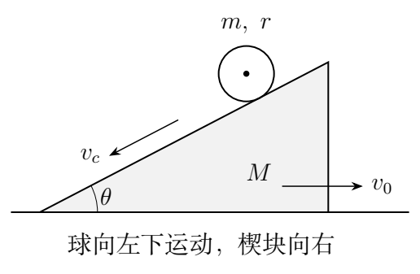
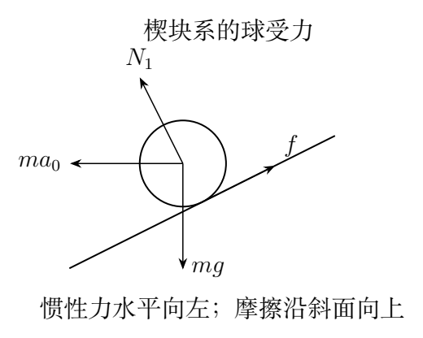

# 第 3 题　可动楔块上的滚动与滑动（40分）

倾角为 $\theta$、质量为 $M$ 的三角形楔块放在光滑水平地面上，其斜面上有质量为 $m$、半径为 $r$ 的均质圆球。圆球从静止开始向下运动，过程中楔块无转动。重力加速度为 $g$，球与楔块间的静摩擦系数和滑动摩擦系数均为 $\mu$。

（1）若 $\mu$ 足够大，圆球无滑动地滚下，求：（i）楔块对地加速度大小 $a_0$；（ii）球质心相对楔块的加速度大小 $a_c$；（iii）地面对楔块的支持力 $N$；（iv）楔块对球的支持力 $N_1$；（v）保持纯滚动所需的最小摩擦系数 $\mu_0$。

（2）若 $\mu<\mu_0$ 且斜面足够长，求从静止开始经过 $\Delta t$ 后，球与楔块接触点 $P$ 相对楔块的速度。

## 一、题型定位

平动、转动与可动约束的耦合动力学。球下落时楔块反向运动，球质心对地加速度与相对楔块加速度不同。摩擦同时影响球的平动和转动，纯滚动只是其中一种可能的运动状态。

本题不能沿用固定斜面上的 $a_c=5g\sin\theta/7$。楔块加速度会通过惯性力改变球的切向加速度，也改变法向支持力。

## 二、知识点

均质实心球的转动惯量为 $I=2mr^2/5$；纯滚动约束为 $v_c=r\dot\varphi$；转动方程为 $I\ddot\varphi=fr$；地面光滑使整体水平方向动量守恒。静摩擦满足 $|f|\le\mu N_1$，滑动摩擦大小才等于 $\mu N_1$。

判断摩擦方向须看接触点的相对速度，而不能仅看质心下坡方向。对正在滑动的球，相对滑动速度为 $v_P=v_c-r\dot\varphi$。

## 三、物理图像

将斜面向下的方向取为切向正方向。原图斜面向左下降，球下坡时楔块向右；为了推导方便，可水平镜像坐标，使下坡向右、楔块向左。以下 $a_0$ 均指楔块向上坡水平一侧的加速度大小，不受这次坐标镜像影响。

楔块系只平动、不转动，球受到水平惯性力 $ma_0$，方向向下坡的水平一侧。该力的切向分量加速下坡运动，法向分量使法向压力减小。摩擦沿斜面向上，为球提供滚动角加速度。

## 四、解题入口

先写三条基本关系：球的切向动力学、转动动力学、整体水平动量守恒。纯滚动时补上 $a_c=r\ddot\varphi$；滑动时改为 $f=\mu N_1$。支持力由法向方程求，地面支持力由整体竖直动力学求。最后始终计算 $v_c-r\dot\varphi$，避免把质心速度当作接触点速度。

## 五、解析

### 1　速度合成与水平动量

按上述镜像后的坐标，地面系水平正方向沿下坡的水平投影。楔块水平速度为 $-v_0$；球质心相对楔块速度为 $v_c$。球的对地速度分量为

$$v_{x,c}=v_c\cos\theta-v_0,\qquad
v_{y,c}=-v_c\sin\theta.$$

球—楔块体系初始水平动量为零，外力没有水平分量，因此

$$m(v_c\cos\theta-v_0)-Mv_0=0.$$

解得

$$\boxed{v_0=\frac{m\cos\theta}{M+m}v_c.}$$

由于斜面角度固定，对时间微分得

$$\boxed{a_0=\frac{m\cos\theta}{M+m}a_c.}$$

该关系对纯滚动、连滚带滑均成立，与摩擦大小无关。它是后续消去楔块加速度的最简入口。

### 2　楔块系中的球运动方程

设摩擦大小为 $f$，方向沿斜面向上。球的切向方程为

$$\boxed{ma_c=mg\sin\theta+ma_0\cos\theta-f.}$$

法向相对加速度为零，因为球质心到固定斜面的法向距离保持为 $r$。注意这只是在楔块系中的相对加速度条件。法向方程给出

$$\boxed{N_1+ma_0\sin\theta=mg\cos\theta.}$$

所以 $N_1=mg\cos\theta-ma_0\sin\theta$，小于固定斜面时的压力。球绕质心的转动方程为

$$I\ddot\varphi=fr,\qquad I=\frac25mr^2.$$

平动惯性力通过质心，不产生绕质心的力矩。支持力和重力也不产生绕球质心的力矩，只有摩擦力提供转动加速。

### 3　纯滚动条件与两种加速度

纯滚动约束为 $a_c=r\ddot\varphi$，故转动方程给出

$$f=\frac I{r^2}a_c=\frac25ma_c.$$

代入切向方程：

$$\frac75a_c=g\sin\theta+a_0\cos\theta.$$

再用水平动量关系消去 $a_0$：

$$\left[\frac75-\frac{m\cos^2\theta}{M+m}\right]a_c=g\sin\theta.$$

定义

$$D_r=7(M+m)-5m\cos^2\theta,$$

则

$$\boxed{a_c=\frac{5(M+m)g\sin\theta}{D_r},\qquad
a_0=\frac{5mg\sin\theta\cos\theta}{D_r}.}$$

$D_r=7M+2m+5m\sin^2\theta>0$。所求大小在 $0<\theta<\pi/2$ 时为正；当斜面接近水平，驱动力和两种加速度都趋于零。

### 4　球的法向支持力

把 $a_0$ 代入法向方程：

$$\begin{aligned}
N_1&=mg\cos\theta-
\frac{5m^2g\sin^2\theta\cos\theta}{D_r}\\
&=mg\cos\theta\frac{D_r-5m\sin^2\theta}{D_r}.
\end{aligned}$$

因 $D_r-5m\sin^2\theta=7M+2m$，得到

$$\boxed{N_1=\frac{m(7M+2m)g\cos\theta}{D_r}.}$$

纯滚动所需的摩擦力为

$$\boxed{f=\frac{2m(M+m)g\sin\theta}{D_r}.}$$

两式分母相同，求摩擦系数阈值时会直接消掉，不必分别近似或代入数值。

### 5　地面支持力：必须包含体系的竖直加速

楔块无竖直运动，而球质心的竖直加速度为 $-a_c\sin\theta$。整体质心的竖直加速度因此为

$$a_{{\rm CM},y}=-\frac{m}{M+m}a_c\sin\theta.$$

将球和楔块合成一个体系，只有 $N$ 与总重力是竖直外力，故

$$N-(M+m)g=-ma_c\sin\theta.$$

代入 $a_c$ 并化简：

$$\boxed{N=(M+m)g-ma_c\sin\theta
=\frac{(M+m)(7M+2m)g}{D_r}.}$$

支持力小于总重力，不意味着楔块离开地面。球的下降使整体质心向下加速，因此地面支持力无需抵消全部总重力。

还可只看楔块，用球对它的支持力、摩擦力及重力列竖直平衡：

$$N=Mg+N_1\cos\theta+f\sin\theta.$$

这里球对楔块的摩擦向下坡，竖直分量向下。代入前面结果，与整体法一致，能检查第三问支持力计算中的方向。

### 6　保持纯滚动的摩擦阈值

静摩擦只需满足 $f\le\mu N_1$，因此

$$\mu_0=\frac f{N_1}
=\boxed{\frac{2(M+m)}{7M+2m}\tan\theta.}$$

当 $\mu\ge\mu_0$，实际静摩擦仍为上节求出的 $f$，并不随 $\mu$ 增大。把它写成 $f=\mu N_1$ 只在阈值处恰好成立。

对于固定斜面极限 $M\to\infty$，$a_0\to0$，$a_c\to5g\sin\theta/7$，$\mu_0\to2\tan\theta/7$。有限质量的楔块增加下坡的相对加速、减小法向压力，因此阈值比固定斜面的值更大。

### 7　滑动时重新联立方程

当 $\mu<\mu_0$，球从静止开始后接触点将沿斜面向下滑动，摩擦向上，故 $f=\mu N_1$。切向方程、法向方程与水平动量关系仍为

$$a_c=g\sin\theta+a_0\cos\theta-\frac fm,$$

$$\frac{N_1}{m}=g\cos\theta-a_0\sin\theta,\qquad
a_0=\frac{m\cos\theta}{M+m}a_c.$$

把 $f/m=\mu(g\cos\theta-a_0\sin\theta)$ 代入第一式：

$$a_c=g(\sin\theta-\mu\cos\theta)
+a_0(\cos\theta+\mu\sin\theta).$$

定义

$$D_s=M+m-m\cos^2\theta-\mu m\sin\theta\cos\theta,$$

则

$$\boxed{a_c=\frac{(M+m)g(\sin\theta-\mu\cos\theta)}{D_s}.}$$

代回法向式，约去含 $\mu$ 的交叉项，得到

$$\boxed{N_1=\frac{mMg\cos\theta}{D_s},\qquad
f=\frac{\mu mMg\cos\theta}{D_s}.}$$

这里下坡切向加速度为常量，因为倾角、质量和摩擦系数均为常量。不能把纯滚动时的 $N_1$ 拿来直接计算滑动摩擦，状态改变后法向动力学也改变了。

### 8　接触点速度与分支自洽

滑动时不再有 $a_c=r\ddot\varphi$。转动方程单独给出

$$r\ddot\varphi=\frac{5f}{2m}.$$

从静止开始经过 $\Delta t$，有 $v_c=a_c\Delta t$，$r\dot\varphi=5f\Delta t/(2m)$。于是

$$v_P=\left(a_c-\frac{5f}{2m}\right)\Delta t.$$

完整代入并合并得

$$\boxed{v_P=
\frac{g[(M+m)\sin\theta-\mu(m+7M/2)\cos\theta]}{D_s}\,\Delta t.}$$

利用 $\mu_0=2(M+m)\tan\theta/(7M+2m)$，分子可写成

$$g(m+7M/2)\cos\theta(\mu_0-\mu)>0.$$

所以接触点确实沿下坡方向相对滑动，先前选取的摩擦方向自洽。$\mu\to\mu_0^-$ 时 $v_P\to0$，滑动解连续接到纯滚动分支。

在该区间中 $\mu_0<\tan\theta$（$M>0$），所以 $\sin\theta-\mu\cos\theta>0$。此外

$$D_s=M+m\sin\theta(\sin\theta-\mu\cos\theta)>M>0,$$

支持力和加速度都保持正常符号。这比只检查最后公式的正负更充分。

### 9　机械能法复核纯滚动结果

记球相对楔块沿斜面走过的距离为 $s_c$，速度为 $\dot s_c=v_c$。整体水平动量消去 $v_0$ 后，平动动能为

$$K_{\rm tr}=\frac12Mv_0^2+\frac12m
\left[(v_c\cos\theta-v_0)^2+v_c^2\sin^2\theta\right]$$

$$=\frac12m\left(1-\frac{m\cos^2\theta}{M+m}\right)v_c^2.$$

纯滚动的转动动能为 $K_{\rm rot}=mv_c^2/5$，因此

$$K=\frac12m\left(\frac75-\frac{m\cos^2\theta}{M+m}\right)v_c^2.$$

球下降高度为 $s_c\sin\theta$，地面支持力不做功，接触处无相对滑动，所以整体机械能守恒：

$$K=mg s_c\sin\theta.$$

对时间微分，再约去 $mv_c$（静止瞬间用连续极限），得到前面的切向加速度式。这个推导独立地复核了惯性力项和 $7/5$ 系数。

### 10　滑动耗散与相对速度

滑动时整体的机械能损失率为

$$\boxed{\frac{dE_{\rm mech}}{dt}=-f(v_c-r\dot\varphi)=-fv_P.}$$

摩擦对球质心做负功，却对球转动做正功；对楔块还存在平动功。这些功相加，恰好剩下接触点相对速度所决定的耗散。只写 $-fv_c$ 会把转动获得的能量漏掉。

若记 $v_P=A_Pt$，$f$、$A_P$ 为常量，则从静止开始到 $t$ 的热量为

$$Q=\int_0^t fA_Pt'\,dt'=\frac12fA_Pt^2.$$

这提供了滑动分支的整体能量检验：重力势能下降应等于球和楔块增加的平动、转动动能再加 $Q$。

### 11　推广到任意转动惯量

若滚动物体满足 $I=kmr^2$，把 $2/5$ 改为 $k$，纯滚动的推导保持相同结构。令

$$D_k=(1+k)(M+m)-m\cos^2\theta,$$

则

$$a_c=\frac{(M+m)g\sin\theta}{D_k},\quad
a_0=\frac{mg\sin\theta\cos\theta}{D_k},$$

$$N_1=mg\cos\theta\frac{(1+k)M+km}{D_k},\quad
f=\frac{km(M+m)g\sin\theta}{D_k}.$$

对应阈值为

$$\boxed{\mu_0(k)=\frac{k(M+m)}{(1+k)M+km}\tan\theta.}$$

转动惯量越大，纯滚动需要分给转动的能量越多，下坡加速度越小，所需摩擦比例却更大。令 $k=2/5$ 即恢复本题全部纯滚动结果。

## 六、关键洞察

水平方向动量关系是连接两个物体的共同约束；法向压力与运动状态共同决定，不能在分支切换时照搬固定斜面的压力。接触点相对速度既用于判定摩擦方向，也用于检验纯滚动条件，还用于计算耗散。

## 七、易错点

把相对加速度当成对地加速度；漏掉楔块系惯性力；误认为法向支持力恒等于 $mg\cos\theta$；纯滚动时一开始就设 $f=\mu N_1$；滑动时继续使用 $v_c=r\dot\varphi$；地面支持力写成总重力；计算热量只乘质心相对位移。

## 八、课堂讲解建议

先让学生在图上合成球的绝对速度，再由水平动量写出速度约束。用同一套基本方程分别增加“纯滚动约束”与“滑动摩擦定律”，比较两组条件如何确定运动。最后令 $\mu$ 接近阈值并检查接触点速度连续为零。

## 九、变式训练

### 变式1　薄壳球替代实心球

把球换成质量、半径相同的均匀薄球壳，$I=2mr^2/3$。求纯滚动的相对加速度与摩擦系数阈值。

解：取 $k=2/3$，$D_k=5(M+m)/3-m\cos^2\theta$，所以

$$a_c=\frac{3(M+m)g\sin\theta}{5(M+m)-3m\cos^2\theta},$$

$$\mu_0=\frac{2(M+m)}{5M+2m}\tan\theta.$$

相同 $M,m,\theta$ 下，薄壳球分给转动的能量更多，$a_c$ 比实心球小；其摩擦阈值则较大。固定斜面极限给出 $a_c=3g\sin\theta/5$、$\mu_0=2\tan\theta/5$。

### 变式2　纯滚动一定距离后的速度

实心球相对楔块从静止下坡走过距离 $s$，求 $v_c,v_0$ 和球的角速度。

解：相对加速度为常量，$v_c^2=2a_cs$，故

$$v_c=\sqrt{\frac{10(M+m)gs\sin\theta}{D_r}},\qquad
v_0=\frac{m\cos\theta}{M+m}v_c,\qquad
\dot\varphi=\frac{v_c}{r}.$$

将三者代入总动能，得到 $mgs\sin\theta$。球的对地速度大小还须合成水平、竖直分量，不能把 $v_c$ 直接解释为对地速率。

### 变式3　滑动阶段产生的热量

本题第二问条件下，求经过时间 $t$ 的热量，写出只含已知参数的结果。

解：先求 $f=\mu mMg\cos\theta/D_s$，接触点相对速度为

$$v_P(t)=\frac{g[(M+m)\sin\theta-\mu(m+7M/2)\cos\theta]}{D_s}t.$$

积分得到

$$Q=\frac{\mu mMg^2\cos\theta}{2D_s^2}
[(M+m)\sin\theta-\mu(m+7M/2)\cos\theta]t^2.$$

$\mu=0$ 时没有热量，$\mu\to\mu_0^-$ 时相对滑动趋于零，热量也趋于零；中间摩擦增大同时会减小相对滑动速度，因此不能断言热量随摩擦系数总是增大。

### 变式4　测得加速度反求惯量参数

滚动物体纯滚动，下坡相对加速度测为 $A$。已知 $M,m,\theta$，求其惯量系数 $k$，并给出纯滚动的摩擦自洽条件。

解：由 $[(1+k)-m\cos^2\theta/(M+m)]A=g\sin\theta$，有

$$\boxed{k=\frac{g\sin\theta}{A}-1+
\frac{m\cos^2\theta}{M+m}.}$$

求得的 $k$ 必须非负，并满足 $\mu\ge\mu_0(k)$。若不满足，观测中的物体可能正在滑动，此时用纯滚动反求会得到错误惯量。还要区分所测的 $A$ 是相对楔块还是对地的加速度分量。

物理上 $k\ge0$，因此纯滚动数据应满足

$$0<A\le
\frac{g\sin\theta}{1-m\cos^2\theta/(M+m)}.$$

上界是没有转动能量需求的 $k=0$ 极限。若测量值超过上界，不能只把反求出的负 $k$ 舍为零；应回查加速度的参考系、斜面角度和是否确实纯滚动。

加速度小误差 $\delta A$ 对惯量参数的影响为

$$\delta k\simeq-\frac{g\sin\theta}{A^2}\delta A.$$

当 $A$ 很小时，固定绝对测量误差会严重放大。以 $M=m$、$\theta=45^\circ$ 为例，实心球 $k=2/5$ 时 $A/g=5\sqrt2/11.5\simeq0.615$；反代可恢复 $k=0.400$。在代入前，仍须用该组参数计算 $\mu_0$ 并确认接触处不滑动。

