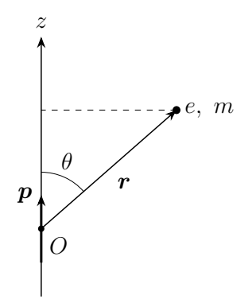
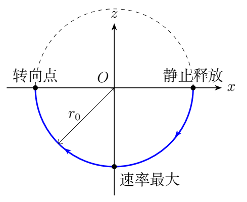

# 第 5 题　电偶极子场中的点电荷运动（40分）

质量为 $m$、电荷量为 $e>0$ 的点电荷在固定于原点 $O$ 的电偶极子作用下运动。偶极矩 $\boldsymbol p=p\hat{\boldsymbol z}$，点电荷位置为 $\boldsymbol r(t)$，其大小为 $r(t)$，与偶极矩夹角为 $\theta(t)$。初始位置满足 $r(0)=r_0>0$、$\theta(0)=\theta_0$。真空介电常量为 $\varepsilon_0$，场和电势为

$$\boldsymbol E=\frac{3(\boldsymbol p\cdot\hat{\boldsymbol r})\hat{\boldsymbol r}-\boldsymbol p}
{4\pi\varepsilon_0r^3},\qquad
\phi=\frac{\boldsymbol p\cdot\boldsymbol r}{4\pi\varepsilon_0r^3}.$$

（1）假定点电荷在垂直 $z$ 轴的平面内绕 $z$ 轴作匀速圆周运动，求 $\theta_0$ 和速度 $v_0$。

（2）假定 $t=0$ 时点电荷静止，求：（i）角动量大小 $L$ 对 $\theta$ 的关系；（ii）径向速率 $v_r$ 对 $r$ 的关系；（iii）运动有界的 $\theta_0$ 条件，及取边界值时在竖直平面内的轨道；（iv）运动无界时 $r(t)$。不讨论点电荷与偶极子碰撞以后的情况。

## 一、题型定位

非中心静电场中的动力学与可分离积分。场具有绕 $z$ 轴的对称性，但并非中心力，因此总角动量通常不守恒。由静止释放时运动限制在一个含 $z$ 轴的平面内，角动量定理仍可积分出一个特殊组合不变量。

本题的径向方程最终不含瞬时角度，原因是角运动的动能和偶极子势能中的角度项恰好相消。这个消元结构来自 $1/r^2$ 势能的特殊形式。

## 二、知识点

球坐标和柱坐标的分量投影；圆周运动的向心条件；角动量定理；机械能守恒；径向速度与径向速率的区别；初值问题与运动分支。固定偶极子提供保守静电场，因此点电荷机械能守恒；固定约束可承受反作用，点电荷的线动量不守恒。

为简化记号，以下定义正量

$$\kappa=\frac{ep}{4\pi\varepsilon_0}>0.$$

点电荷势能为 $U=\kappa\cos\theta/r^2$，单位检验要求 $\kappa$ 的量纲为能量乘长度平方。

## 三、物理图像

偶极子北侧的正电荷受到偏向外侧的力，南侧则具有吸引分量。绕轴圆周运动必须既不沿 $z$ 轴加速，又有指向轴线的水平力；这两个条件会筛掉一个看似合法的角度根。

由静止释放时初始位置、偶极矩和力都在同一竖直平面中，后续加速度也保持在该平面内。角动量方向垂直该平面，大小随运动变化。

## 四、解题入口

第一问用柱坐标投影，先令 $F_z=0$，再检查柱径向力是否朝向转轴。第二问先写平面极坐标的 $L=mr^2\dot\theta$ 和力矩，乘以 $L$ 后把时间微分转成角度微分。得到组合不变量后再代入能量式，径向运动即可独立求出。

## 五、解析

### 1　圆周运动的竖直条件

匀速绕 $z$ 轴的圆轨道上，$r=r_0$、$\theta=\theta_0$ 都不变。电场沿 $z$ 轴的投影为

$$E_z=\frac p{4\pi\varepsilon_0r_0^3}
(3\cos^2\theta_0-1).$$

竖直加速度为零，故

$$3\cos^2\theta_0-1=0,\qquad
\cos\theta_0=\pm\frac1{\sqrt3}.$$

这只是“高度不变”的条件，还没有保证水平力是向心力。

### 2　筛选向心分支并求速度

取柱径向单位矢量 $\hat{\boldsymbol\rho}$ 向外。因偶极矩没有柱径向投影，

$$F_\rho=eE_\rho=
\frac{3\kappa}{r_0^3}\cos\theta_0\sin\theta_0.$$

圆轨道柱半径为 $\rho_0=r_0\sin\theta_0$。向心力要求 $F_\rho<0$，所以只可取

$$\boxed{\cos\theta_0=-\frac1{\sqrt3},\qquad
\theta_0=\arccos(-1/\sqrt3).}$$

由 $m v_0^2/\rho_0=-F_\rho$，

$$v_0^2=-\frac{3\kappa}{mr_0^2}
\cos\theta_0\sin^2\theta_0
=\frac{2\kappa}{\sqrt3mr_0^2}.$$

因此

$$\boxed{v_0=\sqrt{\frac{\sqrt3,ep}{6\pi\varepsilon_0mr_0^2}}.}$$

轨道位于 $z=-r_0/\sqrt3$ 的水平面，半径为 $r_0\sqrt{2/3}$。它绕轴的角动量分量不为零，和下一问“从静止释放、在竖直平面内运动”是两组不同初始条件，不能混用。

### 3　竖直平面内的场分量与力矩

在该平面内使用径向、角向单位矢量。偶极矩可写为

$$\boldsymbol p=p\cos\theta\hat{\boldsymbol r}
-p\sin\theta\hat{\boldsymbol\theta}.$$

代入场式得到

$$F_r=\frac{2\kappa\cos\theta}{r^3},\qquad
F_\theta=\frac{\kappa\sin\theta}{r^3}.$$

角动量的有向标量为 $\ell=mr^2\dot\theta$，力矩为 $rF_\theta$，故

$$\frac{d\ell}{dt}=\frac{\kappa\sin\theta}{r^2}.$$

瞬时 $\ell$ 并不守恒。如果仅因“绕原点运动”就写 $L=$常量，会使后续的径向结果全部失真。

### 4　角动量组合不变量

在运动保持一个角向分支的区间，等式两边乘以 $\ell=mr^2\dot\theta$：

$$\ell\dot\ell=m\kappa\sin\theta\dot\theta.$$

于是

$$\frac{d}{dt}\left(\ell^2+2m\kappa\cos\theta\right)=0.$$

初始静止使 $\ell(0)=0$，所以

$$\boxed{L^2=2m\kappa(\cos\theta_0-\cos\theta),}$$

其中 $L=|\ell|$。恢复原参量为

$$\boxed{L(\theta)=
\sqrt{\frac{mep}{2\pi\varepsilon_0}
(\cos\theta_0-\cos\theta)}.}$$

由于 $L^2\ge0$，可达角度须满足 $\cos\theta\le\cos\theta_0$。这里的不变量不是“角动量守恒”，而是角动量平方与角势能组合守恒。

若轨道越过负 $z$ 轴，通常球坐标角 $\theta\in[0,\pi]$ 会折返。要连续描述竖直平面的转角，可用有向平面角 $\psi$；它满足 $\cos\theta=\cos\psi$。以上平方关系不受这种角坐标分支改变影响。

### 5　能量式消去角运动

初始静止时总能量为

$$E=\frac{\kappa\cos\theta_0}{r_0^2}.$$

平面极坐标速度平方为 $\dot r^2+r^2\dot\theta^2$，因此

$$\frac12m\dot r^2+\frac{L^2}{2mr^2}
+\frac{\kappa\cos\theta}{r^2}
=\frac{\kappa\cos\theta_0}{r_0^2}.$$

代入角动量不变量：

$$\frac{L^2}{2mr^2}+\frac{\kappa\cos\theta}{r^2}
=\frac{\kappa\cos\theta_0}{r^2}.$$

所以角度完全消掉，得到

$$\boxed{\dot r^2=\frac{2\kappa\cos\theta_0}{m}
\left(\frac1{r_0^2}-\frac1{r^2}\right).}$$

题目所求径向速率是非负量

$$\boxed{v_r=|\dot r|=
\sqrt{\frac{ep\cos\theta_0}{2\pi\varepsilon_0m}
\left(\frac1{r_0^2}-\frac1{r^2}\right)}.}$$

当电荷向原点接近，$\dot r<0$，但 $v_r>0$。不能把这一正平方根在所有分支都写成 $dr/dt$。

### 6　径向二阶方程保证初始分支

极坐标径向运动满足

$$m(\ddot r-r\dot\theta^2)=\frac{2\kappa\cos\theta}{r^3}.$$

将 $mr\dot\theta^2=L^2/(mr^3)$ 与角动量关系代入，有

$$\boxed{\ddot r=\frac{2\kappa\cos\theta_0}{mr^3}.}$$

这条二阶方程还能解决平方根式在静止初值处的分支问题：若 $\cos\theta_0>0$，初始径向加速度向外，电荷立即进入 $r>r_0$；若小于零，径向加速度向内，进入 $r<r_0$；若为零，$\ddot r=0$ 且初始径向速度为零，半径始终不变。

因此不应仅根据 $\dot r^2\ge0$ 的代数区间就断言电荷一定会运动，还要检查完整动力学。

### 7　有界条件与边界轨道

对 $0\le\theta_0<\pi/2$，$\cos\theta_0>0$，半径向外增长；当 $r\to\infty$，径向速率趋于正常量

$$v_{r,\infty}=\sqrt{\frac{2\kappa\cos\theta_0}{mr_0^2}}.$$

所以运动无界。对 $\theta_0>\pi/2$，半径不超过 $r_0$，在理想偶极子奇点模型中最终接近原点；这在碰撞前是空间有界运动，不必是周期运动。

对 $\theta_0=\pi/2$，半径恒为 $r_0$，并且

$$L^2=-2m\kappa\cos\theta\ge0.$$

电荷从赤道处向负 $z$ 方向加速，沿下半圆到对侧赤道后转向。因此

$$\boxed{\theta_0\ge\pi/2\text{ 时运动有界；边界轨道为}\ r=r_0\text{ 的下半圆。}}$$

“下半圆轨道”描述电荷能走过的空间曲线，并非匀速运动。到最低点速度最大，到两端赤道位置速度为零。

### 8　无界运动的半径随时间变化

在 $\cos\theta_0>0$ 的向外分支，令

$$A=\frac{2\kappa\cos\theta_0}{mr_0^2}>0.$$

速度方程为

$$\frac{dr}{dt}=\sqrt A\frac{\sqrt{r^2-r_0^2}}r.$$

分离变量：

$$\frac{r\,dr}{\sqrt{r^2-r_0^2}}=\sqrt A\,dt.$$

左侧正是 $d\sqrt{r^2-r_0^2}$，从 $t=0,r=r_0$ 积分得

$$\sqrt{r^2-r_0^2}=\sqrt A,t.$$

于是

$$\boxed{r(t)=\sqrt{r_0^2+
\frac{ep\cos\theta_0}{2\pi\varepsilon_0mr_0^2}t^2}.}$$

求导得 $\dot r=At/r$、$\ddot r=Ar_0^2/r^3$，直接符合二阶径向方程，并满足 $\dot r(0)=0$。远时 $r\sim\sqrt A,t$，和渐近径向速率一致。

### 9　边界轨道上的速率与周期积分

在 $r=r_0$ 的边界轨道，动能完全是角运动，能量为零，所以

$$v^2=-\frac{2\kappa\cos\theta}{mr_0^2}.$$

最低点 $\theta=\pi$，速率为

$$v_{\max}=\sqrt{\frac{2\kappa}{mr_0^2}}.$$

以连续有向角 $\psi$ 表示从右赤道到左赤道的一程，$\pi/2\le\psi\le3\pi/2$，

$$dt=\sqrt{\frac{mr_0^4}{2\kappa}}
\frac{d\psi}{\sqrt{-\cos\psi}}.$$

一程时间为上述区间的积分，往返周期为其两倍。端点的 $1/\sqrt{|\psi-\psi_{\rm end}|}$ 奇性可积，因此一程时间有限。它与球面上的水平圆周匀速轨道不同：这里同一半圆曲线被往返走过。

### 10　一般初速度下的径向组合

若在同一竖直平面内给非零初始角向速度，则组合不变量仍为

$$C=L^2+2m\kappa\cos\theta
=L_0^2+2m\kappa\cos\theta_0.$$

总能量 $E$ 给出

$$\frac12m\dot r^2+\frac{C}{2mr^2}=E.$$

这样可把角运动消去，得到有效径向势 $C/(2mr^2)$。它与通常中心势问题中的离心势相似，但 $C$ 含角势能的组合，而不是单独的守恒角动量平方。对本题静止释放，$C=2m\kappa\cos\theta_0$，正负号恰好决定向外、向内与边界三类运动。

### 11　向内分支的有限时间尺度

若 $\cos\theta_0<0$，从完整二阶径向方程及初值积分得到

$$r^2(t)=r_0^2-
\frac{2\kappa|\cos\theta_0|}{mr_0^2}t^2.$$

理想奇点模型到达原点的时间为

$$t_c=r_0^2\sqrt{\frac{m}{2\kappa|\cos\theta_0|}}.$$

这不要求轨道是一条径向直线；除轴上释放外，角运动同时存在，但组合不变量使半径仍满足这个关系。$\theta_0\to\pi/2^+$ 时 $t_c$ 增大，边界处转为恒定半径轨道。公式只描述到奇点前的运动，不规定碰撞后如何继续。

## 六、关键洞察

轴对称只保证角动量的 $z$ 分量守恒；由静止释放时这个分量为零，但总角动量仍受力矩驱动。更有用的不变量是 $L^2+2m\kappa\cos\theta$，它使径向动力学简化为一个一维问题。

## 七、易错点

把两个 $F_z=0$ 的角度根都当圆轨道；把水平圆轨道的初速度用于静止释放；把总角动量当守恒量；混淆 $|\dot r|$ 与 $\dot r$；只凭能量代数式选初始运动分支；把有界运动一概说成周期运动；把普通极角扩大到 $3\pi/2$ 而未说明有向平面角。

## 八、课堂讲解建议

先在柱坐标图中区分竖直与柱径向投影，练习根的筛选。第二问让学生先指出“总角动量不守恒”，再推导可用于积分的组合不变量。画三种初始角度的半径变化，最后说明半径恒定与匀速圆周运动的区别。

## 九、变式训练

### 变式1　负轴静止释放的碰撞时间

从 $\theta_0=\pi$、半径 $r_0$ 静止释放。求到达理想偶极子原点之前的半径和到达时间。

解：负轴上角向力为零，$\theta=\pi$ 保持不变。径向加速度 $\ddot r=-2\kappa/(mr^3)$。向内分支积分给出

$$r^2=r_0^2-\frac{2\kappa}{mr_0^2}t^2.$$

令 $r=0$，得 $t_c=r_0^2\sqrt{m/(2\kappa)}$。真实偶极子有有限尺寸，接近其组成电荷时该理想式不再适用；本题只求奇点模型在碰撞前的轨道。

### 变式2　边界轨道最低点的角动量

从赤道处静止释放，求到达下半圆最低点的速率和角动量，并检查能量。

解：$\cos\theta_0=0$、$\cos\theta=-1$，故 $L^2=2m\kappa$，$L=\sqrt{2m\kappa}$。由 $L=mr_0v$，

$$v=\sqrt{\frac{2\kappa}{mr_0^2}}.$$

最低点动能 $mv^2/2=\kappa/r_0^2$，势能 $-\kappa/r_0^2$，相加为零，符合赤道处静止的初始总能量。

### 变式3　电荷改为负电荷

将点电荷量改为 $-e$，从静止释放。求有界条件和边界轨道。

解：把 $\kappa$ 改为 $-\kappa$，径向方程成为 $\ddot r=-2\kappa\cos\theta_0/(mr^3)$。因此 $\cos\theta_0>0$ 时向内有界，小于零时向外无界，等于零时半径恒定。有界条件为 $\theta_0\le\pi/2$。边界的角动量关系为 $L^2=2m\kappa\cos\theta$，所以可达区域是上半圆。正负电荷互换相当于交换偶极子的吸引、排斥半空间。

### 变式4　有初始切向速度的定半径轨道

电荷在含偶极矩的竖直平面内运动，初始径向速度为零，角动量为 $L_0$。求使半径恒定的条件，并给出可达角度范围。

解：一般径向方程为 $\ddot r=C/(m^2r^3)$。半径恒定要求 $C=0$，故

$$L_0^2=-2m\kappa\cos\theta_0,$$

这只有 $\cos\theta_0\le0$ 时可行。随后 $L^2=-2m\kappa\cos\theta$，所以运动仍限于下半圆。与赤道静止释放相比，初始位置可以位于下半圆内部，只须给定上述切向速度。该条件使总能量为零、径向加速度恒为零。

在定半径条件下，令 $\eta=\psi-\pi$，角运动方程为

$$\ddot\eta+\frac{\kappa}{mr_0^4}\sin\eta=0.$$

看起来像单摆，但其能量由 $C=0$ 限定，对应转向角 $\eta=\pm\pi/2$，并非任意小振幅。因此不能直接把小角单摆周期作为这个轨道的周期。

用第一积分计算完整往返周期：

$$\mathcal T=
4r_0^2\sqrt{\frac m\kappa}\,
K(1/\sqrt2),$$

其中 $K(k)=\int_0^{\pi/2}(1-k^2\sin^2u)^{-1/2}du$。由于 $K(1/\sqrt2)\simeq1.854$，$\mathcal T\simeq7.42r_0^2\sqrt{m/\kappa}$。不同满足定半径条件的初始位置与速度只改变这条往返轨道上的初相，不改变其振幅和周期。

