# 第 1 题　手机镜头的等效焦距与主点（40分）

手机镜头由多个光学元件组成，图像传感器能记录物体的像，借助软件可读出像的实际尺寸。将镜头视为结构固定的共轴理想透镜组，可把物像关系等效为一个凸透镜，使用薄透镜成像公式计算。但物距、像距与焦距的起点分别为光轴上的物方主点 $H$ 和像方主点 $H'$，这些主点不必与某个透镜的光心重合。本题所有光路均满足近轴条件。

（1）主点封装在镜头内部，位置未知，无法直接测量物距。沿光轴移动一段与光轴垂直、长为 $l$ 的刻度尺，在物距 $u_1,u_2$ 处分别成像，测得移动距离 $s=u_2-u_1$ 和对应像长 $l_1,l_2$。求：（i）等效焦距 $F$；（ii）物距 $u_1$。结果均用 $l,l_1,l_2,s$ 表示。

（2）透镜组由焦距分别为 $f_1,f_2$ 的共轴薄透镜组成，光心为 $O_1,O_2$，间距 $d$。物经两透镜成像时，存在横向放大率为 $+1$ 的一对物面和像面，称为主平面，其与光轴的交点为 $H,H'$。（i）将 $H$ 看作透镜1的“物”，求它相对 $O_1$ 的物距；将 $H'$ 看作透镜2的“像”，求它相对 $O_2$ 的像距。（ii）物方距离从 $H$ 起算，像方距离从 $H'$ 起算，求物方焦距 $F$ 和像方焦距 $F'$。

## 一、题型定位

这是几何光学中的间接测量和复合光学系统问题。前半部分利用两次放大率消去未知主点位置；后半部分利用逐级成像或近轴光线矩阵，把两个透镜合成一个具有两主平面的等效系统。

使用透镜公式前，先确定各段距离从哪里量起。镜头外壳到刻度尺的距离，不等于从主点到刻度尺的物距。两次位置之差却不受这个固定偏移影响，所以能用于消元。

## 二、知识点

薄透镜公式与带符号横向放大率为

$$\frac1u+\frac1v=\frac1f,\qquad m=-\frac vu.$$

在本题的实物、实像测量中，$u,v,F>0$；像倒立，故像长与物长之比是 $|m|$。第二问允许虚物、虚像，此时仍用同一公式，但虚物的物距、虚像的像距取负。

平行光的会聚位置给出焦点；焦点与主点之间的距离才是有效焦距。主平面之间的放大率为 $+1$，不等于说任意物体经过镜头都放大一倍。

## 三、物理图像

传感器固定，调焦由系统内部结构或成像位置决定；本问将两次成像作为已实现的理想物像关系。物体离镜头更远时，实像通常更小。按 $s>0$ 的约定，应有 $l_1>l_2$。这是计算前即可做的方向检查。

两个主点把透镜组对光线的作用分成三步：从入口平移到物方主平面，在等效薄透镜处改变光线斜率，再从像方主平面平移到出口。主点可能位于镜头内部，也可能在镜头外部；这并不意味着那里另有一个真实折射面。

## 四、解题入口

第一问先用 $v_i/u_i=l_i/l$ 把 $v_i$ 消掉，分别求 $u_1,u_2$，再相减。第二问暂用 $U_1,V_1,U_2,V_2$ 表示两个单透镜的物像距，避免和第一问的两次物距混淆。先写 $U_2=d-V_1$，再把总放大率设为1。焦距最后从平行光成像位置减去主点位置求得。

## 五、解析

### 1　第一次成像：把像距换成可测的放大率

设第一次像距为 $v_1$。像长给出

$$\frac{v_1}{u_1}=\frac{l_1}{l},\qquad v_1=\frac{l_1}{l}u_1.$$

将它代入成像公式：

$$\frac1{u_1}+\frac{l}{l_1u_1}=\frac1F.$$

把左侧合并，再取倒数，得

$$\boxed{u_1=F\left(1+\frac l{l_1}\right).}$$

这里无需知道 $H$ 在外壳内的位置。$u_1$ 是理论上从 $H$ 起算的距离，测量信息通过放大率进入方程。

第二次成像同理：

$$u_2=F\left(1+\frac l{l_2}\right).$$

### 2　利用移动距离消去主点位置

由于镜头结构固定，两次测量的 $H$ 相同，故实际移动距离就是物距差：

$$s=u_2-u_1=Fl\left(\frac1{l_2}-\frac1{l_1}\right).$$

解得

$$\boxed{F=\frac{s\,l_1l_2}{l(l_1-l_2)}.}$$

再代回第一次物距：

$$u_1=\frac{s\,l_1l_2}{l(l_1-l_2)}\frac{l_1+l}{l_1},$$

即

$$\boxed{u_1=\frac{s\,l_2(l_1+l)}{l(l_1-l_2)}.}$$

同样得到

$$u_2=\frac{s\,l_1(l_2+l)}{l(l_1-l_2)}.$$

直接相减可检验 $u_2-u_1=s$，这是一项独立于成像代入的代数检查。焦距表达式中 $l_1l_2/[l(l_1-l_2)]$ 无量纲，结果与 $s$ 同量纲。

若 $l_1=l_2$ 而 $s\ne0$，这些数据不符合结构固定、近轴理想成像的模型；不能把分母为零解释为焦距“测得无穷大”。若两次位移也为零，则只是重复同一次观测，没有获得新的约束。

### 3　用一组数据检查物像位置

例如，$l=20.0\,\mathrm{mm}$，$l_1=2.00\,\mathrm{mm}$，$l_2=1.00\,\mathrm{mm}$，$s=60.0\,\mathrm{mm}$。逐步代入为

$$F=\frac{60.0\times2.00\times1.00}{20.0\times1.00}\,\mathrm{mm}
=6.00\,\mathrm{mm},$$

$$u_1=6.00(1+10.0)=66.0\,\mathrm{mm},$$

$$u_2=6.00(1+20.0)=126\,\mathrm{mm}.$$

对应像距为

$$v_1=\frac{l_1}{l}u_1=6.60\,\mathrm{mm},\qquad
v_2=\frac{l_2}{l}u_2=6.30\,\mathrm{mm}.$$

两次物距相差60.0 mm，但像距只变了0.30 mm。远物成像时像距接近焦距，这与手机镜头的尺寸尺度相容。这个例子说明“物像两侧距离都改变”不妨碍用固定主点消元。

### 4　两透镜的逐级成像与总放大率

第一片透镜满足

$$\frac1{U_1}+\frac1{V_1}=\frac1{f_1},\qquad
V_1=\frac{f_1U_1}{U_1-f_1}.$$

第一片的像作为第二片的物，几何关系是

$$U_2=d-V_1=d-\frac{f_1U_1}{U_1-f_1}.$$

当 $V_1>d$，第一片的像落在第二片右侧，光线到达第二片时尚在会聚，因此 $U_2<0$，它是第二片的虚物。把这一情形强行换成正的距离，会破坏光路的连续性。

对任一单透镜，由 $m_i=-V_i/U_i$ 和成像公式，有

$$\frac1{m_i}=1-\frac{U_i}{f_i}.$$

总放大率 $m=m_1m_2$，于是

$$\frac1m=\left(1-\frac{U_1}{f_1}\right)
\left(1-\frac{U_2}{f_2}\right).$$

将 $U_2$ 代入，先化简会消去 $U_1-f_1$：

$$\begin{aligned}
\frac1m
&=\left(1-\frac{U_1}{f_1}\right)
\left(1-\frac d{f_2}+\frac{f_1U_1}{f_2(U_1-f_1)}\right)\\
&=1-\frac d{f_2}-U_1
\left(\frac1{f_1}+\frac1{f_2}-\frac d{f_1f_2}\right).
\end{aligned}$$

### 5　令横向放大率为正一，求主点

对主平面共轭，$m=+1$。令

$$\Phi=\frac1{f_1}+\frac1{f_2}-\frac d{f_1f_2},$$

则上式给出

$$0=-\frac d{f_2}-U_H\Phi.$$

因此

$$\boxed{U_H=\frac{f_1d}{d-f_1-f_2}.}$$

根据光路可逆性，反向观察只须交换1、2，得到

$$\boxed{V_{H'}=\frac{f_2d}{d-f_1-f_2}.}$$

这里 $U_H$ 按物距约定，$V_{H'}$ 按像距约定。若 $f_1,f_2>0$ 且 $d<f_1+f_2$，二者均为负；$H$ 位于 $O_1$ 右侧，$H'$ 位于 $O_2$ 左侧。主点的坐标与有向物像距之间相差一个符号，必须分开说明。

以光向右传播、$O_1$ 为坐标原点，有

$$x_H=-U_H,\qquad x_{H'}=d+V_{H'}.$$

### 6　从平行光求像方焦距

对第一片，$U_1\to\infty$ 时 $V_1=f_1$，故第二片的物距为 $U_2=d-f_1$。最终焦点相对 $O_2$ 的像距为

$$V_{F'}=\frac{f_2(d-f_1)}{d-f_1-f_2}.$$

有效像方焦距应从 $H'$ 起算：

$$\begin{aligned}
F'&=V_{F'}-V_{H'}\\
&=\frac{f_2(d-f_1)-f_2d}{d-f_1-f_2}\\
&=\frac{f_1f_2}{f_1+f_2-d}.
\end{aligned}$$

交换光路方向得到相同的物方焦距，因此

$$\boxed{F=F'=\frac{f_1f_2}{f_1+f_2-d},\qquad
\frac1F=\frac1{f_1}+\frac1{f_2}-\frac d{f_1f_2}.}$$

两端介质相同是 $F=F'$ 的条件；这里镜头两侧均按同一空气环境处理。不能把第二片后的焦点距离 $V_{F'}$ 直接当成 $F'$。

### 7　另一条推导：近轴光线矩阵

用列向量 $(y,\alpha)^{\mathsf T}$ 描述光线高度和近轴斜率。传播距离 $d$ 和薄透镜分别表示为

$$T(d)=\begin{pmatrix}1&d\\0&1\end{pmatrix},\qquad
L(f)=\begin{pmatrix}1&0\\-1/f&1\end{pmatrix}.$$

按光线实际经过的顺序，从右向左乘矩阵：

$$\mathcal M=L(f_2)T(d)L(f_1)
=\begin{pmatrix}
1-d/f_1&d\\
-\Phi&1-d/f_2
\end{pmatrix}.$$

把该矩阵写为主平面形式

$$\mathcal M=T(q)L(F)T(p),$$

其中 $p=x_H$，$q=d-x_{H'}$。比较左下元、左上元和右下元，依次得

$$F=\frac1\Phi,\qquad q=\frac{Fd}{f_1},\qquad
p=\frac{Fd}{f_2}.$$

所以 $U_H=-p$，$V_{H'}=-q$，与逐级成像法完全一致。每个基本矩阵的行列式均为1，因此复合矩阵也应满足 $AD-BC=1$；直接展开可以作为乘法次序和符号的检查。

### 8　特殊极限与测量灵敏度

当 $d=0$，主点回到共同光心，组合光焦度为 $1/f_1+1/f_2$。当第二片的 $f_2\to\infty$，它不再改变斜率，系统焦距回到 $f_1$。当 $d=f_1+f_2$，$\Phi=0$，系统为无焦系统，不具有有限的本题式主点焦距；不能在主点公式中把无穷大当作普通位置。

对第一问的实验式取对数并作小量微分：

$$\frac{\delta F}{F}
=\frac{\delta s}{s}-\frac{\delta l}{l}
-\frac{l_2}{l_1-l_2}\frac{\delta l_1}{l_1}
+\frac{l_1}{l_1-l_2}\frac{\delta l_2}{l_2}.$$

独立随机测量的不确定度应把这些项的方差相加；有共同标尺或像素校准误差时，要保留相关项。$l_1$ 与 $l_2$ 越接近，误差放大越严重，所以移动距离不能选得太小。若 $l,l_1,l_2$ 同乘一个校准比例，三个相对长度项恰好抵消，焦距仍只依赖像长与物长的比值。

\clearpage

# 第 2 题　半圆管活塞的临界稳定性（40分）

将粗细均匀、两端封闭的细玻璃管弯成半径为 $r$ 的半圆环，竖直固定于水平地面，两端与地面接触。管的横截面尺寸远小于 $r$。管内有质量为 $m$ 的薄活塞，与管壁密接，摩擦忽略；活塞相对竖直方向的角位置为 $\theta$。两侧各有 $n$ 摩尔理想气体，其温度始终与外界温度 $T$ 相同，所有气体状态变化均可视为准静态。重力加速度为 $g$，普适气体常量为 $R$。

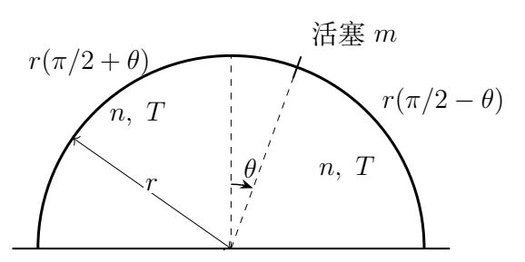

（1）当 $T$ 高于某临界温度 $T_c$ 时，$\theta=0$ 为稳定平衡位置。求 $T_c$ 及活塞在该位置附近微振动的圆频率。

（2）$T=T_c$ 时，判断中央平衡位置的稳定性。

以下可视 $T_c$ 为已知量，不必代入第（1）问结果。

（3）$T<T_c$ 时，求稳定平衡角 $\theta_0$ 满足的方程，并求 $T$ 略低于 $T_c$ 时 $\theta_0$ 的最低非零阶近似。

（4）求 $T<T_c$ 时稳定位置附近的微振动圆频率 $\omega_0(\theta_0)$，表达式可含 $\theta_0$，不可含 $T$；并给出 $T$ 略高于及略低于 $T_c$ 时圆频率随温度的变化。

（5）$T<T_c$ 时，初始速度近似为零，求从正中央运动到可到达的角位置 $\theta$ 时角速度的大小。

## 一、题型定位

气体压力与重力共同作用下的平衡、稳定性和非线性运动。活塞在圆环最高点时，重力使它偏离中央；两侧气体的压强差则把它推回中央。改变温度会改变气体恢复力，从而改变稳定平衡位置的数目。

临界温度处线性项为零，必须保留更高阶项。线性微振动频率为零只表示线性近似失效，不足以判定“中性平衡”。

## 二、知识点

等温理想气体 $pV=nRT$；圆弧切向动力学；小角展开；力的导数与稳定性；势能的局部极小；非线性方程的第一积分。用角坐标时，实际切向加速度为 $r\ddot\theta$，动能为 $mr^2\dot\theta^2/2$。

外界保持气体等温，气体与热库交换热量；不能把活塞动能与重力势能单独相加并声称守恒。可以把压强力对位置的作用积分成一个等效势能，这个势能含气体自由能的变化。

## 三、物理图像

取 $\theta>0$ 为向右偏转。右侧气柱变短，左侧气柱变长，右侧压强更大，气体合力沿切线向左。重力的切向分量向右，为 $mg\sin\theta$。中央处两侧压强相等，重力切向分量也为零，所以任何温度下中央都是一个平衡位置。

高温时气体恢复力较强，只有中央稳定；低温时中央不稳定，左右各出现一个稳定位置。对称性要求两个位置以 $\pm\theta_0$ 成对出现。

## 四、解题入口

引入管截面积 $S$，写出两侧体积，求压力后乘以 $S$。截面积会消掉。把切向动力学方程写成 $\ddot\theta=A(\theta)$，先展开 $A'(0)$ 求临界温度，再展开三次项。非中央平衡先用完整方程求出，再把它用于消去频率式中的 $T$。

## 五、解析

### 1　完整切向运动方程

记 $a=\pi/2$。两侧气柱的弧长分别为 $r(a+\theta)$、$r(a-\theta)$，所以

$$V_L=Sr(a+\theta),\qquad V_R=Sr(a-\theta).$$

等温条件给出

$$p_L=\frac{nRT}{Sr(a+\theta)},\qquad
p_R=\frac{nRT}{Sr(a-\theta)}.$$

沿 $\theta$ 增大方向的合力为

$$F_t=mg\sin\theta+p_LS-p_RS.$$

故

$$mr\ddot\theta=mg\sin\theta
-\frac{nRT}{r(a-\theta)}+\frac{nRT}{r(a+\theta)}.$$

合并分式，并再除以 $mr$：

$$\boxed{\ddot\theta=\frac gr\sin\theta
-\frac{2nRT}{mr^2}\frac\theta{a^2-\theta^2}.}$$

物理区间为 $|\theta|<a$。活塞逼近端点时，某侧体积趋于零，压强发散；本模型内有限能量运动不能越过这个边界。

### 2　中央位置的线性稳定性

在 $|\theta|\ll1$ 时，$\sin\theta\simeq\theta$，$1/(a^2-\theta^2)\simeq1/a^2$，因此

$$\ddot\theta=\left(\frac gr-\frac{8nRT}{\pi^2mr^2}\right)\theta.$$

稳定的小振动要求括号为负。临界条件为

$$\frac gr=\frac{8nRT_c}{\pi^2mr^2},$$

于是

$$\boxed{T_c=\frac{\pi^2mgr}{8nR}.}$$

对 $T>T_c$，写成 $\ddot\theta+\omega^2\theta=0$，得

$$\boxed{\omega^2=\frac{8nRT}{\pi^2mr^2}-\frac gr
=\frac gr\left(\frac T{T_c}-1\right).}$$

该频率是无限小振幅的线性频率。离临界点足够近时，非线性项对任何固定振幅都可能重要，使用线性式须同时限制振幅。

### 3　无量纲化使临界条件更透明

记 $\tau=T/T_c$，利用临界温度把完整方程整理为

$$\boxed{\ddot\theta=\frac gr
\left[\sin\theta-\frac{\tau\theta}{1-4\theta^2/\pi^2}\right].}$$

再定义时间 $\xi=t\sqrt{g/r}$，方程中除 $\tau$ 外不再含参数：

$$\frac{d^2\theta}{d\xi^2}
=\sin\theta-\frac{\tau\theta}{1-4\theta^2/\pi^2}.$$

这说明不同质量、半径和气体量的装置，只要温度比 $\tau$ 相同，角运动在适当时间尺度下相同。质量和气体量通过 $T_c$ 影响稳定性，而 $\sqrt{r/g}$ 决定时间尺度。

### 4　临界温度必须保留三次项

分别展开

$$\sin\theta=\theta-\frac{\theta^3}{6}+O(\theta^5),$$

$$\frac{\theta}{1-4\theta^2/\pi^2}
=\theta+\frac4{\pi^2}\theta^3+O(\theta^5).$$

在 $\tau=1$ 时，线性项相消，得到

$$\ddot\theta=-\frac gr
\left(\frac16+\frac4{\pi^2}\right)\theta^3+O(\theta^5).$$

定义

$$c=\frac16+\frac4{\pi^2}=\frac{24+\pi^2}{6\pi^2}>0,$$

则领先阶为 $\ddot\theta=-(g/r)c\theta^3$。任何小的正偏移都对应负加速度，负偏移对应正加速度，因此

$$\boxed{T=T_c\text{ 时中央仍为稳定平衡位置，但不是线性简谐振子。}}$$

“稳定”表示足够小的初始扰动不会使轨道离开中央附近；无摩擦时并不表示活塞最终停回中央。

### 5　低温非中央平衡方程

设平衡角 $\theta_0\ne0$，把完整方程右侧设为零：

$$\sin\theta_0=\frac{\tau\theta_0}{1-4\theta_0^2/\pi^2}.$$

所以

$$\boxed{\frac T{T_c}
=\left(1-\frac{4\theta_0^2}{\pi^2}\right)
\frac{\sin\theta_0}{\theta_0}.}$$

对于 $0<\theta_0<\pi/2$，两个因子均为正且严格下降。$\sin x/x$ 的导数为 $(x\cos x-\sin x)/x^2<0$，因为 $\tan x>x$。右侧从1连续降到0。因此每个 $0<\tau<1$ 恰有一个正根，对称性再给一个负根。

当 $\tau>1$，右侧不可能达到 $\tau$，没有非中央平衡。中央的加速度斜率为 $(g/r)(1-\tau)$，所以它在低温时不稳定，高温时稳定。

### 6　近平衡分支的平方根规律

若 $T$ 略小于 $T_c$，$\theta_0$ 很小。展开平衡式：

$$\tau=\left(1-\frac{4\theta_0^2}{\pi^2}\right)
\left(1-\frac{\theta_0^2}{6}+O(\theta_0^4)\right)
=1-c\theta_0^2+O(\theta_0^4).$$

于是

$$\boxed{\theta_0\simeq\pm
\sqrt{\frac{6\pi^2}{24+\pi^2}\frac{T_c-T}{T_c}}.}$$

这是最低非零阶近似。不能把 $\theta_0$ 写成正比于 $T_c-T$：对称性使平衡式的首个角度修正为二次项，解出角度自然出现平方根。

例如 $\tau=0.99$，近似角度为 $\sqrt{0.01/c}\simeq0.132$ rad，约7.57°。将它代回完整平衡式可检查遗漏的四次项只造成更高阶偏差。

### 7　非中央稳定位置附近的频率

令 $\theta=\theta_0+\eta$，$|\eta|\ll1$，并记完整右侧为 $A(\theta)$。因为 $A(\theta_0)=0$，

$$\ddot\eta=A'(\theta_0)\eta+O(\eta^2),\qquad
\omega_0^2=-A'(\theta_0).$$

从未消温度的完整式求导：

$$A'(\theta)=\frac gr\cos\theta
-\frac{2nRT}{mr^2}\frac{a^2+\theta^2}{(a^2-\theta^2)^2}.$$

平衡条件给出

$$\frac{2nRT}{mr^2}
=\frac gr\frac{\sin\theta_0}{\theta_0}(a^2-\theta_0^2).$$

代入得到不含 $T$ 的形式：

$$\boxed{\omega_0^2=\frac gr
\left[\frac{\sin\theta_0}{\theta_0}
\frac{a^2+\theta_0^2}{a^2-\theta_0^2}-\cos\theta_0\right].}$$

等价地，写成参考解答的形式为

$$\omega_0^2=\frac{g\cos\theta_0}{r}
\left[\frac{\tan\theta_0}{\theta_0}
\frac{\pi^2/2+2\theta_0^2}{\pi^2/2-2\theta_0^2}-1\right].$$

对正根，$\sin\theta_0/\theta_0>\cos\theta_0$，且分式大于1，所以括号为正；负根给出相同结果。两个非中央根确实稳定，不只是力为零。

### 8　临界点两侧的频率比较

高温一侧的结果已知：

$$\boxed{\omega\simeq\sqrt{\frac gr\frac{T-T_c}{T_c}}.}$$

低温一侧，把频率式展开到 $\theta_0^2$：

$$\frac{\sin\theta_0}{\theta_0}\simeq1-\frac{\theta_0^2}{6},\qquad
\frac{a^2+\theta_0^2}{a^2-\theta_0^2}\simeq1+\frac{8\theta_0^2}{\pi^2},$$

$$\cos\theta_0\simeq1-\frac{\theta_0^2}{2}.$$

相减后系数为 $1/3+8/\pi^2=2c$，因此

$$\omega_0^2\simeq\frac gr,2c\theta_0^2
\simeq\frac{2g}{r}\frac{T_c-T}{T_c}.$$

即

$$\boxed{\omega_0\simeq\sqrt{\frac{2g}{r}\frac{T_c-T}{T_c}}.}$$

相同相对温差下，低温稳定分支的线性频率是高温中央分支的 $\sqrt2$ 倍。频率都随温差的平方根趋于零，这种趋零不能等同于失去非线性稳定性。

### 9　等效势能与完整稳定性图像

把广义力积分，选 $U(0)=0$：

$$\boxed{U(\theta)=mgr(\cos\theta-1)
-nRT\ln\left(1-\frac{4\theta^2}{\pi^2}\right).}$$

它满足 $mr^2\ddot\theta=-U'(\theta)$。气体项也可由两侧等温自由能 $-nRT\ln V_L-nRT\ln V_R$ 的变化求得。

中央附近展开为

$$\frac{U}{mgr}
=\frac{\tau-1}{2}\theta^2
+\left(\frac1{24}+\frac\tau{\pi^2}\right)\theta^4
+O(\theta^6).$$

临界点四次系数为 $c/4>0$；高温是单个势阱，低温为两个势阱。原方程中的左右对称在势能中表现为偶函数。

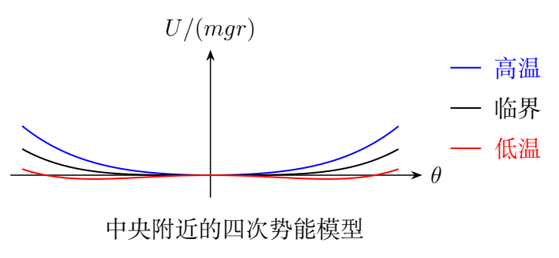

### 10　从中央附近释放的角速度

对完整切向方程乘 $r\,d\theta$，或用等效势能的第一积分，得到

$$\frac12mr^2\dot\theta^2+U(\theta)=E.$$

取从中央出发、初始动能趋于零的极限，则 $E=U(0)=0$，所以

$$\frac12mr^2\dot\theta^2
=mgr(1-\cos\theta)
+nRT\ln\left(1-\frac{4\theta^2}{\pi^2}\right).$$

故在可达区间中

$$\boxed{|\dot\theta|=
\sqrt{\frac{2g}{r}(1-\cos\theta)
+\frac{2nRT}{mr^2}\ln\left(1-\frac{4\theta^2}{\pi^2}\right)}.}$$

根号中的气体项为负：活塞偏离中央时气体恢复力阻碍运动。若误写成正号，就会预测活塞能以无穷速度冲入压强发散的端点，违反本模型的受力方向。

### 11　可达角与“从正中央开始”的数学细节

只有根号内非负的位置可到达。非零转向角 $\theta_m$ 由 $U(\theta_m)=0$ 确定。近平衡临界区，用四次势近似：

$$\frac{U}{mgr}\simeq-\frac{1-\tau}{2}\theta^2+\frac c4\theta^4,$$

所以 $\theta_m^2\simeq2(1-\tau)/c=2\theta_0^2$。释放轨道会经过稳定位置，直到更远的转向点；它不会因为经过合力为零的位置就停止。

严格给定 $\theta(0)=0$ 且 $\dot\theta(0)=0$，光滑动力学方程的唯一解是永远停在中央，即使中央不稳定。题目“初始速度近似为零”应按极小扰动后离开中央、初始能量趋于 $U(0)$ 的极限理解。上式是位置与速度的能量关系，并不保证严格静止的活塞自行启动。

### 12　低温与临界点的其他极限

在 $\tau\to0^+$ 时，正平衡根接近端点。令 $\theta_0=\pi/2-\epsilon$，则

$$\tau\simeq\frac{8\epsilon}{\pi^2},\qquad
\epsilon\simeq\frac{\pi^2}{8}\tau.$$

每个非零温度都仍有有限的气柱体积；$T=0$ 本身不再适合照搬经典理想气体的等温模型。这个渐近式只说明完整平衡方程在小正温度比下的数学行为。

临界点的小振幅运动满足 $\ddot\theta+\alpha\theta^3=0$，$\alpha=gc/r$。振幅 $A$ 下的第一积分是

$$\dot\theta^2=\frac\alpha2(A^4-\theta^4).$$

周期因而为

$$\mathcal T=\frac{4\sqrt2}{A\sqrt\alpha}
\int_0^1\frac{dx}{\sqrt{1-x^4}}.$$

周期随 $A^{-1}$ 增大；角频率与振幅成正比。它解释了为何临界点稳定，却没有与振幅无关的非零线性频率。

\clearpage

# 第 3 题　可动楔块上的滚动与滑动（40分）

倾角为 $\theta$、质量为 $M$ 的三角形楔块放在光滑水平地面上，其斜面上有质量为 $m$、半径为 $r$ 的均质圆球。圆球从静止开始向下运动，过程中楔块无转动。重力加速度为 $g$，球与楔块间的静摩擦系数和滑动摩擦系数均为 $\mu$。

（1）若 $\mu$ 足够大，圆球无滑动地滚下，求：（i）楔块对地加速度大小 $a_0$；（ii）球质心相对楔块的加速度大小 $a_c$；（iii）地面对楔块的支持力 $N$；（iv）楔块对球的支持力 $N_1$；（v）保持纯滚动所需的最小摩擦系数 $\mu_0$。

（2）若 $\mu<\mu_0$ 且斜面足够长，求从静止开始经过 $\Delta t$ 后，球与楔块接触点 $P$ 相对楔块的速度。

## 一、题型定位

平动、转动与可动约束的耦合动力学。球下落时楔块反向运动，球质心对地加速度与相对楔块加速度不同。摩擦同时影响球的平动和转动，纯滚动只是其中一种可能的运动状态。

本题不能沿用固定斜面上的 $a_c=5g\sin\theta/7$。楔块加速度会通过惯性力改变球的切向加速度，也改变法向支持力。

## 二、知识点

均质实心球的转动惯量为 $I=2mr^2/5$；纯滚动约束为 $v_c=r\dot\varphi$；转动方程为 $I\ddot\varphi=fr$；地面光滑使整体水平方向动量守恒。静摩擦满足 $|f|\le\mu N_1$，滑动摩擦大小才等于 $\mu N_1$。

判断摩擦方向须看接触点的相对速度，而不能仅看质心下坡方向。对正在滑动的球，相对滑动速度为 $v_P=v_c-r\dot\varphi$。

## 三、物理图像

将斜面向下的方向取为切向正方向。原图斜面向左下降，球下坡时楔块向右；为了推导方便，可水平镜像坐标，使下坡向右、楔块向左。以下 $a_0$ 均指楔块向上坡水平一侧的加速度大小，不受这次坐标镜像影响。

楔块系只平动、不转动，球受到水平惯性力 $ma_0$，方向向下坡的水平一侧。该力的切向分量加速下坡运动，法向分量使法向压力减小。摩擦沿斜面向上，为球提供滚动角加速度。

## 四、解题入口

先写三条基本关系：球的切向动力学、转动动力学、整体水平动量守恒。纯滚动时补上 $a_c=r\ddot\varphi$；滑动时改为 $f=\mu N_1$。支持力由法向方程求，地面支持力由整体竖直动力学求。最后始终计算 $v_c-r\dot\varphi$，避免把质心速度当作接触点速度。

## 五、解析

### 1　速度合成与水平动量

按上述镜像后的坐标，地面系水平正方向沿下坡的水平投影。楔块水平速度为 $-v_0$；球质心相对楔块速度为 $v_c$。球的对地速度分量为

$$v_{x,c}=v_c\cos\theta-v_0,\qquad
v_{y,c}=-v_c\sin\theta.$$

球—楔块体系初始水平动量为零，外力没有水平分量，因此

$$m(v_c\cos\theta-v_0)-Mv_0=0.$$

解得

$$\boxed{v_0=\frac{m\cos\theta}{M+m}v_c.}$$

由于斜面角度固定，对时间微分得

$$\boxed{a_0=\frac{m\cos\theta}{M+m}a_c.}$$

该关系对纯滚动、连滚带滑均成立，与摩擦大小无关。它是后续消去楔块加速度的最简入口。

### 2　楔块系中的球运动方程

设摩擦大小为 $f$，方向沿斜面向上。球的切向方程为

$$\boxed{ma_c=mg\sin\theta+ma_0\cos\theta-f.}$$

法向相对加速度为零，因为球质心到固定斜面的法向距离保持为 $r$。注意这只是在楔块系中的相对加速度条件。法向方程给出

$$\boxed{N_1+ma_0\sin\theta=mg\cos\theta.}$$

所以 $N_1=mg\cos\theta-ma_0\sin\theta$，小于固定斜面时的压力。球绕质心的转动方程为

$$I\ddot\varphi=fr,\qquad I=\frac25mr^2.$$

平动惯性力通过质心，不产生绕质心的力矩。支持力和重力也不产生绕球质心的力矩，只有摩擦力提供转动加速。

### 3　纯滚动条件与两种加速度

纯滚动约束为 $a_c=r\ddot\varphi$，故转动方程给出

$$f=\frac I{r^2}a_c=\frac25ma_c.$$

代入切向方程：

$$\frac75a_c=g\sin\theta+a_0\cos\theta.$$

再用水平动量关系消去 $a_0$：

$$\left[\frac75-\frac{m\cos^2\theta}{M+m}\right]a_c=g\sin\theta.$$

定义

$$D_r=7(M+m)-5m\cos^2\theta,$$

则

$$\boxed{a_c=\frac{5(M+m)g\sin\theta}{D_r},\qquad
a_0=\frac{5mg\sin\theta\cos\theta}{D_r}.}$$

$D_r=7M+2m+5m\sin^2\theta>0$。所求大小在 $0<\theta<\pi/2$ 时为正；当斜面接近水平，驱动力和两种加速度都趋于零。

### 4　球的法向支持力

把 $a_0$ 代入法向方程：

$$\begin{aligned}
N_1&=mg\cos\theta-
\frac{5m^2g\sin^2\theta\cos\theta}{D_r}\\
&=mg\cos\theta\frac{D_r-5m\sin^2\theta}{D_r}.
\end{aligned}$$

因 $D_r-5m\sin^2\theta=7M+2m$，得到

$$\boxed{N_1=\frac{m(7M+2m)g\cos\theta}{D_r}.}$$

纯滚动所需的摩擦力为

$$\boxed{f=\frac{2m(M+m)g\sin\theta}{D_r}.}$$

两式分母相同，求摩擦系数阈值时会直接消掉，不必分别近似或代入数值。

### 5　地面支持力：必须包含体系的竖直加速

楔块无竖直运动，而球质心的竖直加速度为 $-a_c\sin\theta$。整体质心的竖直加速度因此为

$$a_{{\rm CM},y}=-\frac{m}{M+m}a_c\sin\theta.$$

将球和楔块合成一个体系，只有 $N$ 与总重力是竖直外力，故

$$N-(M+m)g=-ma_c\sin\theta.$$

代入 $a_c$ 并化简：

$$\boxed{N=(M+m)g-ma_c\sin\theta
=\frac{(M+m)(7M+2m)g}{D_r}.}$$

支持力小于总重力，不意味着楔块离开地面。球的下降使整体质心向下加速，因此地面支持力无需抵消全部总重力。

还可只看楔块，用球对它的支持力、摩擦力及重力列竖直平衡：

$$N=Mg+N_1\cos\theta+f\sin\theta.$$

这里球对楔块的摩擦向下坡，竖直分量向下。代入前面结果，与整体法一致，能检查第三问支持力计算中的方向。

### 6　保持纯滚动的摩擦阈值

静摩擦只需满足 $f\le\mu N_1$，因此

$$\mu_0=\frac f{N_1}
=\boxed{\frac{2(M+m)}{7M+2m}\tan\theta.}$$

当 $\mu\ge\mu_0$，实际静摩擦仍为上节求出的 $f$，并不随 $\mu$ 增大。把它写成 $f=\mu N_1$ 只在阈值处恰好成立。

对于固定斜面极限 $M\to\infty$，$a_0\to0$，$a_c\to5g\sin\theta/7$，$\mu_0\to2\tan\theta/7$。有限质量的楔块增加下坡的相对加速、减小法向压力，因此阈值比固定斜面的值更大。

### 7　滑动时重新联立方程

当 $\mu<\mu_0$，球从静止开始后接触点将沿斜面向下滑动，摩擦向上，故 $f=\mu N_1$。切向方程、法向方程与水平动量关系仍为

$$a_c=g\sin\theta+a_0\cos\theta-\frac fm,$$

$$\frac{N_1}{m}=g\cos\theta-a_0\sin\theta,\qquad
a_0=\frac{m\cos\theta}{M+m}a_c.$$

把 $f/m=\mu(g\cos\theta-a_0\sin\theta)$ 代入第一式：

$$a_c=g(\sin\theta-\mu\cos\theta)
+a_0(\cos\theta+\mu\sin\theta).$$

定义

$$D_s=M+m-m\cos^2\theta-\mu m\sin\theta\cos\theta,$$

则

$$\boxed{a_c=\frac{(M+m)g(\sin\theta-\mu\cos\theta)}{D_s}.}$$

代回法向式，约去含 $\mu$ 的交叉项，得到

$$\boxed{N_1=\frac{mMg\cos\theta}{D_s},\qquad
f=\frac{\mu mMg\cos\theta}{D_s}.}$$

这里下坡切向加速度为常量，因为倾角、质量和摩擦系数均为常量。不能把纯滚动时的 $N_1$ 拿来直接计算滑动摩擦，状态改变后法向动力学也改变了。

### 8　接触点速度与分支自洽

滑动时不再有 $a_c=r\ddot\varphi$。转动方程单独给出

$$r\ddot\varphi=\frac{5f}{2m}.$$

从静止开始经过 $\Delta t$，有 $v_c=a_c\Delta t$，$r\dot\varphi=5f\Delta t/(2m)$。于是

$$v_P=\left(a_c-\frac{5f}{2m}\right)\Delta t.$$

完整代入并合并得

$$\boxed{v_P=
\frac{g[(M+m)\sin\theta-\mu(m+7M/2)\cos\theta]}{D_s}\,\Delta t.}$$

利用 $\mu_0=2(M+m)\tan\theta/(7M+2m)$，分子可写成

$$g(m+7M/2)\cos\theta(\mu_0-\mu)>0.$$

所以接触点确实沿下坡方向相对滑动，先前选取的摩擦方向自洽。$\mu\to\mu_0^-$ 时 $v_P\to0$，滑动解连续接到纯滚动分支。

在该区间中 $\mu_0<\tan\theta$（$M>0$），所以 $\sin\theta-\mu\cos\theta>0$。此外

$$D_s=M+m\sin\theta(\sin\theta-\mu\cos\theta)>M>0,$$

支持力和加速度都保持正常符号。这比只检查最后公式的正负更充分。

### 9　机械能法复核纯滚动结果

记球相对楔块沿斜面走过的距离为 $s_c$，速度为 $\dot s_c=v_c$。整体水平动量消去 $v_0$ 后，平动动能为

$$K_{\rm tr}=\frac12Mv_0^2+\frac12m
\left[(v_c\cos\theta-v_0)^2+v_c^2\sin^2\theta\right]$$

$$=\frac12m\left(1-\frac{m\cos^2\theta}{M+m}\right)v_c^2.$$

纯滚动的转动动能为 $K_{\rm rot}=mv_c^2/5$，因此

$$K=\frac12m\left(\frac75-\frac{m\cos^2\theta}{M+m}\right)v_c^2.$$

球下降高度为 $s_c\sin\theta$，地面支持力不做功，接触处无相对滑动，所以整体机械能守恒：

$$K=mg s_c\sin\theta.$$

对时间微分，再约去 $mv_c$（静止瞬间用连续极限），得到前面的切向加速度式。这个推导独立地复核了惯性力项和 $7/5$ 系数。

### 10　滑动耗散与相对速度

滑动时整体的机械能损失率为

$$\boxed{\frac{dE_{\rm mech}}{dt}=-f(v_c-r\dot\varphi)=-fv_P.}$$

摩擦对球质心做负功，却对球转动做正功；对楔块还存在平动功。这些功相加，恰好剩下接触点相对速度所决定的耗散。只写 $-fv_c$ 会把转动获得的能量漏掉。

若记 $v_P=A_Pt$，$f$、$A_P$ 为常量，则从静止开始到 $t$ 的热量为

$$Q=\int_0^t fA_Pt'\,dt'=\frac12fA_Pt^2.$$

这提供了滑动分支的整体能量检验：重力势能下降应等于球和楔块增加的平动、转动动能再加 $Q$。

### 11　推广到任意转动惯量

若滚动物体满足 $I=kmr^2$，把 $2/5$ 改为 $k$，纯滚动的推导保持相同结构。令

$$D_k=(1+k)(M+m)-m\cos^2\theta,$$

则

$$a_c=\frac{(M+m)g\sin\theta}{D_k},\quad
a_0=\frac{mg\sin\theta\cos\theta}{D_k},$$

$$N_1=mg\cos\theta\frac{(1+k)M+km}{D_k},\quad
f=\frac{km(M+m)g\sin\theta}{D_k}.$$

对应阈值为

$$\boxed{\mu_0(k)=\frac{k(M+m)}{(1+k)M+km}\tan\theta.}$$

转动惯量越大，纯滚动需要分给转动的能量越多，下坡加速度越小，所需摩擦比例却更大。令 $k=2/5$ 即恢复本题全部纯滚动结果。

\clearpage

# 第 4 题　编木拱桥的几何、受力与摩擦（40分）

《清明上河图》中的编木拱桥通过构件互相挤压、支持与摩擦保持结构。现考虑仅有三个单元、左右对称的简化侧视模型。在竖直平面内，将每对平行长杆等效为一根质量为 $M$ 的杆，系统包含三根短杆 $A,A',B$ 与三根长杆 $C,D,D'$。所有杆为半径 $R$ 的圆柱，无槽口；短杆质量均为 $m$，长杆长度均为 $L$。长杆互不接触，短杆 $B$ 表面光滑，其余杆间摩擦系数为 $\mu$，杆与地面静摩擦系数为 $\mu'$。$D,D'$ 与地面夹角为 $\theta$，重力加速度为 $g$。

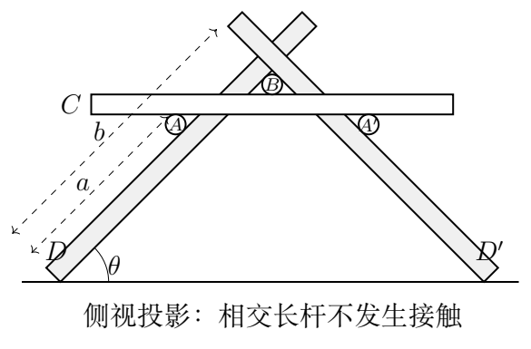

（1）$D$ 杆下端到与 $A$ 杆接触点的长度为 $a$，求下端到与 $B$ 杆接触点的长度 $b$。

（2）利用左右对称，分析 $A,B,C,D$ 的受力。短杆 $A$ 的上方与 $C$ 接触处有向下的 $N_1$、向右的 $f_1$；与斜杆 $D$ 接触处有垂直斜面向左上的 $N_2$、沿斜面向右上的 $f_2$，并受向下重力 $mg$。短杆 $B$ 受 $C$ 向上的 $N_3$、两斜杆向下内侧的 $N_4$，以及重力 $mg$。画出 $C,D$ 的受力图，对 $A,B,C,D$ 分别列力平衡及必要的力矩平衡方程，每对作用力和反作用力用相同符号。

（3）$M=6m$，$\theta=45^\circ$，$L=30\,\mathrm{cm}$，$a=16\,\mathrm{cm}$，$R=2(\sqrt2-1)\,\mathrm{cm}$。求结构保持平衡时 $\mu,\mu'$ 应满足的数值条件，保留三位有效数字。

## 一、题型定位

多刚体静力学与接触摩擦约束。平衡方程先求出“实际需要的接触力”，再用摩擦不等式判断材料是否能提供这些力。几何关系也参与力矩计算，圆柱半径不能在力臂中随意忽略。

求解时需列出短杆的力矩平衡方程。若只列平动平衡，就无法确定上下两处摩擦力之间的关系。

## 二、知识点

每个刚体满足合力为零、合力矩为零；接触法向力必须非负；静摩擦满足 $|f_i|\le\mu_iN_i$。圆柱接触的法向力通过圆柱轴线，因此对其轴线不产生力矩；切向摩擦以半径 $R$ 为力臂。

作用力与反作用力大小相同、方向相反，但分别属于不同刚体的受力图。把同一接触的两个力放进同一个刚体的方程，会错误地相互抵消。

## 三、物理图像

水平杆 $C$ 由两侧短杆 $A,A'$ 支撑；$B$ 压在 $C$ 上，同时挤压两侧斜杆。斜杆与短杆之间的挤压将重力传到地面。左右地面接触处的水平摩擦反向，整体水平合力为零。

实际力传递包含法向分量和切向分量，不能把斜杆简单看成只有轴向压力的二力杆。它同时承受多个接触力与自身重力，必须列力矩平衡。

## 四、解题入口

先由接触几何求 $b-a$。再从 $A$ 的力矩得 $f_1=f_2$，用 $A$ 的水平平衡消去摩擦；然后依次由 $B,C$ 的竖直平衡把 $N_2,N_3,N_4$ 全部用 $N_1$ 表示。最后只需 $D$ 的力矩方程求 $N_1$，其水平、竖直方程给出地面接触力。

## 五、解析

### 1　接触几何与半角公式

短杆 $A$ 与 $C$ 下表面相切，$B$ 与 $C$ 上表面相切；两短杆又分别与斜杆的两侧表面相切。沿 $D$ 的两个接触点相距 $b-a$。把该距离投影到竖直方向，圆柱接触的法向间隔与水平杆厚度共同给出

$$ (b-a)\sin\theta=4R(1+\cos\theta).$$

也可沿两表面的角平分线作辅助线，使用相切圆心到两直线的垂距相等，得到同一关系。利用

$$\frac{1+\cos\theta}{\sin\theta}=\cot\frac\theta2,$$

因此

$$\boxed{b=a+4R\cot\frac\theta2.}$$

当斜面较缓时，同样的圆柱厚度需要更长的沿杆间距，$b-a$ 增大。若算得 $b>L$，该组几何参数根本无法装配成题设接触结构，即使摩擦系数无限大也不能弥补。

### 2　短杆A：三条平衡式

取水平方向向右、竖直方向向上。按题面所给受力方向，$A$ 的竖直平衡为

$$\boxed{N_1+mg=N_2\cos\theta+f_2\sin\theta.}$$

水平平衡为

$$\boxed{f_1+f_2\cos\theta=N_2\sin\theta.}$$

对短杆轴线取力矩：法向力和重力均通过轴线，只有两摩擦产生反向力矩。因力臂都为 $R$，

$$f_1R=f_2R,\qquad\boxed{f_1=f_2\equiv f.}$$

不能因为某根短杆没有转动，就只写两个方向的力平衡；无转动本身要求力矩为零。

### 3　由A的平衡化简接触力

水平式给出

$$f(1+\cos\theta)=N_2\sin\theta,$$

所以

$$\boxed{f=N_2\tan\frac\theta2.}$$

代回竖直式，并利用 $\sin^2\theta/(1+\cos\theta)=1-\cos\theta$，得到

$$N_1+mg=N_2\cos\theta+N_2(1-\cos\theta)=N_2.$$

因此

$$\boxed{N_2=N_1+mg,\qquad
f=(N_1+mg)\tan\frac\theta2.}$$

这个化简说明，两个接触处所需摩擦相同，但法向力不同，摩擦系数下限最终由法向力较小的上方接触控制。

### 4　短杆B与水平杆C

$B$ 光滑，只承受三个法向接触力和自身重力。两侧水平分量抵消，竖直平衡为

$$\boxed{N_3=2N_4\cos\theta+mg.}$$

所有法向力都通过 $B$ 轴线，力矩平衡自动满足。

水平杆 $C$ 的两侧受向上的 $N_1$，中部受 $B$ 向下的 $N_3$，自身重力为 $Mg$。两侧摩擦为向外的 $f$，大小相同、方向相反。因此

$$\boxed{2N_1=N_3+Mg.}$$

左右对称保证 $C$ 的水平合力与合力矩均为零。联立前两式得

$$\boxed{N_4\cos\theta=N_1-\frac12(M+m)g.}$$

接触条件要求 $N_4\ge0$，即 $N_1\ge(M+m)g/2$。如果算出的 $N_4$ 为负，说明假设的接触网络不能保持，不能把“拉力”当成杆间法向支持力。

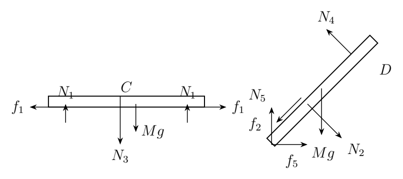

### 5　斜杆D的平动平衡

设地面支持力为 $N_5$，地面摩擦向右、大小为 $f_5$。$A$ 对 $D$ 的作用是 $N_2$ 向右下、$f$ 沿斜面向左下；$B$ 对 $D$ 的 $N_4$ 向左上。斜杆重力为 $Mg$。

竖直方向有

$$\boxed{N_5+N_4\cos\theta
=N_2\cos\theta+f\sin\theta+Mg.}$$

水平方向有

$$\boxed{f_5+N_2\sin\theta
=N_4\sin\theta+f\cos\theta.}$$

若在一般参数下求得 $f_5<0$，只意味着真实地面摩擦与预选方向相反，摩擦条件应使用 $|f_5|$。

### 6　斜杆D的力矩方程与真实力臂

绕斜杆与地面的接触点取力矩，可消去 $N_5,f_5$。斜杆质心的水平坐标距该点为

$$\ell_g=\frac L2\cos\theta-R\sin\theta.$$

第二项来自圆柱底端接地点与杆轴线端点的偏移，不能把有限半径的杆当成零厚度线段。

$N_2,N_4$ 分别以 $a,b$ 为垂直力臂；$f$ 的作用线相对地面接地点有 $2R$ 的垂距。力矩平衡为

$$\boxed{N_2a+Mg\ell_g=N_4b+2Rf.}$$

这也是全题确定内力大小的闭合条件。两个接触法向力尽管都垂直斜杆，作用点不同，对斜杆的力矩不能抵消。

### 7　用一个未知量求所有接触力

令 $t=\tan(\theta/2)$，$w=mg$，将

$$N_2=N_1+w,\quad f=t(N_1+w),\quad
N_4=\frac{N_1-(M+m)g/2}{\cos\theta}$$

代入力矩方程：

$$a(N_1+w)+Mg\ell_g
=\frac b{\cos\theta}\left[N_1-\frac12(M+m)g\right]
+2Rt(N_1+w).$$

把含 $N_1$ 的项归到右边：

$$\left(\frac b{\cos\theta}+2Rt-a\right)N_1
=wa+Mg\ell_g+\frac{(M+m)gb}{2\cos\theta}-2Rtw.$$

所以

$$\boxed{N_1=
\frac{mga+Mg\ell_g+(M+m)gb/(2\cos\theta)-2Rtm g}
{b/\cos\theta+2Rt-a}.}$$

完整计算应先检查分母非零、所有法向力非负及几何可装配。平衡方程的一个代数解，只有满足这些单侧接触条件后才是物理上的平衡解。

### 8　代入本题数据，保留中间精度

统一使用厘米作为长度单位，因为力矩方程所有长度仅以同一比例出现。$\theta=45^\circ$ 时

$$t=\sqrt2-1,\qquad
R=2(\sqrt2-1)\,\mathrm{cm},$$

$$4R\cot22.5^\circ=8\,\mathrm{cm},\qquad b=24\,\mathrm{cm}.$$

质心重力力臂为

$$\ell_g=15\cos45^\circ-R\sin45^\circ
\simeq10.021\,\mathrm{cm}.$$

把 $M/m=6$、$a=16$、$b=24$ 代入力矩式，得到

$$\frac{N_1}{mg}\simeq10.4272,\qquad
\frac{N_2}{mg}\simeq11.4272,$$

$$\frac f{mg}=t\frac{N_2}{mg}\simeq4.73332.$$

继续求得

$$\frac{N_3}{mg}=2\frac{N_1}{mg}-6\simeq14.8545,$$

$$\frac{N_4}{mg}=
\frac{N_1/(mg)-3.5}{\cos45^\circ}\simeq9.79660.$$

所有法向力都为正，故题设接触状态可行。上述内力远大于单根短杆重力，是几何支撑与力矩放大共同造成的，不应仅凭数值大就否定。

### 9　杆间摩擦系数的两个约束

$A$ 上方接触与斜杆接触分别要求

$$f\le\mu N_1,\qquad f\le\mu N_2.$$

因为 $N_2=N_1+mg>N_1$，第一式更严格。所以

$$\mu\ge\frac f{N_1}\simeq0.453938,$$

按三位有效数字写为

$$\boxed{\mu\ge0.454.}$$

这是使假定接触结构能够提供所需静摩擦的下限。实际摩擦仍是 $f$，而不是材料极限 $\mu N_1$。若两接触使用不同材料，应分别检验两个不等式，不能再只给一个共同阈值。

### 10　地面摩擦条件与整体复核

由 $D$ 的竖直方程结合 $A,B,C$ 的结果，可得

$$N_5=\frac32(M+m)g=10.5mg.$$

这也可从整体竖直平衡直接得到：总重力为 $(3M+3m)g$，左右地面支持对称，每侧承担一半。

水平式给出

$$f_5=N_4\sin\theta+f\cos\theta-N_2\sin\theta
\simeq2.19392mg.$$

所以

$$\mu'\ge\frac{|f_5|}{N_5}\simeq0.208945,$$

即

$$\boxed{\mu'\ge0.209.}$$

左右地面摩擦方向相反，因此整体水平合力仍为零。杆间条件和地面条件必须同时满足，不能用较大的杆间摩擦代替不足的地面摩擦。

### 11　重力力矩项的敏感性与模型边界

若忽略杆半径对质心力臂的修正，$\ell_g$ 被误写成 $L\cos\theta/2$，$N_1$、$f$ 和阈值都会改变。虽然本题 $R/L$ 较小，半径还同时决定 $b-a$ 和摩擦力矩，不能在部分关系中保留半径、另一些同阶关系中随意删去。

这个模型的“足够摩擦”只保证静力学平衡的可行性，未进一步分析构件的弹性、屈曲、接触压强或扰动后的动态稳定性。求题设阈值时把这些额外效应加入，会改变问题；讨论真实桥梁时则需另外建模。

\clearpage

# 第 5 题　电偶极子场中的点电荷运动（40分）

质量为 $m$、电荷量为 $e>0$ 的点电荷在固定于原点 $O$ 的电偶极子作用下运动。偶极矩 $\boldsymbol p=p\hat{\boldsymbol z}$，点电荷位置为 $\boldsymbol r(t)$，其大小为 $r(t)$，与偶极矩夹角为 $\theta(t)$。初始位置满足 $r(0)=r_0>0$、$\theta(0)=\theta_0$。真空介电常量为 $\varepsilon_0$，场和电势为

$$\boldsymbol E=\frac{3(\boldsymbol p\cdot\hat{\boldsymbol r})\hat{\boldsymbol r}-\boldsymbol p}
{4\pi\varepsilon_0r^3},\qquad
\phi=\frac{\boldsymbol p\cdot\boldsymbol r}{4\pi\varepsilon_0r^3}.$$

（1）假定点电荷在垂直 $z$ 轴的平面内绕 $z$ 轴作匀速圆周运动，求 $\theta_0$ 和速度 $v_0$。

（2）假定 $t=0$ 时点电荷静止，求：（i）角动量大小 $L$ 对 $\theta$ 的关系；（ii）径向速率 $v_r$ 对 $r$ 的关系；（iii）运动有界的 $\theta_0$ 条件，及取边界值时在竖直平面内的轨道；（iv）运动无界时 $r(t)$。不讨论点电荷与偶极子碰撞以后的情况。

## 一、题型定位

非中心静电场中的动力学与可分离积分。场具有绕 $z$ 轴的对称性，但并非中心力，因此总角动量通常不守恒。由静止释放时运动限制在一个含 $z$ 轴的平面内，角动量定理仍可积分出一个特殊组合不变量。

本题的径向方程最终不含瞬时角度，原因是角运动的动能和偶极子势能中的角度项恰好相消。这个消元结构来自 $1/r^2$ 势能的特殊形式。

## 二、知识点

球坐标和柱坐标的分量投影；圆周运动的向心条件；角动量定理；机械能守恒；径向速度与径向速率的区别；初值问题与运动分支。固定偶极子提供保守静电场，因此点电荷机械能守恒；固定约束可承受反作用，点电荷的线动量不守恒。

为简化记号，以下定义正量

$$\kappa=\frac{ep}{4\pi\varepsilon_0}>0.$$

点电荷势能为 $U=\kappa\cos\theta/r^2$，单位检验要求 $\kappa$ 的量纲为能量乘长度平方。

## 三、物理图像

偶极子北侧的正电荷受到偏向外侧的力，南侧则具有吸引分量。绕轴圆周运动必须既不沿 $z$ 轴加速，又有指向轴线的水平力；这两个条件会筛掉一个看似合法的角度根。

由静止释放时初始位置、偶极矩和力都在同一竖直平面中，后续加速度也保持在该平面内。角动量方向垂直该平面，大小随运动变化。

## 四、解题入口

第一问用柱坐标投影，先令 $F_z=0$，再检查柱径向力是否朝向转轴。第二问先写平面极坐标的 $L=mr^2\dot\theta$ 和力矩，乘以 $L$ 后把时间微分转成角度微分。得到组合不变量后再代入能量式，径向运动即可独立求出。

## 五、解析

### 1　圆周运动的竖直条件

匀速绕 $z$ 轴的圆轨道上，$r=r_0$、$\theta=\theta_0$ 都不变。电场沿 $z$ 轴的投影为

$$E_z=\frac p{4\pi\varepsilon_0r_0^3}
(3\cos^2\theta_0-1).$$

竖直加速度为零，故

$$3\cos^2\theta_0-1=0,\qquad
\cos\theta_0=\pm\frac1{\sqrt3}.$$

这只是“高度不变”的条件，还没有保证水平力是向心力。

### 2　筛选向心分支并求速度

取柱径向单位矢量 $\hat{\boldsymbol\rho}$ 向外。因偶极矩没有柱径向投影，

$$F_\rho=eE_\rho=
\frac{3\kappa}{r_0^3}\cos\theta_0\sin\theta_0.$$

圆轨道柱半径为 $\rho_0=r_0\sin\theta_0$。向心力要求 $F_\rho<0$，所以只可取

$$\boxed{\cos\theta_0=-\frac1{\sqrt3},\qquad
\theta_0=\arccos(-1/\sqrt3).}$$

由 $m v_0^2/\rho_0=-F_\rho$，

$$v_0^2=-\frac{3\kappa}{mr_0^2}
\cos\theta_0\sin^2\theta_0
=\frac{2\kappa}{\sqrt3mr_0^2}.$$

因此

$$\boxed{v_0=\sqrt{\frac{\sqrt3,ep}{6\pi\varepsilon_0mr_0^2}}.}$$

轨道位于 $z=-r_0/\sqrt3$ 的水平面，半径为 $r_0\sqrt{2/3}$。它绕轴的角动量分量不为零，和下一问“从静止释放、在竖直平面内运动”是两组不同初始条件，不能混用。

### 3　竖直平面内的场分量与力矩

在该平面内使用径向、角向单位矢量。偶极矩可写为

$$\boldsymbol p=p\cos\theta\hat{\boldsymbol r}
-p\sin\theta\hat{\boldsymbol\theta}.$$

代入场式得到

$$F_r=\frac{2\kappa\cos\theta}{r^3},\qquad
F_\theta=\frac{\kappa\sin\theta}{r^3}.$$

角动量的有向标量为 $\ell=mr^2\dot\theta$，力矩为 $rF_\theta$，故

$$\frac{d\ell}{dt}=\frac{\kappa\sin\theta}{r^2}.$$

瞬时 $\ell$ 并不守恒。如果仅因“绕原点运动”就写 $L=$常量，会使后续的径向结果全部失真。

### 4　角动量组合不变量

在运动保持一个角向分支的区间，等式两边乘以 $\ell=mr^2\dot\theta$：

$$\ell\dot\ell=m\kappa\sin\theta\dot\theta.$$

于是

$$\frac{d}{dt}\left(\ell^2+2m\kappa\cos\theta\right)=0.$$

初始静止使 $\ell(0)=0$，所以

$$\boxed{L^2=2m\kappa(\cos\theta_0-\cos\theta),}$$

其中 $L=|\ell|$。恢复原参量为

$$\boxed{L(\theta)=
\sqrt{\frac{mep}{2\pi\varepsilon_0}
(\cos\theta_0-\cos\theta)}.}$$

由于 $L^2\ge0$，可达角度须满足 $\cos\theta\le\cos\theta_0$。这里的不变量不是“角动量守恒”，而是角动量平方与角势能组合守恒。

若轨道越过负 $z$ 轴，通常球坐标角 $\theta\in[0,\pi]$ 会折返。要连续描述竖直平面的转角，可用有向平面角 $\psi$；它满足 $\cos\theta=\cos\psi$。以上平方关系不受这种角坐标分支改变影响。

### 5　能量式消去角运动

初始静止时总能量为

$$E=\frac{\kappa\cos\theta_0}{r_0^2}.$$

平面极坐标速度平方为 $\dot r^2+r^2\dot\theta^2$，因此

$$\frac12m\dot r^2+\frac{L^2}{2mr^2}
+\frac{\kappa\cos\theta}{r^2}
=\frac{\kappa\cos\theta_0}{r_0^2}.$$

代入角动量不变量：

$$\frac{L^2}{2mr^2}+\frac{\kappa\cos\theta}{r^2}
=\frac{\kappa\cos\theta_0}{r^2}.$$

所以角度完全消掉，得到

$$\boxed{\dot r^2=\frac{2\kappa\cos\theta_0}{m}
\left(\frac1{r_0^2}-\frac1{r^2}\right).}$$

题目所求径向速率是非负量

$$\boxed{v_r=|\dot r|=
\sqrt{\frac{ep\cos\theta_0}{2\pi\varepsilon_0m}
\left(\frac1{r_0^2}-\frac1{r^2}\right)}.}$$

当电荷向原点接近，$\dot r<0$，但 $v_r>0$。不能把这一正平方根在所有分支都写成 $dr/dt$。

### 6　径向二阶方程保证初始分支

极坐标径向运动满足

$$m(\ddot r-r\dot\theta^2)=\frac{2\kappa\cos\theta}{r^3}.$$

将 $mr\dot\theta^2=L^2/(mr^3)$ 与角动量关系代入，有

$$\boxed{\ddot r=\frac{2\kappa\cos\theta_0}{mr^3}.}$$

这条二阶方程还能解决平方根式在静止初值处的分支问题：若 $\cos\theta_0>0$，初始径向加速度向外，电荷立即进入 $r>r_0$；若小于零，径向加速度向内，进入 $r<r_0$；若为零，$\ddot r=0$ 且初始径向速度为零，半径始终不变。

因此不应仅根据 $\dot r^2\ge0$ 的代数区间就断言电荷一定会运动，还要检查完整动力学。

### 7　有界条件与边界轨道

对 $0\le\theta_0<\pi/2$，$\cos\theta_0>0$，半径向外增长；当 $r\to\infty$，径向速率趋于正常量

$$v_{r,\infty}=\sqrt{\frac{2\kappa\cos\theta_0}{mr_0^2}}.$$

所以运动无界。对 $\theta_0>\pi/2$，半径不超过 $r_0$，在理想偶极子奇点模型中最终接近原点；这在碰撞前是空间有界运动，不必是周期运动。

对 $\theta_0=\pi/2$，半径恒为 $r_0$，并且

$$L^2=-2m\kappa\cos\theta\ge0.$$

电荷从赤道处向负 $z$ 方向加速，沿下半圆到对侧赤道后转向。因此

$$\boxed{\theta_0\ge\pi/2\text{ 时运动有界；边界轨道为}\ r=r_0\text{ 的下半圆。}}$$

“下半圆轨道”描述电荷能走过的空间曲线，并非匀速运动。到最低点速度最大，到两端赤道位置速度为零。

### 8　无界运动的半径随时间变化

在 $\cos\theta_0>0$ 的向外分支，令

$$A=\frac{2\kappa\cos\theta_0}{mr_0^2}>0.$$

速度方程为

$$\frac{dr}{dt}=\sqrt A\frac{\sqrt{r^2-r_0^2}}r.$$

分离变量：

$$\frac{r\,dr}{\sqrt{r^2-r_0^2}}=\sqrt A\,dt.$$

左侧正是 $d\sqrt{r^2-r_0^2}$，从 $t=0,r=r_0$ 积分得

$$\sqrt{r^2-r_0^2}=\sqrt A,t.$$

于是

$$\boxed{r(t)=\sqrt{r_0^2+
\frac{ep\cos\theta_0}{2\pi\varepsilon_0mr_0^2}t^2}.}$$

求导得 $\dot r=At/r$、$\ddot r=Ar_0^2/r^3$，直接符合二阶径向方程，并满足 $\dot r(0)=0$。远时 $r\sim\sqrt A,t$，和渐近径向速率一致。

### 9　边界轨道上的速率与周期积分

在 $r=r_0$ 的边界轨道，动能完全是角运动，能量为零，所以

$$v^2=-\frac{2\kappa\cos\theta}{mr_0^2}.$$

最低点 $\theta=\pi$，速率为

$$v_{\max}=\sqrt{\frac{2\kappa}{mr_0^2}}.$$

以连续有向角 $\psi$ 表示从右赤道到左赤道的一程，$\pi/2\le\psi\le3\pi/2$，

$$dt=\sqrt{\frac{mr_0^4}{2\kappa}}
\frac{d\psi}{\sqrt{-\cos\psi}}.$$

一程时间为上述区间的积分，往返周期为其两倍。端点的 $1/\sqrt{|\psi-\psi_{\rm end}|}$ 奇性可积，因此一程时间有限。它与球面上的水平圆周匀速轨道不同：这里同一半圆曲线被往返走过。

### 10　一般初速度下的径向组合

若在同一竖直平面内给非零初始角向速度，则组合不变量仍为

$$C=L^2+2m\kappa\cos\theta
=L_0^2+2m\kappa\cos\theta_0.$$

总能量 $E$ 给出

$$\frac12m\dot r^2+\frac{C}{2mr^2}=E.$$

这样可把角运动消去，得到有效径向势 $C/(2mr^2)$。它与通常中心势问题中的离心势相似，但 $C$ 含角势能的组合，而不是单独的守恒角动量平方。对本题静止释放，$C=2m\kappa\cos\theta_0$，正负号恰好决定向外、向内与边界三类运动。

### 11　向内分支的有限时间尺度

若 $\cos\theta_0<0$，从完整二阶径向方程及初值积分得到

$$r^2(t)=r_0^2-
\frac{2\kappa|\cos\theta_0|}{mr_0^2}t^2.$$

理想奇点模型到达原点的时间为

$$t_c=r_0^2\sqrt{\frac{m}{2\kappa|\cos\theta_0|}}.$$

这不要求轨道是一条径向直线；除轴上释放外，角运动同时存在，但组合不变量使半径仍满足这个关系。$\theta_0\to\pi/2^+$ 时 $t_c$ 增大，边界处转为恒定半径轨道。公式只描述到奇点前的运动，不规定碰撞后如何继续。

\clearpage

# 第 6 题　涡电流的悬浮与热效应（40分）

交变磁场在导体内部产生涡电流，可用于加热、制动和悬浮。半径为 $b$ 的水平圆线圈固定于桌面，电流为 $I(t)=I_0\cos\omega t$。重力大小为 $G$、半径为 $a$、电导率为 $\sigma$ 的导体球位于线圈中心正上方，高度为 $h$。已知 $a\ll b$，趋肤深度

$$\delta=\sqrt{\frac2{\omega\mu_0\sigma}}\ll a,$$

其中 $\mu_0$ 为真空磁导率，忽略电磁辐射。

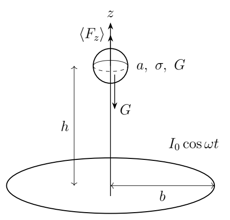

（1）将原来内部无磁场、半径为 $a$ 的理想导体球（$\sigma\to\infty$）放在均匀稳恒外场 $\boldsymbol B_e=B_e\hat{\boldsymbol z}$ 中。已知球外附加场等效于球心磁偶极矩 $\boldsymbol m$ 的场

$$\boldsymbol B'=\frac{\mu_0}{4\pi r^3}
[3(\boldsymbol m\cdot\hat{\boldsymbol r})\hat{\boldsymbol r}-\boldsymbol m].$$

求 $\boldsymbol m$ 和球面电流密度分布。

（2）求圆线圈在球心处的磁感应强度 $\boldsymbol B(t)$。

（3）求悬浮在给定高度 $h$ 所需的电流幅值 $I_0$。假设频率足够高，球在悬浮位置附近的振动幅度可忽略。提示：磁偶极矩与外场均沿 $z$ 轴时，安培力为 $\boldsymbol F=m(dB_e/dz)\hat{\boldsymbol z}$。

（4）把趋肤层内沿径向的涡电流近似为均匀分布，其余球内电流为零。求一个周期的平均热功率，最终式不含 $\delta$。

## 一、题型定位

磁场边界条件、感应磁矩、空间非均匀磁场中的力和趋肤层焦耳热。理想导体部分提供有限电导率、高频极限下的领先阶面电流；再用趋肤层厚度把面电流转为体电流，估算耗散。

求磁矩用磁场法向连续；求电流用切向磁场跃变。两种边界关系分别回答不同问题，不能相互代替。

## 二、知识点

磁场满足无磁单极子的高斯定理；球面面电流 $\boldsymbol K$ 满足 $\mu_0\boldsymbol K=\hat{\boldsymbol r}\times(\boldsymbol B_{\rm out}-\boldsymbol B_{\rm in})$。圆线圈轴上场由毕奥—萨伐尔定律求出。导体热功率密度为 $J^2/\sigma$，交变正弦的平方在一个周期内平均为 $1/2$。

题中球内磁场始终为零依赖“初始无磁场”的条件。理想导体保持初始磁通的行为，不应省略初始条件后推广成任意静磁场都自动被排斥。

## 三、物理图像

感应环流的磁矩反向于外场，使球内磁场抵消。在线圈上方，外场幅值随高度降低，反向磁矩受到向上的力。每半个周期外场与感应磁矩同时反号，力仍向上，因此平均力可平衡重力。

电流集中于厚度 $\delta$ 的薄层。面电流一定时，层越薄，体电流密度越大；焦耳热并不只由球体体积决定。

## 四、解题入口

令球外总場为外场加偶极子场，先在 $r=a$ 令法向分量为零，求磁矩。再代回切向场求 $\boldsymbol K$。线圈轴上场写成 $B_0(z)\cos\omega t$，对 $z$ 求导，再平均磁力。热量从体积分出发，先做球面角积分，最后消去趋肤深度。

## 五、解析

### 1　球面的法向磁场条件

由对称性，感应磁矩沿 $z$ 轴，设其有向分量为 $m$。球外总場的径向分量为

$$B_r=B_e\cos\theta+\frac{\mu_0}{4\pi r^3},2m\cos\theta.$$

球内磁场为零，法向分量连续，所以 $r=a$ 处

$$B_e\cos\theta+\frac{\mu_0m}{2\pi a^3}\cos\theta=0.$$

这个关系须对所有 $\theta$ 成立，故

$$\boxed{\boldsymbol m=-\frac{2\pi a^3}{\mu_0}\boldsymbol B_e.}$$

负号表示反向感应；磁矩正比于球体积尺度 $a^3$。只在赤道取法向条件会得到恒等式0=0，不能据此求磁矩。

### 2　切向磁场与面电流方向

外场的球坐标角向分量为 $-B_e\sin\theta$。偶极子場的角向分量为 $\mu_0m\sin\theta/(4\pi a^3)$，代入磁矩得

$$B_{\theta,\rm out}=-B_e\sin\theta-\frac12B_e\sin\theta
=-\frac32B_e\sin\theta.$$

球内切向场仍为零。由面电流边界条件和 $\hat{\boldsymbol r}\times\hat{\boldsymbol\theta}=\hat{\boldsymbol\phi}$，

$$\boxed{\boldsymbol K(\theta)
=-\frac{3B_e}{2\mu_0}\sin\theta\,\hat{\boldsymbol\phi}.}$$

电流在两极为零、赤道最大。外场沿正 $z$ 时电流沿负方位方向，按右手定则产生负 $z$ 磁矩，符合反向感应的物理图像。

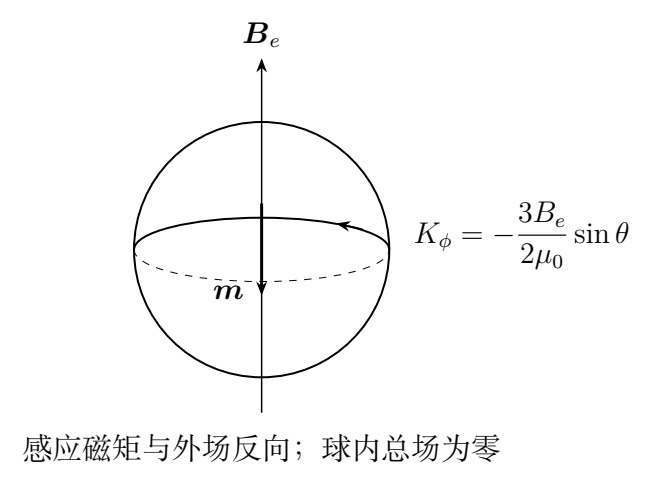

### 3　积分复核磁矩

面电流分布的磁矩可由

$$\boldsymbol m=\frac12\int\boldsymbol r\times\boldsymbol K\,dS$$

求得。设 $K_\phi=K_0\sin\theta$，$dS=a^2\sin\theta\,d\theta\,d\phi$。$z$ 分量为

$$m_z=\frac12a^3K_0\int_0^{2\pi}d\phi
\int_0^\pi\sin^3\theta\,d\theta.$$

利用 $\int_0^\pi\sin^3\theta\,d\theta=4/3$，

$$m_z=\frac{4\pi a^3}{3}K_0
=-\frac{2\pi a^3}{\mu_0}B_e.$$

因此面电流边界条件所得分布与法向条件所得磁矩一致。这项积分同时检查了 $3/2$ 系数与电流方向。

### 4　圆线圈轴上场的积分

轴上点高度为 $z$，到任意线元距离为 $\sqrt{b^2+z^2}$。各线元的水平场分量相互抵消，竖直分量相加。毕奥—萨伐尔定律给出

$$B_z=\frac{\mu_0I}{4\pi}
\frac b{(b^2+z^2)^{3/2}}\int_0^{2\pi}b\,d\phi,$$

所以

$$\boxed{\boldsymbol B(z,t)=
\frac{\mu_0I_0b^2}{2(b^2+z^2)^{3/2}}
\cos\omega t\,\hat{\boldsymbol z}.}$$

球心处 $z=h$，定义幅值

$$B_0=\frac{\mu_0I_0b^2}{2(b^2+h^2)^{3/2}}.$$

当 $z=0$，它回到线圈中心场 $\mu_0I/(2b)$；远轴上 $z\gg b$ 时衰减为 $z^{-3}$，与磁偶极子场一致。

### 5　感应磁矩的瞬时力

由于 $a\ll b$，球附近的外场近似均匀；又因 $\delta\ll a$，感应磁矩取理想导体的领先阶：

$$m(z,t)\simeq-\frac{2\pi a^3}{\mu_0}B(z,t).$$

按题目给出的力公式，先对外场作空间导数：

$$F_z=m\frac{\partial B}{\partial z}
=-\frac{2\pi a^3}{\mu_0}B\frac{\partial B}{\partial z}
=-\frac{\pi a^3}{\mu_0}\frac{\partial B^2}{\partial z}.$$

这里空间导数作用于外场，并非把 $mB$ 当固定磁矩势能随意求导。因磁矩由场感应，直接求 $-mB$ 的全导数会多一个因子2。

对线圈场平方求导：

$$\frac{\partial B^2}{\partial z}
=-\frac{3\mu_0^2I_0^2b^4z}{2(b^2+z^2)^4}
\cos^2\omega t.$$

所以

$$\boxed{F_z(z,t)=
\frac{3\pi\mu_0a^3b^4zI_0^2}{2(b^2+z^2)^4}
\cos^2\omega t.}$$

对 $z>0$，力始终向上。反转线圈电流不会反转该力，因为感应磁矩同时反转。

### 6　平均力与悬浮电流

在球的位移一个电流周期内可忽略时，固定 $z=h$ 再取时间平均，得

$$\boxed{\langle F_z\rangle=
\frac{3\pi\mu_0a^3b^4hI_0^2}{4(b^2+h^2)^4}.}$$

令平均力等于重力 $G$，

$$\boxed{I_0=\sqrt{
\frac{4G(b^2+h^2)^4}{3\pi\mu_0a^3b^4h}}.}$$

该式求的是峰值电流，若问有效值，则应除以 $\sqrt2$。用有效值平均后再乘 $1/2$，会重复平均而少一个因子2。

### 7　趋肤层体电流与焦耳热微元

把面电流 $\boldsymbol K$ 均匀分摊到厚度 $\delta$ 中，题设近似给出

$$\boldsymbol J=\frac{\boldsymbol K}{\delta}
=-\frac{3B(t)}{2\mu_0\delta}\sin\theta\,
\hat{\boldsymbol\phi}.$$

体功率密度为

$$p_J=\frac{J^2}{\sigma}
=\frac{9B(t)^2}{4\mu_0^2\sigma\delta^2}\sin^2\theta.$$

球壳体积微元为 $r^2\sin\theta\,dr\,d\theta\,d\phi$，电流只在 $a-\delta<r<a$ 中存在，故

$$P(t)=\frac{9B(t)^2}{4\mu_0^2\sigma\delta^2}
\int_{a-\delta}^a r^2dr
\int_0^\pi\sin^3\theta d\theta
\int_0^{2\pi}d\phi.$$

径向积分为

$$\frac{a^3-(a-\delta)^3}{3}
=a^2\delta-a\delta^2+\frac{\delta^3}{3}
\simeq a^2\delta.$$

保留薄层领先阶，并用角积分 $4/3$，得到

$$\boxed{P(t)\simeq
\frac{6\pi a^2}{\mu_0^2\sigma\delta}B(t)^2.}$$

若在题设均匀电流模型中保留有限厚度修正，还要乘 $1-\delta/a+\delta^2/(3a^2)$；本题只要求 $\delta\ll a$ 的近似。

### 8　平均功率并消去趋肤深度

$B(t)=B_0\cos\omega t$，因此

$$\langle P\rangle=
\frac{3\pi a^2B_0^2}{\mu_0^2\sigma\delta}
=\frac{3\pi a^2b^4I_0^2}
{4(b^2+h^2)^3\sigma\delta}.$$

利用

$$\frac1{\sigma\delta}=\sqrt{\frac{\omega\mu_0}{2\sigma}},$$

最终为

$$\boxed{\langle P\rangle\simeq
\frac{3\pi a^2b^4I_0^2}{8(b^2+h^2)^3}
\sqrt{\frac{2\omega\mu_0}{\sigma}}.}$$

功率始终非负。在场幅值一定时，电导率增大使热损失下降；频率增大使趋肤层变薄，功率按 $\sqrt\omega$ 增长。该比例限于题设高电导、薄趋肤层且忽略辐射的模型。

### 9　悬浮条件下的热功率

把平均力平衡求出的 $I_0^2$ 代入功率，可消去线圈电流：

$$\boxed{\langle P\rangle_{\rm lev}
=\frac{G(b^2+h^2)}{a h}
\sqrt{\frac{\omega}{2\mu_0\sigma}}.}$$

也可利用 $1/(\mu_0\sigma\delta)=\omega\delta/2$ 写为

$$\langle P\rangle_{\rm lev}
=\frac{G(b^2+h^2)}{2ah}\omega\delta.$$

这个式子显示，在给定几何和重力下，悬浮的平均力可在理想极限保持有限，而热损失随着 $\sigma\to\infty$ 趋于零。没有必要用耗散产生热来解释平均磁力的存在，两者的物理来源不同。

### 10　平均平衡与竖直稳定性的区别

平均力随高度为 $F_{\rm av}(z)=Cz/(b^2+z^2)^4$，其中 $C>0$。其导数为

$$F'_{\rm av}(z)=C\frac{b^2-7z^2}{(b^2+z^2)^5}.$$

在固定电流下，向上偏移后平均支持力减小才具有竖直恢复性，所以稳定侧要求 $h>b/\sqrt7$。对球质量 $M_s=G/g$，竖直慢振动频率满足

$$\Omega_z^2=-\frac{F'_{\rm av}(h)}{M_s}
=\frac{g(7h^2-b^2)}{h(b^2+h^2)}.$$

这只是竖直稳定性分析，未判断横向稳定性。原题第三问只要求给定位置的平均力平衡；补充此条件能避免把任意代数平衡点都当成稳定悬浮。

### 11　高频近似的位移尺度

平衡高度处 $F_z(t)=G[1+\cos2\omega t]$。减去重力后，快速加速度近似为 $g\cos2\omega t$，其受迫位移幅值为

$$\Delta z_{\rm fast}\simeq\frac g{4\omega^2}.$$

因此需同时满足位移远小于场幅值变化尺度，并使 $\omega$ 远大于慢振动频率；另外仍须满足 $\delta\ll a$。单纯说“频率高”不能替代这两类不同的尺度检查。

\clearpage

# 第 7 题　大气温度、声速与远程声传播（40分）

大气最底部为对流层，厚度约10 km，温度随高度升高而降低；其上约10 km范围内温度近似不变，称同温层；更高的一段温度随高度升高而增加，称逆温层。

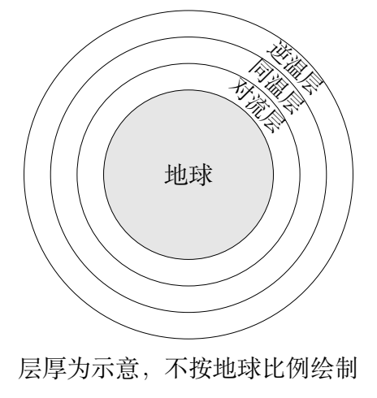

（1）把对流层的温度变化看成空气缓慢绝热上升的结果，求温度与高度 $z$ 的关系。地表温度为 $T_0$，空气为理想气体，摩尔质量为 $\mu$，比热比 $\gamma$ 为常数，普适气体常量为 $R$，重力加速度 $g$ 视为常量。

（2）气体声速为 $v_s=\sqrt{(dp/d\rho)_{\rm ad}}$，$p$ 为压强，$\rho$ 为密度。不考虑风，求声速与温度的关系，讨论三层中声速随高度的变化。

（3）进一步简化：界面为平面；对流层与逆温层温度都为 $-10^\circ\mathrm C$，同温层为 $-55^\circ\mathrm C$。同温层内声源的声波入射至上下界面时，讨论不同入射角的折射与全反射，并画定性光路图。$0^\circ\mathrm C=273.15\,\mathrm K$。

（4）仍用各层恒温、两外层较暖的模型，但界面改为与地球同心的球面。声源和探测气球分别位于对流层或同温层。忽略地面反射和可发生折射时的反射，不考虑吸收。对四种位置组合，判断哪些能探测几千公里外的声音，哪些只能探测小于1000 km的声音，并估算解释。地球半径 $R_e\simeq6371\,\mathrm{km}$。

## 一、题型定位

热力学、静力平衡与几何声学的综合。先从空气微元的力平衡和绝热状态关系求温度梯度，再从绝热压缩求声速；最后把声速作为折射问题中的传播速度，分析冷层内的导波。

第一问的温度梯度来自绝热模型，第三、四问则明确改为分层恒温模型，两种近似用于不同小问，不能同时把连续梯度与突变界面都算进同一条光路。

## 二、知识点

静力平衡 $dp/dz=-\rho g$；理想气体 $p=\rho RT/\mu$；绝热过程 $pV^\gamma=$常量；绝热声速 $v_s^2=\gamma p/\rho$；几何声学的折射律 $\sin\alpha/v=$常量；全反射条件；球面地平线的几何距离。

折射角始终从界面法线量起。光学折射率正比于传播速度的倒数，声学直接使用速度更方便，但不能把折射律中的速度比写反。

## 三、物理图像

空气上升时外界压强降低，空气绝热膨胀并冷却；空气声速与绝对温度的平方根成正比。冷同温层的声速较低，相当于声学的高折射率层，被两侧较快的暖层包围。

同温层内接近掠射的声线在上下边界全反射，可沿冷层远距离传播。对流层与同温层之间的折射连通声线则受到地球遮挡，不能沿直线无限延伸。

## 四、解题入口

先对薄空气柱列压力与重力平衡，转成微分式。绝热关系改写为 $p^{1-\gamma}T^\gamma=$常量后取对数求导，消去压强梯度。声速推导使用 $p=C\rho^\gamma$。折射部分先把摄氏温度换成开尔文，最后分别画平面声导管与球面地平线。

## 五、解析

### 1　空气微元的静力平衡

取截面积 $A$、高度 $dz$ 的空气薄层。下面压力向上，为 $p(z)A$，上面压力向下，为 $p(z+dz)A$，重力为 $\rho A,dz,g$。慢过程近似平衡：

$$p(z)A-p(z+dz)A-\rho A,dz,g=0.$$

除以 $A,dz$ 并取极限：

$$\boxed{\frac{dp}{dz}=-\rho g.}$$

由理想气体状态关系，$\rho=\mu p/(RT)$，因此

$$\boxed{\frac{d\ln p}{dz}=-\frac{\mu g}{RT}.}$$

这里的密度不是常数。如果把 $\rho$ 当成地表密度积分，无法与气体的绝热关系一致。

### 2　绝热关系与温度梯度

对固定物质的量的空气，$V=nRT/p$。把它代入 $pV^\gamma=$常量，可得

$$p^{1-\gamma}T^\gamma=\text{常量}.$$

取对数微分：

$$-(\gamma-1)d\ln p+\gamma d\ln T=0.$$

所以

$$\frac1T\frac{dT}{dz}
=\frac{\gamma-1}{\gamma}\frac{d\ln p}{dz}
=-\frac{\gamma-1}{\gamma}\frac{\mu g}{RT}.$$

消去 $T$，得到常温降率

$$\boxed{\frac{dT}{dz}=-\Gamma,\qquad
\Gamma=\frac{\gamma-1}{\gamma}\frac{\mu g}{R}.}$$

由 $T(0)=T_0$，积分为

$$\boxed{T(z)=T_0-\frac{\gamma-1}{\gamma}\frac{\mu g}{R}z.}$$

本式只用于题设对流层的绝热、近似定 $g$ 模型。不能把它向任意高处外推到负温度。

### 3　压强和密度的伴随分布

由绝热关系，

$$\frac{p(z)}{p_0}=
\left(\frac{T(z)}{T_0}\right)^{\gamma/(\gamma-1)}.$$

再用理想气体密度：

$$\frac{\rho(z)}{\rho_0}=
\left(\frac{T(z)}{T_0}\right)^{1/(\gamma-1)}.$$

将 $p(z)$ 求导，能恢复 $dp/dz=-\rho g$，这是一项完整模型的相互检验。该模型把绝热上升的空气团看成随高度近似平衡；真实大气中的水汽、对流混合与辐射会改变温降率，题目没有要求把这些因素加入。

### 4　从压缩响应推导声速

声波中的小范围压缩膨胀发生得较快，按题设视为绝热。固定质量气体满足 $p=C\rho^\gamma$，因此

$$\left(\frac{dp}{d\rho}\right)_{\rm ad}
=\gamma C\rho^{\gamma-1}=\frac{\gamma p}{\rho}.$$

利用 $p/\rho=RT/\mu$：

$$\boxed{v_s=\sqrt{\frac{\gamma RT}{\mu}}.}$$

声速式中的 $T$ 必须是绝对温度。对流层中 $T$ 下降，所以 $v_s$ 下降；同温层 $T$ 不变，声速近似不变；逆温层 $T$ 上升，声速上升。

声速不是由压强单独决定的。在同一温度、成分及比热比下，改变压强同时改变密度，$p/\rho$ 保持不变，所以领先阶声速不随压强变化。

### 5　两层声速比和临界角

暖层、冷层温度分别为

$$T_o=263.15\,\mathrm K,\qquad T_i=218.15\,\mathrm K.$$

比热比与摩尔质量相同，所以

$$\frac{v_o}{v_i}=\sqrt{\frac{T_o}{T_i}}
=\sqrt{\frac{263.15}{218.15}}\simeq1.0983.$$

冷层入射角为 $\alpha_i$，暖层折射角为 $\alpha_o$，折射律为

$$\frac{\sin\alpha_i}{v_i}=\frac{\sin\alpha_o}{v_o},$$

即 $\sin\alpha_o=(v_o/v_i)\sin\alpha_i$。暖层速度较大，折射角更大，声线偏离法线。

存在实数折射角要求 $(v_o/v_i)\sin\alpha_i\le1$。临界角为

$$\boxed{\alpha_c=\arcsin\frac{v_i}{v_o}
=\arcsin\sqrt{\frac{218.15}{263.15}}
\simeq65.6^\circ.}$$

直接用摄氏温度比 $(-55)/(-10)$ 会导致错误结果；两温度均为负并不意味着传播速度为负。

### 6　折射、全反射与临界掠射

当 $0\le\alpha_i<\alpha_c$，可以折射入暖层，一般也有反射。原题第三问讨论这些行为，并不要求计算反射强度。

当 $\alpha_i>\alpha_c$，没有向暖层传播的几何折射线，发生全反射。当 $\alpha_i=\alpha_c$，折射方向沿界面，属于临界掠射边界，不能把它画成普通穿入暖层的斜线。

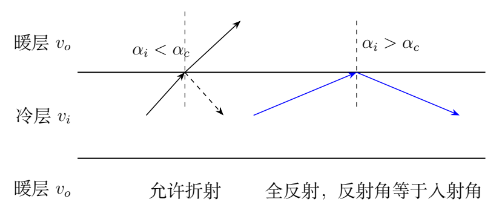

定义相对水平面的掠射角 $\beta=90^\circ-\alpha_i$，则冷层导波条件为

$$|\beta|<90^\circ-\alpha_c\simeq24.4^\circ.$$

上下暖层温度相同，所以两个界面的临界角相同。在平行界面之间反射不改变入射角，满足全反射的声线可以在冷层内反复传播。

### 7　为什么平面无限传播不足以回答远距离问题

第三问可以把界面视为平面，因为它只讨论局部折射。第四问距离达到数百至数千公里，地球曲率不再可忽略。即使各层内部声线是直线，直线在球形地球附近也可能被地面阻挡。

对半径 $R_e$ 的地球，在高度 $h$ 的点到地表切点的直线距离为

$$d_H(h)=\sqrt{(R_e+h)^2-R_e^2}
=\sqrt{2R_eh+h^2}.$$

当 $h\ll R_e$，可近似为 $\sqrt{2R_eh}$。对应地表弧长为 $R_e\arccos[R_e/(R_e+h)]$，在低高度极限与上述距离同阶。题目只要求区分数百公里和几千公里，不必把这两种距离在最低阶估算中混为精确等式。

### 8　声源与气球都在对流层

暖对流层向冷同温层传播时，从快介质入慢介质，不会发生全反射。按第四问忽略可折射时的反射，声线进入冷层；若它能进入冷层，也不能随后自动变成无法透出的全反射导波，因为同一条折射线的角条件保持连通性。

可到达的直接声线首先受地表遮挡限制。把声源和气球都取在对流层顶部 $h_1=10$ km，给出最大可见距离的估算：

$$l_1\lesssim2d_H(h_1)
\simeq2\sqrt{2R_eh_1}\simeq714\,\mathrm{km}.$$

因此按题设模型属于短距离探测，不能探测数千公里外的声音。源与气球实际更低时，范围还会减小。

### 9　一个在对流层，一个在同温层

若声源在对流层、气球在同温层，声线可折射进入冷层，却不能通过许多次无泄漏全反射后再被同温层远处气球接收。估算上界取对流层顶 $h_1=10$ km 和同温层顶 $h_2=20$ km：

$$l_2\lesssim d_H(h_1)+d_H(h_2)$$

$$\simeq\sqrt{2R_eh_1}+\sqrt{2R_eh_2}
\simeq862\,\mathrm{km}.$$

反过来，声源在同温层、气球在对流层，可传入对流层的声线须低于临界角，按题设忽略同时存在的反射，它离开冷层后仍受地球遮挡。由声传播互易性得到同样的距离量级。

这两个组合都不能在本题简化模型中利用冷层的封闭导波无限增加探测距离。若真实环境允许多次部分反射或风场折射，则已经超出此小问给定的近似。

### 10　两者都在同温层

同温层内可存在上下界面均全反射的掠射声线。地球曲率使各次反射的局部法线改变，但层厚远小于地球半径，可以选择足够接近水平的声线，使全反射条件持续满足。

这种声线既不进入地面，也不透射到外部暖层，能沿同温层绕地球传播。在忽略吸收、散射与其他损失的题设下，可探测数千公里外的同温层声源。

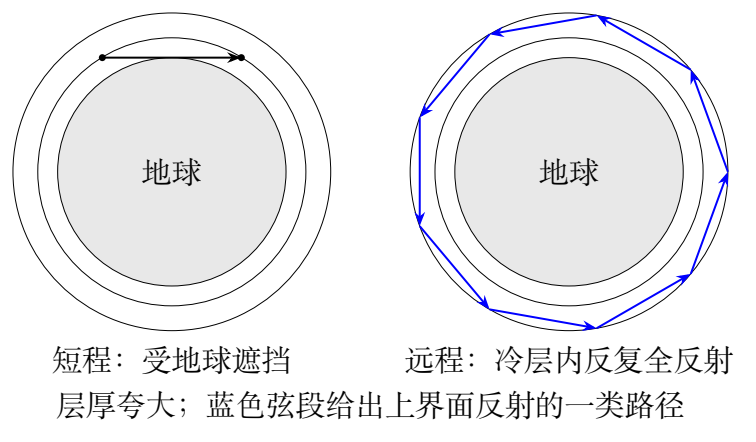

另有一类声线不碰到冷层下边界，只在上界面反复全反射，形成包围地球的弦段路径。它同样属于冷层约束传播。

### 11　用球面几何检查持续全反射

在同温层中声速恒定，任一直线段到地心的最短距离 $b_r$ 在球面镜面反射中保持不变。对半径 $r_j$ 的界面，其入射角满足

$$\sin\alpha_j=\frac{b_r}{r_j}.$$

记冷层两半径 $r_1=R_e+10$ km、$r_2=R_e+20$ km。若声线碰两个界面，要求 $b_r<r_1$，且上界面的全反射条件为

$$b_r>r_2\frac{v_i}{v_o}.$$

由于 $r_2v_i/v_o<r_1$，这两个条件可同时满足。上界面半径较大，同一 $b_r$ 下其入射角较小，因而上界面是更严格的全反射检查；只要上界面满足，下界面也满足。

如果 $r_1\le b_r<r_2$，声线不触及下界面，只在上界面反射；$b_r/r_2$ 接近1，同样可满足全反射。这给出了上一节两种导波路径的几何依据。

### 12　四种组合归纳

| 声源所在层 | 气球所在层 | 题设下距离类型 | 主要限制或机制 |
| --- | --- | --- | --- |
| 对流层 | 对流层 | 小于1000 km | 地球遮挡，约714 km上界 |
| 对流层 | 同温层 | 小于1000 km | 可折射声线，约862 km上界 |
| 同温层 | 对流层 | 小于1000 km | 可透出声线，传播互易性 |
| 同温层 | 同温层 | 可达数千公里 | 冷层上下界面全反射导波 |

这张表的结论始终依赖“可发生折射时忽略反射、不考虑吸收”的条件。它表示是否存在可达路径，没有给出真实接收声强或探测器灵敏度。

\clearpage

# 第 8 题　X射线光谱与康普顿散射（40分）

X射线光谱与光电子能谱可用于获取物质结构信息。X射线管由电子枪阴极和金属阳极组成；阴极电子被电压加速，与金属阳极碰撞后产生X射线，光谱包括连续轫致辐射和离散特征谱。选定波长的特征X射线照射材料靶，用X射线光谱仪与光电子能谱仪分别探测出射光子和电子。已知

$$R_\infty=10973731\,\mathrm{m^{-1}},\qquad
hc=1240\,\mathrm{nm\cdot eV}.$$

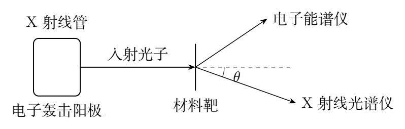

（1）玻尔理论描述氢原子及类氢体系的能级。多电子原子的 $n=1,2,3$ 壳层分别记为K、L、M。金属阳极原子的K壳层电子能量为 $-20.1\,\mathrm{keV}$。（i）电子至少需被多大电压加速，才可电离一个K壳层电子并使L壳层向K壳层跃迁发出K$_\alpha$特征X射线？（ii）该加速电压下连续X射线的最短波长是多少？前两项保留三位有效数字。（iii）已知K$_\alpha$光子能量为17.44 keV，计算该原子的核电荷数。

（2）波长为 $\lambda_0$ 的K$_\alpha$光子与材料靶中初始静止、质量为 $m$ 的电子散射。出射光子与入射光子的夹角为 $\theta$。求出射波长 $\lambda_1$ 和电子动能。

（3）$\theta=135^\circ$ 时，光谱有两个峰，分别位于 $\lambda_0$ 与更长的 $\lambda_1$，后者较宽。说明两个峰的来源，以及 $\lambda_1$ 峰较宽的原因。

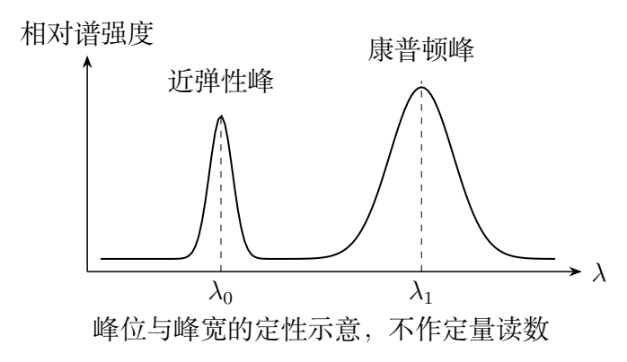

## 一、题型定位

原子特征谱、轫致辐射截止和光子—电子相对论碰撞。第一问的阈值由K壳层电离能决定，特征线能量由能级差决定；第二问则必须同时使用能量和矢量动量守恒。

第三问是对第二问理想“静止电子”模型的解释和扩展。真实材料中有不同散射通道和电子动量分布，因而出现未移位峰与有宽度的移位峰。

## 二、知识点

电势能转换 $K_e=eU$；光子能量 $E=hc/\lambda$、动量 $p=h/\lambda$；类氢能级的 $1/n^2$ 规律与有效核电荷近似；电子的能量动量关系 $E_e^2=m^2c^4+p_e^2c^2$；康普顿波长 $\lambda_c=h/(mc)$。

电子动能为总能量减去静能 $mc^2$。光子没有静能，不能给光子套用非相对论粒子动能 $p^2/(2m)$。

## 三、物理图像

先打掉K壳层电子形成空位，再由外壳层电子填补并放出特征光子；入射电子若未达到K电离阈值，即使动能高于特征光子能量，也不能按此通道激发K$_\alpha$线。

自由电子反冲取得一部分能量后，出射光子的能量下降、波长变长。若整个重原子参与近弹性散射，同样的动量转移对应较小的反冲能量，所以光子波长近似不变。

## 四、解题入口

前两问直接用电子加速能量和光子能量上限，核电荷数用K$_\alpha$跃迁的有效核电荷模型。康普顿推导先写动量矢量三角形，再用电子能量动量关系消去反冲电子，最后转成波长。先不背结论的正负号，用能量流向检查推导。

## 五、解析

### 1　K壳层空位的激发阈值

K壳层电子能量为 $-20.1$ keV，电离到零能量需要20.1 keV。阴极电子经过电压 $U$ 获得动能 $eU$，所以阈值为

$$eU_{\min}=20.1\,\mathrm{keV}.$$

因此

$$\boxed{U_{\min}=20.1\,\mathrm{kV}.}$$

17.44 keV是随后L到K跃迁的光子能量，不是最初制造K空位所需的最小碰撞能量。阈值理想化忽略靶原子的整体反冲和其他能量损失，符合题设。

### 2　连续谱的短波截止

轫致辐射中，单个光子最多取得入射电子全部动能，故

$$E_{\gamma,\max}=eU_{\min},\qquad
\lambda_{\min}=\frac{hc}{eU_{\min}}.$$

使用 $hc$ 的题给单位，能量换为电子伏特：

$$\lambda_{\min}=\frac{1240}{20100}\,\mathrm{nm}
\simeq0.0616915\,\mathrm{nm}.$$

保留三位有效数字，

$$\boxed{\lambda_{\min}=0.0617\,\mathrm{nm}.}$$

该连续谱截止随电压变化，特征线在被激发后的位置主要由元素决定。两者在同一光谱中同时存在，但不能用同一“能级跃迁”解释连续谱。

### 3　有效核电荷与元素核电荷数

类氢能级的能量尺度为 $hcR_\infty$。把多电子原子的K$_\alpha$跃迁作有效核电荷 $Z_*$ 的近似，L到K即 $n=2\to1$，所以

$$E_{K\alpha}=hcR_\infty Z_*^2
\left(1-\frac14\right)=\frac34hcR_\infty Z_*^2.$$

因此

$$\boxed{Z_*=
\sqrt{\frac{4E_{K\alpha}}{3hcR_\infty}}.}$$

注意 $R_\infty$ 的单位为 $\mathrm{m^{-1}}$，与 $hc$ 的 nm 相乘须转换：

$$hcR_\infty=1240\times10973731\times10^{-9}\,\mathrm{eV}
\simeq13.6074\,\mathrm{eV}.$$

所以 $Z_*\simeq41.34$。在本题K线估算采用的屏蔽模型中，有效核电荷介于 $Z-1$ 与 $Z$，或用一电子屏蔽近似写成 $Z_*\simeq Z-1$。核电荷数必须是整数，得到

$$\boxed{Z=42.}$$

该步骤含多电子屏蔽的近似，不能把玻尔公式作为多电子原子的精确能级定律。直接把 $Z_*$ 当 $Z$ 会忽略屏蔽；直接用K结合能代入不含屏蔽的氢样公式，也不能与K$_\alpha$跃迁模型一致。

### 4　散射的能量和矢量动量守恒

设入射和出射光子能量为 $E_0,E_1$，动量为 $\boldsymbol p_0,\boldsymbol p_1$，反冲电子动量为 $\boldsymbol p_e$。初始电子静止，因此

$$\boldsymbol p_e=\boldsymbol p_0-\boldsymbol p_1.$$

平方得到

$$p_e^2=p_0^2+p_1^2-2p_0p_1\cos\theta.$$

能量守恒为

$$\boxed{E_0+mc^2=E_1+E_e,\qquad
E_e=\sqrt{m^2c^4+p_e^2c^2}.}$$

电子动能 $K=E_e-mc^2=E_0-E_1$。因为初始电子静止，$K\ge0$，必须有 $E_1\le E_0$，这已确定出射波长不能更短。

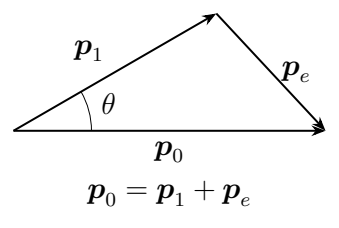

### 5　消去反冲电子并推导波长位移

将 $E_e=mc^2+E_0-E_1$ 代入电子能量动量关系：

$$p_e^2c^2=(E_0-E_1)^2+2mc^2(E_0-E_1).$$

光子 $E_i=cp_i$，因此

$$p_e^2=(p_0-p_1)^2+2mc(p_0-p_1).$$

和动量三角形比较，消去 $p_0^2+p_1^2$：

$$2p_0p_1(1-\cos\theta)=2mc(p_0-p_1).$$

两边除以 $mcp_0p_1$，

$$\frac1{p_1}-\frac1{p_0}=\frac{1-\cos\theta}{mc}.$$

使用 $1/p_i=\lambda_i/h$，得到

$$\boxed{\lambda_1-\lambda_0=
\frac h{mc}(1-\cos\theta)=\lambda_c(1-\cos\theta).}$$

所以

$$\boxed{\lambda_1=\lambda_0+2\lambda_c\sin^2(\theta/2).}$$

加号符合能量传给电子的方向。减号会使 $\theta\ne0$ 时出射光子能量增大、电子动能为负，和初始静止条件矛盾。

### 6　电子动能的等价形式

由能量守恒，

$$\boxed{K=hc\left(\frac1{\lambda_0}-\frac1{\lambda_1}\right).}$$

把波长位移代入，得

$$\boxed{K=
\frac{hc\lambda_c(1-\cos\theta)}
{\lambda_0[\lambda_0+\lambda_c(1-\cos\theta)]}.}$$

也可用 $x=E_0/(mc^2)$ 写成

$$E_1=\frac{E_0}{1+x(1-\cos\theta)},$$

$$\boxed{K=E_0\frac{x(1-\cos\theta)}{1+x(1-\cos\theta)}.}$$

三个形式分别便于从光谱读数、从波长位移及从光子能量计算。它们描述的是同一电子动能，不能另加一个“反冲能”再重复计数。

### 7　角度与能量的特殊极限

$\theta=0$ 时无位移，电子不取得反冲能；$\theta=90^\circ$ 时位移等于 $\lambda_c$；$\theta=180^\circ$ 时位移达到 $2\lambda_c$。

当 $x\ll1$，

$$K\simeq\frac{E_0^2}{mc^2}(1-\cos\theta).$$

此时电子反冲速度较小，可用非相对论能量作最低阶近似，但波长位移关系仍由完整守恒给出。即使光子的波长位移只占初始波长的小部分，也不能把光子本身按非相对论粒子处理。

波长位移与入射波长无关，电子动能却依赖入射能量。光子越硬，给电子的能量通常越多，“位移固定”不表示“能量损失固定”。

### 8　135度散射的数值尺度

入射K$_\alpha$能量17.44 keV对应

$$\lambda_0=\frac{1240}{17440}\,\mathrm{nm}
\simeq0.0711009\,\mathrm{nm}.$$

若用电子康普顿波长 $\lambda_c\simeq0.002426$ nm 作尺度计算，$\cos135^\circ=-1/\sqrt2$，

$$\Delta\lambda=\lambda_c(1+1/\sqrt2)
\simeq0.00414\,\mathrm{nm},$$

$$\lambda_1\simeq0.0752\,\mathrm{nm}.$$

从能量差求电子动能，约为0.960 keV。该数值只用于核对光谱两峰的顺序和量级；原题图未给定量刻度，不能从定性重绘的像素位置读出波长。

### 9　移位峰的来源

较长波长的 $\lambda_1$ 峰来自光子把能量和动量传给电子的非弹性散射，即康普顿散射。在光子能量相对电子束缚能较大时，可用近自由电子反冲近似解释峰位。

第二问把电子初始静止，预测一个固定散射角对应一个出射波长。真实材料电子并非逐个静止，所以该理想关系给的是峰位尺度和主要位移，而不是完整谱线形状。

### 10　未移位峰与重散射体

原子整体或相干电子体系参与近弹性散射时，反冲体质量 $M$ 远大于单电子质量。若用整个原子作为自由反冲体，其位移尺度为

$$\Delta\lambda_M=\frac h{Mc}(1-\cos\theta).$$

因为 $M\gg m$，该位移远小于电子康普顿位移，光子波长近似保持 $\lambda_0$。在原题给定分辨尺度下构成未移位峰。

这并不表示动量没有变化。光子方向改变，反冲体仍取得动量；大质量使同样动量对应的反冲动能很小，故光子能量变化难以分辨。

### 11　为什么移位峰更宽

材料中的电子具有初始动量分布。对给定散射角，初始电子沿动量转移方向的不同速度，会改变电子取得的能量和出射光子的波长，产生康普顿轮廓的展宽。

可以用非相对论反冲近似说明这一点。设传给电子的动量为 $\boldsymbol q=\boldsymbol p_0-\boldsymbol p_1$，电子原有动量为 $\boldsymbol p$，忽略束缚修正，则电子能量变化为

$$\Delta E_e=\frac{(\boldsymbol p+\boldsymbol q)^2-p^2}{2m}
=\frac{q^2}{2m}+\frac{\boldsymbol p\cdot\boldsymbol q}{m}.$$

第二项随电子初始动量变化。若该方向的标准差为 $\sigma_{p,\parallel}$，能量展宽尺度为 $q\sigma_{p,\parallel}/m$。波长展宽近似为

$$\sigma_\lambda\simeq\frac{\lambda_1^2}{hc}
\frac{q\sigma_{p,\parallel}}m.$$

上述式子用于解释展宽机制，并非完整的材料散射截面公式。原题没有给电子动量分布，不能给出定量峰宽。仪器分辨率也会影响两峰，但不能仅凭仪器同一套光谱读出它就是两峰宽度差的原因。

### 12　把三个不同能量尺度分开

20.1 keV是创造K空位的门槛；17.44 keV是指定K$_\alpha$跃迁的光子能量；约0.960 keV是该光子在135度散射时给静止电子的反冲动能。三个数值属于不同过程，彼此不能替换。

如果同时检测出射光子和电子，理想事件应满足 $E_1+K=E_0$。若散射电子来自束缚态且电离能不可忽略，还需把电离或其他激发能加入能量账目，此时自由静止电子公式会出现系统偏移。
