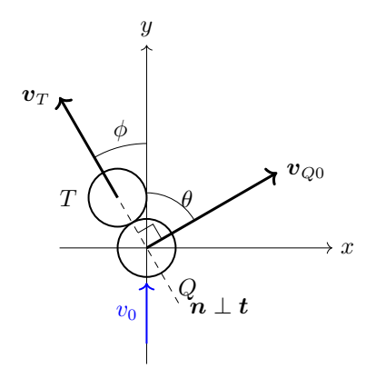
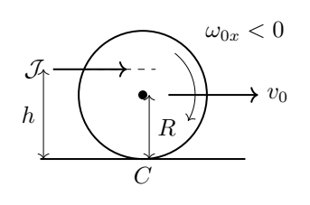
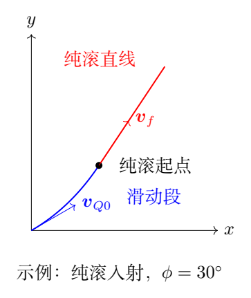
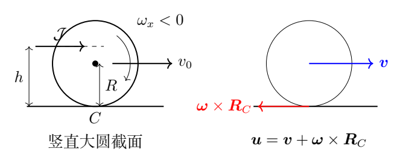

# 第 2 题　台球碰撞、滑动与30°经验规则（50分）

台球 $Q$ 撞击静止的目标球 $T$。两球质量均为 $m$、半径均为 $R$，质量分布均匀。碰撞前 $Q$ 球质心速度为 $\boldsymbol v_0=v_0\boldsymbol e_y$，转动角速度为 $\boldsymbol\omega_0$。碰撞时间极短，两球之间没有摩擦，碰撞完全弹性；球与桌面为点接触。取桌面内右手直角坐标系，$z$ 轴竖直向上，$x$ 向右，$y$ 为入射方向。

（1）碰撞后瞬间，$T$ 球和 $Q$ 球的运动方向与 $y$ 轴的夹角分别为 $\phi$、$\theta$，如图。求两球运动方向夹角，以及 $Q$ 球的质心速度 $\boldsymbol v_Q$ 和转动角速度 $\boldsymbol\omega$，用 $\phi,v_0,\boldsymbol\omega_0$ 等表示。

（2）碰撞后，$Q$ 球在桌面摩擦力作用下经过 $\Delta t$ 才达到无滑滚动。已知动摩擦系数 $\mu$、重力加速度 $g$，以及 $\phi,v_0,\omega_{0x},\omega_{0y}$。用这些量及 $m,R$ 表示下列结果：

（2.1）碰撞后的任意时刻，球上与桌面接触的点称为该时刻的 $C$ 点。求碰撞后瞬间该点对桌面的速度 $\boldsymbol v_{C0}$ 的 $x,y$ 分量。

（2.2）求达到纯滚的时间 $\Delta t$。

（2.3）以碰撞后瞬间球心位置为桌面内原点，求纯滚前球心轨迹 $x(t),y(t)$。

（2.4）定性指出纯滚后球心轨迹形状，并给出最终速度与 $y$ 轴夹角 $\theta_f$ 的正切。

（3）击球者在开球时给静止 $Q$ 球一个沿 $+y$ 的水平冲量 $\mathcal J$。作用点在过球心的竖直大圆面内，距桌面高度为 $h$。求使球立即无滑滚动的特定 $h$。

（4）探讨台球手熟悉的30°经验规则。在第（3）问选定高度的条件下，$Q$ 球以纯滚状态撞击 $T$ 球，$T$ 球沿角度 $\phi$ 飞出。

（4.1）求碰撞后至纯滚前球心的 $x(t),y(t)$。

（4.2）求最终夹角 $\theta_f$ 的正切。

（4.3）$\theta_f$ 在 $\phi=\phi_m$ 处取极大值 $\theta_{fm}$。求它们，并计算 $\phi_m\pm5^\circ$、$\phi_m\pm10^\circ$ 时的 $\theta_f$，完成下表。

| $\phi$ | $\phi_m=$ | $\phi_m+5^\circ$ | $\phi_m+10^\circ$ | $\phi_m-5^\circ$ | $\phi_m-10^\circ$ |
| --- | --- | --- | --- | --- | --- |
| $\theta_f$ |  |  |  |  |  |

## 一、题型定位

瞬时中心碰撞与随后刚体滑动的分段问题。碰撞阶段忽略桌面摩擦冲量，用两球动量与能量守恒；滑动阶段摩擦方向由接触点速度决定，用平动、转动两个方程；纯滚以后接触点相对速度为零，球心作匀速直线运动。

对于一般自旋，球心速度、角速度和接触点滑动方向是三个不同对象。可先求接触点滑动速度的变化，再由摩擦方向积分求球心轨迹。

## 二、知识点

等质量光滑球的弹性斜碰；冲量和冲量矩；均匀球转动惯量 $I=2mR^2/5$；刚体点速度 $\boldsymbol v_C=\boldsymbol v+\boldsymbol\omega\times\boldsymbol R_C$；库仑摩擦；向量三重积；分段轨迹连续性；方向角的象限与极值。

这里每一时刻的 $C$ 是该时刻位于球底的材料点。连续变化的接触位置不是同一颗固定的表面微粒。计算接触点瞬时速度时，球心到接触位置的空间矢量一直为 $-R\boldsymbol e_z$。

## 三、物理图像

两球接触力沿连心线，通过各自球心，所以不能改变角速度。$Q$ 球在连心线方向的速度分量传给 $T$ 球，保留垂直连心线方向的分量。

碰撞之后，旧的自旋和新的平动通常不再匹配。桌面摩擦一方面改变球心速度，一方面改变横向角速度，使接触点滑动逐渐归零。对于碰撞前纯滚的 $Q$ 球，摩擦恰好沿 $T$ 球飞出方向，因此 $Q$ 的速度被拉回到接近原来的方向。

## 四、解题入口

先用沿 $T$ 球出射方向的单位矢量 $\boldsymbol n$ 和垂直它的单位矢量 $\boldsymbol t$ 解碰撞，再变回题给 $x,y$ 坐标。令初始接触滑动速度为 $\boldsymbol u_0$。在滑动阶段联立 $m\dot{\boldsymbol v}=\boldsymbol f$ 和 $I\dot{\boldsymbol\omega}=\boldsymbol R_C\times\boldsymbol f$，对 $\boldsymbol u$ 求导。

证明 $\boldsymbol u$ 方向保持不变后，球心加速度就是恒向量，轨迹与末速度都可直接积分。第（4）问再代入纯滚初值，而不是从头猜摩擦方向。

## 五、解析

### 1　碰撞方向与速度分解

取非退化碰撞 $0<\phi<\pi/2$。连心线沿 $T$ 球出射方向，定义

$$\boldsymbol n=-\sin\phi\,\boldsymbol e_x+\cos\phi\,\boldsymbol e_y,$$

$$\boldsymbol t=\cos\phi\,\boldsymbol e_x+\sin\phi\,\boldsymbol e_y.$$

两者正交，入射速度分解为

$$v_0\boldsymbol e_y
=v_0\cos\phi\,\boldsymbol n+v_0\sin\phi\,\boldsymbol t.$$

碰撞没有切向冲量，$Q$ 的切向分量不变，$T$ 的切向速度仍为零。设碰撞后沿 $\boldsymbol n$ 的速度分别为 $q$、$t$，动量和能量方程为

$$q+t=v_0\cos\phi,$$

$$q^2+t^2=v_0^2\cos^2\phi.$$

平方第一式后与第二式相减，得 $2qt=0$。$t=0$ 对应没有有效碰撞的支；实际分离碰撞取

$$q=0,\qquad t=v_0\cos\phi.$$

于是

$$\boxed{\boldsymbol v_{T}=v_0\cos\phi\,\boldsymbol n,
\qquad\boldsymbol v_{Q0}=v_0\sin\phi\,\boldsymbol t.}$$

两速度内积为零，因此

$$\boxed{\theta+\phi=90^\circ.}$$

在 $x,y$ 坐标中，$Q$ 球碰撞后的初速度为

$$\boxed{v_{Qx0}=v_0\sin\phi\cos\phi,
\qquad v_{Qy0}=v_0\sin^2\phi.}$$

碰撞冲量通过球心，桌面摩擦冲量可忽略，所以

$$\boxed{\boldsymbol\omega(0^+)=\boldsymbol\omega_0.}$$

球的转动能在碰撞瞬间不变，正因如此，能量方程才可化为上述质心速度的平方和。若两球之间有摩擦，这种简化就不成立。

### 2　用整体动量检查直角结论

原坐标中还可直接写

$$\boldsymbol v_{Q0}+\boldsymbol v_T=v_0\boldsymbol e_y,$$

$$v_{Q0}^2+v_T^2=v_0^2.$$

第一式平方后与第二式相减，得到

$$2\boldsymbol v_{Q0}\cdot\boldsymbol v_T=0.$$

此解法说明直角是等质量、目标球静止、弹性且无切向冲量共同作用的结果。正碰 $\phi=0$ 时 $Q$ 瞬时停下，其飞出方向无法定义；掠碰极限 $\phi\to90^\circ$ 时 $T$ 的速度趋零，其方向也成为退化量。

### 3　接触点滑动速度

图中区分质心的平动与自旋引起的球底速度。二者相加才得到桌面摩擦所反对的相对滑动。

球心到桌面接触点的矢量为

$$\boldsymbol R_C=-R\boldsymbol e_z.$$

一般角速度写为 $\boldsymbol\omega=\omega_x\boldsymbol e_x+\omega_y\boldsymbol e_y+\omega_z\boldsymbol e_z$。叉乘得到

$$\boldsymbol\omega\times\boldsymbol R_C
=-R\omega_y\boldsymbol e_x+R\omega_x\boldsymbol e_y.$$

所以记 $\boldsymbol u=\boldsymbol v_C$，有

$$\boxed{\boldsymbol u
=(v_x-R\omega_y)\boldsymbol e_x
+(v_y+R\omega_x)\boldsymbol e_y.}$$

初值为

$$\boxed{u_{0x}=v_0\sin\phi\cos\phi-R\omega_{0y},}$$

$$\boxed{u_{0y}=v_0\sin^2\phi+R\omega_{0x}.}$$

设

$$U_0=|\boldsymbol u_0|
=\sqrt{(v_0\sin\phi\cos\phi-R\omega_{0y})^2
+(v_0\sin^2\phi+R\omega_{0x})^2}.$$

绕竖直轴的自旋 $\omega_{0z}$ 不进入接触点滑动速度。点接触模型中桌面摩擦对竖直轴也无力矩，因此它不影响本题平面轨迹。实际球的有限接触斑可能产生扭转阻力，属于题设以外的修正。

### 4　滑动速度方向为什么不变

只要 $U=|\boldsymbol u|>0$，库仑动摩擦为

$$\boldsymbol f=-\mu mg\frac{\boldsymbol u}{U}.$$

平动与转动方程分别为

$$\dot{\boldsymbol v}=-\mu g\widehat{\boldsymbol u},$$

$$\dot{\boldsymbol\omega}
=\frac1I\boldsymbol R_C\times(-\mu mg\widehat{\boldsymbol u}).$$

对 $\boldsymbol u=\boldsymbol v+\boldsymbol\omega\times\boldsymbol R_C$ 求导。此处 $\boldsymbol R_C$ 是固定的空间矢量，因此

$$\dot{\boldsymbol u}
=\dot{\boldsymbol v}+\dot{\boldsymbol\omega}\times\boldsymbol R_C.$$

因为 $\widehat{\boldsymbol u}$ 水平且与 $\boldsymbol R_C$ 垂直，向量恒等式给出

$$ (\boldsymbol R_C\times\widehat{\boldsymbol u})\times\boldsymbol R_C
=R^2\widehat{\boldsymbol u}.$$

代回，并用 $I=2mR^2/5$，得到

$$\boxed{\dot{\boldsymbol u}
=-\left(1+\frac{mR^2}{I}\right)\mu g\widehat{\boldsymbol u}
=-\frac72\mu g\widehat{\boldsymbol u}.}$$

其导数只有沿自身的分量，没有横向分量。若写 $\boldsymbol u=U\widehat{\boldsymbol u}$，有

$$\dot U=-\frac72\mu g,
\qquad \frac{d\widehat{\boldsymbol u}}{dt}=0.$$

因此滑动速度的方向直到归零都不变，大小线性下降：

$$\boldsymbol u(t)
=\left(U_0-\frac72\mu gt\right)\frac{\boldsymbol u_0}{U_0}.$$

达到纯滚的时间为

$$\boxed{\Delta t=\frac{2U_0}{7\mu g}.}$$

本式适用于 $U_0>0$、$\mu>0$。若 $U_0=0$，碰撞后已经纯滚，应直接取 $\Delta t=0$，不能继续使用含 $1/U_0$ 的方向公式；若 $\mu=0$ 而 $U_0>0$，滑动不会自行停止。

### 5　滑动阶段的球心轨迹

因摩擦方向不变，球心加速度为常向量

$$\boldsymbol a=-\mu g\frac{\boldsymbol u_0}{U_0}.$$

以球心在碰撞后的投影位置为原点，积分得到

$$\boldsymbol v(t)=\boldsymbol v_{Q0}
-\mu gt\frac{\boldsymbol u_0}{U_0},$$

$$\boxed{\boldsymbol r(t)=\boldsymbol v_{Q0}t
-\frac12\mu gt^2\frac{\boldsymbol u_0}{U_0},
\quad0\le t\le\Delta t.}$$

即

$$\boxed{x(t)=v_0\sin\phi\cos\phi\,t
-\frac{\mu g,u_{0x}}{2U_0}t^2,}$$

$$\boxed{y(t)=v_0\sin^2\phi\,t
-\frac{\mu g,u_{0y}}{2U_0}t^2.}$$

一般情形是抛物线的一段；当初速度与加速度共线时退化为直线。所谓“匀减速”严格说是接触滑动速率均匀减小，球心速率未必一直减小。摩擦可以在某个方向加速质心，同时减少较多的转动能。

### 6　转动演化与最终纯滚状态

摩擦分量记为 $f_x,f_y$，关于球心的力矩为

$$\boldsymbol\tau=R f_y\boldsymbol e_x-R f_x\boldsymbol e_y.$$

所以

$$\dot\omega_x=\frac{R f_y}{I},
\qquad\dot\omega_y=-\frac{R f_x}{I},
\qquad\dot\omega_z=0.$$

积分到 $\Delta t$，用 $\mu g\Delta t=2U_0/7$，得到

$$\omega_{xf}=\omega_{0x}-\frac{5u_{0y}}{7R},
\qquad\omega_{yf}=\omega_{0y}+\frac{5u_{0x}}{7R}.$$

球心最终速度为

$$\boxed{\boldsymbol v_f=\boldsymbol v_{Q0}-\frac27\boldsymbol u_0.}$$

展开成分量，

$$\boxed{v_{fx}=\frac57v_0\sin\phi\cos\phi
+\frac27R\omega_{0y},}$$

$$\boxed{v_{fy}=\frac57v_0\sin^2\phi
-\frac27R\omega_{0x}.}$$

将这些量代入接触点速度，分别有

$$v_{fx}-R\omega_{yf}=0,
\qquad v_{fy}+R\omega_{xf}=0,$$

确实满足无滑条件。理想水平桌面上没有其他水平力，维持纯滚不需要非零静摩擦，故之后球心作匀速直线运动：

$$\boxed{\boldsymbol r(t)=\boldsymbol r(\Delta t)
+\boldsymbol v_f(t-\Delta t),\quad t\ge\Delta t.}$$

轨迹的位置和切向速度在连接点都连续，但加速度从恒向量跳变为零。最终方向的正切是

$$\boxed{\tan\theta_f=
\frac{v_{fx}}{v_{fy}}
=\frac{5v_0\sin\phi\cos\phi+2R\omega_{0y}}
{5v_0\sin^2\phi-2R\omega_{0x}}.}$$

一般初始自旋下应使用 $\operatorname{atan2}(v_{fx},v_{fy})$ 判断方向象限；若分母为零，方向可能是 $\pm90^\circ$；若两分量都为零，则球停止，方向没有定义。

### 7　能量损失提供独立检查

滑动时，摩擦对平动和转动的总功率为

$$\dot E=\boldsymbol f\cdot\boldsymbol v
+\boldsymbol\tau\cdot\boldsymbol\omega
=\boldsymbol f\cdot\boldsymbol u
=-\mu mgU.$$

虽然质心可能加速，总机械能始终下降。积分整个滑动过程：

$$\Delta E_{\rm loss}
=\mu mg\int_0^{\Delta t}
\left(U_0-\frac72\mu gt\right)dt,$$

$$\boxed{\Delta E_{\rm loss}=\frac{mU_0^2}{7}.}$$

这个损失与 $\mu$ 无关：摩擦较大时耗散功率较大，但滑动时间相应较短。末速度和末角速度同样与 $\mu$ 无关；达到末状态的时间、位置和轨迹长度则依赖 $\mu$。

### 8　水平击球的最佳高度

原来球静止，水平冲量大小为 $\mathcal J$。忽略极短击球过程中的桌面冲量，有

$$\mathcal J=mv_0.$$

作用点相对球心的竖直坐标为 $h-R$。由右手规则，沿 $+y$ 的冲量在球心以上产生沿 $-x$ 的角冲量：

$$I\omega_{0x}=-(h-R)\mathcal J.$$

立即沿 $+y$ 纯滚要求

$$v_0+R\omega_{0x}=0,
\qquad\omega_{0y}=0.$$

代入 $\omega_{0x}=-v_0/R$ 和均匀球转动惯量，得

$$h-R=\frac I{mR}=\frac25R,$$

$$\boxed{h=\frac75R.}$$

击打位置位于球心上方 $2R/5$。冲量的大小决定速度，高度决定平动与自旋的比例。这两个量不应混为一谈。

### 9　纯滚入射时的碰后滑动方向

第（3）问给出的入射初始角速度为

$$\boldsymbol\omega_0=-\frac{v_0}{R}\boldsymbol e_x.$$

因此碰撞后的滑动速度为

$$\boldsymbol u_0
=v_0\sin\phi\cos\phi\boldsymbol e_x
-v_0\cos^2\phi\boldsymbol e_y
=-v_0\cos\phi\,\boldsymbol n.$$

对 $0\le\phi<90^\circ$，有

$$U_0=v_0\cos\phi,
\qquad\widehat{\boldsymbol u}_0=-\boldsymbol n.$$

摩擦方向为 $+\boldsymbol n$，即沿目标球出射方向。其 $x$ 分量向左，$y$ 分量向前，故

$$\boxed{x(t)=v_0\sin\phi\cos\phi\,t
-\frac12\mu g\sin\phi\,t^2,}$$

$$\boxed{y(t)=v_0\sin^2\phi\,t
+\frac12\mu g\cos\phi\,t^2,}$$

$$0\le t\le\frac{2v_0\cos\phi}{7\mu g}.$$

这特别显示球心的 $y$ 方向速度会增大。它来自初始自旋能的转换，与摩擦耗散总能量并不冲突。

### 10　最终偏角与极值

代入纯滚初值，最终速度为

$$v_{fx}=\frac57v_0\sin\phi\cos\phi,
\qquad v_{fy}=\frac{v_0}{7}(5\sin^2\phi+2).$$

因 $v_{fy}>0$，方向角无象限歧义：

$$\boxed{\tan\theta_f
=\frac{5\sin\phi\cos\phi}{5\sin^2\phi+2}
=\frac{\sin2\phi}{9/5-\cos2\phi}.}$$

令 $q=2\phi$，$c=9/5$。因为反正切单调，$\theta_f$ 的极值等同于 $f(q)=\sin q/(c-\cos q)$ 的极值。微分得

$$\frac{df}{dq}
=\frac{\cos q(c-\cos q)-\sin^2q}{(c-\cos q)^2}
=\frac{c\cos q-1}{(c-\cos q)^2}.$$

在 $0<q<\pi$ 内，分母为正，分子单调由正变负，所以这是唯一的极大值：

$$\boxed{\cos2\phi_m=\frac59,
\qquad\phi_m=\frac12\arccos\frac59\simeq28.13^\circ.}$$

此时 $\sin2\phi_m=\sqrt{56}/9$，代入得

$$\tan\theta_{fm}=\frac5{\sqrt{56}},$$

$$\boxed{\theta_{fm}\simeq33.75^\circ.}$$

按未提前舍入的 $\phi_m$ 代入各角度，结果为：

| $\phi$ | $28.13^\circ$ | $33.13^\circ$ | $38.13^\circ$ | $23.13^\circ$ | $18.13^\circ$ |
| --- | --- | --- | --- | --- | --- |
| $\theta_f$ | $33.75^\circ$ | $33.23^\circ$ | $31.87^\circ$ | $33.09^\circ$ | $30.76^\circ$ |

不同舍入位数可能使末位略有差异。表格反映经验规则的含义：在一段不窄的碰撞角范围内，最终偏角集中在30°附近，而不是严格恒等于30°。

### 11　端点与一个数值过程

正碰 $\phi=0$ 时，$Q$ 碰撞后质心瞬时静止，但仍保留入射自旋；随后桌面摩擦使它重新向前运动，最终 $v_{fy}=2v_0/7$。掠碰极限 $\phi\to90^\circ$ 时，$Q$ 基本未受冲量，初态已接近纯滚，$U_0\to0$、$\Delta t\to0$、$\boldsymbol v_f\to v_0\boldsymbol e_y$。

例如取 $v_0=1.0\,\mathrm{m/s}$、$\mu=0.20$、$g=10\,\mathrm{m/s^2}$、$\phi=30^\circ$。碰后有

$$\boldsymbol v_{Q0}=(0.4330,0.2500)\,\mathrm{m/s},
\qquad U_0=0.8660\,\mathrm{m/s},$$

$$\Delta t=0.1237\,\mathrm s,
\qquad\boldsymbol a=(-1.000,1.732)\,\mathrm{m/s^2}.$$

最终速度和转入纯滚的位置分别为

$$\boldsymbol v_f=(0.3093,0.4643)\,\mathrm{m/s},$$

$$\boldsymbol r_f=(0.0459,0.0442)\,\mathrm m.$$

方向角约为 $33.69^\circ$。位置可从轨迹公式检查，之后沿最终速度方向直线运动。

## 六、关键洞察

可积的对象是接触点滑动速度，因其方向恒定，整个摩擦阶段化为常加速度运动。最终状态由初态平动与自旋共同决定；摩擦系数决定时间和路径，却不决定最终速度。30°规则对应一条函数曲线在最大值附近较平坦的区域。

## 七、易错点

将摩擦写成质心速度反方向；遗漏角加速度对接触点速度的贡献；把滑动速率单调下降等同于质心速率下降；纯滚后继续加动摩擦；对 $U_0=0$ 使用单位矢量公式；仅用 $\tan\theta$ 而不判断方向象限；误认为碰撞必定改变自旋。

## 八、课堂讲解建议

用三个不同箭头表示 $\boldsymbol v$、$\boldsymbol\omega\times\boldsymbol R_C$、$\boldsymbol u$，先在图上相加。让学生独立推导 $7/2$，再用能量损失 $mU_0^2/7$ 检查末态。讲经验规则时用表格展示角度范围，讨论正碰后“停下又前进”的现象如何由保留下来的自旋解释。

## 九、变式训练

### 变式1　一般转动惯量的球

设球的转动惯量为 $I=\kappa mR^2$，其他滑动条件不变，求滑动时间和末速度。

解：平动与转动仍给出

$$\dot{\boldsymbol u}=-(1+1/\kappa)\mu g\widehat{\boldsymbol u}.$$

故

$$\boxed{\Delta t=\frac{\kappa U_0}{(1+\kappa)\mu g},
\quad\boldsymbol v_f=\boldsymbol v_0-
\frac\kappa{1+\kappa}\boldsymbol u_0.}$$

耗散率积分得 $\Delta E_{\rm loss}=m\kappa U_0^2/[2(1+\kappa)]$。取 $\kappa=2/5$ 恢复正文；薄球壳 $\kappa=2/3$ 时，速度修正系数变为 $2/5$，不能继续使用均匀实心球的 $2/7$。

### 变式2　一般转动惯量下的最佳击球高度

对 $I=\kappa mR^2$ 的球，以水平冲量使其立即纯滚，求击球高度。

解：$\mathcal J=mv$、$I\omega_x=-(h-R)\mathcal J$，纯滚要求 $\omega_x=-v/R$。因此

$$\boxed{h=(1+\kappa)R.}$$

薄球壳有 $h=5R/3$。若 $\kappa>1$，公式要求高度超过球顶 $2R$，实际球面上无法按此几何方式施力；一般公式仍须接受作用点可达性的检验。

### 变式3　无自旋的球在桌面滑动

均匀球以速度 $\boldsymbol v_0$ 沿桌面滑动，初始角速度为零。求末速度、滑动时间和能量损失比例。

解：此时 $\boldsymbol u_0=\boldsymbol v_0$，故

$$\boldsymbol v_f=\frac57\boldsymbol v_0,
\qquad\Delta t=\frac{2v_0}{7\mu g}.$$

损失为 $mv_0^2/7$，初始能量 $mv_0^2/2$，所以损失比例为 $2/7$。末态平动能是 $25mv_0^2/98$，转动能是 $5mv_0^2/49$，两者合计 $5mv_0^2/14$，与初能减损失相符。

### 变式4　纯滚入射后的正碰

均匀 $Q$ 球纯滚入射，和静止同质量球正碰。求它重新达到纯滚后的速度及该段滑动距离。

解：正碰后 $\boldsymbol v_{Q0}=0$，$\omega_{0x}=-v_0/R$，故 $\boldsymbol u_0=-v_0\boldsymbol e_y$。摩擦向前，有

$$\Delta t=\frac{2v_0}{7\mu g},
\qquad v_f=\frac{2v_0}{7}.$$

从零速度匀加速到末态，距离为

$$\boxed{d=\frac12\mu g\Delta t^2
=\frac{2v_0^2}{49\mu g}.}$$

角速度从 $-v_0/R$ 变到 $-2v_0/(7R)$，与末态纯滚关系一致。碰撞后的初始转动能是 $mv_0^2/5$，减去损失 $mv_0^2/7$ 后剩 $2mv_0^2/35$，等于末态平动与转动能之和。
