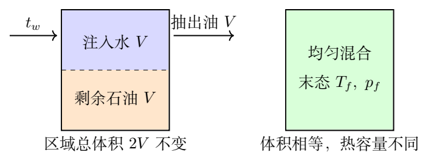
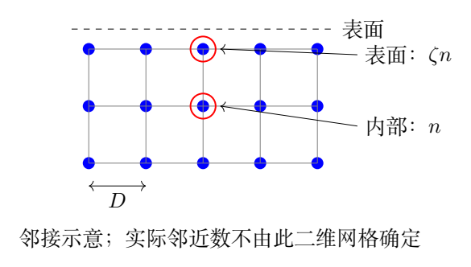

# 第 3 题　注水温度与表面张力的微观模型（45分）

液体与其他介质（包括其蒸气）的分界面称为液体表面，表面张力系数是表征液体性质的重要特征量。

（1）某油井内未抽出的石油为油气混合物，温度为 $100^\circ\mathrm C$。其密度是混有表面活性物质的水（下称“水”）的 $80\%$，比热容是这种水的 $60\%$。记这一状态为参考状态。石油和水的混合物表面张力系数与温度、压强近似满足

$$\frac\sigma{10^{-3}\,\mathrm{N/m}}
=60+0.065\frac T{\mathrm K}
-24.0\frac p{\mathrm{bar}}
+3.15\frac{p^2}{\mathrm{bar}^2}.$$

混合物的等体压强系数为常量

$$\beta=7.28\times10^{-3}\,\mathrm{bar/K}.$$

参考状态下混合物的压强与绝对温度成正比，比例系数为 $\beta$。某固定岩层区域中原来的石油都处于参考状态，抽出其一半，同时注入等体积的水，使区域内混合物总体积始终不变。未抽出的石油与注入水均匀混合，混合物体积等于两种液体体积之和。抽油较快，抽出的石油与注入的水之间的热交换可以忽略。求为了使区域内最终混合物的表面张力系数最小，注入水应取的摄氏温度。

（2）假设表面张力全部归结为表面层粒子与内部粒子的邻近粒子数不同，而两者粒子间距相同。表面层每粒子的邻近粒子数是内部的 $\zeta$ 倍，$0<\zeta<1$。液体摩尔质量为 $\mu$、摩尔汽化热为 $L_m$、质量密度为 $\rho$，阿伏加德罗常量为 $N_A$。导出这个模型中表面张力系数 $\sigma$ 的表达式。

## 一、题型定位

约束下的物性优化与简化微观模型。宏观部分必须先沿等体路径把 $p$ 消成 $T$，再对温度求极值；极值决定混合末温，能量平衡随后决定注入水温。微观部分通过少掉的相互作用键估算表面能，再用摩尔汽化热消去未知键能。

两部分使用的模型层次不同：第一问用经验物性公式，第二问用粒子模型解释能量来源。不能把第二问的粗略模型当作经验式全部温压依赖的精确推导。

## 二、知识点

定容过程 $dp=\beta dT$；摄氏与开尔文温标转换；复合函数极值；两种液体的显热交换；密度、比热与等体积质量；相互作用键双计数；单位面积表面能；粒子数密度的三分之二次方。

表面张力系数可写成 $\mathrm{N/m}$，也可写成 $\mathrm{J/m^2}$。前者强调边界力，后者强调增加界面的能量代价；二者量纲相同。

## 三、物理图像

抽出一半石油并注入等体积水后，参加混合的石油和水体积相等，但质量并不相等。石油的热容量为水的 $0.8\times0.6=0.48$ 倍，故末温更靠近水温。

表面粒子邻居较少，少获得一些结合能，所以把内部粒子移到表面需要正功。增加表面的粒子数与面积成正比；每粒子少掉的结合能乘以单位面积粒子数，就得到 $\sigma$。

## 四、解题入口

设原区域体积为 $2V$，抽出的石油为 $V$，剩下石油和注入水各为 $V$。等体过程积分后，利用参考状态 $p_i=\beta T_i$ 消去积分常数。保留题给系数的有效精度，求二次函数极小值。

微观模型中用 $\varepsilon_b>0$ 表示一条键的结合能大小，避免负相互作用势能带来的符号混乱。内部每粒子平均分得 $n\varepsilon_b/2$ 的结合能；除以二的原因是每条键连接两粒子。令粒子平均间距 $D$，用 $D^3=\mu/(\rho N_A)$。

## 五、解析

### 1　确定真正的等体路径

题中 $\beta=(\partial p/\partial T)_V$ 为常量，因此沿总体积不变的过程

$$dp=\beta\,dT.$$

从参考状态 $T_i,p_i$ 积分到任意状态 $T,p$，有

$$p-p_i=\beta(T-T_i).$$

参考状态给出 $p_i=\beta T_i$，于是

$$\boxed{p=\beta T.}$$

这里 $T$ 必须使用绝对温度。不能把 $p=\beta t$ 中的 $t$ 当摄氏温度，否则参考状态的压强、整条过程路径和极值都会改变。

初始参考温度为

$$T_i=373.15\,\mathrm K,$$

对应压强约 $2.717\,\mathrm{bar}$。混合时温度下降，压强也沿这条直线下降。抽油过程中总体积不变的条件决定了我们必须沿这条路径求极值，而不是在固定压强下对经验公式求导。

### 2　用无量纲数值形式代入物性式

定义 $\tau=T/\mathrm K$、$\pi_p=p/\mathrm{bar}$、$S=\sigma/(10^{-3}\,\mathrm{N/m})$。于是

$$\pi_p=0.00728\tau,$$

$$S=60+0.065\tau-24(0.00728\tau)
+3.15(0.00728\tau)^2.$$

展开可得

$$\boxed{S(\tau)=60-0.10972\tau
+0.00016694496\tau^2.}$$

把温度写成数值 $\tau$，是为了明确系数里的单位已被除去。若直接使用有单位的 $T$，一次系数的量纲应为 $\mathrm{K^{-1}}$，二次系数应为 $\mathrm{K^{-2}}$。

### 3　极值求解和可行性

对二次函数求导：

$$\frac{dS}{d\tau}=-0.10972+0.00033388992\tau,$$

$$\frac{d^2S}{d\tau^2}=0.00033388992>0.$$

二阶导数为正，所以导数为零给出唯一的极小值：

$$\boxed{T_f=
\frac{0.10972}{0.00033388992}\,\mathrm K
\simeq328.61\,\mathrm K.}$$

转换为摄氏温度，

$$\boxed{t_f=T_f-273.15\,\mathrm K
\simeq55.46^\circ\mathrm C.}$$

极值压强为

$$p_f=\beta T_f\simeq2.392\,\mathrm{bar},$$

相应最小表面张力约

$$\sigma_{\min}\simeq41.97\times10^{-3}\,\mathrm{N/m}>0.$$

题给系数是经验近似量。若先把一次系数舍入成 $-0.110$、二次系数舍入成 $167\times10^{-6}$，会得到 $T_f\simeq329\,\mathrm K$、$t_f\simeq56^\circ\mathrm C$，与参考答案的精度一致。下面保持原系数再计算水温，以避免两次舍入叠加。

### 4　另一条极值路线：链式求导

不用先展开，也能沿等体路径求导：

$$\frac{dS}{d\tau}
=\frac{\partial S}{\partial\tau}
+\frac{\partial S}{\partial\pi_p}
\frac{d\pi_p}{d\tau}.$$

代入各项，

$$\frac{dS}{d\tau}
=0.065+[-24+6.30\pi_p](0.00728).$$

令其为零，再用 $\pi_p=0.00728\tau$，与展开二次函数所得结果一致。这也显示：直接只取 $\partial S/\partial T=0.065$，会错误地认为没有极小值，因为遗漏了压强随温度变化的贡献。

### 5　热量守恒中的体积与质量

设注入水体积为 $V$，剩余石油体积也为 $V$，它们的质量分别为

$$m_o=\rho_oV=0.8\rho_wV,
\qquad m_w=\rho_wV.$$

比热关系为 $c_o=0.6c_w$，所以两者热容量之比为

$$\frac{m_oc_o}{m_wc_w}=0.8\times0.6=0.48.$$

只有剩下的石油与注入水参加最后的热量平衡。已抽出石油的质量不能再放进放热项。按题设近似忽略其他热交换，石油放热等于水吸热：

$$m_oc_o(100-t_f)=m_wc_w(t_f-t_w).$$

温差用摄氏度或开尔文表示数值相同。约去公共因子，得到

$$0.48(100-t_f)=t_f-t_w,$$

$$\boxed{t_w=1.48t_f-48.}$$

代入保留原系数所得末温，得

$$\boxed{t_w\simeq34.08^\circ\mathrm C.}$$

若采用参考答案舍入的 $t_f\simeq56^\circ\mathrm C$，则 $t_w\simeq34.88^\circ\mathrm C$，报告为约 $35^\circ\mathrm C$。两种结果的差别来自中间系数和温度的舍入。按原题数据直接计算，推荐写约 $34^\circ\mathrm C$，并注明常用近似为约 $35^\circ\mathrm C$。

末温应位于水温和原石油温度之间，这里 $34.08<55.46<100$，符合能量流向。用水温反代加权平均：

$$t_f=\frac{0.48\times100+t_w}{1.48},$$

可恢复同一末温。

### 6　表面张力最小对温度误差的敏感性

把二次函数配方，可写成

$$S(\tau)=S_{\min}
+0.00016694496(\tau-\tau_f)^2.$$

由此知道，在极小值附近，末温误差对表面张力的影响是二阶的。若 $T_f$ 偏差为 $5\,\mathrm K$，则

$$\Delta\sigma
=10^{-3}\times0.00016694496\times25\,\mathrm{N/m}
\simeq4.17\times10^{-6}\,\mathrm{N/m}.$$

水温误差传给末温的系数为

$$\frac{dt_f}{dt_w}=\frac1{1.48}\simeq0.676.$$

这解释了为什么在题给经验模型的精度下，约34°与约35°的注入温度不会导致显著不同的表面张力。这里的目标只是最小化题给 $\sigma$；真实油井产量还取决于黏度、渗透率等，题目已把它们排除在求解模型之外。

### 7　相互作用键的计数

设内部每粒子有 $n$ 个邻近粒子，每条相互作用键的势能为 $-\varepsilon_b$，其中 $\varepsilon_b>0$。若内部共有 $N$ 个粒子，邻接计数为 $nN$，但每条键被两端各数一次，实际键数是

$$N_{\rm bond}=\frac{nN}{2}.$$

于是每粒子平均相互作用势能为

$$u_{\rm bulk}=-\frac{n\varepsilon_b}{2}.$$

表面层每粒子平均邻近数为 $\zeta n$，按同一分摊规则有

$$u_{\rm surf}=-\frac{\zeta n\varepsilon_b}{2}.$$

表面层相对内部的能量提高量为

$$\boxed{\Delta u=u_{\rm surf}-u_{\rm bulk}
=\frac{(1-\zeta)n\varepsilon_b}{2}>0.}$$

正号反映表面形成需要能量。若把一条吸引键的有符号势能 $-\varepsilon_b$ 直接写进正的表面能公式，就容易错出负的表面张力。

### 8　从每粒子能量到单位面积能量

在面积 $\Delta A$ 的表面层内，设有 $N_s$ 个粒子。模型把增加表面的能量写为

$$\Delta W=N_s\Delta u.$$

定义平均粒子间距 $D$，取每表面粒子的平均占地面积为 $D^2$，即

$$\frac{N_s}{\Delta A}=\frac1{D^2}.$$

由表面张力的能量定义，

$$\sigma=\frac{\Delta W}{\Delta A},$$

所以

$$\boxed{\sigma=\frac{(1-\zeta)n\varepsilon_b}{2D^2}.}$$

这里 $\Delta A$ 是新增界面的面积。若某装置形成两个面积相同的表面，总表面积增加为 $2\Delta A$，做功也应按两个表面计入；不能在本题单表面模型中凭空加入另一因子二。

### 9　用摩尔汽化热消去键能

本题简化模型把汽化所需能量全部归结为消除液体的相互作用结合能。对一摩尔粒子，液体中的总结合能大小为

$$\frac12N_An\varepsilon_b.$$

忽略其他汽化功与动能变化，因而

$$\boxed{L_m=\frac12N_An\varepsilon_b.}$$

不要对一个粒子写 $n\varepsilon_b$ 后再乘 $N_A$：若同时把所有粒子汽化，同一条键会因此被计算两次。摩尔汽化热是整摩尔总体变化，应沿用整体系的键计数。

消去 $n\varepsilon_b/2$，得到

$$\boxed{\sigma=\frac{(1-\zeta)L_m}{N_AD^2}.}$$

真实液体的摩尔汽化热含有更复杂的热力学贡献，真实表面张力也属于表面自由能。在本问已指定的邻接模型内，上式是所求的能量近似；其适用边界应与模型假设一起理解。

### 10　从摩尔体积求粒子间距

每摩尔液体体积为

$$V_m=\frac\mu\rho.$$

在题给均匀间距近似下，每粒子平均体积为 $D^3$，故

$$N_AD^3=\frac\mu\rho,$$

$$D^2=\left(\frac\mu{\rho N_A}\right)^{2/3}.$$

代入表面张力，得到

$$\boxed{\sigma=
\frac{(1-\zeta)L_m}{N_A}
\left(\frac{\rho N_A}{\mu}\right)^{2/3}.}$$

也可写成

$$\boxed{\sigma=(1-\zeta)L_m
\left(\frac\rho\mu\right)^{2/3}N_A^{-1/3}.}$$

两式完全等价。这里 $\mu$ 是摩尔质量，应在SI制中使用 $\mathrm{kg/mol}$，不能直接把 $\mathrm{g/mol}$ 的数值代入而不换算。

### 11　量纲、极限和模型依赖

$L_m/N_A$ 是每粒子能量，量纲为焦耳；$1/D^2$ 量纲为面积倒数，因此 $\sigma$ 为 $\mathrm{J/m^2}= \mathrm{N/m}$。$\zeta\to1$ 时表面与内部没有邻接差别，模型预言 $\sigma\to0$；$\zeta$ 减小、粒子间距减小或结合能增大时，表面能代价提高。

在 $L_m,\mu,\zeta$ 固定时，$\sigma\propto\rho^{2/3}$。若考虑微小参数变化，取对数微分有

$$\frac{d\sigma}{\sigma}
=-\frac{d\zeta}{1-\zeta}
+\frac{dL_m}{L_m}
+\frac23\frac{d\rho}{\rho}
-\frac23\frac{d\mu}{\mu}.$$

这并不表示真实液体随温度升高的全部变化只由密度控制，因为 $L_m$、表面结构和自由能贡献也会改变。公式提供的是题设模型内的参数关系。

## 六、关键洞察

最小化必须沿实际过程的约束路径进行。等体关系提供 $p(T)$，能量平衡提供水温到末温的映射。微观部分的两个因子二来自同一个整体系键计数，并在消元后一起消失。

## 七、易错点

把摄氏温度代入 $p=\beta T$；固定压强求偏导；把等体积误当等质量；把已经抽出的石油计入热平衡；中途舍入导致水温差异而不说明；漏掉键双计数；将有符号负键能直接当正结合能；把模型表面能等同于精确自由能。

## 八、课堂讲解建议

先画剩油、水、抽出油三个区域，标出参与末态热平衡的两份体积。用链式求导与二次函数两条路线检查极值。微观部分可先让学生数四个粒子之间的连接，每条键从两端各数一次，再由总能量求每粒子平均能量。

## 九、变式训练

### 变式1　抽出比例改为任意值

原体积为 $V_0$，抽出比例 $f$，同时注入体积 $fV_0$ 的水，目标末温仍为 $t_f$。求水温。

解：剩油热容量为 $0.48(1-f)\rho_wc_wV_0$，水热容量为 $f\rho_wc_wV_0$。故

$$0.48(1-f)(100-t_f)=f(t_f-t_w),$$

$$\boxed{t_w=t_f-\frac{0.48(1-f)}f(100-t_f).}$$

取 $f=1/2$ 恢复正文。若 $f=1/4$，需 $t_w\simeq-8.68^\circ\mathrm C$；普通水能否保持该液态条件须另行判断，说明数学解还要检查注入物的实际状态。

### 变式2　参考压强存在偏移

等体路径改为 $p/\mathrm{bar}=b\tau+q$，其中 $b=0.00728$、$q=0.10$，求最优温度。

解：代入原经验式，导数为

$$\frac{dS}{d\tau}=0.065-24b+6.30b(b\tau+q).$$

故

$$\boxed{\tau_f=\frac{24b-0.065-6.30bq}{6.30b^2}.}$$

较正文的最优温度下降 $q/b\simeq13.74\,\mathrm K$，即约 $314.87\,\mathrm K$。二阶导数 $6.30b^2>0$，仍为极小值。压强偏移会改变最优温度，不能只保留斜率而忽略参考条件。

### 变式3　由表面张力估算邻接比

给定 $\sigma,L_m,\rho,\mu$，在本题模型内反求 $\zeta$。

解：由最终公式，

$$\boxed{\zeta=1-\frac{\sigma N_A}{L_m}
\left(\frac\mu{\rho N_A}\right)^{2/3}.}$$

例如取 $\mu=0.018\,\mathrm{kg/mol}$、$\rho=1000\,\mathrm{kg/m^3}$、$L_m=4.0\times10^4\,\mathrm{J/mol}$、$N_A=6.0\times10^{23}\,\mathrm{mol^{-1}}$、$\sigma=0.070\,\mathrm{N/m}$，得 $D\simeq3.11\times10^{-10}\,\mathrm m$、$\zeta\simeq0.899$。若反求超出 $0<\zeta<1$，就说明给定数据与这个简化模型不相容。

### 变式4　表面粒子间距改变

设内部平均间距为 $D$，表面平均间距为 $D_s=\lambda D$，其他键能与邻接条件保持题设值。求修正的 $\sigma$。

解：每个表面粒子的能量提高仍为 $(1-\zeta)n\varepsilon_b/2$，但单位面积粒子数变成 $1/(\lambda^2D^2)$，所以

$$\boxed{\sigma_\lambda=\frac1{\lambda^2}
\frac{(1-\zeta)L_m}{N_A}
\left(\frac{\rho N_A}{\mu}\right)^{2/3}.}$$

若 $\lambda=1.10$，表面张力变为原结果的 $1/1.21\simeq0.826$。此变化仅修改几何占地；若键能同时随间距变化，还需在能量项中加入新的模型。

如果表面张力已经测定而 $\lambda$ 未知，则单凭这一次测量不能分别确定 $\lambda$ 和 $\zeta$。整理可得

$$\frac{1-\zeta}{\lambda^2}
=\frac{\sigma N_AD^2}{L_m}.$$

实验只固定了左边这个组合。比如正文模型 $\zeta_0=0.90$、$\lambda_0=1$ 与 $\lambda=1.10$、$\zeta=1-0.10(1.10)^2=0.879$ 会给出相同的表面张力。在没有表面结构测量时，不能把反求的单一邻接比当成唯一的微观解释。

若两者均有小偏差，直接微分得到

$$\frac{d\sigma}{\sigma}
=-\frac{d\zeta}{1-\zeta}-2\frac{d\lambda}{\lambda}.$$

当 $\zeta$ 接近一时，微小邻接比变化会造成较大的相对表面张力变化；而间距增加1%在固定邻接比下会使 $\sigma$ 约下降2%。
