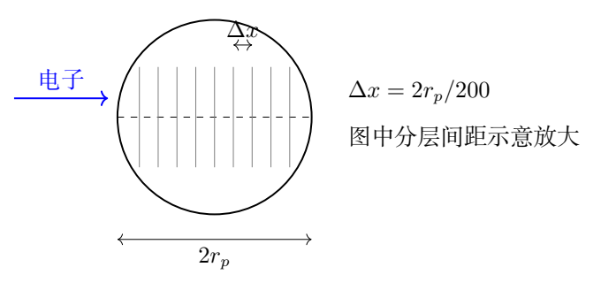
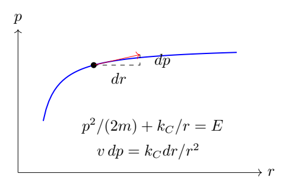

# 第 4 题　质子层析与量子散射尺度（45分）

（1）质子半径约为 $0.850\,\mathrm{fm}$，其内部包含带电荷和不带电荷的粒子。希望用电子对质子内部电荷分布进行200层断层扫描，估算被加速电子所需的动能，用 $\mathrm{GeV}$ 表示。计算狭义相对论与极端相对论结果的差别是否小于狭义相对论结果的 $1\%$。本问不计电磁相互作用的影响。

（2）静止质量为 $m$、电荷为 $Z_1e$ 的粒子向电荷为 $Z_2e$ 的固定靶散射。当两者中心间距为 $r$、入射粒子动量大小为 $p$ 时，求系统总能量。若入射粒子和靶均为质子，且两粒子中心间距的测量不确定度等于它们的中心间距，估算入射质子的速度 $v$。假设中心间距测量的不确定度与入射粒子位置测量的不确定度近似相等。本问按非相对论处理。

已知

$$e=1.60\times10^{-19}\,\mathrm C,
\qquad m_e=9.11\times10^{-31}\,\mathrm{kg},$$

$$h=6.63\times10^{-34}\,\mathrm{kg\,m^2/s},
\qquad c=3.00\times10^8\,\mathrm{m/s},$$

$$\varepsilon_0=8.85\times10^{-12}\,\mathrm{C^2/(N\,m^2)}.$$

## 一、题型定位

不确定关系给出局域化所需的动量尺度，再由相对论能量关系换算电子动能。第二问结合库仑势能与局域化动量，用等能量曲线的局部变化估算量子效应显著的速度尺度。

这是题设下的尺度估算。位置标准差限制动量标准差，不能在没有波包或实验模型时严格确定平均入射动量；第二问也不能仅凭能量守恒就让能量测量的标准差等于零。下文按题设采用相应的尺度估算，并注明假设。

## 二、知识点

$1\,\mathrm{fm}=10^{-15}\,\mathrm m$；$\hbar=h/(2\pi)$；$\Delta x\Delta p_x\ge\hbar/2$；相对论关系 $E^2=p^2c^2+m^2c^4$；动能扣除静止能量；大参数展开；非相对论库仑势能；固定靶与两体相对运动的区别。

电子伏特的换算为 $1\,\mathrm{eV}=e\,\mathrm J$，因此本题使用的 $1\,\mathrm{GeV}=1.60\times10^{-10}\,\mathrm J$。

## 三、物理图像

200层是把整个质子直径分成200个厚度单元，层厚约为半径的百分之一。要分辨如此细的结构，电子波包必须包含很大的空间频率，动量尺度远大于 $m_ec$，所以动能几乎等于 $pc$。

对于第二问，距离的量子涨落会带来势能尺度变化。将它与动量涨落引起的动能尺度变化作局部比较，可以得到一个由基本电荷、普朗克常量和真空介电常量组成的速度尺度。

## 四、解题入口

用 $\Delta x=2r_p/200$ 表示层厚，按题目估算取 $p_*\sim\Delta p_x\sim\hbar/(2\Delta x)$。分别计算 $K_{\rm rel}$ 与 $K_{\rm ur}=p_*c$，比较它们的相对差。

第二问先写 $E=p^2/(2m)+k_C/r$，其中 $k_C=Z_1Z_2e^2/(4\pi\varepsilon_0)$。沿一条经典等能量曲线取微分，得到 $v\,dp=k_Cdr/r^2$；再以变化量级对应不确定尺度，给出题目意图下的估算。这个步骤不是把两个标准差带符号相消。

## 五、解析

### 1　层厚的几何因子

质子半径记为 $r_p$，以免与第二问的两粒子间距 $r$ 混淆。已知

$$r_p=0.850\times10^{-15}\,\mathrm m.$$

200层横跨直径 $2r_p$，所以分辨长度为

$$\boxed{\Delta x=\frac{2r_p}{200}
=8.50\times10^{-18}\,\mathrm m.}$$

若误把半径分成200层，长度会少一半，所估动量与极端相对论能量会多一倍。这里的因子二来自扫描范围，是独立于不确定关系中因子二的另一个几何因素。

### 2　局域化对应的动量尺度

不确定关系给出

$$\Delta p_x\ge\frac\hbar{2\Delta x}.$$

在题目采用的分辨率估算中，取饱和尺度并把入射动量尺度估作同量级：

$$\boxed{p_*\simeq\frac\hbar{2\Delta x}.}$$

利用题给 $h$，

$$\hbar=\frac{6.63\times10^{-34}}{2\pi}
\simeq1.05520\times10^{-34}\,\mathrm{J\,s},$$

$$p_*\simeq6.20704\times10^{-18}\,\mathrm{kg\,m/s}.$$

相应的能量尺度为

$$\boxed{p_*c\simeq1.86211\times10^{-9}\,\mathrm J.}$$

这一步没有假设电子是非相对论粒子。它只使用位置与动量的关系，之后须根据 $p_*/(m_ec)$ 决定适用的能量公式。

### 3　狭义相对论的电子动能

相对论总能量为

$$E_{\rm rel}=\sqrt{p_*^2c^2+m_e^2c^4}.$$

动能必须扣除静止能量：

$$\boxed{K_{\rm rel}
=\sqrt{(p_*c)^2+(m_ec^2)^2}-m_ec^2.}$$

题给静止能量为

$$m_ec^2=9.11\times10^{-31}(3.00\times10^8)^2
=8.199\times10^{-14}\,\mathrm J,$$

约为 $0.5124\,\mathrm{MeV}$。代入计算，

$$K_{\rm rel}\simeq1.86203\times10^{-9}\,\mathrm J.$$

换成 $\mathrm{GeV}$：

$$\boxed{K_{\rm rel}\simeq11.6377\,\mathrm{GeV}
\simeq11.6\,\mathrm{GeV}.}$$

这就是题目估算约定下电子需要的动能量级。并非 $11.6\,\mathrm{MeV}$；GeV和MeV差三个数量级。

### 4　极端相对论近似及误差

定义无量纲小量

$$\epsilon=\frac{m_ec^2}{p_*c}
\simeq4.403\times10^{-5}.$$

电子满足 $\epsilon\ll1$，极端相对论近似为

$$\boxed{K_{\rm ur}\simeq p_*c
=1.86211\times10^{-9}\,\mathrm J
\simeq11.6382\,\mathrm{GeV}.}$$

以狭义相对论动能为分母，误差比为

$$\delta=\frac{K_{\rm ur}-K_{\rm rel}}{K_{\rm rel}}
\simeq4.4032\times10^{-5},$$

$$\boxed{\delta\simeq0.00440\%<1\%.}$$

因此极端相对论近似足够准确。注意 $0.00440\%$ 已经是百分数，不能再把它误当 $0.00440$ 的比例。

直接对根式作展开也能检查：

$$K_{\rm rel}
=p_*c\sqrt{1+\epsilon^2}-m_ec^2,$$

$$K_{\rm rel}
=p_*c\left(1-\epsilon+\frac12\epsilon^2+O(\epsilon^4)\right).$$

虽然根号内静止能量的平方贡献是 $\epsilon^2$ 阶，但动能还扣掉了 $m_ec^2$，所以主误差是 $\epsilon$ 阶。若只比较根号内两项，就会低估动能近似误差。

### 5　为什么不能用非相对论动能

若误用 $K=p^2/(2m_e)$，与 $p_*c$ 的比为

$$\frac{p_*^2/(2m_e)}{p_*c}
=\frac{p_*}{2m_ec}=\frac1{2\epsilon}
\simeq1.14\times10^4.$$

这会高估四个数量级，且对应 $p_*/m_e\gg c$ 的非法经典速度。非相对论条件应检查 $p\ll mc$，不是只看入射粒子的静止质量是否很小。

### 6　一般层数的结果

若把质子直径分成 $L$ 层，同样的估算给出

$$\Delta x=\frac{2r_p}{L},
\qquad p_*c=\frac{\hbar cL}{4r_p},$$

$$\boxed{K_{\rm rel}(L)
=\sqrt{\left(\frac{\hbar cL}{4r_p}\right)^2+m_e^2c^4}
-m_ec^2.}$$

在极端相对论区间内，能量与层数成正比；在非相对论区间内，能量与层数平方成正比。不同区间有不同标度，不能把线性比例延伸到任意小分辨需求。

### 7　固定靶的非相对论能量

第二问入射粒子质量为 $m$，靶固定，不给靶分配动能。选择两粒子无限分离处为势能零点，库仑势能为

$$U(r)=\frac{Z_1Z_2e^2}{4\pi\varepsilon_0r}.$$

因而不含不变的静止能量部分的机械能为

$$\boxed{E=\frac{p^2}{2m}
+\frac{Z_1Z_2e^2}{4\pi\varepsilon_0r}.}$$

同号电荷时势能为正，是排斥相互作用；异号电荷时势能为负。若靶可以自由运动，应使用两体总动能或约化质量，不能照搬固定靶公式。

### 8　题意下的速度尺度估算

设 $k_C=Z_1Z_2e^2/(4\pi\varepsilon_0)>0$。沿一条定能量的经典运动曲线，

$$dE=\frac pm\,dp-\frac{k_C}{r^2}dr=0.$$

用 $p/m=v$，在变化尺度上写为

$$v\,\Delta p\sim\frac{k_C}{r^2}\Delta r.$$

再取局域化饱和尺度 $\Delta p\sim\hbar/(2\Delta r)$，得到

$$\frac{v\hbar}{2\Delta r}
\sim\frac{k_C\Delta r}{r^2},$$

$$\boxed{\left(\frac{\Delta r}{r}\right)^2
\sim\frac{v\hbar}{2k_C}
=\frac{\varepsilon_0hv}{Z_1Z_2e^2}.}$$

因此在同号电荷条件下，

$$\boxed{\frac{\Delta r}{r}
\sim\sqrt{\frac{\varepsilon_0hv}{Z_1Z_2e^2}}.}$$

原题两粒子均为质子，$Z_1=Z_2=1$。令相对位置不确定尺度为一，得到

$$\boxed{v_*\sim\frac{e^2}{\varepsilon_0h}.}$$

这个速度与质子质量、所取距离都无关，是局部动能变化、库仑势能变化和不确定关系合成的特征尺度。

### 9　数值与非相对论自洽性

代入题给常量，

$$v_*\sim\frac{(1.60\times10^{-19})^2}
{(8.85\times10^{-12})(6.63\times10^{-34})}
\simeq4.363\times10^6\,\mathrm{m/s},$$

$$\boxed{v_*\simeq0.0145c\simeq0.015c.}$$

此速率远小于 $c$，故第二问使用非相对论动能是自洽的。相对论动能展开为

$$K=\frac12mv^2\left(1+\frac34\frac{v^2}{c^2}+\cdots\right),$$

这里首项修正的相对大小约 $1.6\times10^{-4}$，不到 $0.02\%$。

如果定义无量纲电磁耦合常量

$$\alpha_C=\frac{e^2}{4\pi\varepsilon_0\hbar c},$$

因 $h=2\pi\hbar$，上述速度还可写成

$$\boxed{v_*=2\alpha_Cc.}$$

用题给数据 $\alpha_C\simeq0.00727$，仍给出同一速度。这个形式有助于检查因子 $2\pi$ 是否使用正确。

### 10　尺度推导的适用边界

第8节使用的是局部微分式。当 $\Delta r/r\ll1$ 时，势能变化可用一阶近似描述；题目却把这一比例推到一，所以所得 $v_*$ 只表示量子位置涨落和经典距离相当的数量级，不能称为严格唯一的速度或普遍的最小入射速度。

例如若距离由 $r$ 增加到 $r+\Delta r$，精确势能差为

$$U(r+\Delta r)-U(r)
=-\frac{k_C\Delta r}{r(r+\Delta r)}.$$

当 $\Delta r=r$ 时，精确差的大小为 $k_C/(2r)$，而局部微分式给 $k_C/r$，两者差一个因子二。这正是“数量级估算”与“精确有限变化”的区别。

不确定关系中的 $\Delta r,\Delta p$ 是波包的标准差或相应宽度。能量守恒表示某个封闭体系沿运动的能量不变，不等于测量标准差 $\Delta E$ 自动为零。第8节从等能量曲线转为涨落尺度是一项额外估算约定，其结论应与这个约定一起报告。

### 11　用波包说明平均动量与分辨率的区别

在一维最小不确定高斯波包中，可写

$$\psi(x)=C\exp\left[-\frac{(x-x_0)^2}{4s^2}
+\frac{i p_0x}{\hbar}\right].$$

它满足 $\Delta x=s$、$\Delta p=\hbar/(2s)$，但平均动量 $p_0$ 可以改变而不改变这两个宽度。故 $\Delta x$ 单独并不强制 $\langle p\rangle=p_*$。

第一問按照竞赛题意把探针入射动量尺度估为局域化动量宽度，因此得到11.6GeV。若要精确设计实验，还需给出散射动量转移、可用角度、波包形状和分辨判据；本题未提供这些条件。明确这一点可以保持结果可用，同时避免把估算式误读为一般定理。

### 12　数量级与量纲检查

$\hbar/\Delta x$ 的量纲为动量，乘 $c$ 后为能量。$e^2/(\varepsilon_0r)$ 量纲为能量，故 $e^2/(\varepsilon_0h)$ 的量纲为速度。电子问题所需能量约 $10^{-9}\,\mathrm J$，静止能量约 $10^{-13}\,\mathrm J$，符合极端相对论；质子速度约 $10^6\,\mathrm{m/s}$，小于光速约两数量级，符合非相对论。

最终可报告：在题目的局域化估算约定下，电子动能约11.6GeV，两种相对论结果差约0.0044%；第二问的库仑散射特征速度约 $0.015c$。

## 六、关键洞察

不确定关系限制宽度，相对论公式换算能量；两个逻辑步骤应分开。极端相对论动能的误差主要来自扣掉静止能量，而不是根式内静止项。第二问的速度是一个模型尺度，并非仅凭守恒和不确定原理严格解出的唯一值。

## 七、易错点

用半径替代直径分层；混用 $h$ 与 $\hbar$；误写 $10^{-8}\,\mathrm J$ 却仍称11.6GeV；不扣静止能量；用非相对论公式求超高动量电子能量；漏掉第二问的平方根；将有符号能量变化当测量标准差。

## 八、课堂讲解建议

先画直径分层，检查长度数量级。让学生分别算 $pc$ 与 $mc^2$，再决定能量近似。第二问先在经典等能量曲线上作微分，再说明从微分变化到量子涨落尺度的估算转换。最后用高斯波包说明“平均值”和“宽度”不是同一个量。

## 九、变式训练

### 变式1　扫描层数加倍

电子仍按正文估算约定，层数由200变为400，求动能变化。

解：层厚减半，所以 $p_*c$ 加倍为 $3.72423\times10^{-9}\,\mathrm J$。相对论动能为

$$K_{400}=\sqrt{4(p_{200}c)^2+m_e^2c^4}-m_ec^2
\simeq23.276\,\mathrm{GeV}.$$

它接近原来的两倍。极端相对论误差约变为原来的一半，因为 $mc^2/(pc)$ 减半。精确动能并非严格线性，原因在于同样的静止能量只扣除一次。

### 变式2　极端相对论误差低于1%的条件

对任意质量 $m$ 的粒子，求 $pc/(mc^2)$ 应大致多大，才使 $pc$ 近似动能的误差低于1%。

解：令 $q=p/(mc)$，有 $K/(mc^2)=\sqrt{1+q^2}-1$。要求

$$\frac{q-[\sqrt{1+q^2}-1]}{\sqrt{1+q^2}-1}\le0.01.$$

等号给 $q=1.01(\sqrt{1+q^2}-1)$。移项平方并去掉零动量退化解，得

$$\boxed{q\ge\frac{2(1.01)}{1.01^2-1}
\simeq100.50.}$$

因此粗略判据 $pc\gtrsim100mc^2$ 很合适，但若检验在边界处是否严格小于1%，应使用100.50。

### 变式3　改变电荷数

沿正文同号电荷局部估算，设 $Z_1Z_2=4$，求相对不确定尺度达到一的速度。

解：由 $(\Delta r/r)^2\sim\varepsilon_0hv/(Z_1Z_2e^2)$，有

$$\boxed{v_*\sim\frac{Z_1Z_2e^2}{\varepsilon_0h}
=4\times4.363\times10^6\,\mathrm{m/s}
\simeq0.0582c.}$$

此值仍可作非相对论的数量级估算，但相对论首项修正约0.25%，比原题大。若电荷数继续增大而速度接近光速，就必须修改动能变化关系，不能继续线性放大。

### 变式4　相对位置宽度设为十分之一

对质子散射，沿同一局部估算规定 $\Delta r/r=0.10$，求相应速度尺度。

解：令比例为 $\lambda$，有

$$\lambda^2\sim\frac{\varepsilon_0hv}{e^2},
\qquad\boxed{v\sim\lambda^2v_*}. $$

代入 $\lambda=0.10$，得 $v\sim4.36\times10^4\,\mathrm{m/s}$。相对变化变小后，一阶势能微分近似较好，但宽度与局部经典变化的等同依然属于模型约定。该结果不应拿来推断真实加速器探针分辨能力随入射速度的普遍规律。
