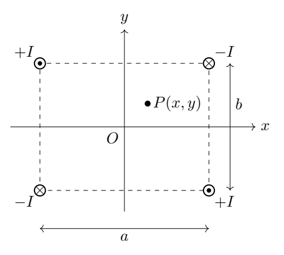
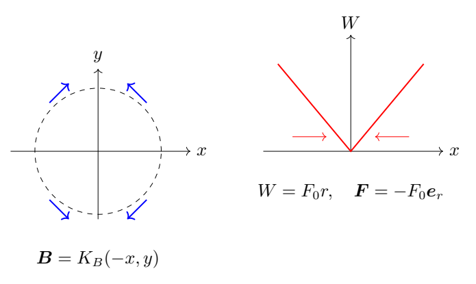

# 第 5 题　四导线磁阱与蒸发冷却（45分）

实现稀薄原子气体的玻色—爱因斯坦凝聚，需要磁阱囚禁和降温等技术。本题研究一种四导线磁阱的近轴磁场和势能。

（1）四根相互平行的无限长直导线，横截面可忽略，垂直穿过边长为 $a,b$ 的长方形四个顶点。电流大小均为 $I$，方向如下图：左上、右下电流沿 $+z$，右上、左下沿 $-z$。以长方形中心为原点，取 $x$ 轴垂直于长为 $b$ 的边，$y$ 轴垂直于长为 $a$ 的边，建立右手直角坐标系。点 $P=(x,y,0)$ 在原点附近，$|x|\ll a$、$|y|\ll b$，$a,b$ 为同阶量。求 $O,P$ 两点磁感应强度，并将可作近似的结果保留到领头阶。

（2）原子固有磁矩为 $\boldsymbol S$。将磁矩视为形状、电流不随旋转改变的微小电流圈，证明它在磁场 $\boldsymbol B$ 中的势能为

$$W_m=-\boldsymbol S\cdot\boldsymbol B.$$

（3）把原子限制在 $x-y$ 平面原点附近，并通过实验手段使磁矩方向始终与当地磁场相反。求其受力，保留到领头阶。

（4）一团原子被囚禁在柱形区域内，横截面平行于 $x-y$ 平面、半径为 $R_1$，$R_1\ll a,b$；柱高远小于 $R_1$，原子密度近似均匀，磁矩均与当地磁场相反。以 $O$ 为势能零点，求平均势能。缓慢蒸发一部分原子，使余下原子团向中心收缩为半径 $R_1/5$、高度不变的圆柱，密度保持不变。求冷却后的总原子数、总势能和平均势能。已知真空磁导率为 $\mu_0$。

## 一、题型定位

磁场向量叠加、近轴泰勒展开、磁偶极势能与径向分布积分。导线场的方向不能直接用场强大小相加代替；势能由反平行磁矩给出 $+SB$，而受力需要对磁场大小求梯度。

本题近轴势能与半径成正比，形成锥形阱。它不是通常势能与半径平方成正比的谐振子阱。

## 二、知识点

无限长直导线的磁场；右手定则；多导线叠加；多变量的一阶展开；磁矩受力矩 $\boldsymbol S\times\boldsymbol B$；势能与力；二维环形微元 $2\pi r\,dr$；均匀面密度与总体积密度；尺度变化下的粒子数和能量标度。

题中的 $\boldsymbol S$ 表示磁矩，不是这里要另行求解的角动量。记其大小为 $S>0$。外部调控使方向保持反平行是给定模型条件，磁矩大小不变。

## 三、物理图像

中心四导线磁场相消。小范围内，磁场在 $x$ 方向表现为朝向中心的分量，在 $y$ 方向表现为离开中心的分量；然而磁场大小只依赖到中心的距离。反平行磁矩倾向于低磁场区域，因而受到向中心的力。

原子团越靠近中心，势能越小。蒸发高能量原子后，在题设密度和高度固定的情况下，半径下降同时减少粒子数与每粒子平均势能，总势能下降得更快。

## 四、解题入口

把四个导线坐标写为 $(s a/2,t b/2)$，$s,t=\pm1$，电流有符号值 $I_{st}=-stI$。对每根导线使用向量形式的Biot—Savart结果，求和后在原点展开。

用符号 $K_B$ 表示磁场梯度系数，避免四问反复携带长常数。得出 $B=K_Br$ 后，直接写 $W=SK_Br$，再用圆环微元求平均值。

## 五、解析

### 1　单根导线的向量磁场

一根位于 $(x_j,y_j)$、电流沿 $+z$ 的无限长导线，在 $P=(x,y)$ 处产生

$$\boldsymbol B_j
=\frac{\mu_0I}{2\pi}
\frac{\boldsymbol e_z\times[(x-x_j)\boldsymbol e_x+(y-y_j)\boldsymbol e_y]}
{(x-x_j)^2+(y-y_j)^2}.$$

即

$$B_{jx}=-\frac{\mu_0I}{2\pi}
\frac{y-y_j}{(x-x_j)^2+(y-y_j)^2},$$

$$B_{jy}=\frac{\mu_0I}{2\pi}
\frac{x-x_j}{(x-x_j)^2+(y-y_j)^2},
\qquad B_{jz}=0.$$

沿 $-z$ 的导线把上述结果整体反号。在导线右侧，沿 $+z$ 的电流产生向上的场，这可以作为右手定则的快速检查。

### 2　四导线的精确叠加形式

定义 $C_B=\mu_0I/(2\pi)$，$x_{st}=sa/2$、$y_{st}=tb/2$，电流符号 $q_{st}=-st$。于是

$$\boxed{B_x=-C_B\sum_{s,t=\pm1}
q_{st}\frac{y-tb/2}{(x-sa/2)^2+(y-tb/2)^2},}$$

$$\boxed{B_y=C_B\sum_{s,t=\pm1}
q_{st}\frac{x-sa/2}{(x-sa/2)^2+(y-tb/2)^2},
\qquad B_z=0.}$$

这给出原点附近和远离原点时都可使用的精确场，只需避开导线本身。原点距四根导线相同，相关分子的带符号和为零，因此

$$\boxed{\boldsymbol B(O)=\boldsymbol0.}$$

例如中心的 $x$ 场分量正比于 $\sum q_{st}t$，$y$ 分量正比于 $\sum q_{st}s$，均为零。只有在矢量分量中处理方向，才能看清相消。

### 3　一阶泰勒展开

记原点到每根导线的距离平方为

$$d_0^2=\frac{a^2+b^2}{4}.$$

每根导线的分母写为

$$d_{st}^2=d_0^2-sa,x-tb,y+x^2+y^2.$$

在小量条件下取

$$\frac1{d_{st}^2}
=\frac1{d_0^2}+
\frac{sa,x+tb,y}{d_0^4}+O(r^2/d_0^4),$$

其中 $r=\sqrt{x^2+y^2}$，$a,b$ 同阶保证同一个小范围适用。将它代入分量式，先看 $B_x$ 的常数项：

$$B_x(0)=\frac{C_B}{d_0^2}\sum q_{st}\frac{tb}{2}=0.$$

线性项中，直接来自 $-y$ 的项因 $\sum q_{st}=0$ 相消。来自分母展开的 $x$ 项为

$$\frac{C_B}{d_0^4}
\sum q_{st}\frac{tb}{2}(sa,x)
=-\frac{2C_Bab}{d_0^4}x.$$

$y$ 项因 $\sum q_{st}=0$ 或相应奇数和为零而消失。因此

$$B_x=-\frac{2C_Bab}{d_0^4}x+\text{高阶项}.$$

同理可得

$$B_y=\frac{2C_Bab}{d_0^4}y+\text{高阶项}.$$

定义正的梯度系数

$$\boxed{K_B=\frac{16\mu_0abI}{\pi(a^2+b^2)^2}.}$$

最终近轴场为

$$\boxed{\boldsymbol B(P)
\simeq K_B(-x\boldsymbol e_x+y\boldsymbol e_y),
\qquad B_z=0.}$$

磁场大小于是为

$$\boxed{B(P)\simeq K_B\sqrt{x^2+y^2}=K_Br.}$$

中心反演对称使场为奇函数，故二阶项也相消，首个一般修正从三阶场分量开始。实际近似范围仍应由 $r\ll a,b$ 保证。

### 4　场的局部一致性检查

在不含导线的中心区域，近似场满足

$$\nabla\cdot\boldsymbol B
=-K_B+K_B=0,$$

$$\nabla\times\boldsymbol B=\boldsymbol0.$$

这符合无磁单极以及区域内无电流的条件。沿 $x$ 轴，场指向 $-x$；沿 $y$ 轴，场指向 $+y$。场方向不是在各个方向都径向向内，但它的大小具有径向对称性，计算势能时应使用场的大小，不能直接照搬场矢量的方向。

### 5　磁偶极势能的推导

对形状和电流固定的微小电流圈，力矩为

$$\boldsymbol\tau=\boldsymbol S\times\boldsymbol B.$$

设磁矩与磁场夹角为 $\vartheta$。磁力矩趋于减小 $\vartheta$，其沿增大角度方向的广义力矩为

$$\tau_\vartheta=-SB\sin\vartheta.$$

势能的角度导数为广义力矩的负值，故

$$\frac{dW}{d\vartheta}=SB\sin\vartheta.$$

取 $\vartheta=\pi/2$ 时 $W=0$，积分得

$$W(\vartheta)=\int_{\pi/2}^{\vartheta}SB\sin\vartheta'\,d\vartheta'
=-SB\cos\vartheta,$$

$$\boxed{W_m=-\boldsymbol S\cdot\boldsymbol B.}$$

平行时 $W=-SB$ 为最低，反平行时 $W=+SB$ 为最高角向能量。题目通过外部调控维持反平行，因此使用的是这个指定的磁矩支，而不是让磁矩自由转到平行支。

### 6　反平行磁矩的平移力

磁矩反平行给出

$$W(r)=+SB(r)\simeq SK_Br.$$

定义 $F_0=SK_B$，则

$$\boldsymbol F=-\nabla W.$$

对 $r>0$，有 $\partial r/\partial x=x/r$、$\partial r/\partial y=y/r$，所以

$$\boxed{F_x=-SK_B\frac x{\sqrt{x^2+y^2}},
\qquad F_y=-SK_B\frac y{\sqrt{x^2+y^2}}.}$$

即

$$\boxed{\boldsymbol F=-F_0\boldsymbol e_r,
\qquad |\boldsymbol F|=F_0.}$$

近轴领头阶力的大小为常量，方向朝中心。若把它写成 $-K_BS(x\boldsymbol e_x+y\boldsymbol e_y)$，会漏掉 $1/r$ 并错成胡克力，量纲也不正确。

原点 $r=0$ 的锥形势能有尖点，梯度方向没有唯一值，而且当地 $\boldsymbol B=0$，磁矩反平行的方向也未定义。故上式明确用于原点附近的非零 $r$；不能把 $x/r,y/r$ 在原点直接代入。题设的外部调控把真实零场区的磁矩演化简化了。

### 7　平均势能的环形积分

设柱高为 $H_z$、体积粒子数密度为 $n_v$，取面密度

$$n_s=n_vH_z.$$

因柱高和密度均匀，半径 $r$ 到 $r+dr$ 的圆环内粒子数为

$$dN=n_s2\pi r\,dr.$$

全团粒子数为

$$\boxed{N_1=\int_0^{R_1}n_s2\pi r\,dr
=n_s\pi R_1^2.}$$

势能总量为

$$U_1=\int_0^{R_1}F_0r\,dN
=2\pi n_sF_0\int_0^{R_1}r^2dr,$$

$$\boxed{U_1=\frac23\pi n_sF_0R_1^3.}$$

平均势能为

$$\boxed{\overline W_1=\frac{U_1}{N_1}
=\frac23F_0R_1
=\frac{32\mu_0abIS}{3\pi(a^2+b^2)^2}R_1.}$$

如果先把柱体的高度积分出来，再对面内圆环积分，结果完全相同。平均值中柱高与密度均相消。

### 8　为什么平均半径是 $2R/3$

均匀面积分布不等于半径均匀分布。在半径为 $R$ 的圆盘中，粒子半径的概率密度是

$$p_r(r)=\frac{2r}{R^2},\qquad0\le r\le R.$$

其归一化与平均半径为

$$\int_0^Rp_r(r)dr=1,
\qquad\langle r\rangle=\int_0^Rr\,p_r(r)dr=\frac{2R}{3}.$$

故平均势能正是 $F_0\langle r\rangle$。若错取平均半径 $R/2$，就是把面积均匀分布偷换成了半径均匀分布。

还可求二阶矩：

$$\langle r^2\rangle=\frac{R^2}{2},$$

$$\operatorname{Var}(r)=\frac{R^2}{2}-\frac{4R^2}{9}
=\frac{R^2}{18}.$$

于是势能标准差为 $F_0R/\sqrt{18}$。这为均匀原子团的能量分布提供另一项检查，而不是只检查平均值。

### 9　半径缩小五倍后的三个尺度

题设保持密度和高度不变，故面密度 $n_s$ 不变，$R_2=R_1/5$。因此

$$\boxed{N_2=n_s\pi(R_1/5)^2=\frac{N_1}{25}.}$$

总势能含 $R^3$，有

$$\boxed{U_2=\frac{U_1}{125}
=\frac{2\pi n_sF_0R_1^3}{375}.}$$

平均势能含 $R$，有

$$\boxed{\overline W_2=\frac{\overline W_1}{5}
=\frac{2F_0R_1}{15}.}$$

三者的关系可再次检查：

$$\frac{U_2}{N_2}
=\frac{U_1/125}{N_1/25}
=\frac15\frac{U_1}{N_1}.$$

由于题面未给柱高或密度的具体数值，总粒子数和总势能应使用 $n_s$，或者使用初态的 $N_1,U_1$ 表示，不能凭空给出数值。

### 10　蒸发冷却的条件和结果含义

若用截断圆盘来理解几何分布，余下中央半径为 $R_1/5$ 的区域只占原面积 $1/25$，所以有 $24/25$ 的粒子被去除。它们带走的初态势能是 $124U_1/125$，平均每个被去除粒子的势能为

$$\overline W_{\rm removed}
=\frac{U_1-U_2}{N_1-N_2}
=\frac{31}{30}\overline W_1.$$

它大于初始平均值，所以选择高能量原子移除可以降低平均能量。真实蒸发冷却还包括动能和粒子碰撞再热化；本题只要求在给定最终几何与均匀密度条件下的外场势能。

不能把 $U_2/U_1=1/125$ 说成温度下降125倍，也不能因“收缩”就假定粒子数守恒。题目明确是部分原子被蒸发且密度保持不变，粒子数必须随面积改变。

### 11　量纲与磁阱尺度检查

$\mu_0I$ 的量纲是磁场乘长度，$ab/(a^2+b^2)^2$ 的量纲为长度的负二次方，因此 $K_B$ 的量纲为磁场每长度。$SB$ 是能量，故 $F_0=SK_B$ 是力，平均势能 $F_0R$ 的量纲正确。

导线矩形在 $a\leftrightarrow b$ 交换时，$K_B$ 不变；电流反向使磁场向量反向，但在重新维持反平行支后磁场大小和势能不变。近轴近似须在初态 $R_1\ll a,b$ 成立，半径收缩后条件更好。

## 六、关键洞察

磁场方向是二维鞍形，但磁场大小形成中心最低的圆锥。这使反平行磁矩可以被吸向中心。平均能量的计算依赖粒子空间分布，均匀面积对应 $2r/R^2$，并非均匀半径。

## 七、易错点

忽略电流正负方向；只加磁场大小；把磁矩符号 $S$ 当标量直接套力公式；误将锥形阱当谐阱；在中心直接使用未定义的单位径向量；认为原子团收缩时总粒子数不变；平均半径误取 $R/2$；把势能缩放比直接当温度比。

## 八、课堂讲解建议

先在四个坐标轴上的小位移点画场方向，再对任意点计算大小。由此引出场向量与场大小的区别。积分前要求学生先画圆环微元，并预测 $N\propto R^2$、$U\propto R^3$ 的标度，再用积分确认系数。

## 九、变式训练

### 变式1　固定矩形面积的最佳形状

保持 $ab=A_0$ 和电流 $I$ 不变，求近轴场梯度 $K_B$ 最大时矩形的形状。

解：分子不变，须最小化 $(a^2+b^2)^2$。由 $a^2+b^2\ge2ab=2A_0$，等号在 $a=b=\sqrt{A_0}$，故

$$\boxed{K_{B,\max}=\frac{4\mu_0I}{\pi A_0}.}$$

正方形在给定面积下产生最大的近轴梯度。若改变的是边长和而不是面积，必须重新处理约束，不能直接把上式中的面积看成固定值。

### 变式2　任意收缩比

密度与高度不变，半径由 $R$ 变成 $\lambda R$，$0<\lambda<1$。求剩余比例和平均势能比例。

解：$N\propto R^2$、$U\propto R^3$，故

$$\boxed{\frac{N_2}{N_1}=\lambda^2,
\quad\frac{U_2}{U_1}=\lambda^3,
\quad\frac{\overline W_2}{\overline W_1}=\lambda.}$$

若只剩原粒子数的四分之一，则 $\lambda=1/2$，总势能剩八分之一、平均势能剩二分之一。三个比值分别代表粒子数、总能量和单粒子平均，不能互相替代。

### 变式3　加上均匀轴向偏置磁场

在近轴四导线场上叠加 $B_0\boldsymbol e_z$，$B_0>0$。反平行磁矩仍被维持，求中心附近势能和力。

解：磁场大小为 $B=\sqrt{B_0^2+K_B^2r^2}$。取中心势能为零，有

$$W=S(\sqrt{B_0^2+K_B^2r^2}-B_0).$$

当 $K_Br\ll B_0$，展开得

$$\boxed{W\simeq\frac{SK_B^2}{2B_0}r^2,
\quad\boldsymbol F\simeq-\frac{SK_B^2}{B_0}\boldsymbol r.}$$

此时中心势能光滑且成为谐阱。原子质量为 $m_a$ 时小振动频率 $\omega_a=K_B\sqrt{S/(m_aB_0)}$，同时避免了理想零场点的方向退化。

### 变式4　锥形阱中的热平衡分布

在无截断、二维经典热平衡模型中，$W=F_0r$，粒子面密度正比于 $e^{-F_0r/(k_BT)}$。求平均势能。

解：令 $\ell=k_BT/F_0$。归一化分母含 $\int_0^\infty r e^{-r/\ell}dr=\ell^2$，平均半径的分子含 $\int_0^\infty r^2e^{-r/\ell}dr=2\ell^3$。因此

$$\boxed{\langle r\rangle=2\ell,
\quad\langle W\rangle=2k_BT.}$$

这与正文均匀圆盘的 $2F_0R/3$ 不同，因为空间分布条件不同。若存在有限半径截断，就须把两个积分上限改为该半径再取比值。
