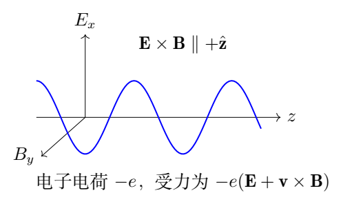
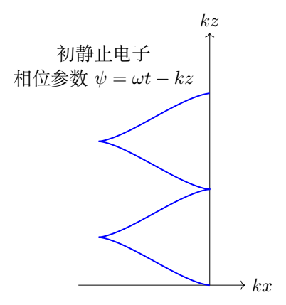

# 第 4 题　强平面激光场中的相对论电子运动

真空激光加速机制利用强激光脉冲提高电子能量。采用沿 $+z$ 传播、线偏振的单色平面电磁波模型：
$$
\mathbf E=E_0\cos(kz-\omega t)\,\mathbf e_x,\qquad
\mathbf B=\frac{E_0}{c}\cos(kz-\omega t)\,\mathbf e_y,
\qquad kc=\omega.
$$
$E_0$ 是电场振幅，$c$ 为真空光速。忽略重力，使用相对论动力学。

（1）$t=0$ 时电子静止于原点，忽略辐射阻尼。
（1.1）求动量 $\mathbf p$ 和总能量 $\varepsilon$，表达式可含当时坐标。
（1.2）求位置 $x,y,z$ 与时间的关系，可用隐函数表示。

（2）$t=0$ 时从原点沿 $x$-$z$ 平面注入总能量为 $\varepsilon_0$ 的电子，初速度与 $+x$ 的夹角不大于 $\pi/2$，忽略辐射阻尼。求最大能量 $\varepsilon_{\max}$ 及对应入射角 $\theta_0$；$\theta_0$ 为入射方向与 $z$ 轴的夹角。

（3）强激光下辐射阻尼不可忽略，给定能量损失模型
$$
\frac{d\varepsilon}{dt}
=-\frac{e^4\mu_0E_0^2}{4\pi m_e^4c^5}\varepsilon^2.
$$
激光强度 $I=1.0\times10^{22}\,\mathrm{W/cm^2}$，波长
$\lambda=800\,\mathrm{nm}$，初始总能量
$\varepsilon_0=1000m_ec^2$。求一个激光周期后
$\Delta\varepsilon/\varepsilon_0$。
给定 $m_e=9.101\times10^{-31}\,\mathrm{kg}$，
$e=1.602\times10^{-19}\,\mathrm C$，
$c=2.998\times10^8\,\mathrm{m/s}$，
$\mu_0=4\pi\times10^{-7}\,\mathrm{N/A^2}$。
强度为坡印廷矢量大小的时间平均。本题50分。

## 一、题型定位

电子在平面波中的运动同时受电场与磁场影响，又涉及相对论能量。直接以 $t$ 求解三个非线性速度方程很繁琐；可先求横向动量的相位关系和守恒量 $\varepsilon-cp_z$，再用能量动量关系消去纵向动量。

第二问把“在一个波周期中选最大相位”与“在固定初始能量下选最佳入射角”分成两次优化。第三问使用题给损失模型，须准确处理强度单位及振幅与平均强度之间的因子2。

## 二、知识点

- 相对论动量、总能量、速度的关系。
- 洛伦兹力，磁场不做功。
- 平面波相位变量及守恒量。
- 能量动量关系与参数轨迹。
- 带约束的极值、平方后的根筛选。
- 可分离微分方程、有限能量损失。
- 场振幅、时间平均强度与SI单位换算。

## 三、物理图像

电场使电子在 $x$ 方向往复运动。电子获得横向速度后，磁场力又产生 $z$ 向动量，因此初静止电子的纵向动量始终非负，运动有沿波传播方向的漂移。

电子的总能量随横向动量增长，但其沿 $z$ 方向的速度也增大，使它追赶波相位。电子经历一个完整相位周期所需的实验室时间因此一般大于固定位置测得的激光周期。

## 四、解题入口

记电子质量为 $m=m_e$，定义无量纲场强
$$
a=\frac{eE_0}{mc\omega}>0.
$$
使用电子沿轨迹经历的正向相位
$$
\psi=\omega t-kz.
$$
对于从静止出发的电子，
$\dot\psi=\omega(1-v_z/c)>0$。先积分得到
$p_x=-mca\sin\psi$，再用
$\varepsilon-cp_z=mc^2$ 求 $p_z,\varepsilon$。

一般注入时使用
$\gamma_0=\varepsilon_0/(mc^2)$、
$P=\sqrt{\gamma_0^2-1}$、
$u_0=\gamma_0-P\cos\theta_0>0$。
第三问独立使用题给阻尼方程，不能继续假定第一问的无阻尼守恒量成立。

## 五、解析

（1）写出相对论动力学分量。

电子电荷为 $-e$，
$$
\dot{\mathbf p}=-e(\mathbf E+\mathbf v\times\mathbf B),\qquad
\mathbf p=\gamma m\mathbf v,\qquad
\varepsilon=\gamma mc^2.
$$
由于 $\mathbf B$ 沿 $y$，其叉乘为
$$
\mathbf v\times\mathbf B=(-v_zB_y,\ 0,\ v_xB_y).
$$
因此
$$
\dot p_x=-eE_0(1-v_z/c)\cos\psi,
$$
$$
\dot p_y=0,\qquad
\dot p_z=-\frac{eE_0}{c}v_x\cos\psi.\tag{4.1}
$$
初始 $p_y=0$，故始终 $p_y=0$，运动在 $x$-$z$ 平面。即使电场不含 $z$ 分量，纵向动量也会由磁力产生。

（2）相位积分得到横向动量。

相位沿轨迹的导数为
$$
\dot\psi=\omega-kv_z
=\omega(1-v_z/c).
$$
于是
$$
\dot p_x=-\frac{eE_0}{\omega}\dot\psi\cos\psi
=-\frac{eE_0}{\omega}\frac{d}{dt}\sin\psi.
$$
用初始 $p_x(0)=0,\psi(0)=0$ 积分：
$$
\boxed{p_x=-\frac{eE_0}{\omega}\sin\psi=-mca\sin\psi.}\tag{4.2}
$$
若使用原题的相位 $\varphi=kz-\omega t=-\psi$，此式写为
$p_x=(eE_0/\omega)\sin\varphi$，两种记号完全等价。负号来自电子的负电荷，不应凭正电荷的运动直觉改写。

（3）寻找能量与纵向动量的守恒组合。

相对论能量变化率
$$
\dot\varepsilon=\mathbf v\cdot\dot{\mathbf p}
=-e\mathbf v\cdot\mathbf E
=-eE_0v_x\cos\psi.
$$
磁力的功为零。由式（4.1）可见
$\dot\varepsilon=c\dot p_z$，故
$$
\frac{d}{dt}(\varepsilon-cp_z)=0.
$$
初静止电子的常量为 $mc^2$：
$$
\boxed{\varepsilon-cp_z=mc^2.}\tag{4.3}
$$
这个量不是 $\varepsilon$ 本身。激光可以暂时向电子输送能量，同时增加纵向动量，二者变化受此关系约束。

（4）用能量动量关系消去未知量。

总能量满足
$$
\varepsilon^2=m^2c^4+c^2p_x^2+c^2p_z^2.
$$
代入 $\varepsilon=mc^2+cp_z$：
$$
m^2c^4+2mc^3p_z+c^2p_z^2
=m^2c^4+c^2p_x^2+c^2p_z^2.
$$
两边消项后
$$
p_z=\frac{p_x^2}{2mc}.
$$
所以
$$
\boxed{
\mathbf p=-mca\sin\psi\,\mathbf e_x
+\frac12mca^2\sin^2\psi\,\mathbf e_z,}\tag{4.4}
$$
$$
\boxed{\varepsilon=mc^2
\left(1+\frac{a^2}{2}\sin^2\psi\right).}\tag{4.5}
$$
式（4.4）给 $p_z\ge0$，而 $p_x$ 可以正负交替。横向动量为场强一阶，纵向动量与动能为场强二阶，这也是弱场极限的一项检查。

对应速度为
$$
\frac{v_x}{c}=
-\frac{a\sin\psi}{1+a^2\sin^2\psi/2},\qquad
\frac{v_z}{c}=
\frac{a^2\sin^2\psi/2}{1+a^2\sin^2\psi/2}.
$$
即使 $a$ 很大，速度仍小于 $c$；不能把动量关系直接当成非相对论速度。

（5）用相位求参数轨迹。

由式（4.3）
$$
1-\frac{v_z}{c}
=\frac{\varepsilon-cp_z}{\varepsilon}
=\frac{1}{\gamma},
\qquad \dot\psi=\frac{\omega}{\gamma}.
$$
因此
$$
\frac{dx}{d\psi}
=\frac{v_x}{\dot\psi}
=\frac{p_x}{m\omega}
=-\frac a{k}\sin\psi.
$$
积分并用 $x(0)=0$：
$$
\boxed{x(\psi)=\frac a{k}(\cos\psi-1),\qquad y=0.}\tag{4.6}
$$
同理
$$
\frac{dz}{d\psi}
=\frac{p_z}{m\omega}
=\frac{a^2}{2k}\sin^2\psi.
$$
利用 $\sin^2\psi=(1-\cos2\psi)/2$：
$$
\boxed{z(\psi)=\frac{a^2}{4k}
\left(\psi-\frac12\sin2\psi\right).}\tag{4.7}
$$
再由 $\psi=\omega t-kz$：
$$
\boxed{
t(\psi)=\frac1\omega
\left[\left(1+\frac{a^2}{4}\right)\psi
-\frac{a^2}{8}\sin2\psi\right].}\tag{4.8}
$$
其导数为
$$
\frac{dt}{d\psi}=\frac1\omega
\left(1+\frac{a^2}{2}\sin^2\psi\right)>0.
$$
因此每个 $t\ge0$ 唯一对应 $\psi\ge0$，参数式给出了无歧义的轨迹。把 $\psi=\omega t-kz$ 代回式（4.6）、（4.7），就是题目允许的隐函数关系。

（6）检查轨迹的短时与周期行为。

短时 $\psi\ll1$，
$$
x\simeq-\frac{a}{2k}\psi^2,\qquad
z\simeq\frac{a^2}{6k}\psi^3,\qquad
t\simeq\frac{\psi}{\omega}.
$$
于是 $x\simeq-eE_0t^2/(2m)$，符合电子最初在电场中的负向加速；$z$ 从三阶时间起增长，因为先有横向速度，才出现纵向磁力。

当相位增加 $2\pi$，
$$
\Delta x=0,\qquad
\Delta z=\frac{\pi a^2}{2k},
$$
$$
\Delta t=\frac{2\pi}{\omega}
\left(1+\frac{a^2}{4}\right).
$$
电子横向位置回到起点，总动量在该相位也回到零，但它已经向前移动。此实验室时间不是固定位置激光周期 $2\pi/\omega$。第（3）问所说“一个周期”按给定激光波长使用 $\lambda/c$。

（7）一般注入电子的两项不变量。

对于初始 $p_{x0}\ge0$、$p_{y0}=0$，
$$
p_x=p_{x0}-mca\sin\psi,\qquad p_y=0,
$$
$$
\varepsilon-cp_z=\varepsilon_0-cp_{z0}=mc^2u_0.
$$
令
$$
\frac{p_{x0}}{mc}=P\sin\theta_0,\qquad
\frac{p_{z0}}{mc}=P\cos\theta_0,\qquad
P=\sqrt{\gamma_0^2-1}.
$$
入射条件只要求 $p_{x0}\ge0$；$p_{z0}$ 可以正也可以负，相应角度可取 $0\le\theta_0\le\pi$。不变量
$u_0=\gamma_0-P\cos\theta_0$ 总为正，因为 $\gamma_0>P$。

一般能量动量关系与不变量联立，得
$$
\gamma=\frac{1+q_x^2+u_0^2}{2u_0},
\qquad q_x=\frac{p_x}{mc}.
$$
与初始式相减：
$$
\boxed{\gamma=\gamma_0+
\frac{a^2\sin^2\psi-2aP\sin\theta_0\sin\psi}{2u_0}.}\tag{4.9}
$$

（8）先对相位求最大值。

令 $\xi=-\sin\psi\in[-1,1]$。式（4.9）的增量分子是
$$
a^2\xi^2+2aP\sin\theta_0\,\xi.
$$
它是开口向上的二次函数，区间最大值出现在端点。由于 $P\sin\theta_0\ge0$，$\xi=1$ 的值不小于 $\xi=-1$；即选 $\sin\psi=-1$。于是固定角度下
$$
\gamma_{\rm peak}(\theta_0)
=\gamma_0+\frac{a^2+2aP\sin\theta_0}
{2(\gamma_0-P\cos\theta_0)}.\tag{4.10}
$$
正向相位持续增加，故从 $\psi=0$ 出发确实能到达 $\psi=3\pi/2$ 这样的相位。只取第一个四分之一周期，会错误地选到横向动量减小的端点。

（9）对入射角求极大值并筛选分支。

对式（4.10）的增量求导，分母为正。其导数符号由
$$
2\gamma_0\cos\theta_0-2P-a\sin\theta_0
$$
决定。极值条件为
$$
\boxed{\gamma_0\cos\theta_0-\frac a2\sin\theta_0=P.}\tag{4.11}
$$
在 $0<\theta_0<\pi/2$，左边严格递减，从 $\gamma_0$ 降到 $-a/2$，因此 $\gamma_0>1$ 时有且只有一个根。超过 $\pi/2$ 后导数始终为负，不可能再获得更大能量。因此该根是整个允许入射区间的最大值。

用半角变量 $v=\tan(\theta_0/2)$，式（4.11）变为
$$
(\gamma_0+P)v^2+av+(P-\gamma_0)=0.
$$
由于 $\gamma_0^2-P^2=1$，正根为
$$
v=\frac{\sqrt{a^2+4}-a}{2(\gamma_0+P)}.
$$
负根对应不允许的负横向初始动量。进一步化为
$$
\boxed{\theta_0=
\arctan\frac{2}{a\gamma_0+P\sqrt{a^2+4}}.}\tag{4.12}
$$
这个角度在第一象限，故用通常的 $\arctan$ 即可。$\gamma_0=1$ 时初速度为零，入射方向没有物理意义，此时只需要能量结果。

（10）求最大能量并给出另一条优化路线。

代入最佳角度，整理得到
$$
\boxed{
\varepsilon_{\max}=
\frac{mc^2}{2}
\left[(a^2+2)\gamma_0
+a\sqrt{(\gamma_0^2-1)(a^2+4)}\right].}\tag{4.13}
$$
可以通过“给定目标能量是否能实现”来复求。设
$D_\gamma=\gamma_{\max}-\gamma_0$，式（4.10）可整理为
$$
2\gamma_0D_\gamma-a^2
=2P(D_\gamma\cos\theta_0+a\sin\theta_0).
$$
右端不超过 $2P\sqrt{D_\gamma^2+a^2}$。最大可达值对应等号，最佳角满足
$\tan\theta_0=a/D_\gamma$。在最大值分支左端为正，平方后得
$$
D_\gamma^2-\gamma_0a^2D_\gamma
+\frac{a^4}{4}-P^2a^2=0.
$$
选择较大根：
$$
D_\gamma=\frac{\gamma_0a^2+aP\sqrt{a^2+4}}2.
$$
这与式（4.13）相同，并给出式（4.12）的角度。平方产生的较小根不能作为全局最大能量。

检查 $P=0$ 时得到
$\varepsilon_{\max}=mc^2(1+a^2/2)$，与第（1）问一致。$a\to0$ 时能量回到 $\varepsilon_0$。对于 $\gamma_0\gg1$，最佳角较小，但严格同向注入 $\theta_0=0$ 一般仍非最优。

（11）振幅与激光平均强度。

坡印廷矢量为
$$
\mathbf S=\frac1{\mu_0}\mathbf E\times\mathbf B
=\frac{E_0^2}{\mu_0c}\cos^2(kz-\omega t)\,\mathbf e_z.
$$
在固定位置对一个激光周期平均，
$\langle\cos^2\rangle=1/2$，所以
$$
\boxed{I=\frac{E_0^2}{2\mu_0c},\qquad
E_0^2=2\mu_0cI.}\tag{4.14}
$$
这里 $E_0$ 是峰值振幅，不能将其直接当均方根场强。题给强度需换为
$$
1.0\times10^{22}\,\mathrm{W/cm^2}
=1.0\times10^{26}\,\mathrm{W/m^2}.
$$

（12）积分辐射损失，不作小损失线性外推。

将式（4.14）代入给定微分方程：
$$
\dot\varepsilon=-A_{\rm rad}\varepsilon^2,\qquad
A_{\rm rad}=\frac{e^4\mu_0^2I}{2\pi m^4c^4}.
$$
分离变量积分：
$$
-\frac1{\varepsilon(t)}+\frac1{\varepsilon_0}
=-A_{\rm rad}t,
$$
即
$$
\varepsilon(t)=\frac{\varepsilon_0}
{1+A_{\rm rad}\varepsilon_0t}.
$$
激光周期 $T_{\rm L}=\lambda/c$。记
$$
\chi=A_{\rm rad}\varepsilon_0T_{\rm L}
=\frac{e^4\mu_0^2I\varepsilon_0\lambda}
{2\pi m^4c^5}.
$$
相对变化为
$$
\boxed{\frac{\Delta\varepsilon}{\varepsilon_0}
=-\frac{\chi}{1+\chi}.}\tag{4.15}
$$
代入题给常数，
$T_{\rm L}\approx2.67\times10^{-15}\,\mathrm s$，
$\chi\approx0.652$，得到
$$
\boxed{\frac{\Delta\varepsilon}{\varepsilon_0}
\approx-0.395,\quad\text{损失约39.5\%。}}
$$
因为 $\chi$ 并不远小于1，不能只用
$-\chi$ 作为损失比例。积分后的能量始终为正，线性外推则可能给出不合理负能量。

（13）区分场内能量峰与最终净增益。

第（1）、（2）问计算的是给定单色平面波中电子可以达到的瞬时能量。若在无阻尼模型下相位再次使横向动量回到初值，守恒量与能量动量关系使总能量也回到初值。因此不能只从瞬时高峰断言一个完整脉冲必然留下同样的净加速量。

第三问给定的是单独的能量损失方程，求解遵循它本身的模型。加入阻尼后，之前无阻尼的
$\varepsilon-cp_z$ 不再自动守恒；不能把式（4.13）的最大值与损失式直接相加，宣称获得一般强脉冲的完整轨迹。

## 六、关键洞察

相位变量把追赶电磁波的运动影响吸收进去，守恒量再把纵向动力学变为代数问题。能量增益表达式的分母为
$\gamma_0-P\cos\theta_0$，不是单独的初始横向动量。

最佳入射角必须兼顾横向与场相互作用，以及纵向追赶波的速度。先优化相位、再优化角度，能清楚判断端点和根的物理意义。

## 七、易错点

- 将电子电荷写为 $+e$。
- 漏掉 $x$ 向磁力中的 $-v_zB_y$。
- 用非相对论速度关系 $p=mv$ 处理强场。
- 误以为 $\varepsilon$ 守恒，或把 $\varepsilon+cp_z$ 当守恒量。
- 忘记相位沿电子轨迹的导数包含 $v_z$。
- 把电子相位周期当成激光在固定位置的周期。
- 最大化 $\sin^2$ 时漏掉与初始动量相乘的线性项。
- 强度单位漏乘 $10^4$，或振幅公式漏因子2。
- 辐射损失约40%时仍使用小损失线性近似。

## 八、课堂讲解建议

先用叉乘确定力的三个分量，再同时写功率与纵向动量变化率，让学生自行发现不变量。轨迹求解使用 $\psi$，并让学生以短时加速度与参数时间单调性复核。

第二问先画开口向上的相位二次函数，明确最大值在端点；再讨论入射角。最佳角可以用求导与目标能量投影两条路线互相检查。第三问先完成单位换算，再积分，比较精确损失与线性估计的差别。

## 九、变式训练

### 变式1　初静止电子的平均纵向漂移速度

忽略阻尼，对一个完整电子相位周期求平均纵向速度。

**解答。** 周期位移
$\Delta z=\pi a^2/(2k)$，周期时间
$\Delta t=(2\pi/\omega)(1+a^2/4)$。由 $\omega/k=c$，
$$
\boxed{\bar v_z=\frac{\Delta z}{\Delta t}
=c\,\frac{a^2}{4+a^2}.}
$$
弱场时 $\bar v_z\simeq ca^2/4$，强场时接近 $c$。平均速度要按时间计算，不能直接对 $\sin^2\psi$ 的速度表达式作无权相位平均。

### 变式2　一个相位周期内的平均总能量

初静止，求实验室时间平均的 $\gamma$。

**解答。** $\gamma=1+(a^2/2)\sin^2\psi$，
$dt=\gamma\,d\psi/\omega$，故
$$
\langle\gamma\rangle_t=
\frac{\int_0^{2\pi}\gamma^2\,d\psi}
{\int_0^{2\pi}\gamma\,d\psi}.
$$
用 $\langle\sin^2\rangle=1/2$、
$\langle\sin^4\rangle=3/8$，
$$
\boxed{\langle\gamma\rangle_t
=\frac{1+a^2/2+3a^4/32}{1+a^2/4}.}
$$
电子在能量较高处追赶波相位，更久地停留于相应相位区间，所以时间平均不等于简单相位平均 $1+a^2/4$。

### 变式3　给定阻尼模型的半能量时间

保持激光强度不变，求能量降为初始一半所需时间。

**解答。** 由
$\varepsilon(t)=\varepsilon_0/(1+A_{\rm rad}\varepsilon_0t)$，
设 $\varepsilon=\varepsilon_0/2$，得
$$
\boxed{t_{1/2}=\frac1{A_{\rm rad}\varepsilon_0}.}
$$
以原题周期为单位，
$t_{1/2}/T_{\rm L}=1/\chi\approx1.5$。随着能量降低，瞬时损失率的绝对值也降低，所以损失并非每个周期固定40%。

### 变式4　激光强度随时间变化

给定
$I(t)=I_{\rm p}e^{-t^2/\tau^2}$，电子从 $t=-\infty$ 起具有能量 $\varepsilon_{\rm in}$。只使用题给阻尼模型，求 $t=+\infty$ 的能量。

**解答。** 令
$B_{\rm rad}=e^4\mu_0^2/(2\pi m^4c^4)$，有
$d(1/\varepsilon)/dt=B_{\rm rad}I(t)$。积分：
$$
\frac1{\varepsilon_{\rm out}}-\frac1{\varepsilon_{\rm in}}
=B_{\rm rad}I_{\rm p}\tau\sqrt\pi.
$$
所以
$$
\boxed{\varepsilon_{\rm out}=
\frac{\varepsilon_{\rm in}}
{1+B_{\rm rad}\varepsilon_{\rm in}I_{\rm p}\tau\sqrt\pi}.}
$$
该结果只描述给定损失模型，没有同时计入场加速项。积分强度而不是单独的峰值强度决定此模型下的累积损失。

