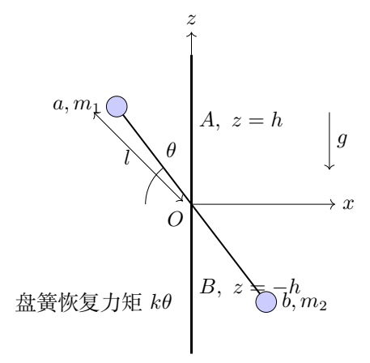
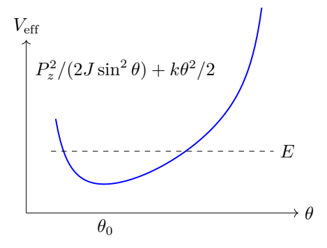

# 第 6 题　转速仪的定倾角运动、冲击与进动速率

竖直转轴底端由光滑地面支撑，受固定光滑轴承 $A,B$ 约束。两轴承相距 $2h$，中点为 $O$。质量为 $m_1,m_2$ 的质点球 $a,b$ 固定在质量 $M$、长度 $2l$ 的均质细杆两端。细杆中心以小圆孔套在 $O$ 处的光滑水平轴上，可在杆与竖轴所在平面内转动。

以 $O$ 为原点，竖直向上为 $z$ 正方向。记 $Oa$ 与 $+z$ 的夹角为 $\theta$。$O$ 处有轻质盘簧，给细杆大小为 $k\theta$ 的恢复力矩，$k$ 为常量。重力加速度为 $g$。图示时刻杆在 $x$-$z$ 平面，球 $a$ 位于 $x<0$，球 $b$ 位于 $x>0$。

（1）系统绕竖轴以恒定角速度转动，$\theta=\theta_0$，其中
$0<\theta_0<\pi,\ \theta_0\ne\pi/2$。
（1.1）求角速度 $\omega_0$，分别讨论 $m_1>m_2$ 和
$m_1\le m_2$ 时非零实际转速存在的 $\theta_0$ 条件。
（1.2）求图示时刻对 $O$ 的完整角动量 $\mathbf L$，以及轴承对转轴的作用力 $\mathbf F_A,\mathbf F_B$。

（2）取 $m_1=m_2=m$，初始处于第（1）问的稳定运动。$t=0$ 时球 $a$ 在杆—竖轴平面内受到垂直细杆的极短冲击，令 $\theta$ 增大。已知随后最大倾角为 $\theta_M$，$\theta_0<\theta_M<\pi$。
（2.1）求冲击后瞬时 $\dot\theta=\Omega_0$。
（2.2）冲击很小时，求 $\theta_0$ 附近小振动角频率
$\omega_\theta$。
（2.3）记 $\delta_0=\theta_M-\theta_0$，$\delta_0\ll\theta_0$，求随时间变化的竖轴转速 $\omega(t)$，保留 $\delta_0$ 一阶。本题45分。

## 一、题型定位

这是两自由度转动系统：倾角 $\theta$ 与绕竖轴的方位角。定倾角运动可以在随转参考系中用恢复力矩、重力矩与离心力矩平衡求转速；但角动量不必与竖轴平行，轴承力需要使用完整矢量。

冲击后的运动没有持续驱动，竖轴方向角动量守恒，转速随倾角改变。将这个守恒量代回能量后，倾角运动归结为一维有效势问题。

## 二、知识点

- 均质杆与端点质量的转动惯量。
- 定倾角匀速转动的力矩平衡。
- 刚体角动量矢量与常模旋转矢量的时间导数。
- 质心运动定理、轴承力的合力与力偶。
- 瞬时冲击前后不同守恒条件。
- 固定轴向角动量下的有效势、小振动和转速调制。
- 对平衡分支与正平方根的筛选。

## 三、物理图像

球 $a$ 位于上方、负 $x$ 侧。若 $m_1>m_2$，重力倾向于让 $\theta$ 增大；盘簧倾向于使其减小。离心力的倾角力矩与
$\sin\theta\cos\theta$ 成正比，在急角、钝角两侧方向不同。

等质量时质心位于 $O$，但杆的角动量仍有横向分量。它随系统转动，轴承必须提供相应力偶。冲击只增加杆平面内的倾角速度，没有竖轴力矩冲量，因此 $L_z$ 不变；$\theta$ 增大使绕竖轴惯量增加，转速随之降低。

## 四、解题入口

先统一使用
$$
J=\left(m_1+m_2+\frac M3\right)l^2,\qquad
\Delta m=m_1-m_2.
$$
$J$ 是细杆和端球绕 $O$、垂直杆方向的惯量。写出
$k\theta_0-\Delta mgl\sin\theta_0
=J\omega_0^2\sin\theta_0\cos\theta_0$，
再根据分母符号筛选倾角。

等质量冲击后另用
$J=(2m+M/3)l^2$，
$P_z=J\sin^2\theta\,\omega$。
先守恒 $P_z$，再用机械能；不能把 $\omega$ 当成固定参数求小振动。

## 五、解析

（1）求统一转动惯量。

端球贡献 $(m_1+m_2)l^2$。杆绕中心、垂直杆的轴贡献
$$
J_{\rm rod}=\frac1{12}M(2l)^2=\frac M3l^2.
$$
所以
$$
\boxed{J=\left(m_1+m_2+\frac M3\right)l^2.}\tag{6.1}
$$
设方位角为 $\varphi$，$\dot\varphi=\omega$。整个杆—球系统的动能为
$$
T=\frac12J\dot\theta^2+\frac12J\sin^2\theta\,\omega^2.
$$
重力势能为
$$
U_g=\Delta mgl\cos\theta,
$$
因为两球高度分别为 $\pm l\cos\theta$，均质杆的重心在 $O$。盘簧势能为 $U_k=k\theta^2/2$。

（2）定倾角转动的平衡关系。

在随系统绕 $z$ 转动的参考系中，定倾角时杆静止。以 $\theta$ 增大为正，重力矩为
$\Delta mgl\sin\theta$，盘簧力矩为 $-k\theta$。

端球离心力矩为
$(m_1+m_2)l^2\omega^2\sin\theta\cos\theta$。
杆微元离心力矩沿两半杆积分：
$$
2\int_0^l
\left(\frac{M}{2l}\,dr\right)
\omega^2r^2\sin\theta\cos\theta
=\frac M3l^2\omega^2\sin\theta\cos\theta.
$$
合并为 $J\omega^2\sin\theta\cos\theta$。平衡条件：
$$
-k\theta_0+\Delta mgl\sin\theta_0
+J\omega_0^2\sin\theta_0\cos\theta_0=0.
$$
故
$$
\boxed{\omega_0=
\sqrt{\frac{k\theta_0-\Delta mgl\sin\theta_0}
{J\sin\theta_0\cos\theta_0}}.}\tag{6.2}
$$
取正根表示角速度大小；实际转向可以反向，此时矢量角动量相应变号。

（3）严格判断非零转速存在的倾角范围。

由于 $0<\theta_0<\pi$，$\sin\theta_0>0$。分母的符号由
$\cos\theta_0$ 决定。要求 $\omega_0^2>0$。

若 $\Delta m>0$：

- 急角 $0<\theta_0<\pi/2$ 时必须
$k\theta_0>\Delta mgl\sin\theta_0$；
- 钝角 $\pi/2<\theta_0<\pi$ 时必须
$k\theta_0<\Delta mgl\sin\theta_0$。

因此
$$
\boxed{
\begin{cases}
0<\theta_0<\pi/2,\quad
k\theta_0>\Delta mgl\sin\theta_0,\\
\text{或}\\
\pi/2<\theta_0<\pi,\quad
k\theta_0<\Delta mgl\sin\theta_0.
\end{cases}}\tag{6.3}
$$
若 $\Delta m\le0$，分子
$k\theta_0+|\Delta m|gl\sin\theta_0>0$，只允许急角：
$$
\boxed{0<\theta_0<\pi/2.}\tag{6.4}
$$
分子为零对应零转速的静止平衡边界，不属于这里的非零匀速转动。题目已排除 $\pi/2$，无需在分母为零处直接套公式。

（4）用无量纲参数看清分支。

对 $\Delta m>0$，定义
$\Lambda=\Delta mgl/k$，并考虑
$F(\theta)=\theta/\sin\theta$。其导数
$$
F'=\frac{\sin\theta-\theta\cos\theta}{\sin^2\theta}>0
\quad(0<\theta<\pi),
$$
因为分子在0处为零、导数为 $\theta\sin\theta>0$。
$F$ 从1单调增至无穷，在 $\pi/2$ 为 $\pi/2$。

由此可进一步读出：若 $\Lambda\le1$，全部急角允许；若
$1<\Lambda<\pi/2$，急角中只有大于唯一根
$F(\theta_*)=\Lambda$ 的部分允许；若
$\Lambda\ge\pi/2$，没有满足非零转速条件的急角。
钝角分支只有 $\Lambda>\pi/2$ 才存在，范围为
$\pi/2<\theta_0<\theta_*$。这些存在条件不等于对所有分支的动态稳定性判据。

（5）求完整角动量。

图示时刻球 $a$ 位置
$$
\mathbf r_a=l(-\sin\theta_0\,\mathbf e_x+
\cos\theta_0\,\mathbf e_z),
$$
速度由绕 $z$ 转动给出
$$
\mathbf v_a=\omega_0\mathbf e_z\times\mathbf r_a
=-\omega_0l\sin\theta_0\,\mathbf e_y.
$$
叉乘得
$$
\mathbf r_a\times m_1\mathbf v_a
=m_1l^2\omega_0\sin\theta_0
(\cos\theta_0\mathbf e_x+\sin\theta_0\mathbf e_z).
$$
球 $b$ 的位置、速度同时反号，叉乘方向相同。杆微元积分再贡献 $Ml^2/3$。因此
$$
\boxed{
\mathbf L=J\omega_0\sin\theta_0
(\cos\theta_0\mathbf e_x+\sin\theta_0\mathbf e_z).}\tag{6.5}
$$
横向分量 $L_x$ 不能省略。它虽随系统转动、大小不变，但方向不断改变，产生非零 $\dot{\mathbf L}$。

（6）轴承合力由质心运动求得。

系统总质量为 $m_{\rm tot}=m_1+m_2+M$。质心相对 $O$：
$$
\mathbf r_C=\frac{\Delta m}{m_{\rm tot}}
l(-\sin\theta_0\mathbf e_x+\cos\theta_0\mathbf e_z).
$$
绕竖轴的向心加速度为
$$
\mathbf a_C=
\frac{\Delta m}{m_{\rm tot}}\omega_0^2l\sin\theta_0\,\mathbf e_x.
$$
重力与底部地面支持力的竖直合力抵消，光滑轴承只提供横向力。由质心运动定理：
$$
F_{Ax}+F_{Bx}=\Delta m\omega_0^2l\sin\theta_0,
\qquad F_{Ay}+F_{By}=0.\tag{6.6}
$$
等质量时合力为零，但两轴承作用力可以组成非零力偶。

（7）轴承力偶由角动量定理求得。

角动量以角速度 $\omega_0\mathbf e_z$ 旋转：
$$
\dot{\mathbf L}
=\omega_0\mathbf e_z\times\mathbf L
=J\omega_0^2\sin\theta_0\cos\theta_0\,\mathbf e_y.
$$
重力对 $O$ 的力矩为
$-\Delta mgl\sin\theta_0\,\mathbf e_y$。
轴承在 $z=\pm h$，它们的力矩分别为
$$
\boldsymbol\tau_A=h(F_{Ax}\mathbf e_y-F_{Ay}\mathbf e_x),
$$
$$
\boldsymbol\tau_B=-h(F_{Bx}\mathbf e_y-F_{By}\mathbf e_x).
$$
因此
$$
-hF_{Ay}+hF_{By}=0,
$$
$$
h(F_{Ax}-F_{Bx})-\Delta mgl\sin\theta_0
=J\omega_0^2\sin\theta_0\cos\theta_0.
$$
结合式（6.6），先得 $F_{Ay}=F_{By}=0$。再用定倾角平衡关系，将后一式化为
$h(F_{Ax}-F_{Bx})=k\theta_0$。所以
$$
\boxed{\mathbf F_A=
\left[\frac{\Delta m\omega_0^2l\sin\theta_0}{2}
+\frac{k\theta_0}{2h}\right]\mathbf e_x,}\tag{6.7}
$$
$$
\boxed{\mathbf F_B=
\left[\frac{\Delta m\omega_0^2l\sin\theta_0}{2}
-\frac{k\theta_0}{2h}\right]\mathbf e_x.}\tag{6.8}
$$
这是轴承对转轴的力；若问转轴对轴承的力，应整体反号。盘簧是杆与转轴之间的内部力偶，在对整体列角动量定理时不能再重复作为外力矩加入。

（8）等质量冲击后的竖轴角动量守恒。

以下 $J=(2m+M/3)l^2$。冲击发生在杆—竖轴平面内，冲量对 $z$ 轴没有力矩；之后光滑约束、重力、盘簧也不产生净 $z$ 向外力矩。因此
$$
P_z=J\sin^2\theta\,\omega
=J\sin^2\theta_0\,\omega_0
$$
在冲击前后及随后运动中守恒，得到
$$
\boxed{\omega(\theta)=
\omega_0\frac{\sin^2\theta_0}{\sin^2\theta}.}\tag{6.9}
$$
冲击瞬间 $\theta$ 尚未变化，所以 $\omega$ 仍为 $\omega_0$；
变化的是平面内倾角速度 $\dot\theta$。冲击后总能量比冲击前高，不能跨冲击事件直接令两者总能量相同。

（9）机械能与一维有效势。

等质量时两球重力势相消、杆重心固定，只有盘簧势能随
$\theta$ 改变。冲击后机械能为
$$
E=\frac12J\dot\theta^2+\frac12J\sin^2\theta\,\omega^2
+\frac12k\theta^2.
$$
代入角动量不变量：
$$
\boxed{E=\frac12J\dot\theta^2+V_{\rm eff}(\theta),
\quad V_{\rm eff}=\frac{P_z^2}{2J\sin^2\theta}
+\frac12k\theta^2.}\tag{6.10}
$$
这里的离心屏障在 $\theta\to0,\pi$ 时发散，所以非零
$P_z$ 的有限能量运动不能穿过竖直位置。势的导数为
$$
V_{\rm eff}'=-\frac{P_z^2\cos\theta}{J\sin^3\theta}+k\theta.
$$
在 $\theta_0$ 令其为零，恰好恢复
$k\theta_0=J\omega_0^2\sin\theta_0\cos\theta_0$。

（10）由最大倾角求冲击后的倾角速度。

冲击后瞬间
$(\theta,\dot\theta,\omega)=(\theta_0,\Omega_0,\omega_0)$。
最大倾角处
$(\theta,\dot\theta,\omega)=(\theta_M,0,\omega_M)$，且
$\omega_M=\omega_0\sin^2\theta_0/\sin^2\theta_M$。

从冲击后瞬间至转折点能量守恒：
$$
\frac12J\Omega_0^2+V_{\rm eff}(\theta_0)
=V_{\rm eff}(\theta_M).
$$
整理：
$$
\Omega_0^2=
\frac{k}{J}(\theta_M^2-\theta_0^2)
+\omega_0^2\sin^2\theta_0
\left(\frac{\sin^2\theta_0}{\sin^2\theta_M}-1\right).
$$
又 $J\omega_0^2=k\theta_0/(\sin\theta_0\cos\theta_0)$，
所以
$$
\boxed{\Omega_0=
\sqrt{\frac{k}{J}
\left[
\theta_M^2-\theta_0^2+
\theta_0\tan\theta_0
\left(\frac{\sin^2\theta_0}{\sin^2\theta_M}-1\right)
\right]}.}\tag{6.11}
$$
选择正根，因为冲击令 $\theta$ 增大。后一项在部分角度范围内可以为负，表示绕轴转动能减少；总括号仍应非负，由达到该转折点所需的能量决定。

（11）小振动频率：固定的是角动量。

对有效势求二阶导数：
$$
V_{\rm eff}''=
\frac{P_z^2}{J}
\left(\frac1{\sin^2\theta}
+\frac{3\cos^2\theta}{\sin^4\theta}\right)+k.
$$
在 $\theta_0$ 代入 $P_z=J\omega_0\sin^2\theta_0$：
$$
V_{\rm eff}''(\theta_0)
=J\omega_0^2(\sin^2\theta_0+3\cos^2\theta_0)+k
=J\omega_0^2(1+2\cos^2\theta_0)+k.
$$
令 $\xi=\theta-\theta_0$，则
$J\ddot\xi+V_{\rm eff}''(\theta_0)\xi=0$。因此
$$
\boxed{\omega_\theta^2=
\frac{k}{J}+\omega_0^2(1+2\cos^2\theta_0),}\tag{6.12}
$$
或
$$
\boxed{\omega_\theta=
\sqrt{\frac{k}{J}
\left[1+\theta_0
\frac{1+2\cos^2\theta_0}{\sin\theta_0\cos\theta_0}
\right]}.}\tag{6.13}
$$
等质量允许的 $\theta_0$ 为急角，右端严格为正，平衡在固定
$P_z$ 的运动下稳定。

若错误地把 $\omega=\omega_0$ 固定，则会从力矩式得到
$k/J-\omega_0^2\cos2\theta_0$，漏掉角动量守恒引起的反馈。只有持续外部驱动固定转速的另一种实验，才对应那个频率。

（12）初始相位与竖轴转速调制。

小冲击后 $\xi(0)=0,\dot\xi(0)>0$，所以
$$
\xi(t)=\delta_0\sin\omega_\theta t+O(\delta_0^2).
$$
不是余弦初相位。用式（6.9）展开：
$$
\sin^2(\theta_0+\xi)
=\sin^2\theta_0+2\sin\theta_0\cos\theta_0\,\xi+O(\xi^2),
$$
$$
\frac{\sin^2\theta_0}{\sin^2(\theta_0+\xi)}
=1-2\cot\theta_0\,\xi+O(\xi^2).
$$
因此
$$
\boxed{\omega(t)=
\omega_0[1-2\cot\theta_0\,\delta_0\sin\omega_\theta t]
+O(\delta_0^2).}\tag{6.14}
$$
$\theta$ 增大时惯量增大，转速下降，正负趋势正确。
小振动近似还要求 $|\delta_0\cot\theta_0|\ll1$；题设
$\delta_0\ll\theta_0$ 在小角度时保证了这一点。

（13）从精确能量回到小冲击极限。

令 $\theta_M=\theta_0+\delta_0$。在阱底展开：
$$
V_{\rm eff}(\theta_M)-V_{\rm eff}(\theta_0)
=\frac12V_{\rm eff}''(\theta_0)\delta_0^2+O(\delta_0^3).
$$
由于一阶项为零，式（6.11）给
$$
\Omega_0=\omega_\theta\delta_0+O(\delta_0^2).
$$
这与第（12）步的正弦初速度一致。它同时验证精确冲击表达式和小振动结果，没有把最大倾角当成平衡倾角。

（14）由小振动结果重建可观测的转速曲线。

取一致单位使 $k=1$、$J=1.4$，选择平衡倾角 $\theta_0=0.7$ 弧度。先从静态平衡而非任意给定转速求
$$
\omega_0=\sqrt{\frac{\theta_0}{1.4\sin\theta_0\cos\theta_0}}
\approx1.00736.
$$
固定角动量的小振动角频率为
$$
\omega_\theta
=\sqrt{\frac1{1.4}+\omega_0^2(1+2\cos^2\theta_0)}
\approx1.70772,
$$
故倾角振动周期为 $T_\theta\approx3.67929$。这个周期与绕竖轴转一周所需时间不同，二者的频率描述不同的自由度。

若冲击给予 $\dot\theta(0)=0.01$，最低阶振幅为
$$
\delta_0=\frac{0.01}{\omega_\theta}\approx0.005856.
$$
该振幅远小于 $\theta_0$，也远小于到轴线或水平位置的角距，可以在线性范围使用
$$
\theta(t)\simeq0.7+0.005856\sin(1.70772t).
$$
转速的相对调制幅度为
$$
2\cot\theta_0\,\delta_0\approx0.01390,
$$
即约 $1.39\%$。在倾角最大时，绕轴惯量最大，转速最小；两种变化在最低阶反相。

用冲击后的有效能量再检查同一结果。初始额外能量为
$$
\Delta E=\frac12J\dot\theta(0)^2.
$$
在平衡点附近，
$$
V_{\rm eff}(\theta_0+\delta)
=V_{\rm eff}(\theta_0)+\frac12J\omega_\theta^2\delta^2
+O(\delta^3).
$$
转折点的倾角速度为0，令两式相等得到
$\delta=|\dot\theta(0)|/\omega_\theta$，与动力学解一致。若冲击更强，则应解完整转折点方程，不能继续让振幅与冲击速度成正比。

最后比较“外部电机维持转速”的另一实验条件。固定 $\omega_0$ 的线性方程给
$$
\omega_{\theta,\rm driven}^2
=\frac{k}{J}-\omega_0^2\cos2\theta_0.
$$
本例约为 $0.5418$，而自由系统约为 $2.9163$。二者的差正是转速随倾角改变而产生的反馈。实际计算前应先确认驱动约束，不能仅凭装置外形选择小振动公式。

## 六、关键洞察

轴承合力与轴承力偶负责不同事情：前者提供质心向心加速度，后者改变横向角动量的方向。等质量时合力消失而力偶仍存在，说明只检查合力不足以确定轴承的全部作用。

冲击后转速是倾角的函数，不是恒定外参数。将角动量约束代入有效势，相当于把方位自由度正确消去；直接固定转速会改变小振动问题本身。

## 七、易错点

- 杆惯量写成 $Ml^2$，漏掉 $1/3$。
- 重力矩的质量差写成质量和。
- 根号实数条件只看分子，忽略急、钝角分母变号。
- 只给 $L_z$，漏掉横向角动量。
- 在整体角动量方程中重复加入内部盘簧力矩。
- 将轴承对轴的力与轴对轴承的反作用力混同。
- 跨越冲击直接使用机械能守恒。
- 冲击后的振动中固定 $\omega_0$。
- 初始倾角位移为零却使用余弦解。

## 八、课堂讲解建议

先画 $a$ 的位置、速度并做一次叉乘，确保学生看到角动量具有横向分量。轴承力分为“和”与“差”两条方程，比同时展开全部分量更清楚。

冲击部分先列守恒量表：$L_z$ 跨冲击守恒，能量只在冲击后守恒。把 $V_{\rm eff}$ 画出后，再读转折点和频率。最后让学生用“倾角增大，转速下降”检查调制公式的符号。

## 九、变式训练

### 变式1　等质量系统的轴承力

取 $m_1=m_2=m$，求匀速定倾角时两轴承力，并说明总合力与力偶。

**解答。** $\Delta m=0$，式（6.7）、（6.8）给
$$
\boxed{\mathbf F_A=\frac{k\theta_0}{2h}\mathbf e_x,\qquad
\mathbf F_B=-\frac{k\theta_0}{2h}\mathbf e_x.}
$$
合力为零，质心固定在 $O$；力偶为
$h(F_{Ax}-F_{Bx})=k\theta_0$，负责维持横向角动量旋转。轴承间距加倍时，保持相同力偶所需的各力减半。

### 变式2　小平衡倾角的频率极限

等质量，$\theta_0\ll1$。求 $\omega_0$ 与 $\omega_\theta$ 的最低阶。

**解答。** $\sin\theta_0\cos\theta_0\simeq\theta_0$，
所以 $\omega_0^2\simeq k/J$。式（6.12）中
$\cos^2\theta_0\simeq1$，故
$$
\boxed{\omega_0\simeq\sqrt{k/J},\qquad
\omega_\theta\simeq2\sqrt{k/J}.}
$$
小振动频率为绕轴转速的约两倍。这是固定角动量的结果；若固定外部驱动转速，会得到不同的极限。

### 变式3　盘簧另有零位角

盘簧恢复力矩变为 $-k(\theta-\theta_s)$，保持等质量，求定倾角转速及冲击后小振动频率。

**解答。** 势能改为 $k(\theta-\theta_s)^2/2$。定倾角条件
$k(\theta_0-\theta_s)=J\omega_0^2\sin\theta_0\cos\theta_0$，
所以
$$
\omega_0^2=\frac{k(\theta_0-\theta_s)}
{J\sin\theta_0\cos\theta_0}.
$$
有效势仍加上 $P_z^2/(2J\sin^2\theta)$，其盘簧二阶导数仍为 $k$，因此
$$
\boxed{\omega_\theta^2=k/J+\omega_0^2(1+2\cos^2\theta_0).}
$$
应先检查 $\omega_0^2>0$，再判断频率实数；不能机械套原急角存在范围。

### 变式4　转轴具有额外竖轴惯量

给转轴增加固定竖轴惯量 $J_s$，其自身没有倾角动能。等质量系统自由转动，求固定角动量下的倾角小振动频率。

**解答。** 绕轴总惯量为
$A(\theta)=J_s+J\sin^2\theta$，守恒量为
$P=A\omega$。有效势
$$
V_{\rm eff}=\frac{P^2}{2A(\theta)}+\frac12k\theta^2.
$$
在平衡处 $P=A_0\omega_0$，求二阶导数：
$$
V_{\rm eff}''
=k-\frac{\omega_0^2}{2}A''+
\frac{\omega_0^2(A')^2}{A_0}.
$$
使用 $A'=2J\sin\theta_0\cos\theta_0$、
$A''=2J\cos2\theta_0$，除以倾角惯量 $J$：
$$
\boxed{\omega_\theta^2=
\frac{k}{J}-\omega_0^2\cos2\theta_0+
\frac{4J\omega_0^2\sin^2\theta_0\cos^2\theta_0}
{J_s+J\sin^2\theta_0}.}
$$
$J_s=0$ 恢复原题；$J_s$ 极大时转速反馈很弱，趋近固定转速的小振动结果。这条极限连接解释两种模型的差异。

