# 第 1 题　冷原子云的自由展开与飞行时间测温

一磁光陷阱中约束的 $N$ 个原子构成的原子气处于绝对温度 $T$ 的平衡态。在位置 $\mathbf r=(x,y,z)$、速度 $\mathbf v=(v_x,v_y,v_z)$ 的原子数密度 $f(\mathbf r,\mathbf v)$ 服从玻尔兹曼分布
$$
f(\mathbf r,\mathbf v)\propto
\exp\!\left[-\frac{m(\omega_x^2x^2+\omega_y^2y^2+\omega_z^2z^2)}{2k_{\rm B}T}\right]
\exp\!\left[-\frac{m(v_x^2+v_y^2+v_z^2)}{2k_{\rm B}T}\right].
$$
其中 $\omega_i$ 为 $i=x,y,z$ 方向陷阱对原子的约束强度，$m$ 为原子质量，$k_{\rm B}$ 为玻尔兹曼常量。取竖直向下为 $z$ 轴正方向。在陷阱正下方 $z=h$（$h>0$）处有探测器，可测量该平面附近沿 $z$ 方向单位高度内的原子数，以及单位时间内由上至下通过该平面的原子数。重力加速度大小为 $g$，忽略原子碰撞，$t=0$ 时撤除陷阱。

（1）求撤除前完整的分布函数 $f(\mathbf r,\mathbf v)$。

（2）求 $t>0$ 时探测平面附近的纵向数密度 $n(t)$ 和通过该平面的原子流 $I(t)$。

（3）在温度极低、约束很强的极限下，求 $n(t)$ 最大时刻 $t_n$ 和 $I(t)$ 最大时刻 $t_I$，保留温度的非零最低阶。

（4）在同一极限下，$t=t_n$ 附近有
$$
n(t)\approx n_0\exp\!\left[-\frac{(t-t_n)^2}{2\sigma_t^2}\right].
$$
求有效展宽 $\sigma_t$，保留温度的非零最低阶。提示：
$\int_0^\infty e^{-x^2}\,dx=\sqrt\pi/2$，
$\int_0^\infty x^2e^{-x^2}\,dx=\sqrt\pi/4$。本题45分。

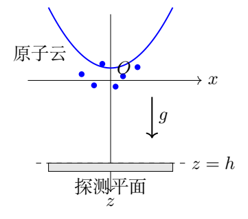

## 一、题型定位

原子从初始平衡分布出发，经无碰撞飞行后形成到达信号。需要先把分布归一化，再将每个原子的初始位置、速度映射到探测平面。一个原子云有空间宽度，也有速度宽度；两者在自由飞行中共同决定探测信号。

最后两问是低温展开问题。零温到达时刻给出主要尺度，有限温度使峰值略微提前、信号获得有限宽度。峰的位置和峰的宽度分别由对数信号的一阶、二阶导数决定。

## 二、知识点

- 玻尔兹曼分布的归一化与高斯积分。
- 匀加速运动及相空间体积保持。
- 相互独立高斯变量的线性组合、条件分布。
- 数密度、有向粒子流和单向穿越流的区别。
- 对数求导、极值条件、小参数展开和局部高斯近似。
- 强约束极限与低温极限的先后顺序。

## 三、物理图像

记
$$
s^2=\frac{k_{\rm B}T}{m},\qquad
a_i^2=\frac{s^2}{\omega_i^2}.
$$
$s$ 是任一速度分量的标准差，$a_i$ 是初始位置分量的标准差。陷阱撤除后，原子保持初始横向速度，竖直方向叠加重力：
$$
z=z_0+v_{z0}t+\frac12gt^2.
$$
云的中心位于 $\bar z=gt^2/2$，竖直宽度为
$\sqrt{a_z^2+s^2t^2}$。到达某个固定平面，相当于选取初始相空间中满足一条直线关系的原子。

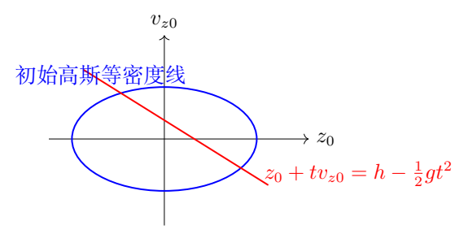

即使探测器覆盖整个横截面，横向原子运动仍存在，但对 $x,y$ 全部积分后，它们只贡献归一化因子。若探测器有限大，这一步不再成立，需另乘横向收集比例。

## 四、解题入口

先令分布函数为常数乘两个指数，以 $\int f\,d^3r\,d^3v=N$ 求常数。第（2）问可以直接做配方积分，也可以把 $z_0$ 和 $v_{z0}$ 视为独立高斯变量。两条路线应得同一密度。

求流时不能只用云中心的速度 $gt$ 乘密度；位于探测平面的原子经过了条件筛选，其平均速度一般不同。先求条件平均速度，再乘密度。峰值运算在强约束后的简化式上进行，并以
$$
t_0=\sqrt{\frac{2h}{g}},\qquad
\eta=\frac{s^2}{gh}=\frac{k_{\rm B}T}{mgh}\ll1
$$
控制低温展开。

## 五、解析

（1）归一化六维分布。

设常数为 $C$。任一方向的位置积分、速度积分分别为
$$
\int_{-\infty}^{\infty}
e^{-m\omega_i^2r_i^2/(2k_{\rm B}T)}\,dr_i
=\sqrt{\frac{2\pi k_{\rm B}T}{m\omega_i^2}},
$$
$$
\int_{-\infty}^{\infty}
e^{-mv_i^2/(2k_{\rm B}T)}\,dv_i
=\sqrt{\frac{2\pi k_{\rm B}T}{m}}.
$$
把两者相乘，得到每个方向的二维积分
$$
\int e^{-m(\omega_i^2r_i^2+v_i^2)/(2k_{\rm B}T)}
\,dr_i\,dv_i=\frac{2\pi k_{\rm B}T}{m\omega_i}.
$$
三个方向独立，因而
$$
N=C\frac{(2\pi k_{\rm B}T)^3}{m^3\omega_x\omega_y\omega_z}.
$$
解得
$$
\boxed{C=N\left(\frac{m}{2\pi k_{\rm B}T}\right)^3
\omega_x\omega_y\omega_z.}\tag{1.1}
$$
代回后
$$
\boxed{
f=C\exp\!\left[
-\frac{m}{2k_{\rm B}T}
\left(\omega_x^2x^2+\omega_y^2y^2+\omega_z^2z^2
+v_x^2+v_y^2+v_z^2\right)\right].}\tag{1.2}
$$
这里的 $f$ 是相空间数密度，积分是原子数而非1。它的量纲为
$[\mathrm{length}]^{-3}[\mathrm{velocity}]^{-3}$，不能与通常的空间数密度混为一谈。

（2）先求初始纵向边缘分布。

对 $x,y,v_x,v_y$ 积分，留下
$$
F_0(z_0,v_0)
=\frac{N}{2\pi a_zs}
\exp\!\left(-\frac{z_0^2}{2a_z^2}
-\frac{v_0^2}{2s^2}\right),\qquad v_0=v_{z0}.
$$
此式满足 $\int F_0\,dz_0\,dv_0=N$。它清楚地显示初始 $z_0,v_0$ 独立，均值均为零。

记 $\omega=\omega_z$，并引入
$$
A=1+\omega^2t^2,\qquad
H=h-\frac12gt^2,\qquad
b^2=a_z^2+s^2t^2=\frac{s^2A}{\omega^2}.
$$
竖直位置是独立高斯变量之和，故任意高度 $z$ 的纵向数密度为
$$
n(z,t)=\frac{N}{\sqrt{2\pi}\,b}
\exp\!\left[-\frac{(z-gt^2/2)^2}{2b^2}\right].
$$
取 $z=h$，得到
$$
\boxed{
n(t)=\frac{N\omega}{\sqrt{2\pi}s\sqrt A}
\exp\!\left[-\frac{\omega^2H^2}{2s^2A}\right].}\tag{1.3}
$$
$n$ 的量纲为原子数每单位高度。在整个 $z$ 轴积分仍为 $N$，宽度虽然增长，原子总数没有改变。

（3）用相空间配方独立复求密度。

探测平面的条件是
$$
z_0=H-v_0t.
$$
于是
$$
n(t)=\int_{-\infty}^{\infty}F_0(H-v_0t,v_0)\,dv_0.
$$
指数中的二次型可写成
$$
\omega^2(H-v_0t)^2+v_0^2
=A\left(v_0-\frac{\omega^2Ht}{A}\right)^2
+\frac{\omega^2H^2}{A}.
$$
这是完整的配方，不应漏掉后面的常数项。积分后，平方项贡献
$\sqrt{2\pi}s/\sqrt A$，留下恰好为式（1.3）的结果。

运动映射也可以用末速度 $v=v_0+gt$ 表示：
$$
v_0=v-gt,\qquad
z_0=h-vt+\frac12gt^2.
$$
映射 $(z_0,v_0)\mapsto(z,v)$ 的雅可比为1，所以无需另补一个相空间体积因子。若改用“到达时间”作为变量，雅可比才会以速度的形式出现在通量中。

（4）求探测平面的条件速度与有向净流。

从上面的配方知，在探测平面上
$$
\langle v_0\rangle_{z=h}=\frac{\omega^2Ht}{A},
\qquad
\operatorname{Var}(v_0\mid z=h)=\frac{s^2}{A}.
$$
末速度 $v=v_0+gt$ 的条件平均值为
$$
u=gt+\frac{\omega^2Ht}{A}
=\frac{gt+\omega^2ht+\tfrac12\omega^2gt^3}{A}.
$$
有向净流定义为向下流减向上流，故
$$
I_{\rm net}(t)=\int_{-\infty}^{\infty}vF(h,v,t)\,dv.
$$
条件分布的中心给出
$$
\boxed{I_{\rm net}(t)=n(t)
\left[gt+\frac{\omega^2t(h-gt^2/2)}{1+\omega^2t^2}\right].}\tag{1.4}
$$
参考解答中的 $I(t)$ 采用此有向流口径。它不等于简单的 $n(t)gt$；探测平面高于或低于云中心时，条件筛选分别倾向于初始向上或向下速度不同的原子。

（5）按“仅由上至下”计数时的严格表达式。

题面将流描述为单位时间内由上至下通过的原子数。若严格只计末速度 $v>0$ 的穿越，则需使用
$$
I_\downarrow(t)=\int_0^\infty vF(h,v,t)\,dv.
$$
设条件速度标准差
$$
q=\frac{s}{\sqrt A},\qquad
\phi(w)=\frac{e^{-w^2/2}}{\sqrt{2\pi}},\qquad
\Phi(w)=\int_{-\infty}^{w}\phi(\xi)\,d\xi.
$$
完成正半轴高斯积分，令 $\xi=(v-u)/q$，有
$$
\int_0^\infty \frac{v}{q}\phi\!\left(\frac{v-u}{q}\right)\,dv
=\int_{-u/q}^{\infty}(u+q\xi)\phi(\xi)\,d\xi.
$$
利用 $\phi'(\xi)=-\xi\phi(\xi)$，得到
$$
\boxed{I_\downarrow
=n(t)\left[u\Phi(u/q)+q\phi(u/q)\right].}\tag{1.5}
$$
向上流的正计数为
$n[q\phi(u/q)-u\Phi(-u/q)]$，两者之差为 $nu$。这一检查也证明式（1.4）确为净流。

后续两问的强约束极限下，$q\to0$，而 $u=h/t+gt/2>0$，故单向流和净流一致。对有限约束、低温且 $u/q\gg1$ 的情形，差别只来自高斯负速度尾部，指数级小，不影响后面按温度幂次保留的结果。

（6）取强约束极限，得到飞行时间信号。

对固定 $t>0$，$\omega t\gg1$ 时
$$
\sqrt{1+\omega^2t^2}\simeq\omega t,\qquad
\frac{\omega^2}{1+\omega^2t^2}\simeq\frac1{t^2}.
$$
密度和流化为
$$
\boxed{n_\infty(t)=\frac{N}{\sqrt{2\pi}st}
\exp\!\left[-\frac{(h/t-gt/2)^2}{2s^2}\right],}\tag{1.6}
$$
$$
\boxed{I_\infty(t)=\frac{N}{\sqrt{2\pi}s}
\left(\frac{h}{t^2}+\frac g2\right)
\exp\!\left[-\frac{(h/t-gt/2)^2}{2s^2}\right].}\tag{1.7}
$$
强约束使初始位置可以近似为0。要在时刻 $t$ 到达高度 $h$，初始速度必须是
$$
v_0(t)=\frac ht-\frac{gt}{2}.
$$
其导数为 $dv_0/dt=-h/t^2-g/2$。初始速度概率密度乘 $|dv_0/dt|$，也直接得到式（1.7）。这条到达时间变量变换路线独立于条件平均速度方法。

并且 $v_0(t)$ 随 $t$ 从 $+\infty$ 单调降至 $-\infty$，因而
$$
\int_0^\infty I_\infty(t)\,dt=N.
$$
每个从原点出发的原子最终恰好向下穿过探测平面一次；即使初始速度向上，也会先升后落。

（7）求密度峰 $t_n$。

对式（1.6）取对数，略去与 $t$ 无关项：
$$
L_n=-\ln t-\frac{1}{2s^2}
\left(\frac{h^2}{t^2}-gh+\frac{g^2t^2}{4}\right).
$$
一阶导数为
$$
L_n'=-\frac1t+\frac{h^2}{s^2t^3}-\frac{g^2t}{4s^2}.
$$
令其为零并乘 $s^2t^3$，得
$$
h^2-s^2t_n^2-\frac{g^2t_n^4}{4}=0.
$$
以 $t_n^2$ 为未知量，选择正根：
$$
\boxed{t_n^2=\frac{2}{g^2}
\left(\sqrt{s^4+g^2h^2}-s^2\right).}\tag{1.8}
$$
负根不能给出实的正到达时间。用 $\eta=s^2/(gh)$ 表示，
$$
\frac{t_n^2}{t_0^2}=\sqrt{1+\eta^2}-\eta
=1-\eta+\frac12\eta^2+O(\eta^4).
$$
再次开平方：
$$
\boxed{t_n=t_0\left(1-\frac{\eta}{2}\right)+O(\eta^2t_0)
=\sqrt{\frac{2h}{g}}
\left(1-\frac{k_{\rm B}T}{2mgh}\right)+O(T^2).}\tag{1.9}
$$
峰提前的原因是前因子 $1/t$ 更偏向较早到达的原子。只令指数的平方项为零会得到 $t_0$，漏掉所求的温度一阶修正。

（8）求原子流峰 $t_I$。

对式（1.7）取对数，
$$
L_I=\ln\!\left(\frac h{t^2}+\frac g2\right)
-\frac{(h/t-gt/2)^2}{2s^2}+\text{常数}.
$$
求导并令零：
$$
-\frac{2h}{t(h+gt^2/2)}
+\frac{h^2/t^3-g^2t/4}{s^2}=0.
$$
消去正分母后
$$
-2hs^2t^2+
\left(h+\frac{gt^2}{2}\right)
\left(h^2-\frac{g^2t^4}{4}\right)=0.
$$
令 $x=t_I^2/t_0^2$，则
$$
x^3+x^2+(4\eta-1)x-1=0.
$$
也可写为
$$
(1+x)^2(1-x)=4\eta x.
$$
对 $x>0$，左端除以 $x$ 等于 $1/x+1-x-x^2$，导数严格为负，从 $+\infty$ 降至 $-\infty$，故正根唯一。又右端为正，根在 $0<x<1$，流峰确实提前。

设 $x=1+\Delta x$，展开至一阶：
$$
4\Delta x+4\eta=0,\qquad \Delta x=-\eta.
$$
因此
$$
\boxed{t_I=t_0\left(1-\frac{\eta}{2}\right)+O(\eta^2t_0).}\tag{1.10}
$$
$t_n$ 和 $t_I$ 在温度一阶相同，但并非所有温度下都相等。进一步展开，上述三次方程给出
$x=1-\eta+\eta^3/4+\cdots$，故
$$
\frac{t_I}{t_0}=1-\frac\eta2-\frac{\eta^2}{8}+\cdots,\qquad
\frac{t_n}{t_0}=1-\frac\eta2+\frac{\eta^2}{8}+\cdots.
$$
二阶开始分开，这说明将两个不同信号的峰位置永远等同是不成立的。

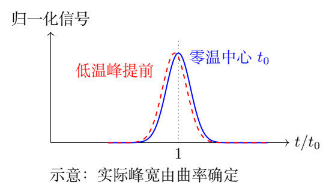

（9）由曲率求局部时间展宽。

在密度峰附近令 $\Delta t=t-t_n$，由于 $L_n'(t_n)=0$，
$$
L_n(t)=L_n(t_n)+\frac12L_n''(t_n)(\Delta t)^2
+O((\Delta t)^3).
$$
与题给高斯式对照，
$$
\frac1{\sigma_t^2}=-L_n''(t_n).
$$
直接求二阶导数：
$$
L_n''=\frac1{t^2}-\frac{3h^2}{s^2t^4}
-\frac{g^2}{4s^2}.
$$
峰条件还给出 $h^2/t_n^4=s^2/t_n^2+g^2/4$，所以
$$
L_n''(t_n)=-\frac2{t_n^2}-\frac{g^2}{s^2}<0.
$$
这是对密度峰为严格极大值的复核，并给出强约束下的曲率宽度
$$
\sigma_t^2=\frac{s^2}{g^2+2s^2/t_n^2}.
$$
在低温极限保留第一个非零阶，
$$
\boxed{\sigma_t=\frac{s}{g}
=\frac1g\sqrt{\frac{k_{\rm B}T}{m}}.}\tag{1.11}
$$
此处 $\sigma_t\propto\sqrt T$，而 $\sigma_t^2\propto T$。宽度单位必须是时间，漏掉 $g$ 会留下速度单位。

（10）用线性映射解释展宽及近似范围。

强约束下到达条件为
$$
h=v_0t+\frac12gt^2.
$$
在 $v_0=0,t=t_0$ 附近取微分，
$$
0=t_0\,dv_0+gt_0\,dt,\qquad dt=-\frac{dv_0}{g}.
$$
所以速度标准差 $s$ 变为时间标准差 $s/g$。这解释了宽度在最低阶不含高度 $h$：更高的下落速度与更长的速度展开时间抵消了。

局部高斯近似要求 $|\Delta t|\ll t_0$。典型宽度与落体时间之比为
$$
\frac{\sigma_t}{t_0}=\sqrt{\frac{\eta}{2}}\ll1,
$$
恰好对应低温条件。强约束还要求初始位置宽度比飞行展开宽度小，即
$a_z\ll st_0$，等价于 $\omega_z t_0\gg1$。若固定有限 $\omega_z$ 而一味降低温度，两种宽度同时缩小，二者比例不会自动改变。

对有限约束，线性化 $z_0+v_0t+gt^2/2=h$ 给出
$$
dt=-\frac{dz_0+t_0dv_0}{gt_0},\qquad
\sigma_{t,\rm lin}^2=\frac{s^2}{g^2}
\left(1+\frac1{\omega_z^2t_0^2}\right).
$$
它揭示初始云尺寸带来的仪器展宽。这个式子是低温线性估计，与式（1.11）的强约束结果具有正确的极限关系。

（11）把局部高斯近似的误差写成可检查的量。

局部宽度不等于整条信号的标准差。飞行信号在整个时间区间一般不是严格对称的高斯；式（1.11）描述峰顶附近的二阶形状。继续对 $L_n=\ln n$ 求导，在密度峰处得到
$$
L_n'''(t_n)=\frac{10}{t_n^3}+\frac{3g^2}{s^2t_n},
\qquad
L_n''''(t_n)=-\frac{54}{t_n^4}-\frac{15g^2}{s^2t_n^2}.
$$
因此局部展开可写为
$$
\ln\frac{n(t_n+\Delta t)}{n(t_n)}
=-\frac{\Delta t^2}{2\sigma_t^2}
+\frac{L_n'''(t_n)}6\Delta t^3
+\frac{L_n''''(t_n)}{24}\Delta t^4+\cdots.
$$
用 $\Delta t=\xi\sigma_t$ 比较各项，低温下三阶系数的主项是
$$
\frac{L_n'''(t_n)\sigma_t^3}{6}
\simeq\frac{s}{2gt_n}
\simeq\sqrt{\frac\eta8}.
$$
在 $\xi=O(1)$ 的峰顶范围，该量小才可以主要保留高斯项；若拟合范围远伸入尾部，$\xi^3$ 会放大形状误差。三阶项为正，说明以峰顶为中心时左右两侧并非完全对称。实验上应比较不同拟合窗口得到的温度，不能只看到拟合曲线平滑就判定模型无偏。

用 $h=g=1$ 的一致单位举例，取 $s=0.2$，则 $\eta=0.04$：
$$
t_0=\sqrt2,\qquad
\frac{t_n}{t_0}=0.980204,\qquad
\frac{t_I}{t_0}=0.979804.
$$
二者都比零温中心提前约 $2\%$，但密度峰与通量峰之间的差只约为 $0.04\%\,t_0$。由曲率得到
$$
\sigma_t=0.195962,
$$
而最低阶 $s/g=0.2$ 略大。若把曲率宽度直接代入最低阶测温式，得到的 $T$ 相对真实值的比例为
$$
\frac{T_{\rm inferred}}T
=\frac{g^2\sigma_t^2}{s^2}
=\frac1{1+2s^2/(g^2t_n^2)}
\approx0.9600.
$$
这个约 $4\%$ 的差来自有限温度修正，与初始云尺寸展宽是不同来源。比较模型时要保持使用同一种信号：密度的曲率不能直接套在通量峰上，有限约束的全表达式也不能与强约束的局部式混为同一精度。

## 六、关键洞察

探测信号把初始位置和速度混合在一起。先获得联合分布，再按探测条件进行筛选，才知道在某一时刻到达平面的原子有怎样的速度。条件平均速度与云中心速度不同，正是流与密度不能直接用 $gt$ 相连的原因。

峰值修正与宽度来自同一个对数函数，却依赖不同导数。温度一阶的峰提前来自前因子，宽度的最低阶来自指数曲率。题中两个峰在一阶相同具有特殊性，二阶已分开。

## 七、易错点

- 把相空间数密度的归一化写成1，漏掉 $N$。
- 用 $gt$ 作为探测平面所有原子的速度。
- 相空间映射中多乘一个不需要的雅可比。
- 混淆有向净流与只计向下穿越的流。
- 只令指数为零找峰，漏掉温度一阶位移。
- 用 $n''$ 直接与高斯宽度比较，忘记在峰处除以 $n$；对数曲率更直接。
- 没有分别检查 $\omega_z t_0\gg1$ 与 $\eta\ll1$。

## 八、课堂讲解建议

先让学生画出初始相空间的椭圆与探测直线，再用“独立高斯量相加”迅速得到密度。随后保留配方积分作为另一条路线，让学生看到条件平均速度藏在平方项中心。

求峰时先预测零温时刻，再检查前因子为何使峰提前。把 $t_n,t_I$ 的一阶同值和二阶差异并列，可以检验学生是否把近似结论误当成恒等式。最后用到达条件的微分解释宽度，连接计算与实验测温。

## 九、变式训练

### 变式1　有限初始尺寸的低温到达展宽

保留有限 $\omega_z$，求探测时间标准差的低温最低阶。

**解答。** 初始 $z_0,v_0$ 独立，方差为 $a_z^2,s^2$。在零温轨迹的 $t_0=\sqrt{2h/g}$ 处，线性化到达方程：
$$
\delta t=-\frac{z_0+t_0v_0}{gt_0}.
$$
独立变量的方差相加，因此
$$
\boxed{\sigma_t^2=\frac{a_z^2+t_0^2s^2}{g^2t_0^2}
=\frac{k_{\rm B}T}{mg^2}
\left(1+\frac{1}{\omega_z^2t_0^2}\right).}
$$
适用条件是所得宽度远小于 $t_0$。取 $\omega_z\to\infty$ 恢复原题。

### 变式2　有限圆形探测器的横向收集比例

令 $\omega_x=\omega_y=\omega_\perp$，探测器在 $z=h$ 平面中心、半径为 $R$，求时刻 $t$ 的净流收集比例。

**解答。** 横向联合空间分布为二维各向同性高斯，任一分量方差
$b_\perp^2=s^2(\omega_\perp^{-2}+t^2)$。横向与竖直运动独立，故净流乘上圆盘积分：
$$
P_R(t)=\int_0^R\frac{\rho}{b_\perp^2}
e^{-\rho^2/(2b_\perp^2)}\,d\rho
=1-e^{-R^2/(2b_\perp^2)}.
$$
所以 $I_R=I_{\rm net}P_R$。当 $R\to\infty$ 比例为1；长飞行时间下比例减小，不能继续直接用全平面峰时测温。

### 变式3　初始竖直平均速度不为零

原子初始竖直速度均值为 $v_c$，方差仍为 $s^2$，取强约束，求零温到达时间和最低阶宽度。

**解答。** 零温轨迹满足
$h=v_ct_c+gt_c^2/2$，正时间根为
$$
t_c=\frac{-v_c+\sqrt{v_c^2+2gh}}{g}.
$$
线性化 $h=(v_c+\delta v)t+gt^2/2$：
$$
\delta t=-\frac{t_c\,\delta v}{v_c+gt_c}.
$$
故
$$
\boxed{\sigma_t=\frac{st_c}{\sqrt{v_c^2+2gh}}.}
$$
当 $v_c=0$ 时恢复 $s/g$；初始向上的平均速度可增加飞行时间，但到达时末速度仍为正。

### 变式4　从局部宽度反推温度并传播误差

在强约束条件下测得时间宽度 $\sigma_t$。求温度；若 $g,m,\sigma_t$ 的独立相对误差为 $\epsilon_g,\epsilon_m,\epsilon_\sigma$，求最低阶合成相对误差。

**解答。** 式（1.11）给出
$$
T=\frac{mg^2\sigma_t^2}{k_{\rm B}}.
$$
取对数微分，
$dT/T=dm/m+2\,dg/g+2\,d\sigma_t/\sigma_t$。独立误差的方差相加，因此
$$
\boxed{\epsilon_T=
\sqrt{\epsilon_m^2+4\epsilon_g^2+4\epsilon_\sigma^2}.}
$$
若还存在独立的仪器时间抖动 $\sigma_{\rm inst}$，应先以
$\sigma_{\rm atom}^2=\sigma_{\rm measured}^2-\sigma_{\rm inst}^2$
扣除方差，再代入。宽度不是直接相减；若差值接近零，温度反演会对误差敏感。

\clearpage

# 第 2 题　重离子束探针与平行板能量分析器

重离子束探针通过二次离子的能量测量等离子体局部电势。一次离子电荷量 $q_1=e$（$e>0$），初始动能为 $K_1$；在等离子体内直接电离成电荷量 $q_2=2e$ 的二次离子。二次离子在外部磁场偏转下离开等离子体，恰能进入能量分析器，其进入狭缝的动能为 $K_2$。等离子体外电势为零，相对论效应可忽略。

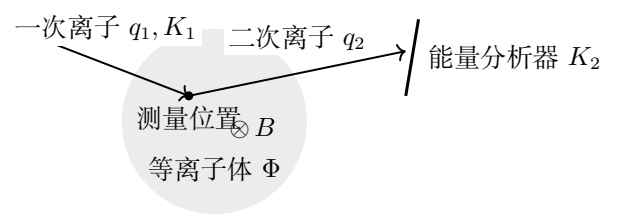

能量分析器由相距 $d$ 的两平行电极板组成，上板电势 $V_A$，下板电势0；只有两板之间存在均匀电场，其他区域无电场、磁场。二次离子速度平行于纸面。入射狭缝中心在下板下方 $Y_{D1}$，接收中心在下板下方 $Y_{D2}$。相对水平板的入射角为 $\theta_I$，接收时相对入射中心的水平距离为 $X_D$。

（1.1）求 $X_D$。
（1.2）要求 $\theta_I$ 的极小变化 $\Delta\theta_I$ 使 $X_D$ 的变化为 $O((\Delta\theta_I)^3)$，即满足二级聚焦。求 $0<\theta_I<\pi/2$ 内的聚焦角，并给出 $X_D,V_A$。
（1.3）分析器已按上述条件放置，入射板、接收板与水平方向夹角分别为 $\theta_a,\theta_b$。离子在入射板上距狭缝中心为 $l$（沿板向右下方为正），求接收板上距中心的 $s$；$s>0$ 为下半平面，$s<0$ 为上半平面。

（2）安装误差和 $K_2$ 波动可能使分析器偏离二级聚焦，入射狭缝宽为 $w$。
（2.1）求 $l=0$ 时的 $s$。
（2.2）假设入射离子全部被捕获，且狭缝各处入射的离子密度、动能、速度方向相同。上、下半平面接收电流分别为 $i_U,i_L$，用这些电流及硬件参数表示 $K_2$。
（2.3）测量位置处的直接电离可简化为
$$
\mathrm{Tl}^+(\text{极高能})+e^-(\text{低能})
\longrightarrow \mathrm{Tl}^+(\text{极高能})+e^-(\text{次级高能})
$$
$$
\longrightarrow
\mathrm{Tl}^{++}(\text{极高能})+e'^-(\text{次级高能})+e''^-(\text{逸出}).
$$
次级高能电子使一次离子电离；电子动能和电离能远小于一次离子动能，没有其他碰撞。忽略离子从出发至测量位置、以及二次离子从测量位置至分析器期间的能量衰减，求局部电势 $\Phi$。本题45分。

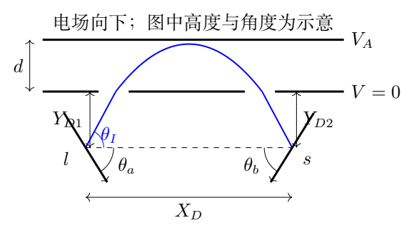

## 一、题型定位

前半题是匀强电场中的斜抛与几何成像，二级聚焦要求对入射角的一、二阶灵敏度同时为零。后半题把狭缝位置映射成接收位置，再将接收板上下电流差反演为动能，最后利用离子电荷变化求电势。

计算时分别求轨迹、接收比例和静电能量变化。磁场使轨迹弯曲但不做功，所以测量公式使用电势能而不是磁场强度。

## 二、知识点

- 匀强电场中斜抛运动的返回时间与水平射程。
- 泰勒展开及一阶、二阶聚焦条件。
- 两条直线的交点、狭缝成像倍率。
- 均匀束流的长度比例与电流比例。
- 分段电荷状态下的机械能守恒。
- 测量范围、饱和信号与非均匀入射造成的偏差。

## 三、物理图像

正二次离子进入上板电势较高的平行板区，受到向下电场力。它先上升再下降，在相同下板高度离开。水平速度不变，入口和出口的竖直速度大小相同、符号相反。因此板外两段的水平距离都是“下降或上升高度乘 $\cot\theta_I$”。

把两段无场高度合并为
$$
D=Y_{D1}+Y_{D2}>0.
$$
改变入射角，一方面改变板内射程，另一方面改变板外水平位移。二级聚焦来自这两种变化的一阶和二阶相互抵消；不是所有角度都能做到。

## 四、解题入口

先设板内水平射程为 $L$，得到
$X_D=L+D\cot\theta_I$。用
$$
A=\frac{2K_2d}{q_2V_A}
$$
把公式写成 $X_D=A\sin2\theta_I+D\cot\theta_I$，求导更清楚。

对于狭缝偏移，先找出口位置 $X_M$，再写接收点
$(x,y)=(X_D-s\cos\theta_b,\;Y_{D2}+s\sin\theta_b)$。
将出射直线 $y=(x-X_M)\tan\theta_I$ 代入，统一得到 $s(l)$。最后用 $s=0$ 切分入射狭缝，避免凭图猜测电流差的正负。

## 五、解析

（1）板内运动和中心射程。

设离子质量为 $M$，入射速度大小为 $V$，板内向下加速度大小为
$$
a=\frac{q_2V_A}{Md},\qquad K_2=\frac12MV^2.
$$
从下板高度射入后，板内竖直位移满足
$$
y=V\sin\theta_I\,\tau-\frac12a\tau^2.
$$
回到同一高度的非零时间为
$$
\tau_L=\frac{2V\sin\theta_I}{a}.
$$
因此板内水平射程
$$
L=V\cos\theta_I\,\tau_L
=\frac{V^2\sin2\theta_I}{a}
=\frac{2K_2d}{q_2V_A}\sin2\theta_I.
$$
板外分别贡献 $Y_{D1}\cot\theta_I$ 和
$Y_{D2}\cot\theta_I$，得到
$$
\boxed{X_D=\frac{2K_2d}{q_2V_A}\sin2\theta_I
+D\cot\theta_I.}\tag{2.1}
$$
质量 $M$ 在固定动能下消去。分析器主要测量的是能量与电荷之比 $K_2/q_2$，而不是单独的速度或质量。

（2）完整写出二级聚焦条件。

记 $X(\theta)=A\sin2\theta+D\cot\theta$。在固定分析器参数、固定 $K_2$ 时
$$
X(\theta+\Delta\theta)
=X(\theta)+X'(\theta)\Delta\theta
+\frac12X''(\theta)(\Delta\theta)^2+O((\Delta\theta)^3).
$$
满足题设就要求
$$
X'=2A\cos2\theta-D\csc^2\theta=0,\tag{2.2}
$$
$$
X''=-4A\sin2\theta+2D\csc^2\theta\cot\theta=0.\tag{2.3}
$$
先由式（2.2）解得
$$
D=2A\cos2\theta\sin^2\theta.
$$
$A,D>0$ 意味着 $\cos2\theta>0$，故候选角首先落在 $0<\theta<\pi/4$。代入第二条件：
$$
-4A\sin2\theta+4A\cos2\theta\cot\theta=0.
$$
除以 $4A$，乘 $\tan\theta$：
$$
\cos2\theta=\sin2\theta\tan\theta=2\sin^2\theta.
$$
又 $\cos2\theta=1-2\sin^2\theta$，所以
$$
4\sin^2\theta=1.
$$
在允许区间内唯一解为
$$
\boxed{\theta_I=\frac{\pi}{6}.}\tag{2.4}
$$
回代 $D=2A(1/2)(1/4)=A/4$，即
$$
\boxed{V_A=\frac{K_2d}{2q_2D},\qquad
X_D=3\sqrt3\,D.}\tag{2.5}
$$
角度求解过程中，区间条件同时排除了周期延拓产生的其他代数根。

（3）二级聚焦消除到什么程度。

再求三阶导数：
$$
X'''=-8A\cos2\theta
-4D\csc^2\theta\cot^2\theta
-2D\csc^4\theta.
$$
在 $\theta=\pi/6,A=4D$ 时
$$
X'''=-16D-48D-32D=-96D.
$$
于是中心角附近
$$
\boxed{\Delta X_D=-16D(\Delta\theta_I)^3
+O((\Delta\theta_I)^4).}\tag{2.6}
$$
一、二阶消失并不代表所有角度都聚焦到同一点；三阶像差仍存在。角度要以弧度代入泰勒展开，不能将度数直接代入式（2.6）。

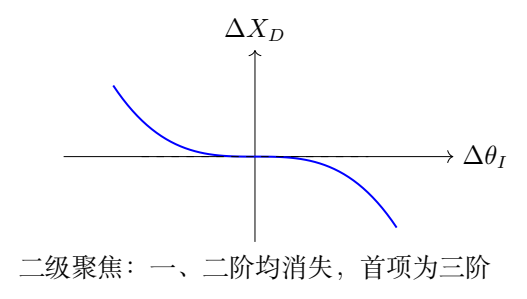

板内最大上升高度为
$$
y_{\max}=\frac{V^2\sin^2\theta_I}{2a}
=\frac{K_2d}{q_2V_A}\sin^2\theta_I.
$$
聚焦配置下 $y_{\max}=D/2$。理想抛物线还必须不撞上板，因此需
$D/2<d$。这是实际轨迹可达性的检查；题设默认束流能完整进入并离开板间区域。

（4）将狭缝位置 $l$ 映射到接收位置 $s$。

按题图的方向，偏移后的入射位置有水平坐标
$l\cos\theta_a$，距下板的高度变为
$Y_{D1}+l\sin\theta_a$。所以离子从下板退出时的水平坐标
$$
X_M=l\cos\theta_a+
(Y_{D1}+l\sin\theta_a)\cot\theta_I
+\frac{2K_2d}{q_2V_A}\sin2\theta_I.
$$
接收板上距中心为 $s$ 的点，相对下板的向下高度和水平坐标为
$$
y=Y_{D2}+s\sin\theta_b,\qquad
x=X_D-s\cos\theta_b.
$$
出口之后没有场，离子轨迹是一条斜率为 $\tan\theta_I$ 的直线：
$$
y=(x-X_M)\tan\theta_I.
$$
将 $x,y,X_M$ 代入并整理：
$$
\begin{aligned}
s(\cos\theta_b\tan\theta_I+\sin\theta_b)
={}&X_D\tan\theta_I-D\\
&-\frac{4K_2d}{q_2V_A}\sin^2\theta_I\\
&-l(\cos\theta_a\tan\theta_I+\sin\theta_a).
\end{aligned}\tag{2.7}
$$
这里用到了
$\sin2\theta_I\tan\theta_I=2\sin^2\theta_I$。

为缩短后续式子，定义
$$
C_a=\cos\theta_a\tan\theta_I+\sin\theta_a,\qquad
C_b=\cos\theta_b\tan\theta_I+\sin\theta_b,
$$
$$
Q=X_D\tan\theta_I-D-\frac{4K_2d}{q_2V_A}\sin^2\theta_I.
$$
则完整映射为
$$
\boxed{s(l)=\frac{Q-C_al}{C_b}.}\tag{2.8}
$$
不能在推导这个通式前就把聚焦条件代入，否则后半题所需的失调信息会被消掉。

（5）聚焦时的狭缝成像倍率。

聚焦参数给出
$$
X_D\tan\theta_I=3D,\qquad
\frac{4K_2d}{q_2V_A}\sin^2\theta_I=2D,
$$
故 $Q=0$。又
$$
C_a=\frac{\sin(\theta_I+\theta_a)}{\cos\theta_I},
\qquad
C_b=\frac{\sin(\theta_I+\theta_b)}{\cos\theta_I}.
$$
所以第（1.3）问结果为
$$
\boxed{s=-\frac{\sin(\theta_I+\theta_a)}
{\sin(\theta_I+\theta_b)}\,l.}\tag{2.9}
$$
负号表示入口上下位置翻转。若 $\theta_a=\theta_b$，则 $s=-l$，是单位大小的倒像。若 $C_b=0$，出射直线与接收板平行，交点公式奇异，这种接收几何不能用于本测量。

（6）中心射线失调与分界入射点。

一般情况下 $l=0$，由式（2.8）
$$
\boxed{s_{l=0}=\frac{
X_D\tan\theta_I-D-\dfrac{4K_2d}{q_2V_A}\sin^2\theta_I
}{C_b}.}\tag{2.10}
$$
接收上下半平面的分界 $s=0$ 对应入射位置
$$
\boxed{l_0=\frac{Q}{C_a}.}\tag{2.11}
$$
题图配置中 $C_a,C_b>0$，所以 $l>l_0$ 时 $s<0$，到上半接收板；$l<l_0$ 时 $s>0$，到下半接收板。这个单调性决定电流差的符号。

（7）由电流分配反演二次离子动能。

狭缝范围为 $-w/2\le l\le w/2$。束流均匀、全部捕获时，电流与对应的入口长度成正比：
$$
\frac{i_U}{i_U+i_L}=\frac{w/2-l_0}{w},
\qquad
\frac{i_L}{i_U+i_L}=\frac{w/2+l_0}{w}.
$$
定义无量纲不对称度
$$
\mathcal A=\frac{i_U-i_L}{i_U+i_L}.
$$
相减得 $\mathcal A=-2l_0/w$，即 $l_0=-w\mathcal A/2$。由
$Q=C_al_0$ 解出 $K_2$：
$$
\boxed{
K_2=\frac{q_2V_A}{4d\sin^2\theta_I}
\left[
X_D\tan\theta_I-D+\frac w2 C_a\mathcal A
\right].}\tag{2.12}
$$
括号中各项都是长度，前面的 $q_2V_A/d$ 为能量每单位长度，量纲正确。接收板角度 $\theta_b$ 消失，因为反演只使用上下分界的位置，不使用像在接收板上被拉伸的幅度。

对于理想聚焦硬件，将 $\theta_I=\pi/6$、
$X_D=3\sqrt3D$ 代入，中心能量为
$$
K_{20}=\frac{2q_2V_AD}{d}.
$$
式（2.12）在附近化为
$$
K_2-K_{20}=\frac{q_2V_AwC_a}{2d}\mathcal A.
$$
因此电流差是附近动能变化的线性读数，总电流反映束流强弱。用差与和之比可以消去束流整体强度的缓慢漂移。

（8）电流差公式的有效测量区间。

电流分配式隐含 $|l_0|\le w/2$。等价地，$|\mathcal A|\le1$。如果能量失调太大，分界点落在狭缝外，全部离子都到同一半接收板，不对称度饱和在 $\pm1$，此时不能再由读数唯一恢复更远的能量。

式（2.12）给出的可线性反演能量区间是
$$
K_{\rm center}-\Delta K_{\rm range}
\le K_2\le
K_{\rm center}+\Delta K_{\rm range},
$$
$$
K_{\rm center}=
\frac{q_2V_A(X_D\tan\theta_I-D)}{4d\sin^2\theta_I},
\qquad
\Delta K_{\rm range}=
\frac{q_2V_Aw|C_a|}{8d\sin^2\theta_I}.
$$
只有满足捕获、单调映射、均匀入射的假设，这一范围内的比例关系才成立。单纯扩大狭缝虽提高动态范围，也会改变角度散布和束流空间均匀性。

（9）分段能量守恒求局部电势。

一次离子在等离子体外的总机械能为 $K_1$。到局部电势 $\Phi$ 处，电荷仍为 $q_1$，动能
$$
K_{\rm before}=K_1-q_1\Phi.
$$
直接电离过程中，离子失去一个电子。电子带走的能量及电离能相对重离子动能很小，根据题设
$$
K_{\rm after}\simeq K_{\rm before}.
$$
二次离子随后带电 $q_2$ 离开到电势零处，故
$$
K_2=K_{\rm after}+q_2\Phi
\simeq K_1+(q_2-q_1)\Phi.
$$
于是
$$
\boxed{\Phi=\frac{K_2-K_1}{q_2-q_1}
=\frac{K_2-K_1}{e}.}\tag{2.13}
$$
正电势使一次离子进入时减速，但二次离子出去时获得的电势能更多；最终动能增加 $e\Phi$。这个符号检查能避免把局部电势写反。

把式（2.12）代入，得到可直接用于数据反演的表达式：
$$
\boxed{
\Phi=\frac{V_A}{2d\sin^2\theta_I}
\left[X_D\tan\theta_I-D+\frac w2C_a
\frac{i_U-i_L}{i_U+i_L}\right]
-\frac{K_1}{e}.}\tag{2.14}
$$
磁场力始终与速度垂直，不做功，因而不出现在这条能量关系中。电离时系统整体电荷守恒，但离子自身电荷改变；不能把离子跨越电离事件的 $K+q\Phi$ 当成同一个连续守恒量。

（10）保留小碰撞损失时的偏差。

若电离事件使重离子动能减少 $\Delta K_{\rm coll}>0$，则
$$
K_2=K_1+(q_2-q_1)\Phi-\Delta K_{\rm coll}.
$$
忽略损失的反演结果为
$$
\Phi_{\rm inferred}
=\Phi-\frac{\Delta K_{\rm coll}}{q_2-q_1}.
$$
它会低估真实正电势。题设允许忽略此项，但这条式子明确了近似的方向与量级。测量的电流误差也可传播：
$$
\delta\Phi=
\frac{q_2V_AwC_a}
{8ed\sin^2\theta_I}\,\delta\mathcal A.
$$
其中硬件参数固定；若入射角、板间距、电压也漂移，应对式（2.14）分别求导，不能只把电流差的不确定度当成全部误差。

（11）从测得电流到电势的完整算例与误差链。

设分析器按中心二次离子能量 $K_{20}$ 调到二级聚焦，保持 $\theta_I=\pi/6$、$X_D=3\sqrt3D$。先由聚焦式反算中心能量：
$$
K_{20}=\frac{2q_2V_AD}{d}.
$$
电流不平衡 $\mathcal A=(i_U-i_L)/(i_U+i_L)$ 对能量的偏移为
$$
\Delta K_2=\frac{q_2V_AwC_a}{2d}\,\mathcal A.
$$
除以中心能量，得到不依赖绝对电压刻度的几何表达式：
$$
\boxed{\frac{\Delta K_2}{K_{20}}
=\frac{wC_a}{4D}\,\mathcal A.}
$$
例如取 $\theta_a=\pi/6$，则 $C_a=1$。若狭缝宽度为 $w=0.02D$，测得 $\mathcal A=0.30$，则
$$
\frac{\Delta K_2}{K_{20}}=0.0015.
$$
此时 $l_0=-w\mathcal A/2=-0.15w$，仍处在 $[-w/2,w/2]$，均匀束流的线性分配式可用。若 $\mathcal A$ 已接近 $\pm1$，几乎全部束流落在一侧，只凭电流比就难以继续分辨更大的失调；不能把线性式无限外推到 $|\mathcal A|>1$。

若二次电荷比一次电荷多一个正元电荷，
$$
\Delta\Phi=\frac{\Delta K_2}{e}
=\frac{q_2V_AwC_a}{2ed}\,\mathcal A.
$$
例如 $q_2=2e$ 时，同样的相对能量变化对应
$\Delta\Phi=V_A(wC_a/d)\mathcal A$。这里是电势的变化；测量电势绝对值仍要用原题的 $K_1$ 和 $K_2$ 作差，不能将中心能量 $K_{20}$ 全部视为等离子体电势增益。

误差分析也可按测量链逐段进行。若两电流读数的误差独立，写 $S=i_U+i_L$，则
$$
\frac{\partial\mathcal A}{\partial i_U}=\frac{2i_L}{S^2},\qquad
\frac{\partial\mathcal A}{\partial i_L}=-\frac{2i_U}{S^2},
$$
$$
\sigma_{\mathcal A}^2
=\frac{4}{S^4}\left(i_L^2\sigma_U^2+i_U^2\sigma_L^2\right).
$$
再乘能量标定斜率和 $1/e$，便得到电势读数的统计误差。两通道若存在共同漂移或相关噪声，还要加入协方差项；入口束流不均匀则带来系统偏差，不能用增加读数次数消除。

## 六、关键洞察

二级聚焦消除的是入射角的一、二阶灵敏度，而电流差反演的是能量失调。两者作用在不同变量上，可以同时存在。入口狭缝到接收板的映射是仿射关系，测量实际上寻找这条映射的零点。

电荷变化是局部电势能被转换成可测动能差的关键。若离子进入、出去的电荷相同且不损失能量，外部末动能仍为 $K_1$，无法由此读出局部电势。

## 七、易错点

- 板内返回时间少写因子2。
- 漏掉入口或出口无场段的水平位移。
- 只令 $X'=0$ 就称二级聚焦。
- 将狭缝长度与接收板上的长度比例直接等同，却不检查映射斜率。
- 混淆上板电势 $V_A$ 与粒子速度 $V$。
- 把上半接收电流对应的入口区间写反。
- 在分界点已越过狭缝时继续使用未饱和线性反演。
- 对电离前后的离子使用同一电荷的机械能公式。

## 八、课堂讲解建议

先分成三段轨迹并标注“无场—匀强场—无场”，让学生自己把三个水平距离相加。聚焦条件不宜直接给出30°；应先用正参数判断角度区间，再解一、二阶条件。

接收映射推导时始终保留 $Q$，在聚焦时才令其零。课堂上用同一条直线 $s(l)$ 展示中心对准、失调、完全饱和三种状态。最后用正电势下“少电荷进入、多电荷离开”的能量图解释 $\Phi$ 的正负。

## 九、变式训练

### 变式1　只要求一级聚焦

固定 $A,D>0$，要求 $X'(\theta)=0$。求满足条件的角度方程及存在范围。

**解答。** 令 $u=\sin^2\theta$，$\cos2\theta=1-2u$，则
$D=2Au(1-2u)$，即
$$
4Au^2-2Au+D=0,\qquad
u=\frac{1\pm\sqrt{1-4D/A}}4.
$$
存在条件是 $A\ge4D$；相应 $0<u<1/2$。若 $A>4D$，通常有两个一级聚焦角。$A=4D$ 时二根重合于 $u=1/4$，即原题的二级聚焦角30°。

### 变式2　电离为三价离子

一次离子仍为 $q_1=e$，测量处最终成为 $q_2=3e$，忽略碰撞能量损失。求电势与末动能差的关系。

**解答。** 到达测量点时动能 $K_1-e\Phi$；成为三价后离开到零电势，增加 $3e\Phi$，故
$$
K_2=K_1+2e\Phi,\qquad
\boxed{\Phi=(K_2-K_1)/(2e).}
$$
分析器的轨迹式须同时改用 $q_2=3e$，不能只改最后的分母。给定电压时同一动能的电场加速度更大，板内射程更短。

### 变式3　狭缝入射密度有线性梯度

入口线密度与 $1+2\beta l/w$ 成正比，$|\beta|<1$，仍全部捕获。令 $u=2l_0/w$，用不对称度 $\mathcal A$ 求 $u$。

**解答。** 归一化入口密度为
$(1+2\beta l/w)/w$。上半接收比例
$$
P_U=\int_{l_0}^{w/2}\frac{1+2\beta l/w}{w}\,dl
=\frac12-\frac{l_0}{w}+\frac\beta4-\frac{\beta l_0^2}{w^2}.
$$
所以
$$
\mathcal A=2P_U-1=-u+\frac\beta2(1-u^2).
$$
解二次方程并选择与 $\beta\to0$ 连续的根：
$$
\boxed{u=\frac{-1+\sqrt{1-2\beta\mathcal A+\beta^2}}{\beta}.}
$$
$\beta=0$ 时取极限 $u=-\mathcal A$。再以 $Q=C_awu/2$ 反演动能。必须检查 $|u|\le1$，另一代数根通常不属于狭缝。

### 变式4　通过提高板电压修正已知能量失调

硬件几何和角度固定在二级聚焦状态，原设定为 $K_{20},V_{A0}$。离子能量变为 $K_{20}+\delta K$，求保持中心射线对准所需的电压变化。

**解答。** 中心对准要求 $Q=0$，固定几何时就是固定
$K_2/V_A$。因此
$$
\frac{K_{20}+\delta K}{V_{A0}+\delta V_A}
=\frac{K_{20}}{V_{A0}},
\qquad
\boxed{\frac{\delta V_A}{V_{A0}}=\frac{\delta K}{K_{20}}.}
$$
这是精确的比例关系。保持 $A=2K_2d/(q_2V_A)=4D$ 后，二级聚焦角也保持30°。若只移动接收中心而不改电压，可以令中心对准，却不一定同时恢复二级聚焦。

例如二次离子能量增加 $2\%$，板电压也须增加 $2\%$。若保持板电压不变，中心偏移量可由式（2.10）直接算出：
$$
s(0)=-\frac{4d\sin^2\theta_I}{q_2V_AC_b}\,\delta K.
$$
在聚焦角30°并用 $K_{20}=2q_2V_AD/d$ 后，
$$
\frac{s(0)}D=-\frac2{C_b}\frac{\delta K}{K_{20}}
=-\frac{0.04}{C_b}.
$$
负号表示中心束流向上半接收板移动，符合前文电流差增加对应能量增加的标定方向。调高板电压后，抛物线射程和两个无场段均恢复原中心轨迹。

该修正以电荷量和几何角度保持不变为条件。若电荷状态同时改变，应保持 $K_2/(q_2V_A)$，不能继续只保持 $K_2/V_A$。若入口角或探测板位置发生误差，则需重新检查中心对准及聚焦两个条件。

\clearpage

# 第 3 题　量子霍尔电阻的接触误差与多重连接

量子霍尔效应器件的端口按图标记为1至8，垂直器件向上施加磁场 $B$。在不相邻的端口 $i,j$ 通电流 $I_0$，在连接 $i,j$ 的直线段两侧各选端口 $l,m$ 测电压 $U_{lm}$，定义霍尔电阻
$$
R_{i,j;l,m}=\frac{U_{lm}}{I_0}.
$$

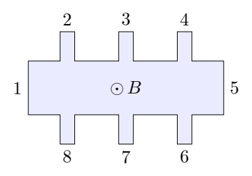

器件等效为含受控电源的环形电路。流入端口 $i$ 的电流为 $I_i$，流出时取负；每端口固有电阻为 $r=R_{\rm H}/2$，外加接触电阻 $R_{ci}$。相邻内部节点间的电源电动势为 $r(I_i+I_{i+1})$，电源无内阻，方向与图示磁场约定一致。各接触电阻可不同，但 $\epsilon_i=R_{ci}/r$ 均为远小于1的量，约 $0.1\%$。

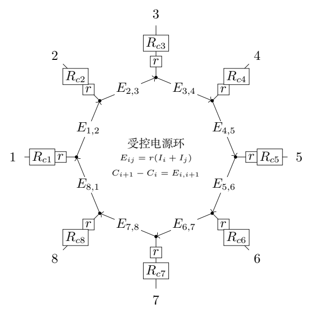

（1）哪些端口通电流、哪些端口测电压，可以获得与接触电阻无关的霍尔电阻？至少证明一种接法。

（2）将两个性质相同、接触电阻可能不同的器件 $a,b$ 相连，端口记为 $1a$ 至 $8a$、$1b$ 至 $8b$。
（2.1）按图3-3相连，求 $7a$ 与 $3b$ 断开和接通时，在 $1a,5b$ 通电流、$3a,7b$ 测电压的霍尔电阻 $R_{1a,5b;3a,7b}$ 及 $R'_{1a,5b;3a,7b}$。哪种接法的相对接触误差更小？证明结论。

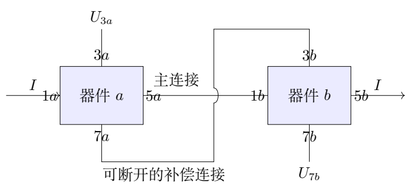

（2.2）三重并联接法为：$1a,1b$ 接输入 $A$，$5a,5b$ 接输出 $B$；$2a,2b$ 相连但不外接；$3a,3b$ 相连并接电压端 $C$；$6a,6b$ 相连但不外接；$7a,7b$ 相连并接电压端 $D$。求 $R_{A,B;C,D}$ 的接触电阻相对误差阶。假设
$R_{c5a}=R_{c5b}=R_{c6a}=R_{c6b}=R_{c7a}=R_{c7b}=0$，证明结论。本题45分。

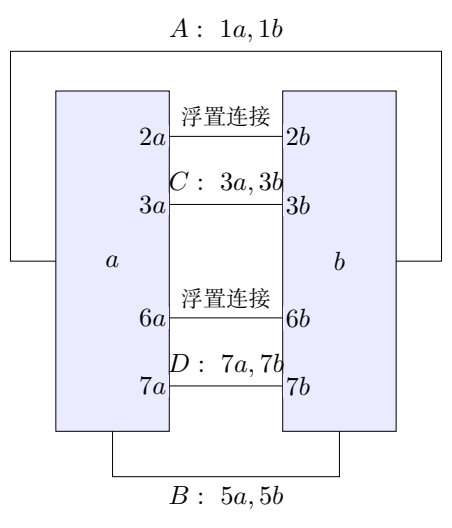

## 一、题型定位

本题研究四端测量与接触误差消除。第一问中电压端不流电流，因此没有接触压降；多器件连接时，原来的“测量端”可能承担内部补偿电流，接触电阻便会重新进入测量结果。

电源的电动势依赖端口电流，因此不能把环路当成普通电阻网络。正确的方法是保留受控源写电流、电压方程，或将它们统一换算成器件的端口关系，再分析连接。

## 二、知识点

- 基尔霍夫电流定律与电压定律。
- 高输入阻抗电压测量、四端测量。
- 受控电源的方向与电动势。
- 小参数误差阶、补偿电流的数量级。
- 多端口线性模型、浮置节点及基准电势。
- 精确公式与渐近估计的区别。

## 三、物理图像

在一个器件上从1通入、5流出电流 $I$，端口2、3、4位于同一高电势侧，端口6、7、8位于另一低电势侧。两侧电势差为 $R_{\rm H}I=2rI$。电压探头的接触电阻不产生压降，因为理想探头无电流。

把两个器件串联时，主连接上的接触电阻仍承受大电流，故出现一阶误差。再加一条适当连接，器件自身的霍尔电压会驱动小补偿电流，抵消大部分接触压降，剩下的是两个小接触电阻的乘积。

## 四、解题入口

电压正负必须先约定。本解取 $U_{37}=U_3-U_7$，使单器件结果为 $+2r$；对串联系统取 $U_{3a}-U_{7b}$，对并联系统取 $U_C-U_D$。若电压表接线反向，全部电阻整体变号，误差阶不变。

串联部分用
$$
a=R_{c5a}+R_{c1b},\qquad
b=R_{c7a}+R_{c3b}
$$
分别表示主连接、补偿连接的接触电阻和。并联部分用接触和 $S_i$、接触差 $D_i$，能看清每一次补偿怎样再降低一阶。

## 五、解析

（1）由等效电路建立通用端口关系。

记内部环节点电势为 $C_i$，端口外部电势为 $T_i$。流入器件的电流正，因此沿端口电阻向内走时电势下降：
$$
T_i=C_i+(r+R_{ci})I_i.
$$
受控源环满足
$$
C_i-C_{i-1}=r(I_i+I_{i-1}),
$$
指标按模8循环。定义理想接触位置的电势
$$
V_i=C_i+rI_i.
$$
于是
$$
V_i-V_{i-1}=2rI_i,\qquad
T_i=V_i+R_{ci}I_i.\tag{3.1}
$$
对第一式绕环求和得到 $\sum_iI_i=0$，与电流守恒一致。式（3.1）包括所有受控源，提供了一条与逐个环路列式等价的端口路线。

（2）证明单器件四端测量消除接触误差。

令
$$
I_1=I,\qquad I_5=-I,\qquad
I_2=I_3=I_4=I_6=I_7=I_8=0.
$$
由式（3.1）
$$
V_2=V_3=V_4=V_1,\qquad
V_6=V_7=V_8=V_5,
$$
$$
V_1-V_5=2rI.
$$
又 $I_3=I_7=0$，所以
$T_3=V_3,T_7=V_7$，测得
$$
\boxed{R_{1,5;3,7}=\frac{T_3-T_7}{I}=2r=R_{\rm H}.}\tag{3.2}
$$
电流端接触压降改变电源需要提供的总电压，但不改变两条理想边的霍尔电势差。电压端接触电阻也不影响读数，因为没有电流。

一般可在任意不相邻端口通电流，在连接线两侧分别取无电流的电压端。每侧至少应有可用端口；如果选取两电压端位于同侧，它们的理想电势相同，读到的就不是霍尔电压。

（3）普通串联：主连接接触电阻进入一阶。

补偿连接 $7a\leftrightarrow3b$ 断开时，主路径为
$1a\to5a\to1b\to5b$，主连接电流为 $I$。电压端 $3a,7b$ 不流电流，它们的自身接触电阻不影响读数。

沿测量路径跨过两个器件的霍尔电势差以及中间接触电阻，总电压为
$$
U_{3a}-U_{7b}=2rI+aI+2rI.
$$
因此
$$
\boxed{R_{1a,5b;3a,7b}=4r+a.}\tag{3.3}
$$
两器件理想串联值为 $4r=2R_{\rm H}$，其相对误差
$$
\delta_{\rm open}=\frac{a}{4r}=O(\epsilon).
$$
这里的 $a$ 只包括内部主连接的接触电阻；两端外接电源的接触电阻不属于四端测量电压路径。

（4）补偿连接接通后，先列电流和回路方程。

设主连接由 $5a$ 流出的电流为 $J$，补偿连接中从 $7a$ 流出的电流为 $K$。输入电流在两条连接之间分配：
$$
I=J+K.
$$
按题图受控源的方向，闭合回路的电压方程化为
$$
aJ=(4r+b)K.\tag{3.4}
$$
例如用原来的“流入 $7a$ 为正”记号，电流为 $I_{7a}=-K$。回路式为
$$
0=-J(2r+a)+(J-I_{7a})r
-I_{7a}(2r+b)-(I_{7a}-J)r,
$$
代入 $I_{7a}=-K$，即得 $-aJ+(4r+b)K=0$。这样可以直接检查式（3.4）的每个 $4r$ 从何而来。

联立电流守恒：
$$
\boxed{J=\frac{4r+b}{4r+a+b}I,\qquad
K=\frac{a}{4r+a+b}I.}\tag{3.5}
$$
$a,b\ll r$ 时 $K/I\approx a/(4r)=O(\epsilon)$，补偿连接承担的是小电流，不是与主连接等大的电流。

（5）计算闭合后的测量电压与误差。

沿仍经过主连接的测量路径，
$$
U_{3a}-U_{7b}=(4r+a)J.
$$
将式（3.5）代入：
$$
R'=\frac{(4r+a)(4r+b)}{4r+a+b}.
$$
把分子分解
$$
(4r+a)(4r+b)=4r(4r+a+b)+ab,
$$
所以
$$
\boxed{R'=4r+\frac{ab}{4r+a+b}
=4r\left[1+\frac{ab}{4r(4r+a+b)}\right].}\tag{3.6}
$$
其相对误差为
$$
\boxed{\delta_{\rm closed}
=\frac{ab}{4r(4r+a+b)}=O(\epsilon^2).}\tag{3.7}
$$
相比断开情形，
$$
\frac{\delta_{\rm closed}}{\delta_{\rm open}}
=\frac{b}{4r+a+b}\ll1
$$
（$a>0$ 时）。若 $a=0$，两种接法都准确；若 $b=0$，补偿后在此模型内恰好准确。有限非负接触电阻时误差仍非负，但由一阶降到二阶。

不能用“增加导线会让电阻变小”的普通无源网络直觉解释此处。这里的补偿电流由端口连接方式和受控源共同决定。

（6）三重并联的电流记号与接触和、差。

电流源从 $A$ 向系统注入总电流 $I$，从 $B$ 取出。分别记
$I_{1a},I_{1b}$ 为器件1端输入电流，
$I_{5a},I_{5b}$ 为5端输出电流：
$$
I_{1a}+I_{1b}=I,\qquad
I_{5a}+I_{5b}=I.
$$
连接 $ia\leftrightarrow ib$（$i=2,3,6,7$）中，从 $b$ 流入 $a$ 的电流记为 $I_i$。因此在器件 $a$ 是流入，在器件 $b$ 是流出。

定义
$$
R_{ia}=r+R_{cia},\quad R_{ib}=r+R_{cib},\quad
S_i=R_{cia}+R_{cib},\quad D_i=R_{cia}-R_{cib}.
$$
则 $R_{ia}+R_{ib}=2r+S_i$，
$R_{ia}-R_{ib}=D_i$。题设给出 $S_5=S_6=S_7=0$，同时这些端口的接触差也为零。

（7）保留全部必要回路，依次求小电流。

由输入端经过7端的闭合回路，受控源与零接触的7端合并后：
$$
(2r+R_{c1a})I_{1a}
=(2r+R_{c1b})I_{1b}.
$$
与总电流式联立，得
$$
\boxed{
I_{1a}=\frac{2r+R_{c1b}}{4r+S_1}I,\qquad
I_{1b}=\frac{2r+R_{c1a}}{4r+S_1}I.}\tag{3.8}
$$
两个输入电流之差不是零，接触差 $D_1$ 会改变分流。接着，在
$1a\to2a\to2b\to1b$ 回路写电压：
$$
(4r+S_2)I_2=R_{c1a}I_{1a}-R_{c1b}I_{1b}.
$$
代入式（3.8），右端为
$$
\frac{2r(R_{c1a}-R_{c1b})}{4r+S_1}I.
$$
于是
$$
\boxed{\frac{I_2}{I}
=\frac{2rD_1}{(4r+S_1)(4r+S_2)}.}\tag{3.9}
$$
这是 $O(\epsilon)$ 的第一次补偿电流。

再看 $2a\to3a\to3b\to2b$ 回路：
$$
(4r+S_3)I_3=S_2I_2.
$$
因此
$$
\boxed{\frac{I_3}{I}
=\frac{2rD_1S_2}
{(4r+S_1)(4r+S_2)(4r+S_3)}.}\tag{3.10}
$$
$I_3/I=O(\epsilon^2)$。同一关系在下侧给出
$$
(4r+S_6)I_6=-R_{c5a}I_{5a}+R_{c5b}I_{5b}=0,
$$
$$
(4r+S_7)I_7=S_6I_6=0.
$$
故 $I_6=I_7=0$。这些结论使用了题设的零接触假设；没有这个假设时需继续保留下侧补偿链。

（8）测量电压：两条路径相加消去不必要项。

从下侧测量端 $D$ 到上侧 $C$，分别沿 $a,b$ 两器件求电压差，可以写成
$$
U_{CD}^{(a)}
=-I_7R_{7a}-(I_7+I_6)r
-(I_6-I_{5a})r-(-I_{5a}+I_3)r+I_3R_{3a},
$$
$$
U_{CD}^{(b)}
=I_7R_{7b}-(-I_7-I_6)r
-(-I_6-I_{5b})r-(-I_{5b}-I_3)r-I_3R_{3b}.
$$
这两个式子描述同一对端点，故应相等。相加除以2，并用
$I_{5a}+I_{5b}=I$，得到更简洁的关系：
$$
U_{CD}=rI+\frac12(D_3I_3-D_7I_7).
$$
题设 $I_7=D_7=0$，从而
$$
U_{CD}=rI+\frac12D_3I_3.
$$
代入式（3.10）：
$$
\boxed{
R_{A,B;C,D}
=r\left[
1+\frac{D_1S_2D_3}
{(4r+S_1)(4r+S_2)(4r+S_3)}
\right].}\tag{3.11}
$$
理想并联值为 $R_{\rm H}/2=r$，不是串联时的 $4r$。

（9）说明三阶误差及其物理来源。

将式（3.11）全部除以 $r$，用 $\epsilon_{ia}=R_{cia}/r$：
$$
\delta_{\rm triple}=
\frac{(\epsilon_{1a}-\epsilon_{1b})
(\epsilon_{2a}+\epsilon_{2b})
(\epsilon_{3a}-\epsilon_{3b})}
{(4+\epsilon_{1a}+\epsilon_{1b})
(4+\epsilon_{2a}+\epsilon_{2b})
(4+\epsilon_{3a}+\epsilon_{3b})}.
$$
分子包含三个一阶小量，分母以 $4^3$ 为主，所以
$$
\boxed{\delta_{\rm triple}=O(\epsilon^3).}\tag{3.12}
$$
各式的关系依次为：
输入接触差产生一阶 $I_2$；
第二对接触压降产生二阶 $I_3$；
测量端接触差再乘 $I_3$，得到三阶电压误差。

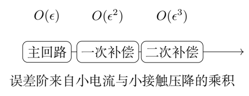

与串联闭合误差不同，三阶误差的正负由 $D_1D_3$ 决定。若同对两接触电阻相同，$D_1=0$ 或 $D_3=0$，精确公式中误差为零。若 $S_2=0$，补偿链中没有二阶源项，也精确为零。

“约 $0.1\%$ 的接触比”只确定数量级；不能把相对误差直接写为精确 $10^{-9}$。三阶前因子、接触差的抵消和测量方向都影响具体数值。

（10）端口矩阵路线与独立复核方法。

也可不使用上面的指定回路，而对每个器件的8个理想端电势、电流写
$$
V_i-V_{i-1}=2rI_i,\qquad T_i=V_i+R_{ci}I_i.
$$
连接的外端 $T_i$ 取相同电势；每个连接节点上所有流入器件的电流之和等于外部注入电流。电压端节点外部注入为0，但该节点内部两器件之间仍可能有电流。

这些线性方程整体存在一个电势平移自由度，应固定一个节点电势为0，再求解。将求得的
$(T_{3a}-T_{7b})/I$ 或 $(T_C-T_D)/I$
与式（3.6）、（3.11）比较，就能独立检查回路推导与接线。若把“电压端总外部电流为0”误写成“每个相连端口各自电流为0”，就会丢失正是造成三阶误差的 $I_3$。

（11）用同一组接触比比较三种误差。

以 $r$ 为电阻单位，取两器件相关接触比为
$$
\begin{array}{c|ccc}
&1&2&3\\\hline
a&0.0011&0.0012&0.0013\\
b&0.0021&0.0022&0.0023
\end{array}
$$
串联时另取 $R_{c5a}/r=0.0015$、$R_{c7a}/r=0.0017$，则
$$
\frac ar=0.0015+0.0021=0.0036,\qquad
\frac br=0.0017+0.0023=0.0040.
$$
以理想串联值 $4r$ 为基准，断开补偿线时
$$
\delta_{\rm open}=\frac{a}{4r}=9.0\times10^{-4}.
$$
闭合后的精确相对误差是
$$
\delta_{\rm closed}
=\frac{ab}{4r(4r+a+b)}
=8.98293\times10^{-7}.
$$
由一阶变成二阶，改善倍数约为1002。这个倍数使用指定接触和计算；换另一组接触，数值会变化。

在三重并联算例中，重新按题设令下侧相关接触为零，保留上表的 $1,2,3$ 接触比。此时
$$
\frac{D_1}{r}=-0.0010,\quad
\frac{S_2}{r}=0.0034,\quad
\frac{D_3}{r}=-0.0010.
$$
两次补偿依次给出
$$
\begin{aligned}
\frac{I_2}{I}&=\frac{-0.0020}{4.0032\times4.0034}
\approx-1.24794\times10^{-4},\\
\frac{I_3}{I}&=\frac{0.0034}{4.0036}\frac{I_2}{I}
\approx-1.05980\times10^{-7}.
\end{aligned}
$$
相对理想并联值 $r$，最终电压误差为
$$
\delta_{\rm triple}
=\frac{D_3I_3}{2rI}
\approx5.29900\times10^{-11}.
$$
两次电流为负，表示实际方向与预设相反；两个接触差同号，故测得值略高于 $r$。

全部接触比缩小 $\lambda$ 倍，分子带出 $\lambda^3$，分母趋于常数 $4^3$。所以小接触比减半，误差约缩为 $1/8$。串联、并联的相对误差分别以 $4r,r$ 为基准。

## 六、关键洞察

高阻电压表只保证其外部支路不流电流，不保证连在该测量节点上的器件端口各自无电流。多重连接是通过内部小电流实现补偿，因此单器件四端测量的零接触误差证明不能机械复制到连接后的每个端口。

三阶公式中的“接触差—接触和—接触差”结构说明误差既受小参数影响，也受对称性影响。分析接线变化时，可先检查哪些接触电阻之差变为零，再判断相应误差项是否消失。

## 七、易错点

- 将受控电源当作固定电源或直接删去。
- 所有端口电流都用正号，违反电流守恒。
- 电压正负约定不一致，导致串联加法变成减法。
- 将理想串联值 $4r$ 与理想并联值 $r$ 混淆。
- 在三重连接中强行令电压端每个器件的电流均为零。
- 只计算分子的阶次而忽略分母是否在小参数极限趋于非零常数。
- 没有标明下侧接触为零的假设，就把式（3.11）用于任意全部非零接触。

## 八、课堂讲解建议

先用一个器件从端口方程证明四端结果，再画普通串联的电压路径，明确中间接触压降为何不能消失。接通补偿线后，先估计补偿电流为小量，再进行精确求解。

讲三重并联时将接线清单写在图旁，不依赖交叉线的视觉印象。按 $I_2\to I_3\to \Delta U$ 的顺序推进，让学生每步写出量级。最后用接触完全对称、其中一对接触为零等特殊情形复核公式。

## 九、变式训练

### 变式1　串联两条连接接触和相同

取 $a=b=\alpha r$，求断开、闭合接法的相对误差，并比较 $\alpha\ll1$ 时的改善倍数。

**解答。** 原题精确式给出
$$
\delta_{\rm open}=\frac\alpha4,\qquad
\delta_{\rm closed}=\frac{\alpha^2}{4(4+2\alpha)}.
$$
故
$$
\frac{\delta_{\rm closed}}{\delta_{\rm open}}
=\frac{\alpha}{4+2\alpha}\simeq\frac\alpha4.
$$
若 $\alpha=0.002$，断开误差为 $5.0\times10^{-4}$，闭合约 $2.5\times10^{-7}$。这是指定接触和的计算，不能把单端口接触比直接误作 $\alpha$。

### 变式2　有限输入阻抗的单器件电压表

原第一问的3、7端之间接入电阻 $R_V$ 作为电压表，其他测量条件不变。求 $R_{\rm H}$ 读数。

**解答。** 设电压表电流为 $J$，从3流向7，则
$I_3=-J,I_7=J$。端口关系沿3至7的区间给出
$V_3-V_7=2r(I-J)$。端口接触使
$$
T_3-T_7=2rI-(2r+R_{c3}+R_{c7})J.
$$
又 $J=(T_3-T_7)/R_V$，所以
$$
\boxed{\frac{T_3-T_7}{I}
=\frac{2rR_V}{R_V+2r+R_{c3}+R_{c7}}.}
$$
当 $R_V\to\infty$ 恢复 $2r$。有限输入阻抗使电压端流电流，接触电阻重新产生影响。

### 变式3　三重并联中一对接触对称

保留题设下侧零接触条件，但令 $R_{c1a}=R_{c1b}$。求并联霍尔电阻，并解释为何不只是一阶近似。

**解答。** $D_1=0$，输入电流由式（3.8）精确平分。随后式（3.9）给 $I_2=0$，式（3.10）给 $I_3=0$，下侧同样 $I_6=I_7=0$。因此
$$
U_{CD}=rI,\qquad \boxed{R_{A,B;C,D}=r.}
$$
接触电阻可以非零，结果在题给线性等效模型内仍精确。原因是对称输入没有激发后续补偿误差链。

### 变式4　交换测量端接触差的符号

两次实验只有 $R_{c3a},R_{c3b}$ 互换，所有其他参数相同，且保持下侧零接触。两次读数记为 $R_+,R_-$。求平均值与差。

**解答。** 互换不改变 $S_3$，却令 $D_3\to-D_3$。设
$$
\Delta=\frac{D_1S_2D_3}{(4r+S_1)(4r+S_2)(4r+S_3)}.
$$
则 $R_\pm=r(1\pm\Delta)$，因而
$$
\boxed{\frac{R_++R_-}{2}=r,\qquad
R_+-R_-=2r\Delta.}
$$
平均在该模型中消去三阶接触误差。实际若交换操作同时改变其他接触、器件性质或磁场方向，就不能继续使用此抵消结论。

\clearpage

# 第 4 题　强平面激光场中的相对论电子运动

真空激光加速机制利用强激光脉冲提高电子能量。采用沿 $+z$ 传播、线偏振的单色平面电磁波模型：
$$
\mathbf E=E_0\cos(kz-\omega t)\,\mathbf e_x,\qquad
\mathbf B=\frac{E_0}{c}\cos(kz-\omega t)\,\mathbf e_y,
\qquad kc=\omega.
$$
$E_0$ 是电场振幅，$c$ 为真空光速。忽略重力，使用相对论动力学。

（1）$t=0$ 时电子静止于原点，忽略辐射阻尼。
（1.1）求动量 $\mathbf p$ 和总能量 $\varepsilon$，表达式可含当时坐标。
（1.2）求位置 $x,y,z$ 与时间的关系，可用隐函数表示。

（2）$t=0$ 时从原点沿 $x$-$z$ 平面注入总能量为 $\varepsilon_0$ 的电子，初速度与 $+x$ 的夹角不大于 $\pi/2$，忽略辐射阻尼。求最大能量 $\varepsilon_{\max}$ 及对应入射角 $\theta_0$；$\theta_0$ 为入射方向与 $z$ 轴的夹角。

（3）强激光下辐射阻尼不可忽略，给定能量损失模型
$$
\frac{d\varepsilon}{dt}
=-\frac{e^4\mu_0E_0^2}{4\pi m_e^4c^5}\varepsilon^2.
$$
激光强度 $I=1.0\times10^{22}\,\mathrm{W/cm^2}$，波长
$\lambda=800\,\mathrm{nm}$，初始总能量
$\varepsilon_0=1000m_ec^2$。求一个激光周期后
$\Delta\varepsilon/\varepsilon_0$。
给定 $m_e=9.101\times10^{-31}\,\mathrm{kg}$，
$e=1.602\times10^{-19}\,\mathrm C$，
$c=2.998\times10^8\,\mathrm{m/s}$，
$\mu_0=4\pi\times10^{-7}\,\mathrm{N/A^2}$。
强度为坡印廷矢量大小的时间平均。本题50分。

## 一、题型定位

电子在平面波中的运动同时受电场与磁场影响，又涉及相对论能量。直接以 $t$ 求解三个非线性速度方程很繁琐；可先求横向动量的相位关系和守恒量 $\varepsilon-cp_z$，再用能量动量关系消去纵向动量。

第二问把“在一个波周期中选最大相位”与“在固定初始能量下选最佳入射角”分成两次优化。第三问使用题给损失模型，须准确处理强度单位及振幅与平均强度之间的因子2。

## 二、知识点

- 相对论动量、总能量、速度的关系。
- 洛伦兹力，磁场不做功。
- 平面波相位变量及守恒量。
- 能量动量关系与参数轨迹。
- 带约束的极值、平方后的根筛选。
- 可分离微分方程、有限能量损失。
- 场振幅、时间平均强度与SI单位换算。

## 三、物理图像

电场使电子在 $x$ 方向往复运动。电子获得横向速度后，磁场力又产生 $z$ 向动量，因此初静止电子的纵向动量始终非负，运动有沿波传播方向的漂移。

电子的总能量随横向动量增长，但其沿 $z$ 方向的速度也增大，使它追赶波相位。电子经历一个完整相位周期所需的实验室时间因此一般大于固定位置测得的激光周期。

## 四、解题入口

记电子质量为 $m=m_e$，定义无量纲场强
$$
a=\frac{eE_0}{mc\omega}>0.
$$
使用电子沿轨迹经历的正向相位
$$
\psi=\omega t-kz.
$$
对于从静止出发的电子，
$\dot\psi=\omega(1-v_z/c)>0$。先积分得到
$p_x=-mca\sin\psi$，再用
$\varepsilon-cp_z=mc^2$ 求 $p_z,\varepsilon$。

一般注入时使用
$\gamma_0=\varepsilon_0/(mc^2)$、
$P=\sqrt{\gamma_0^2-1}$、
$u_0=\gamma_0-P\cos\theta_0>0$。
第三问独立使用题给阻尼方程，不能继续假定第一问的无阻尼守恒量成立。

## 五、解析

（1）写出相对论动力学分量。

电子电荷为 $-e$，
$$
\dot{\mathbf p}=-e(\mathbf E+\mathbf v\times\mathbf B),\qquad
\mathbf p=\gamma m\mathbf v,\qquad
\varepsilon=\gamma mc^2.
$$
由于 $\mathbf B$ 沿 $y$，其叉乘为
$$
\mathbf v\times\mathbf B=(-v_zB_y,\ 0,\ v_xB_y).
$$
因此
$$
\dot p_x=-eE_0(1-v_z/c)\cos\psi,
$$
$$
\dot p_y=0,\qquad
\dot p_z=-\frac{eE_0}{c}v_x\cos\psi.\tag{4.1}
$$
初始 $p_y=0$，故始终 $p_y=0$，运动在 $x$-$z$ 平面。即使电场不含 $z$ 分量，纵向动量也会由磁力产生。

（2）相位积分得到横向动量。

相位沿轨迹的导数为
$$
\dot\psi=\omega-kv_z
=\omega(1-v_z/c).
$$
于是
$$
\dot p_x=-\frac{eE_0}{\omega}\dot\psi\cos\psi
=-\frac{eE_0}{\omega}\frac{d}{dt}\sin\psi.
$$
用初始 $p_x(0)=0,\psi(0)=0$ 积分：
$$
\boxed{p_x=-\frac{eE_0}{\omega}\sin\psi=-mca\sin\psi.}\tag{4.2}
$$
若使用原题的相位 $\varphi=kz-\omega t=-\psi$，此式写为
$p_x=(eE_0/\omega)\sin\varphi$，两种记号完全等价。负号来自电子的负电荷，不应凭正电荷的运动直觉改写。

（3）寻找能量与纵向动量的守恒组合。

相对论能量变化率
$$
\dot\varepsilon=\mathbf v\cdot\dot{\mathbf p}
=-e\mathbf v\cdot\mathbf E
=-eE_0v_x\cos\psi.
$$
磁力的功为零。由式（4.1）可见
$\dot\varepsilon=c\dot p_z$，故
$$
\frac{d}{dt}(\varepsilon-cp_z)=0.
$$
初静止电子的常量为 $mc^2$：
$$
\boxed{\varepsilon-cp_z=mc^2.}\tag{4.3}
$$
这个量不是 $\varepsilon$ 本身。激光可以暂时向电子输送能量，同时增加纵向动量，二者变化受此关系约束。

（4）用能量动量关系消去未知量。

总能量满足
$$
\varepsilon^2=m^2c^4+c^2p_x^2+c^2p_z^2.
$$
代入 $\varepsilon=mc^2+cp_z$：
$$
m^2c^4+2mc^3p_z+c^2p_z^2
=m^2c^4+c^2p_x^2+c^2p_z^2.
$$
两边消项后
$$
p_z=\frac{p_x^2}{2mc}.
$$
所以
$$
\boxed{
\mathbf p=-mca\sin\psi\,\mathbf e_x
+\frac12mca^2\sin^2\psi\,\mathbf e_z,}\tag{4.4}
$$
$$
\boxed{\varepsilon=mc^2
\left(1+\frac{a^2}{2}\sin^2\psi\right).}\tag{4.5}
$$
式（4.4）给 $p_z\ge0$，而 $p_x$ 可以正负交替。横向动量为场强一阶，纵向动量与动能为场强二阶，这也是弱场极限的一项检查。

对应速度为
$$
\frac{v_x}{c}=
-\frac{a\sin\psi}{1+a^2\sin^2\psi/2},\qquad
\frac{v_z}{c}=
\frac{a^2\sin^2\psi/2}{1+a^2\sin^2\psi/2}.
$$
即使 $a$ 很大，速度仍小于 $c$；不能把动量关系直接当成非相对论速度。

（5）用相位求参数轨迹。

由式（4.3）
$$
1-\frac{v_z}{c}
=\frac{\varepsilon-cp_z}{\varepsilon}
=\frac{1}{\gamma},
\qquad \dot\psi=\frac{\omega}{\gamma}.
$$
因此
$$
\frac{dx}{d\psi}
=\frac{v_x}{\dot\psi}
=\frac{p_x}{m\omega}
=-\frac a{k}\sin\psi.
$$
积分并用 $x(0)=0$：
$$
\boxed{x(\psi)=\frac a{k}(\cos\psi-1),\qquad y=0.}\tag{4.6}
$$
同理
$$
\frac{dz}{d\psi}
=\frac{p_z}{m\omega}
=\frac{a^2}{2k}\sin^2\psi.
$$
利用 $\sin^2\psi=(1-\cos2\psi)/2$：
$$
\boxed{z(\psi)=\frac{a^2}{4k}
\left(\psi-\frac12\sin2\psi\right).}\tag{4.7}
$$
再由 $\psi=\omega t-kz$：
$$
\boxed{
t(\psi)=\frac1\omega
\left[\left(1+\frac{a^2}{4}\right)\psi
-\frac{a^2}{8}\sin2\psi\right].}\tag{4.8}
$$
其导数为
$$
\frac{dt}{d\psi}=\frac1\omega
\left(1+\frac{a^2}{2}\sin^2\psi\right)>0.
$$
因此每个 $t\ge0$ 唯一对应 $\psi\ge0$，参数式给出了无歧义的轨迹。把 $\psi=\omega t-kz$ 代回式（4.6）、（4.7），就是题目允许的隐函数关系。

（6）检查轨迹的短时与周期行为。

短时 $\psi\ll1$，
$$
x\simeq-\frac{a}{2k}\psi^2,\qquad
z\simeq\frac{a^2}{6k}\psi^3,\qquad
t\simeq\frac{\psi}{\omega}.
$$
于是 $x\simeq-eE_0t^2/(2m)$，符合电子最初在电场中的负向加速；$z$ 从三阶时间起增长，因为先有横向速度，才出现纵向磁力。

当相位增加 $2\pi$，
$$
\Delta x=0,\qquad
\Delta z=\frac{\pi a^2}{2k},
$$
$$
\Delta t=\frac{2\pi}{\omega}
\left(1+\frac{a^2}{4}\right).
$$
电子横向位置回到起点，总动量在该相位也回到零，但它已经向前移动。此实验室时间不是固定位置激光周期 $2\pi/\omega$。第（3）问所说“一个周期”按给定激光波长使用 $\lambda/c$。

（7）一般注入电子的两项不变量。

对于初始 $p_{x0}\ge0$、$p_{y0}=0$，
$$
p_x=p_{x0}-mca\sin\psi,\qquad p_y=0,
$$
$$
\varepsilon-cp_z=\varepsilon_0-cp_{z0}=mc^2u_0.
$$
令
$$
\frac{p_{x0}}{mc}=P\sin\theta_0,\qquad
\frac{p_{z0}}{mc}=P\cos\theta_0,\qquad
P=\sqrt{\gamma_0^2-1}.
$$
入射条件只要求 $p_{x0}\ge0$；$p_{z0}$ 可以正也可以负，相应角度可取 $0\le\theta_0\le\pi$。不变量
$u_0=\gamma_0-P\cos\theta_0$ 总为正，因为 $\gamma_0>P$。

一般能量动量关系与不变量联立，得
$$
\gamma=\frac{1+q_x^2+u_0^2}{2u_0},
\qquad q_x=\frac{p_x}{mc}.
$$
与初始式相减：
$$
\boxed{\gamma=\gamma_0+
\frac{a^2\sin^2\psi-2aP\sin\theta_0\sin\psi}{2u_0}.}\tag{4.9}
$$

（8）先对相位求最大值。

令 $\xi=-\sin\psi\in[-1,1]$。式（4.9）的增量分子是
$$
a^2\xi^2+2aP\sin\theta_0\,\xi.
$$
它是开口向上的二次函数，区间最大值出现在端点。由于 $P\sin\theta_0\ge0$，$\xi=1$ 的值不小于 $\xi=-1$；即选 $\sin\psi=-1$。于是固定角度下
$$
\gamma_{\rm peak}(\theta_0)
=\gamma_0+\frac{a^2+2aP\sin\theta_0}
{2(\gamma_0-P\cos\theta_0)}.\tag{4.10}
$$
正向相位持续增加，故从 $\psi=0$ 出发确实能到达 $\psi=3\pi/2$ 这样的相位。只取第一个四分之一周期，会错误地选到横向动量减小的端点。

（9）对入射角求极大值并筛选分支。

对式（4.10）的增量求导，分母为正。其导数符号由
$$
2\gamma_0\cos\theta_0-2P-a\sin\theta_0
$$
决定。极值条件为
$$
\boxed{\gamma_0\cos\theta_0-\frac a2\sin\theta_0=P.}\tag{4.11}
$$
在 $0<\theta_0<\pi/2$，左边严格递减，从 $\gamma_0$ 降到 $-a/2$，因此 $\gamma_0>1$ 时有且只有一个根。超过 $\pi/2$ 后导数始终为负，不可能再获得更大能量。因此该根是整个允许入射区间的最大值。

用半角变量 $v=\tan(\theta_0/2)$，式（4.11）变为
$$
(\gamma_0+P)v^2+av+(P-\gamma_0)=0.
$$
由于 $\gamma_0^2-P^2=1$，正根为
$$
v=\frac{\sqrt{a^2+4}-a}{2(\gamma_0+P)}.
$$
负根对应不允许的负横向初始动量。进一步化为
$$
\boxed{\theta_0=
\arctan\frac{2}{a\gamma_0+P\sqrt{a^2+4}}.}\tag{4.12}
$$
这个角度在第一象限，故用通常的 $\arctan$ 即可。$\gamma_0=1$ 时初速度为零，入射方向没有物理意义，此时只需要能量结果。

（10）求最大能量并给出另一条优化路线。

代入最佳角度，整理得到
$$
\boxed{
\varepsilon_{\max}=
\frac{mc^2}{2}
\left[(a^2+2)\gamma_0
+a\sqrt{(\gamma_0^2-1)(a^2+4)}\right].}\tag{4.13}
$$
可以通过“给定目标能量是否能实现”来复求。设
$D_\gamma=\gamma_{\max}-\gamma_0$，式（4.10）可整理为
$$
2\gamma_0D_\gamma-a^2
=2P(D_\gamma\cos\theta_0+a\sin\theta_0).
$$
右端不超过 $2P\sqrt{D_\gamma^2+a^2}$。最大可达值对应等号，最佳角满足
$\tan\theta_0=a/D_\gamma$。在最大值分支左端为正，平方后得
$$
D_\gamma^2-\gamma_0a^2D_\gamma
+\frac{a^4}{4}-P^2a^2=0.
$$
选择较大根：
$$
D_\gamma=\frac{\gamma_0a^2+aP\sqrt{a^2+4}}2.
$$
这与式（4.13）相同，并给出式（4.12）的角度。平方产生的较小根不能作为全局最大能量。

检查 $P=0$ 时得到
$\varepsilon_{\max}=mc^2(1+a^2/2)$，与第（1）问一致。$a\to0$ 时能量回到 $\varepsilon_0$。对于 $\gamma_0\gg1$，最佳角较小，但严格同向注入 $\theta_0=0$ 一般仍非最优。

（11）振幅与激光平均强度。

坡印廷矢量为
$$
\mathbf S=\frac1{\mu_0}\mathbf E\times\mathbf B
=\frac{E_0^2}{\mu_0c}\cos^2(kz-\omega t)\,\mathbf e_z.
$$
在固定位置对一个激光周期平均，
$\langle\cos^2\rangle=1/2$，所以
$$
\boxed{I=\frac{E_0^2}{2\mu_0c},\qquad
E_0^2=2\mu_0cI.}\tag{4.14}
$$
这里 $E_0$ 是峰值振幅，不能将其直接当均方根场强。题给强度需换为
$$
1.0\times10^{22}\,\mathrm{W/cm^2}
=1.0\times10^{26}\,\mathrm{W/m^2}.
$$

（12）积分辐射损失，不作小损失线性外推。

将式（4.14）代入给定微分方程：
$$
\dot\varepsilon=-A_{\rm rad}\varepsilon^2,\qquad
A_{\rm rad}=\frac{e^4\mu_0^2I}{2\pi m^4c^4}.
$$
分离变量积分：
$$
-\frac1{\varepsilon(t)}+\frac1{\varepsilon_0}
=-A_{\rm rad}t,
$$
即
$$
\varepsilon(t)=\frac{\varepsilon_0}
{1+A_{\rm rad}\varepsilon_0t}.
$$
激光周期 $T_{\rm L}=\lambda/c$。记
$$
\chi=A_{\rm rad}\varepsilon_0T_{\rm L}
=\frac{e^4\mu_0^2I\varepsilon_0\lambda}
{2\pi m^4c^5}.
$$
相对变化为
$$
\boxed{\frac{\Delta\varepsilon}{\varepsilon_0}
=-\frac{\chi}{1+\chi}.}\tag{4.15}
$$
代入题给常数，
$T_{\rm L}\approx2.67\times10^{-15}\,\mathrm s$，
$\chi\approx0.652$，得到
$$
\boxed{\frac{\Delta\varepsilon}{\varepsilon_0}
\approx-0.395,\quad\text{损失约39.5\%。}}
$$
因为 $\chi$ 并不远小于1，不能只用
$-\chi$ 作为损失比例。积分后的能量始终为正，线性外推则可能给出不合理负能量。

（13）区分场内能量峰与最终净增益。

第（1）、（2）问计算的是给定单色平面波中电子可以达到的瞬时能量。若在无阻尼模型下相位再次使横向动量回到初值，守恒量与能量动量关系使总能量也回到初值。因此不能只从瞬时高峰断言一个完整脉冲必然留下同样的净加速量。

第三问给定的是单独的能量损失方程，求解遵循它本身的模型。加入阻尼后，之前无阻尼的
$\varepsilon-cp_z$ 不再自动守恒；不能把式（4.13）的最大值与损失式直接相加，宣称获得一般强脉冲的完整轨迹。

## 六、关键洞察

相位变量把追赶电磁波的运动影响吸收进去，守恒量再把纵向动力学变为代数问题。能量增益表达式的分母为
$\gamma_0-P\cos\theta_0$，不是单独的初始横向动量。

最佳入射角必须兼顾横向与场相互作用，以及纵向追赶波的速度。先优化相位、再优化角度，能清楚判断端点和根的物理意义。

## 七、易错点

- 将电子电荷写为 $+e$。
- 漏掉 $x$ 向磁力中的 $-v_zB_y$。
- 用非相对论速度关系 $p=mv$ 处理强场。
- 误以为 $\varepsilon$ 守恒，或把 $\varepsilon+cp_z$ 当守恒量。
- 忘记相位沿电子轨迹的导数包含 $v_z$。
- 把电子相位周期当成激光在固定位置的周期。
- 最大化 $\sin^2$ 时漏掉与初始动量相乘的线性项。
- 强度单位漏乘 $10^4$，或振幅公式漏因子2。
- 辐射损失约40%时仍使用小损失线性近似。

## 八、课堂讲解建议

先用叉乘确定力的三个分量，再同时写功率与纵向动量变化率，让学生自行发现不变量。轨迹求解使用 $\psi$，并让学生以短时加速度与参数时间单调性复核。

第二问先画开口向上的相位二次函数，明确最大值在端点；再讨论入射角。最佳角可以用求导与目标能量投影两条路线互相检查。第三问先完成单位换算，再积分，比较精确损失与线性估计的差别。

## 九、变式训练

### 变式1　初静止电子的平均纵向漂移速度

忽略阻尼，对一个完整电子相位周期求平均纵向速度。

**解答。** 周期位移
$\Delta z=\pi a^2/(2k)$，周期时间
$\Delta t=(2\pi/\omega)(1+a^2/4)$。由 $\omega/k=c$，
$$
\boxed{\bar v_z=\frac{\Delta z}{\Delta t}
=c\,\frac{a^2}{4+a^2}.}
$$
弱场时 $\bar v_z\simeq ca^2/4$，强场时接近 $c$。平均速度要按时间计算，不能直接对 $\sin^2\psi$ 的速度表达式作无权相位平均。

### 变式2　一个相位周期内的平均总能量

初静止，求实验室时间平均的 $\gamma$。

**解答。** $\gamma=1+(a^2/2)\sin^2\psi$，
$dt=\gamma\,d\psi/\omega$，故
$$
\langle\gamma\rangle_t=
\frac{\int_0^{2\pi}\gamma^2\,d\psi}
{\int_0^{2\pi}\gamma\,d\psi}.
$$
用 $\langle\sin^2\rangle=1/2$、
$\langle\sin^4\rangle=3/8$，
$$
\boxed{\langle\gamma\rangle_t
=\frac{1+a^2/2+3a^4/32}{1+a^2/4}.}
$$
电子在能量较高处追赶波相位，更久地停留于相应相位区间，所以时间平均不等于简单相位平均 $1+a^2/4$。

### 变式3　给定阻尼模型的半能量时间

保持激光强度不变，求能量降为初始一半所需时间。

**解答。** 由
$\varepsilon(t)=\varepsilon_0/(1+A_{\rm rad}\varepsilon_0t)$，
设 $\varepsilon=\varepsilon_0/2$，得
$$
\boxed{t_{1/2}=\frac1{A_{\rm rad}\varepsilon_0}.}
$$
以原题周期为单位，
$t_{1/2}/T_{\rm L}=1/\chi\approx1.5$。随着能量降低，瞬时损失率的绝对值也降低，所以损失并非每个周期固定40%。

### 变式4　激光强度随时间变化

给定
$I(t)=I_{\rm p}e^{-t^2/\tau^2}$，电子从 $t=-\infty$ 起具有能量 $\varepsilon_{\rm in}$。只使用题给阻尼模型，求 $t=+\infty$ 的能量。

**解答。** 令
$B_{\rm rad}=e^4\mu_0^2/(2\pi m^4c^4)$，有
$d(1/\varepsilon)/dt=B_{\rm rad}I(t)$。积分：
$$
\frac1{\varepsilon_{\rm out}}-\frac1{\varepsilon_{\rm in}}
=B_{\rm rad}I_{\rm p}\tau\sqrt\pi.
$$
所以
$$
\boxed{\varepsilon_{\rm out}=
\frac{\varepsilon_{\rm in}}
{1+B_{\rm rad}\varepsilon_{\rm in}I_{\rm p}\tau\sqrt\pi}.}
$$
该结果只描述给定损失模型，没有同时计入场加速项。积分强度而不是单独的峰值强度决定此模型下的累积损失。

\clearpage

# 第 5 题　约瑟夫森结的时间相位、磁通干涉与小振动

理想约瑟夫森结由“超导体—薄绝缘层—超导体”组成。以结中心为原点，绝缘层厚度为 $d\ll Y,Z$，其 $y$-$z$ 截面的边长为 $Y,Z$；电流沿 $x$ 方向。两超导体波函数相位分别为 $\varphi_1,\varphi_2$，相位差
$\delta=\varphi_2-\varphi_1$。结电流密度和相位满足
$$
j=j_0\sin\delta,\qquad
\frac{\partial\delta}{\partial t}=\frac{2e}{\hbar}U.
$$
$j_0>0$，$\hbar$ 为约化普朗克常量，$e>0$。以上关系在外磁场为零和非零时均成立；无外磁场时相位差与空间无关。

（1）结两端加恒定直流电压 $U_0$，初相位为 $\delta(0)$。求电流密度 $j(t)$ 及周期。

（2）令 $U=0$，沿 $z$ 方向加静磁场。由于超导体屏蔽，磁场只存在于绝缘层及两侧各厚度为 $\lambda$ 的等效区域。绝缘层内
$\mathbf B=B_z(y)\mathbf e_z$，相位满足
$$
\frac{d\delta}{dy}=\frac{2e(d+2\lambda)}{\hbar}B_z(y).
$$
（2.1）忽略电流自生磁场，$B_z=B_0$ 为常数。求
$\delta(y)$、总电流 $I_J(B_0)$，以及 $I_J=0$ 对应的 $B_0$。已知 $\delta(0)=\delta_0\ne k\pi$。
（2.2）考虑电流自生磁场，证明
$$
\frac{d^2\delta}{dy^2}=\frac1{\lambda_J^2}\sin\delta,
$$
并求约瑟夫森穿透深度 $\lambda_J$。绝缘层磁导率为 $\mu_0$。

（3）外磁场为零，宏观模型为理想约瑟夫森结 $J$ 与电阻 $R$、电容 $C$ 并联，外加恒定偏置电流 $I$，记 $I_0=j_0YZ$。
（3.1）用 $\delta(t)$ 及其导数表示三个支路电流，导出相位方程。
以下认为 $R$ 足够大，可忽略电阻支路。
（3.2）将方程类比为单位质量粒子在势 $V(\delta)$ 中运动。求势、存在势阱的电流范围、阱底相位及小振动角频率 $\omega$。
（3.3）$\omega$ 的最大值为 $\omega_J$，已知结中电磁波速度
$\tilde c=\omega_J\lambda_J$。绝缘层相对介电常数
$\epsilon_r=9.0$，$d=3.0\,\mathrm{nm}$，$\lambda=53\,\mathrm{nm}$，求 $\tilde c/c$，保留两位有效数字。本题45分。

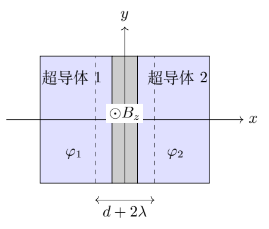

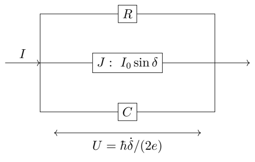

## 一、题型定位

同一相位变量在时间方向和空间方向分别受电压、磁场控制。时间相位线性增长产生交流电流；空间相位线性变化使不同位置的电流相互抵消。考虑自生磁场后，空间相位满足非线性微分方程。

电容使相位获得类似惯性的二阶时间项，偏置电流使周期势倾斜，平衡与小振动频率由势的导数决定。结中波速最后由时间响应尺度与空间穿透尺度的乘积给出。

## 二、知识点

- 相位积分、正弦电流与交流周期。
- 有限宽结的空间积分及干涉零点。
- 安培定律、非线性空间方程。
- 并联电路的电流守恒与电容电流。
- 势能曲率、稳定与不稳定平衡。
- 临界偏置、小振动与势垒。
- 平行板电容、有效磁厚度与波速。

## 三、物理图像

电压不为零时，相位不断推进，因此即使电压恒定，约瑟夫森电流仍随时间振荡。静磁场在结宽度方向造成相位梯度，局部电流可以正负不同，总电流需对整个截面积分。

在偏置电流模型中，相位像一个在波浪形斜坡上运动的坐标。偏置较小时仍有局部谷底；偏置接近临界电流时谷底与峰顶合并，小振动变慢；超过临界后没有静止阱底。

## 四、解题入口

先定义有效磁厚度与磁通量子
$$
d_{\rm eff}=d+2\lambda,\qquad
\Phi_0=\frac{\pi\hbar}{e}.
$$
静磁场问题使用
$\beta=2ed_{\rm eff}B_0/\hbar$，相位为
$\delta_0+\beta y$，总电流在 $-Y/2$ 至 $Y/2$ 积分。

并联电路先写共同电压
$U=(\hbar/2e)\dot\delta$，再逐个写支路电流。类比单位质量时应先将相位方程除以
$\hbar C/(2e)$；否则势与频率的系数会错。

## 五、解析

（1）直流电压下的交流约瑟夫森电流。

$U=U_0$ 恒定，积分相位方程：
$$
\delta(t)=\delta(0)+\frac{2eU_0}{\hbar}t.
$$
于是
$$
\boxed{j(t)=j_0\sin\!\left(\delta(0)+\frac{2eU_0}{\hbar}t\right).}\tag{5.1}
$$
非零 $U_0$ 时角频率大小及周期为
$$
\boxed{\omega_{\rm ac}=\frac{2e|U_0|}{\hbar},\qquad
T_{\rm ac}=\frac{\pi\hbar}{e|U_0|}.}\tag{5.2}
$$
电压若为负，相位推进方向相反，但周期仍为正。$U_0=0$ 时相位恒定、电流为直流，不存在有限的上述振荡周期。

（2）均匀静磁场造成线性空间相位。

由题给空间相位方程，
$$
\frac{d\delta}{dy}=\beta,\qquad
\beta=\frac{2ed_{\rm eff}B_0}{\hbar}.
$$
用中心相位 $\delta(0)=\delta_0$：
$$
\boxed{\delta(y)=\delta_0+\beta y.}\tag{5.3}
$$
局部电流密度为 $j_0\sin(\delta_0+\beta y)$。总电流是
$$
I_J=j_0Z\int_{-Y/2}^{Y/2}\sin(\delta_0+\beta y)\,dy.
$$
展开正弦：
$$
\sin(\delta_0+\beta y)
=\sin\delta_0\cos\beta y+\cos\delta_0\sin\beta y.
$$
第二项为奇函数，关于中心对称积分为零，第一项积分给出
$$
I_J=\frac{2j_0Z}{\beta}\sin\delta_0\sin\frac{\beta Y}{2}.
$$
定义 $\chi=\beta Y/2$，得到
$$
\boxed{I_J=I_0\sin\delta_0\,\frac{\sin\chi}{\chi},
\quad \chi=\frac{ed_{\rm eff}B_0Y}{\hbar}
=\frac{\pi\Phi}{\Phi_0},}\tag{5.4}
$$
其中 $\Phi=B_0d_{\rm eff}Y$ 是穿过有效磁截面的磁通。

（3）电流零点与零磁场极限。

题设 $\delta_0\ne k\pi$，所以 $\sin\delta_0\ne0$。非零磁场零点来自 $\sin\chi=0$：
$$
\chi=n\pi,\qquad n=\pm1,\pm2,\ldots.
$$
因此
$$
\boxed{B_{0,n}=\frac{n\pi\hbar}{ed_{\rm eff}Y}
=\frac{n\Phi_0}{d_{\rm eff}Y},\qquad n\ne0.}\tag{5.5}
$$
不能把 $n=0$ 也作为零点。因为
$\lim_{\chi\to0}\sin\chi/\chi=1$，零磁场时
$I_J=I_0\sin\delta_0\ne0$。

若允许调节中心相位，对 $\delta_0$ 最大化电流的绝对值，得到临界包络
$$
I_{\max}(B_0)=I_0\left|\frac{\sin\chi}{\chi}\right|.
$$
固定 $\delta_0$ 的有符号电流与包络的绝对值是两种不同量，不能在式（5.4）中随意删除符号。

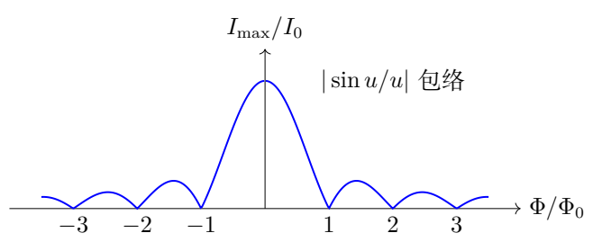

（4）考虑自生磁场，得到空间非线性方程。

在当前坐标约定下，安培定律的 $x$ 分量为
$$
(\nabla\times\mathbf B)_x=\frac{dB_z}{dy}
=\mu_0j_x=\mu_0j_0\sin\delta.
$$
将空间相位关系再对 $y$ 求导：
$$
\delta''=\frac{2ed_{\rm eff}}{\hbar}B_z'
=\frac{2e\mu_0j_0d_{\rm eff}}{\hbar}\sin\delta.
$$
与要求的形式对照：
$$
\boxed{\lambda_J=
\sqrt{\frac{\hbar}{2e\mu_0j_0d_{\rm eff}}}.}\tag{5.6}
$$
有效磁厚度必须使用 $d+2\lambda$；电流密度的面积为 $YZ$，两者来自不同几何方向。

对 $\delta=2n\pi+\xi$ 的小空间偏离，$\sin\delta\simeq\xi$，方程
$\xi''=\xi/\lambda_J^2$ 的解为指数型。它描述静态空间相位的穿透尺度，并不是时间谐振动方程，因此此处的正号不表示动态不稳定。

（5）空间方程的首次积分与局域磁通解。

将 $\delta''=\sin\delta/\lambda_J^2$ 乘 $\delta'$，积分：
$$
\frac12(\delta')^2=-\frac{\cos\delta}{\lambda_J^2}+C_{\rm s}.
$$
若在一侧相位趋于0且梯度趋于0，$C_{\rm s}=1/\lambda_J^2$，从而
$$
(\delta')^2=\frac{2}{\lambda_J^2}(1-\cos\delta)
=\frac4{\lambda_J^2}\sin^2\frac\delta2.
$$
对于从0单调增加至 $2\pi$ 的解，选正分支：
$$
\delta'=\frac2{\lambda_J}\sin\frac\delta2.
$$
分离变量，利用
$\int d\delta/[2\sin(\delta/2)]=\ln\tan(\delta/4)$，
得到
$$
\delta(y)=4\arctan e^{(y-y_0)/\lambda_J}.
$$
对应磁场
$$
B_z=\frac{\hbar}{2ed_{\rm eff}}\delta'
=\frac{\hbar}{ed_{\rm eff}\lambda_J}
\operatorname{sech}\frac{y-y_0}{\lambda_J}.
$$
积分有效截面的磁通：
$$
d_{\rm eff}\int_{-\infty}^{\infty}B_z\,dy
=\frac{\hbar}{2e}[\delta(+\infty)-\delta(-\infty)]
=\Phi_0.
$$
这是原空间方程的一个补充边界值解，帮助理解 $\lambda_J$ 与磁通尺度。有限宽结的实际边界条件还需由外磁场决定，不能将这个无限区间解强加到所有有限结。

（6）三个并联支路电流与相位方程。

三个支路共同电压为
$$
U=\frac{\hbar}{2e}\dot\delta.
$$
理想约瑟夫森支路：
$$
I_J=I_0\sin\delta.
$$
电阻支路：
$$
I_R=\frac UR=\frac{\hbar}{2eR}\dot\delta.
$$
电容支路：
$$
I_C=C\dot U=\frac{\hbar C}{2e}\ddot\delta.
$$
外加恒定电流等于三者之和：
$$
\boxed{
\frac{\hbar C}{2e}\ddot\delta
+\frac{\hbar}{2eR}\dot\delta
+I_0\sin\delta=I.}\tag{5.7}
$$
有限 $R$ 产生类似黏性阻尼的一阶导数项，电容产生二阶导数的惯性项。忽略电阻电流意味着取近似 $1/(RC)\to0$，不是将整个电阻支路的相位关系改成另一种电压。

（7）单位质量类比的势。

在题设大 $R$ 条件下，将式（5.7）除以 $\hbar C/(2e)$：
$$
\ddot\delta+\frac{2eI_0}{\hbar C}\sin\delta
-\frac{2eI}{\hbar C}=0.
$$
要写成 $\ddot\delta=-V'(\delta)$，取
$$
\boxed{V(\delta)=
-\frac{2e}{\hbar C}(I\delta+I_0\cos\delta)+\text{常数}.}\tag{5.8}
$$
乘以 $\dot\delta$ 可积分为
$$
\frac12\dot\delta^2+V(\delta)=E_{\rm unit}.
$$
这里采用单位“质量”类比，$V$ 的量纲是 $\mathrm{s^{-2}}$。它不是直接以焦耳计的物理电路能量。

若希望使用真正能量，定义
$$
M_\delta=C\left(\frac{\hbar}{2e}\right)^2,\qquad
E_J=\frac{\hbar I_0}{2e}.
$$
则电容储能为 $M_\delta\dot\delta^2/2$，物理势为
$$
U_\delta=-E_J\cos\delta-\frac{\hbar I}{2e}\delta.
$$
且 $U_\delta=M_\delta V$。两种写法求出的频率一致；混用它们会错掉相位惯性系数。

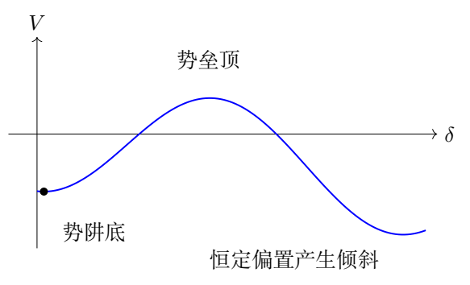

（8）求平衡相位与稳定性。

令 $i=I/I_0$，平衡条件
$$
V'(\delta)=\frac{2eI_0}{\hbar C}(\sin\delta-i)=0
$$
给 $\sin\delta=i$。当 $|i|<1$ 时有两类：
$$
\delta_{\rm s}=\arcsin i+2n\pi,
\qquad
\delta_{\rm u}=\pi-\arcsin i+2n\pi.
$$
二阶导数为
$$
V''(\delta)=\frac{2eI_0}{\hbar C}\cos\delta.
$$
第一类 $\cos\delta_{\rm s}=+\sqrt{1-i^2}>0$ 为阱底；第二类二阶导数为负，是势垒顶。因此
$$
\boxed{|I|<I_0,\qquad
\delta_{\rm bottom}=\arcsin(I/I_0)+2n\pi.}\tag{5.9}
$$
$|I|=I_0$ 时两个分支合并、曲率为零，只是退化静止点，没有有限深的势阱。$|I|>I_0$ 时无静止点。

（9）阱底小振动频率及临界趋势。

令 $\delta=\delta_{\rm s}+\xi$，$|\xi|\ll1$。展开
$$
\sin(\delta_{\rm s}+\xi)
=\sin\delta_{\rm s}+\cos\delta_{\rm s}\,\xi+O(\xi^2).
$$
偏置常项抵消，方程成为
$$
\ddot\xi+\frac{2eI_0}{\hbar C}\cos\delta_{\rm s}\,\xi=0.
$$
所以
$$
\boxed{\omega=
\sqrt{\frac{2eI_0}{\hbar C}}\,(1-i^2)^{1/4}.}\tag{5.10}
$$
最大值在 $I=0$：
$$
\boxed{\omega_J=\sqrt{\frac{2eI_0}{\hbar C}}.}\tag{5.11}
$$
频率对偏置是四次方根，不是平方根。因为相位曲率已经含一个 $\sqrt{1-i^2}$，从曲率再取平方根又开一次根号。

若 $i=1-\zeta$、$\zeta\ll1$，
$$
\omega\simeq\omega_J(2\zeta)^{1/4}.
$$
接近临界时小振动明显变慢，同时允许的小振幅也变小；不能在频率趋零时仍使用任意固定幅度的线性振荡。

（10）势垒高度及小振动适用幅度。

考虑 $0\le i<1$，向下倾斜方向的相邻势垒顶为
$\delta_{\rm u}=\pi-\arcsin i$。势阱底与顶的距离是
$2\arccos i$。物理势差
$$
\Delta U_\delta
=U_\delta(\delta_{\rm u})-U_\delta(\delta_{\rm s}).
$$
使用 $\cos\delta_{\rm s}=\sqrt{1-i^2}$、
$\cos\delta_{\rm u}=-\sqrt{1-i^2}$，得到
$$
\boxed{\Delta U_\delta=
2E_J\left[\sqrt{1-i^2}-i\arccos i\right].}\tag{5.12}
$$
$i=0$ 时势垒为 $2E_J$，$i\to1^-$ 时趋零。接近临界
$\Delta U_\delta\simeq(4\sqrt2/3)E_J(1-i)^{3/2}$。
这说明频率虽只按四次方根变小，势阱深度却更快消失。小振动的相位幅度应远小于相邻顶、底间距，而不只是笼统写 $|\xi|\ll1$。

（11）求结中波速并检查面积消去。

理想平行板电容
$$
C=\frac{\epsilon_r\epsilon_0YZ}{d},\qquad I_0=j_0YZ.
$$
所以
$$
\omega_J^2=\frac{2ej_0d}{\hbar\epsilon_r\epsilon_0}.
$$
与式（5.6）的 $\lambda_J^2$ 相乘：
$$
\tilde c^2=\omega_J^2\lambda_J^2
=\frac{d}{\mu_0\epsilon_0\epsilon_r(d+2\lambda)}.
$$
由于 $c^2=1/(\mu_0\epsilon_0)$，
$$
\boxed{\frac{\tilde c}{c}
=\sqrt{\frac{d}{\epsilon_r(d+2\lambda)}}.}\tag{5.13}
$$
代入纳米长度即可，因为只出现长度比：
$$
\frac{\tilde c}{c}
=\sqrt{\frac{3.0}{9.0(3.0+106)}}\approx0.0553.
$$
两位有效数字为
$$
\boxed{\tilde c/c=0.055.}
$$
$j_0,Y,Z$ 全部消去：它们分别影响时间和空间响应尺度，但在乘积中抵消。若忽略超导体内的磁穿透厚度，会误得到 $1/\sqrt{\epsilon_r}$，明显高估波速。

## 六、关键洞察

同一相位的时间梯度对应电压，空间梯度对应磁场。均匀磁场下的总电流不是每处电流的简单同号相加，而是相位在整个结宽度上积分的结果。

电流偏置下相位“势能”可写成归一化类比势，也可写成物理能量。把相位惯性系数写明，就能统一两种表达式，也能避免频率中少一个平方根。

## 七、易错点

- 直流电压误判为直流约瑟夫森电流。
- 时间周期漏绝对值，或把零电压代入后称有限周期。
- 磁通面积用 $YZ$，而不是 $Y(d+2\lambda)$。
- 将零磁场也算作电流零点。
- 把固定中心相位的电流和临界包络混同。
- 电容电流错写成一阶导数。
- 将 $|I|=I_0$ 的退化点当作仍有势阱。
- 频率中的 $(1-i^2)^{1/4}$ 写成 $(1-i^2)^{1/2}$。
- 将单位质量类比势直接标为焦耳。

## 八、课堂讲解建议

先比较“电压导致时间相位梯度”和“磁场导致空间相位梯度”两条关系。空间积分可先将正弦拆成奇、偶项，便于看出中心相位如何留下。画出有符号总电流与绝对值包络的区别。

电路部分逐支路写电流后再合并。势图先看零偏置，再加入线性倾斜；用阱底曲率解释频率，用顶、底合并解释临界电流。数值部分先在符号层面消去 $j_0$ 与面积，再代入长度比。

## 九、变式训练

### 变式1　小磁通下的总电流修正

固定 $\delta_0$，$|\Phi|\ll\Phi_0$。求总电流的最低阶磁场修正。

**解答。** 令 $\chi=\pi\Phi/\Phi_0$，
$\sin\chi/\chi=1-\chi^2/6+O(\chi^4)$，故
$$
\boxed{I_J=I_0\sin\delta_0
\left[1-\frac{\pi^2}{6}\left(\frac{\Phi}{\Phi_0}\right)^2+\cdots\right].}
$$
一阶磁场项因结宽度关于中心对称而消失。若结电流密度不均匀且不对称，则这一结论需重新由积分判断。

### 变式2　给定频率比例反求偏置电流

测得小振动频率 $\omega=\omega_J/2$，求偏置电流大小。

**解答。** 原式为
$\omega/\omega_J=(1-i^2)^{1/4}$，四次方后
$1-i^2=1/16$，所以
$$
\boxed{|I|=\frac{\sqrt{15}}4I_0\approx0.968I_0.}
$$
这是接近临界的状态。势垒变小，实际振幅必须足够小才能用线性频率；由频率大小无法判断偏置的正负。

### 变式3　保留有限电阻的小振动

在 $|i|<1$ 的阱底附近保留电阻支路，求振动的衰减形式。

**解答。** 将式（5.7）线性化并除以 $\hbar C/(2e)$：
$$
\ddot\xi+\frac1{RC}\dot\xi+\omega^2\xi=0.
$$
设 $\Gamma=1/(2RC)$。欠阻尼 $\Gamma<\omega$ 时
$$
\xi=e^{-\Gamma t}
(A\cos\omega_dt+B\sin\omega_dt),\qquad
\omega_d=\sqrt{\omega^2-\Gamma^2}.
$$
临界阻尼为 $\Gamma=\omega$；更大阻尼时为两个非振荡指数解。电阻不仅改变幅度，也改变实际振荡频率。

### 变式4　有效磁厚度加倍但电容不变

把磁穿透厚度改变，使 $d_{\rm eff}$ 加倍，保持 $d,\epsilon_r,j_0,Y,Z$ 不变。求 $\lambda_J,\omega_J,\tilde c$ 和首个磁场零点的变化。

**解答。** $\lambda_J\propto d_{\rm eff}^{-1/2}$，故降为原来的 $1/\sqrt2$。$\omega_J$ 只依赖 $j_0d/(\epsilon_r\epsilon_0)$，保持不变。因此 $\tilde c$ 也降为 $1/\sqrt2$。

零点 $|B_{0,1}|=\Phi_0/(d_{\rm eff}Y)$ 降为原来的一半。这两种不同的比例说明空间穿透尺度与磁通周期虽都受有效厚度影响，依赖幂次并不相同。

\clearpage

# 第 6 题　转速仪的定倾角运动、冲击与进动速率

竖直转轴底端由光滑地面支撑，受固定光滑轴承 $A,B$ 约束。两轴承相距 $2h$，中点为 $O$。质量为 $m_1,m_2$ 的质点球 $a,b$ 固定在质量 $M$、长度 $2l$ 的均质细杆两端。细杆中心以小圆孔套在 $O$ 处的光滑水平轴上，可在杆与竖轴所在平面内转动。

以 $O$ 为原点，竖直向上为 $z$ 正方向。记 $Oa$ 与 $+z$ 的夹角为 $\theta$。$O$ 处有轻质盘簧，给细杆大小为 $k\theta$ 的恢复力矩，$k$ 为常量。重力加速度为 $g$。图示时刻杆在 $x$-$z$ 平面，球 $a$ 位于 $x<0$，球 $b$ 位于 $x>0$。

（1）系统绕竖轴以恒定角速度转动，$\theta=\theta_0$，其中
$0<\theta_0<\pi,\ \theta_0\ne\pi/2$。
（1.1）求角速度 $\omega_0$，分别讨论 $m_1>m_2$ 和
$m_1\le m_2$ 时非零实际转速存在的 $\theta_0$ 条件。
（1.2）求图示时刻对 $O$ 的完整角动量 $\mathbf L$，以及轴承对转轴的作用力 $\mathbf F_A,\mathbf F_B$。

（2）取 $m_1=m_2=m$，初始处于第（1）问的稳定运动。$t=0$ 时球 $a$ 在杆—竖轴平面内受到垂直细杆的极短冲击，令 $\theta$ 增大。已知随后最大倾角为 $\theta_M$，$\theta_0<\theta_M<\pi$。
（2.1）求冲击后瞬时 $\dot\theta=\Omega_0$。
（2.2）冲击很小时，求 $\theta_0$ 附近小振动角频率
$\omega_\theta$。
（2.3）记 $\delta_0=\theta_M-\theta_0$，$\delta_0\ll\theta_0$，求随时间变化的竖轴转速 $\omega(t)$，保留 $\delta_0$ 一阶。本题45分。

## 一、题型定位

这是两自由度转动系统：倾角 $\theta$ 与绕竖轴的方位角。定倾角运动可以在随转参考系中用恢复力矩、重力矩与离心力矩平衡求转速；但角动量不必与竖轴平行，轴承力需要使用完整矢量。

冲击后的运动没有持续驱动，竖轴方向角动量守恒，转速随倾角改变。将这个守恒量代回能量后，倾角运动归结为一维有效势问题。

## 二、知识点

- 均质杆与端点质量的转动惯量。
- 定倾角匀速转动的力矩平衡。
- 刚体角动量矢量与常模旋转矢量的时间导数。
- 质心运动定理、轴承力的合力与力偶。
- 瞬时冲击前后不同守恒条件。
- 固定轴向角动量下的有效势、小振动和转速调制。
- 对平衡分支与正平方根的筛选。

## 三、物理图像

球 $a$ 位于上方、负 $x$ 侧。若 $m_1>m_2$，重力倾向于让 $\theta$ 增大；盘簧倾向于使其减小。离心力的倾角力矩与
$\sin\theta\cos\theta$ 成正比，在急角、钝角两侧方向不同。

等质量时质心位于 $O$，但杆的角动量仍有横向分量。它随系统转动，轴承必须提供相应力偶。冲击只增加杆平面内的倾角速度，没有竖轴力矩冲量，因此 $L_z$ 不变；$\theta$ 增大使绕竖轴惯量增加，转速随之降低。

## 四、解题入口

先统一使用
$$
J=\left(m_1+m_2+\frac M3\right)l^2,\qquad
\Delta m=m_1-m_2.
$$
$J$ 是细杆和端球绕 $O$、垂直杆方向的惯量。写出
$k\theta_0-\Delta mgl\sin\theta_0
=J\omega_0^2\sin\theta_0\cos\theta_0$，
再根据分母符号筛选倾角。

等质量冲击后另用
$J=(2m+M/3)l^2$，
$P_z=J\sin^2\theta\,\omega$。
先守恒 $P_z$，再用机械能；不能把 $\omega$ 当成固定参数求小振动。

## 五、解析

（1）求统一转动惯量。

端球贡献 $(m_1+m_2)l^2$。杆绕中心、垂直杆的轴贡献
$$
J_{\rm rod}=\frac1{12}M(2l)^2=\frac M3l^2.
$$
所以
$$
\boxed{J=\left(m_1+m_2+\frac M3\right)l^2.}\tag{6.1}
$$
设方位角为 $\varphi$，$\dot\varphi=\omega$。整个杆—球系统的动能为
$$
T=\frac12J\dot\theta^2+\frac12J\sin^2\theta\,\omega^2.
$$
重力势能为
$$
U_g=\Delta mgl\cos\theta,
$$
因为两球高度分别为 $\pm l\cos\theta$，均质杆的重心在 $O$。盘簧势能为 $U_k=k\theta^2/2$。

（2）定倾角转动的平衡关系。

在随系统绕 $z$ 转动的参考系中，定倾角时杆静止。以 $\theta$ 增大为正，重力矩为
$\Delta mgl\sin\theta$，盘簧力矩为 $-k\theta$。

端球离心力矩为
$(m_1+m_2)l^2\omega^2\sin\theta\cos\theta$。
杆微元离心力矩沿两半杆积分：
$$
2\int_0^l
\left(\frac{M}{2l}\,dr\right)
\omega^2r^2\sin\theta\cos\theta
=\frac M3l^2\omega^2\sin\theta\cos\theta.
$$
合并为 $J\omega^2\sin\theta\cos\theta$。平衡条件：
$$
-k\theta_0+\Delta mgl\sin\theta_0
+J\omega_0^2\sin\theta_0\cos\theta_0=0.
$$
故
$$
\boxed{\omega_0=
\sqrt{\frac{k\theta_0-\Delta mgl\sin\theta_0}
{J\sin\theta_0\cos\theta_0}}.}\tag{6.2}
$$
取正根表示角速度大小；实际转向可以反向，此时矢量角动量相应变号。

（3）严格判断非零转速存在的倾角范围。

由于 $0<\theta_0<\pi$，$\sin\theta_0>0$。分母的符号由
$\cos\theta_0$ 决定。要求 $\omega_0^2>0$。

若 $\Delta m>0$：

- 急角 $0<\theta_0<\pi/2$ 时必须
$k\theta_0>\Delta mgl\sin\theta_0$；
- 钝角 $\pi/2<\theta_0<\pi$ 时必须
$k\theta_0<\Delta mgl\sin\theta_0$。

因此
$$
\boxed{
\begin{cases}
0<\theta_0<\pi/2,\quad
k\theta_0>\Delta mgl\sin\theta_0,\\
\text{或}\\
\pi/2<\theta_0<\pi,\quad
k\theta_0<\Delta mgl\sin\theta_0.
\end{cases}}\tag{6.3}
$$
若 $\Delta m\le0$，分子
$k\theta_0+|\Delta m|gl\sin\theta_0>0$，只允许急角：
$$
\boxed{0<\theta_0<\pi/2.}\tag{6.4}
$$
分子为零对应零转速的静止平衡边界，不属于这里的非零匀速转动。题目已排除 $\pi/2$，无需在分母为零处直接套公式。

（4）用无量纲参数看清分支。

对 $\Delta m>0$，定义
$\Lambda=\Delta mgl/k$，并考虑
$F(\theta)=\theta/\sin\theta$。其导数
$$
F'=\frac{\sin\theta-\theta\cos\theta}{\sin^2\theta}>0
\quad(0<\theta<\pi),
$$
因为分子在0处为零、导数为 $\theta\sin\theta>0$。
$F$ 从1单调增至无穷，在 $\pi/2$ 为 $\pi/2$。

由此可进一步读出：若 $\Lambda\le1$，全部急角允许；若
$1<\Lambda<\pi/2$，急角中只有大于唯一根
$F(\theta_*)=\Lambda$ 的部分允许；若
$\Lambda\ge\pi/2$，没有满足非零转速条件的急角。
钝角分支只有 $\Lambda>\pi/2$ 才存在，范围为
$\pi/2<\theta_0<\theta_*$。这些存在条件不等于对所有分支的动态稳定性判据。

（5）求完整角动量。

图示时刻球 $a$ 位置
$$
\mathbf r_a=l(-\sin\theta_0\,\mathbf e_x+
\cos\theta_0\,\mathbf e_z),
$$
速度由绕 $z$ 转动给出
$$
\mathbf v_a=\omega_0\mathbf e_z\times\mathbf r_a
=-\omega_0l\sin\theta_0\,\mathbf e_y.
$$
叉乘得
$$
\mathbf r_a\times m_1\mathbf v_a
=m_1l^2\omega_0\sin\theta_0
(\cos\theta_0\mathbf e_x+\sin\theta_0\mathbf e_z).
$$
球 $b$ 的位置、速度同时反号，叉乘方向相同。杆微元积分再贡献 $Ml^2/3$。因此
$$
\boxed{
\mathbf L=J\omega_0\sin\theta_0
(\cos\theta_0\mathbf e_x+\sin\theta_0\mathbf e_z).}\tag{6.5}
$$
横向分量 $L_x$ 不能省略。它虽随系统转动、大小不变，但方向不断改变，产生非零 $\dot{\mathbf L}$。

（6）轴承合力由质心运动求得。

系统总质量为 $m_{\rm tot}=m_1+m_2+M$。质心相对 $O$：
$$
\mathbf r_C=\frac{\Delta m}{m_{\rm tot}}
l(-\sin\theta_0\mathbf e_x+\cos\theta_0\mathbf e_z).
$$
绕竖轴的向心加速度为
$$
\mathbf a_C=
\frac{\Delta m}{m_{\rm tot}}\omega_0^2l\sin\theta_0\,\mathbf e_x.
$$
重力与底部地面支持力的竖直合力抵消，光滑轴承只提供横向力。由质心运动定理：
$$
F_{Ax}+F_{Bx}=\Delta m\omega_0^2l\sin\theta_0,
\qquad F_{Ay}+F_{By}=0.\tag{6.6}
$$
等质量时合力为零，但两轴承作用力可以组成非零力偶。

（7）轴承力偶由角动量定理求得。

角动量以角速度 $\omega_0\mathbf e_z$ 旋转：
$$
\dot{\mathbf L}
=\omega_0\mathbf e_z\times\mathbf L
=J\omega_0^2\sin\theta_0\cos\theta_0\,\mathbf e_y.
$$
重力对 $O$ 的力矩为
$-\Delta mgl\sin\theta_0\,\mathbf e_y$。
轴承在 $z=\pm h$，它们的力矩分别为
$$
\boldsymbol\tau_A=h(F_{Ax}\mathbf e_y-F_{Ay}\mathbf e_x),
$$
$$
\boldsymbol\tau_B=-h(F_{Bx}\mathbf e_y-F_{By}\mathbf e_x).
$$
因此
$$
-hF_{Ay}+hF_{By}=0,
$$
$$
h(F_{Ax}-F_{Bx})-\Delta mgl\sin\theta_0
=J\omega_0^2\sin\theta_0\cos\theta_0.
$$
结合式（6.6），先得 $F_{Ay}=F_{By}=0$。再用定倾角平衡关系，将后一式化为
$h(F_{Ax}-F_{Bx})=k\theta_0$。所以
$$
\boxed{\mathbf F_A=
\left[\frac{\Delta m\omega_0^2l\sin\theta_0}{2}
+\frac{k\theta_0}{2h}\right]\mathbf e_x,}\tag{6.7}
$$
$$
\boxed{\mathbf F_B=
\left[\frac{\Delta m\omega_0^2l\sin\theta_0}{2}
-\frac{k\theta_0}{2h}\right]\mathbf e_x.}\tag{6.8}
$$
这是轴承对转轴的力；若问转轴对轴承的力，应整体反号。盘簧是杆与转轴之间的内部力偶，在对整体列角动量定理时不能再重复作为外力矩加入。

（8）等质量冲击后的竖轴角动量守恒。

以下 $J=(2m+M/3)l^2$。冲击发生在杆—竖轴平面内，冲量对 $z$ 轴没有力矩；之后光滑约束、重力、盘簧也不产生净 $z$ 向外力矩。因此
$$
P_z=J\sin^2\theta\,\omega
=J\sin^2\theta_0\,\omega_0
$$
在冲击前后及随后运动中守恒，得到
$$
\boxed{\omega(\theta)=
\omega_0\frac{\sin^2\theta_0}{\sin^2\theta}.}\tag{6.9}
$$
冲击瞬间 $\theta$ 尚未变化，所以 $\omega$ 仍为 $\omega_0$；
变化的是平面内倾角速度 $\dot\theta$。冲击后总能量比冲击前高，不能跨冲击事件直接令两者总能量相同。

（9）机械能与一维有效势。

等质量时两球重力势相消、杆重心固定，只有盘簧势能随
$\theta$ 改变。冲击后机械能为
$$
E=\frac12J\dot\theta^2+\frac12J\sin^2\theta\,\omega^2
+\frac12k\theta^2.
$$
代入角动量不变量：
$$
\boxed{E=\frac12J\dot\theta^2+V_{\rm eff}(\theta),
\quad V_{\rm eff}=\frac{P_z^2}{2J\sin^2\theta}
+\frac12k\theta^2.}\tag{6.10}
$$
这里的离心屏障在 $\theta\to0,\pi$ 时发散，所以非零
$P_z$ 的有限能量运动不能穿过竖直位置。势的导数为
$$
V_{\rm eff}'=-\frac{P_z^2\cos\theta}{J\sin^3\theta}+k\theta.
$$
在 $\theta_0$ 令其为零，恰好恢复
$k\theta_0=J\omega_0^2\sin\theta_0\cos\theta_0$。

（10）由最大倾角求冲击后的倾角速度。

冲击后瞬间
$(\theta,\dot\theta,\omega)=(\theta_0,\Omega_0,\omega_0)$。
最大倾角处
$(\theta,\dot\theta,\omega)=(\theta_M,0,\omega_M)$，且
$\omega_M=\omega_0\sin^2\theta_0/\sin^2\theta_M$。

从冲击后瞬间至转折点能量守恒：
$$
\frac12J\Omega_0^2+V_{\rm eff}(\theta_0)
=V_{\rm eff}(\theta_M).
$$
整理：
$$
\Omega_0^2=
\frac{k}{J}(\theta_M^2-\theta_0^2)
+\omega_0^2\sin^2\theta_0
\left(\frac{\sin^2\theta_0}{\sin^2\theta_M}-1\right).
$$
又 $J\omega_0^2=k\theta_0/(\sin\theta_0\cos\theta_0)$，
所以
$$
\boxed{\Omega_0=
\sqrt{\frac{k}{J}
\left[
\theta_M^2-\theta_0^2+
\theta_0\tan\theta_0
\left(\frac{\sin^2\theta_0}{\sin^2\theta_M}-1\right)
\right]}.}\tag{6.11}
$$
选择正根，因为冲击令 $\theta$ 增大。后一项在部分角度范围内可以为负，表示绕轴转动能减少；总括号仍应非负，由达到该转折点所需的能量决定。

（11）小振动频率：固定的是角动量。

对有效势求二阶导数：
$$
V_{\rm eff}''=
\frac{P_z^2}{J}
\left(\frac1{\sin^2\theta}
+\frac{3\cos^2\theta}{\sin^4\theta}\right)+k.
$$
在 $\theta_0$ 代入 $P_z=J\omega_0\sin^2\theta_0$：
$$
V_{\rm eff}''(\theta_0)
=J\omega_0^2(\sin^2\theta_0+3\cos^2\theta_0)+k
=J\omega_0^2(1+2\cos^2\theta_0)+k.
$$
令 $\xi=\theta-\theta_0$，则
$J\ddot\xi+V_{\rm eff}''(\theta_0)\xi=0$。因此
$$
\boxed{\omega_\theta^2=
\frac{k}{J}+\omega_0^2(1+2\cos^2\theta_0),}\tag{6.12}
$$
或
$$
\boxed{\omega_\theta=
\sqrt{\frac{k}{J}
\left[1+\theta_0
\frac{1+2\cos^2\theta_0}{\sin\theta_0\cos\theta_0}
\right]}.}\tag{6.13}
$$
等质量允许的 $\theta_0$ 为急角，右端严格为正，平衡在固定
$P_z$ 的运动下稳定。

若错误地把 $\omega=\omega_0$ 固定，则会从力矩式得到
$k/J-\omega_0^2\cos2\theta_0$，漏掉角动量守恒引起的反馈。只有持续外部驱动固定转速的另一种实验，才对应那个频率。

（12）初始相位与竖轴转速调制。

小冲击后 $\xi(0)=0,\dot\xi(0)>0$，所以
$$
\xi(t)=\delta_0\sin\omega_\theta t+O(\delta_0^2).
$$
不是余弦初相位。用式（6.9）展开：
$$
\sin^2(\theta_0+\xi)
=\sin^2\theta_0+2\sin\theta_0\cos\theta_0\,\xi+O(\xi^2),
$$
$$
\frac{\sin^2\theta_0}{\sin^2(\theta_0+\xi)}
=1-2\cot\theta_0\,\xi+O(\xi^2).
$$
因此
$$
\boxed{\omega(t)=
\omega_0[1-2\cot\theta_0\,\delta_0\sin\omega_\theta t]
+O(\delta_0^2).}\tag{6.14}
$$
$\theta$ 增大时惯量增大，转速下降，正负趋势正确。
小振动近似还要求 $|\delta_0\cot\theta_0|\ll1$；题设
$\delta_0\ll\theta_0$ 在小角度时保证了这一点。

（13）从精确能量回到小冲击极限。

令 $\theta_M=\theta_0+\delta_0$。在阱底展开：
$$
V_{\rm eff}(\theta_M)-V_{\rm eff}(\theta_0)
=\frac12V_{\rm eff}''(\theta_0)\delta_0^2+O(\delta_0^3).
$$
由于一阶项为零，式（6.11）给
$$
\Omega_0=\omega_\theta\delta_0+O(\delta_0^2).
$$
这与第（12）步的正弦初速度一致。它同时验证精确冲击表达式和小振动结果，没有把最大倾角当成平衡倾角。

（14）由小振动结果重建可观测的转速曲线。

取一致单位使 $k=1$、$J=1.4$，选择平衡倾角 $\theta_0=0.7$ 弧度。先从静态平衡而非任意给定转速求
$$
\omega_0=\sqrt{\frac{\theta_0}{1.4\sin\theta_0\cos\theta_0}}
\approx1.00736.
$$
固定角动量的小振动角频率为
$$
\omega_\theta
=\sqrt{\frac1{1.4}+\omega_0^2(1+2\cos^2\theta_0)}
\approx1.70772,
$$
故倾角振动周期为 $T_\theta\approx3.67929$。这个周期与绕竖轴转一周所需时间不同，二者的频率描述不同的自由度。

若冲击给予 $\dot\theta(0)=0.01$，最低阶振幅为
$$
\delta_0=\frac{0.01}{\omega_\theta}\approx0.005856.
$$
该振幅远小于 $\theta_0$，也远小于到轴线或水平位置的角距，可以在线性范围使用
$$
\theta(t)\simeq0.7+0.005856\sin(1.70772t).
$$
转速的相对调制幅度为
$$
2\cot\theta_0\,\delta_0\approx0.01390,
$$
即约 $1.39\%$。在倾角最大时，绕轴惯量最大，转速最小；两种变化在最低阶反相。

用冲击后的有效能量再检查同一结果。初始额外能量为
$$
\Delta E=\frac12J\dot\theta(0)^2.
$$
在平衡点附近，
$$
V_{\rm eff}(\theta_0+\delta)
=V_{\rm eff}(\theta_0)+\frac12J\omega_\theta^2\delta^2
+O(\delta^3).
$$
转折点的倾角速度为0，令两式相等得到
$\delta=|\dot\theta(0)|/\omega_\theta$，与动力学解一致。若冲击更强，则应解完整转折点方程，不能继续让振幅与冲击速度成正比。

最后比较“外部电机维持转速”的另一实验条件。固定 $\omega_0$ 的线性方程给
$$
\omega_{\theta,\rm driven}^2
=\frac{k}{J}-\omega_0^2\cos2\theta_0.
$$
本例约为 $0.5418$，而自由系统约为 $2.9163$。二者的差正是转速随倾角改变而产生的反馈。实际计算前应先确认驱动约束，不能仅凭装置外形选择小振动公式。

## 六、关键洞察

轴承合力与轴承力偶负责不同事情：前者提供质心向心加速度，后者改变横向角动量的方向。等质量时合力消失而力偶仍存在，说明只检查合力不足以确定轴承的全部作用。

冲击后转速是倾角的函数，不是恒定外参数。将角动量约束代入有效势，相当于把方位自由度正确消去；直接固定转速会改变小振动问题本身。

## 七、易错点

- 杆惯量写成 $Ml^2$，漏掉 $1/3$。
- 重力矩的质量差写成质量和。
- 根号实数条件只看分子，忽略急、钝角分母变号。
- 只给 $L_z$，漏掉横向角动量。
- 在整体角动量方程中重复加入内部盘簧力矩。
- 将轴承对轴的力与轴对轴承的反作用力混同。
- 跨越冲击直接使用机械能守恒。
- 冲击后的振动中固定 $\omega_0$。
- 初始倾角位移为零却使用余弦解。

## 八、课堂讲解建议

先画 $a$ 的位置、速度并做一次叉乘，确保学生看到角动量具有横向分量。轴承力分为“和”与“差”两条方程，比同时展开全部分量更清楚。

冲击部分先列守恒量表：$L_z$ 跨冲击守恒，能量只在冲击后守恒。把 $V_{\rm eff}$ 画出后，再读转折点和频率。最后让学生用“倾角增大，转速下降”检查调制公式的符号。

## 九、变式训练

### 变式1　等质量系统的轴承力

取 $m_1=m_2=m$，求匀速定倾角时两轴承力，并说明总合力与力偶。

**解答。** $\Delta m=0$，式（6.7）、（6.8）给
$$
\boxed{\mathbf F_A=\frac{k\theta_0}{2h}\mathbf e_x,\qquad
\mathbf F_B=-\frac{k\theta_0}{2h}\mathbf e_x.}
$$
合力为零，质心固定在 $O$；力偶为
$h(F_{Ax}-F_{Bx})=k\theta_0$，负责维持横向角动量旋转。轴承间距加倍时，保持相同力偶所需的各力减半。

### 变式2　小平衡倾角的频率极限

等质量，$\theta_0\ll1$。求 $\omega_0$ 与 $\omega_\theta$ 的最低阶。

**解答。** $\sin\theta_0\cos\theta_0\simeq\theta_0$，
所以 $\omega_0^2\simeq k/J$。式（6.12）中
$\cos^2\theta_0\simeq1$，故
$$
\boxed{\omega_0\simeq\sqrt{k/J},\qquad
\omega_\theta\simeq2\sqrt{k/J}.}
$$
小振动频率为绕轴转速的约两倍。这是固定角动量的结果；若固定外部驱动转速，会得到不同的极限。

### 变式3　盘簧另有零位角

盘簧恢复力矩变为 $-k(\theta-\theta_s)$，保持等质量，求定倾角转速及冲击后小振动频率。

**解答。** 势能改为 $k(\theta-\theta_s)^2/2$。定倾角条件
$k(\theta_0-\theta_s)=J\omega_0^2\sin\theta_0\cos\theta_0$，
所以
$$
\omega_0^2=\frac{k(\theta_0-\theta_s)}
{J\sin\theta_0\cos\theta_0}.
$$
有效势仍加上 $P_z^2/(2J\sin^2\theta)$，其盘簧二阶导数仍为 $k$，因此
$$
\boxed{\omega_\theta^2=k/J+\omega_0^2(1+2\cos^2\theta_0).}
$$
应先检查 $\omega_0^2>0$，再判断频率实数；不能机械套原急角存在范围。

### 变式4　转轴具有额外竖轴惯量

给转轴增加固定竖轴惯量 $J_s$，其自身没有倾角动能。等质量系统自由转动，求固定角动量下的倾角小振动频率。

**解答。** 绕轴总惯量为
$A(\theta)=J_s+J\sin^2\theta$，守恒量为
$P=A\omega$。有效势
$$
V_{\rm eff}=\frac{P^2}{2A(\theta)}+\frac12k\theta^2.
$$
在平衡处 $P=A_0\omega_0$，求二阶导数：
$$
V_{\rm eff}''
=k-\frac{\omega_0^2}{2}A''+
\frac{\omega_0^2(A')^2}{A_0}.
$$
使用 $A'=2J\sin\theta_0\cos\theta_0$、
$A''=2J\cos2\theta_0$，除以倾角惯量 $J$：
$$
\boxed{\omega_\theta^2=
\frac{k}{J}-\omega_0^2\cos2\theta_0+
\frac{4J\omega_0^2\sin^2\theta_0\cos^2\theta_0}
{J_s+J\sin^2\theta_0}.}
$$
$J_s=0$ 恢复原题；$J_s$ 极大时转速反馈很弱，趋近固定转速的小振动结果。这条极限连接解释两种模型的差异。

\clearpage

# 第 7 题　自聚焦光纤中的三维光线与椭圆投影

圆柱形自聚焦光纤的对称轴为 $z$ 轴，采用柱坐标
$(\rho,\theta,z)$。折射率随离轴距离增大而减小：
$$
n(\rho)=n_0\sqrt{1-\alpha^2\rho^2},
$$
其中 $\alpha,n_0>0$，$\rho$ 足够小。光线为三维空间曲线，参数形式
$\rho=\rho(z),\theta=\theta(z)$。光纤截面半径足够大，轨迹始终不到圆柱侧面。

（1）导出 $\rho(z),\theta(z)$ 满足的微分方程。

（2）在 $z=0$ 处有
$$
\rho(0)=\rho_0,\quad \rho'(0)=k_1>0,\quad
\theta(0)=0,\quad\theta'(0)=k_2>0.
$$
撇号表示对 $z$ 求导。求以后传播的最大离轴距离
$\rho_{\max}$。

（3）在相同初始条件下，求直角坐标轨迹 $x(z),y(z)$。本题45分。

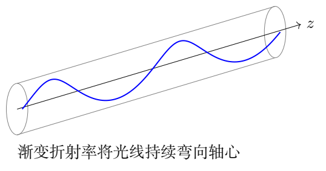

## 一、题型定位

折射率连续变化，光线方向也沿传播路径连续改变。沿 $z$ 平移和绕轴旋转的对称性给出两个不变量，能将径向问题化为一维转折点方程。

给定折射率的平方恰好是 $\rho^2$ 的线性函数，因此直角坐标中的光线方程最终成为同频谐振方程。求最大半径既可以从径向首次积分选根，也可以从横截面椭圆的长半轴计算。

## 二、知识点

- 光线切矢量、弧长与柱坐标几何。
- 费马原理、欧拉方程及循环坐标。
- 平移、旋转对称性对应的不变量。
- 径向转折点、二次方程的根筛选。
- 直角坐标谐振解、初始位置与斜率匹配。
- 横截面椭圆、轴心不可达与角度连续性。
- 精确给定模型与近轴近似的区别。

## 三、物理图像

折射率在轴心最大，向外降低，光线偏折趋势指向折射率较高的轴心。同时光线可以具有绕轴的切向传播分量，因此未必穿过轴线，而可能在两个非零半径之间往复。

初始 $\rho'>0$ 表示起初向外，初始 $\theta'>0$ 表示绕轴方向已确定。横截面投影不是一般意义上的圆：径向斜率与绕轴斜率不同，会产生椭圆；轴向传播使这一椭圆投影变为空间曲线。

## 四、解题入口

定义沿 $z$ 参数化的弧长因子
$$
w=\frac{ds}{dz}=\sqrt{1+\rho'^2+\rho^2\theta'^2}.
$$
光程泛函为 $\int n(\rho)w\,dz$。从费马原理先得到
$n/w=\beta$ 与 $\rho^2\theta'=\ell$ 两个常数，其中
$$
\beta=n_0\sqrt{\frac{1-\alpha^2\rho_0^2}
{1+k_1^2+\rho_0^2k_2^2}},\qquad
\ell=\rho_0^2k_2.
$$
最大半径满足 $\rho'=0$。直角坐标路线则直接用同一常量
$\beta$，避免在转折点除以 $\rho'$ 造成不必要的歧义。

## 五、解析

（1）弧长及费马原理的拉氏函数。

光线位置矢量为
$$
\mathbf r(z)=\rho\cos\theta\,\mathbf e_x+
\rho\sin\theta\,\mathbf e_y+z\,\mathbf e_z.
$$
求导：
$$
\mathbf r'=(\rho'\cos\theta-\rho\theta'\sin\theta)\mathbf e_x
+(\rho'\sin\theta+\rho\theta'\cos\theta)\mathbf e_y+\mathbf e_z.
$$
平方后交叉项抵消，得到
$$
|\mathbf r'|^2=1+\rho'^2+\rho^2\theta'^2.
$$
因此光程的拉氏函数是
$$
L=n(\rho)\sqrt{1+\rho'^2+\rho^2\theta'^2}=nw.
$$
不需要先假设 $\rho',\rho\theta'$ 很小；以下计算对题给
$n(\rho)$ 的几何光学模型保留完整弧长。

（2）从旋转对称性求角向不变量。

$L$ 不显含 $\theta$，欧拉方程给
$$
\frac{d}{dz}\frac{\partial L}{\partial\theta'}=0,
\qquad
\frac{\partial L}{\partial\theta'}
=\frac{n\rho^2\theta'}w.
$$
所以
$$
\frac{n\rho^2\theta'}w=J_{\rm opt}=\text{常数}.\tag{7.1}
$$
这里的常量是光线变分问题中的广义动量，不是物体的机械角动量，但对应同样的旋转对称性。

（3）从轴向平移对称性求另一不变量。

$L$ 不显含 $z$，故
$$
\rho'\frac{\partial L}{\partial\rho'}
+\theta'\frac{\partial L}{\partial\theta'}-L
=\text{常数}.
$$
左边为
$$
\frac{n(\rho'^2+\rho^2\theta'^2)}w-nw
=-\frac nw.
$$
于是可以取正常数
$$
\boxed{\frac{n(\rho)}{\sqrt{1+\rho'^2+\rho^2\theta'^2}}
=\beta>0.}\tag{7.2}
$$
把式（7.1）除以 $\beta$：
$$
\boxed{\rho^2\theta'=\ell=\text{常数}.}\tag{7.3}
$$
这也等价于
$$
\rho\theta''+2\rho'\theta'=0
$$
（$\rho>0$）。它说明半径较小时角向斜率较大，但并不代表光速改变为该角向斜率。

（4）写出径向完整微分方程。

径向欧拉方程
$$
\frac{d}{dz}\left(\frac{n\rho'}w\right)
=n_\rho w+\frac{n\rho\theta'^2}{w}.
$$
用 $n/w=\beta$ 为常数，得
$$
\beta\rho''=n_\rho w+\beta\rho\theta'^2.
$$
又
$$
\frac{n_\rho}{n}
=-\frac{\alpha^2\rho}{1-\alpha^2\rho^2},
$$
所以第（1）问可写为两条局部方程：
$$
\boxed{
\begin{aligned}
\rho''-\rho\theta'^2
&=-\frac{\alpha^2\rho}{1-\alpha^2\rho^2}
(1+\rho'^2+\rho^2\theta'^2),\\
\rho\theta''+2\rho'\theta'&=0.
\end{aligned}}\tag{7.4}
$$
也可用角向方程与式（7.2）的常量关系作为等价的首次积分形式。第一式右端径向力总指向轴心，左端保留柱坐标中的几何项。

（5）由初始条件确定所有常量。

记
$$
D_0=1+k_1^2+\rho_0^2k_2^2,\qquad
q_0=1-\alpha^2\rho_0^2.
$$
为使给定折射率为实且非零，初始点需 $q_0>0$。初始条件直接给
$$
\boxed{\beta=n_0\sqrt{\frac{q_0}{D_0}},
\qquad \ell=\rho_0^2k_2.}\tag{7.5}
$$
定义
$$
\kappa=\frac{n_0\alpha}{\beta}
=\alpha\sqrt{\frac{D_0}{q_0}},
\qquad
A=\frac{n_0^2}{\beta^2}-1.
$$
$\kappa$ 的单位为长度的倒数，$A$ 无量纲，$\ell$ 的单位为长度。注意原题 $k_1=\rho'$ 无量纲，而 $k_2=\theta'$ 的单位为长度的倒数；二者不能直接相加。

（6）径向首次积分与转折半径。

式（7.2）平方后代入 $n^2=n_0^2(1-\alpha^2\rho^2)$：
$$
1+\rho'^2+\rho^2\theta'^2
=\frac{n_0^2}{\beta^2}(1-\alpha^2\rho^2).
$$
使用 $\theta'=\ell/\rho^2$，得到
$$
\boxed{\rho'^2=A-\kappa^2\rho^2-\frac{\ell^2}{\rho^2}.}\tag{7.6}
$$
在径向转折点 $\rho'=0$，令 $u=\rho^2$：
$$
\kappa^2u^2-Au+\ell^2=0.
$$
两根
$$
u_\pm=\frac{A\pm\sqrt{A^2-4\kappa^2\ell^2}}{2\kappa^2}.
$$
由于初始 $k_1>0$，初始半径位于两转折点之间、首先向外到达较大根。因此
$$
\boxed{\rho_{\max}=
\sqrt{\frac{A+\sqrt{A^2-4\kappa^2\ell^2}}
{2\kappa^2}}.}\tag{7.7}
$$
相应最小半径为 $\rho_{\min}=\sqrt{u_-}$。对于通常的
$\rho_0>0,k_2>0$，$\ell>0$，故 $u_->0$，光线不穿过轴心。

若不引入 $A,\kappa$，结果也可写为
$$
\rho_{\max}^2=
\frac{n_0^2-\beta^2+
\sqrt{(n_0^2-\beta^2)^2-4n_0^2\alpha^2\beta^2\ell^2}}
{2n_0^2\alpha^2}.
$$
保留平方根外的再开方很重要，二次方程求得的是半径平方。

（7）转折点实数性与折射率范围。

由初始式（7.6）
$$
A=k_1^2+\kappa^2\rho_0^2+\frac{\ell^2}{\rho_0^2}
>2\kappa\ell
$$
（$\rho_0>0$）。最后一步使用正量的算术—几何平均不等式，而 $k_1^2>0$ 保证严格不等。因此判别式严格为正，两转折半径不同。

同时式（7.2）要求
$n^2=\beta^2(1+\rho'^2+\ell^2/\rho^2)\ge\beta^2>0$，所以
$$
\alpha^2\rho^2\le1-\frac{\beta^2}{n_0^2}<1.
$$
轨迹始终位于给定实折射率区域。题设光纤侧面不可达，还需实际截面半径大于 $\rho_{\max}$；“转折点存在”与“没有碰到侧面”是两项不同的几何条件。

（8）直角坐标中直接推导谐振方程。

换成 $x,y$，
$$
L=n(x,y)\sqrt{1+x'^2+y'^2},
\qquad n^2=n_0^2[1-\alpha^2(x^2+y^2)].
$$
仍有 $n/\sqrt{1+x'^2+y'^2}=\beta$。欧拉方程为
$$
\frac{d}{dz}(\beta x')=n_x\sqrt{1+x'^2+y'^2}.
$$
因为
$$
n_x=-\frac{n_0^2\alpha^2x}{n},\qquad
\sqrt{1+x'^2+y'^2}=\frac n\beta,
$$
所以
$$
\beta x''=-\frac{n_0^2\alpha^2}{\beta}x.
$$
同理对 $y$，得到
$$
\boxed{x''+\kappa^2x=0,\qquad
y''+\kappa^2y=0.}\tag{7.8}
$$
此推导没有除以 $\rho'$ 或 $x$，因此在径向转折点、坐标过零时都可连续使用。它也说明谐振不是将 $n$ 草率当作常数的结果，而来自题给 $n^2$ 的特殊二次形式。

（9）匹配初始位置和斜率。

由 $\theta(0)=0$：
$$
x(0)=\rho_0,\qquad y(0)=0.
$$
柱坐标求导给
$$
x'=\rho'\cos\theta-\rho\theta'\sin\theta,\qquad
y'=\rho'\sin\theta+\rho\theta'\cos\theta.
$$
初始斜率为
$$
x'(0)=k_1,\qquad y'(0)=\rho_0k_2.
$$
分别匹配谐振解的余弦、正弦系数：
$$
\boxed{x(z)=\rho_0\cos(\kappa z)
+\frac{k_1}{\kappa}\sin(\kappa z),}\tag{7.9}
$$
$$
\boxed{y(z)=\frac{\rho_0k_2}{\kappa}\sin(\kappa z),\qquad
\kappa=\alpha\sqrt{\frac{1+k_1^2+\rho_0^2k_2^2}
{1-\alpha^2\rho_0^2}}.}\tag{7.10}
$$
位置及两条初始斜率全部满足。$n_0$ 消去，说明在同样初始几何条件下，将整个折射率曲线乘一个常数不改变光线空间轨迹，只会改变传播时间。

（10）用横截面椭圆复求最大半径。

设 $B=k_1/\kappa$，$C=\rho_0k_2/\kappa$，$u=\kappa z$。轨迹可写成
$$
\begin{pmatrix}x\\y\end{pmatrix}
=
\begin{pmatrix}\rho_0&B\\0&C\end{pmatrix}
\begin{pmatrix}\cos u\\\sin u\end{pmatrix}.
$$
当 $u$ 变化时，单位圆在线性变换下成为中心在轴心的椭圆。半径平方为
$$
\rho^2=\rho_0^2\cos^2u+2\rho_0B\sin u\cos u
+(B^2+C^2)\sin^2u.
$$
最大、最小值是对称矩阵
$$
G=
\begin{pmatrix}
\rho_0^2&\rho_0B\\
\rho_0B&B^2+C^2
\end{pmatrix}
$$
的两个特征值。因而
$$
\boxed{\rho_{\max}^2=
\frac{\rho_0^2+B^2+C^2+
\sqrt{(\rho_0^2-B^2-C^2)^2+4\rho_0^2B^2}}2.}\tag{7.11}
$$
$\operatorname{tr}G=A/\kappa^2$，
$\det G=\ell^2/\kappa^2$，代回特征值公式，正好恢复式（7.7）。两种路线一个从径向守恒量出发，一个从完整轨迹的椭圆几何出发。

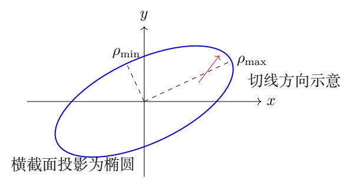

（11）角度连续性、周期与螺旋特征。

若需要恢复柱坐标角，
$$
\theta(z)=\operatorname{atan2}(y(z),x(z))
$$
并沿轨迹连续展开角度。不能只用 $\arctan(y/x)$，否则在跨象限时丢失 $\pi$ 的变化。因为
$$
xy'-yx'=\rho_0C\kappa=\rho_0^2k_2=\ell>0,
$$
角度始终正向增加。径向距离则在 $\rho_{\min},\rho_{\max}$ 之间变化。

$x,y$ 的完整重复周期为 $2\pi/\kappa$；半径平方周期为
$\pi/\kappa$，因为横截面半周后坐标整体变号而半径相同。一般空间轨迹不是等半径的圆螺旋，只有特殊初始斜率才产生圆形横截面投影。

若 $\rho_0=0$，柱坐标角在轴心没有通常的唯一意义，应从式（7.9）、（7.10）的直角坐标极限处理。此时 $y=0$，光线可穿越轴线，不能继续使用 $\ell>0$ 的不穿轴论证。

（12）近轴极限与均匀介质极限。

当 $\alpha\rho_0\ll1$ 且
$k_1^2+\rho_0^2k_2^2\ll1$，
$$
\kappa\simeq\alpha.
$$
于是近轴轨迹周期近似为 $2\pi/\alpha$，对初始斜率的依赖仅在更高阶。这是额外近轴近似的结果，不能在一般初始条件下把精确的 $\kappa$ 无条件替换为 $\alpha$。

若 $\alpha\to0$，折射率趋于均匀，利用
$\sin(\kappa z)/\kappa\to z$：
$$
x\to\rho_0+k_1z,\qquad y\to\rho_0k_2z.
$$
恢复直线传播。此时有初始横向斜率的光线没有有限的径向回转尺度，不能把式（7.7）在 $\kappa=0$ 处直接代入并宣称仍有有限最大半径。

（13）从同一轨迹求轴向周期的传播时间。

光在局部介质的速度为 $c/n$，故
$$
\frac{dt}{dz}=\frac nc\frac{ds}{dz}
=\frac{n^2}{\beta c}
=\frac{n_0^2}{\beta c}(1-\alpha^2\rho^2).
$$
一个轴向轨迹周期 $Z_{\rm per}=2\pi/\kappa$ 内，
$$
\langle\rho^2\rangle_z=
\frac12(\rho_0^2+B^2+C^2)=\frac{A}{2\kappa^2}.
$$
于是平均时间梯度为
$$
\boxed{\frac{\Delta t}{Z_{\rm per}}
=\frac{n_0^2+\beta^2}{2\beta c}.}\tag{7.12}
$$
这是给定几何光学模型下的补充结果。它说明空间轨迹的 $n_0$ 消去，不代表传播时间也与 $n_0$ 无关。对轨迹重复周期求平均时，积分变量是轴向坐标 $z$，不能误把它当实际弧长。

（14）将一组初始条件同时代入两种最大半径算法。

为便于核对，选任意长度单位 $L$，取
$$
\alpha=0.6/L,\quad \rho_0=0.35L,\quad
k_1=0.18,\quad k_2=0.7/L.
$$
径向斜率 $k_1=d\rho/dz$ 无量纲，角斜率 $k_2=d\theta/dz$ 的单位是长度的倒数。混淆它们的单位，会在 $\rho_0^2k_2^2$ 处立即出现量纲错误。

初始条件给
$$
q_0=1-\alpha^2\rho_0^2=0.9559,
\qquad D_0=1+k_1^2+\rho_0^2k_2^2=1.092425.
$$
于是
$$
\kappa=\alpha\sqrt{D_0/q_0}=0.641418/L,
\qquad B=0.280628L,\quad C=0.381966L.
$$
轨迹为
$$
\begin{aligned}
x/L&=0.35\cos(0.641418z/L)
+0.280628\sin(0.641418z/L),\\
y/L&=0.381966\sin(0.641418z/L).
\end{aligned}
$$
在 $z=0$ 直接求值和求导，恢复 $x=0.35L$、$y=0$、$x'=0.18$、$y'=0.245$。由 $\theta'=(xy'-yx')/\rho^2$ 再恢复 $k_2=0.7/L$，这同时检查了从柱坐标到直角坐标的初始条件转换。

第一种算法，把 $A=D_0/q_0-1$、$\ell=\rho_0^2k_2$ 代入径向转折点二次方程。第二种算法，对
$$
G=\begin{pmatrix}
\rho_0^2&\rho_0B\\
\rho_0B&B^2+C^2
\end{pmatrix}
$$
求两个特征值。两种算法均给
$$
\rho_{\min}=0.250737L,\qquad
\boxed{\rho_{\max}=0.533181L.}
$$
这两个数分别是椭圆的短、长半轴，不能把 $\max\{|x|,|y|\}$ 当作最大离轴距离。长轴一般不沿 $x$ 或 $y$ 轴，因为矩阵存在非零的混合项 $\rho_0B$。

模型有效范围也能直接检查：
$$
\alpha\rho_{\max}\approx0.319908<1.
$$
因此整个轨迹的折射率为实数。若实际光纤半径小于 $\rho_{\max}$，轨迹会遇到侧面，题设的无侧面作用模型便不能描述完整传播；这里的最大半径公式自身没有包含边界反射。

轴向坐标的完整轨迹周期为 $9.79578L$，径向周期为其一半。这个例子的 $n_0$ 尚未指定，但空间轨迹已经完全确定；给出 $n_0$ 后才可进一步计算传播时间。保留精确 $\kappa$ 得到的周期比近轴估计 $2\pi/\alpha$ 小，反映了有限初始斜率与离轴位置的修正。

## 六、关键洞察

旋转和平移对称性给出了角向与轴向不变量；这两项常量足以预测径向转折。特别的折射率平方形式进一步使横向直角坐标各自满足谐振方程。

把柱坐标守恒量与直角坐标椭圆对照，既能筛选最大半径的根，也能解释为什么一般光线不穿轴、半径周期比横向轨迹周期短一半。

## 七、易错点

- 弧长漏掉 $\rho^2\theta'^2$。
- 将折射率梯度视为突变界面，反复使用固定侧面反射。
- 未说明近轴条件就令 $ds/dz=1$。
- 把二次方程的 $\rho^2$ 根当成 $\rho$。
- 最大半径误取较小根。
- 以 $k_2$ 而非 $\rho_0k_2$ 作为初始 $y'$。
- 在转折点除以 $\rho'$，再把单点零值误判为整条轨迹分支。
- 使用单值 $\arctan(y/x)$ 导致跨象限角度不连续。
- 将一般椭圆投影当作等半径圆螺旋。

## 八、课堂讲解建议

先由弧长建立费马泛函，再从“没有显含 $\theta,z$”读出两个守恒量。径向方程要画出两个转折半径并解释根的选择。随后用直角坐标重新推导，不依靠对径向式作可能奇异的除法。

让学生逐项核对四个初始条件，并将 $\rho^2$ 写成二次型；长、短半轴与转折半径的等价可作为完整复核。最后讨论均匀介质极限，检查谐振轨迹如何连续变成直线。

## 九、变式训练

### 变式1　没有初始绕轴斜率

令 $k_2=0$，保持 $\rho_0>0,k_1>0$，求轨迹和最大半径。

**解答。** $\ell=0$，$\kappa=\alpha\sqrt{(1+k_1^2)/(1-\alpha^2\rho_0^2)}$。
初始 $y=y'=0$，故 $y$ 恒为零，
$$
x=\rho_0\cos\kappa z+\frac{k_1}{\kappa}\sin\kappa z.
$$
所以
$$
\boxed{\rho_{\max}=\sqrt{\rho_0^2+(k_1/\kappa)^2}.}
$$
光线可以穿过轴心，径向柱坐标为 $|x|$，过轴时角度需改变。原题 $\ell>0$ 的离心屏障在此消失。

### 变式2　寻找等半径圆螺旋

放宽原题 $k_1>0$，令 $k_1=0$，要求 $\rho(z)=\rho_0$ 恒定。求 $k_2$。

**解答。** 圆形投影要求 $x=\rho_0\cos\kappa z$、
$y=\rho_0\sin\kappa z$，即 $k_2=\kappa$。代入
$$
\kappa^2=\alpha^2\frac{1+\rho_0^2k_2^2}
{1-\alpha^2\rho_0^2},
$$
得到
$$
\boxed{k_2^2=\frac{\alpha^2}{1-2\alpha^2\rho_0^2}.}
$$
需 $\alpha\rho_0<1/\sqrt2$。这比折射率仅为实数的
$\alpha\rho_0<1$ 更严格，说明并非每个允许半径都能支持该等半径轨迹。

### 变式3　改变整体折射率标度

保持 $\alpha,\rho_0,k_1,k_2$ 不变，将 $n_0$ 加倍。问轨迹、最大半径、同一轴向段传播时间如何变化。

**解答。** $\beta$ 随 $n_0$ 加倍，故
$\kappa=n_0\alpha/\beta$ 不变。$\ell$ 不变，
$A=n_0^2/\beta^2-1$ 不变，因此 $x,y,\rho_{\max}$ 均不变。

但 $dt/dz=n^2/(\beta c)$ 中 $n^2$ 增为4倍、$\beta$ 增为2倍，所以传播时间加倍。几何轨迹由相对梯度决定，传播速度仍取决于绝对折射率。

### 变式4　用已知横向轨迹验证两个不变量

给出 $x=A_1\cos\kappa z+B_1\sin\kappa z$、
$y=A_2\cos\kappa z+B_2\sin\kappa z$。证明
$xy'-yx'$ 为常数，并求其值。

**解答。** 分别求导并代入，$\sin^2+\cos^2=1$，交叉项抵消：
$$
\boxed{xy'-yx'=\kappa(A_1B_2-A_2B_1).}
$$
它是横截面线性变换的行列式乘 $\kappa$，也是
$\rho^2\theta'$。若行列式非零，投影椭圆不退化且方向固定；若为零，轨迹投影退化为过轴直线。第二个不变量还需检验
$n^2=\beta^2(1+x'^2+y'^2)$，不能只凭常数面积率就断言任何谐振轨迹适合任意折射率。
