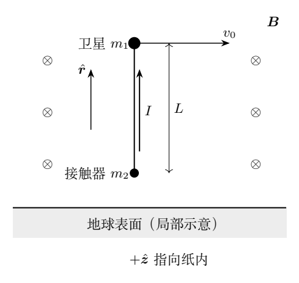
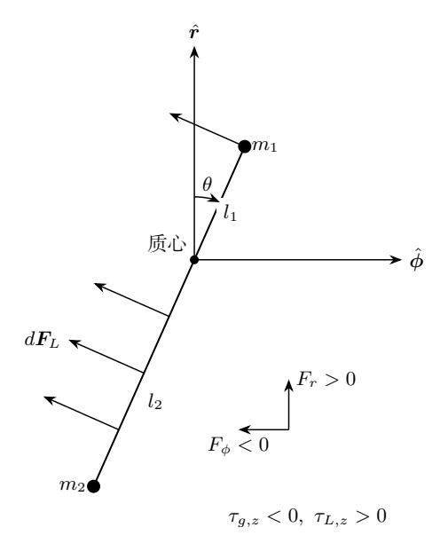

# 第 4 题　电动力绳索的发电、轨道下降与姿态平衡

质量 $m_1=450\,\mathrm{kg}$ 的卫星在地球赤道上空沿圆轨道飞行，初始离地高度 $h_0=400\,\mathrm{km}$。卫星悬挂均匀、轻质、长直的刚性导电绳索，绳索在轨道平面内，长度 $L=5.00\,\mathrm{km}$，总电阻 $R_{\rm t}=200\,\Omega$，外包轻质绝缘材料。下端接有质量 $m_2=50.0\,\mathrm{kg}$ 的等离子体接触器。卫星与接触器可和电离层交换电子；闭合连接处的轻质开关后，绳索与等离子体构成闭合回路。其余部分的电阻和感抗忽略。

当地磁场视为均匀，大小 $B=3.00\times10^{-5}\,\mathrm T$，垂直于轨道平面。图4-1中磁场指向纸内、飞行方向向右。忽略等离子体及大气阻力。取 $G=6.67\times10^{-11}\,\mathrm{N\,m^2/kg^2}$、$M_{\rm E}=5.97\times10^{24}\,\mathrm{kg}$、$R_{\rm E}=6.37\times10^6\,\mathrm m$。$r_0=R_{\rm E}+h_0$，且 $L/r_0\ll1$。把卫星、绳索和接触器视为一个系统。

（1）绳索各处速度均取卫星速度。

（1.1）求开关断开时圆轨道速度 $v_0$ 与角速度 $\Omega_0$。

（1.2）绳索恰好沿径向时闭合开关，求感应电流 $I$ 与电功率 $P$。

（1.3）假设每圈高度变化远小于轨道半径，求刚闭合时 $dh/dt$，并用初始变化率与初始周期估算一圈后的 $\Delta h$。

（2）绳索在轨道平面内相对径向向飞行方向偏转 $\theta$，$0\le\theta<90^\circ$，接触器仍比卫星更靠近地心。原题指定在“随轨道转动的参考系（随系统质心作轨道运动，但不相对地心参考系转动）”中讨论。

（2.1）开关未闭合时，准确到 $L/r_0$ 一阶，求两端各自所受重力与离心力的合力，验证合力之和近似为零；证明小偏角时在 $\theta=0$ 附近简谐摆动，求 $\omega_1$。

（2.2）闭合开关后，仍取轨道半径 $r_0$，求绳索洛伦兹力的切向分量 $F_\phi(\theta)$ 与径向分量 $F_r(\theta)$，径向以向外为正。

（2.3）求洛伦兹力对系统质心的力矩、新平衡偏角 $\theta_{\rm eq}$、稳定性及其附近的小摆动角频率 $\omega_2$。本题50分。

## 一、题型定位

本题需要同时分析动生电动势、轨道能量变化和重力梯度引起的姿态运动。电功率来自轨道机械能的下降；绳索中的电流同时产生沿轨道的制动力和相对质心的姿态力矩。

姿态部分必须先说明参考系。题面中“随轨道转动”与括号内“不相对地心参考系转动”的描述相互冲突。随质心平动而不转动的参考系，和随径向、切向基矢旋转的参考系，具有不同的惯性力。下文分别给出这两种解释，并列出参考解答采用的旋转参考系结果。

## 二、知识点

- 圆轨道条件为 $v_0^2/r_0=GM_{\rm E}/r_0^2$。
- 动生电动势为 $\mathcal E=\int(\boldsymbol v\times\boldsymbol B)\cdot d\boldsymbol l$。
- 圆轨道总机械能为 $-GM_{\rm E}M/(2r)$，不是只考虑动能。
- 质心两端距离由 $m_1l_1=m_2l_2$ 和 $l_1+l_2=L$ 决定。
- 中心引力的一阶空间变化有法向和切向分量；参考系旋转还引入离心、科里奥利惯性力。
- 均匀线力的合力作用点在绳索几何中点，通常不在系统质心。
- 新平衡附近的频率由总力矩对偏角的一阶导数确定。

## 三、物理图像

定义 $M=m_1+m_2$，取 $\hat{\boldsymbol r}$ 沿径向向外，$\hat{\boldsymbol\phi}$ 沿飞行方向，并令

$$
\hat{\boldsymbol z}=\hat{\boldsymbol r}\times\hat{\boldsymbol\phi}.
$$

按图4-1，$+\hat{\boldsymbol z}$ 指向纸内，$\boldsymbol B=B\hat{\boldsymbol z}$。从接触器指向卫星的绳索单位向量为

$$
\boldsymbol n=\cos\theta\,\hat{\boldsymbol r}+\sin\theta\,\hat{\boldsymbol\phi}.
$$

$\theta$ 增大对应绕 $+\hat{\boldsymbol z}$ 转动。绳索坐标 $s$ 从质心计量，卫星在 $s=l_1$，接触器在 $s=-l_2$。

在这种一致的方向约定下，$\boldsymbol v\times\boldsymbol B$ 径向向外，常规电流沿 $\boldsymbol n$ 流向卫星，而安培力的切向分量沿飞行反方向。这也可以通过功率必须取自轨道机械能来复核。

## 四、解题入口

第（1）问先求速度和周期，再计算电路功率，最后由总轨道能量微分得到下降率。第（2）问先求质心位置，再展开引力场。将各力对质心作矩；均匀线磁力要对 $s$ 积分，不能把它的合力放在质心上。

以 $\Omega_0$ 固定、轨道缓慢下降和绳索各处平动速度相同为本题近似。姿态旋转自身产生的额外动生电动势不在题设速度近似内。

## 五、解析

（1.1）圆轨道速度与角速度。

初始半径为 $r_0=6.77\times10^6\,\mathrm m$。由

$$
\frac{GM_{\rm E}M}{r_0^2}=\frac{Mv_0^2}{r_0},
$$

得

$$
v_0=\sqrt{\frac{GM_{\rm E}}{r_0}}
\simeq7.67\times10^3\,\mathrm{m/s},\qquad
\Omega_0=\frac{v_0}{r_0}
\simeq1.13\times10^{-3}\,\mathrm{s^{-1}}.
$$

周期为 $T_0=2\pi/\Omega_0\simeq5.55\times10^3\,\mathrm s$。

（1.2）电流与功率。

径向绳索与 $\boldsymbol v\times\boldsymbol B$ 平行，电动势大小为

$$
\mathcal E_0=BLv_0\simeq1.15\times10^3\,\mathrm V.
$$

所以

$$
\boxed{I_0=\frac{BLv_0}{R_{\rm t}}\simeq5.75\,\mathrm A,}
\qquad
\boxed{P_0=\frac{B^2L^2v_0^2}{R_{\rm t}}\simeq6.62\,\mathrm{kW}.}
$$

此处给出的是整个电阻 $R_{\rm t}$ 上的电功率；若其中一部分为负载，另一部分是线阻，实际可供负载使用的功率还要按电阻分配。

（1.3）从圆轨道总能量求下降率。

在半径为 $r$ 的近圆轨道上，动能为 $GM_{\rm E}M/(2r)$，引力势能为 $-GM_{\rm E}M/r$。相加得

$$
E_{\rm orb}=-\frac{GM_{\rm E}M}{2r}.
$$

电路消耗的能量来自轨道，故

$$
\dot E_{\rm orb}=-P,\qquad
\dot E_{\rm orb}=\frac{GM_{\rm E}M}{2r^2}\dot r.
$$

由于 $r=R_{\rm E}+h$，$\dot r=\dot h$。初始下降率为

$$
\boxed{\dot h_0=-\frac{2P_0r_0^2}{GM_{\rm E}M}
\simeq-3.05\,\mathrm{m/s}.}
$$

按题目要求用初始变化率估算一圈：

$$
\boxed{\Delta h\simeq\dot h_0T_0\simeq-1.69\times10^4\,\mathrm m
=-16.9\,\mathrm{km}.}
$$

其大小与 $r_0$ 之比约为 $2.49\times10^{-3}$，符合每圈变化远小于半径的假设。高度下降时近圆轨道速度反而增加；只把电功率等同于动能减少会给出错误方向。

（2.1）质心距离与两个参考系的合力。

由质心定义，

$$
l_1=\frac{m_2}{M}L=500\,\mathrm m,\qquad
l_2=\frac{m_1}{M}L=4500\,\mathrm m,
$$

绕质心的转动惯量为

$$
J=m_1l_1^2+m_2l_2^2=\frac{m_1m_2}{M}L^2.
\tag{4.1}
$$

先严格采用题干文字指定的随质心平动、不旋转参考系。其原点加速度为 $-\Omega_0^2r_0\hat{\boldsymbol r}$，故质量为 $m_i$ 的物体受到均匀平动惯性力 $+m_i\Omega_0^2r_0\hat{\boldsymbol r}$。

对相对质心位移 $\boldsymbol s=X\hat{\boldsymbol r}+Y\hat{\boldsymbol\phi}$，引力加速度作一阶展开：

$$
\boldsymbol g(r_0\hat{\boldsymbol r}+\boldsymbol s)
=-\Omega_0^2r_0\hat{\boldsymbol r}
+\Omega_0^2(2X\hat{\boldsymbol r}-Y\hat{\boldsymbol\phi})
+O\!\left(\Omega_0^2L^2/r_0\right).
$$

加上平动惯性力，得到此参考系的有效合力

$$
\boldsymbol F^{\rm tr}
=m_i\Omega_0^2(2X\hat{\boldsymbol r}-Y\hat{\boldsymbol\phi}).
$$

两端分别为

$$
\boxed{\boldsymbol F_1^{\rm tr}
=m_1\Omega_0^2l_1(2\cos\theta\,\hat{\boldsymbol r}
-\sin\theta\,\hat{\boldsymbol\phi}),}
$$

$$
\boxed{\boldsymbol F_2^{\rm tr}
=-m_2\Omega_0^2l_2(2\cos\theta\,\hat{\boldsymbol r}
-\sin\theta\,\hat{\boldsymbol\phi}).}
\tag{4.2}
$$

由 $m_1l_1=m_2l_2$，合力之和在一阶为零。

若改用随 $\hat{\boldsymbol r},\hat{\boldsymbol\phi}$ 一起以 $\Omega_0$ 转动的参考系，还要加离心增量 $m_i\Omega_0^2\boldsymbol s$。重力与离心力之和成为

$$
\boldsymbol F_1^{\rm rot}=3m_1\Omega_0^2l_1\cos\theta\,\hat{\boldsymbol r},
\qquad
\boldsymbol F_2^{\rm rot}=-3m_2\Omega_0^2l_2\cos\theta\,\hat{\boldsymbol r}.
\tag{4.3}
$$

这正是参考解答采用的表达式，属于旋转参考系。相对运动的科里奥利力沿绳索，对质心的姿态力矩为零；式（4.3）用于力矩时仍有效，但它与式（4.2）不是同一个参考系中的力。

（2.1续）求重力梯度力矩与 $\omega_1$。

在平动参考系中，均匀惯性力对质心总矩为零。把式（4.2）代入

$$
\boldsymbol\tau_g=l_1\boldsymbol n\times\boldsymbol F_1^{\rm tr}
-l_2\boldsymbol n\times\boldsymbol F_2^{\rm tr},
$$

利用

$$
\boldsymbol n\times(2\cos\theta\,\hat{\boldsymbol r}
-\sin\theta\,\hat{\boldsymbol\phi})
=-3\sin\theta\cos\theta\,\hat{\boldsymbol z},
$$

得到

$$
\boldsymbol\tau_g=-3J\Omega_0^2\sin\theta\cos\theta\,\hat{\boldsymbol z}.
\tag{4.4}
$$

在旋转参考系中，新增离心力沿各端位置矢量，不产生力矩，所以式（4.3）给出同样的式（4.4）。绝对姿态角是 $\Omega_0t+\theta$；$\Omega_0$ 固定时，其二阶导数等于 $\ddot\theta$。因此

$$
\ddot\theta=-3\Omega_0^2\sin\theta\cos\theta.
$$

小偏角下 $\sin\theta\cos\theta\simeq\theta$，故

$$
\boxed{\omega_1=\sqrt3\,\Omega_0.}
$$

（2.2）倾斜绳索中的电动势、电流与合力。

用上述方向约定，

$$
\boldsymbol v\times\boldsymbol B=v_0B\hat{\boldsymbol r},
\qquad
d\boldsymbol l=\boldsymbol n\,ds.
$$

从接触器到卫星积分得

$$
\mathcal E(\theta)=BLv_0\cos\theta,\qquad
I(\theta)=\frac{BLv_0}{R_{\rm t}}\cos\theta.
$$

电流沿 $+\boldsymbol n$。由于

$$
\boldsymbol n\times\hat{\boldsymbol z}
=\sin\theta\,\hat{\boldsymbol r}-\cos\theta\,\hat{\boldsymbol\phi},
$$

磁力为

$$
\boldsymbol F_L=IBL
(\sin\theta\,\hat{\boldsymbol r}-\cos\theta\,\hat{\boldsymbol\phi}).
$$

令 $K=B^2L^2v_0/R_{\rm t}$，则

$$
\boxed{F_\phi=-K\cos^2\theta,\qquad
F_r=K\sin\theta\cos\theta.}
\tag{4.5}
$$

切向力始终制动。其机械功率 $F_\phi v_0=-K v_0\cos^2\theta$ 恰好等于 $-I^2R_{\rm t}$，检验了电流与力的方向。

（2.3）积分计算磁力矩。

单位长度受力 $\boldsymbol f_L=IB(\boldsymbol n\times\hat{\boldsymbol z})$。在位置 $s\boldsymbol n$ 上，微小力矩为

$$
d\boldsymbol\tau_L=s\boldsymbol n\times\boldsymbol f_L\,ds
=-sIB\,ds\,\hat{\boldsymbol z}.
$$

积分上下限不对称，因两端质量不同：

$$
\boldsymbol\tau_L
=-\frac{IB}{2}(l_1^2-l_2^2)\hat{\boldsymbol z}
=\frac{v_0B^2L^3(m_1-m_2)}{2MR_{\rm t}}
\cos\theta\,\hat{\boldsymbol z}.
\tag{4.6}
$$

定义

$$
\chi=\frac{v_0B^2L(m_1-m_2)}{2R_{\rm t}m_1m_2},
$$

则 $\tau_{L,z}=J\chi\cos\theta$。姿态方程为

$$
\ddot\theta=\cos\theta(\chi-3\Omega_0^2\sin\theta).
\tag{4.7}
$$

因要求 $0\le\theta<\pi/2$，$\cos\theta>0$，可除去它，得到

$$
\sin\theta_{\rm eq}=\frac{\chi}{3\Omega_0^2}
=\frac{r_0B^2L}{6MR_{\rm t}\Omega_0}
\left(\frac{m_1}{m_2}-\frac{m_2}{m_1}\right).
$$

代入参数，该比值约为 $0.398$，故

$$
\boxed{\theta_{\rm eq}\simeq23.5^\circ.}
$$

若该比值大于等于1，则在题设开区间内不存在这样的平衡；不能对超出定义域的量强行取反正弦。

令 $\theta=\theta_{\rm eq}+\epsilon$。对式（4.7）右侧求导：

$$
\frac{d}{d\theta}
[\cos\theta(\chi-3\Omega_0^2\sin\theta)]_{\theta_{\rm eq}}
=-3\Omega_0^2\cos^2\theta_{\rm eq}.
$$

于是

$$
\ddot\epsilon=-3\Omega_0^2\cos^2\theta_{\rm eq}\epsilon.
$$

系数为负，偏离后受到恢复作用，平衡稳定。角频率为

$$
\boxed{\omega_2=\sqrt3\,\Omega_0\cos\theta_{\rm eq}
\simeq1.80\times10^{-3}\,\mathrm{s^{-1}}.}
$$

（2.4）从引力场的导数明确系数2与系数3的来源。

令 $\mu_{\rm E}=GM_{\rm E}$，地心位置矢量为 $\boldsymbol R$，引力加速度为

$$
\boldsymbol g(\boldsymbol R)=-\mu_{\rm E}\frac{\boldsymbol R}{R^3}.
$$

将分量对位置求导，用 $\partial R/\partial R_j=R_j/R$，有

$$
\frac{\partial g_i}{\partial R_j}
=-\mu_{\rm E}\left(\frac{\delta_{ij}}{R^3}
-\frac{3R_iR_j}{R^5}\right).
$$

在 $\boldsymbol R_0=r_0\hat{\boldsymbol r}$ 处，$\mu_{\rm E}/r_0^3=\Omega_0^2$，所以一阶增量为

$$
\delta\boldsymbol g
=\Omega_0^2\big[3(\hat{\boldsymbol r}\cdot\boldsymbol s)
\hat{\boldsymbol r}-\boldsymbol s\big]
=\Omega_0^2(2X\hat{\boldsymbol r}-Y\hat{\boldsymbol\phi}).
$$

径向位置变化同时改变引力的大小与方向，沿径向得到系数2；纯切向位移在一阶不改变距离，却改变引力方向，因此产生 $-Y$ 项。只对标量 $GM/r^2$ 求导，会漏掉后一项。

旋转系中再加离心增量 $\Omega_0^2\boldsymbol s$，切向项恰好抵消，径向系数成为3：

$$
\delta\boldsymbol g+\Omega_0^2\boldsymbol s
=3\Omega_0^2X\hat{\boldsymbol r}.
$$

由此可见，“3”不是单独的引力梯度系数，而是引力梯度与旋转系离心增量合成后的结果。

（2.5）检查随轨道转动参考系中的惯性力矩。

相对旋转系的端点速度为

$$
\boldsymbol v_{\rm rel}=s\dot\theta\,\boldsymbol n_\perp,\qquad
\boldsymbol n_\perp=-\sin\theta\,\hat{\boldsymbol r}
+\cos\theta\,\hat{\boldsymbol\phi}.
$$

$\boldsymbol n_\perp=\hat{\boldsymbol z}\times\boldsymbol n$，故

$$
\boldsymbol F_{\rm Cor}
=-2m\Omega_0\hat{\boldsymbol z}\times\boldsymbol v_{\rm rel}
=2m\Omega_0s\dot\theta\,\boldsymbol n.
$$

科里奥利力沿端点到质心的方向，对质心的叉乘为零。离心增量也沿 $\boldsymbol s$，同样无姿态力矩。均匀平动惯性力对两端求矩，其系数为

$$
m_1l_1-m_2l_2=0,
$$

总矩也为零。因而在 $\Omega_0$ 为常量的圆轨道近似中，旋转系虽改变各端的力，仍给出相同的姿态方程。若轨道角速度显著随时间改变，还会出现欧拉惯性力，不能继续用这一零力矩结论。

（2.6）从引力势能独立求重力梯度力矩。

两端地心距离分别为 $|r_0\hat{\boldsymbol r}+l_1\boldsymbol n|$ 和 $|r_0\hat{\boldsymbol r}-l_2\boldsymbol n|$。对一般有向距离 $s$，

$$
\frac1{|r_0\hat{\boldsymbol r}+s\boldsymbol n|}
=\frac1{r_0}\left[
1-\frac{s}{r_0}\cos\theta
+\frac{s^2}{2r_0^2}(3\cos^2\theta-1)
+O\left(\frac{|s|^3}{r_0^3}\right)\right].
$$

乘上 $-\mu_{\rm E}m_i$ 并对两端相加，一次项因质心关系抵消；二次项含 $m_1l_1^2+m_2l_2^2=J$。取向相关部分为

$$
U_g=-\frac{J\Omega_0^2}{2}(3\cos^2\theta-1).
$$

舍去不随角度变化的常量，可以写为

$$
U_g(\theta)-U_g(0)=\frac32J\Omega_0^2\sin^2\theta.
$$

求导得到

$$
-\frac{dU_g}{d\theta}
=-3J\Omega_0^2\sin\theta\cos\theta.
$$

这一结果由精确中心引力势的展开得到，独立检查了力矩的负号、系数3和质量惯性因子 $J$。

（2.7）用力矩积分检查新平衡及其边界。

在本题固定 $r_0,v_0$、忽略姿态运动额外电动势的模型内，定义角度函数

$$
W(\theta)=\frac32J\Omega_0^2\sin^2\theta-J\chi\sin\theta.
$$

它满足 $J\ddot\theta=-dW/d\theta$，因此可以用来判断该姿态方程的平衡与小振动。$W$ 不是整个发电系统的总能量：轨道仍在给电路提供能量，此处已把缓慢轨道变量视为常量。

令 $s_*=\chi/(3\Omega_0^2)$，配方为

$$
W=\frac32J\Omega_0^2(\sin\theta-s_*)^2
-\frac{J\chi^2}{6\Omega_0^2}.
$$

在 $0\le\theta<\pi/2$ 内，$\sin\theta$ 单调增加。$0<s_*<1$ 时，唯一内部最小点为 $\theta_{\rm eq}=\arcsin s_*$。对偏角 $\epsilon$，

$$
W-W_{\min}
=\frac32J\Omega_0^2\cos^2\theta_{\rm eq}\,\epsilon^2
+O(\epsilon^3).
$$

与 $J\omega_2^2\epsilon^2/2$ 比较，再次得到 $\omega_2^2=3\Omega_0^2\cos^2\theta_{\rm eq}$。当 $s_*\to1^-$，最小点趋向区间端部，恢复系数趋零；这不是通常的有限频率简谐平衡。若 $s_*\ge1$，区间内部没有驻点，正是反正弦求根必须检查的边界。

（2.8）从角动量损失复核轨道下降率。

近圆轨道的角动量为

$$
H_{\rm orb}=Mr v=M\sqrt{\mu_{\rm E}r},\qquad
\frac{dH_{\rm orb}}{dr}=\frac{Mv}{2}.
$$

径向绳索时，制动力大小 $P/v$，对地心的力矩为 $\dot H_{\rm orb}=rF_\phi=-rP/v$。因此

$$
\frac{Mv}{2}\dot r=-\frac{rP}{v},\qquad
\dot r=-\frac{2rP}{Mv^2}
=-\frac{2r^2P}{M\mu_{\rm E}}.
$$

它与轨道能量微分一致。还可比较两微分式：

$$
\frac{dE_{\rm orb}}{dH_{\rm orb}}
=\frac{Mv^2/(2r)}{Mv/2}=\frac vr=\Omega_0.
$$

机械功率与地心力矩因此满足 $\dot E_{\rm orb}=\Omega_0\dot H_{\rm orb}=F_\phi v$。这项检查把电路功率、制动力、角动量损失和圆轨道能量变化连在一起，能发现遗漏总质量或轨道势能的错误。

## 六、关键洞察

绳索的均匀磁力合力作用在几何中点，质心因卫星较重而靠近卫星。两点错位使磁力产生倾斜力矩；若两端质量相等，该力矩消失，但轨道制动力仍然存在。

重力梯度力矩可由平动或旋转参考系求得。合力表达式虽不同，新增离心力对姿态没有力矩，因此摆动频率相同。可用这一结果核对参考解答中混用的参考系表述。

## 七、易错点

- 用 $m_1$ 代替系统总质量计算轨道能量消耗。
- 把高度 $h_0$ 当作轨道半径，遗漏 $R_{\rm E}$。
- 忽略轨道下降时引力势能的变化，仅从动能求功率。
- 不固定 $\hat{\boldsymbol z}$ 与电流方向，出现制动力反成推力的符号错误。
- 将磁力作用在质心上，错误地判定磁力矩为零。
- 在平动参考系中直接写旋转参考系的离心力。
- 对总力矩线性化时漏掉平衡条件，误得 $\omega_2=\omega_1$。

## 八、课堂讲解建议

先完成电路与轨道能量，要求学生用 $F_\phi v_0=-P$ 检查方向。随后用尺子标出质心距两端的500米与4500米，直观解释为何均匀磁力有矩。

参考系部分并排列出式（4.2）和式（4.3），再分别求力矩，展示两种计算的一致性。不要仅凭“离心力”一词跳过参考系定义。最后用总力矩曲线在新平衡点的斜率解释频率下降。

## 九、变式训练

### 变式1　两端质量相等

保持总质量、绳长、磁场和电阻不变，把两端质量改为 $M/2$。求新平衡及磁力矩。

**解答。** 此时 $l_1=l_2=L/2$，对称积分 $\int_{-L/2}^{L/2}s\,ds=0$，故 $\tau_L=0$。式（4.7）中 $\chi=0$，稳定平衡为 $\theta=0$，小摆动频率为 $\sqrt3\Omega_0$。

但 $F_\phi=-B^2L^2v_0\cos^2\theta/R_{\rm t}$ 不含质量差，径向状态仍具有原来的电功率与制动力。总质量相同，初始轨道下降率也相同。磁力矩为零不意味着不能发电或制动。

### 变式2　求保持内部平衡所需的电阻

保持原质量与其他参数，求内部平衡存在的临界电阻，并求 $\theta_{\rm eq}=45^\circ$ 所需电阻。

**解答。** 将平衡式写成 $\sin\theta_{\rm eq}=R_{\rm c}/R_{\rm t}$，其中

$$
R_{\rm c}=\frac{r_0B^2L}{6M\Omega_0}
\left(\frac{m_1}{m_2}-\frac{m_2}{m_1}\right)\simeq79.6\,\Omega.
$$

严格内部平衡要求 $R_{\rm t}>R_{\rm c}$。$R_{\rm t}=R_{\rm c}$ 对应 $\theta=90^\circ$ 的边界，题设不包括它；$R_{\rm t}<R_{\rm c}$ 没有内部平衡。

要使 $\theta_{\rm eq}=45^\circ$，取 $R_{\rm t}=\sqrt2R_{\rm c}\simeq112.6\,\Omega$。此时 $\omega_2=\sqrt{3/2}\Omega_0$。电阻降低会提高电流，却同时把平衡推向更大的倾角，因此不能只按径向状态估算最终功率。

### 变式3　恒定磁场下的缓慢轨道下降

假设绳索始终保持径向，$B,L,R_{\rm t}$ 不变，轨道持续近圆。求半径随时间的变化。

**解答。** 在半径 $r$ 处，$v^2=GM_{\rm E}/r$，故

$$
P(r)=\frac{B^2L^2GM_{\rm E}}{R_{\rm t}r}.
$$

与 $\dot E_{\rm orb}=-P$ 联立，约去 $GM_{\rm E}$：

$$
\dot r=-\gamma r,\qquad
\gamma=\frac{2B^2L^2}{MR_{\rm t}}=4.50\times10^{-7}\,\mathrm{s^{-1}}.
$$

积分得 $r(t)=r_0e^{-\gamma t}$，$h(t)=r_0e^{-\gamma t}-R_{\rm E}$。小时间展开为 $h-h_0=-\gamma r_0t+O((\gamma t)^2)$，恢复第（1.3）问。

此结果只在近圆、均匀磁场、径向绳索和电路参数不变的模型内成立。接近低空后大气阻力与地磁空间变化均不能再忽略，指数式不能外推为真实落地全过程。

### 变式4　固定倾角时的功率与制动力

保持原电阻，暂把倾角固定在本题平衡值，求电功率、径向磁力和初始下降率。

**解答。** 记 $s=\sin\theta_{\rm eq}\simeq0.398$，则 $\cos^2\theta_{\rm eq}=1-s^2\simeq0.842$。因此

$$
P_{\rm eq}=P_0(1-s^2)\simeq5.57\,\mathrm{kW},
\qquad
F_{\phi,\rm eq}=-\frac{P_{\rm eq}}{v_0}\simeq-0.726\,\mathrm N.
$$

径向力为

$$
F_{r,\rm eq}=K s\sqrt{1-s^2}\simeq0.315\,\mathrm N.
$$

轨道平动速度为切向，径向力在该近似下不作功；下降率由切向功率决定：

$$
\dot h_{\rm eq}=\dot h_0(1-s^2)\simeq-2.56\,\mathrm{m/s}.
$$

不能把 $|\boldsymbol F_L|v_0$ 当作机械功率，因为磁力并不全部沿速度方向。姿态变化过程中还可能有转动能交换，此处特意固定倾角以隔离平动功率。
