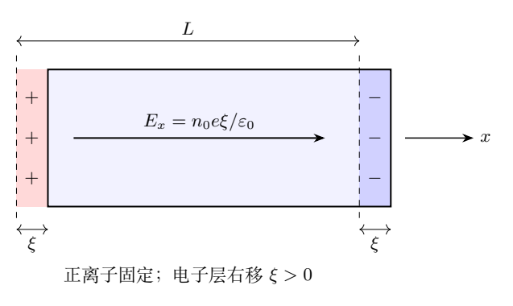
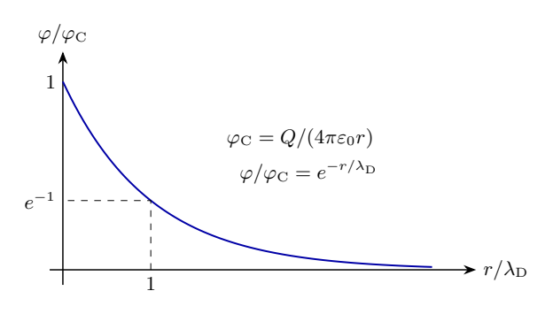
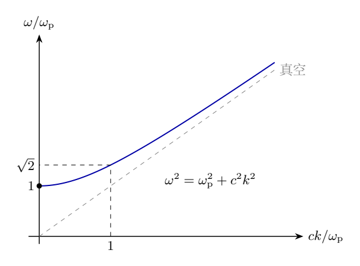

# 第 6 题　等离子体振荡、德拜屏蔽与电磁波传播

均匀等离子体由数密度均为 $n_0$ 的自由电子和带一个元电荷的正离子组成，未扰动时电中性。电子电荷为 $-e$、质量为 $m_{\rm e}$，$e>0$。正离子质量远大于电子，可视为固定的均匀背景。真空介电常量为 $\varepsilon_0$。

（1）沿 $x$ 取厚度 $L$ 的电子层，其横向尺度远大于 $L$。该层整体位移为 $\xi$，$|\xi|\ll L$，两侧出现厚度 $|\xi|$ 的净正、负电荷薄层。求两薄层之间的电场，并写出其中电子集体位移的方程，求振荡角频率 $\omega_{\rm p}$。

（2）在等离子体原点放入点电荷 $Q$，电子重新分布，产生球对称静电势 $\varphi(r)$。电子满足

$$
n(r)=n_0\exp\frac{e\varphi(r)}{k_{\rm B}T},\qquad
|e\varphi|\ll k_{\rm B}T,
$$

其中 $k_{\rm B}$ 为玻尔兹曼常量、$T$ 为绝对温度。

（2.1）求一阶近似下 $\delta n=n-n_0$ 与净电荷密度 $\rho_q(r)$。

（2.2）已知 $r>0$ 时满足

$$
\frac1r\frac{d^2(r\varphi)}{dr^2}=\frac{\varphi}{\lambda_{\rm D}^2},
\qquad \lambda_{\rm D}=\sqrt{-\frac{\varepsilon_0\varphi}{\rho_q}}.
$$

求德拜长度 $\lambda_{\rm D}$。

（2.3）求 $\varphi(r)$，讨论 $r\ll\lambda_{\rm D}$ 和 $r\gg\lambda_{\rm D}$ 的特点。提示：通解为

$$
\varphi=\frac{Ae^{-r/\lambda_{\rm D}}+Be^{r/\lambda_{\rm D}}}{r},
$$

近原点匹配 $\varphi\sim Q/(4\pi\varepsilon_0r)$，远处电势趋于零。

（3）角频率 $\omega$、波数 $k$ 的外部电磁波电场为 $\boldsymbol E=\boldsymbol E_0e^{-i\omega t+ikx}$。忽略碰撞，电子位移为 $\boldsymbol\eta(t)$，极化强度 $\boldsymbol P=-n_0e\boldsymbol\eta=\varepsilon_0[\varepsilon(\omega)-1]\boldsymbol E$。

（3.1）在给定位置取 $\boldsymbol\eta=\boldsymbol\eta_0e^{-i\omega t}$，求位移幅和相对介电函数，用 $\omega_{\rm p}$ 表示后者。

（3.2）利用 $k^2c^2=\varepsilon(\omega)\omega^2$，求色散关系与可传播角频率范围。

（3.3）取太阳风的量级 $n_0\sim10^7\,\mathrm{m^{-3}}$、$e\sim10^{-19}\,\mathrm C$、$m_{\rm e}\sim10^{-30}\,\mathrm{kg}$、$\varepsilon_0\sim10^{-11}\,\mathrm{F/m}$、$c\sim10^8\,\mathrm{m/s}$，估算可传播频率，与 $f_{\rm vis}\sim10^{14}\,\mathrm{Hz}$ 比较，判断对可见光是否透明，并从电子响应解释。本题45分。

## 一、题型定位

三问分别考查电子对内部位移、静态点电荷和周期外场的响应。它们共同由电子受电场作用建立模型，但涉及不同的时间尺度：集体自由振荡、热平衡静态屏蔽和受迫高频运动。

等离子体频率描述电子惯性响应，德拜长度描述热运动与静电聚集的竞争。不能把静态屏蔽的长度直接当成所有频率电磁波的衰减长度。

## 二、知识点

- 平行无限带电薄层间的场由高斯定理求得。
- 电子电荷为负，受到的力与电场方向相反。
- 电子的电势能为 $-e\varphi$，故玻尔兹曼因子为 $\exp(+e\varphi/k_{\rm B}T)$。
- 球对称拉普拉斯算子可写为 $(r\varphi)''/r$。
- 复振幅约定 $e^{-i\omega t}$ 下，二阶时间导数对应 $-\omega^2$。
- 传播要求实波数；虚波数给出倏逝场，空间衰减本身不等于碰撞吸收。
- 角频率与普通频率相差 $2\pi$。

## 三、物理图像

电子整体右移 $\xi>0$ 后，左端正电荷没有被电子抵消，右端电子超出正离子背景。薄层等效面电荷密度为 $\pm n_0e\xi$，场沿 $+x$，电子力沿 $-x$，构成恢复作用。

静态点电荷为正时，局部电势为正，电子聚集，诱导净电荷为负。这个负电荷云削弱远处场，屏蔽并不意味着所有位置的电场严格为零。

高频电场中，电子虽然仍受力，但位移幅随 $\omega^{-2}$ 减小，因此高频极化很弱，介电函数接近真空值。

## 四、解题入口

第（1）问由面电荷求场，再写单电子方程。第（2）问先展开电子密度，注意净电荷多一个 $-e$，再代入德拜长度定义并用两端边界选取常数。第（3）问从受迫运动求极化，把它与介电函数定义对照，最后判断 $k^2$ 的正负。

对点电荷的线性化结果，要明确区分线性方程的形式近原点边界，与弱势条件在实际空间中的适用范围。

## 五、解析

（1.1）位移引起的电场。

取单位横向面积，薄层净电荷分别为 $n_0e\xi$ 与 $-n_0e\xi$。每个无限薄层产生的场大小为 $|\sigma|/(2\varepsilon_0)$，在两层之间方向相同，相加得

$$
\boxed{\boldsymbol E=\frac{n_0e}{\varepsilon_0}\xi\,\hat{\boldsymbol x}.}
\tag{6.1}
$$

对 $\xi<0$，该有向表达式自动反号。薄层的有限厚度使薄层内部电场渐变；式（6.1）是两电荷分离区之间的主体区域电场，符合 $|\xi|/L\ll1$ 的集体位移近似。

（1.2）恢复运动和等离子体频率。

电子受力为 $-e\boldsymbol E$，所以

$$
m_{\rm e}\ddot\xi=-\frac{n_0e^2}{\varepsilon_0}\xi,
\qquad
\ddot\xi+\omega_{\rm p}^2\xi=0.
$$

得到

$$
\boxed{\omega_{\rm p}=\sqrt{\frac{n_0e^2}{m_{\rm e}\varepsilon_0}}.}
\tag{6.2}
$$

若初始位移、速度为 $\xi_0,u_0$，解为 $\xi=\xi_0\cos\omega_{\rm p}t+(u_0/\omega_{\rm p})\sin\omega_{\rm p}t$。频率与位移幅无关，是线性恢复场的结果。

量纲上，$e^2/\varepsilon_0$ 的单位为力乘长度平方，再乘数密度并除以质量得到 $\mathrm{s^{-2}}$，与角频率平方一致。

（2.1）密度与净电荷。

令 $z=e\varphi/(k_{\rm B}T)$，$|z|\ll1$，则 $e^z=1+z+O(z^2)$，故

$$
\boxed{\delta n(r)=\frac{n_0e}{k_{\rm B}T}\varphi(r).}
$$

正离子数密度保持 $n_0$，所以

$$
\rho_q=n_0e-en=-e\delta n,
\qquad
\boxed{\rho_q(r)=-\frac{n_0e^2}{k_{\rm B}T}\varphi(r).}
\tag{6.3}
$$

对 $Q>0$，$\varphi>0$、$\delta n>0$、$\rho_q<0$，与电子聚集的物理图像一致。

（2.2）德拜长度。

由题给定义，

$$
\lambda_{\rm D}^2=-\frac{\varepsilon_0\varphi}
{-n_0e^2\varphi/(k_{\rm B}T)}
=\frac{\varepsilon_0k_{\rm B}T}{n_0e^2}.
$$

故

$$
\boxed{\lambda_{\rm D}=\sqrt{\frac{\varepsilon_0k_{\rm B}T}{n_0e^2}}.}
\tag{6.4}
$$

定义中的负号不可遗漏：诱导电荷与电势异号，德拜长度应为正实数。在 $\varphi=0$ 的点，应把该比值理解为由线性响应系数定义的极限。

（2.3）求球对称屏蔽势。

令 $\psi=r\varphi$，则方程转化为

$$
\psi''=\frac{\psi}{\lambda_{\rm D}^2}.
$$

特征根为 $\pm1/\lambda_{\rm D}$，所以

$$
\psi=Ae^{-r/\lambda_{\rm D}}+Be^{r/\lambda_{\rm D}}.
$$

要求远处 $\varphi\to0$，指数增长项必须消失，即 $B=0$。形式近原点匹配要求

$$
\lim_{r\to0}r\varphi=\frac{Q}{4\pi\varepsilon_0},
$$

故 $A=Q/(4\pi\varepsilon_0)$。最终

$$
\boxed{\varphi(r)=\frac{Q}{4\pi\varepsilon_0r}e^{-r/\lambda_{\rm D}}.}
\tag{6.5}
$$

当 $r/\lambda_{\rm D}\ll1$，指数因子约为 $1-r/\lambda_{\rm D}$，势的首项为库仑势。当 $r/\lambda_{\rm D}\gg1$，相对库仑势被指数抑制，静电影响主要集中在德拜尺度附近。

必须同时检查弱势条件。对理想点电荷，$r\to0$ 时 $|\varphi|$ 发散，因而线性化不可能一直成立到原点。式（6.5）是题给线性方程的点源解，其近原点条件用于确定点源强度；实际弱扰动的使用区间应避开强势核心。

一个保守的尺度判断是 $r\gg r_*:=|eQ|/(4\pi\varepsilon_0k_{\rm B}T)$，使未屏蔽库仑势已满足弱势条件。若要同时讨论“近处仍近似库仑势”的实际线性区间，需要 $r_*\ll r\ll\lambda_{\rm D}$。若这样的区间不存在，需采用非线性密度响应描述核心，不能只靠线性公式外推。

（2.3续）用总电荷检查屏蔽。

将式（6.5）代入 $\rho_q=-\varepsilon_0\varphi/\lambda_{\rm D}^2$，得

$$
\rho_q(r)=-\frac{Q}{4\pi\lambda_{\rm D}^2r}e^{-r/\lambda_{\rm D}}.
$$

在线性点源模型内，诱导总电荷为

$$
Q_{\rm ind}=4\pi\int_0^\infty r^2\rho_q\,dr
=-\frac{Q}{\lambda_{\rm D}^2}\int_0^\infty re^{-r/\lambda_{\rm D}}dr.
$$

令 $u=r/\lambda_{\rm D}$，积分等于 $\lambda_{\rm D}^2\int_0^\infty ue^{-u}du=\lambda_{\rm D}^2$，故 $Q_{\rm ind}=-Q$。

电场为

$$
E_r=-\frac{d\varphi}{dr}
=\frac{Q}{4\pi\varepsilon_0r^2}
\left(1+\frac r{\lambda_{\rm D}}\right)e^{-r/\lambda_{\rm D}}.
$$

其对应的包围净电荷 $4\pi\varepsilon_0r^2E_r$ 在 $r\to\infty$ 时趋于零，符合整体屏蔽。

（3.1）电子位移与极化。

在固定位置，把电场局部幅度记为 $\boldsymbol E_0'$，电子满足

$$
m_{\rm e}\ddot{\boldsymbol\eta}=-e\boldsymbol E_0'e^{-i\omega t}.
$$

取稳态受迫解 $\boldsymbol\eta=\boldsymbol\eta_0e^{-i\omega t}$，代入得

$$
-m_{\rm e}\omega^2\boldsymbol\eta_0=-e\boldsymbol E_0',
\qquad
\boxed{\boldsymbol\eta_0=\frac{e}{m_{\rm e}\omega^2}\boldsymbol E_0'.}
$$

极化为

$$
\boldsymbol P=-n_0e\boldsymbol\eta
=-\frac{n_0e^2}{m_{\rm e}\omega^2}\boldsymbol E.
$$

与定义比较：

$$
\varepsilon_0[\varepsilon(\omega)-1]
=-\frac{n_0e^2}{m_{\rm e}\omega^2},
$$

所以

$$
\boxed{\varepsilon(\omega)=1-\frac{\omega_{\rm p}^2}{\omega^2}.}
\tag{6.6}
$$

电子位移与电场复幅同相，而极化与电场反相，与自由电子受迫运动方程的符号一致。这里是周期稳态解，任意自由漂移的齐次部分不属于介电响应幅。

（3.2）色散和传播范围。

代入题给色散式：

$$
k^2c^2=\omega^2-\omega_{\rm p}^2,
\qquad
\boxed{\omega^2=\omega_{\rm p}^2+c^2k^2.}
\tag{6.7}
$$

当 $\omega>\omega_{\rm p}$，$k$ 为实数，可形成传播波；当 $0<\omega<\omega_{\rm p}$，取向 $+x$ 衰减的根

$$
k=i\frac{\sqrt{\omega_{\rm p}^2-\omega^2}}c,
$$

场幅随 $x$ 指数衰减，特征长度为 $c/\sqrt{\omega_{\rm p}^2-\omega^2}$。在截止点 $\omega=\omega_{\rm p}$，$k=0$，不属于具有有限波数的普通传播状态。

本题忽略碰撞，介电函数为实数；低频场的倏逝来自传播条件不满足，不是电子碰撞把能量转化为热。有限厚度介质中的穿透还要由边界条件决定。

由式（6.7），相速度与群速度分别为

$$
v_{\rm ph}=\frac{\omega}{k}>c,\qquad
v_{\rm g}=\frac{d\omega}{dk}=\frac{c^2k}{\omega}<c.
$$

相速度大于 $c$ 不表示信号超光速；两者乘积为 $c^2$，可作为色散计算的检查。

（3.3）太阳风的频率量级。

按照题给量级：

$$
\omega_{\rm p}\sim
\sqrt{\frac{10^7(10^{-19})^2}{10^{-30}10^{-11}}}
=10^5\,\mathrm{s^{-1}}.
$$

因此普通截止频率

$$
f_{\rm p}=\frac{\omega_{\rm p}}{2\pi}\sim10^4\,\mathrm{Hz}.
$$

可见光 $f_{\rm vis}\sim10^{14}\,\mathrm{Hz}$ 远大于截止频率，满足传播条件。其介电函数偏离1的量级为

$$
\left|\varepsilon-1\right|
\sim\left(\frac{10^5}{2\pi\times10^{14}}\right)^2
\approx2.5\times10^{-20}.
$$

故在本题无磁场、无碰撞的稀薄等离子体模型中，太阳风对该可见光近似透明。电子仍受到快速交变电场作用，但位移响应幅按 $\omega^{-2}$ 很小，产生的极化不足以显著改变传播。

（4）从泊松方程重新建立屏蔽方程。

包含原点电荷时，电势满足

$$
\nabla^2\varphi
=-\frac{Q\delta^{(3)}(\boldsymbol r)+\rho_q}{\varepsilon_0}.
$$

用 $\rho_q=-\varepsilon_0\varphi/\lambda_{\rm D}^2$，得到

$$
\left(\nabla^2-\frac1{\lambda_{\rm D}^2}\right)\varphi
=-\frac Q{\varepsilon_0}\delta^{(3)}(\boldsymbol r).
$$

在 $r>0$，右端为零。球对称情况下，先写

$$
\nabla^2\varphi
=\frac1{r^2}\frac d{dr}\left(r^2\frac{d\varphi}{dr}\right)
=\varphi''+\frac2r\varphi'.
$$

令 $\psi=r\varphi$，逐项微分：

$$
\varphi'=\frac{\psi'}r-\frac{\psi}{r^2},\qquad
\varphi''=\frac{\psi''}r-\frac{2\psi'}{r^2}
+\frac{2\psi}{r^3}.
$$

两式组合后交叉项相消，得到 $\nabla^2\varphi=\psi''/r$，这才转化成常系数方程 $\psi''=\psi/\lambda_{\rm D}^2$。这里先排除原点，是因为点源的奇性不能当成普通函数直接代入局部微分式。

对包围原点的小球使用高斯定理，形式线性点源解的诱导电荷在小球内趋零，故

$$
-\lim_{r\to0}4\pi r^2\varphi'(r)=\frac Q{\varepsilon_0}.
$$

代入 $\varphi=Ae^{-r/\lambda_{\rm D}}/r$，左端为 $4\pi A$，又得 $A=Q/(4\pi\varepsilon_0)$。这由电通量明确了归一化，和先前近原点匹配的形式条件一致。

（5）计算任意半径内的屏蔽电荷。

诱导电荷云在半径 $r$ 内的总量为

$$
Q_{\rm ind}(<r)
=-\frac Q{\lambda_{\rm D}^2}
\int_0^r s e^{-s/\lambda_{\rm D}}\,ds.
$$

令 $u=s/\lambda_{\rm D}$，分部积分给出

$$
\int_0^x u e^{-u}\,du
=\big[-(u+1)e^{-u}\big]_0^x
=1-(1+x)e^{-x}.
$$

于是

$$
Q_{\rm ind}(<r)
=-Q\left[1-\left(1+\frac r{\lambda_{\rm D}}\right)
e^{-r/\lambda_{\rm D}}\right].
$$

点源与诱导云相加，半径 $r$ 内的净电荷为

$$
Q_{\rm net}(<r)=Q(1+x)e^{-x},\qquad x=\frac r{\lambda_{\rm D}}.
$$

这与电场计算的 $4\pi\varepsilon_0r^2E_r$ 完全相同。净电荷比例的导数为

$$
\frac d{dx}\big[(1+x)e^{-x}\big]=-xe^{-x}<0\quad(x>0).
$$

所以屏蔽是随半径逐渐积累的过程。$r=\lambda_{\rm D}$ 时，电势相对库仑势已降为 $e^{-1}$，但包围净电荷比例为 $2/e$；“屏蔽长度”不能解释为该半径外电荷已经全部抵消。两者分别描述势的比例与高斯通量的比例。

（6）由连续性方程理解纵向集体振荡。

为检查薄层模型的含义，取一维小位移场 $\xi(x,t)$。原长 $dx$ 的电子段变为 $[1+\partial_x\xi]dx$，粒子数守恒给出

$$
n_0dx=(n_0+\delta n)(1+\partial_x\xi)dx.
$$

丢掉两个小量的乘积，得到 $\delta n=-n_0\partial_x\xi$。固定正离子背景下，净电荷为

$$
\rho_q=-e\delta n=n_0e\,\partial_x\xi.
$$

高斯方程 $\partial_xE=\rho_q/\varepsilon_0$ 因此成为

$$
\partial_x\left(E-\frac{n_0e}{\varepsilon_0}\xi\right)=0.
$$

对于没有额外均匀场、波数非零的纵向扰动，空间常数项取零，故 $E=n_0e\xi/\varepsilon_0$。电子动力学随即给出

$$
\ddot\xi=-\frac e{m_{\rm e}}E=-\omega_{\rm p}^2\xi.
$$

这与整体薄层位移具有同一恢复频率。纵向冷电子模式中没有本题横向电磁波的 $c^2k^2$ 项，因为此处用的是电荷密度与纵向高斯场；不能把两类模式的传播方程混用。

（7）从麦克斯韦方程推出横向色散。

对均匀、非磁性介质中的横向波，$\boldsymbol k\cdot\boldsymbol E=0$。采用 $e^{-i\omega t}$，法拉第定律和安培定律分别给出

$$
\boldsymbol k\times\boldsymbol E=\omega\boldsymbol B,\qquad
\boldsymbol k\times\boldsymbol B
=-\omega\mu_0\varepsilon_0\varepsilon(\omega)\boldsymbol E.
$$

第一式再左乘 $\boldsymbol k\times$，利用三重积

$$
\boldsymbol k\times(\boldsymbol k\times\boldsymbol E)
=\boldsymbol k(\boldsymbol k\cdot\boldsymbol E)-k^2\boldsymbol E
=-k^2\boldsymbol E,
$$

便得到 $k^2c^2=\varepsilon(\omega)\omega^2$，其中 $c^{-2}=\mu_0\varepsilon_0$。色散式中的真空传播项来自磁场和位移电流，电子响应则通过 $\varepsilon(\omega)$ 进入。

在 $\omega>\omega_{\rm p}$ 时，

$$
\omega(k)=\sqrt{\omega_{\rm p}^2+c^2k^2},\qquad
\frac{d\omega}{dk}=\frac{c^2k}{\omega}.
$$

相位前进速率为 $\omega/k$，窄带波包的群速为 $d\omega/dk$；前者大于 $c$、后者小于 $c$，两者乘积为 $c^2$。截止附近 $k\to0$，群速趋零，而相速形式上很大。相速不等于信号前沿速度，不能由它判断超光速传递。

静态屏蔽与动态截止还可用

$$
\lambda_{\rm D}\omega_{\rm p}
=\sqrt{\frac{k_{\rm B}T}{m_{\rm e}}}
$$

联系起来：右端是此处定义的单方向热速度尺度。电子热运动在约一个集体响应时间内跨过的距离，与德拜尺度同量级。这是一种尺度解释，静态屏蔽势和横向倏逝长度仍具有不同方程与边界条件。

## 六、关键洞察

由式（6.2）与（6.4）可得 $\lambda_{\rm D}\omega_{\rm p}=\sqrt{k_{\rm B}T/m_{\rm e}}$。左侧把静态屏蔽尺度和动态响应时间联系起来，右侧是电子的热速度尺度。

点源线性解在原点形式上带有库仑奇点，不等于弱势假设在原点成立。物理上说明实际应用区间，与数学上用点源归一化常数，应分别交代。

## 七、易错点

- 在正电荷电势下写成电子减少，错用玻尔兹曼指数的符号。
- 把 $\delta n$ 当成净电荷密度，漏掉 $-e$。
- 丢掉德拜长度定义的负号，得到虚长度。
- 将指数增长解保留，违反远处边界。
- 对 $e^{-i\omega t}$ 求二阶导数时丢掉负号。
- 把 $\omega_{\rm p}$ 直接当作以赫兹计的截止频率。
- 将倏逝等同于吸收，或以相速度大于光速判断信号超光速。

## 八、课堂讲解建议

三问都先画电荷与位移方向，再写方程。第（1）问用两薄层各自的场相加，明确为什么不是 $\sigma/(2\varepsilon_0)$。第（2）问让学生检查正电势对应的电子势能下降。

第（3）问保持复振幅约定一致，依次写位移、极化、介电函数和色散关系。用图6-3解释实波数、截止和虚波数，最后再作太阳风数量级计算。将“电子无法响应”解释为“响应幅很小”，避免形成电子完全不受力的印象。

## 九、变式训练

### 变式1　密度与温度的缩放

把数密度增为原来的4倍，温度增为原来的9倍。求等离子体频率、德拜长度和二者乘积的变化。

**解答。** 从动力学式得 $\omega_{\rm p}\propto\sqrt{n_0}$，故增为2倍。由静态响应 $\lambda_{\rm D}\propto\sqrt{T/n_0}$，故增为 $3/2$ 倍。

两者乘积增为3倍，等于热速度 $\sqrt{k_{\rm B}T/m_{\rm e}}$ 的变化。可见增加密度同时提高振荡频率和加强静态屏蔽，增加温度则削弱电子聚集而增大屏蔽长度。

### 变式2　正离子也参与静态屏蔽

静态时正离子可移动，其温度为 $T_i$，电子温度为 $T_e$；未扰动时两者密度均为 $n_0$。求总德拜长度。

**解答。** 电子势能为 $-e\varphi$，离子势能为 $+e\varphi$，因此一阶响应为

$$
\delta n_e=\frac{n_0e\varphi}{k_{\rm B}T_e},\qquad
\delta n_i=-\frac{n_0e\varphi}{k_{\rm B}T_i}.
$$

净电荷为 $e\delta n_i-e\delta n_e$，即

$$
\rho_q=-\frac{n_0e^2\varphi}{k_{\rm B}}
\left(\frac1{T_e}+\frac1{T_i}\right).
$$

故

$$
\frac1{\lambda^2}=\frac{n_0e^2}{\varepsilon_0k_{\rm B}}
\left(\frac1{T_e}+\frac1{T_i}\right).
$$

若两温度相等，总德拜长度为仅电子响应时的 $1/\sqrt2$。这是静态平衡问题，不能据此把原题高频电子振荡的质量直接改成离子质量。

### 变式3　指定频率的传播与衰减

分别取 $\omega=\sqrt2\omega_{\rm p}$ 和 $\omega=\omega_{\rm p}/2$。求前者的波数、相速度与群速度，后者的场衰减长度。

**解答。** 第一种情况 $c^2k^2=\omega_{\rm p}^2$，所以

$$
k=\frac{\omega_{\rm p}}c,\quad
v_{\rm ph}=\sqrt2c,\quad v_{\rm g}=\frac c{\sqrt2}.
$$

第二种情况 $k^2=-3\omega_{\rm p}^2/(4c^2)$。选择向右衰减的根，场为 $e^{-\sqrt3\omega_{\rm p}x/(2c)}$，衰减长度

$$
\ell=\frac{2c}{\sqrt3\omega_{\rm p}}.
$$

两结论分别来自实根与虚根；不能把第二种情况也套进实相速度表达式。

### 变式4　加入碰撞阻尼

把电子运动改为 $m_{\rm e}(\ddot{\boldsymbol\eta}+\nu\dot{\boldsymbol\eta})=-e\boldsymbol E$，$\nu>0$。求介电函数和电导率，并检查无碰撞与低频极限。

**解答。** 用相同的 $e^{-i\omega t}$ 约定，

$$
(-\omega^2-i\nu\omega)m_{\rm e}\boldsymbol\eta_0=-e\boldsymbol E_0,
\qquad
\boldsymbol\eta_0=\frac{e\boldsymbol E_0}
{m_{\rm e}\omega(\omega+i\nu)}.
$$

故

$$
\varepsilon(\omega)=1-\frac{\omega_{\rm p}^2}{\omega(\omega+i\nu)}.
$$

其虚部为 $\omega_{\rm p}^2\nu/[\omega(\omega^2+\nu^2)]>0$，对应该时间约定下的耗散响应。电流密度为 $\boldsymbol J=-n_0e\dot{\boldsymbol\eta}$，于是

$$
\sigma(\omega)=\frac{n_0e^2}{m_{\rm e}(\nu-i\omega)}.
$$

$\nu\to0$ 恢复原介电函数；$\omega\to0$ 时 $\sigma\to n_0e^2/(m_{\rm e}\nu)$，为正的直流电导率。与原题不同，这时传播或倏逝之外还存在真实碰撞吸收。
